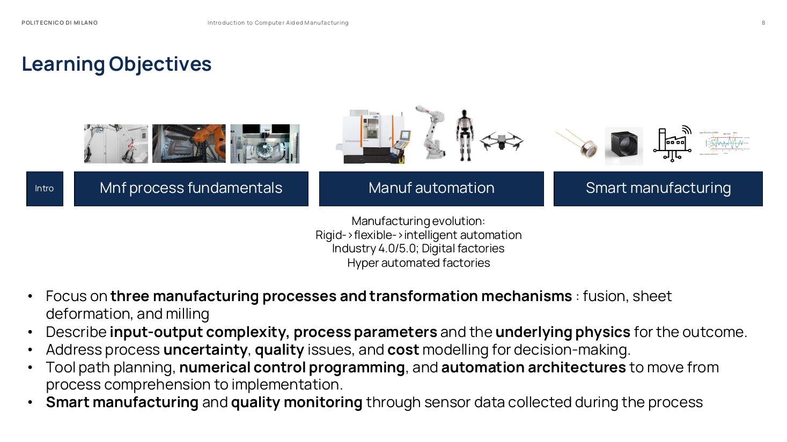
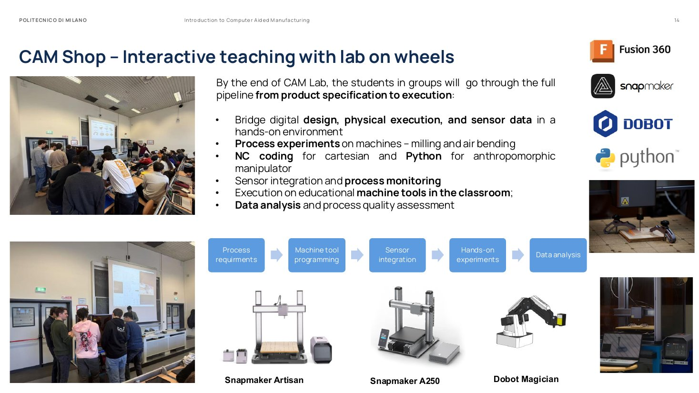

# L0.0 Introduction to CAM

> Part of the CAM study guide. Source of truth: [the study guide](https://claude.ai/artifact/WrGc96ueegSH8ZXZdT4FaB). Generated by `tools/build_guide.py`; edit the guide, not this file.

## Slides and professor's explanations (exam material)

Automation matters in manufacturing because the market demands two opposite things at once: **near-zero defects at high volume** and **fast product changes**. CAM gives control engineers the link between the virtual world (calculation, simulation) and the physical process. *(Recording: 14 Sep, morning, first hour.)*

### Why automate? The chair example

- **Productivity** goes up, so cost per part goes down.
- **Repeatability:** you cannot expect 10,000 identical good parts. The first parts during set-up may be faulty, and process **uncertainty** shows up as **quality** problems.
- A scrapped part costs money; a faulty part **sold to the market** costs much more (recalls, lost customer trust).
- **Flexibility:** a phone takes about 1.5–2 years from design to market, a car about 5. If the automation can't follow product changes, you lose competitiveness.
- Target **good** quality, not maximum quality: maximum quality means higher cost.

### Two historical figures (slide 3)

- **Sakichi Toyoda** (Toyota founder): a loom line where a **thread breaks if a part is faulty**, so the line stops instead of mounting the bad part. His point: this is not just automated but **intelligent manufacturing** — "a thread would do what software does today".
- **Walter Shewhart** (Bell Labs, chip making): **embrace variability**. You cannot make 10,000 identical good parts, so observe and measure the sources of variability and combine that with process physics to reduce them. This is the root of statistical quality control.

**Exam alert:** the course aims to make manufacturing **more intelligent** (Toyoda) and to **tackle variability** (Shewhart). Use these two names as the frame for the whole course.

### The four videos (slides 4–7) = the three process families of the course

| Video | Question | What he said |
| --- | --- | --- |
| DMG Mori (milling) | Can I check my process digitally before running it? | High-end manufacturing is run in the digital platform first: 5-axis machine (X, Y, Z + 2 rotations), collision checks, even the measurement cycle is simulated. |
| Machina Labs (sheet metal) | 3D parts from sheet without dedicated dies? | Two robots (6 DOF + 1 linear axis each) press the sheet in small increments: **flexible** instead of dedicated automation, since a die is expensive and slow to make. |
| BLM (laser welding) | Can a robot work autonomously? | Today someone programs the robot for every new part, and every physical part sits slightly off. Future: the machine finds the weld itself via machine vision / AI seam tracking. |
| Dark factory | — | Fully automated plant; humans do intellectual work only. Strong economic pressure on speed and resources. |

**Numbers to remember:** an industrial 6-DOF robot positions to about **1 mm** (about 0.5 mm if well calibrated); a human hair is about **70 µm**. Whether 1 mm is good "depends on what you're manufacturing". For the sheet-forming robots it would be disastrous, so you need **closed-loop** control of where the part and actuators are.

### Industrial revolutions

1. Steam power (1800s, Britain/Netherlands).
2. **Production line** (Henry Ford, inspired by a slaughterhouse line).
3. **Electronics** (1970s): computation, robotics.
4. **Industry 4.0** (\~2010): **sensing and data**. "Fourth one is where we are today, and fourth one is this course."
5. **Industry 5.0** (today): putting the **human back** in the system. Example: nobody wants to be a welder, but you can program a collaborative robot to weld.

### Course map (slide 8)

Intro → **process fundamentals** (3 families: melting/fusion, plastic deformation, chip removal; for each, physics + simplest model + automation and monitoring needs) → **manufacturing automation** (Cartesian systems, anthropomorphic robots, humanoids, drones) → **smart manufacturing** (sensor data, statistics, input–output link to improve the process). Textbooks: Groover, *Fundamentals of Modern Manufacturing* and *Automation, Production Systems and CIM*.

## Professor background (less exam-critical)

He started from a classroom chair: made in thousands to tens of thousands a year, never by hand. Know the **order of magnitude** of volumes, not exact numbers ("we change numbers by a logarithmic scale").

**Class discussion — which engineering resources must you take care of?** Materials, energy, machines/software, **human beings** (manpower *and* knowledge) and **land**. He added that AI data centres also use land and cooling water.

**Class discussion — what is new compared to CAM in the 1980s?** NC dates from the 1950s and CAM from the 1980s. New today: far more computing power, **wireless communication** (code no longer sent over a long cable), and **sensors on the machine**, which means much more **process data**. Plus AI to learn from that data.

**Class discussion — do robots steal jobs?** In Europe, automation keeps manufacturing **alive**: labour is expensive, costs must be cut, and nobody wants the hard jobs. New jobs become more qualified.

## Practice exercises

*No dedicated exercise. All formulas: [formula sheet](../formula-sheet.md).*

## Likely oral questions

- **Why is manufacturing still important if its share of GDP is falling?** Absolute output still grows; one manufacturing job creates up to about 4 service jobs. Italy is 2nd in Europe, with a surplus in machinery (+73 bn€). Automation keeps manufacturing alive in high-labour-cost countries (Industry 4.0 = data, 5.0 = human back in the loop).
- **Toyoda and Shewhart: what do they teach?** Toyoda: a thread breaks and stops the line on a faulty part, so intelligent manufacturing ("a thread doing what software does today"). Shewhart: accept variability, measure it, reduce its sources, the basis of quality monitoring. The course's two goals: make manufacturing intelligent, and tackle variability.
- **Also prepare:** the full CAM Lab and CAM Shop workflow (process requirements → machine programming in Fusion 360 / NC code for the Snapmaker, Python for the Dobot → sensor integration → experiments → data analysis). It is explicitly part of the oral.
