# L1.1 Manufacturing and automation – introduction

> Part of the CAM study guide. Source of truth: [the study guide](https://claude.ai/artifact/WrGc96ueegSH8ZXZdT4FaB). Generated by `tools/build_guide.py`; edit the guide, not this file.

## Slides and professor's explanations (exam material)

The choice between **fixed, programmable and flexible automation** depends on **how many parts** and **how many variants** you need. Control and optimisation always need a **model of the process**, and no model is perfect. *(Recordings: 14 Sep morning, second half, and 14 Sep afternoon.)*

**Exam alert:** "Distinguish between fixed, programmable and flexible automation. This is probably one important concept that you need to take home — a simple link between quality, cost and flexibility."

### Definitions

- **Manufacturing** (*manus* + *factus*, "made by hand"): today the set of **controlled physical transformations** that turn raw materials into parts and products, by manual or automated labour.
- **Manufacturing system:** workers + equipment doing processing and assembly.
- **Manufacturing cell:** a small system, one machine or a small group, doing one or more operations on a part.
- **Production line:** an ordered sequence of machines/workstations; the product moves through processing, handling, inspection and assembly.
- **Automation** (slide 11): **mechanisation** replaces human *power* (muscle); **robotisation** replaces human *manipulation*; **computerisation** replaces human *intelligence*. Automation also makes output more predictable: a technician works differently in the morning and on a hot afternoon.

### Class discussion — the coin line (U.S. Mint, slide 4)

Sequence: melting & casting → rolling → coil weighing → annealing → cleaning → cladding → rolling to blank thickness → blanking → riddling → annealing & cleaning → upsetting → coining (stamping) → inspection → weighing → counting & bagging. **Weighing steps** check for material lost by evaporation (melting) or scrap (deformation). **Annealing** = heating to restore malleability after deformation ("manufacturing is the kitchen of the industry").

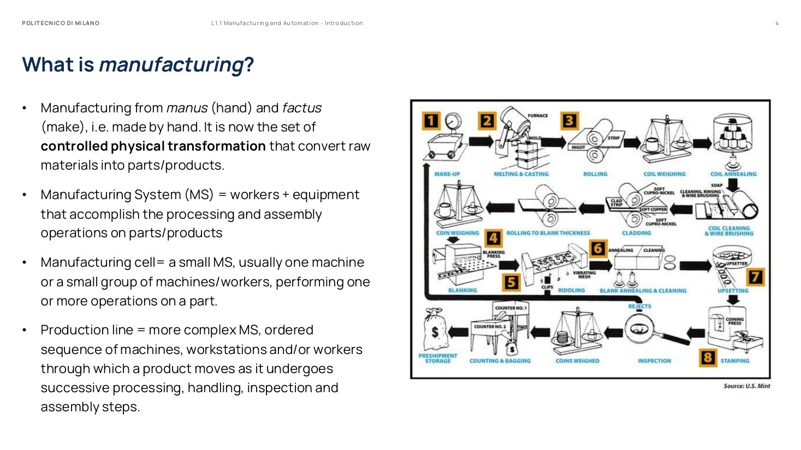

| Where | What to automate | What to control |
| --- | --- | --- |
| Casting | Pouring (the metal is hot and dangerous) | Flow speed, volume, **temperature** (too hot wastes energy, too cold won't cast) |
| Weighing | Electronic scales, cameras to count | The coin is worth more than its metal, so weight must be checked |
| Blanking | Conveyors feeding the press | — |
| Coining (most critical) | Press + automated inspection | **Force** and **stroke**: too low gives no imprint, too high damages the coin |

### The production system (slide 5)

- **Factory level**, read bottom-up: manufacturing processes and assembly ← automation & control technologies + material handling technologies → manufacturing systems.
- **Enterprise level:** manufacturing support systems (planning, design, scheduling, production management, **CAD/CAM**).
- **Quality control systems** span both levels: faulty parts are caught in the factory, but the enterprise must check that released parts still conform and what the market still wants.

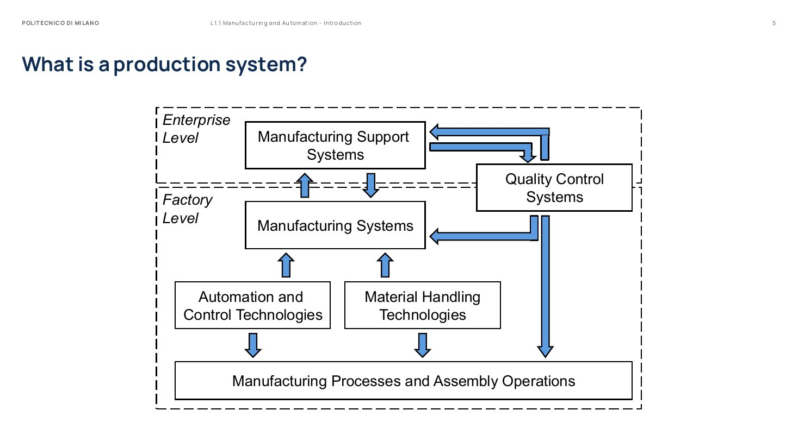

### Classification of processes (slide 6)

- **Processing operations**
  - *Shaping:* **solidification** (liquid fills a cavity; additive), particulate processing (powder pressed + heated), **deformation** (solid state; volume in = volume out), **material removal** (solid state; subtractive). The course covers the three in bold.
  - *Property enhancing:* heat treatment. Class example: clear ice needs air removed and **slow solidification**, because the cooling rate changes the crystal structure and so the mechanical properties.
  - *Surface processing:* cleaning (subtractive), coating/deposition (additive). Needed for mating tolerances, corrosion protection, biomedical implants (the body may reject a bad surface), semiconductors (flatness).
- **Assembly operations:** joining (welding: both parts melted locally; brazing/soldering: only the filler melts, lower temperature; adhesive bonding) or mechanical fastening (bolts, rivets).

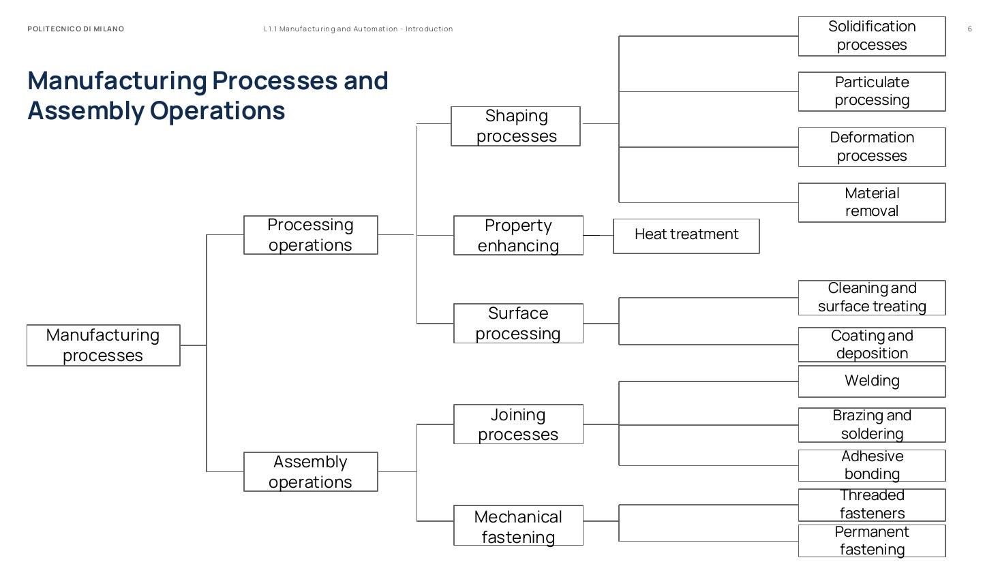

### Manufacturing in the economy (slides 7–10)

- Manufacturing's **share** of GDP is falling (EU about 15%, China about 25%) due to outsourcing, international competition and rich countries consuming more services. Italy: 27% of the workforce around 1970, about 15–16% today.
- But total GDP is growing, so manufacturing output still grows. **One manufacturing job generates up to about 4 service jobs** (retail, transport, software, after-sales).
- Italy: **2nd manufacturing economy in Europe**, 8th in the world (1.8%). Strength = specialisation, quality, design, know-how. Trade surplus 2023: automation & machinery +73 bn€, food & beverage +32, fashion +29, furniture & appliances +15. Europe's industrial "golden belt": UK (Milton Keynes) → Belgium/Netherlands → Baden-Württemberg → Lombardy/Piedmont.
- **Key drivers of competitiveness:** product (function & quality, reliability, cost & delivery, sustainability); **process** (cycle time, yield, flexibility, labour productivity, energy & capital, utilisation); supply chain (stable access to materials, skills, logistics, data); innovation (prototype → scaled production, manufacturing readiness).

**Class discussion — does a factory that produces nothing spend money?** Yes: people, land, energy (heating), running the company. Fixed costs exist anyway, so a shorter **cycle time** directly lowers **cost per part**. Yield = sellable parts / parts made. Flexibility example: the yogurt maker who decides to put 10% more yogurt in each cup — can the machine handle it?

### Levels of automation (slide 15)

Enterprise (corporate information system) → plant (production system) → cell/system (groups of machines) → machine (individual machines) → device (sensors, actuators). **Exam alert:** the data flow is **bidirectional** — neither purely top-down commands nor purely bottom-up data.

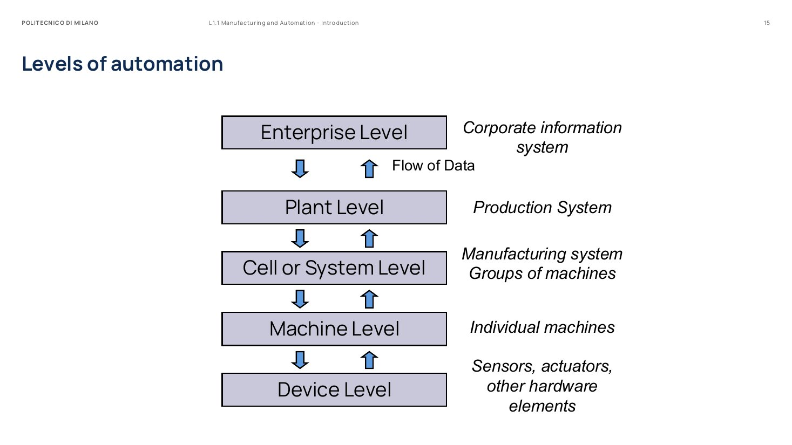

- **Device** — which sensor for which process? Casting: **temperature**. Milling: **position** readout, then velocity (first derivative) and acceleration; accelerometers give **force** (F = m·a).
- **Cell** — material flow between machines: too many parts cause congestion, too few leave machine 2 idle.
- **Plant** — scheduling, resource allocation, **maintenance** (things wear out; stop before catastrophic failure), quality management.

### Fixed vs programmable vs flexible automation

|  | Fixed (dedicated) | Programmable | Flexible |
| --- | --- | --- | --- |
| Characteristics | Fixed process/assembly sequence; simple operations integrated into a complex system | Sequence controlled by a **program**; can be changed; requires **changeover** | Mixed product variants; medium volume; continuous production of a variable mix |
| Investment | High: **custom-engineered** equipment and dedicated tooling | High: **general-purpose** machines, cheap standard tools | High: **custom-engineered system** |
| Rate | High | Lower | Medium |
| Product change | Relatively inflexible | Flexible to variation | Flexible to design variation, with minimal interruption |
| Application | Very large quantities, high rates (automotive) | **Batch** production, low–medium volume (F1, aerospace, custom implants) | Batch, low–medium volume, part families |
| Examples | Machining transfer lines, assembly machines, continuous-motion assembly, high-precision machining | **NC machine tools, industrial robots, PLCs** | Flexible manufacturing cells (FMC) and systems (FMS) |

**Fixed — Tesla Model Y rear underbody (Giga casting).** Class discussion: "how is it made?" Students guessed sheet-metal deformation, which is the traditional way: many stamped parts plus assembly and sub-assembly. Tesla instead **die-casts it as one part** (liquid aluminium injected into a die) and aims for the whole body structure in about three castings (rear, front, centre). The press is made in Italy near Brescia (Idra); 36 million impressions of the video in a month. Changing the part means a **new die**, which must be manufactured, and the swap stops production for days. Automotive downtime costs millions of euros per day. **Transfer lines** (deep-drawing press lines) are the other fixed example.

**Exam alert — dies and moulds:** the press can be reused, but the die is dedicated and expensive, the result of extensive engineering. It is **intellectual property**, often owned by the design authority (e.g. Tesla), even when someone else builds it: "if I gave you my tool, potentially you can copy what I did".

**Programmable — 50 customised gears** milled on a CNC machine. The geometry changes by **writing a new program**; tools are standard and can be replaced in minutes. The gear could also be made by casting + machining, deformation or sintering, but for 50 parts you don't buy dedicated equipment. "It is not really a game of cost, it is a game of how many I need." Fixed = cars sold by the hundreds of thousands; programmable = a gear for next week's Grand Prix.

**Class discussion — robot milling vs Cartesian machine (slide 23).** The robot has a larger reach, so it can work on large parts such as composite moulds. But it is slower because: (1) a straight line needs six motors working together, while a linear axis needs one or two; (2) the robot arm is **compliant**, so cutting forces deflect it, and going faster means higher forces and more power. It was cutting wood, not metal. "Robot without any load will move fast, robot trying to cut cannot move fast" — this is the **link between motion and process dynamics** (position x → velocity x′ → forces).

**Class discussion — fixed or programmable for drilling 10 holes in an engine block (slide 24)?** It depends on **(1) the number of parts** (many → fixed multi-spindle head; few → programmable CNC) and **(2) the number of variants** (many → programmable). **Exam alert — don't assume fixed is always faster or cheaper.** First compute the real cycle time, since drilling 10 holes at once generates large forces, and the dedicated tooling may cost more. The market wants everything cheap, customised and "for yesterday", so you must handle variability and cost together.

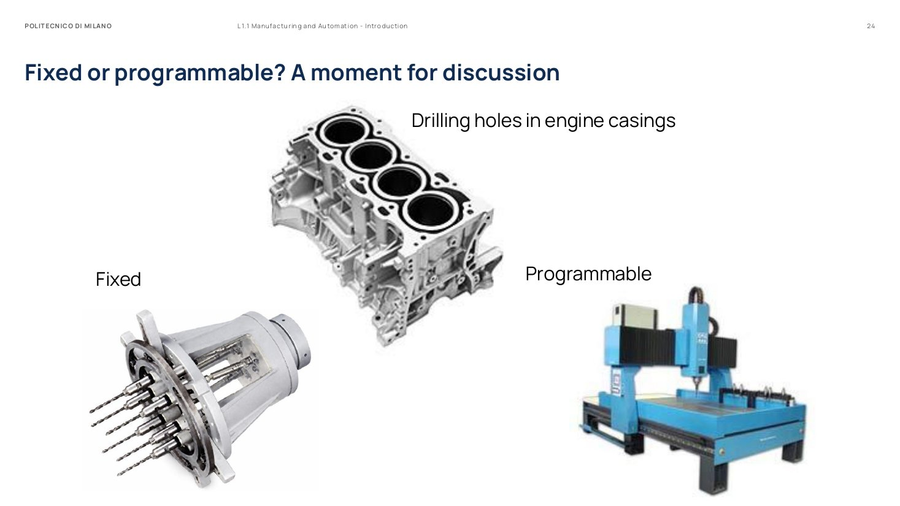

He drew the classic chart (from Groover): **parts per year vs number of variants**. Fixed = few variants, very high volume; programmable = many variants, small batches (roughly 10–100 parts); flexible in between (roughly 1,000–10,000).

**Flexible — Haas EC-400 with pallet pool (slide 27).** The machine changes not only its own tools but also the **workpiece**, through a pallet changer: you load one part while another is machined. The automation challenge is the right position at the right time; any positioning error ruins the part, so **fixtures** must be high quality. **Programmable vs flexible (slide 28):** a general-purpose machine (Mikron) handles only the process. A flexible cell also handles loading, placement and unloading, with several stations (milling, drilling, turning) linked by a transfer system for a **family of similar parts**. It is more productive but less able to change design instantly.

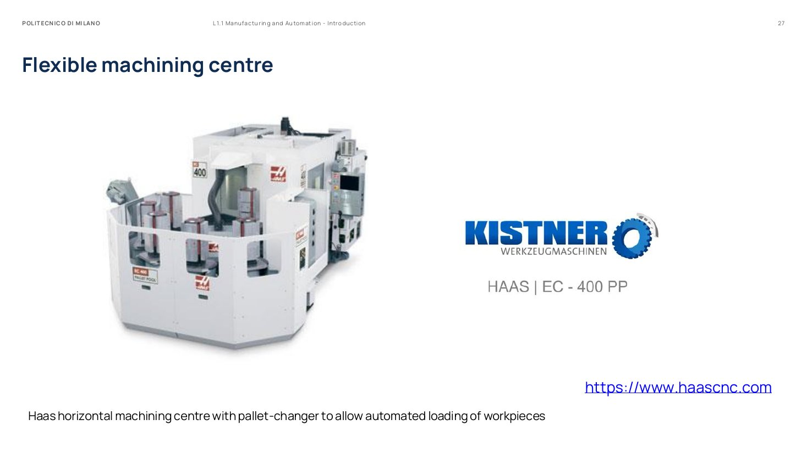

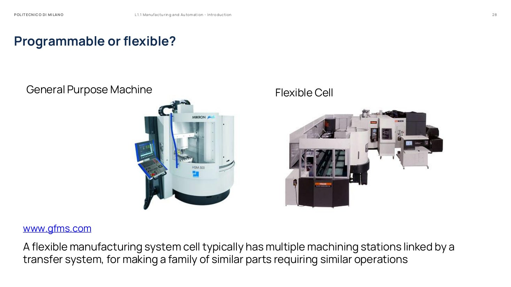

### Process models for control (slides 29–32)

The control pyramid, bottom to top: **process regulation** → **supervisory control** → operations optimisation → production scheduling → business planning. Going up, scope and impact grow; going down, **information fidelity** grows.

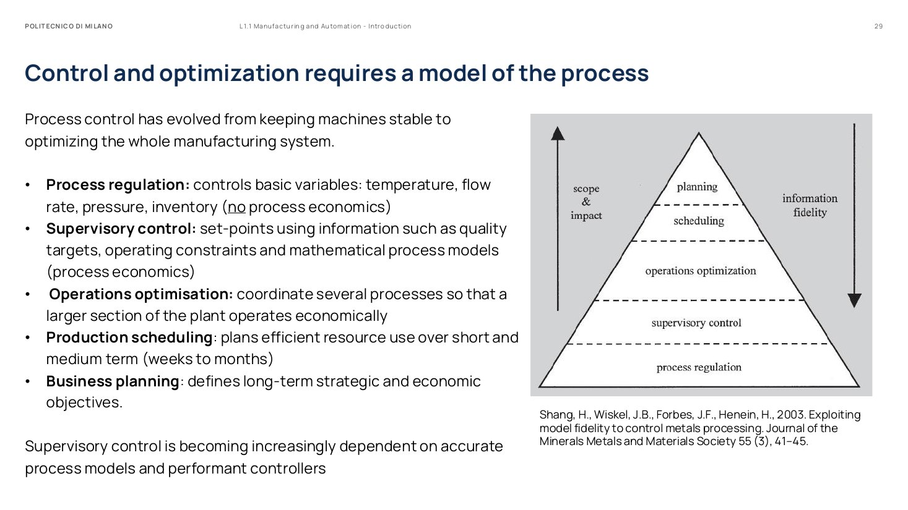

- **Process regulation:** basic variables (temperature, flow, pressure, inventory, tool velocity), with **no process economics**.
- **Supervisory control:** chooses **set-points** using quality targets, constraints and **mathematical process models**. His example: not "keep feed at 500 mm/min" but "which feed rate meets the quality target **without excessive tool wear**?"
- **Operations optimisation:** several processes, so a larger part of the plant runs economically. **Scheduling:** weeks to months. **Planning:** long-term strategy.
- **Exam alert:** "Supervisory control is becoming increasingly dependent on accurate process models." If force matters in milling, you need a model that **predicts the force**: force = cutting pressure × chip area, and chip area depends on the parameters you choose (see L1.5).

**Which kind of model?** Slide 30 example: the spindle power and vibration rise — is it tool wear, chatter, more friction, a temperature rise or a change in material? To optimise you must predict how the process responds to a change in conditions.

- **Physics-based:** from conservation laws and process mechanisms (analytical or numerical).
- **Data-driven:** learned from measured data; useful when data are abundant and first-principles modelling is hard.
- **Hybrid:** physics + data-driven corrections; often the most attractive for industrial supervisory control.

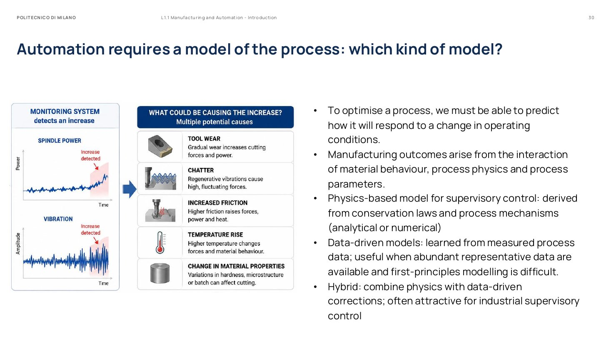

**No process model is perfect (slide 31):**

|  | Model errors | Disturbances |
| --- | --- | --- |
| What | Uncertainty in using the model, e.g. the tool–workpiece interface evolves (friction coefficient depends on pressure, temperature, speed) | Everything beyond what the model should predict |
| Affected by the control signal? | **Yes** | **No** |
| Examples | Friction coefficient varying 0.09–0.145 | Springback / post-processing after the main action; unexpected interruptions |

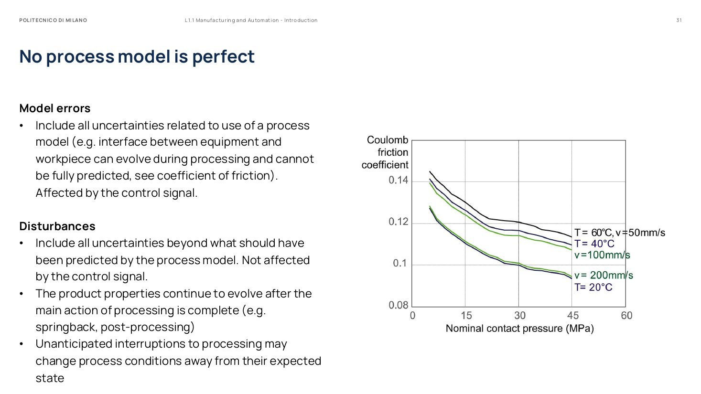

**Physical process vs digital model (slide 32, Allwood et al. 2016):** schedule planner (target zᵣ → input u) → \[equipment ↔ interface ↔ workpiece\], exchanging positions/angles (x, θ) and forces/heat (t, q) → post-process → product property z. A **process model** runs in parallel; its mismatch Δₚ, plus disturbances dₚ and dₚₚ, explains why **equipment sensors** and **product sensors** are needed to close the loop.

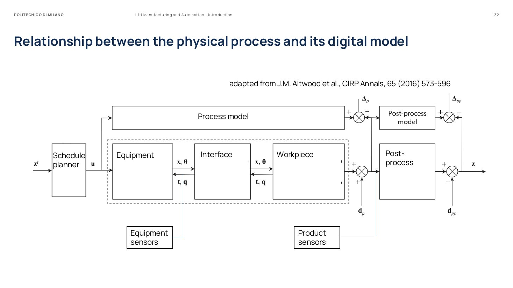

**What he added in class about models:**

- **History:** low computing power, so physical models were "our best guess" → then sensors, so monitoring without a physical model ("it vibrates more, maybe change the tool" = **data-driven**: rising spindle power is linked to tool wear) → today, high computing power + widespread sensors, so **hybrid**. Example: the cutting force is pressure × area, but the cutting pressure usually comes from tabulated data. In a hybrid model you **compute the force online from machine-sensor data** instead.
- **Model error example:** friction force = normal force × friction coefficient ("high-school physics"). The model is easy to use, but the coefficient **drops as the system heats up** and depends on contact pressure and speed, so the simple model is not fully representative. Unexpected obstacles that raise or lower friction are **disturbances**. "This is why today we model, we verify, and we keep the system under control."
- The "interface" in the block diagram is **how you talk to the machine**: the programming language, the touchscreen.
- Each operation (including post-processing such as surface finishing) is a **small closed loop**: equipment and product sensors measure how far you deviate from requirements. You use that to **improve the process model** or to **change the process plan**.
- **Exam alert — gear example:** if the process model predicts a tolerance but the gear **always comes out smaller**, you can make the designed geometry bigger so it comes out right, i.e. **compensate a systematic, modelled error**.

## Professor background (less exam-critical)

*No background comments for this chapter.*

## Practice exercises

*No dedicated exercise. All formulas: [formula sheet](../formula-sheet.md).*

## Likely oral questions

- **Fixed, programmable or flexible automation: how do you choose?** By parts per year and number of variants. Fixed: high investment in custom equipment and dedicated tooling, high rate, inflexible (Giga casting; the die is IP). Programmable: general-purpose machines, a program changes the sequence, changeover needed, batch/low-medium volume (CNC, robots, PLCs; the 50 gears). Flexible: a custom system handling a mix of variants with minimal interruption (FMC/FMS, pallet changers). Then add his warning: fixed is **not automatically faster or cheaper** — compute the cycle time (forces) and the tooling cost (engine-block drilling example).
- **Why is a robot slower than a CNC machine at milling?** A straight line needs 6 coordinated motors instead of 1–2 linear axes, and the arm is compliant, so cutting forces deflect it. Faster means more force and power. Repeatability is about 1 mm vs micrometres. It is used for large, soft parts (composite moulds). This is the link between motion and process dynamics.
- **Model errors vs disturbances?** Model errors are uncertainty inside the model and are affected by the control signal (the friction coefficient changes with temperature and pressure). Disturbances lie outside the model and are not affected by the control (springback, interruptions, operator die-open time). Hence the need for sensors and closed loop, and for feedforward on measured disturbances (casting MPC).
- **Physics-based, data-driven or hybrid model?** Physics = conservation laws (Bernoulli, Rosenthal, k\_c). Data-driven = learned from measurements when physics is hard (power rise means tool wear). Hybrid = physics + data corrections, e.g. computing the force online from machine sensors instead of tabulated k\_c; most attractive for supervisory control.
- **Explain the control pyramid.** Process regulation (temperature, flow, speed; no economics) → supervisory control (set-points from quality targets + process models: which feed meets the quality without excessive tool wear?) → operations optimisation → scheduling → planning. Fidelity rises downwards, scope upwards. Supervisory control increasingly depends on accurate models.
- **Levels of automation and data flow?** Device → machine → cell → plant → enterprise; bidirectional. Give one example per level (temperature sensor in casting; CNC; material flow between machines; scheduling and maintenance; business planning).
