# L1.2 Transformation by solidification – casting

> Part of the CAM study guide. Source of truth: [the study guide](https://claude.ai/artifact/WrGc96ueegSH8ZXZdT4FaB). Generated by `tools/build_guide.py`; edit the guide, not this file.

## Slides and professor's explanations (exam material)

Every casting process solves two coupled problems: **fill the cavity before the flow freezes**, and **remove heat so the part solidifies in the right sequence**. Sand casting is gravity-driven in an insulating mould; die casting is pressure-driven in a conductive permanent die. *(Slides + recordings of 15 Sep morning and the start of 16 Sep, which covers the MPC example.)*

### What casting is

Sequence: pattern/mould making → melt preparation → mould filling → solidification/cooling → removal/breakout → secondary processing.

Why it matters strategically: huge size range (zipper teeth to a 10 m ship propeller); a vast number of castable alloys; EU sector of €31 bn, 2,300+ companies, about 138,000 workers; automotive is the largest customer by tonnage; circular economy (80–90% scrap input). Casting suits **complex parts, reasonably high melting-point materials, both large and small**.

- **Prof — melting temperatures decide everything** ("our fundamental parameter is temperature"). Approximate values: **steel about 1500 °C**, Ni alloys about 1350 °C, **Al about 660 °C**, Mg about 630 °C, **Zn about 400 °C**. The mould must withstand the melt: you can cast Al in a steel die, but not steel in steel ("they weld together"). Say "aluminium **alloy**", "steel", never "iron".

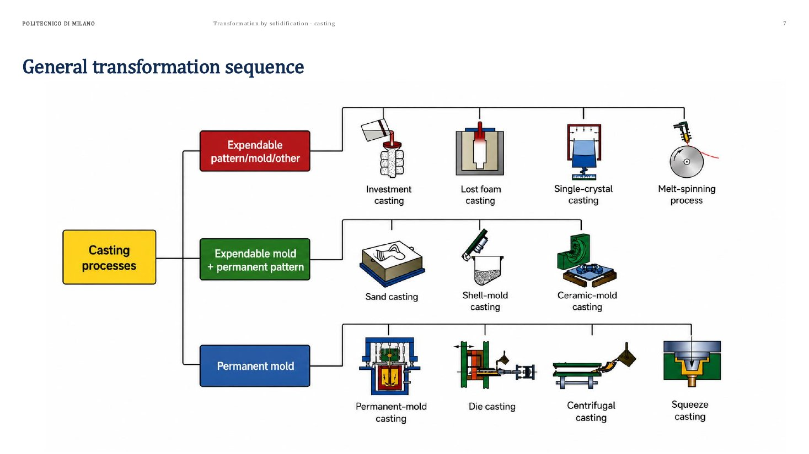

### The three processes

|  | Sand casting | Die casting | Investment casting |
| --- | --- | --- | --- |
| Mould | Disposable, compacted refractory sand; pattern = outside, **cores** = internal passages; **cope** (top) + **drag** (bottom) along a parting line | Permanent metal die (tool steel) | Ceramic shell built on a **wax pattern** tree, dewaxed and fired |
| Filling | Gravity, through the gating system | **Pressure** (up to 1000 MPa) | Gravity into a preheated shell (vacuum/pressure/centrifugal possible) |
| Surface Ra | 6.3–25 µm, so post-machining needed | 0.8–3.2 µm | Fine detail |
| Tooling cost | Low, very common, large parts | High, so high volumes | Medium |
| Cycle | Labour-intensive, long | Fast (die removes heat quickly) | Long (shell building) |
| Notes | 3D-printed moulds/cores allow previously impossible shapes | Die suffers thermal cycling, pressure, erosion, corrosion; steel choice, cooling layout, maintenance are central | Shell knock-out, cut from tree |

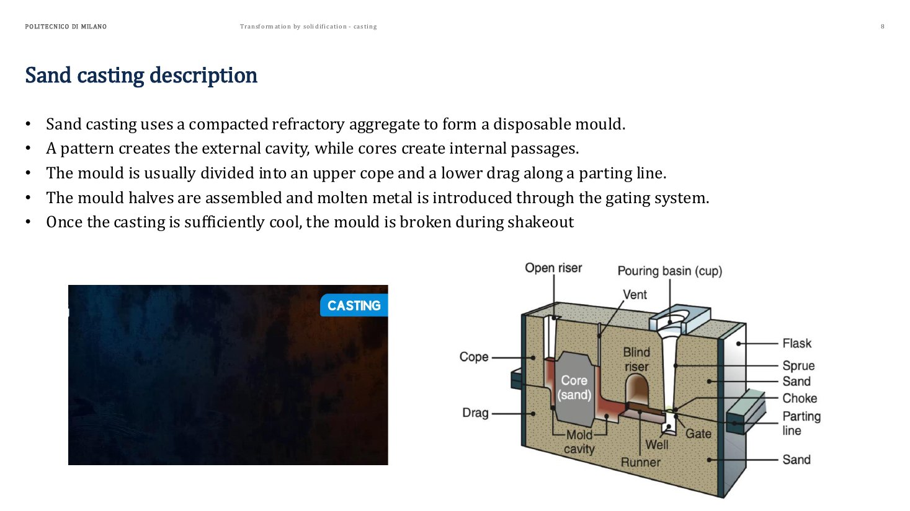

- **Prof — why sand casting is gravity casting:** sand doesn't melt (it vitrifies above about 3000 °C), so it withstands any melt, but it **can't withstand force**. The metal is never pushed in; the speed comes only from potential energy, so it is **set by the mould design** (sprue height). A **matte surface** tells you a part was sand cast. "Almost everything starts in casting", then gets machined.
- **Prof — automation needs:** make the mould every cycle (it's broken each time); bring the melt to the pouring station; pour at the right time and volume (too slow and it freezes, too fast and it damages the mould); extract; recirculate sand; extract fumes and dust. Molten Al about 700 °C, steel about double, and even the **radiation** harms operators.

**Die-casting machines:** **cold chamber** = metal is ladled or dosed into a separate shot sleeve, then a plunger drives it in (**Al alloys**; the Giga Press is the largest cold-chamber machine, see the Tesla example in L1.1). **Hot chamber** = gooseneck and injection cylinder immersed in the melt, fast filling (**Zn, Mg alloys**).

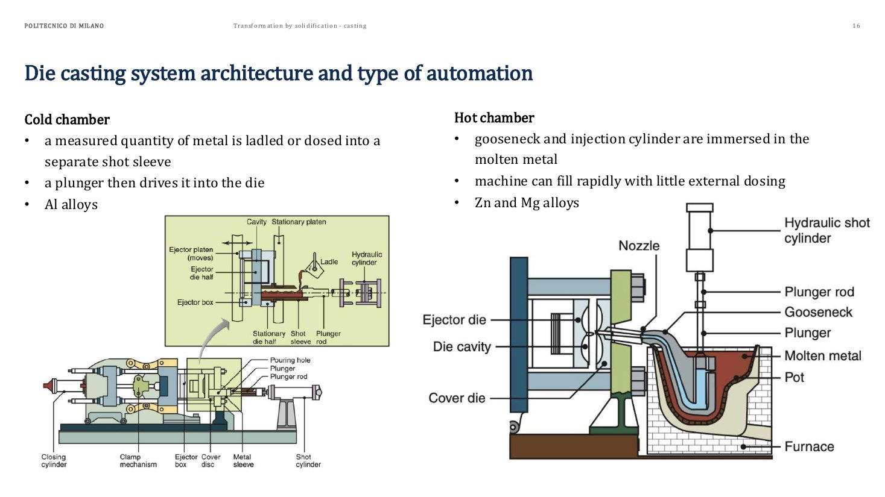

- **Prof — die casting:** "die" = permanent; pressure makes it faster and pushes the air out. The die is **steel**, so Al, Mg, Zn. The die wears (thermal cycling, erosion), so the **part geometry drifts**, "always an automation and control opportunity". **Cold chamber** (Al): a ladle doses each shot, slower, less wear, more precise. **Hot chamber** (Zn, Mg): a gooseneck sits in the pot, more automatable, but more wear. Classic small parts: belt buckles, electronics housings, **matchbox toy cars**.
- **Class discussion — how do you make the die and the pattern?** Only 1–10 dies are needed, so **programmable automation: mill it from a block** (or cast + machine if huge). Patterns: plastic, wood or metal, also milled (or 3D-printed, which is flexible). **Exam alert:** this is process selection by "how many do I need?" (L1.1).

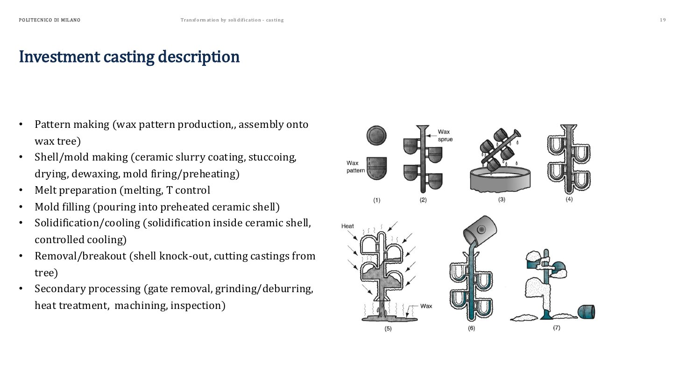

### Automation in casting

- **Sand — material handling:** conveyors (belt, bucket, roller, pallet, monorail, overhead), cranes, trucks, robots. Less manual carrying and waiting, less damage to fragile moulds and cores, less exposure to hot metal.
- **Sand — moulding and cores:** automated sand preparation (moisture, binder, temperature, mixing time); high-pressure moulding machines; core blowers and robot insertion.
- **Sand — pouring, shakeout, environment:** automatic pouring controls metal mass, stream position and timing; shakeout feeds sand reclamation; dust/fume extraction.
- **Die casting:** automation targets **cycle time**. **Investment casting:** robots dip the wax trees into the slurry.

### Physics: what goes wrong

- **Filling:** liquid velocity too high gives turbulence and gas entrapment; too slow gives regions of isolated liquid.
- **Solidification:** the wrong sequence gives shrinkage porosity, plus effects on microstructure and residual stress.

* **Prof:** too slow means freezing and incomplete filling; too fast means **turbulence, entrapped air, porosity**. Metals **shrink** when they solidify, and uneven thick/thin sections give residual stress and bending. The course models **filling only**, not solidification.

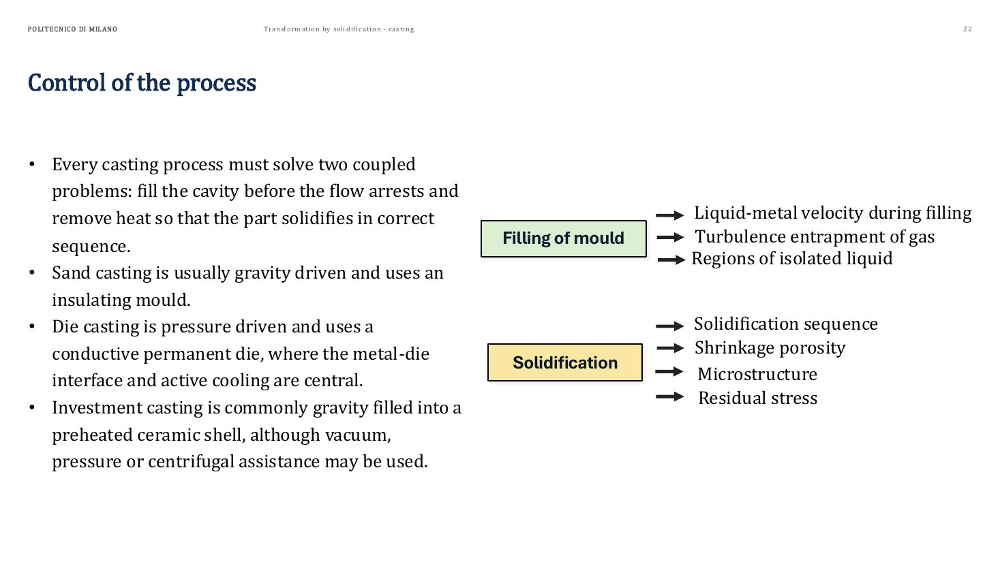

### Model 1 — gravity pouring (sand casting)

Bernoulli between two points of the gating system:

```math
P_1 + \tfrac{1}{2}\rho v_1^2 + \rho g h_1 - \Delta P_{loss} = P_2 + \tfrac{1}{2}\rho v_2^2 + \rho g h_2
```

Atmospheric pressure at both points, no friction, top of sprue (v₁ = 0, h₁ = h) to base (h₂ = 0):

```math
v = \sqrt{2 g h}
```

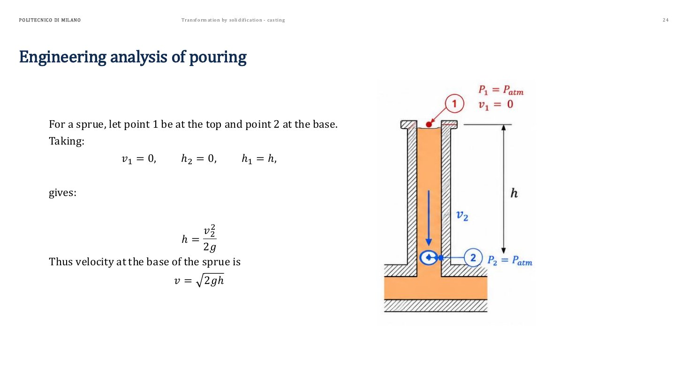

Continuity (incompressible): Q = A v = constant, so A₁v₁ = A₂v₂. The metal speeds up as it falls, so **the sprue must be tapered**, narrower at the base. Otherwise the stream separates from the wall and aspirates air.

Mould filling time for cavity volume V:

```math
T_{MF} = \frac{V}{Q} = \frac{V}{A\sqrt{2gh}}
```

This is a **theoretical minimum**: it neglects friction, changes of direction, contractions and expansions, turbulence, losses in runners and gates, and partial obstruction.

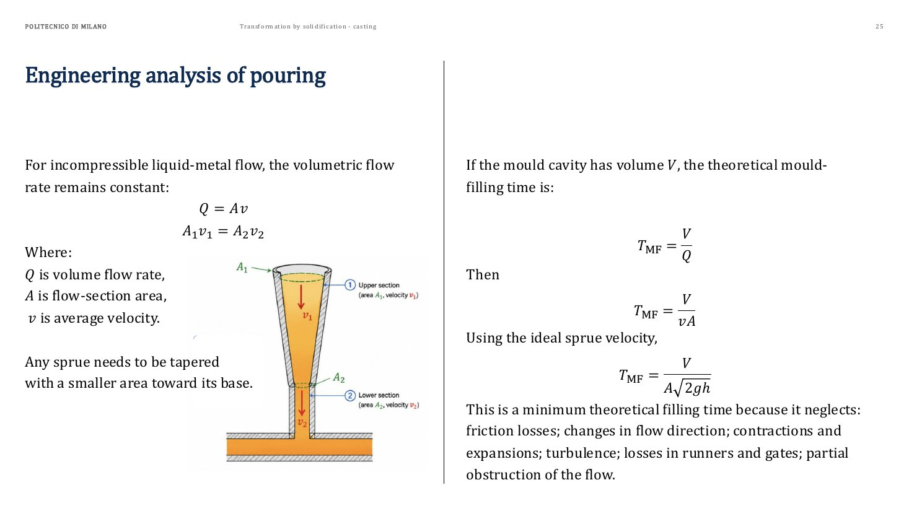

**Worked example (slide 26):** sprue 20 cm long, base area 2.5 cm², cavity 1560 cm³. v = √(2 · 981 · 20) = **198.1 cm/s**; Q = 2.5 · 198.1 = **495.3 cm³/s**; T\_MF = 1560 / 495.3 = **3.15 s ≈ 3.2 s**. Watch the units: g = 981 cm/s² when lengths are in cm.

- **Prof:** derived on the blackboard: higher speed means a **taller sprue** (within design limits). **Exam alert:** "I ask students to **draw** during the oral exams", so be ready to sketch the sprue and gating. On 3.2 s: "is this a lot?" It depends on the volume, and cooling time comes on top; die casting fills the same cavity in **under a second**.

### Model 2 — pressure filling (die casting)

The driving term is the injection pressure ΔP\_inj = P\_shot − P\_cavity. Neglecting losses, with discharge coefficient C\_d:

```math
v_g = C_d\sqrt{\frac{2\,\Delta P_{inj}}{\rho}} \qquad t_{fill} = \frac{V_{cavity}}{A_g C_d \sqrt{2\Delta P_{inj}/\rho}}
```

Plunger continuity: A\_p v\_p = A\_g v\_g, so v\_g = (A\_p / A\_g) v\_p. **Small gate sections produce very high gate velocities.** Die casting must fill very fast, before the metal loses heat to the die.

- **Prof:** in die casting **losses can't be neglected but are hard to measure**, hence C\_d < 1. In practice you **control force/plunger velocity**, not pressure: a large plunger area pushed slowly through a small gate gives high gate velocity, "this is how pumps work".

### Process control example — MPC for low-pressure die casting of Al wheels (Maijer et al., 2009)

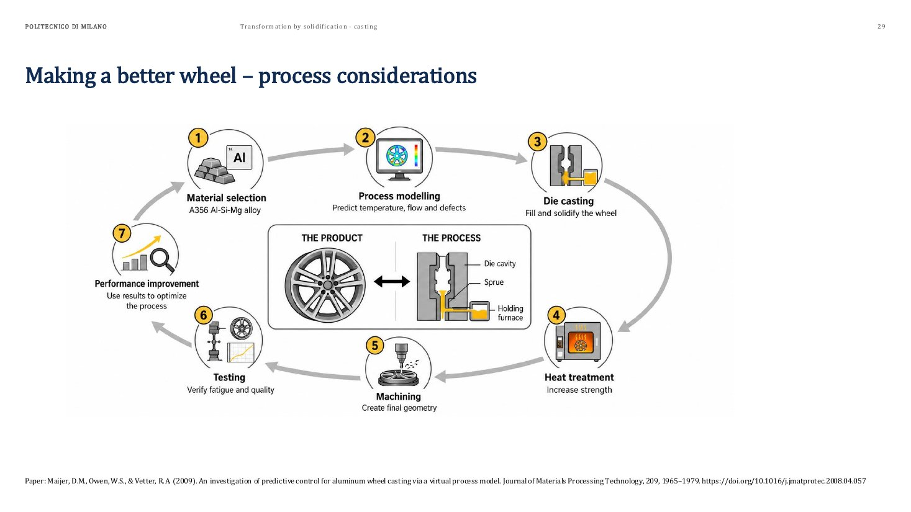

- **Problem:** recipes (die-close time, cooling durations, pressure, ejection time) run **open-loop**. That works only if the environment is perfectly repeatable, but furnace temperature drifts, coatings age, filters load, operators extend die-open time, cooling flow changes, and the die heats up from start-up to steady cycling.
- **Why not use the detailed model directly:** the 3D FE thermal model is too expensive for real time. Instead, run **virtual bump tests** on it (step each input from nominal, hold the others, run 100 cycles to reveal gains, delays and time constants), then identify a **reduced-order discrete state-space model** with **N4SID** (system identification). That model is ready for MPC.
- **Sampling instant = one casting cycle k**; the model predicts next-cycle temperatures.
- **Controlled outputs:** PV1–PV3 = **maximum-cycle die temperature** of the bottom, top and side die (one target per cycle instead of tracking within the cycle). Rationale: macro-shrinkage comes from **liquid encapsulation**; if die temperatures near the critical region repeat the optimal cycle, the solidification path repeats.
- **Manipulated inputs:** CV1 bottom-die cooling duration, CV2 top-die cooling duration, CV3 die-closed time.
- **Measured disturbances (feedforward):** FF1 incoming metal temperature, FF2 die-open time (operator-dependent).

* **Prof (16 Sep):** casting → heat treatment → machining → sample testing → field data is "a **very slow loop**"; with a model and in-process data you get quality without waiting for testing. Recipes are often set "based on pure experience". A 20 °C summer–winter difference is about **3% of the Al melting temperature**. Dies age, filters load, **operators get tired**. Some disturbances are impossible to control (outside temperature), others we **prefer not to** (humidity).
* **Prof:** "if your simulation takes two days, the humidity has already changed", hence reduced models. **One wheel = one data point**: a million wheels a year is a rich data set. **Proxy:** you can't put a sensor in the melt, so you measure the **die** (peak about 545 °C), one max per cycle; today you can analyse the **whole temperature profile**. Detecting a bad part is already a gain; ideally you **intervene** (e.g. pour hotter if a point reads low). Virtual experiments also allow **offline optimisation**.
* **Exam alert:** "The perfect process may not happen, not because of lack of engineering competence, but because there are disturbances from the outside."

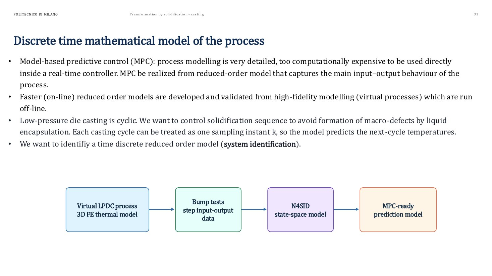

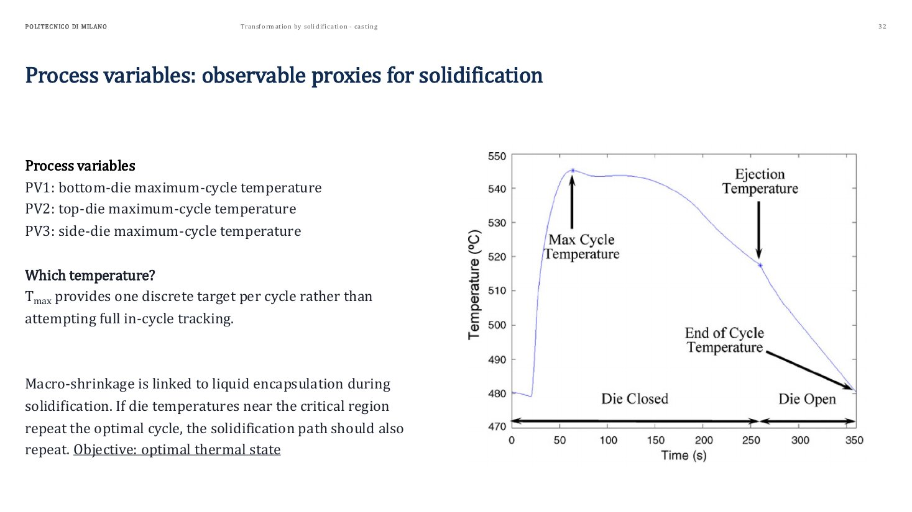

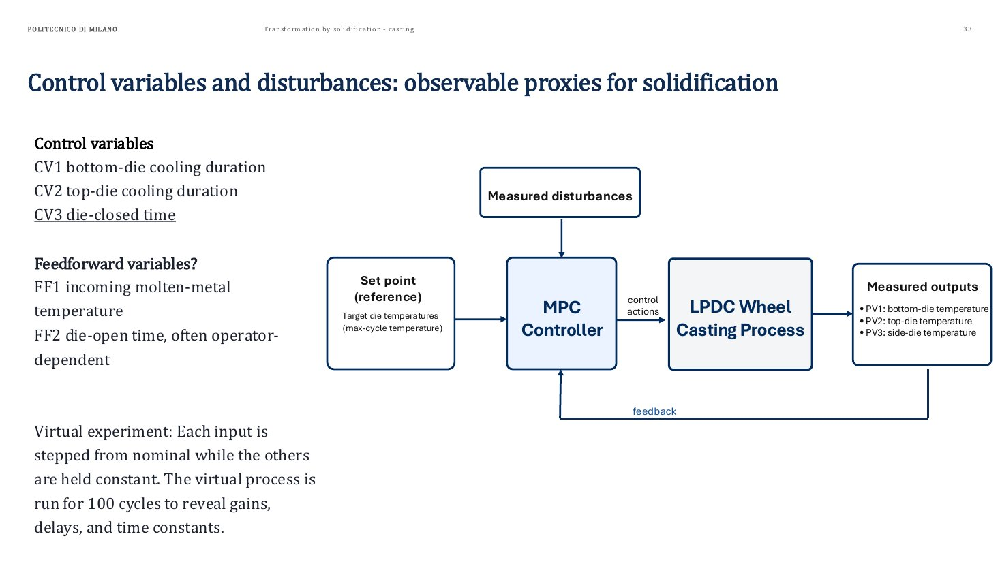

```math
x(k+1) = A\,x(k) + B_{cv}\,u_{cv}(k) + B_{ff}\,u_{ff}(k), \qquad y(k) = C\,x(k)
```

A = natural thermal evolution from one cycle to the next; B\_cv = effect of the control variables; B\_ff = effect of the measured disturbances; C maps internal states to the measured die temperatures.

**Exam link:** this is the L1.1 control pyramid in practice. A high-fidelity model is used offline, a reduced model online, sensors close the loop, and disturbances are handled by feedforward.

## Professor background (less exam-critical)

- **Prof — metal choice (engineering culture, not asked in the oral):** steel = benchmark ("steel makes the world go round"); Al = light; Ti = light and strong (aerospace, implants, costly); Cu = conductivity (wires); Ni = high temperature (turbines); Mg = lightest but highly reactive ("if it catches fire, you leave it to burn").
- **Prof — mould families:** expendable mould + expendable pattern (investment); expendable mould + permanent pattern (sand, shell, ceramic); permanent mould (die, centrifugal for tubes, squeeze). Permanent = metal dies, so mostly low-melting alloys. Melting makes casting **recycling-friendly** (up to 90% scrap).
- **Prof — vocabulary:** pouring basin → sprue → runner → gate → cavity; **riser** feeds **solidification shrinkage**. **Mould = negative of the part; pattern = positive; core = negative of the internal cavity.** Sand needs **binders**.
- **Prof — engine-block foundry video (Al):** automated sand dosing; robots handle sand cores "delicately" so they don't break "until the time they should"; cores dried, measured, trimmed; metal rising to the top = **complete filling**; gases escaping (the cavity was full of air). An aluminium engine is probably a performance vehicle.
- **Prof — Giga casting control:** a car-sized part needs temperature, speed **and** pressure controlled at many points, so the whole machine is sensorised (pressure at several die locations).
- **Prof — investment casting:** the goal is good finish **and** high-melting alloys. Wax tree → ceramic slurry → furnace (wax out, ceramic baked) → gravity pour. Almost any metal, fine detail, e.g. **turbine blades**.
- **Class discussion — why not ceramic dies?** Ceramics are fragile under injection pressure, and a big ceramic die is a chicken-and-egg problem and too expensive. A ceramic coating on a metal die combines both.

## Practice exercises

### A. Sprue design (inverse of the slide example)

Same mould (h = 20 cm, V = 1560 cm³), but you want T\_MF = 2 s. Required base area? v = 198.1 cm/s as before, so A = V / (T·v) = 1560 / (2 · 198.1) = **3.94 cm²**. A shorter fill time needs a larger section (or a taller sprue).

### B. Die casting

Plunger area 20 cm² moving at 2 m/s, gate 1 cm², cavity 400 cm³. v\_g = (20/1)·2 = **40 m/s**. Q = 20·10⁻⁴ · 2 = 4·10⁻³ m³/s, so t\_fill = 400·10⁻⁶ / 4·10⁻³ = **0.1 s** (compare 3 s for gravity sand casting).

All formulas: [formula sheet](../formula-sheet.md).

## Likely oral questions

- **How would you control die casting?** Open-loop recipes fail because of drifts (furnace, coatings, operator, warm-up). The FE model is too slow, so run virtual bump tests and identify a reduced state-space model (N4SID) with one sample per cycle. Outputs: max-cycle die temperatures. Inputs: cooling durations, die-closed time. Feedforward: metal temperature, die-open time. MPC keeps the solidification path the same, avoiding liquid encapsulation and shrinkage.
- **Why taper the sprue?** Continuity: the metal accelerates as it falls (v = √2gh), so A must shrink to keep Q constant. Otherwise the stream separates and aspirates air (gas defects). And why is T\_MF a minimum? It ignores friction, turbulence and gate losses.
