# L1.3 Transformation by fusion welding

> Part of the CAM study guide. Source of truth: [the study guide](https://claude.ai/artifact/WrGc96ueegSH8ZXZdT4FaB). Generated by `tools/build_guide.py`; edit the guide, not this file.

## Slides and professor's explanations (exam material)

**Power density decides whether a heat source melts, does nothing, or drills**: too low and heat conducts away; too high and the metal vaporises. Laser welding runs in **conduction** mode (< 10⁶ W/cm², wide and shallow) or **keyhole** mode (> 10⁶ W/cm², narrow and deep). *(Slides + recording of 16 Sep afternoon.)*

### Joining and welding

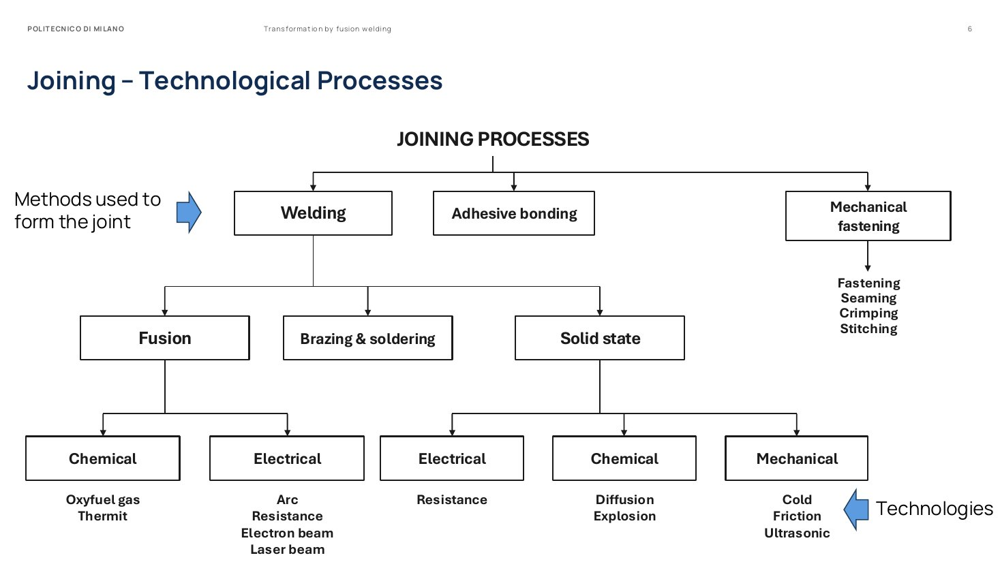

- **Joining** = fastening components into a continuous form or unit. An ideal design has no joints (joints are local weaknesses), but joining is needed for **manufacturability** and/or **functionality** (the four design goals: manufacturability, functionality, cost, aesthetics).
- Families: welding, brazing & soldering, adhesive bonding, mechanical fastening (also seaming, crimping, stitching).
- **Welding** = atoms brought close enough to form primary bonds, by heat and/or pressure; the result is a **weldment**.
- **Fusion welding:** both parts melted, sometimes with filler. No filler = **autogenous** weld. Examples: arc, oxyfuel, resistance spot (strictly not fusion), laser, electron beam.
- **Solid-state welding:** heat/pressure, no melting, no filler (forge, diffusion, friction).

* **Class discussion — which zone is strongest?** Usually the **fusion zone** (cools fastest), then the base metal; the **HAZ is weakest**, so a good weld breaks **near the HAZ**. Smaller seam = smaller HAZ = usually safer.

### Heat sources

| Process | Power density (W/mm²) | Notes |
| --- | --- | --- |
| Oxyfuel | 10 | Fuel-gas combustion |
| Arc | 50 | Plasma 8,000–20,000 K; overall ≈ 10⁸ W/m² |
| Resistance | 1,000 | Spot and seam welding |
| Laser beam | 9,000 | 10⁹–10¹¹ W/m² |
| Electron beam | 10,000 |  |

**Arc welding:** the power source sets a voltage between electrode and workpiece; touch and withdraw to strike the arc. Current flows through an ionised gas (**plasma**); arc temperatures > 5500 °C. **More heat is generated at the anode**, because electrons are much lighter and faster than ions. The weld pool solidifies behind the moving electrode to form the bead.

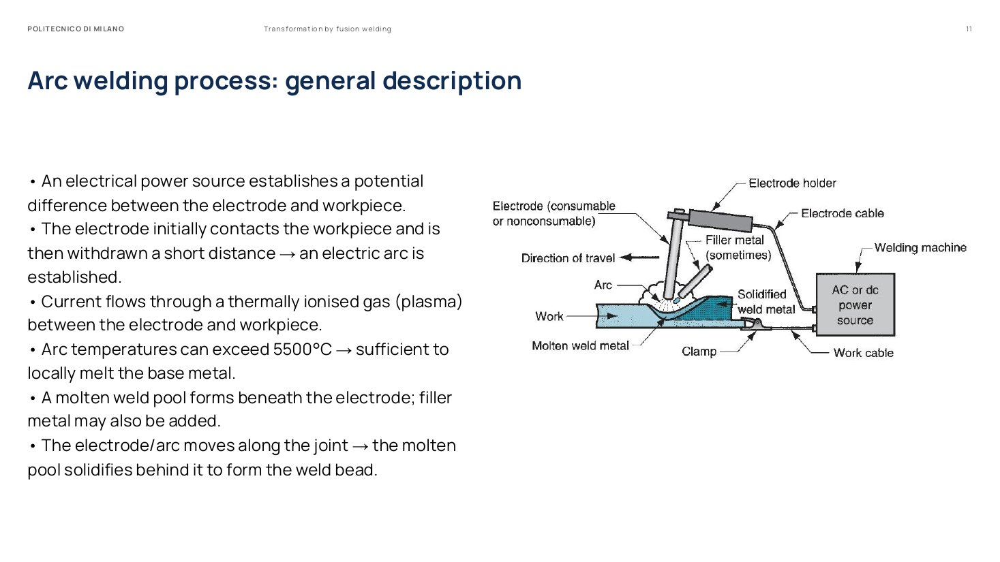

|  | Manual metal arc | TIG | MIG/MAG |
| --- | --- | --- | --- |
| Electrode | Consumable (coated) | **Non-consumable** W | Consumable wire = filler |
| Shielding | None (coating) | Ar, He (inert) | Ar, He (MIG, inert) / CO₂ mixes (MAG, active) |
| Current | 10–500 A | 200–500 A | 500 A |
| Voltage | 17–45 V | 55 V | 16–30 V |
| Spatter / distortion | High / large | Low / smaller | Low / smaller |

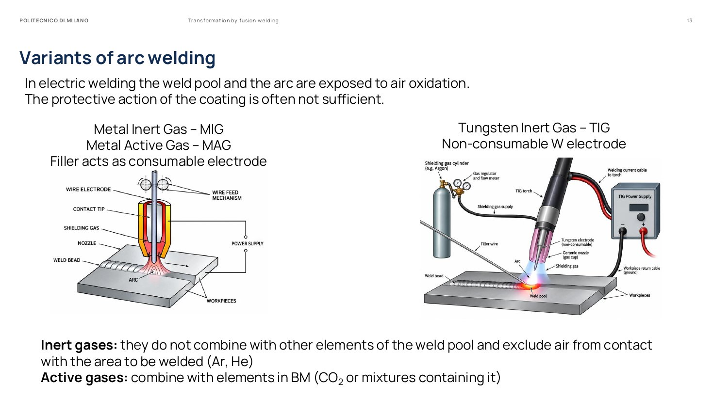

**Inert** gases do not combine with the weld pool and exclude air; **active** gases react with the base metal.

```latex
P = I\,V \qquad PD = \frac{\eta P}{\pi d_s^2/4} \qquad d_s \approx 10\text{–}20\ \text{mm (arc size ≈ bead width)}
```

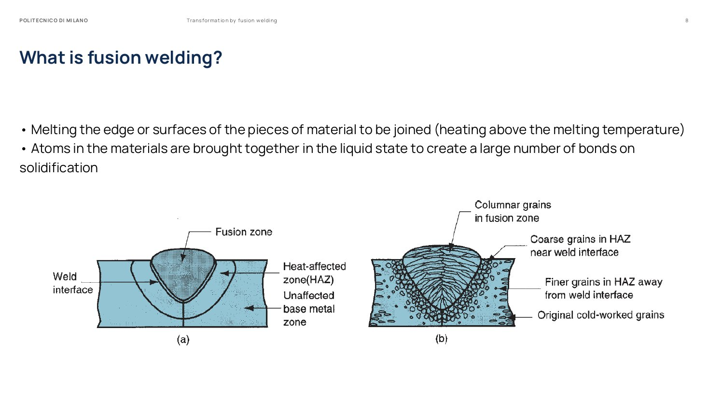

### High power density beams (laser, electron beam)

- 10¹⁰–10¹¹ W/m² is right for welding; above it, vaporisation removes material (drilling).
- High power density + high speed gives a **narrow heat-affected zone (HAZ)**. Usually **autogenous** (no filler).
- **LASER** = Light Amplification by Stimulated Emission of Radiation. Coherent light focuses to a sub-mm spot. The optical cavity has a laser medium (solid or gas), mirrors and a pump. Types: CO₂ (earliest high-power CW), Nd:YAG, **fibre lasers (most used today)**.
- **Fibre laser delivery:** double-clad fibre (active core, inner cladding, outer cladding), pump guided by total internal reflection. Focused spot about 0.5–2 mm, power about 2–20 kW, so 10⁹–10¹¹ W/m². The intensity is **not uniform** across the spot (often Gaussian).
- **Delivery arrangements:** flexible fibre to a head on a robot, or **remote welding with a galvo scanner**.
- **Industrial example:** ABB IRB 4600 arm + rotary-tilting table, IPG 6 kW fibre laser (150 µm waist), wobble head with galvo scanners, wire feeder. **Teaching system:** Snapmaker A350 (10 W) and A250 (1.6 W) diode lasers, 450–460 nm, 0.005 mm repeatability.

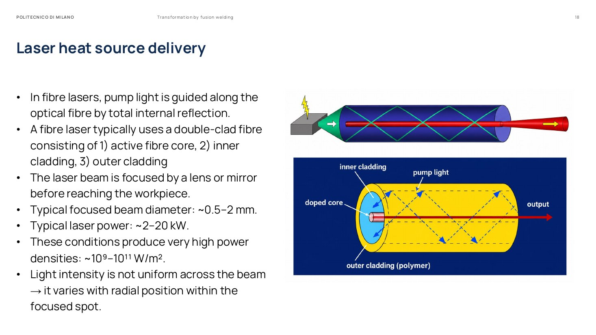

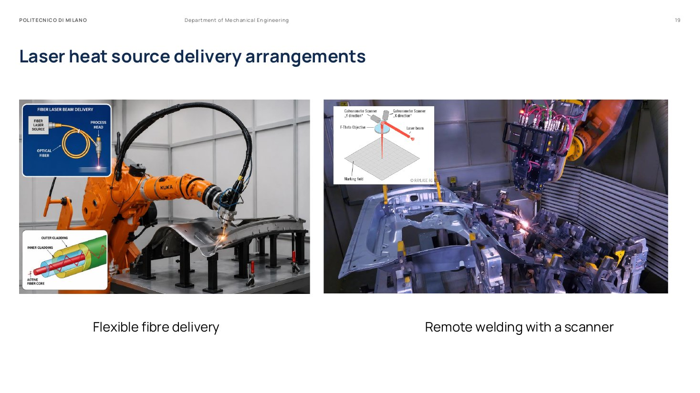

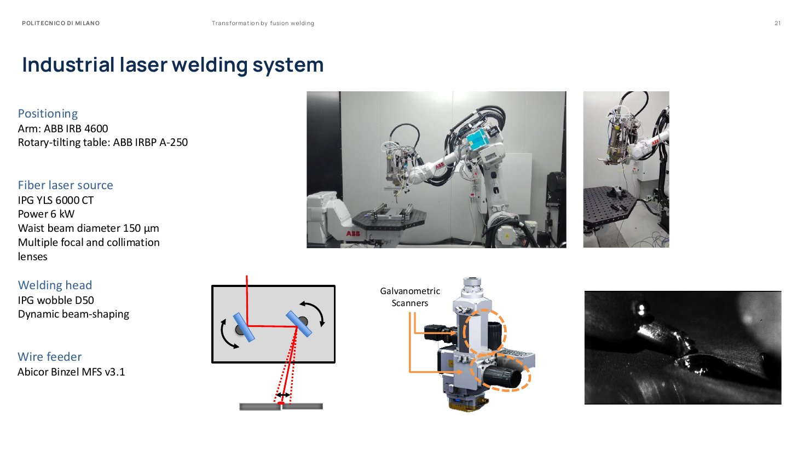

- **Prof — laser:** spot 1–2 orders of magnitude smaller than an arc, power 100 W–20 kW, so it can **vaporise**, giving narrow seams and a small HAZ. Same laser on his samples: about 5 mm seam (beam **wobbled**) vs < 1 mm. Filler welds **bulge**; autogenous welds are flat. Spot down to 0.1 mm on a robot with about 1 mm repeatability, so **trajectory control is the challenge**. Scanners move a **massless beam** with small mirrors.
- **Prof — power density:** PD ∝ P/d², so a smaller spot raises intensity much faster than more power. Spot size is where the peak falls to **13.5%** (1/e²); just remember the beam is **more intense at the centre** with **no sharp edge**. A moving source **preheats ahead and post-heats behind**.

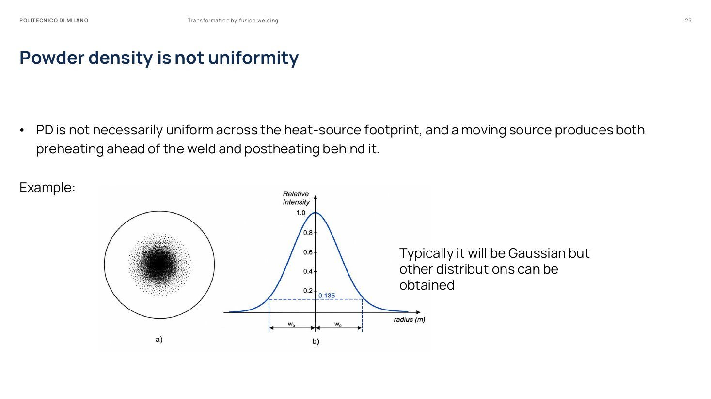

### Conduction vs keyhole

|  | Conduction | Keyhole (deep penetration) |
| --- | --- | --- |
| Intensity | < 10⁶ W/cm² | > 10⁶ W/cm² |
| Mechanism | Absorbed at the surface, then conducted | Vaporisation opens a **vapour cavity**; **vapour pressure** holds back the melt |
| Pool shape | Wide, shallow, near-hemispherical | **Narrow, deep** (high depth/width ratio) |
| Absorption | Surface absorptivity | Multiple reflections in the keyhole, close to 100% |
| Notes |  | Threshold depends little on speed; small spots reach it easily (CO₂ > 1 kW; single-mode fibre even < 1 kW). **Unstable keyholes trap porosity.** Chevron ripples form behind the beam as the keyhole closes. |

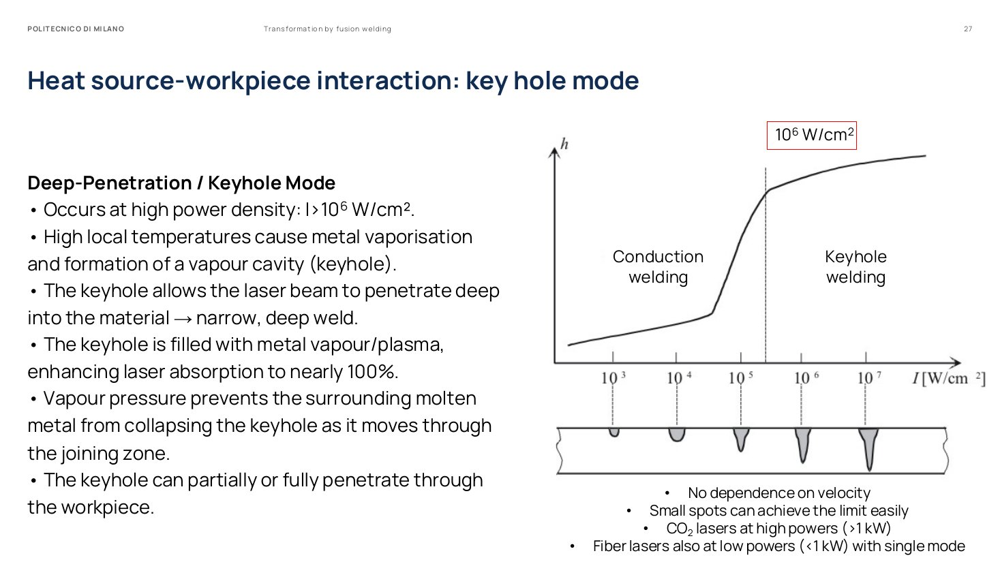

- **Prof:** conduction = **low aspect ratio** (depth/width). Keyhole "because you can **see through**": his 5 mm sample was welded through the full thickness. Absorption is like a green shirt reflecting green; at about 1 µm **copper absorbs little**, steel a lot.

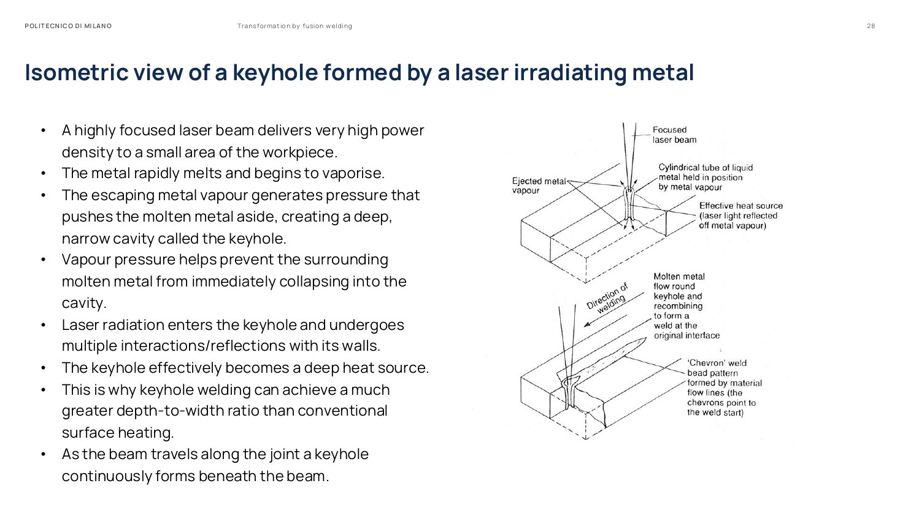

**Absorption:** light is absorbed, reflected or transmitted. Absorptivity is **higher at shorter wavelengths**, and depends on temperature, angle of incidence, roughness and surface films.

### Heat balance (key formula for numerical exercises)

Absorbed power = power needed to heat and melt the volume swept per second:

```latex
A\,P = w\,h\,v\;\rho\left[c_p\,(T_m - T_a) + L_m\right]
```

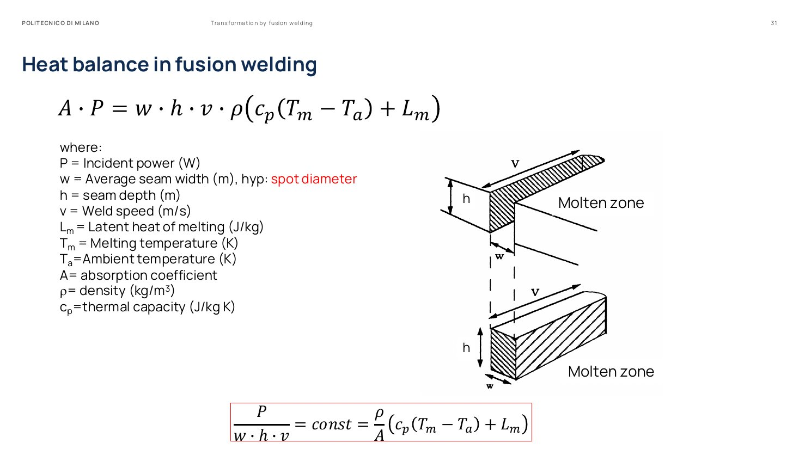

A = absorptivity, P = incident power (W), w = seam width (m, often taken as spot diameter), h = penetration depth (m), v = weld speed (m/s), ρ = density, c\_p = specific heat, T\_m = melting temperature, T\_a = ambient, L\_m = latent heat of melting.

Define the **volumetric energy to melt** E\_v = ρ\[c\_p(T\_m − T\_a) + L\_m\] (J/mm³), so **P/(w·h·v) = E\_v / A = constant** for a material.

| Material | ρ (kg/m³) | c\_p (J/kg·K) | L\_m (kJ/kg) | T\_m (°C) | E\_v (J/mm³) |
| --- | --- | --- | --- | --- | --- |
| Al alloy | 2,700 | 900 | 390 | 660 | 2.60 |
| Steel | 7,850 | 470 | 270 | 1,500 | 7.56 |
| Ni alloy | 8,400 | 440 | 290 | 1,350 | 7.33 |
| Stainless steel | 8,000 | 500 | 260 | 1,450 | 7.78 |
| Brass | 8,500 | 380 | 180 | 930 | 4.45 |
| Mg alloy | 1,800 | 1,020 | 370 | 630 | 1.78 |

Consequence (YLR fibre laser data on stainless steel, 420 µm spot): **penetration rises with power and falls with speed**, since h ∝ A·P / (w·v·E\_v).

- **Prof — reading the balance:** with w ≈ spot, **deeper means slower or more power** (keyhole regime). Al needs less energy per volume (low T\_m **and** low density). No perfect choice: a small weld is safer (small HAZ), a large seam tolerates fit-up better.

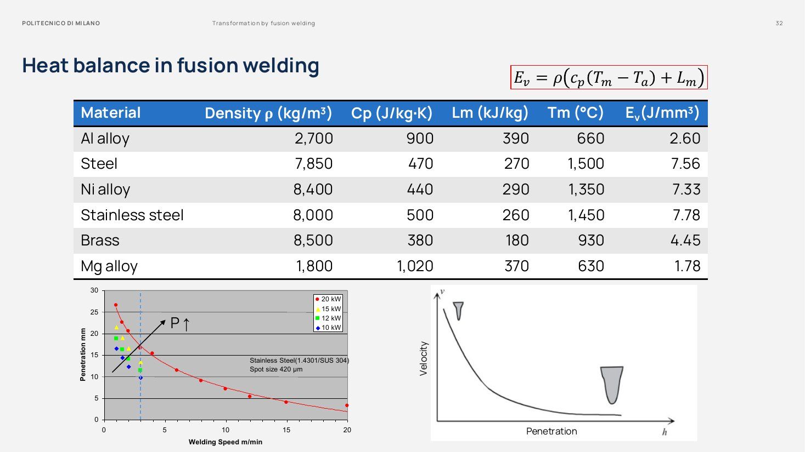

**Independent variables:** beam power, beam diameter, material absorptivity, traverse speed. **Dependent:** penetration depth, microstructure and metallurgical properties.

- **Class discussion — what would you control to avoid defects?** (1) **Speed**: axes must accelerate and decelerate at corners, so the real speed isn't the programmed one, and you must **balance power against actual speed**; (2) **seam position tracking**: are the parts where you think?; (3) **cleanliness**: oxide raises arc resistance, contamination changes laser absorption, oil causes flashes and spatter. "Better to see that in process", which leads into L1.4: **think about which sensors to put on the process**.

## Professor background (less exam-critical)

- **Prof — why join:** a seamless part is usually stronger, but joining is needed for manufacturability, functionality (separate parts joined can **cost less**), and aesthetics. Examples: offshore platform, aircraft engine, steel bridge.
- **Class discussion — what do these share?** They are **load-bearing and safety-critical** (the Genoa bridge collapse involved corroding steel and weakening joints). "Joining is one of the most critical regions where things can break", so welding needs control.
- **Prof — families:** mechanical fastening (e.g. **crimping** a soda-can lid; needs thin parts), adhesive bonding (common in aircraft and cars), welding (fusion above T\_m; brazing/soldering below; solid state: resistance, explosion, **friction welding**, where rubbing breaks the oxide and then atoms diffuse). Two perfectly pure, flat Al pieces would bond under pressure alone, but such surfaces don't exist, so you add **heat**.
- **Class samples:** Al butt weld (lighter, greyish), stainless steel (stays shiny where touched), **spot welds** in lap joints. Key question: "how do you melt only the weld region?" **Localise the heat.**
- **Prof — heat sources:** oxy-fuel is manual with a big flame (shipyards); **resistance** needs clamping, which limits automation. **Class discussion — why is electron-beam welding rare?** Electrons collide with gas, so it needs **vacuum**: costly, mainly aerospace.
- **Prof — arc:** the electrode **doesn't touch** the work; you ionise the gas in between. **Filler** closes gaps and/or improves properties. Inert gases from cheapest: **N₂, Ar, He**; active = CO₂ mixes. TIG: **tungsten melts at about 3500 °C**. Controls: current, voltage, gas flow, wire feed, AC/DC, polarity. **Tandem robots** distribute **shrinkage** so the part distorts less.
- **Prof — lab systems:** the department cell has **10 axes** (6 robot + 2 table + 2 scanner), 6 kW, 150 µm. The CAM Shop Snapmaker (10 W, 5 µm) can only mark: "same principle".

## Practice exercises

### C. Arc power density

MIG at I = 200 A, V = 25 V, efficiency η = 0.7, arc diameter 15 mm. P = 5000 W, absorbed 3500 W; area = π·15²/4 = 176.7 mm², so **PD ≈ 20 W/mm²**, the same order as the arc's tabulated 50 W/mm². Laser welding needs about 10⁴ W/mm².

### D. Laser heat balance

Steel (E\_v = 7.56 J/mm³), seam width 0.5 mm, penetration 3 mm, speed 2 m/min = 33.3 mm/s, absorptivity 0.8. Melted volume rate = 0.5 · 3 · 33.3 = 50 mm³/s, so absorbed power = 50 · 7.56 = 378 W and P = 378 / 0.8 ≈ **473 W** (minimum; real values are higher because of conduction losses). For aluminium (E\_v = 2.60), the same weld needs about 3× less energy per volume, but Al's low absorptivity works against it.

All formulas: [formula sheet](../formula-sheet.md).

## Likely oral questions

- **Conduction vs keyhole welding?** The threshold is about 10⁶ W/cm². Keyhole: vaporisation opens a cavity held by vapour pressure; multiple reflections give near-100% absorption and a deep narrow weld. Risk: unstable keyhole means porosity. Conduction: surface absorption, wide shallow pool.
- **Why does power density matter?** Too low and heat conducts away with no melting; too high and the metal vaporises. Oxyfuel 10, arc 50, laser 9,000 W/mm². High PD + speed gives a narrow HAZ and less distortion.
