# L1.4 Welding modelling and automation

> Part of the CAM study guide. Source of truth: [the study guide](https://claude.ai/artifact/WrGc96ueegSH8ZXZdT4FaB). Generated by `tools/build_guide.py`; edit the guide, not this file.

## Slides and professor's explanations (exam material)

"Automation is not just moving the torch; it is **closing the loop between target, signal and correction**." A sensor is useful for control only if it observes a controllable state, responds before the defect forms, and samples fast enough. *(Slides + recording of 30 Sep afternoon. Professor's comments are inline, marked Prof / Class discussion / Exam alert.)*

### Why automate welding

Repeatable heat input despite operator, fixture and part variation; higher productivity (a robot or laser moves faster than a hand torch); **safety** (arc radiation, fume, high-power beam, hot metal); **traceability** (every weld linked to its process data); a **zero-defect** ambition (detect drift and intervene before scrap).

- **Prof — three kinds of variability:** person to person, **fixture to fixture** (one worn, one new), **part to part**. Welding is tricky because you assemble at least two parts, so **both tolerances and how they sit together** matter.

### Motion systems for beam welding

The beam can be moved by the part, the optics, the head, or combinations. The choice affects accuracy, acceleration, access, payload and sensing. **Scanner:** small fields, remote welding. **Gantry:** precision over large flat sheets. **Robot:** 3D access, but **accuracy and calibration dominate**.

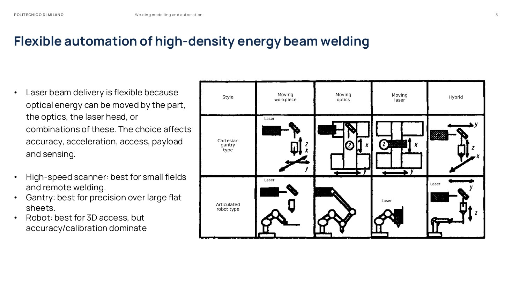

- **Class discussion — gantry vs articulated robot:** the robot has more DOF, so better **access**. But the gantry is **rigid**, so it is more precise and faster ("a high-speed train on rails is faster than most cars"), at the cost of being bulky and expensive. Robot freedom can mean a **"wobbly" system**. Scanner: the laser source is heaviest, the head lighter, light has **no mass**, so mirrors are fastest, but only over **small areas**.

**A robotic welding cell needs:** fixtures (repeatable joint position and fit-up), positioners (access + best weld orientation), robot + welding package (coordinated path and process control), **two stations** (weld on one while loading/unloading the other), torch service equipment.

- **Prof:** an arc robot carries the torch (about 5 kg) plus wire feeder; the power source is integrated with the controller (turn the arc on/off, current, voltage, polarity). Offline programming repeats the same path, but **"the programmed position is where you hope the part will be"**. Fit-up and manufacturing errors shift the part, so the trajectory needs correction.
- **Exam alert — positioner vs spindle:** a spindle turns indefinitely and you control its **velocity**; a **positioner controls position** (rotary positioner for long parts, tilting-rotating table). The lab has three cells of 6-DOF robot + positioner.

**Programmed vs adaptive welding — handling joint variability:** **touch sensing** (find the joint before welding), **through-arc tracking** (correct the path from welding-current variation), **vision tracking** (locate and follow the seam). More sensing gives more flexibility but higher cost and complexity.

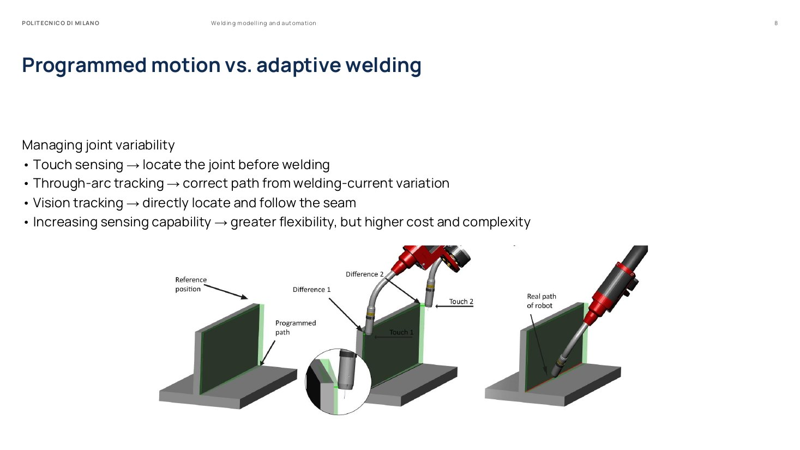

- **Class discussion — why do parts move during welding?** **Thermal drift**: one part is hot, the other cold, so it expands unevenly. Pre-weld sensing corrects the initial misplacement, but not what happens once things heat up. Hence the push for **real-time vision compensation**.
- **Prof — touch sensing explained:** not pressure. The torch is already part of an **electrical circuit** (built to make an arc), so touching the part **closes the circuit**. Knowing the robot position and torch geometry, you map the real seam.

### Open vs closed loop

- **Open loop:** power, speed and focus are preset. No measurement means no correction, yet industrial processes have disturbances.
- **Closed loop:** measure continuously, compare with a target, adjust a control variable (laser power, travel speed, focal position, powder feed).
- **Four questions to ask (slide "Time to reflect"):** (1) what process variable or product quality can we measure? (2) how do we interpret the signal and separate it from noise? (3) how do we improve the process, and on what timescale? (4) what do we change, and by how much?
- Motivation: weld failures caused the Seongsu Bridge collapse (1994), a wind-turbine tower collapse (Germany, 2014) and the SS Schenectady tanker fracture (1943).

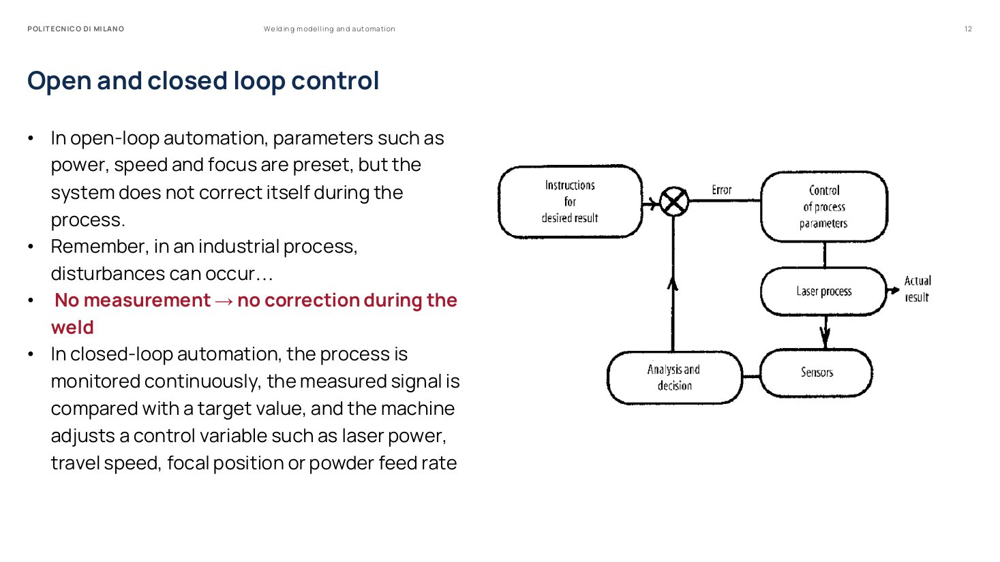

- **Class discussion — which disturbances cause poor laser welds?** Room temperature (only with extreme seasonal swings) → bad positioning or fixturing → **dirty optics / fumes** → **change of material lot** (purchasing switches supplier for price, and the surface or chemistry changes slightly without anyone telling you) → oxidised vs clean surfaces → system-to-system variability → and **human error** ("people press the wrong button"). "If you don't sensorise the process, you have no idea of these issues."
- **Prof:** the critical outputs (**depth, width, internal defects**) usually can't be measured directly, so we measure **indirectly**. "That opens up the world of big data and machine learning."

### What must be controlled, and the defects when it isn't

| Beam | Workstation | Workpiece | Process (observable) |
| --- | --- | --- | --- |
| Source type, power P, diameter D, energy distribution, position | Traverse speed, focal position, seam location, vibration, gas nozzle/flow | Absorptivity, joint gap, surface condition, temperature, material batch | Melt pool size, keyhole stability, plume/plasma, spatter, acoustic emission |

- **Class discussion — the 4 questions applied (useful oral method):**
  1. **What to measure? Use the human senses:** see (camera, IR temperature), hear (**microphone**, since the keyhole emits a high-pitched sound), smell (gas sensor; an argon sensor is a "smell sensor" for safety), touch (contact probe on bead height/width). "Engineering applications derive from these ideas."
  2. **Signal vs noise (microphone):** air movement, echoes, factory noise (low frequency), machine whine (high frequency), so band-pass filtering. Or the **Shazam approach**: FFT plus a learned signature. Two philosophies: physics-based filtering vs **training a model** on many repeated welds.
  3. **Timescale (worked example):** 10 mm weld at 30 mm/s gives **0.33 s**. Acquisition must resolve that window, and you must ask **when the defect forms**. A microphone and a photodiode can; a camera depends on its frame rate.
  4. **What to change?** If the signal says depth is dropping, **increase power** (or reduce speed), reading straight off the heat balance P/(w·h·v) = const. "All of a sudden we go back to our models. Simple yet powerful."
- **Prof:** in practice we control mainly the **beam** and the **workstation (motion)**; the workpiece and process columns are what we observe.

* **Wrong beam intensity:** lack of penetration, lack of fusion, spatter, keyhole defects (porosity).
* **Wrong workstation:** missed weld, oxidation (bad shielding), overheating at corners, underfill.
* **Wrong parameters, thermal side:** distortion and residual stress.

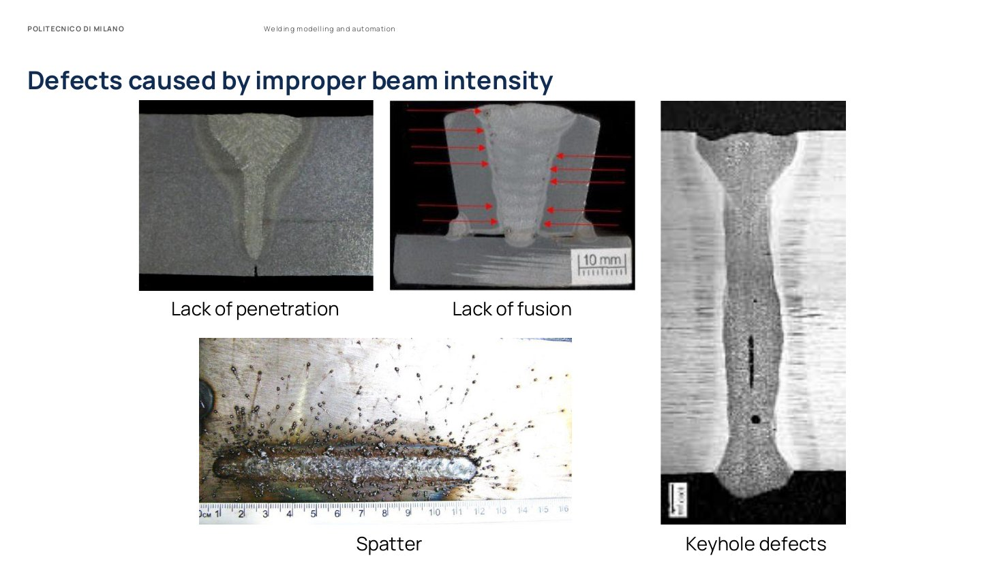

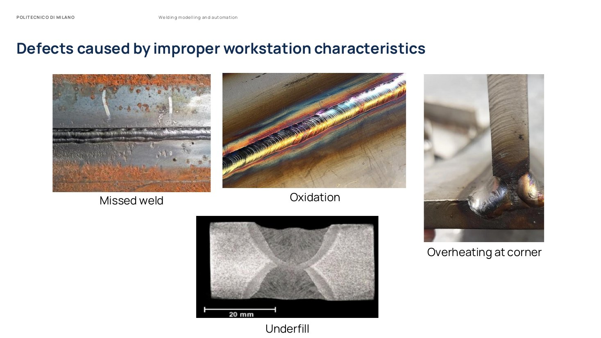

- **Prof — process signatures:** seeing the keyhole needs **X-rays**, which isn't feasible industrially, so watch what comes out: **plume** (vapour, emits light; a deeper or shallower keyhole changes it), **spatter**, melt-pool size from the top.
- **Exam alert — why even a tiny lack of penetration matters:** "that is the region where a **crack will start**." Pores and keyhole voids are **crack initiators**. Spatter on the surface means **voids inside** ("mass is conserved"). Oxidation is bad because it **corrodes more easily later**. Overheated corners and underfill = missing material, so stress concentration.

### Distortion vs residual stress

Both come from **thermally induced stresses**: non-uniform, fast heating and cooling create temperature gradients, so regions expand differently. If the structure is **free**, the result is **distortion** (fit-up and accuracy problems). If it is **restrained**, the result is **residual stress** (cracks, lower service properties).

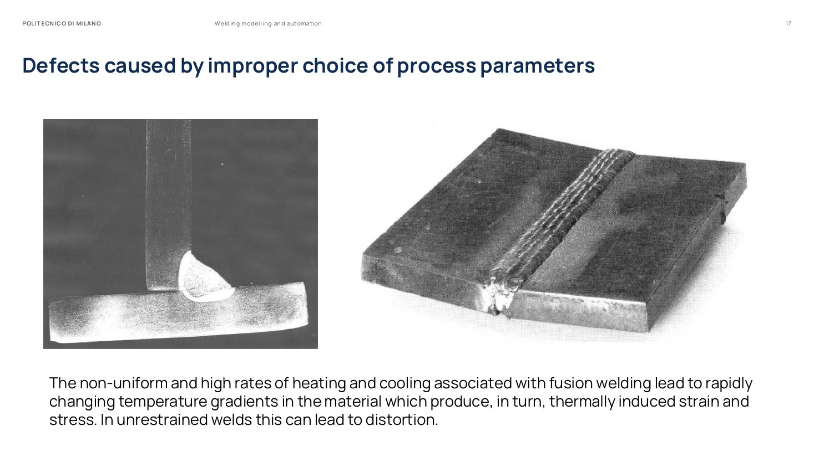

Material properties that matter: thermal expansion coefficient α; **solidification shrinkage** (about 3% steel, about 7% Al); solid-state phase changes (austenite → martensite in steel; none in Al or Ni alloys); E and yield strength falling with temperature. Stresses are much harder to compute than temperatures: they need 2D/3D elastic–plastic analysis.

- **Prof:** the **fixture is a process choice**. Free parts distort; clamped parts keep **residual stress**, which can be released later when you unclamp or **machine some material away**, and then the part moves. More molten metal at the top than the bottom makes the top expand more. **Hot metal is weaker**, so hot zones deform first. Stresses need simulations, so in practice they are handled experimentally.

### In-process monitoring examples

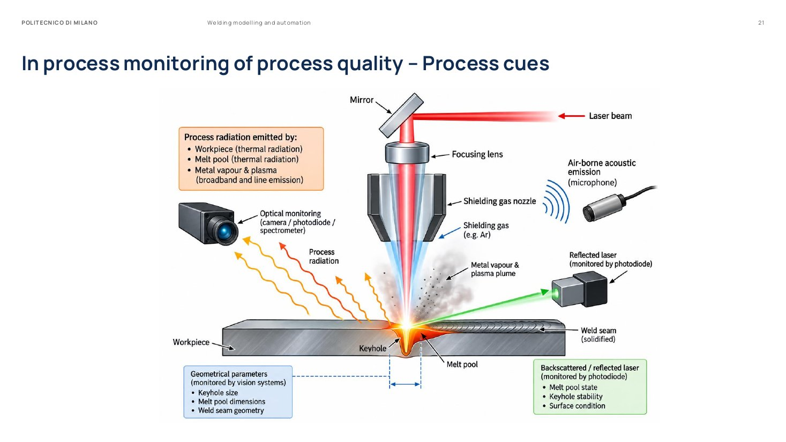

- **Optical seam tracking (workstation):** a laser line projected at a known angle; the camera sees it shift or deform at edges and gaps, giving seam position, gap, edge offset and tool orientation. The data go to the robot to correct the path (compensating part tolerances and fixture errors). Example: 60 Hz, 150 mm working distance, 50 × 60 mm range.
- **Digital image correlation (distortion):** high-temperature speckle pattern + two synchronised cameras, giving full-field 3D displacement and strain before, during and after welding.
- **OCT / inline coherent imaging (keyhole):** a low-power measurement beam, coaxial with the process laser, enters the keyhole. Interferometry of the path-length difference gives **keyhole depth directly**.
- **Photodiodes (fault detection):** Ti6Al4V lap joints, 2 mm. The signal reveals a 50 W power drop, reduced He shielding (−10 l/min) and local lack of contact between plates.

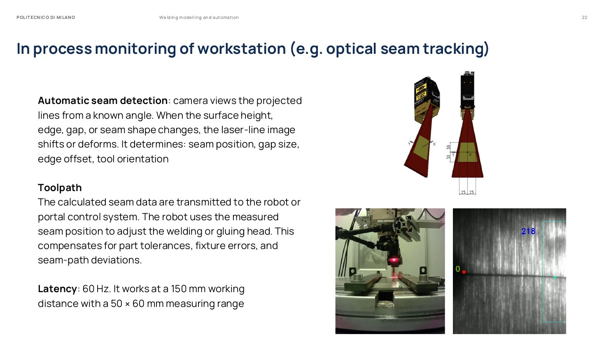

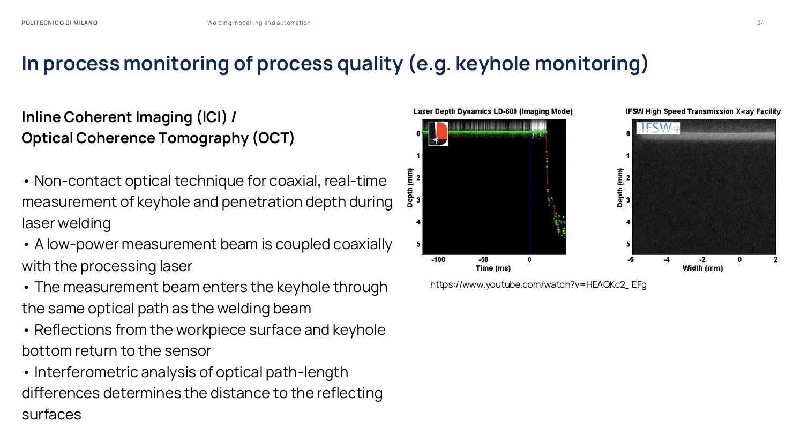

- **Prof — physical basis of the optical signals:** **thermal radiation** (hot metal glows red → yellow → white; our bodies emit IR too); **reflected laser light**, since absorption + reflection = 1, so measuring reflection tells you the absorbed energy; **plume emission**; **airborne acoustic emission** (the keyhole vibrates).
- **Exam alert — space vs time trade-off:** "the data flow remains more or less the same". A **camera** gives more data in **space**, so lower frame rate. A **photodiode** is a camera with one pixel, so very fast in **time**. A spectrometer splits wavelengths and is slower.

### When is a measurement usable for closed-loop control?

1. It observes a **controllable** state with enough signal-to-noise ratio.
2. It **responds before the defect develops**:

```latex
\tau_{total} = \tau_{sensor} + \tau_{processing} + \tau_{controller} + \tau_{actuator} < \tau_{defect}
```

3. It samples fast enough (Nyquist): f\_s > 2 f\_process. Sensor, controller and actuator must all be faster than the defect dynamics.

| Sensor | Observes | Sampling | Implication |
| --- | --- | --- | --- |
| Photodiode | Plume, reflected laser, thermal radiation | 1–100 kHz | Very fast and simple, but **indirect** |
| Camera | Plume, melt pool, keyhole | 0.5–5 kHz | Rich information, heavy processing |
| Spectrometer | Plasma spectrum | 0.1–1 kHz | High spectral resolution, poorer real time |
| OCT | Keyhole depth | 1–300 kHz | **Direct depth**, fast, robust |

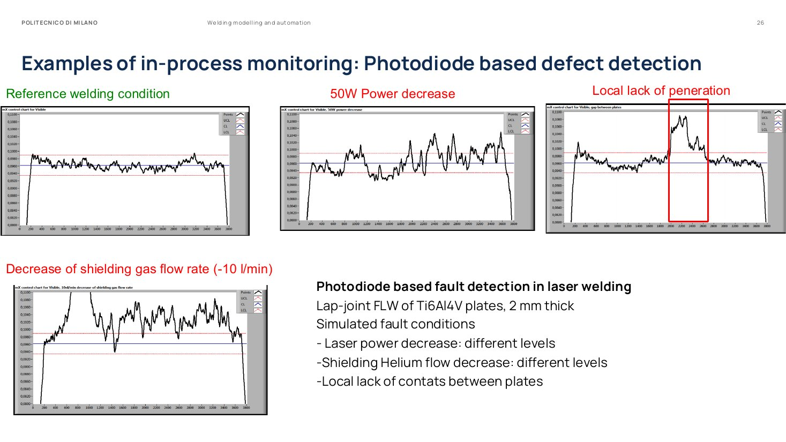

- **Prof — latency worked example:** defect forms in **1 ms**; acquire 1 ms + process 20 ms + send to controller 5 ms + actuate 1 ms = **about 27 ms**, so you can't act on that defect. Choose the sensor to match the phenomenon.
- **Prof — photodiode monitoring (Ti alloy):** weld under reference conditions, build an **acceptance band**, then introduce faults (power drop, lack of penetration, less shielding gas) and the signal leaves the band. "These are **not absolute measurement systems**, they require **teaching**." In band = OK, out of band = not OK, without knowing the cause. Today **ML learns the signature of each defect**, so it can tell the cause too. The bands are built later in the course (L3, control charts).

### Closed-loop example — penetration control by spectroscopy (Sibillano et al., 2012)

- Question: estimate penetration **without destructive testing** and control the laser power automatically.
- Setup: CO₂ laser lap weld, AISI 304, 1 mm + 2 mm sheets (max penetration 3 mm), v = 50 mm/s.
- Signal: **plasma electron temperature T\_e** from optical emission spectroscopy. Calibration: 2 mm depth gives T\_e,ref = 5460 K (P ≈ 1200 W); 3 mm gives 5300 K (P ≈ 1800 W). **Deeper penetration means lower T\_e.**
- Error e(t) = T\_e(t) − T\_e,ref, fed to a **PI controller** acting on laser power.
- Test: start 20% low (960 W, under-penetration), so T\_e is above the set point. The PI raises the power towards 1200 W, T\_e converges to 5460 K, and metallography confirms about 2 mm. It corrects disturbances in both directions.

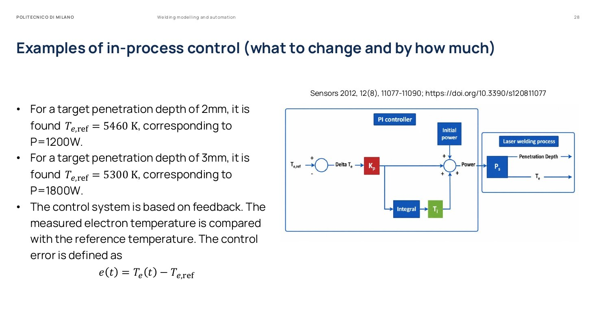

- **Prof:** this is "from monitoring to control": not just identifying issues but a more intelligent process. The electron temperature is **not the part's temperature** but the **ionisation of the plume**; it has an inverse relationship with depth. When the controller starts, the power ramps slowly to the target and the temperature reading decays to the set point.

### Analytical thermal models

| Source | Gradient | Motionless beam | Moving beam (quasi-stationary) |
| --- | --- | --- | --- |
| Planar | Thickness only (x) | T(x,t) | T(x,v) |
| Line | Normal to the beam (x,y) | T(x,y,t) | T(x,y) |
| Point | All directions (x,y,z) | T(x,y,z,t) | T(x,y,z) |

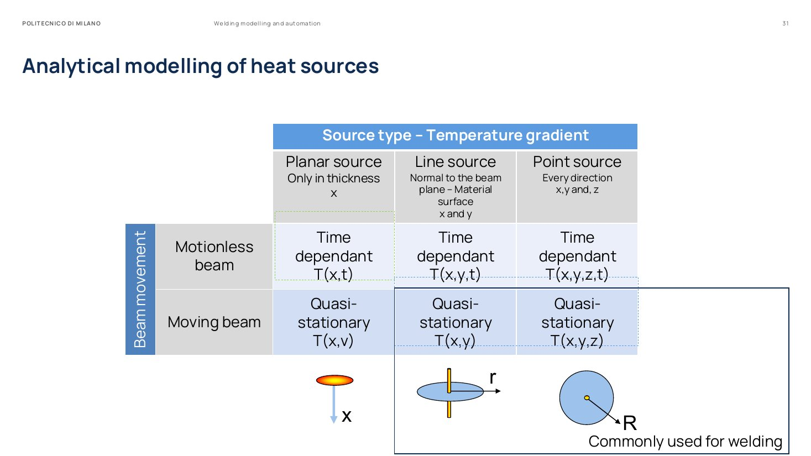

- **Prof:** a motionless beam suits on/off processes such as heat treatment; welding uses a **moving** beam. **Keyhole looks like a line source** (heat roughly constant through the depth); **conduction looks like a point source** (varies in every direction). "I will not derive the equations, but help you **read** them."

**Rosenthal moving point source** (semi-infinite body; surface weld):

```latex
T - T_0 = \frac{Q}{2\pi k R}\exp\!\left[-\frac{v\,(x - R)}{2\alpha}\right], \qquad R = \sqrt{x^2+y^2+z^2}, \quad \alpha = \frac{k}{\rho c_p}
```

(Written exactly as on slide 32, with x along the travel direction in coordinates moving with the source.) Assumptions: constant properties, no radiation loss, **no melting, no latent heat**, semi-infinite workpiece.

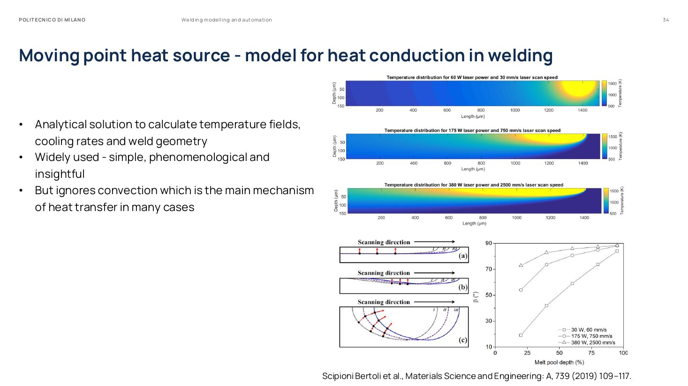

- **Prof — how to read Rosenthal (likely oral):** more power Q means a higher temperature rise; **higher conductivity k** (denominator) makes it harder to heat; at **R = 0 the formula goes to infinity**, which isn't physical because it assumes pure conduction; away from the source it **decays exponentially**; **higher speed** dissipates faster. Example maps (60 W at 30 mm/s up to higher power and speed): the isotherms **stretch into a tail** behind the source. The **melt isotherm gives the molten width**, and the maximum width **lags behind** the source, more so at higher speed. (The g in the slide's symbol list is a copy-paste leftover; it isn't used in the point-source formula.)

Centre-line cooling rate (**square** dependence on temperature):

```latex
\frac{\partial T}{\partial t} = 2\pi k\left(\frac{v}{Q}\right)(T - T_0)^2
```

Cooling is faster at **higher speed** and **lower power** (slide 33). For steel (k = 52 W/m·K, T\_m = 1500 °C) at 1000 mm/s it is about 7·10⁵ °C/s at Q = 1 kW, but under 10⁵ °C/s at Q = 10 kW. The slides write the cooling rates as magnitudes.

- **Prof:** the cooling rate matters because **fast cooling can be more damaging** (residual stress, microstructure). You can make maps to choose between high speed or high power. To get the same cooling rate at **10 kW instead of 1 kW**, the speed must go from about **100 to about 1100 mm/s**.

**Rosenthal moving line source** (full-penetration keyhole; heat spread through thickness g; K₀ = modified Bessel function, second kind, order zero):

```latex
T - T_0 = \frac{Q}{2\pi k g}\exp\!\left(\frac{v x}{2\alpha}\right) K_0\!\left(\frac{v R}{2\alpha}\right)
```

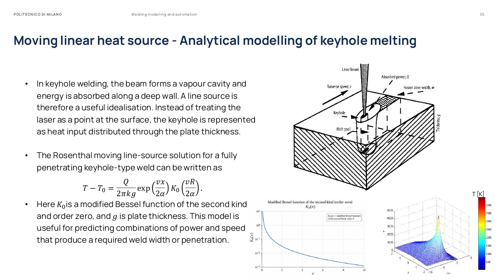

Centre-line cooling rate (**cubic** dependence, so cooling changes rapidly with small temperature changes):

```latex
\frac{\partial T}{\partial t} = 2\pi k \rho c_p \left(\frac{v g}{Q}\right)^2 (T - T_0)^3
```

**Dimensionless groups:** normalised speed Y = vR/(2α), normalised power X = Q / \[2π(T\_m − T₀) k g\]. A Y–X plot estimates the **required power for a given thickness, speed and material**.

**Limits of conduction models:** they ignore **convection** in the melt pool, which is often the main heat-transfer mechanism. They cannot predict the variety of real pool shapes, or the effect of welding orientation; that needs fluid flow (numerical models). **Trade-off:** model fidelity vs computational cost, the same theme as the casting MPC.

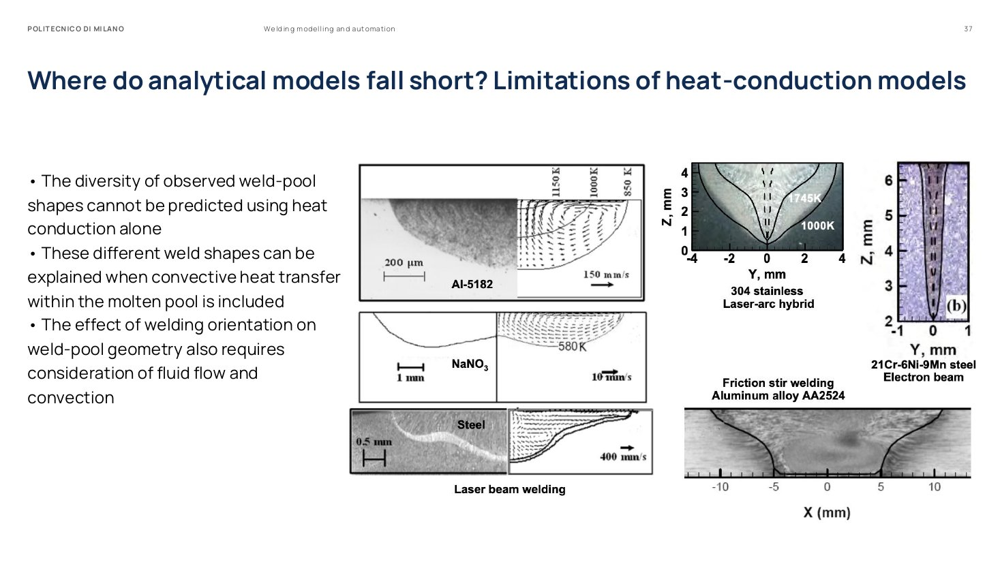

- **Prof (5 Oct recap):** α has units of **m²/s** (how fast heat spreads over an area); vx/2α is dimensionless, a "form factor". Convention: **x = beam travel direction, z = depth, y = lateral**. Use the point source on a computer (Excel, MATLAB, Python): find where T = T\_m, the **melting isotherm**, which gives the half-width and depth (a near-spherical cross-section). K₀ is tabulated in any solver.
- **Class question — what if the weld is not fully penetrated?** The line source assumes **full penetration (depth = g)**. For partial penetration it's chicken and egg (you need the depth to compute the depth), so you **calibrate with experimental data**.
- **Limits (his words):** you must assume the equilibrium **in advance** (conduction → point, keyhole → line), another chicken-and-egg problem. No oxidation, no extra reactions, no material heterogeneity: "a perfect world". None of the model shapes looks like a real keyhole weld (wide top + deep narrow root). Fix: **combine two heat sources**, one for the top and one for the deep penetration.

## Professor background (less exam-critical)

- **Prof:** "One of the simplest things to check isn't visible to the human eye. **Defects can be hidden.**" A ship has **kilometres of weld**, so quality must be consistent. Two levers: **automate** (repeatable, controllable) and **model** (know how to govern the process).
- **Prof — inspection depends on criticality:** cars are **sampled**, ships sampled more, aircraft sometimes have **every weld checked**. Automating plus monitoring makes 100% checking feasible. "Scrap is a loss, but if a safety-critical part breaks in use, it's much worse than losing money."
- **Prof:** modern models such as **physics-informed neural networks** use these simple thermal models to predict in real time; that's why we study them even without full derivations.
- **Prof — why robots in car-body welding (video):** short welds, complex geometries to move around, no long trajectories. Resistance spot welding: there the **part is moved to the gun**, not the gun to the part.
- **Prof:** two-station cells exist because **"there's always cost related to not doing anything"** (see L1.9). Real example: an Italian maker of motorcycle exhausts uses exactly these rotating two-station cells.
- **Prof — lab demo (video):** image-based seam tracking developed in his lab. The robot was programmed for a **straight line** but tracked an S-shaped seam with the gap opening **from 0 to 1 mm**, correcting every point in real time. "This is not a finished logic. There is still a lot to do."
- **Prof:** the designers of the failed bridge, turbine and tanker "were capable of designing correctly. But they had their **highest hopes about production**." On paper it can be perfect; if production is wrong, it fails.
- **Class discussion on the defect photos:** the V-shaped part that bent was distorted by uneven heating (top pulls, bottom pushes), from **too much power**. The missed weld had **too little** power.
- **Prof:** DIC is for **process characterisation**, not real-time monitoring. **OCT** in his video matched X-ray keyhole depth "more or less, but with a lot of noise"; it runs at about **250 kHz**. The lab has **three OCT devices** (X-ray work is done with a partner lab).
- **Prof:** the line-source solution assumes the **same temperature distribution at every depth**, because the line source heats the whole thickness from the inside out. The decay along the weld direction combines the exponential and the Bessel function K₀. "You don't need to know the details of K₀."
- **Why the cooling rate matters (class discussion):** too fast means large internal stress and distortion; too slow can harm the microstructure. You must hit the temperature **and** the right cooling.

## Practice exercises

*No dedicated exercise. All formulas: [formula sheet](../formula-sheet.md).*

## Likely oral questions

- **When can a sensor be used for closed-loop control?** It observes a controllable state with good SNR, total latency is below the defect formation time, and f\_s > 2f\_process. Compare photodiode (fast, indirect), camera (rich, slow processing), spectrometer (slow), OCT (direct depth, fast).
- **Describe the penetration-control example.** Plasma electron temperature from spectroscopy as a proxy for depth (deeper means lower T\_e). Set point 5460 K for 2 mm. A PI controller acts on laser power; starting from 960 W it converges to about 1200 W; metallography confirms. It works in both directions.
- **Distortion vs residual stress?** Both come from thermal stresses due to gradients. Free structure gives distortion; restrained gives residual stress. Key properties: α, solidification shrinkage (3% steel, 7% Al), phase changes, E and yield strength vs temperature.
- **Assumptions and limits of Rosenthal?** Constant properties, no radiation, no melting or latent heat, semi-infinite body; it ignores convection, so it can't predict real pool shapes. Point source for surface welds, line source for keyhole. Cooling rate ∝ (T−T₀)² (point) or (T−T₀)³ (line).
