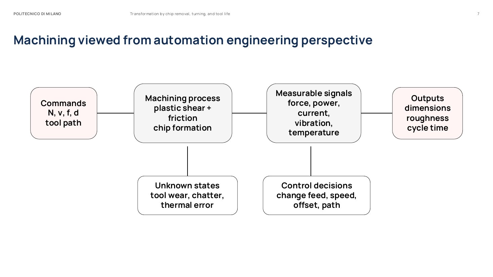
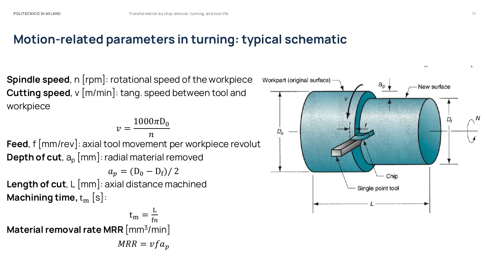
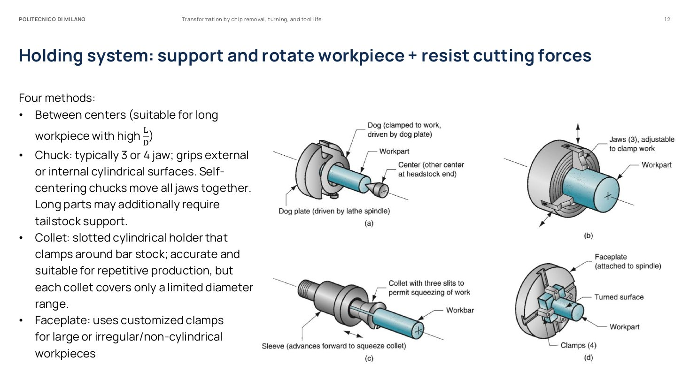
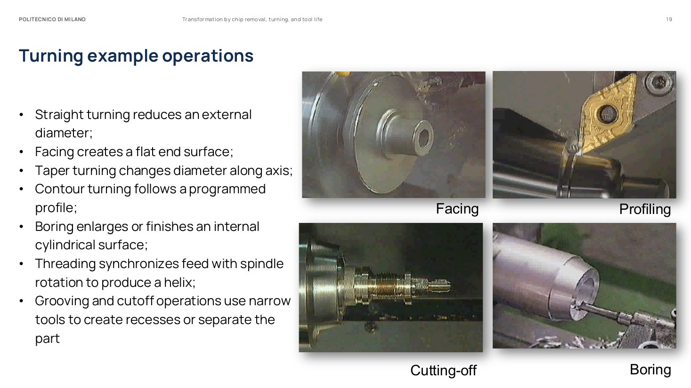
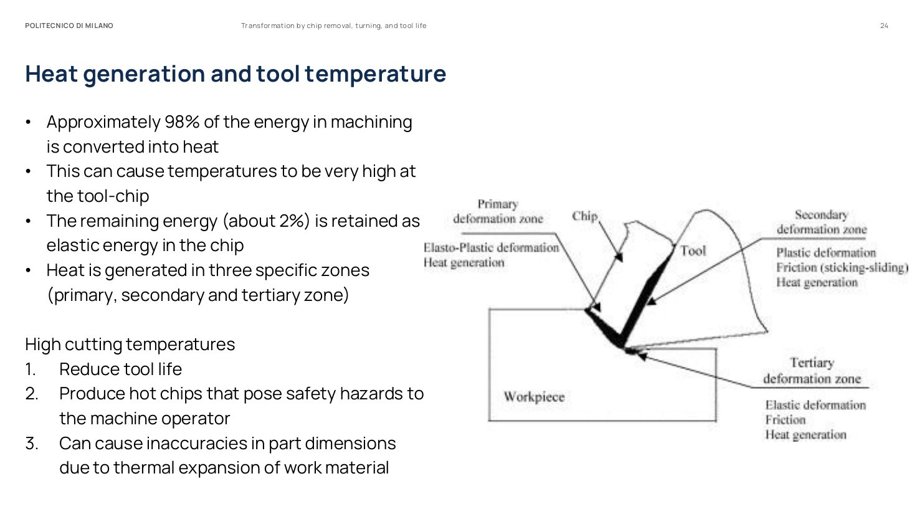
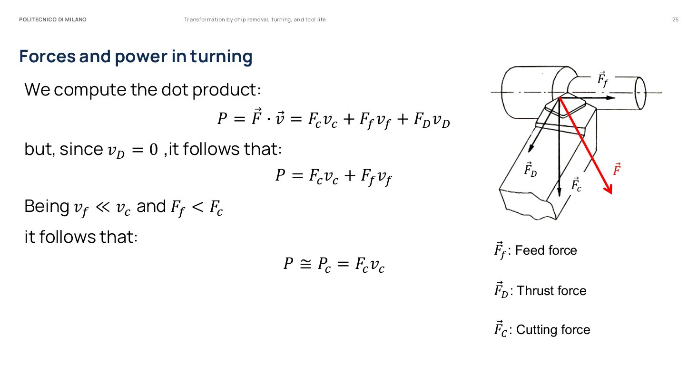
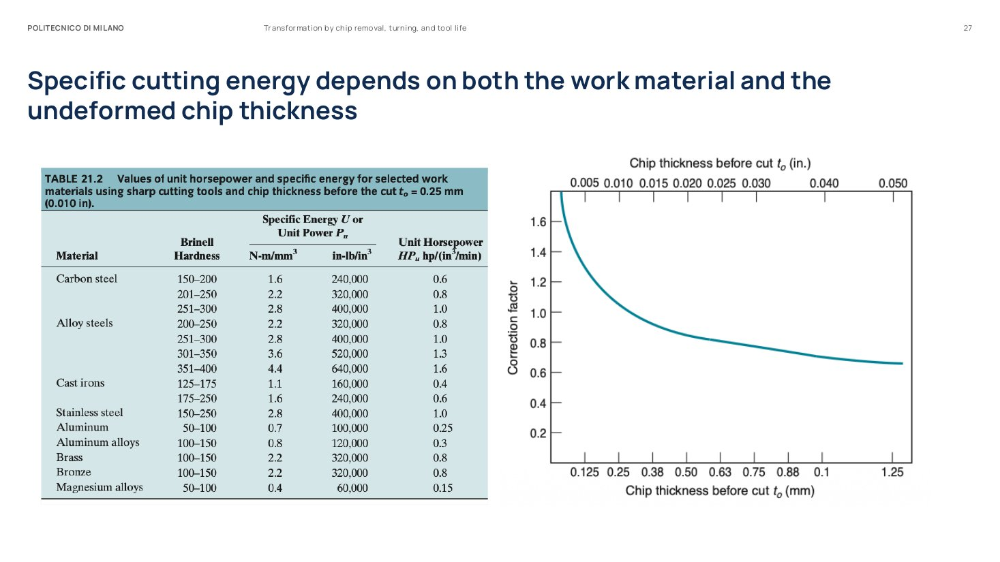
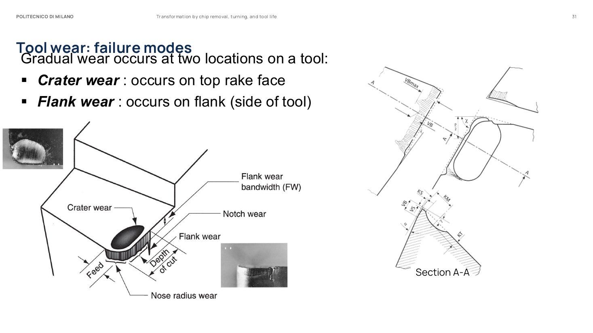
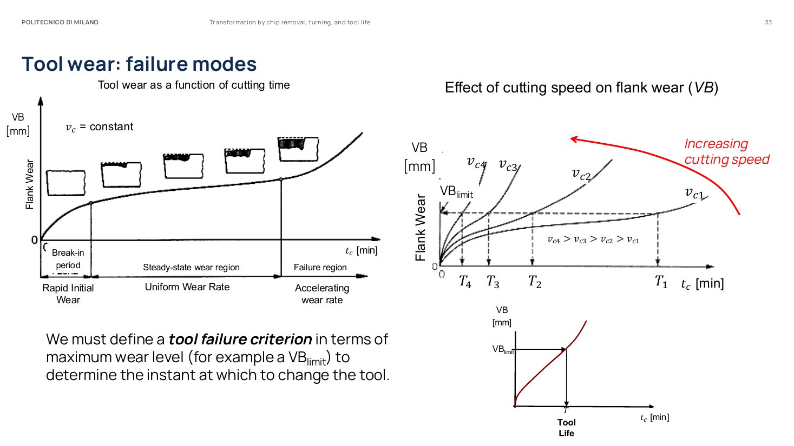
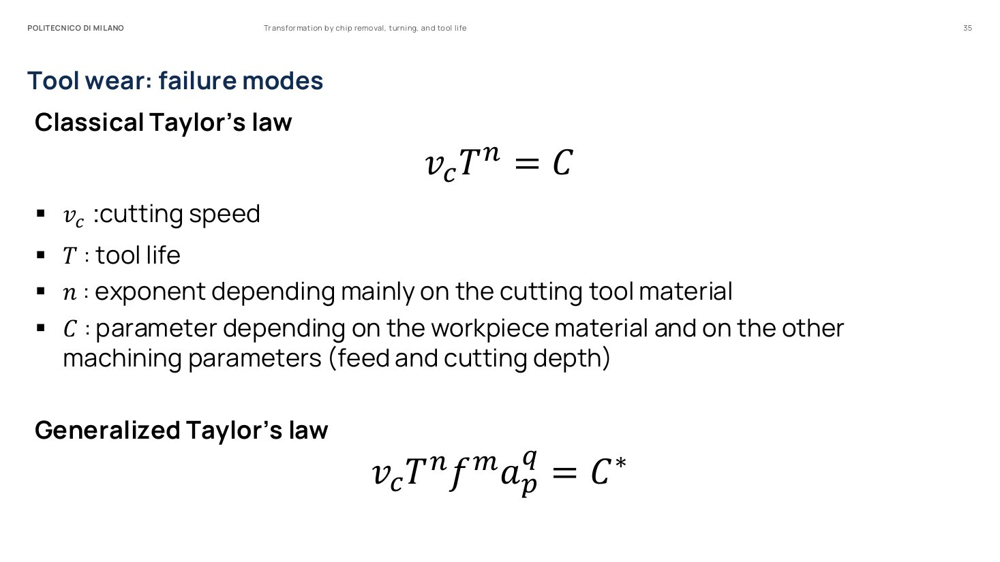

# L1.5 Transformation by chip removal – turning and tool life

> Part of the CAM study guide. Source of truth: [the study guide](https://claude.ai/artifact/WrGc96ueegSH8ZXZdT4FaB). Generated by `tools/build_guide.py`; edit the guide, not this file.

## Slides and professor's explanations (exam material)

Machining is a **disturbance-rich** process: you command speed, feed and depth, but the outcome also depends on states you cannot see directly (**tool wear, chatter, thermal error**). That is why it motivates monitoring and automation (L1.8). *(Slides + recording of 5 Oct morning. Professor's comments inline.)*

### Material removal and why machining

- **Material removal processes:** machining (sharp tool: turning, milling, drilling), abrasive processes (grinding), non-traditional processes (other energy forms).
- **Why machining:** great flexibility of shapes; dimensions and finishes hard to get otherwise; works on a wide range of materials. But it is **resource-intensive** (time, energy, material), so it comes **after a near-net-shape process** (casting, forming).
- **Sequence:** workpiece material → datum & fixturing → rough machining → semi-finishing → finishing/grinding → cleaning/deburring → inspection. "Each step offers opportunities for automation."

* **Why roughing then finishing, not one pass?** Removing a lot of material at once makes it hard to keep good surface quality, because of the **forces and power** involved.
* **Exam alert:** "In engineering, **we don't maximise** these things. If you maximise productivity, quality decreases, and vice versa. We try to reach the **requirements**."

### Machining from an automation perspective (slide 8)

| Commands (inputs) | Process | Measurable signals | Outputs |
| --- | --- | --- | --- |
| N, v, f, d, tool path | Plastic shear + friction, chip formation | Force, power, current, vibration, temperature | Dimensions, roughness, cycle time |

**Unknown states:** tool wear, chatter, thermal error. **Control decisions:** change feed, speed, offset, path. This block diagram links straight to L1.1 (model errors, disturbances, sensors).

**Study framework for any machining process:** (1) relative motions and workpiece symmetry, (2) workholding, (3) tool geometry, (4) chip-formation mechanics, (5) tool wear, (6) machining capability. Tool wear shares the same physics across processes.



### Turning: motions and parameters

Turning makes **rotational parts**. Three motions: **cutting** (workpiece rotation, cutting speed v), **feed** (tool moves parallel to the axis, f in mm/rev), **depth setting** (tool moves perpendicular, depth of cut a\_p).

- **Prof — the orange analogy:** to peel an orange you rotate it and move the knife continuously (turning: cutting motion on the workpiece, feed on the tool), unlike a carrot where you cut, then rotate. In turning **the spindle controls speed, not position**. Feed is in **mm per revolution** because "the tool is obliged to follow the rotation". External cylindrical turning: the tool moves along the axis; **facing**: it moves radially.
- **Exam alert:** "Often I will tell you what I like asking in the oral exams. **I usually like to see a drawing of this kind**": the cylinder with D₀ and D\_f, the tool, the feed direction, the symmetry axis drawn as a long-dash/short-dash line.

```latex
v = \frac{\pi D_0 n}{1000}\ [\text{m/min}] \qquad a_p = \frac{D_0 - D_f}{2} \qquad t_m = \frac{L}{f\,n} \qquad MRR = v\,f\,a_p
```



n = spindle speed (rpm), D₀ = starting diameter (mm), D\_f = final diameter, L = length of cut (mm). The slide writes v = 1000πD₀/n, but dimensionally v \[m/min\] = π D₀ \[mm\] · n / 1000. For MRR in mm³/min, convert v to mm/min (× 1000).

- **Exam alert — units:** "In a written exam your **unit should be correct**. If it's numerically correct but you wrote km/h, it's wrong." Cutting speed is taken at the **initial diameter** D₀; the 1000 converts to m/min. **A depth of cut of 2 mm reduces the diameter by 4 mm.** Machining time = distance / feed velocity = L/(f·n).

### Workholding, tools, machines

- **Between centres:** long workpieces (high L/D). **Chuck:** 3 or 4 jaws, self-centring; long parts also need a tailstock. **Collet:** clamps bar stock; accurate, good for repetitive production, but each collet covers a narrow diameter range. **Faceplate:** custom clamps for large or irregular parts.
- **Single-point tool:** rake face, flank face, **cutting edge** where they meet; side rake angle, side relief angle, cutting-edge angle. **Inserts:** multiple edges, a trade-off between strength and accessibility.
- **High-production automation:** automatic tool feed and turret indexing in chucking machines; **automatic bar feeding** (feed through the collet, machine, cut off, index the stock).
- **CNC lathe → CNC turning centre:** loader/feeder/unloader, turrets (e.g. 10 tools, some powered), automatic chip removal, tool indexing including **driven tools** (drilling, tapping, milling), tool storage, tool monitoring and setting, programmed cycles for parallel turning.
- **Shapes:** straight turning, facing, taper, contour, form, chamfer, grooving/cutoff, threading (feed synchronised with spindle rotation to make a helix), boring (internal), drilling/reaming on the axis, knurling.



### Capability: tolerance and roughness

Typical tolerance: D < 25 mm → ±0.025 mm; 25–50 mm → ±0.05 mm; D > 50 mm → ±0.075 mm. Typical roughness about 1 µm Ra. **Ra** = mean absolute deviation of the profile from its mean line (areas above = areas below).

```latex
R_a \approx \frac{f^2}{32\,r}\cdot 10^3\ [\mu\text{m}] \qquad (f \text{ in mm/rev},\ r = \text{nose radius in mm})
```



**Exam alert (likely numerical):** roughness grows with the **square of the feed** and falls with a **larger nose radius**. The real finish is worse because of work material, built-up edge, tool wear, vibration/chatter and machine/fixture stiffness.

- **Prof — where the formula comes from:** at each revolution the tool leaves its **imprint**; the profile repeats with period f and the shape of the nose radius r. Peak-to-valley **R\_t = f²/(8r)** and **R\_a ≈ R\_t/4**, hence f²/(32r). Threading: **feed = thread pitch**. Knurling deforms the surface for grip.
- **Exam alert:** "Often we will ask you to calculate the expected surface roughness." **"I may ask you when this equation holds"**: only with **no vibrations** (the tool path changes) and **no tool wear** (the tool no longer has radius r).
- **Class discussion — why not a flat tool (r → ∞, so Ra → 0)?** The flat face would be in **full contact with surface you're not cutting** (cutting happens on the rake edge), so friction **heats and oxidises** the surface and damages it. Very large radii also leave a large imprint at the end of the cut, outside specifications. "Usually there is **not a single optimum**." Example tool nose radius is about 0.3 mm, comparable to the roughness scale.

### Chip formation, heat, forces and power

- **Orthogonal cutting** (2D model): material ahead of the edge undergoes large plastic shear in a thin **primary shear zone** at shear angle φ; friction between chip and rake face is the **secondary zone**.
- **Heat:** about **98% of the energy becomes heat**, about 2% stays as elastic energy in the chip. Heat is generated in three zones (primary, secondary, tertiary). High temperatures **reduce tool life**, make hot chips (a safety hazard) and cause **dimensional errors** through thermal expansion.
- **Power:** P = F⃗·v⃗ = F\_c v\_c + F\_f v\_f + F\_D v\_D. With v\_D = 0, v\_f ≪ v\_c and F\_f < F\_c:


- **Prof — three heat zones explained:** **primary** = shearing the material along the shear plane (internal friction; this is the **useful** energy); **secondary** = the chip sliding on the rake face (friction, "not really required"); **tertiary** = the flank still slightly rubbing the new surface. Can you minimise secondary and tertiary? Only with a thinner tool, which **breaks more easily**. Hence **coolants**: they lubricate (less friction) and carry heat away.
- **Prof — why we need forces at all:** (1) to choose a **machine with enough power**; (2) because the tool's **life is finite** and depends on the load.



```latex
P \approx P_c = F_c\,v_c
```



**Cutting-pressure (k\_c) method** for the cutting force:

```latex
F_c = k_c\,A_D, \quad A_D = f\,a_p = b\,h_D, \quad h_D = f\sin\kappa_r, \quad k_c = \frac{k_{cs}}{h_D^{\,x}} \;\Rightarrow\; F_c = \frac{k_{cs}}{(\sin\kappa_r)^x}\,f^{\,1-x}\,a_p
```

k\_cs = specific cutting pressure (material-dependent, tabulated), x = exponent, κ\_r = cutting-edge (approach) angle, h\_D = undeformed chip thickness. **The specific cutting energy depends on both the material and the chip thickness**: thinner chips cost more energy per unit volume. This is the "force = cutting pressure × chip area" model from L1.1, and why supervisory control needs a force model.



- **Prof:** the thrust force pushes back, but in a **stable** process the part doesn't move, and v\_f ≪ v\_c, so the power comes from the cutting force. **Force = pressure × area.** Chip area ≈ **f × a\_p** (a geometrical approximation; a student noticed the units come out as mm²/rev, and he agreed it's an approximation). **k\_c = k\_cs / h\_Dˣ is the Kronenberg relation**, determined **experimentally**: tool makers give tabulated k\_cs and x for each workpiece–tool pair.
- **Exam alert — reading the formula:** F\_c depends on the **material** (k\_cs), **tool geometry** (κ\_r), **tool material** (x), and your **parameters** (f, a\_p). Since **0 < x < 1**, raising f or a\_p raises the force. "Force calculations in chip removal are very simple and will always be **pressure times area**."

### Tool wear and tool life

- **Failure modes:** **fracture** (excessive forces or vibration cause brittle fracture), **temperature** (too hot for the tool material), **gradual wear** (preferred, because it gives the longest tool use).
- **Where:** **crater wear** on the rake face; **flank wear** on the flank, which affects **dimensional accuracy and surface finish**, measured by **VB** (average) and VB\_max.
- **Wear curve VB(t):** break-in (rapid initial wear) → steady state (uniform rate) → failure region (accelerating). Higher v\_c gives faster wear.
- **Tool life T** = the time to reach a chosen **VB\_limit** (the failure criterion that tells you when to change the tool).





**Taylor's law:**

```latex
v_c\,T^{\,n} = C \quad\Leftrightarrow\quad \ln T = \frac{1}{n}\ln C - \frac{1}{n}\ln v_c
```



n depends mainly on the **tool material**; C on the **workpiece material** and the other parameters (feed, depth). On a log–log plot it is a straight line, so **two (v, T) tests are enough to find n and C**. Generalised form: v\_c Tⁿ fᵐ a\_p^q = C\*.

- **Exam alert:** "When I ask **what is the end of tool life**, you shouldn't answer *when the tool breaks*." It's when wear reaches the **limit we decide** (typically VB about 0.5 mm, no need to memorise). After breakage the tool has **already cut unreliable parts**. We prefer **gradual wear** because it is **predictable**.
- **Prof:** on a coated (gold) insert you can see where the coating is worn: rake face, flank face and nose radius, where friction is. Flank wear exists because the flank still rubs slightly; **crater** wear because the chip slides over the rake face. Measure VB under a microscope. Wear curve: rapid initial (surface imperfections wear off) → steady → accelerating (integrity lost).
- **Exam alert — Taylor:** "If I ask you about this, you need to speak about **experiments, not a proof**." n and C are empirical fits. Tool materials: **ceramics fastest, carbides fast, high-speed steel slowest**, and not all speeds suit all tool materials. In the generalised law, feed and depth also shorten life, but less strongly (exponents < 1).

**Exam link:** tool wear is an **unknown state** that slowly changes force, power and roughness. Monitoring spindle power or vibration (data-driven, see L1.1) or estimating forces online (hybrid) are how automation decides when to change the tool.

## Professor background (less exam-critical)

- **Prof:** in machining you can **count the tools** acting on the part; in abrasive processes you can't (grinding wheel), so you use statistics. The tool must withstand the forces so that **material leaves the workpiece, not the tool**.
- **Class discussion — why does the starting bar look rough?** It comes from an earlier process (casting) that is fast but has poor surface quality. Machining takes you from **near-net shape to net shape**, needed for mating tolerances and because surface quality affects **service life**. Material types: metals, ceramics, polymers, wood, composites.
- **Prof:** friction between tool and work must not stop the part rotating, so workholding is part of machine design. Long parts **deflect under their own weight**, so they go between centres. The collet is usually **pneumatic** (opening the circuit releases the bar). The faceplate's jaws move **independently**, so it can hold non-symmetrical parts and align their axis with the spindle.
- **Prof — tools passed around in class:** a high-speed steel tool **brazed** to its shank (brazing: only a filler melts and diffuses in, see L1.3), an insert held by a **torque screw**, and a round insert ("round doesn't mean blunt"). **Why different shapes?** Different surfaces: a round tool for a round groove, a thin tool for narrow areas. The flank face **shouldn't rub** on the workpiece; the chip flows over the **rake** face; the edge must be sharp, "just like our knife".
- **Prof — automation video:** one setup does turning → cone for the drill entry → drilling → facing → threading → cutoff, each with a dedicated tool from the turret, plus automatic bar feeding. On a turning centre the spindle can also do **position control** (rotate the part to an angle for driven-tool milling). A second spindle catches the part at cutoff. Deburring matters: a bottle opener that cuts your fingers won't sell. "We didn't see any operator. Why? Because this was **all programmed**." (You programmed this with Tornaquindici in CAM Lab.)
- **Prof:** automatic **chip removal** matters (chips can damage the machine); **tool indexing** = knowing exactly where the tool is relative to the part, otherwise every command goes to the wrong place. The tool is a **consumable**, hence tool monitoring.
- **Class discussion — video of a vibrating tool that breaks:** it wasn't well centred. The tool and spindle axes didn't match, the mass was offset, so **self-excitation** led to fracture. "If you mount the tool wrong, that's beyond the tool's capacity, it shouldn't happen." Temperature failure means operating outside specs or without coolant.

## Practice exercises

### E. Turning (parameters, roughness, force, power)

D₀ = 50 mm → D\_f = 46 mm, n = 1000 rpm, f = 0.2 mm/rev, L = 200 mm, nose radius r = 0.8 mm, κ\_r = 90°, k\_cs = 1800 N/mm², x = 0.25.

1. aₚ = (50 − 46)/2 = **2 mm**; v = π·50·1000/1000 = **157.1 m/min** (2.62 m/s).
2. tₘ = 200 / (0.2·1000) = **1 min**.
3. MRR = 157.1·10³ · 0.2 · 2 = **62,800 mm³/min** (≈ 62.8 cm³/min).
4. Rₐ = 0.2²/(32·0.8)·10³ = **1.56 µm**. Halving the feed gives 0.39 µm (÷4), but doubles tₘ.
5. h\_D = 0.2 mm; k\_c = 1800 / 0.2⁰·²⁵ = 1800 / 0.669 = 2692 N/mm²; F\_c = 2692 · 0.2 · 2 = **1077 N**.
6. P ≈ 1077 · 2.62 = **2.8 kW** at the spindle.

### F. Taylor tool life

Tests: 200 m/min gives T = 10 min; 150 m/min gives T = 40 min. n = ln(200/150) / ln(40/10) = 0.2877 / 1.3863 = **0.21**; C = 200 · 10⁰·²⁰⁷⁵ = **322.5 m/min**. At 180 m/min: T = (322.5/180)^(1/0.2075) = 1.792^4.82 ≈ **16.6 min**. A small speed reduction gives a big gain in life, because n < 1.

### G. Past exam: turning (summer 2021, solved in class 6 Oct)

Bar Ø80 mm, 300 mm long, 3-jaw chuck. **External** turning over 120 mm: a\_p = 1 mm, f = 0.4 mm/rev, v\_c = 250 m/min. **Internal** turning over 20 mm: a\_p = 0.5 mm, f = 0.1 mm/rev. k\_cs = 1995 MPa, x = 0.29, κ\_r = 95°, nose radius r = 0.4 mm. Lathe: 5 kW electric, 90% efficiency.

1. h\_D = 0.4·sin95° = 0.398 mm; k\_c = 1995 / 0.398^0.29 ≈ **2605 MPa**. (Thinner chips need higher pressure: "it is harder to cut material when it is thinner".)
2. A\_D = 0.4 × 1 = 0.4 mm², so F\_c ≈ **1.04 kN** (about 100 kg-force).
3. P\_c = 1042 × 250/60 ≈ **4.3 kW**. Available = 0.9 × 5 = **4.5 kW**, so **feasible**. If not: reduce a\_p (two passes), f or v\_c.
4. Final diameter = 80 − 2·1 = **78 mm**; n = 250·1000/(π·78) ≈ **1020 rpm**; v\_f = 0.4 × 1020 = **408 mm/min**. (In class he used the final diameter 78 mm here, while the L1.5 slide defines v at D₀. The difference is about 2.5%, but state which diameter you use.)
5. **Trap:** cutting length = 120 + **1 mm exit** (the tool must disengage past the part) = 121 mm, so t\_m = 121/408 min ≈ **17.8 s**.
6. Internal R\_a = 0.1²/(32·0.4)·10³ ≈ **0.78 µm**. (Feel: 0.1 µm = mirror; about 1 µm = dull; 10 µm = sandy to the touch.)

**Exam alert:** no software in the written test, only a **calculator**; draw the part first; don't round until the end; watch units (v\_f is in mm/**min**).

### J. Turning + minimum-cost tool life (solved in class 14 Oct)

Steel bar Ø100 × 300 mm, 3-jaw chuck + **tailstock**. Turn to Ø94 over 180 mm in roughing + finishing; **roughing a\_p = 2.5 mm** (Ø100 → 95). k\_cs = 1610 MPa, x = 0.29, κ\_r = 45°, f = 0.15 mm/rev, v\_c = 260 m/min. Economics: tool change T\_t = 160 s, cutting edge C\_e = €1, machine cost rate C\_r = €180/h, Taylor n = 0.122, C = 250.

1. h\_D = 0.15·sin45° = 0.106 mm; k\_c = 1610/0.106^0.29 ≈ **3090 MPa** (about 3000).
2. A\_D = 0.15 × 2.5 = **0.375 mm²**; F\_c ≈ **1.16 kN**; P = F·v = 1157 × 260/60 ≈ **5.0 kW**.
3. **Minimum-cost tool life:** T\_min = (1/n − 1)(T\_t + C\_e/C\_r). In consistent units: C\_r = 180/60 = **€3/min**, so C\_e/C\_r = 0.33 min; T\_t = 2.67 min; T\_min = (8.20 − 1) × 3.0 ≈ **21.6 min (about 22 min)**.
4. **Cutting speed for minimum cost:** from Taylor, v = C/Tⁿ = 250/21.6^0.122 ≈ **172 m/min**. That is lower than the 260 m/min used for roughing, consistent with v\_min < v\_max. (In class he stopped at the formula; the final number here is my calculation.)

**Watch units:** put time in minutes (or seconds) everywhere: T\_t, C\_e/C\_r and Taylor's C.

All formulas: [formula sheet](../formula-sheet.md).

## Likely oral questions

- **How do feed and nose radius affect roughness?** Rₐ ≈ f²/32r: doubling the feed gives 4× the roughness, a larger radius lowers it. Real finish is worse because of built-up edge, wear, chatter and stiffness. The trade-off is productivity (MRR = v·f·aₚ) against finish.
- **Tool wear: types and how to manage it.** Crater (rake face), flank (VB; affects dimensions and finish). The curve has break-in, steady state and accelerating wear; tool life = time to VB\_limit; Taylor v·Tⁿ = C. Wear is an unknown state, so monitor spindle power or vibration and change the tool before failure (plant-level maintenance, L1.1).
