# L1.6 Milling, drilling and process control in machining

> Part of the CAM study guide. Source of truth: [the study guide](https://claude.ai/artifact/WrGc96ueegSH8ZXZdT4FaB). Generated by `tools/build_guide.py`; edit the guide, not this file.

## Slides and professor's explanations (exam material)

Milling is **interrupted cutting** with a multi-tooth tool, so chip thickness, force and torque vary as each tooth enters and leaves. Process control in machining means **adaptive control**: ACO optimises a performance index during the cut; GAC corrects geometric errors part to part. Both need monitoring. *(Slides + recordings of 5 Oct afternoon (milling and drilling models) and 6 Oct morning (process control and worked exercises). Professor's comments inline.)*

### Milling: motions, operations, tools

- **Milling** = the workpiece is fed against a rotating multi-edge cutter (teeth); the cutter axis is basically perpendicular to the feed. It mainly makes flat surfaces; other shapes come from the cutter path or cutter shape.
- Motions: **cutting** (tool rotation, v\_c), **feed** (workpiece or tool, linear/curvilinear, feed rate in mm/min), **depth setting**.
- **Peripheral (slab) milling:** cutter axis parallel to the surface, outer teeth cut. **Face milling:** axis perpendicular, end + peripheral teeth cut. Peripheral milling can be **up milling** (conventional) or **down milling** (climb).
- **Cutters:** plain (helical teeth, slab), form (profile copied into the part, e.g. gear-tooth spaces), face (HSS or carbide inserts), **end mills** (square, radiused, ball ends: slots, pockets, profiles, contouring, die sinking).
- **Interrupted cutting:** each tooth repeatedly enters and exits, giving **cyclic mechanical impact and thermal loading** (unlike turning).
- **Workholding:** vise (general purpose) vs **fixture** (custom, accurate, faster). The trade-off between capital cost and labour/setup cost is modelled in L1.9. **Pallets/shuttle:** while the CNC isn't cutting it loses money, so an interchangeable worktable lets you load one part while another is machined.
- **Capability:** peripheral and face milling about ±0.025 mm, end milling about ±0.05 mm; roughness about 0.4 µm Ra. **Ball-nose scallops (cusps):** a ridge stays between passes, so a smaller stepover gives a better finish but more time.
- **Teaching machine:** Snapmaker A350/A250 with a 50 W CNC module, 6,000–12,000 rpm, max stepdown 1 mm beech / 0.5 mm acrylic, 0.005 mm repeatability (CAM Shop).

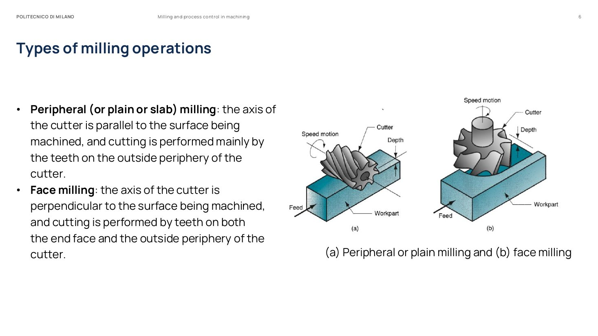

- **Prof:** in milling each tooth cuts for part of the rotation and is idle for the rest, so it makes sense to put **multiple teeth** on the tool. In slab milling you never immerse the tool deeper than its **radius**. Milling is "arguably one of the most flexible manufacturing processes" because of (1) **more axes** and (2) many **tool shapes**. **This is the CAM Shop milling process** (pocket milling, like the slide).
- **Exam alert — up vs down milling ("we like to discuss this during oral exams"):** be ready to **draw** a 4-tooth cutter. **Up milling:** the chip starts at **zero thickness and grows**, so the force increases through the cut; it tends to **pull the workpiece up off the fixture**, giving slightly **higher roughness**. **Down milling:** the tooth enters at **maximum thickness**, so the force decreases to zero; less lifting, but it creates issues for the motion and machine architecture. Outside slab milling you can't always choose.
- **Prof — axes and interpolation:** face, partial face and slot milling = **1D** motion; profile = **2D** (two axes interpolated); pocket = **2.5D** (Z dives, then X–Y move, so you see a **staircase**); surface contouring with a **ball-end mill** = full **3D** (a dome follows any contour). "Having axes doesn't mean they can be interpolated together." 5-axis = 3 linear + rotary + tilting table.

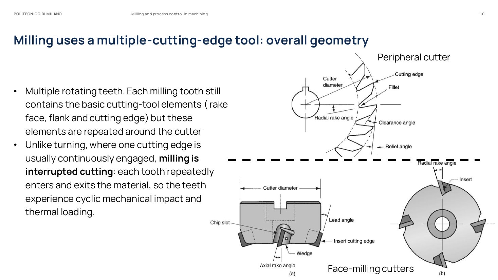

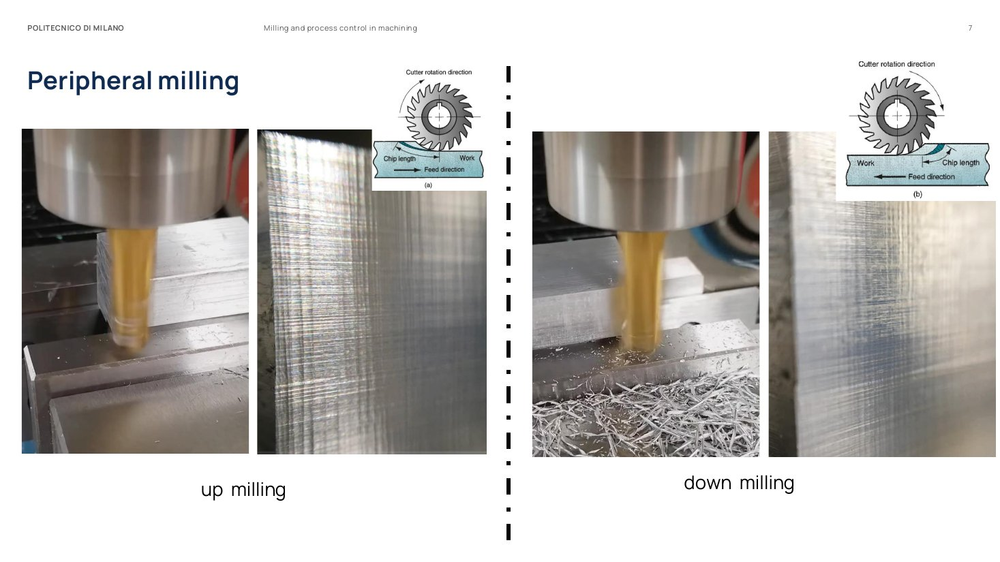

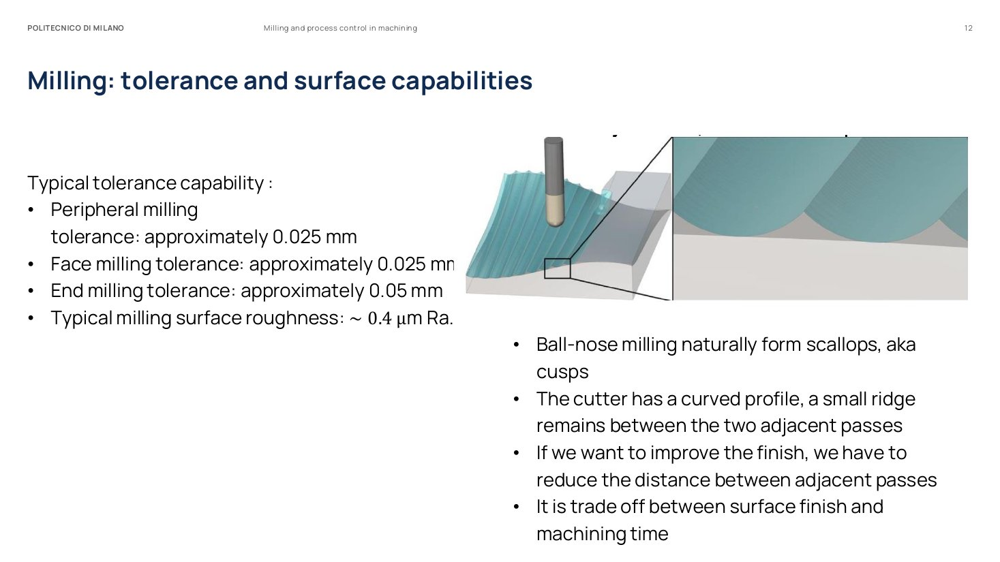

### Vibration and stiffness

**Forced vibration** comes from an external periodic excitation and is easy to identify. **Chatter** is self-excited: it comes from the interaction between the cutting process and the **dynamic stiffness** of the whole system (machine, spindle, tool, workpiece, fixture), which can change during an operation. Remedies: a stiffer frame cross-section, higher-modulus materials, better fixtures, and especially **passive or active damping**.

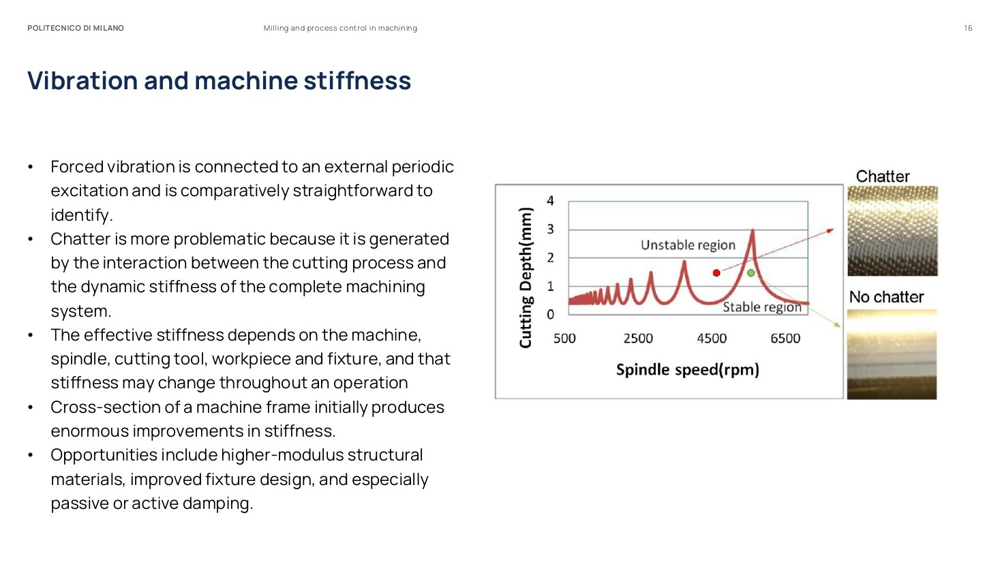

- **Class discussion — a vertical mill vs a thinner universal mill:** the thinner one **vibrates and deforms more**. Intermittent cutting is **more prone to vibration** than continuous cutting, because each tooth hits the work. Old machines fought this with **weight** (heavy cast iron damps vibration), but weight costs money. Natural frequency depends on **stiffness and mass**, so modern machines are **light but rigid** by design.
- **Prof:** chatter is different because **you are cutting the mass**: the part changes shape and therefore its vibration properties during the cut. When it goes unstable you see **chatter marks**. A student suggested choosing parameters that avoid vibration: that's **stability lobes**, computed from a machine model. Stable below the lobes, unstable outside (no details required).

### Milling model

```math
v_c = \frac{\pi D n}{1000}\ [\text{m/min}] \qquad v_f = f_z\,Z\,n\ [\text{mm/min}] \qquad MRR = a_e\,a_p\,v_f \qquad T_m = \frac{L + A}{v_f}
```

Z = number of teeth, f\_z = feed per tooth, a\_p / a\_e = axial / radial depth (the meaning swaps between face and slab milling), A = approach distance. Slab: A = √(d(D−d)). Face, cutter centred on the part: A = ½(D − √(D² − w²)). Face, cutter offset to one side: A = √(w(D−w)). (w = work width.) Typical ranges: D 0.2–2000 mm, Z 2–200, f\_z 0.01–1 mm, v\_c 30–500 m/min.

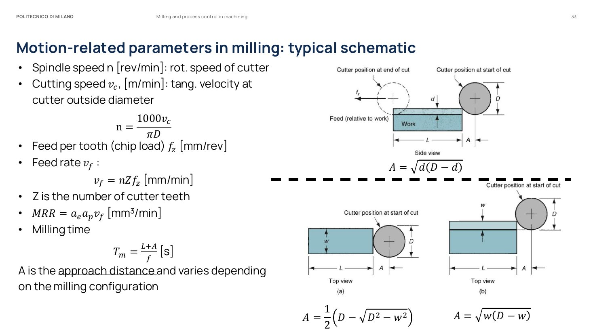

- **Prof — approach distance:** you don't start counting time when the tool touches the part (it would crash). The machining length is L + A, where A is where engagement completes, from a simple triangle: D²/4 = A² + (D/2 − d)², which gives A = √(d(D − d)).

**Chip thickness (slab milling):** the tooth path is a cycloid. At tooth angle θ = ωt:

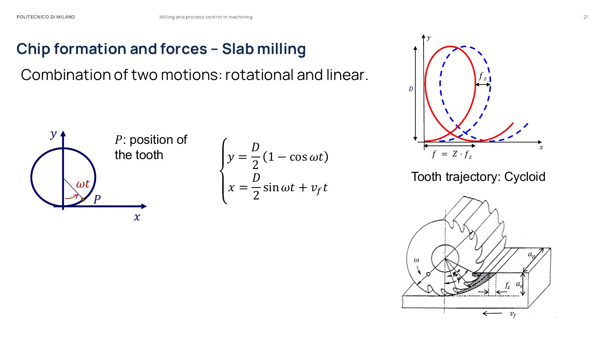

```math
h_D(\theta) = f_z\sin\theta, \quad h_{D,max} = f_z\sin\varphi, \quad 1-\cos\varphi = \frac{2a_e}{D}, \quad h_{D,av} = \frac{1}{\varphi}\int_0^{\varphi} f_z\sin\theta\,d\theta = \frac{f_z}{\varphi}\frac{2a_e}{D}
```

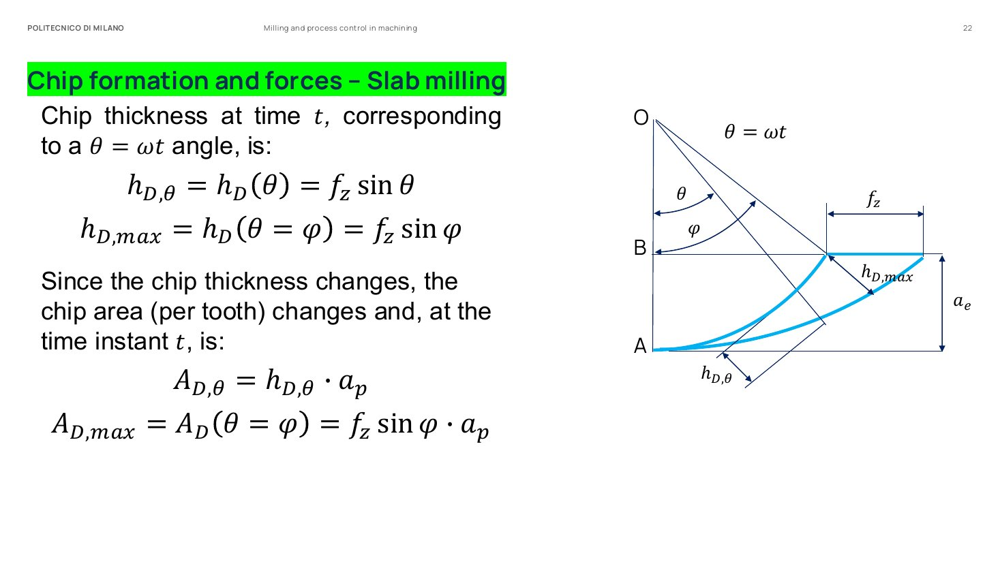

φ = engagement angle. Number of teeth in contact z = φ/φ₀ with tooth pitch φ₀ = 2π/Z.

- **Prof:** f\_z (mm per rev per tooth) ≠ f (mm per rev); f = Z·f\_z. Each tooth traces a **cycloid** (rotation + feed), and consecutive teeth lag by f\_z. Tooth spacing: 4 teeth → 90°, 6 → 60°, 8 → 45°. **z = φ/φ₀ = how many teeth fit in the contact arc.** In face milling the tool is usually **wider than the workpiece**; in slab milling you don't dive past the radius.
- **Prof — why sum torques, not forces:** forces are **vectors** pointing different ways for each tooth, but all torques act about the same axis, so you add them.

**Force, torque, power** (same k\_c method as turning): F\_c(θ) = k\_c,θ·A\_D,θ, with A\_D,θ = h\_D,θ·a\_p and k\_c,θ = k\_cs·h\_D,θ^(−x). Torque T\_c = Σ F\_c(θᵢ)·(D/2)/1000 \[Nm\]; power P\_c = T\_c·ω with ω = 2πn/60.

- **z ≤ 1** (at most one tooth cutting): design for the **peak**, F\_c,max = k\_c,max·f\_z·sinφ·a\_p.
- **z > 2:** use the **average**, T\_c ≈ z·F\_c,av·(D/2)/1000, with F\_c,av = k\_cs·h\_D,av^(−x)·h\_D,av·a\_p. This simplifies to:

```math
P_c = k_{c,av}\,\frac{a_e\,a_p\,v_f}{60\cdot 1000}\ [\text{W}] \qquad (= k_{c,av}\times MRR)
```

**Exam alert (likely numerical):** milling power = average specific cutting pressure × MRR. Mind the units: k\_c in N/mm², MRR in mm³/min, divide by 60·1000 to get W.

- **Prof — the shape of the force signal:** for one tooth, h\_D follows a **sine**; k\_c starts from infinity at zero thickness (non-physical) and drops, so the force follows roughly the chip-thickness profile. **z ≤ 1:** separate peaks with gaps, so size for the **maximum chip thickness**. **z > 2:** overlapping teeth **smooth** the torque towards an average, so use **average chip thickness × number of teeth**. **1 < z < 2:** neither applies, so **compute numerically** (or solve analytically for the maximum, which you may see in the exercise).
- **Prof — face milling difference:** the part is offset from the cutter axis for stability; angles are measured from the vertical, h\_D = f\_z·**cosθ**, and you get an **up-milling then down-milling** passage in one rotation. The chip thickness **doesn't necessarily start or end at zero**, so you must find θ₁ and θ₂ from the geometry.
- **Exam alert — the chain to remember for every milling question:** power = torque × angular speed; torque = force × arm; force = pressure × area, all **angle-dependent**. Size the machine on the **maximum power**.

* **Exam alert (6 Oct):** "The usual question I ask in the oral: *is this face milling up or down milling?* The answer is **both**." It starts as up milling and becomes down milling after the cutter axis, so the stability issues of both are present. Example of z: contact angle 60° with 8 teeth (45° pitch) gives z ≈ 1.33, so while one tooth cuts, the next is already entering.

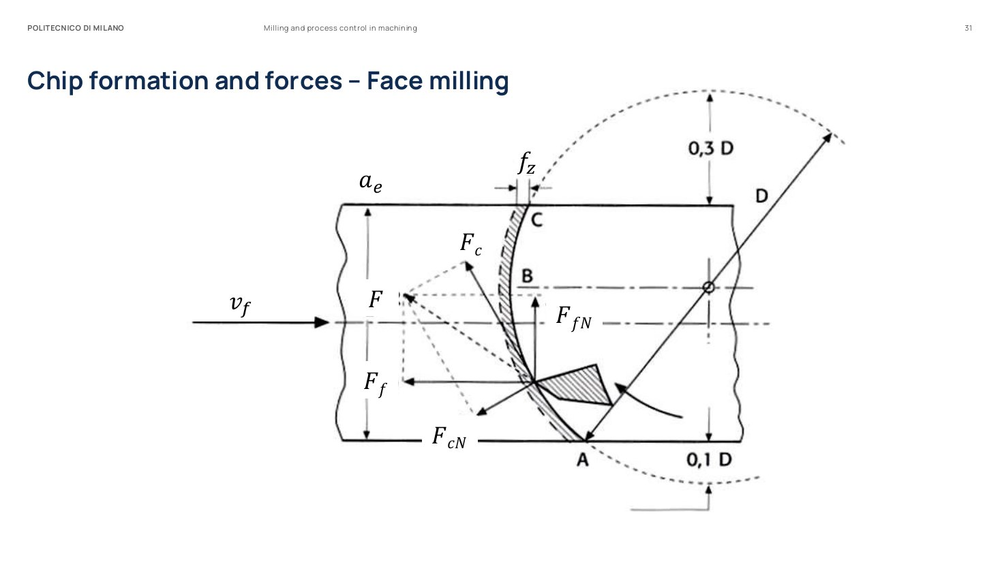

### Drilling

Round hole with a drill bit on a drill press. f = 0.01–0.8 mm/rev, D = 1–50 mm, v\_c = 5–300 m/min. Chip section A\_D = f·D/4 (two cutting lips, each removing f/2 over a length of D/2). F\_c = k\_c·A\_D; torque T\_c = F\_c·(D/2)/1000 \[Nm\]; P = T\_c·ω.

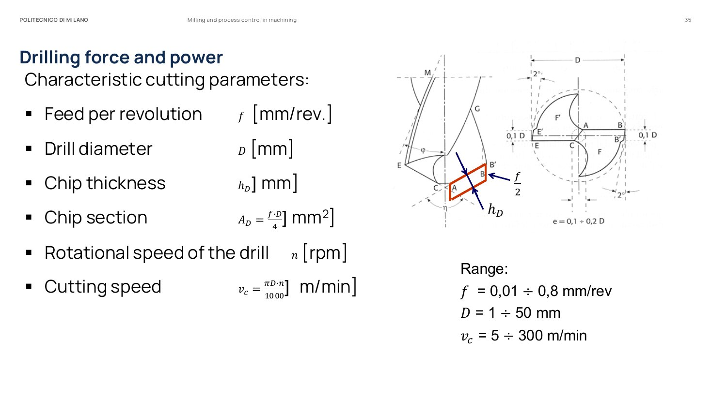

- **Prof — why drilling is a special case:** in milling the chip has room to escape; in drilling the chip can **only go up** out of the hole, and you must **push** the drill in (anyone who has drilled a wall knows). So the **thrust force becomes relevant**, unlike in turning and milling, and it is a more delicate process. Holes are for assembly, cables, fluid passages.
- **Prof:** a drill is like a **2-tooth mill moving only in depth**. Each lip removes a section of height D/2 and width f/2, so A\_D = f·D/4. The torque of each lip acts at **half the radius**, so the formula gives the **total** torque T\_c = k\_c·A\_D·D/(2·1000).

### Machine tool control and monitoring

- **Why automate:** productivity, quality, cycle time, cost, less reliance on experienced operators. **Tool failure accounts for about 20% of machine-tool downtime.**
- **CNC chain:** CAD → CAM → NC/G-code → CNC interpreter → interpolator → servo loops → machine + cutting process, with sensors (encoders, current, force, vibration, probe) feeding back. CNC controls position, velocity and path, but **what happens in the cut?**
- **The 4 control questions, answered for machining:** (1) measure dimensional accuracy, finish, force, tool wear, chatter; (2) with dynamometers, spindle power/current, accelerometers, acoustic emission, temperature; (3) act on feed, speed, depth, tool path, coolant; (4) **within the cut** or **part to part**.

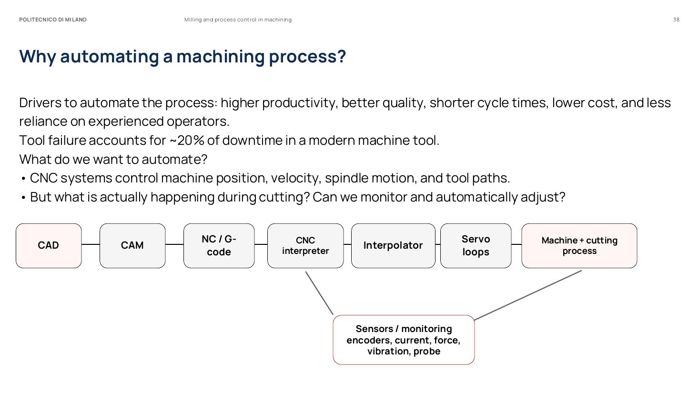

- **Class discussion — what to measure:** roughness and dimensions (the outputs, but these are **consequences**). To know if the process is under control, check whether what you **calculated** (force, power) stays as modelled. Force is hard to measure; **power is easy: the spindle motor is a sensor** (current × voltage).
- **Class discussion — why would spindle power rise in turning, where force should stay constant?** Material batch variability; **tool wear** (a blunt tool rubs, so more friction and heat); a **clogged coolant line** ("you think these are not remarkable issues, but these things happen"). Interpreting dimensions: measure every part and notice that part 13 is out of tolerance.
- **Prof — choosing the sampling rate (worked reasoning):** the force/power in milling repeats at each **tooth passage**, so the basic cycle is the rotation. At 3000 rpm = **50 rev/s**, you must sample **well above 50 Hz** (higher still to resolve single teeth). Undersampling distorts the profile, but "you don't go immediately to 200 kHz: too much data is not easy to deploy".
- **Prof — what to change if power is excessive:** check the tool, check the coolant, or reduce process parameters: in milling, **almost everything** lowers power (a\_e, a\_p, f\_z, n). If you don't intervene: overheating, then wear, then non-conforming parts and new tools, so both quality and productivity suffer.

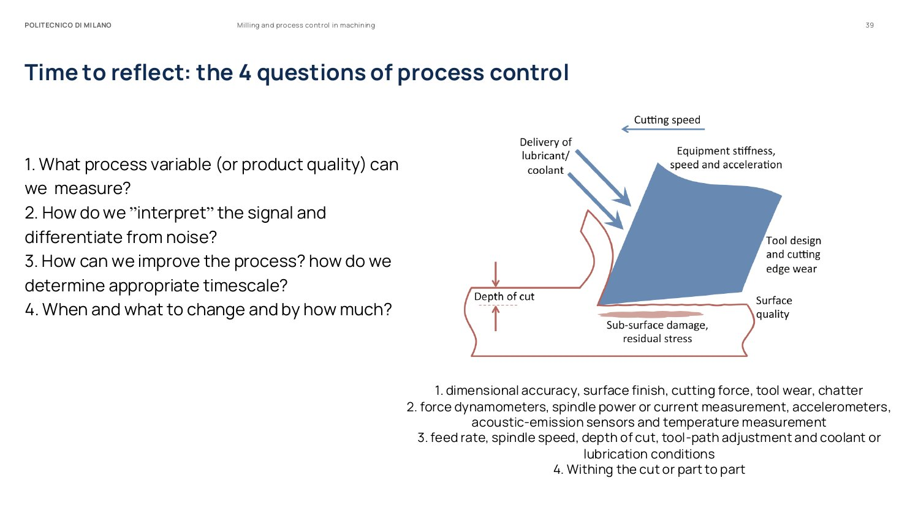

|  | ACO — Adaptive Control with Optimisation | GAC — Geometric Adaptive Control |
| --- | --- | --- |
| Goal | Optimise a **performance index** (min time, min unit cost, max MRR) | Compensate **geometric errors**: tool wear, deflection, thermal effects, finish variation |
| Acts on | Feed, spindle speed, depth, using models + feedback | Tool offsets, feed override |
| Timescale | During the cut | **Between parts or features** (finishing) |
| Example | Early systems maximised MRR by changing feed and speed | Shaft diameter grows with tool wear: measure the part, adjust the offset before the next one; adjust feed to hold Ra |
| Caveat | Needs process knowledge and physical interpretation | Linked to part quality, but what is the response time? |

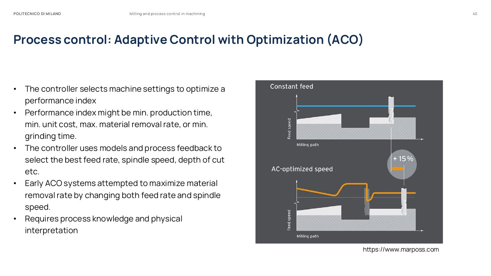

- **Prof — ACO example, done offline in CAM:** a milling path where the axial depth of cut **increases** over one stretch. With constant feed, power rises and you **may break the tool**. So reduce the feed where the depth grows, then go fast where there is no cutting, keeping **power roughly constant**. Constant feed looks more productive, but carries the risk.
- **Prof — GAC example:** turning a shaft while the tool wears produces a **conical** part (the diameter grows towards the end). A **touch probe** (ceramic ball, doesn't deflect) measures the real diameter and the offset is corrected. But every stop adds time and cost, so it is reasonable for **critical, high-value parts**.

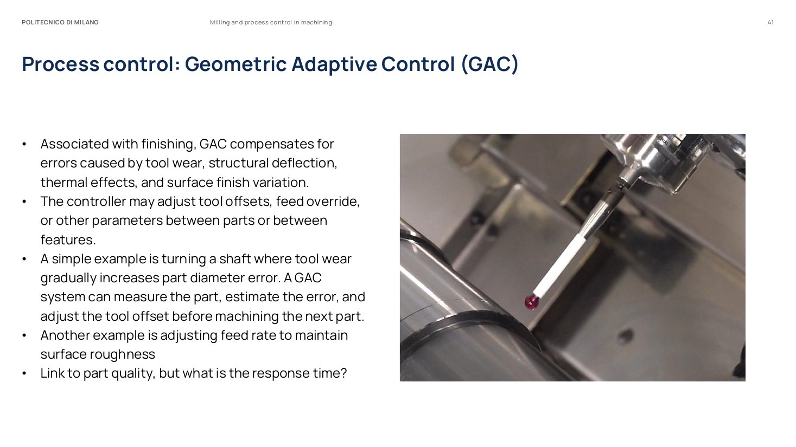

**Monitoring vocabulary:** what to monitor = surface texture, surface integrity, dimensions, tool condition, chatter. There is **no universal sensor**, so **sensor fusion**. **Direct** sensing measures the quantity itself; **indirect** sensing estimates it from another signal. **In-process** = during cutting; **in-cycle** = periodically, e.g. between parts.

|  | External: piezo dynamometers, spindle/tool-holder sensors | Internal: servo/spindle motor current |
| --- | --- | --- |
| Pros | Direct, accurate, reliable, good resolution | No extra sensor, cheap, easy CNC integration |
| Cons | Expensive, hard to install, thermal compensation | Feed current disturbed by friction and dynamics; hard for continuous force in milling; spindle current mainly reflects the **tangential** force (fine for torque) |

- **Prof:** a table dynamometer means **the fixture becomes the sensor**. Calibrated forces in **newtons** (not an uncalibrated amplitude); one axis per sensing direction. Used for expensive parts or **experiments**. Force on the workpiece matters for vibration; force on the tool lets you act **before it breaks**. Feed-axis current also includes guide **friction**, not just cutting.
- **Exam alert — the method he repeats for every process (casting, welding, machining):** describe the phenomenon in words → model it mathematically → know which physical effects an error produces (in machining: **vibration, sound, heat, more power**) → pick the sensor that observes that effect (power meter, thermal camera, accelerometer/dynamometer, microphone) → trade off precision vs invasiveness vs cost (a mounted dynamometer measures directly; a microphone needs **training**). Instabilities change chip area and material response, so power changes, so signals can be used to **update the parameters** in our simplified equations.

**Tool condition monitoring:** wear isn't seen directly, so watch signals that change as the tool deteriorates. **Accelerometers** are simple, non-invasive and real-time; **motor current** is already in the drive. Interpreting the signal is the challenge (the data-driven / hybrid models from L1.1).

## Professor background (less exam-critical)

- **Prof — tools shown in class:** a face mill with **6 inserts**, and an 8-tooth end mill that was neither insert nor brazed but **sintered** (powder metallurgy) and then ground sharp.
- **Prof:** dedicated fixtures give **faster, more precise** part changes but cost more; pallets cut downtime. "As we move to a higher degree of automation we go faster, and eventually it increases the cost."
- **Class discussion — what can't the 50 W CAM Shop machine do?** Large tools, and **strong materials**: power → force → pressure, which is comparable to the material strength, so no steel. Its spindle speed is high because it uses **small tools**. Industrial milling machines have **tens of kW**. The old vertical mill had **uncoupled, often manual** axes; the Snapmaker interpolates all 3 (Z and X on the spindle, Y on the workpiece).
- **Prof:** once loading and cutting are fast, **tool changes** are what's left: 20% of downtime even when automated (seconds, versus minutes by hand). Motion automation is "relatively easy" compared to an autonomous car, but here the moving tool carries **much higher loads**. Interpolation = discrete motors (X, Y) must combine to draw a diagonal; smaller segments mean more computation. In open loop the machine just sends the tool, but forces are high, **the workpiece loses mass and the tool wears**. The roughness and force models only hold if everything is ideal (no vibration, no heating).

## Practice exercises

### H. Past exam: drilling (2021, solved in class 6 Oct)

Through hole Ø28 mm, depth 60 mm. v\_c = 290 m/min, f = 0.1 mm/rev, **k\_c = 2100 MPa given directly** (common for drilling, because of the thrust and the complexity; point angle 160° not needed). Machine 7.5 kW, 90%.

1. Per lip: base f/2 = 0.05 mm, height D/2 = 14 mm, so A\_D = **0.7 mm²**; F\_c = 2100 × 0.7 = **1470 N**.
2. Each lip's force acts at D/4 = 7 mm: T = 2 × 1470 × 7/1000 = **20.58 Nm**.
3. n = 290·1000/(π·28) ≈ **3297 rpm**; ω = 2πn/60 = **345.3 rad/s**.
4. P = 20.58 × 345.3 ≈ **7.1 kW** > available 6.75 kW, so **not feasible** ("well done, you found it before breaking anything").
5. **Fixes (class discussion):** reduce v\_c; reduce f; drill a **smaller pilot hole** and then enlarge it. Every fix **increases time**: "it's not an unbounded optimisation". Lowering v\_c at the same f (mm/rev) doesn't change the material per revolution, only n, so the same material takes longer.
6. Drilling easily needs more power than turning, because the whole hole volume becomes chip.

### I. Past exam: face milling (summer 2021, solved in class 7 Oct)

Steel square 300 × 300 mm, roughing allowance (axial depth) **a\_p = 4 mm**. Face mill D = 80 mm, Z = 8, κ\_r = 90°, k\_cs = 1600 MPa, x = 0.197, f\_z = 0.15 mm, v\_c = 250 m/min. Machine 15 kW, 80%. Zig-zag path: **25% of the tool overhangs** one side; start and finish **5% of D** away from the part; **5 passes** with step-over = **75% of D** (so a\_e = 0.75D = 60 mm).

1. **Engagement angles** (draw it!): φ₁ = arcsin((0.5D − 0.25D)/0.5D) = arcsin(0.5) = **30°**; φ₂ = **90°** (the tool can't cut past its axis line). Total φ = 120° = **2.094 rad**. The maximum possible in face milling is 180°.
2. Tooth pitch = 2π/8 = 0.785 rad, so **z = 2.094/0.785 = 2.67** teeth on average, which is > 2, so use the **average chip thickness** method.
3. h\_D,av = (f\_z/φ)·(2a\_e/D) = (0.15/2.094)·(2·60/80) = **0.107 mm**; A\_D,av = 0.107 × 4 = **0.43 mm²**.
4. k\_c(h\_av) = 1600 × 0.107^(−0.197) ≈ **2480 MPa**. "It's not the average pressure: it's the pressure **at** the average chip thickness." F\_c,av ≈ **1.06 kN** per tooth.
5. T = z · F · D/2 = 2.67 × 1064 × 40/1000 = **113.6 Nm**; ω = v\_c/(D/2) = (250·1000/60)/40 = **104.2 rad/s**; P = **11.8 kW**.
6. Available = 0.8 × 15 = **12 kW**, so **feasible**. (In practice peaks can exceed the average, but short peaks are usually fine; you could compute the exact peak numerically.)
7. **Path length:** each pass = 0.05D + L + D + 0.05D = L + 1.1D = 388 mm, times 5 passes, plus 4 step-overs × 0.75D = 240 mm, so about **2180 mm**. n = 250·1000/(π·80) ≈ 995 rpm; v\_f = Z·f\_z·n ≈ **1194 mm/min**, so t ≈ **110 s** (almost 2 min).

**Class discussion — why this zig-zag with entry and exit margins? ("this type of discussion is what we do during the oral exam")** Five passes because the mill is narrower than the part. Enter and exit **in the plane, from outside the part**, rather than plunging, for **precision**: you're sure everything is cut, and forces and power ramp up smoothly (zero chip → stationary → zero), so vibration risk is lower. An arc entry is possible but engages more of the tool at once. Downside: **longer time**, since all moves near the part are at feed speed. If roughing and finishing were separate, you could rough fast and finish delicately. **Size the machine on the stationary (maximum) condition**, not the entry or exit.

**Prof — where k\_cs and x come from:** they come with the **tool**, which is chosen for the workpiece material (tools for Al, steel, Ti…), along with recommended ranges of f\_z and v\_c. "They don't fall from the sky."

**Exam alert — decimals:** keep decimals with a physical meaning. In mm, the 3rd decimal is a **micrometre**, the 6th a nanometre, the 9th a picometre ("the distance between atoms"). Three decimals are enough; excess digits "are just a bit embarrassing".

All formulas: [formula sheet](../formula-sheet.md).

## Likely oral questions

- **Why is milling harder to model and monitor than turning?** Interrupted cutting: chip thickness h\_D = f\_z·sinθ varies with tooth angle, the number of engaged teeth z = φ/(2π/Z) varies, and teeth suffer cyclic impact and thermal load. So force and torque are periodic. For z ≤ 1 you design on the peak force, for z > 2 on the average; P\_c = k\_c,av·MRR.
- **Forced vibration vs chatter?** Forced = external periodic excitation, easy to identify. Chatter = self-excited, from the interaction between the cut and the **dynamic stiffness** of machine + spindle + tool + workpiece + fixture, which changes during the operation. Remedies: stiffer structure, better fixtures, passive/active damping.
- **ACO vs GAC?** ACO optimises a performance index (min time or cost, max MRR) by adjusting feed and speed during the cut, using models + feedback. GAC compensates geometric errors (wear, deflection, thermal) between parts or features through offsets, e.g. the shaft diameter growing as the tool wears. Both need monitoring, and the key question is response time.
- **Dynamometer or motor current?** Dynamometer: direct, accurate, good resolution, but expensive, hard to install, needs thermal compensation. Motor current: no extra sensor, cheap, already in the CNC, but indirect; feed current is disturbed by friction and dynamics; spindle current reflects mainly the tangential force. No universal sensor, so sensor fusion. Also: direct vs indirect, in-process vs in-cycle.
