# L1.7 Transformation by deformation: forming processes

> Part of the CAM study guide. Source of truth: [the study guide](https://claude.ai/artifact/WrGc96ueegSH8ZXZdT4FaB). Generated by `tools/build_guide.py`; edit the guide, not this file.

## Slides and professor's explanations (exam material)

In forming, a die applies stresses **above the yield strength**, so the metal deforms plastically to the die's shape. Volume is conserved: no material is added or removed. Force and formability depend on **strain hardening, temperature, strain rate and friction**, captured by the flow curve Y\_f = Kεⁿ. *(Slides + recordings of 7 Oct (introduction, bulk vs sheet) and 12 Oct morning (cutting, bending, drawing, material behaviour). Professor's comments inline.)*

### Bulk vs sheet

|  | Bulk deformation | Sheet-metal working |
| --- | --- | --- |
| Surface/volume | Low (billets, bars) | **High** (sheets, strips, coils) |
| Deformation | Large, massive shape change | Cutting, bending, drawing |
| Examples | Rolling, forging, extrusion, wire/bar drawing | **Pressworking**: punch + die, parts are **stampings** |

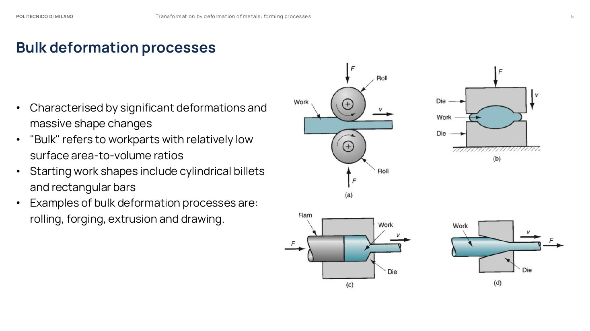

- **Prof:** deformation processes are **constant-volume** (casting and welding add material, machining removes it). **Elastic** = springs back (he bent a metal bar in class); **plastic** = keeps the new shape. The die must deform the part without deforming itself, "just like the cutting tools". "If casting was making ice cubes, **this is making pasta**."

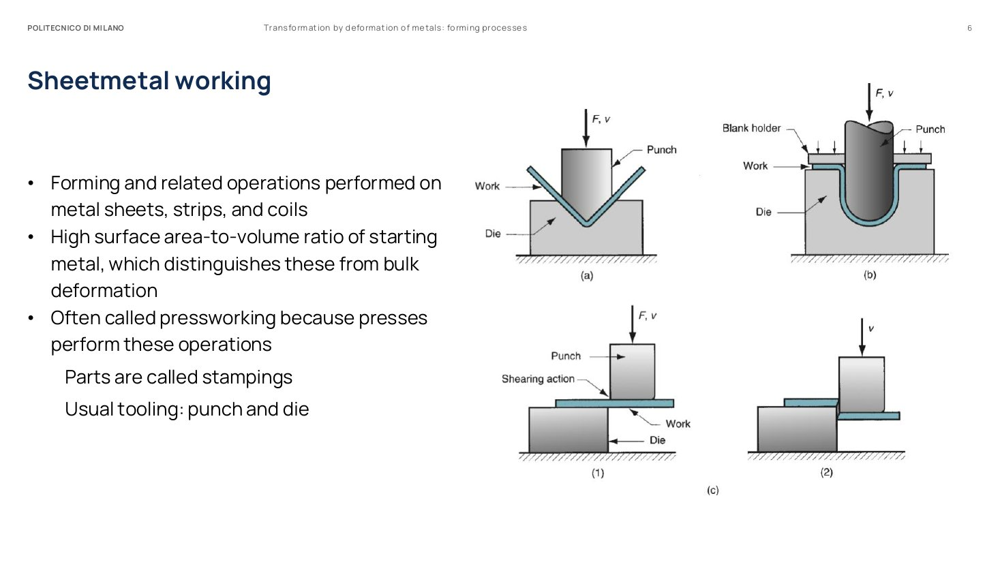

Sheet = 0.4–6 mm thick (plate > 6 mm), usually **cold worked**. It starts from **flat rolling** (volume conservation, hot or cold). Applications: food tanks and cans, aerospace nozzles and nose cones, car body panels, doors, hoods, architectural roofing and façades. Industrial stampings usually combine all three operations in a die sequence: cut → draw → trim → pierce → flange → hem.

### Cutting

- **Shearing:** a straight cut between two edges with a small **clearance**; for large sheets.
- **Blanking:** the cut-out piece (**blank**) is the part. **Punching:** the cut-out piece (**slug**) is scrap and the hole is the feature.
- **Progressive die** (high volume): a sequence of operations in **one press**; the strip advances step by step and the part stays attached until the final cutoff. **Pilot holes** align the strip with each station. Can include lancing (partial cuts) and bending.

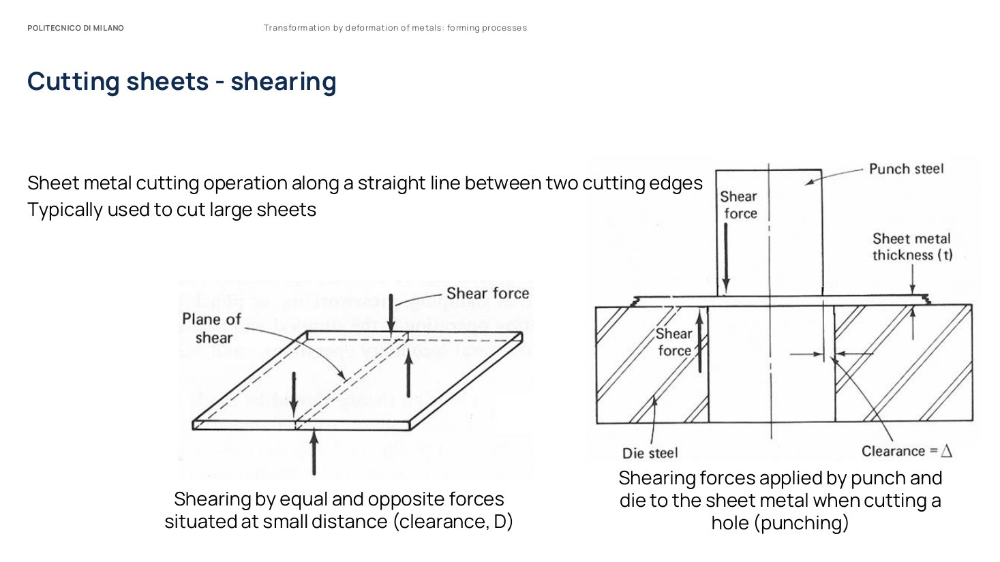

- **Prof — shearing mechanics:** a punch alone can't cut; the **die provides the reaction**, and the **clearance** gives the material room to flow. The sheared area = **thickness × length** (straight cut) or **thickness × circumference** (round punch). The force is the same whether you keep the blank or the sheet; the name only matters for the process sequence.
- **Class discussion — what's the catch with doing all operations in one press?** **More power**: all punches work at once, so the forces add. They move at the same ram speed, but **bigger holes need more force** (P = F·v summed). The forces must also be **balanced** across the die, and the sequence must be well studied.

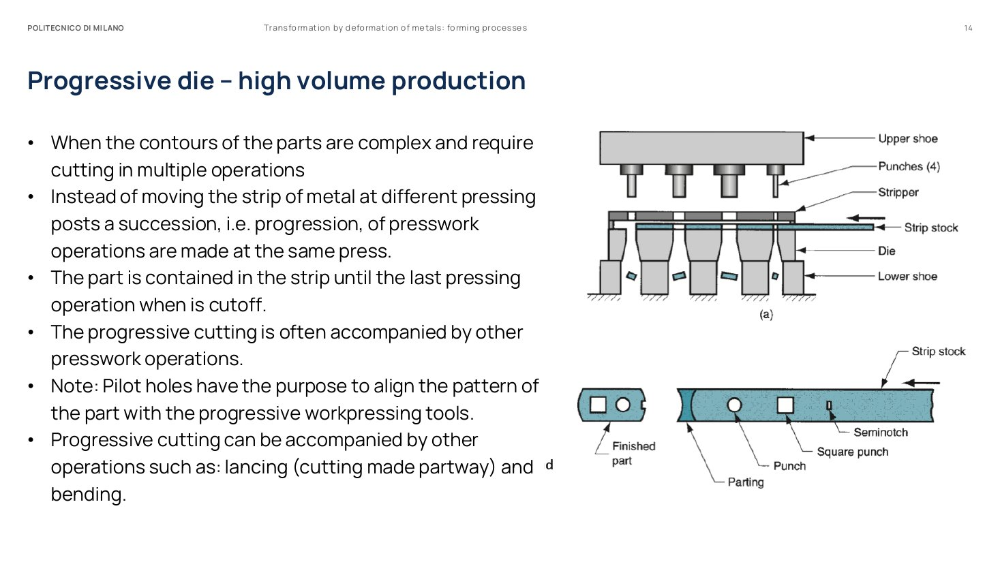

### Bending

The sheet is strained around a straight axis: the inside of the **neutral plane** is compressed, the outside stretched. **Bend allowance** = length of the neutral axis in the bend, needed so the flat blank gives the right final dimensions:

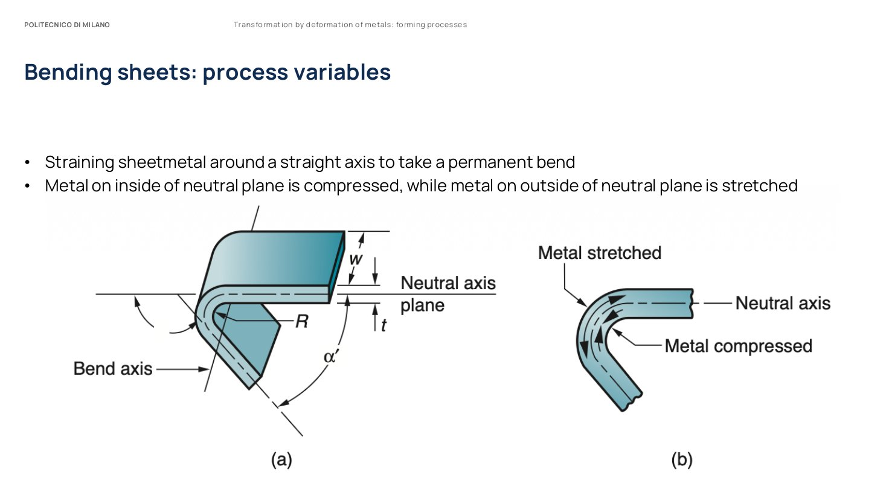

- **Prof:** in bending you can't treat the thickness as negligible. Stretching outside and compressing inside mean the **final length changes**: a 1 m flat blank doesn't give 1 m after bending. The issue is **where the neutral axis is**, since the arc length = r′·angle needs the right radius.

```latex
A_b = 2\pi\,\frac{\alpha}{360}\,(R + K_{ba}\,t), \qquad K_{ba} = 0.33 \text{ if } R < 2t, \quad K_{ba} = 0.50 \text{ if } R \ge 2t
```

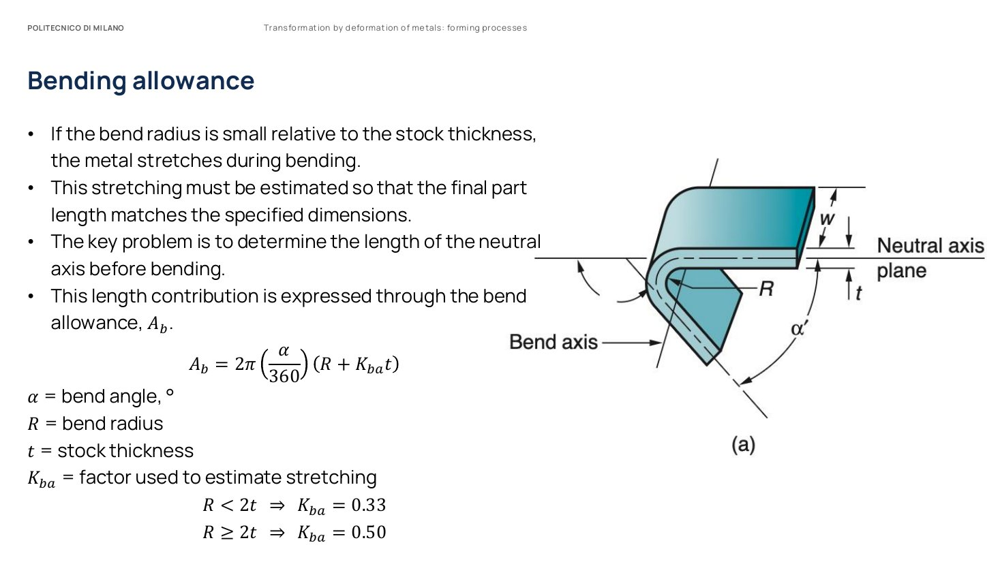

α = bend angle (°), R = bend radius, t = thickness.

- **Prof — reading K\_ba:** **easy bend** (large R, thin sheet) means the neutral axis stays at the middle (K\_ba = 0.5). **Hard bend** (R < 2t: small radius, thick sheet) means it moves to **one third** of the thickness (K\_ba = 0.33), so the allowance is smaller. **Flat blank length = straight segments + A\_b.** Wrong length gives a part that is too long or too short (an exercise will use this).

| Type | Notes |
| --- | --- |
| **V-bending** | V-die on a **press brake**; simple, cheap dies; low production. **This is the CAM Shop air-bending activity.** |
| Edge bending | Wiping die + pressure pad; high production; costly dies |
| Flanging | Small flange relative to the part: stiffness, rounded edges, easier assembly |
| Hemming | Fold the edge over: edge quality, stiffness, hides burrs |
| Curling / wiring | Rounded edge (around a wire): stiffens, removes sharp edges |
| Corrugating | Repeated wavy ribs: stiffness without more thickness (roofing, panels) |
| Successive bending | Progressive pressworking, one station per bend, strip advanced intermittently |

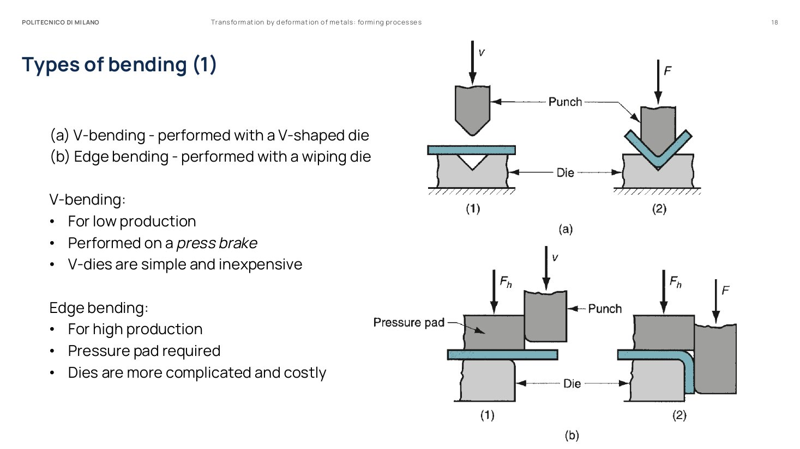

- **Prof — V-bending:** the punch **always has a tip radius** (that's the R in A\_b; "zero tip radius doesn't exist"). A 60° die gives a final angle **wider than 60°** because of springback. The V-die must be at least as long as the bend. **Edge bending:** the pressure pad holds the sheet by friction; the die clearance must be **at least t** so the bent metal fits.
- **Exam alert — cutting vs bending is a matter of radii:** shearing tools have **sharp corners** to **concentrate pressure** and break the metal; bending (and drawing) tools have **controlled radii** so the metal **flows instead of rupturing**. "Otherwise the schematic looks like shearing. Why doesn't it cut? Because of this radius."

### Deep drawing (axisymmetric cup)

- A blank over a die cavity is pushed in by a punch, making cups, boxes and hollow shapes. **Clearance c = 1.1t** (about 10% more than the thickness).
- **Steps:** (1) bending over the punch radius; (2) bending over the die radius, then straightening into the cylindrical wall; (3) flange material flows inwards. The punch force must exceed the **friction** under the flange. The flange is compressed circumferentially, so it tends to **wrinkle**; a **blankholder** presses it flat.
- **Stress state:** all the force reaches the flange **through the cup walls**, so the walls are highly **tensioned** and can **tear**. Characteristic failures: wrinkling (flange or wall), tearing (near the bottom), earing (anisotropy), surface scratches.

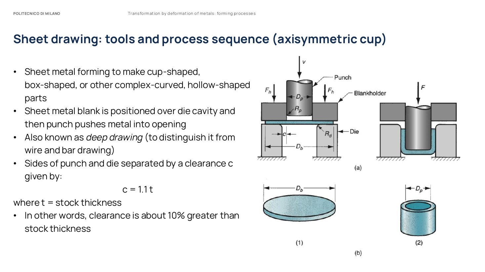

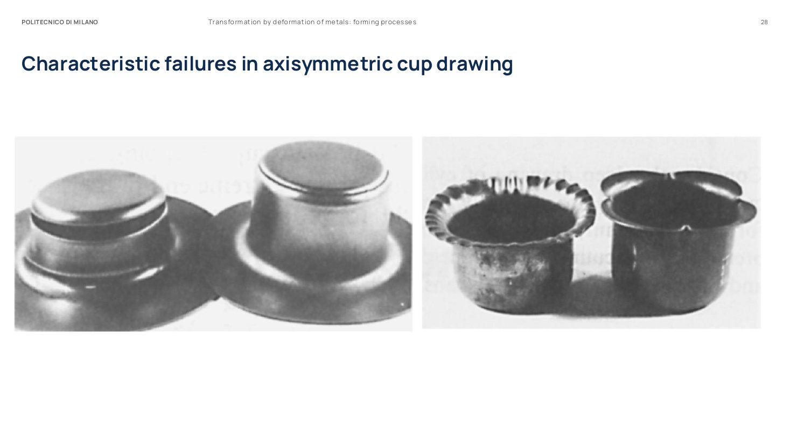

- **Class discussion — drawing looks like shearing, so why doesn't it cut?** (1) **larger clearance** (about 1.1t) so the sheet can flow in; (2) **radii** on both punch and die; (3) the **blank holder**, which doesn't stop the sheet but **slows it down** so it flows under control without buckling out of plane (shearing has no blank holder; drawing is in between). Volume is constant: blank area × t = cup volume, so you can size the blank.
- **Prof:** deep drawing is a **sequence of bend-and-straighten** cycles: metal bent over the die radius is then straightened into the wall. The flange is in **circumferential compression** (so it wrinkles, prevented by the blank holder); the wall is in **tension** (it carries all the punch force); the corners see bending. The bottom corner started deforming earliest and accumulates the most strain, so **tearing happens there** if thickness doesn't stay constant.
- **Class discussion — 1000 good cups, then tearing starts. Why?** Punch or die **wear**; the material **lot changed**; **lubrication failing** (local friction, so the metal can't flow). How to detect it: temperature rise, end-of-line vision inspection, and above all **punch force increasing**. That is monitoring.

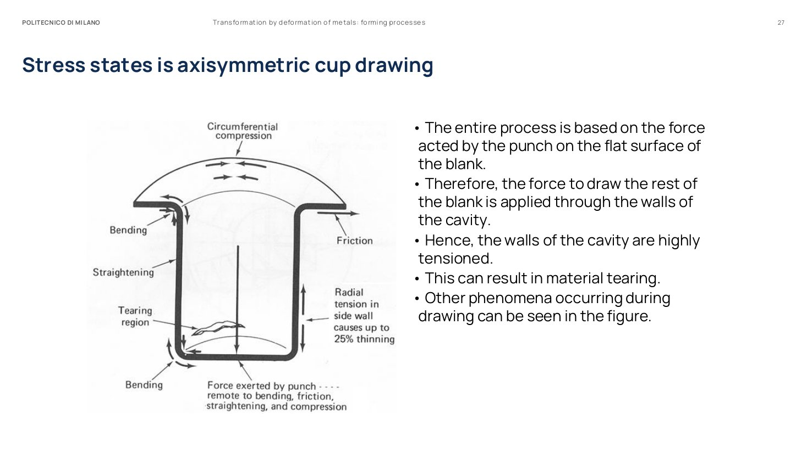

### Formability and material models

- Most bulk processes are compressive; some forming stretches (tension), bending gives tension + compression, cutting gives shear. **Desirable:** low yield strength, high ductility. Both improve with temperature; strain rate and friction also matter.
- **Simple force models (slide):**

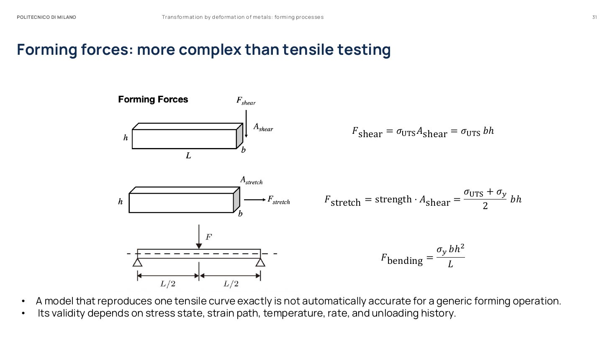

- **Prof:** formability = deforming **without breaking** (or breaking under control, as in cutting), ideally at low force, power and energy. In machining we used pressure × area; in forming it's **stress × area**, compared to material strength. Which strength depends on the process: **cutting** needs the **UTS** (rupture); **bending** needs the **yield point** (start of flow); stretching is in between.

```latex
F_{shear} = \sigma_{UTS}\,b\,h \qquad F_{stretch} = \frac{\sigma_{UTS} + \sigma_y}{2}\,b\,h \qquad F_{bending} = \frac{\sigma_y\,b\,h^2}{L}
```

b = width, h = thickness, L = die opening/span. **Exam alert:** a model that fits one tensile curve is not automatically valid for a forming operation. It depends on stress state, strain path, temperature, rate and unloading (springback) — the "no model is perfect" theme from L1.1.

- **Tensile test** (UNI EN 10002, ISO, ASTM E646) gives the flow curve.
- **Hollomon (work hardening):** σ = Kεⁿ (K = strength coefficient, n = strain-hardening exponent). **Flow stress** Y\_f = Kεⁿ = the instantaneous yield strength. **Average flow stress** up to final strain ε:

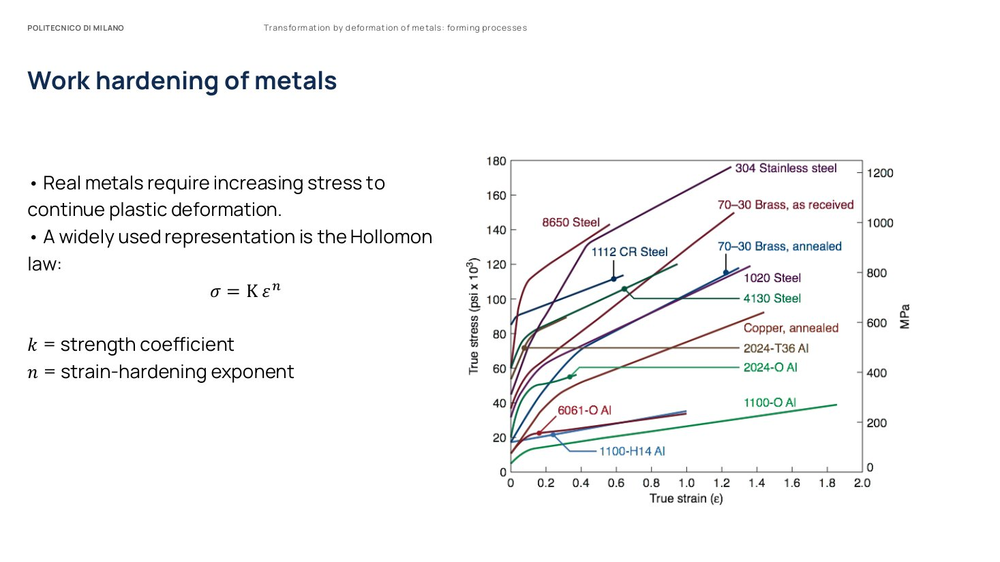

- **Exam alert — the curve is the material's "ID card":** linear **elastic** region (Hooke; release and it returns; he pushed and released an Al bar) → **yield** → **plastic** region with **strain hardening** → max = **UTS** → rupture. Area under the elastic part = **resilience** (a bridge must stay here); area up to rupture = **toughness** (a bent sheet needs it). **Forming works in the plastic region**, between yield and rupture.
- **Class discussion — Al vs steel curves:** Al **yields at lower stress** (easier to deform), breaks at lower stress, but **deforms more before breaking**, and has a **smaller slope (E)**, so it is easier to deform elastically. Steel has a higher E.
- **Prof — why strain hardening:** deformation happens through internal **defects**; as they **jam** against each other it gets harder to move them. Hollomon describes this. True area at any point comes from constant volume, since the machine measures length, not area. **Poisson's ratio** links the contraction in x and y to the extension in z (< 1).
- **Prof — why average flow stress:** in bending, the whole bend line deforms together; in **rolling**, material enters undeformed and leaves fully deformed, so the strain varies through the zone. Hence Ȳ\_f = Kεⁿ/(1+n), with ε the final strain. **Units:** σ in MPa = N/mm²; ε dimensionless; strain rate in s⁻¹.

```latex
\bar{Y}_f = \frac{K\,\varepsilon^{\,n}}{1+n}
```

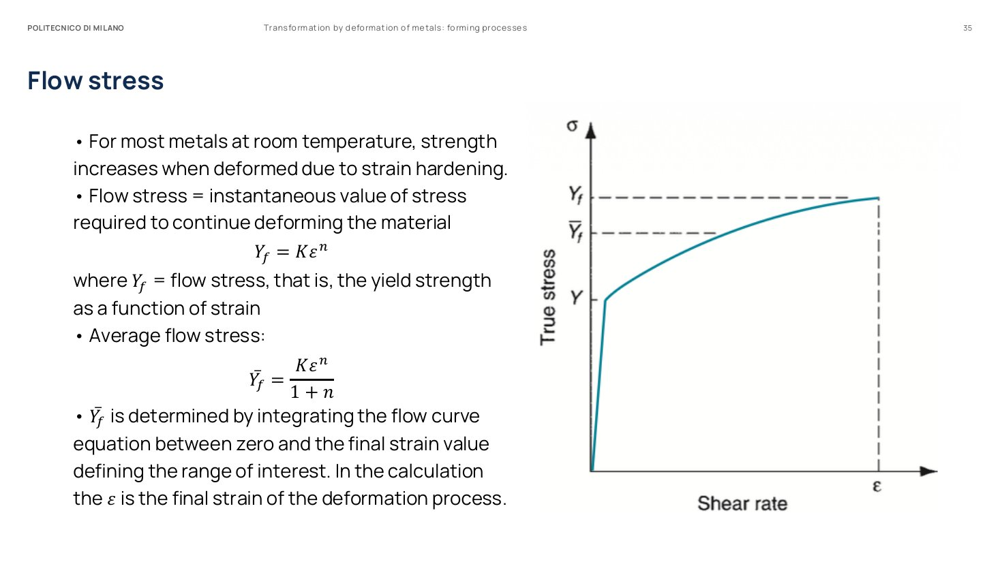

- **Elastic–perfectly plastic:** σ = Eε for ε < ε\_y, σ = Y beyond (K = Y, n = 0). It captures bending well: an **elastic core** stores recoverable energy (**springback**) and the **plastic outer layers** keep the curvature. **Elastic–strain hardening:** K > Y, n > 0, how most ductile metals behave cold.
- **Strain rate:** at hot-working temperatures the flow stress rises with strain rate (**strain-rate sensitivity**). With rising temperature, C falls and the exponent m rises.

### Cold vs hot working

|  | Cold working (room temperature) | Hot working (T > 0.5 T\_m, above recrystallisation) |
| --- | --- | --- |
| Flow curve | Strain hardening (n > 0) | K drops, **n → 0**, ductility up |
| Pros | Accuracy, tolerances, surface finish, strength from hardening, grain flow, no heating | Large deformation, low forces |
| Cons | High forces/power, clean surfaces needed, limited deformation, may need annealing | Lower accuracy, heating energy, oxidation, shorter tool life |

- **Prof — "hot" is relative to the material:** hot working means T > 0.5·T\_m: for Al (T\_m ≈ 600 °C) about **300 °C**; for steel (about 1500 °C) about **750 °C**. Hot: lower yield, **no strain hardening** (elastic–perfectly plastic plateau), lower E. Heat gives defects energy to **slide past each other**. But heating **costs energy too**, and causes oxidation. Cold: more **precise**, since there's no uneven heat exchange changing properties point to point.
- **Prof — strain rate:** deform faster and it gets **harder** (flow stress rises with ε̇, on log axes). How do you change ε̇? Through **process speed**: punch, rolls, extrusion ram. With rising temperature the constant C falls but the material becomes **more sensitive to strain rate** (m rises).
- **Prof — the procedure for any forming force:** know the deformation the process requires → is it hot or cold? → read the strength from the flow curve (Hooke / Hollomon, temperature, rate) → **force = stress × area**.

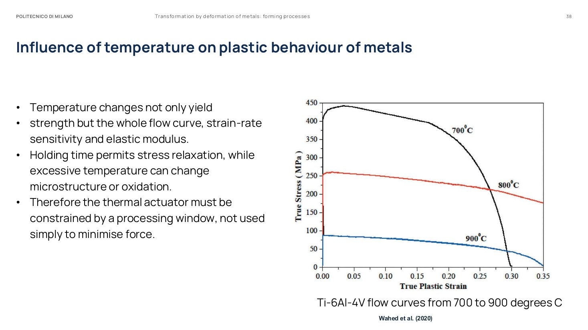

Warm working sits in between. **Temperature as a control variable:** it changes the whole flow curve, the strain-rate sensitivity and E (Ti-6Al-4V curves from 700 to 900 °C), but too hot changes the microstructure or oxidises. "The thermal actuator must be constrained by a **processing window**, not used simply to minimise force."

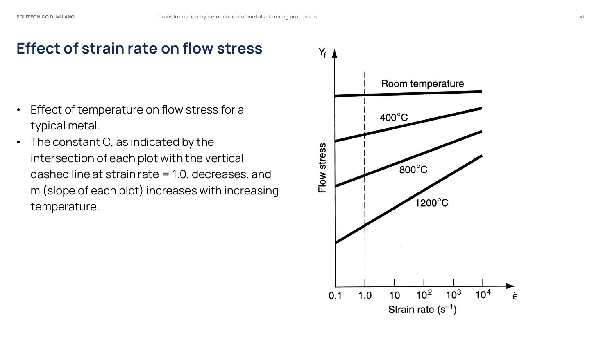

**Measurable during sheet operations (link to L1.8 and CAM Shop):** punch force and stroke, angle/springback, process signatures that reveal defects or tool state.

## Professor background (less exam-critical)

- **Prof — the four bulk processes in one line each:** **forging** = a closed die imprints its shape, discrete (one part at a time; e.g. car **camshafts**); **rolling** = continuous version for long products: thinner means longer (volume constant), and it **makes the sheet** for sheet working; **extrusion** = "pushing toothpaste from the tube" through a die, constant cross-section (aluminium window frames, Bosch/aluminium profiles); **drawing** = **pulling** through an open die, very long thin products (every copper wire in a cable, reduced in many stages). Extrusion is measured in metres, drawing in **kilometres**.
- **Prof:** bulk processes need **high forces, heavy equipment**, usually **hot** (heat lowers strength). Billets and bars come from **casting**: "please remember, things always start at melting."
- **Class discussion — sheet vs coil:** a coil is easier to **transport**, but it's already bent, so you must flatten it; a sheet is ready to use. A **strip** is narrow in one dimension (e.g. **EV battery tabs**).
- **Class discussion — why is sheet worked cold (room temperature; hot means close to T\_m)?** It's thin, so already easy to deform, and for **quality**: hot sheet gets close to rupture more easily.
- **Class discussion — car hood vs rear window frame (same material and thickness):** what differs is the **sequence of processes and dedicated tools**. Hood: blanking (cut the blank) → **deep drawing** → trimming/punching. Frame: much more **punching** (the window area removed) plus bending. Deep-drawn cups also go through several drawing stages.
- **Prof:** like paper: you can bend it, shear it (but only the right way: scissors, not pulling), punch it, draw it. Unlike turning and milling, where one tool makes many geometries, stamping dies are **custom-made for one product**: expensive, long-lived, for high volumes (fixed automation, as in L1.1). Shearing a sheet into two halves still conserves volume. **Blanking vs punching depends on which piece you keep.** One die set can cut, bend and draw in sequence.
- **Progressive die:** easier to automate. The strip advances one station per stroke, holds the parts until the final cutoff ("the strip acts like a mask"), and **pilot holes** register it at each station.
- **Prof — paper demo:** bend a sheet of paper over itself and it **springs back**; that's why you put a book on it. Metal does the same: the outside fibres stretch, the inside compresses, the stresses balance across the thickness, and the **neutral axis shifts towards the inside**. So you must **overbend** to end at the right angle. **This is a CAM Shop exercise: bending to the correct angle.**
- **Prof:** a flange stiffens a flat panel (it resists bending). Flange types: straight, stretch (radius inwards), shrink (radius outwards), reverse, jog, hole flange. Hems: you never find a free sheet edge you can touch on a car door; **fizzy-drink cans** are hemmed (assembly + no cuts); flattened / open / teardrop / double hem (two sheets gripping). **Corrugation:** the waves redirect a vertical load in different directions, so a stiffer panel. Successive bending (connector pins): **punch holes first**, because cutting the outline first would make the strip hard to advance.
- **Prof — tensile test demo:** an AM "dog-bone" specimen (thin in the middle so it breaks there, thick ends for the jaws) and modelling clay pulled by hand: the diameter shrinks, the length grows (constant volume), then it breaks; a bigger area needs a bigger force. The machine records **force vs elongation**, converted to **stress vs strain** to get a material property. "I would very much require all engineers of Politecnico di Milano to know this test."

## Practice exercises

*No dedicated exercise. All formulas: [formula sheet](../formula-sheet.md).*

## Likely oral questions

- **Deep drawing: what fails and why?** All the force passes through the cup walls, so they are in tension and can **tear**. The flange is compressed circumferentially, so it **wrinkles** (prevented by a blankholder, but too much blankholder force causes tearing). Clearance c = 1.1t. Control variables: blankholder force, draw beads, lubrication.
- **Cold vs hot working?** Hot (T > 0.5T\_m): K falls, n → 0, large deformation, low forces, but poor accuracy, oxidation, energy and short tool life. Cold: accuracy, finish, strain hardening, but high forces and limited ductility. Temperature as an actuator must stay inside a processing window.
