# L1.8 Sheet-metal forming control and automation

> Part of the CAM study guide. Source of truth: [the study guide](https://claude.ai/artifact/WrGc96ueegSH8ZXZdT4FaB). Generated by `tools/build_guide.py`; edit the guide, not this file.

## Slides and professor's explanations (exam material)

"The machine controls its own axes; the customer specifies the state of the product. Between those two statements lies the **mechanics of the workpiece**." A press can repeat a stroke perfectly and still give different bend angles, because the sheet varies. The central problem is **springback**, solved by open-loop compensation, direct feedback, model-based feedback or adaptive control. This is the **CAM Shop air-bending activity**. *(Slides + recordings of 12 Oct afternoon (online) and 13 Oct morning (control strategies). Professor's comments inline.)*

### Why automate, and automation vs flexibility

- Stamping makes about 10–30% of vehicle body components. A panel goes through drawing, trimming, flanging and piercing, so **a disturbance in the first operation propagates down the line**. Conventionally, defects are found only after forming: scrap, then manual press correction.
- Automation raises productivity (fewer interruptions and manual set-ups), cuts scrap (catches drift before a big batch), encodes operator knowledge into measurements, models and rules, and gives **traceability** (force, position, temperature, angle per part or coil).
- **Flexibility** = ability to change product, geometry or route. **A dedicated mechanical press can be highly automated yet have little product flexibility** (automation is not flexibility; see L1.1).
- **Stamping sequence:** coil preparation & blanking → drawing → trimming → piercing/notching → re-drawing/calibration → flanging & hemming.
- **Tandem line:** separate presses + robots transferring panels. Flexible (a press can be serviced or reassigned, dies arranged for panel families), but limited by transfer time, synchronisation and part stability. **Transfer press:** several die stations in one press, crossbar grippers moving the panels. The trajectory must avoid die collisions and match the press opening.

* **Prof — the drifting-hole example:** a punched hole whose centre drifts slightly compromises the whole downstream geometry. Conventionally you discover it by measuring parts one by one, **when it's too late** and many parts are scrapped. The causes (tool wear, lubrication, wrong settings) **can be sensed**, on the part or through the press's **power consumption**, and corrected possibly in real time. In automotive, cost dominates: automation looks expensive but **cuts scrap cost**.

### Automation vs product quality: sources of variability

The same punch stroke gives different bend angles because the sheet varies in **thickness, yield strength, E, hardening, orientation (anisotropy)**, and friction varies with **lubrication, contact pressure, sliding speed, tool wear**. "Even a perfect servo system cannot remove workpiece variations unless the product state is **measured or inferred**."

- **Prof:** "What we control is the **motion of a tool**. Material flow is controlled only **indirectly**, through tool geometry." Sheet thickness has its own tolerance, e.g. a 2 mm sheet at **±0.1 mm**, varying within a sheet and between batches. Yield, E and hardening vary because the sheet itself comes from rolling or casting with its own variability. In hot forming, **delays between operations** change the temperature of the part and the tool, and therefore wear.
- **Prof — springback data (high-strength steel, 1.2 mm, open die):** at 50–90° bend angle springback is about **10°** and fairly stable, then it **grows at larger angles**. The values come **with a scatter** (standard deviation), so there isn't a single springback value, which is why measuring other quantities helps keep control.

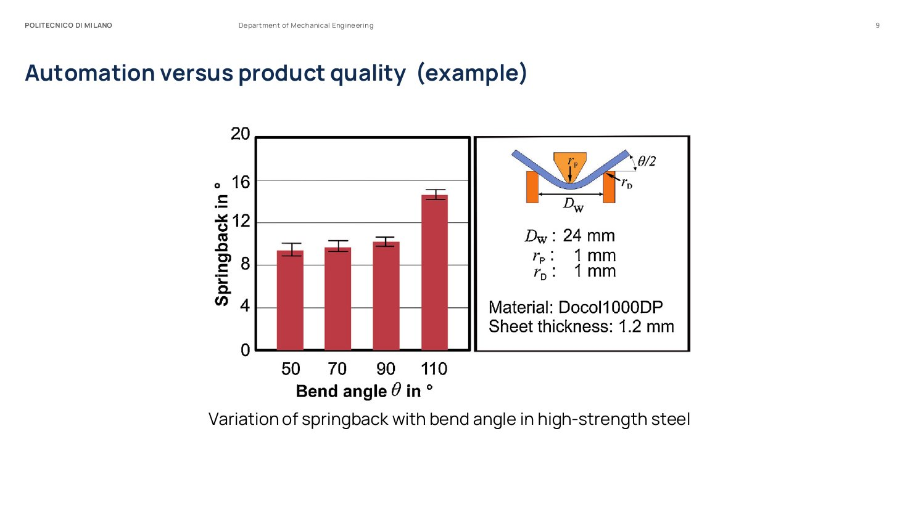

| Model errors | Disturbances | Material variability |
| --- | --- | --- |
| Mismatch between model and reality: E, hardening, anisotropy, friction | Outside the model: unplanned stock variation, part temperature, frame vibration, damaged lubricant film | Often counted as a disturbance: microstructure, tool/interface variability, wear |

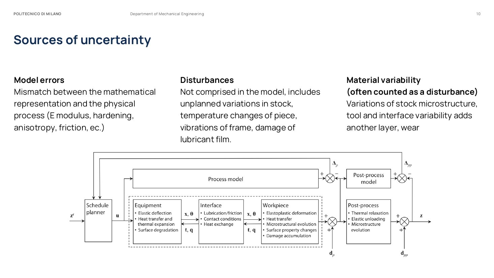

- **Prof:** models are deliberately limited (we may neglect friction or hardening for a simpler solution), so the calculated value differs from reality. Example: springback with vs without strain hardening gives slightly different results. Disturbances are things "supposedly fixed" that vary; better to know them and correct. Material variability: **within one coil** some parts are harder or softer. **Tool wear changes the punch tip radius**, so the bend changes. Strategy: **limit** uncertainty, **measure** it, then **update the model**.

**The 4 control questions, answered for forming:** (1) measure thickness distribution, absence of wrinkles, draw-in; (2) with transducers, force cells, cameras, strain measurement; (3) act on blank-holder force, draw-bead penetration, local lubrication, tool temperature; (4) between strokes / part to part.

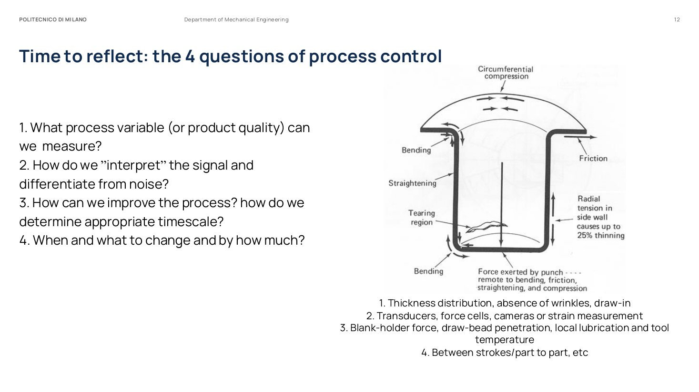

- **Prof:** strain gauges and load cells on the part are direct but **invasive**, used mostly to **calibrate**. The easiest is the **punch force**: poor lubrication raises friction, which raises force, so **the machine itself is the sensor**. Changes are applied **part to part** (use one stroke's force to correct the next part). **Anisotropy:** rolling aligns the microstructure, so properties differ along x, y, z.

| Machine/tooling | Workpiece | Interface | Process (output) |
| --- | --- | --- | --- |
| Punch stroke/depth, punch force, punch speed, die opening, tool geometry | Temperature, material model, anisotropy, geometry | Lubrication, heat transfer | **Bend angle, springback**, residual stress |

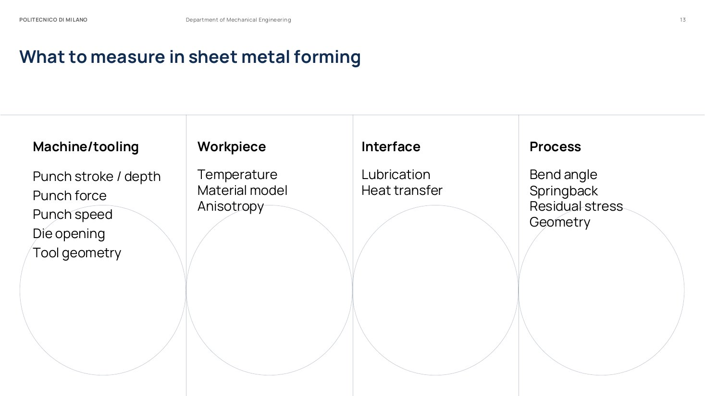

### Actuators

- **Mechanical (force/displacement):** mechanical presses; **hydraulic/servo-hydraulic** (control position, velocity *and* force during the stroke, most flexible); **servo-electric** ball screws (accurate, clean, less force for huge parts); **piezoelectric** (very high resolution and speed, tiny stroke, for fine correction or vibration compensation); **electromagnetic pulse** (short high-energy pulse for high-strength materials, reduces springback); pneumatic.
- **Thermal:** laser, resistance, induction, furnaces, spray cooling. They don't move the punch but **lower the flow stress** (L1.7: within a processing window).

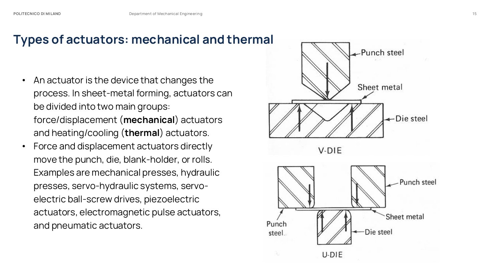

- **Prof — actuator trade-offs:** hydraulic = **very high force** but limited precision ("workhorses"; possible oil spills, hence servo-electric is "clean"); piezo = **tiny, very precise** motion; electromagnetic pulse = huge force for a **very short time** ("like a small blast"); pneumatic = **fast** but not precise. Force profile: hydraulic is a long plateau, electromagnetic a short spike.
- **Prof — thermal actuators explained:** instead of a uniform material, you create **hot and cold zones**: the hot zone behaves like hot working, the cold zone like cold working. Deformation goes **where it's hot**, so far less mechanical force and simpler machines. **Drawback:** local heating needs **complex tools and dies**.

### Punch force and velocity

```latex
F_{load} \propto \frac{\sigma_y\,L\,t_0^2}{V} \qquad v_p = \frac{ds_p}{dt} \qquad \dot\varepsilon \approx \frac{v_p}{l_c} \qquad P_{form} = F_p\,v_p
```

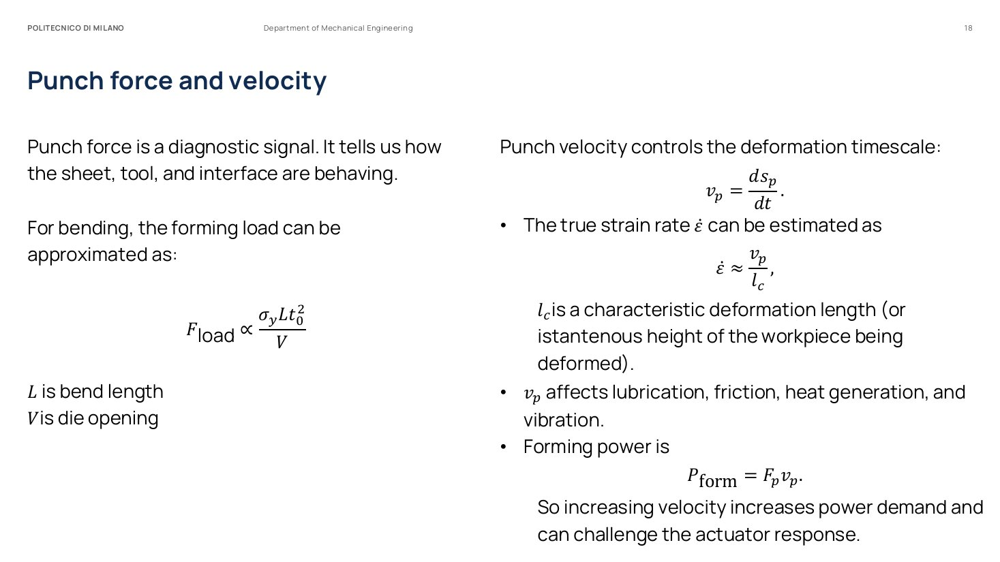

L = bend length, V = die opening, t₀ = thickness, l\_c = characteristic deformation length. **Punch force is a diagnostic signal** for sheet, tool and interface. Velocity sets the deformation timescale and affects lubrication, friction, heat and vibration; faster means more power, which can exceed what the actuator can respond to.

- **Prof:** to dimension a forming process you need **power = force × velocity**. Force comes from the geometry you want (yield × bend length × t² / die opening); a **faster stroke means more power**, which may exceed what the actuator can deliver. A rising force signals changes in geometry, material or friction.

### Sensing

- **Force:** strain-gauge load cells, piezo sensors, hydraulic pressure transducers, instrumented tools. **Placement matters**: frame cells pick up inertial and off-axis loads; sensors near the punch are more direct but face high pressure and little space. Several cells detect eccentric loading or misplaced sheets. Force is an **indirect** quality measure (affected by strength, thickness, friction, tool radius, machine compliance). It is useful for identification, contact detection, overload protection and anomalies.
- **Position:** linear encoders, optical scales, **LVDT** (a movable ferromagnetic core changes the coupling between primary and secondary coils). In precision bending the useful variable is the **punch–die relative position under load**, not the unloaded machine coordinate.
- **Bend angle:** contact (pins, yokes, discs: insensitive to reflectivity, but may mark the part or block tooling) vs non-contact optical (triangulation lasers, line scanners, cameras, structured light: troubled by shiny sheet, oil, scale, incidence angle). **Laser profiler:** a laser line + CMOS triangulation reconstructs the cross-section, both flanks are fitted, giving the included angle. Measure the **loaded** angle (punch in contact) **and the unloaded** angle (after release), and their difference **is the springback**.


- **Exam alert — C-frame example:** under load the **machine frame itself bends** slightly, so even if the encoder says the tool reached the right position, the part reflects the frame deflection. Hence: measure the **punch–die relative position under load**. If thickness or material shifts the bend, move the punch to compensate (**you'll try something like this in CAM Shop**).
- **Prof — laser triangulation in plain words:** a laser line hits the surface at an angle; on the camera a flat surface is a straight line and a height step shifts the line, so simple trigonometry gives the height of each point, then the bend edges, then the **angle**. **CAM Shop:** you'll measure the real bend angle by **image analysis** (loaded vs released gives springback).

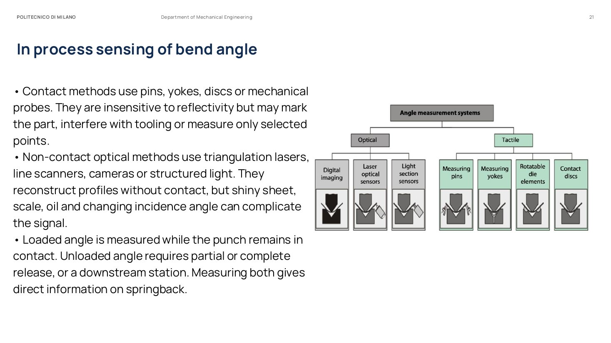

### Bending mechanics

- Outside in tension, inside in compression; **neutral axis** where the stress changes sign, at about **0.4t from the inner surface**. It moves **closer to the inner surface** with smaller radius, thicker sheet, or a larger bend.
- If the maximum stress exceeds UTS: fracture; between yield and UTS: plastic; below the elastic limit: elastic. **Material near the neutral axis stays elastic and pulls the part back after unloading: springback.**

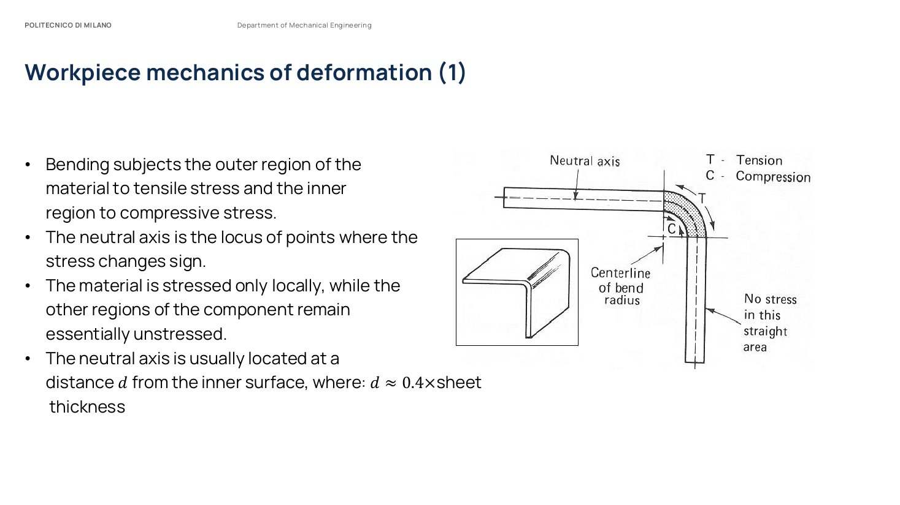

- **Prof — where springback comes from:** only the bend zone is stressed; outside it there is no stress or strain. Compare the outer-fibre stress X to the "ID card": **X > UTS → fracture; yield ≤ X ≤ UTS → plastic; X ≤ elastic limit → elastic**. Near the neutral axis the material always stays elastic and **wants to return**, so springback. The compressive side has a smaller zone (the neutral axis has shifted), so a lower peak stress, but also an elastic core. Springback gets heavier or lighter with **t/R and the bend angle**.

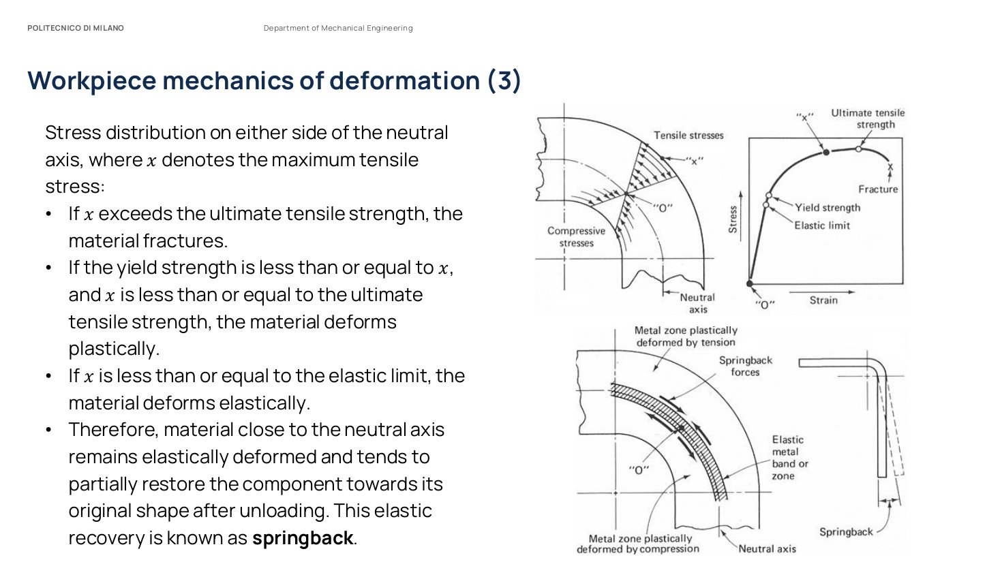

**Strain** (sheet thickness t, width w, mid-plane radius r, distance z from the mid-plane):

```latex
e_x = \frac{(r+z)\theta - r\theta}{r\theta} = \frac{z}{r}, \qquad \varepsilon_x = \ln\!\left(1 + \frac{z}{r}\right) \approx \frac{z}{r} = \kappa z
```

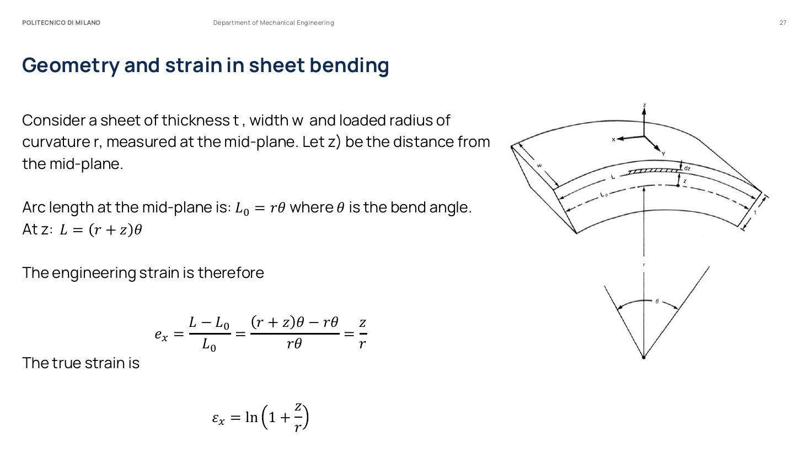

Strain is **linear through the thickness**. Wide sheet (w ≫ t) means ε\_y ≈ 0: **plane strain**, with E′ = E/(1−ν²). Yield starts at z/r = Y/E′, so the **elastic core half-thickness** is z\_e = Y r / E′.

- **Prof:** engineering strain z/r and true strain ln(1 + z/r) coincide because z ≪ r. **Plane strain** because the sheet is wide (w ≫ t): no strain along the width. You need **z\_e** to know where yielding starts through the thickness.

**Elastic–perfectly plastic sheet:**

```latex
M = 2\int_0^{t/2} w\,\sigma_x\,z\,dz = \frac{w\,Y\,t^2}{4} \qquad \Delta M = \frac{w E' t^3}{12}\left(\frac{1}{r} - \frac{1}{r'}\right)
```

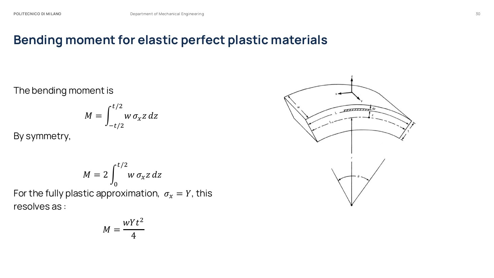

Unloading is elastic, and the final moment must be zero (M − ΔM = 0):

- **Prof — reading the springback equation:** you need material properties (Y, E, ν), the **thickness t** and the **punch radius r**, and you get the **unloaded radius r′ > r**, then the angle change = arc length × (1/r − 1/r′), and **final angle = target − springback**. The uniaxial test gives σ\_Y, but bending is plane strain, so multiply by 2/√3 ("a given, you don't need the demonstration"). Including hardening (K, n) gives slightly different values: the model-error example. He went through these derivations quickly online: **know the steps and how to read the result**.

```latex
\frac{1}{r} - \frac{1}{r'} = \frac{3Y}{t\,E'} \qquad \Delta\theta_{sb} \approx L_b\left(\frac{1}{r} - \frac{1}{r'}\right), \quad \theta_f = \theta_L - \Delta\theta_{sb}
```

r′ = radius after springback, L\_b = bend arc length. With von Mises plane strain, Y = (2/√3)σ\_Y, so 1/r − 1/r′ = 2√3·σ\_Y(1−ν²)/(E t).

**Residual stress after springback:** σ′\_x/Y = 1 − 3z/t, which gives **−Y/2 (compression) at the outer surface** z = t/2, although it was in tension under load.

**Strain-hardening sheet** (σ = K(z/r)ⁿ): M = \[2wK/(n+2)\]·(t/2)^(n+2)·κⁿ and

```latex
\frac{1}{r} - \frac{1}{r'} = \frac{6}{n+2}\,\frac{K}{E}\left(\frac{t}{2r}\right)^{n}\frac{1}{t} \qquad \text{Gardiner: } \frac{r}{r'} = 4\left(\frac{r\sigma_Y}{Et}\right)^3 - 3\,\frac{r\sigma_Y}{Et} + 1
```

Residual stress becomes non-linear through the thickness; n = 0 gives back the perfectly plastic result. **Higher temperature usually reduces springback.**

**Limits:** for sharp bends the neutral axis shifts inwards, the inner layers thicken and the outer layers thin (t\_i ≈ t₀/(1 + z\_i/ρ)), and compression exceeds tension. High-accuracy models need neutral-axis shift, thickness change, tension–compression asymmetry, evolving modulus and kinematic hardening.

### Springback trends (for open-loop compensation)

- **Higher strength** (higher elastic limit) → **more** springback.
- **Smaller radius**, **larger bend angle**, **thicker sheet** (more plastic deformation) → **less** springback.
- Compensation methods: **overbending** to a preset angle; **bottoming** (coining the radius zone so it deforms plastically through the volume).

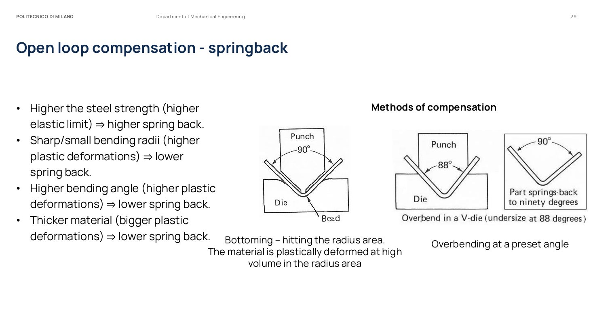

- **Prof (13 Oct) — "I prefer to speak about how to interpret it":** hot forming means no hardening, so the perfectly plastic formula; **cold forming** (the usual case) means use the **strain-hardening** formula. Read it: springback grows with the **ratio K/E** (from the formula: a **stiffer** material with higher E springs back **less**, a stronger one with higher K **more**) and depends on t/r. All of it assumes the **neutral axis at mid-plane**, so the model is limited to its assumptions.
- **Prof — material data are averages:** repeat a tensile test and you get scatter, so **calibration** means finding a good estimate **and an interval**. **Lookup tables** from past bends (material, thickness, tool → "to get 90°, bend to 95°") are still very useful, but they fail when grade, thickness, orientation, wear or lubrication change.
- **Prof — bottoming:** a sharp-tipped punch **squeezes** the bend zone at the bottom of the die so **no region is left elastic**, which kills springback. Open-loop compensation is always "modelled behaviour": either numbers from the equation or a phenomenological understanding.

### Control strategies

| Strategy | How | Limits |
| --- | --- | --- |
| **Open-loop compensation** | Overbend predicted from nominal material data + tooling; lookup tables, empirical bend deductions | Fails when grade, thickness, orientation, tool wear or lubrication change |
| **Direct feedback (part to part)** | Measure the unloaded angle θ(k); e(k) = θ\_target − θ(k); **PI** correction of the stroke for the next part | Corrects only after a part is made |
| **Model-based feedback (hybrid)** | Partial bend: measure loaded and unloaded angle, **estimate material properties**, compute the final stroke | Extrapolates better than fixed gains; the decision is interpretable |
| **Adaptive** | Update model parameters (physical, e.g. effective E, or empirical, e.g. angle–stroke slope) during production | Must be slower than the noise but fast enough to follow real drift |

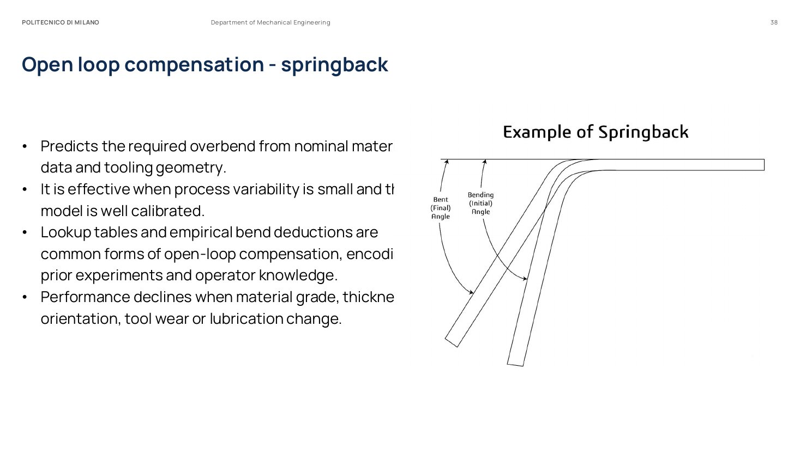

- **Prof:** the analytical model puts the neutral axis at mid-plane, but in sharp bends it's asymmetric: inner layers **thicken**, outer layers **thin**, and compressive strain exceeds tensile. Accurate springback models must include neutral-axis shift, thickness change and the asymmetry, which is why industry combines models with **measurement and feedback** (table above).

* **Prof — direct feedback is a slow loop:** you correct the **next** part, not the current one, because measuring and acting take time. It requires **air bending** (open die), where the final angle depends on **how far the punch goes**, unlike a V-die. **You'll do something close to this in CAM Shop.**
* **Prof — why model-based (hybrid) is better:** the PI loop only knows "error → stroke"; the hybrid puts the **process model in the controller** and back-calculates material parameters (inverse solution). Then the **same model works for other thicknesses and materials**, and decisions are **interpretable**: "I increased the stroke because E changed by X". "**Black-box models** are very useful, but in industry their **trustability is questioned**."
* **Prof — adaptive:** update parameters between parts, over long production runs.

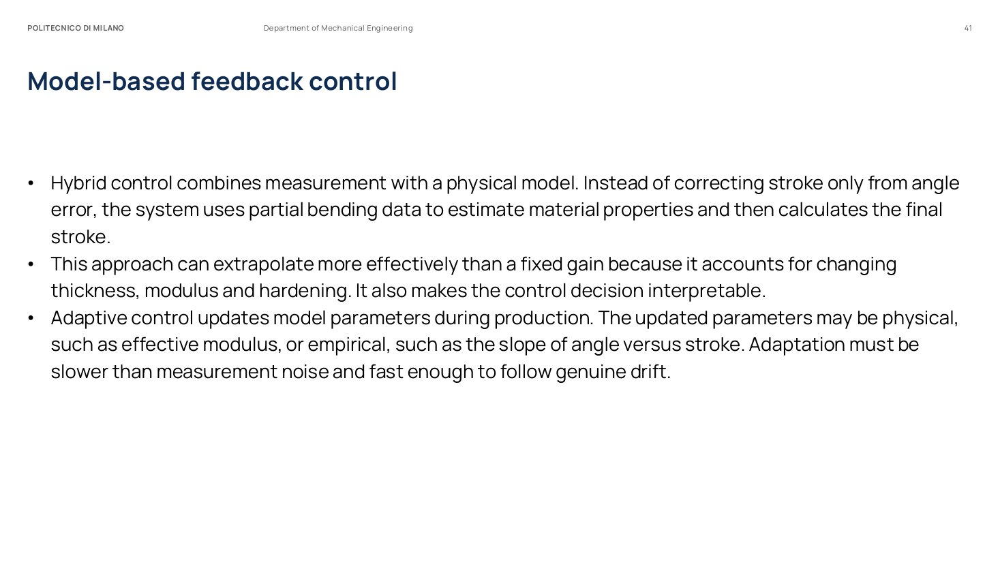

```latex
\Delta s(k) = K_p\,e(k) + K_i\sum_{j=0}^{k} e(j), \qquad s(k+1) = s(k) + \Delta s(k)
```

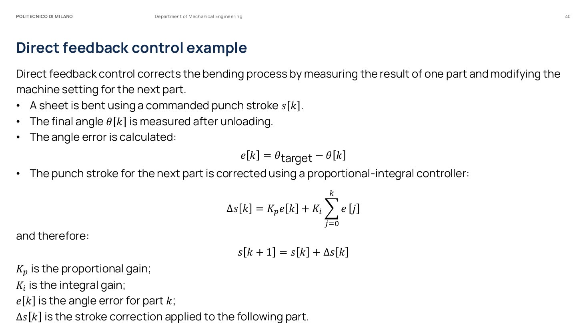

**Wang et al. 2008 — incremental air bending:** partial bend, release, measure the loaded/unloaded angle, repeat. Each pair gives a radius, R = (w·tanθ₁ + T/2 − d)/(secθ₁ − 1). Then find the thickness T, modulus E and yield Y that **minimise the residuals** between predicted and measured unloaded radii, and compute the final punch displacement. **The angle error fell from 2° to 0.5°.**

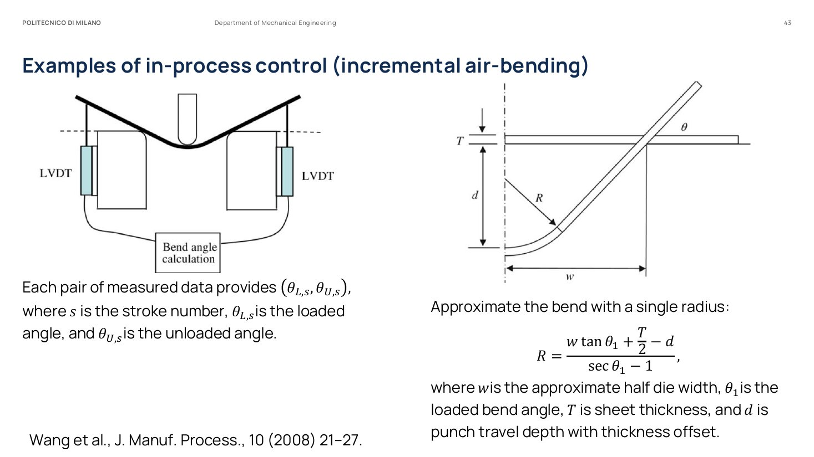

- **Prof — how many measurements?** With **4 unknowns you need at least 4 data points**, and then you have no margin for error, so repeat several partial bends and **best-fit**. Fitting bounds parameters around a **starting value** (shown as % change). Each parameter has its own effect: yield gives a linear trend, E a parabolic one. **2° → 0.5° is a 75% reduction, and angular errors are amplified over distance.**

**High-precision 90° bending (Tekiner):** target ±0.25°, calculation < 1 s. A single **pre-release** shortly before the target: the shape and stroke give an effective **n**, the load gives an effective **strength K**, the springback gives an effective **E**. The controller predicts springback at the target and computes the final stroke.

**Exam link:** this is the L1.1 block diagram made real. The process model (bending mechanics) has model errors (E, n, anisotropy) and disturbances (sheet variation), product sensors (laser profiler) measure the angle, and the loop closes **part to part** or **within the stroke**. Compare with GAC in machining (L1.6) and the PI penetration control in welding (L1.4).

## Professor background (less exam-critical)

- **Prof:** generic, non-dedicated tools give more flexibility, but lower productivity and less **repeatability**. Press = general-purpose (expensive); punch/die = **dedicated** to the product (can be very expensive). The press frame must be **rigid**: if it deforms under the reaction force, the part geometry is wrong. Drawn panels carry extra material that is **trimmed later**.
- **Prof — transfer vs tandem:** transfer = one big press, more compact and **faster**; tandem = separate presses + robots, slower moving parts, but **more flexible** (easier to change tools on one press).
- **Prof — sensor placement trade-off:** a transducer in the punch is accurate, but the **punch must be shaped around it**; frame-mounted is easier but picks up vibration and off-axis loads. Several cells (punch, die, blank holder) also tell you **where** the problem is: friction, tool or material.
- **Class question — how many iterations to calibrate?** The error decays over a transient, roughly **10–15 iterations**, then the model barely changes, **unless something changes** (thickness, material). Constraints (±0.25°, < 1 s) keep the system from becoming "indecisive".
- **Class question — what about punch speed?** It affects **power** and, in **hot** forming, the material's strength (strain rate); in cold bending it's minor. To include it, enrich the constitutive model (K, n depending on T and ε̇) or treat it as a correction. **Temperature can be a control parameter (hot working at about 750 °C for steel) or a disturbance** (summer–winter, 2–35 °C in Milan): decide which phenomena to **model** and which to leave as **error**.

## Practice exercises

*No dedicated exercise. All formulas: [formula sheet](../formula-sheet.md).*

## Likely oral questions

- **Why does the same press stroke give different bend angles?** The sheet varies (thickness, yield, E, hardening, anisotropy) and friction varies (lubrication, pressure, speed, wear). The machine controls its axes, the customer specifies the product, and in between is workpiece mechanics. Even a perfect servo can't fix this unless the product state is measured or inferred.
- **What is springback and what affects it?** The elastic core near the neutral axis recovers after unloading. For a perfectly plastic sheet, 1/r − 1/r′ = 3Y/(tE′). It increases with strength (Y/E) and decreases with thicker sheet, smaller radius and larger bend angle; higher temperature reduces it. The outer surface ends with residual compression of −Y/2.
- **Compare springback control strategies.** Open-loop overbend from tables (fails when the material changes) → direct PI feedback part to part on the stroke → model-based: partial bend, measure loaded and unloaded angles, fit T, E, Y, compute the final stroke (Wang: 2° down to 0.5°) → adaptive parameter updating (slower than noise, faster than drift).
- **How do you measure bend angle in process?** Contact probes (robust to reflections, may mark the part) vs optical laser profiler (triangulation, fit both flanks; problems with shine, oil, incidence angle). Loaded minus unloaded angle = springback. For position, the useful variable is the punch–die position under load (LVDT, encoders).
