# L1.9 Cost estimation in manufacturing

> Part of the CAM study guide. Source of truth: [the study guide](https://claude.ai/artifact/WrGc96ueegSH8ZXZdT4FaB). Generated by `tools/build_guide.py`; edit the guide, not this file.

## Slides and professor's explanations (exam material)

The unit cost is **material + tooling/N + capital/(L·t\_wo·Ṅ) + overhead/Ṅ**. Fixed costs spread over volume, so a high-investment process (die casting, fixed automation) wins only **above a crossover quantity**. This turns L1.1's "how many parts?" question into a number. *(Slides + recordings of 13 Oct morning and 14 Oct afternoon (machining economics). Professor's comments inline.)*

### Cost, price, value

A viable product needs **Cost < Price < Value** (cost = what it costs the maker; price = what the customer pays; value = what it is worth to the customer). Estimates are used to set prices for bids, check profitability, **justify investment in equipment and automation**, and benchmark productivity. For high-tech products, competitiveness depends more on performance than on cost; the price ceiling depends on perceived value, market size, competition and brand.

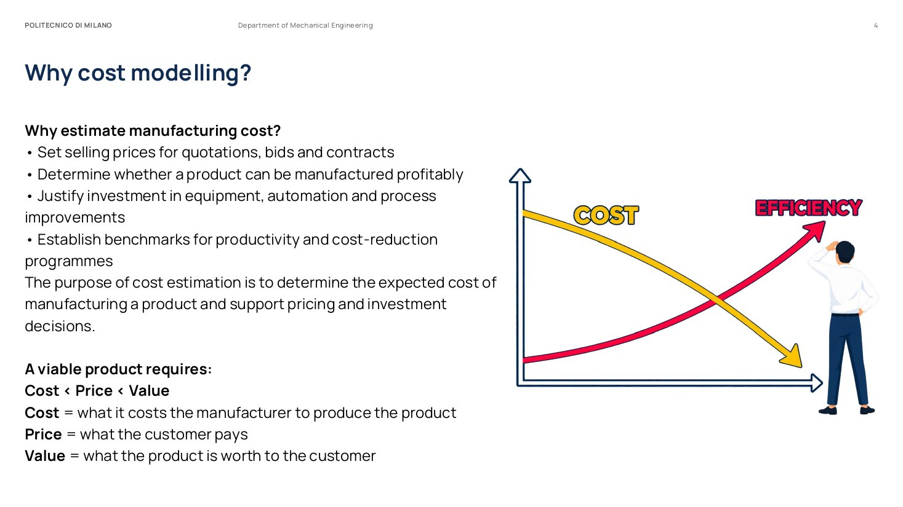

| Approach | Evidence | Best use |
| --- | --- | --- |
| Top-down | Costs of comparable products or projects | Early concepts, rapid screening |
| Bottom-up | Bill of materials, process steps, times and rates (from CAM cycle estimates, PLC/CNC logs, MES, time studies, supplier quotes) | Detailed planning, quotations |

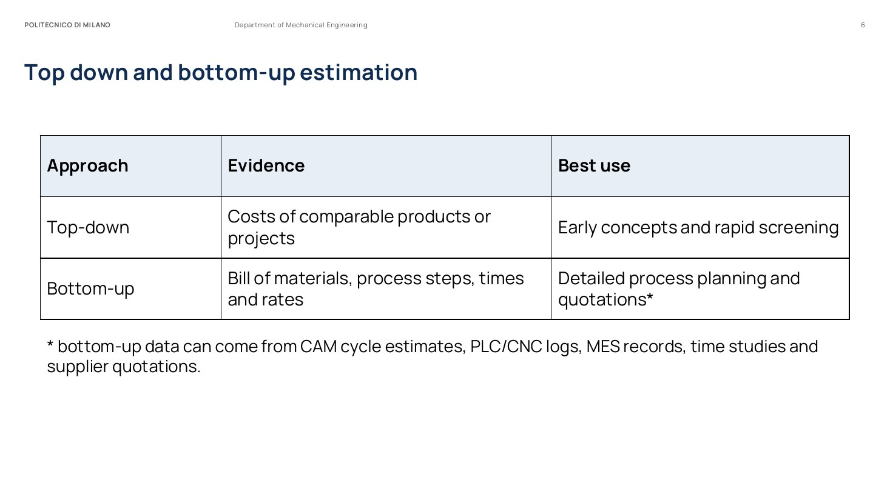

**Four rules for minimising cost:** keep things **standard** (bought-in parts, standard materials); keep things **simple** (no unnecessary features or difficult setups); **design for assembly** (fewer parts, self-aligning, simple joining); **specify only what is needed** (no unnecessarily tight tolerances or finishes). Pyramid of Giza example: casing stones flat to 0.2 mm, placed to 0.1 mm. Tight tolerances have always been possible, but "a tighter specification needs a reason".

- **Exam alert — linking tolerances to cost:** cost rises **steeply** with quality. A tighter roughness may need an extra operation, or in turning a **lower feed** (Ra = f²/32r), which means lower productivity. "Specify only what is needed", and specify it **correctly**: often missing in engineering projects.

### Cost behaviour and allocation

- **Fixed** cost per unit falls with volume: C\_fixed,unit = F/N. **Variable** cost per unit is constant: v. So C\_unit = F/N + v.
- **Direct** costs are traceable to one product (its aluminium, its insert, its operator, a dedicated fixture, a robot bought only for that line). **Indirect** costs (rent, supervision, maintenance, heating, IT, shared metrology) must still be **allocated**.
- **Material:** purchased mass = m/(1−f), with scrap fraction f (material yield). The price depends on grade, form, quantity, supplier and date.
- **Labour:** Σ operator time per part × hourly rate, based on **actual operator involvement**, not machine running time (one operator can supervise several machines).
- **Overhead rate** = cost pool / allocation-base units (machine hours, labour hours, volume). Automation adds its own indirect costs: maintenance, compressed air, software licences, safety systems, data infrastructure. To reduce overhead: JIT (less WIP), shorter lead times, produce only to demand, total cost of ownership.

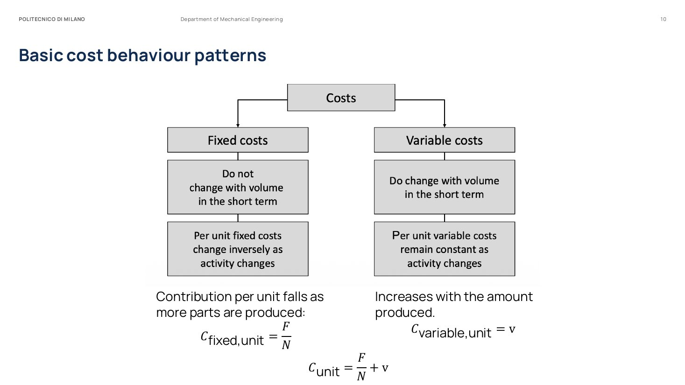

- **Prof:** C\_unit = F/N + v goes to **infinity at N = 0** and tends to **v as N → ∞**. Direct-cost examples for the implant: its titanium, its cutting tool, its fixture, a robot bought just for it. Indirect: "how much does it cost **to exist**?" (space, staff, IP). Material prices **change daily** (London Metal Exchange for Al ingots; polymers come from oil, so they shift with world events) and depend on form: powder, ingot, wire, sheet. One operator can watch several machines, so **labour = actual involvement**. **Overhead is in €/hour**: what it costs the company to stay alive per hour.

### Process-based unit-cost model (key formula)

```latex
C_{unit} = \frac{m\,C_m}{1-f} + \frac{C_t}{N} + \frac{1}{\dot N}\left(\frac{C_c}{L\,t_{wo}} + C_{oh}\right)
```

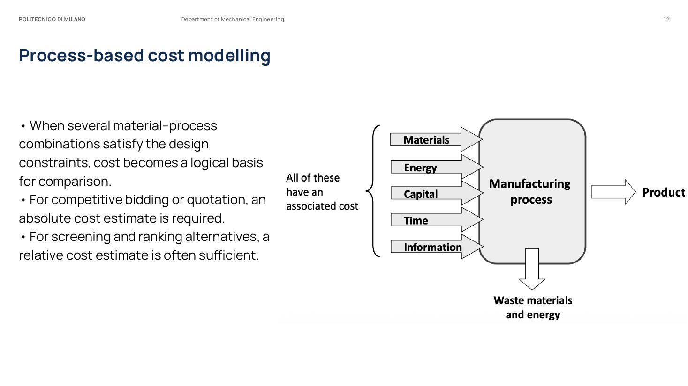

- **Prof — orders of magnitude (14 Oct):** dedicated dies for bending or deep drawing cost from about **€5k to €100k** depending on complexity; equipment (robot, CNC) costs **tens to hundreds of thousands**; overhead about **€50 to several hundred per hour**. For an assembly, compute the cost **for each sub-part** and sum.

m C\_m/(1−f) = material with scrap; C\_t = dedicated tooling written off over quantity N; C\_c = capital equipment written off over t\_wo (**in hours**) at load factor L; C\_oh = overhead rate (€/h); Ṅ = production rate (parts/h). For ranking options a **relative** cost is enough; for bids you need an **absolute** one.

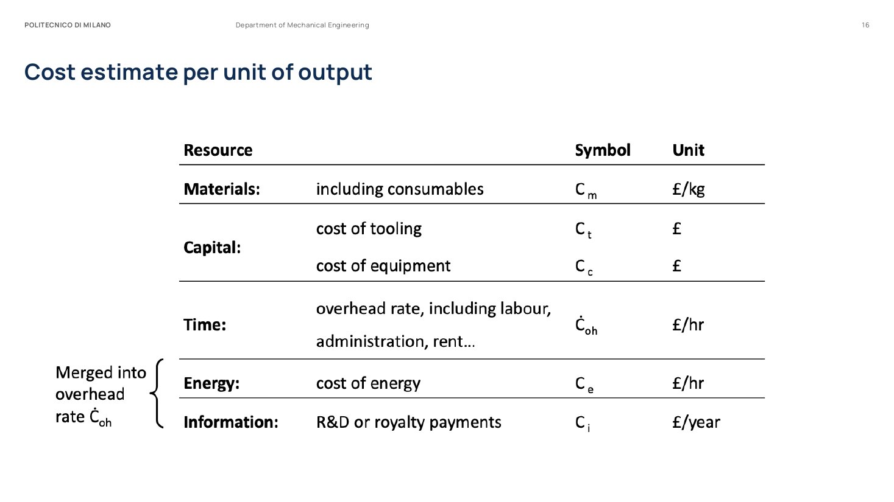

- **Prof — term by term:** **scrap fraction f**: you need more than 1 kg to make a 1 kg part (sprues and gates in casting, chips in machining, trims in forming). **Tooling**: the press-brake punch and die are tooling, the press brake is capital; spread over the **planned quantity N**. **Capital write-off time**: "in 5 years the machine has to **pay itself off**" (about 5 years for machine tools, because new technology arrives). **Load factor L**: you can't produce 365 days × 24 h, so it counts shifts, working days and **changeover speed**. Energy and information (R&D, patents) are folded into the overhead rate.
- **Exam alert — read the formula to reduce cost:** reduce **scrap**, **produce more** (N), **load the machine** (L), **produce faster** (Ṅ). "All the things we know intuitively come down to a mathematical calculation."

* **Class discussion (4 Nov) — how can automation lower the unit cost? Read the model term by term:** **material/scrap** (precise, automated processes make fewer defects, so f falls; "nobody speaks about this", yet it doesn't depend on volume); **tooling** (monitor tool wear; flexible, non-dedicated tools plus more automation, e.g. robot bending with a generic tool); **overhead** (fewer people, but more energy, maintenance, software licences and know-how: "it's not a simple game"); **capital/rate** (automated handling cuts idle time and raises Ṅ, at a higher C\_c). Much equipment is under-used because of missing knowledge or poor choices, so productivity can often rise without new investment. The model is for **interpretation**, not a final price, and the numbers shift every day.
* **Prof — more load factor isn't automatically better:** in exercise M, a second operator doubles L but also the overhead, and the break-even production rate goes **up** (from ≥ 3.6 to ≥ 4.1 parts/h).

### Worked example (slide): sand casting vs die casting

Normalised to material cost, f = 0, L = 1, t\_wo = 5 years = 5 · 365 · 24 = 43,800 h.

|  | Sand casting | Die casting |
| --- | --- | --- |
| Material m C\_m | 1 | 1 |
| Overhead C\_oh (per h) | 20 | 20 |
| Dedicated tooling C\_t | 210 | 16,000 |
| Capital C\_c | 10,000 | 300,000 |
| Rate Ṅ (per h) | 5 | 200 |

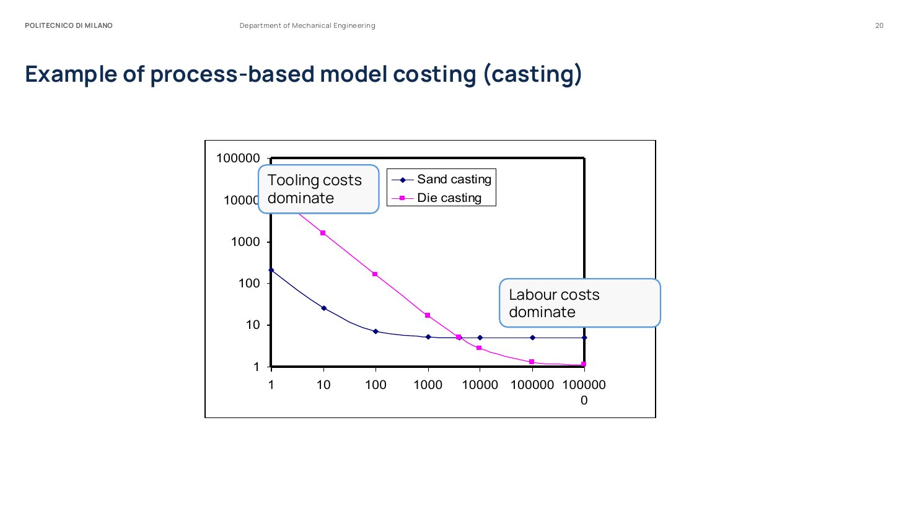

Material cancels. Sand: 210/n + (10,000/43,800 + 20)/5 = 210/n + 4.046. Die: 16,000/n + (300,000/43,800 + 20)/200 = 16,000/n + 0.134. Setting them equal: 15,790/n = 3.911, so **n ≈ 4,037 parts**. Below that, sand casting (low tooling) is cheaper; above it, die casting wins. At small n tooling dominates; at large n the time-related costs (labour/overhead) dominate. **Exam alert:** convert t\_wo to hours.

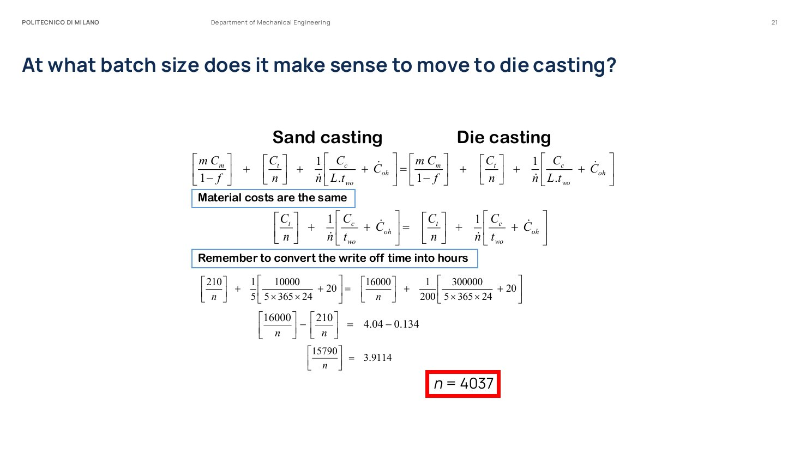

- **Prof:** the die is expensive because it must **last**; the sand mould is broken every time. Die-casting **machinery** is pricier (automated injection), and sand casting **looks cheaper but is slow**. **Small batches: tooling and capital dominate; large batches: overhead (time) dominates.** **Exam alert:** "higher technology or more sophisticated automation doesn't necessarily mean cheaper": it depends on the quantity.

### Break-even sales volume

At break-even, price p = C\_unit(N\_BE):

```latex
N_{BE} = \frac{C_t}{p - \dfrac{m C_m}{1-f} - \dfrac{C_c}{L\,t_{wo}\,\dot N} - \dfrac{C_{oh}}{\dot N}}
```

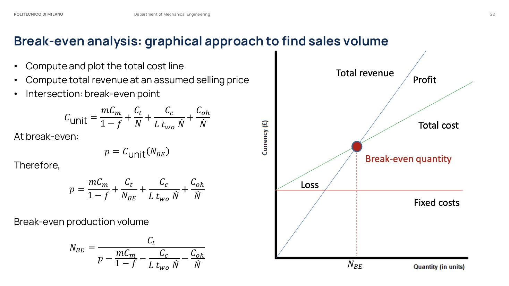

Graphically: plot total cost and total revenue (p × N); they cross at N\_BE.

- **Prof — when to use the crossover:** for a **new investment** (an existing factory has already paid its capital). **Combine the two models:** from a price, find the minimum quantity for profit, then pick the cheaper process for that quantity; or from a given quantity, pick the process and then the price that gives a profit.

* **Prof:** total cost starts at the fixed costs, so you **can't profit from the first part**; profit = revenue (p × N) − total cost. A higher price lowers N\_BE, "but this doesn't mean *increase the price and everything is OK*: if it's too high, nobody buys." High tooling cost raises N\_BE. **Where to find the data:** mass from the design; material price from the market (time-dependent); scrap from the process and your quality; tooling and capital from **supplier quotes**; load factor and overhead from **company history**; write-off about 5 years. "You see why we call it an **estimate**."

### Machining economics (links L1.5 Taylor to cost)

Cycle time per part = handling + machining + share of tool change:

```latex
T_c = T_h + T_m + \frac{T_t}{n_p}, \qquad T_m = \frac{\pi D L}{f v}, \qquad T = \left(\frac{C}{v}\right)^{1/n}, \qquad n_p = \frac{T}{T_m} = \frac{f\,C^{1/n}}{\pi D L\,v^{1/n-1}}
```

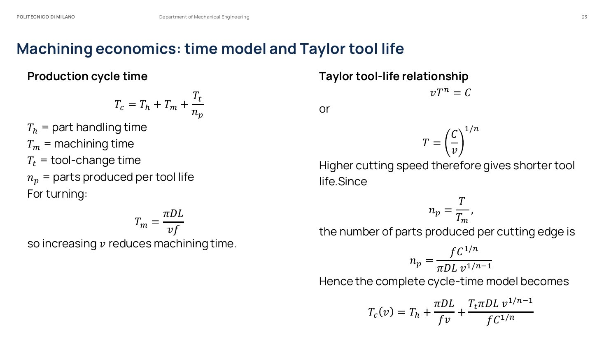

Raising v shortens machining time but also tool life, so there is an optimum.

- **Prof — why machining gets its own model:** other tools (bending dies, casting dies) also wear, but the cutting tool's life is **well modelled (Taylor)** and depends on v, which also sets productivity. Faster cutting = more parts per hour, but **more tool changes**. Handling time T\_h is fixed (shorter with more automation); tool change T\_t is fixed (minutes by hand, seconds with a turret) but is spread over n\_p parts. In T\_c(v): handling is constant, machining falls as 1/v, tool change **rises with v^(1/n−1)**, so the sum has a **minimum**.

**Maximum production rate** (dT\_c/dv = 0, tool price ignored; use it when the machine is the **bottleneck**):

```latex
v_{max} = \frac{C}{\left[\left(\frac{1}{n} - 1\right)T_t\right]^{n}}, \qquad T_{max} = \left(\frac{1}{n} - 1\right)T_t
```

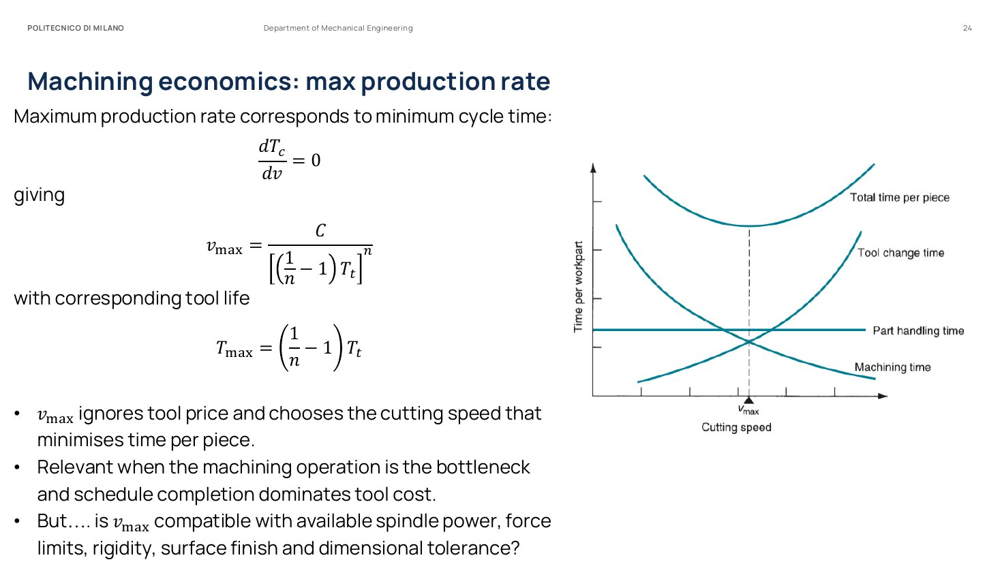

**Minimum unit cost**, with C\_r = C\_c/(L·t\_wo) + C\_oh (machine + overhead rate) and C\_e = cost per cutting edge:

```latex
C_{unit}(v) = \frac{mC_m}{1-f} + \frac{C_t}{N} + C_r T_h + C_r T_m(v) + \frac{C_r T_t + C_e}{n_p(v)}
```

```latex
v_{min} = C\left[\frac{n}{1-n}\,\frac{C_r}{C_r T_t + C_e}\right]^{n}, \qquad T_{min} = \left(\frac{1}{n} - 1\right)\left(T_t + \frac{C_e}{C_r}\right)
```

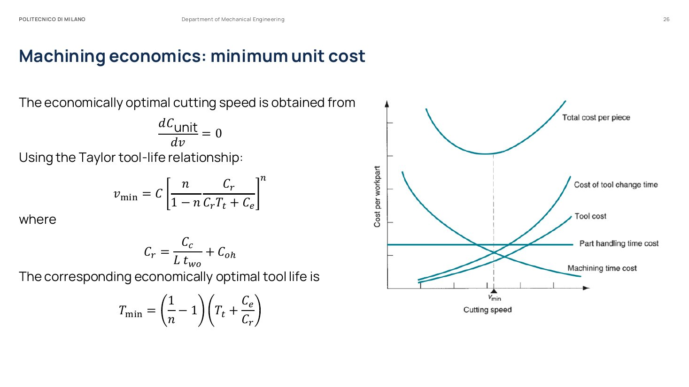

v\_min < v\_max because the cost optimum also pays for tool edges. **Exam alert:** is v\_max compatible with spindle power, force limits, rigidity, surface finish and tolerance? This links back to the force/power models in L1.5 and L1.6.

- **Prof — the cost curve:** handling cost is flat, machining cost falls with v, tool cost (edges + change time) rises with v, so the total has a minimum: to the left you **machine too slowly**, to the right **tool wear dominates**. Plotted together, the **minimum-time speed is higher than the minimum-cost speed** (a global optimum lies between; not covered). In C\_unit the fixed tooling C\_t is "tooling except the cutting edge"; the edge is the **consumable** C\_e.
- **Exercise (14 Oct):** see **J** in the formula sheet.

**Exam link:** cost is what decides fixed vs programmable vs flexible automation (L1.1). A robot or CNC investment raises C\_c but can raise Ṅ, utilisation L and yield (lower f), which shows up directly in C\_unit. Fixtures vs vises in milling (L1.6) is the same trade-off: capital vs labour/setup.

## Professor background (less exam-critical)

- **Prof:** throughout the course: quality vs productivity, and precision needs more investment in automation and tools. Cost estimation "puts **numbers** to these words"; it's an **estimate**, not an exact calculation. "**If there isn't a demand, we don't make things.**" Price must cover cost **plus profit**, because a company needs profit to have a future. Investments must be justified: "people see the cost of new equipment and say no. What if it increases profitability?"
- **Prof — examples of cost vs price vs value:** a family car has **price close to cost** (huge pressure in automotive); a fast red sports car has price far above cost (value); **Italian eyewear** is cheap plastic to make but very expensive (perceived value; he lost his at a concert and "still cries").
- **Class discussion — phone cover:** sells for €15–20, costs **tens of cents** to make (cheap elastomer + **mass production**). **Titanium hip implant:** small numbers, expensive alloy, complex geometry, per patient, so it might cost about €1000 to make but sells for tens of thousands, because of the **research and certification** (millions of euros of testing before a metal goes into a human body). Cost isn't only material: it's **volume, precision and know-how**.
- **Prof:** top-down example: "a similar project cost €250k, this one will be about €275k." Bottom-up needs **a lot of data**. **Cost per kilogram** (like apples at the grocery) shows the value added: construction about $1/kg, packaging about $10/kg (cheap but very light), ships about $100/kg, luxury cars up to about $1000/kg, then appliances, sports gear, and at the top **aerospace and biomedical** (implants: tens of thousands per kg; even contact lenses are expensive per gram). A spacecraft must **work**, so performance comes first; a warehouse can always be made cheaper.
- **Prof (4 Nov):** after the write-off time the machine is paid off but can keep running (a Fiat Ducato line in Italy is about 20 years old); "I won't ask these to you in an oral exam". On replacing workers with AI: somebody has to earn money to buy the products; Europe's issue is **reshoring**, bringing production back through automation because people don't want some jobs. AM avoids dedicated tooling (consumables are negligible by comparison).

## Practice exercises

### J. Turning + minimum-cost tool life (solved in class 14 Oct)

Steel bar Ø100 × 300 mm, 3-jaw chuck + **tailstock**. Turn to Ø94 over 180 mm in roughing + finishing; **roughing a\_p = 2.5 mm** (Ø100 → 95). k\_cs = 1610 MPa, x = 0.29, κ\_r = 45°, f = 0.15 mm/rev, v\_c = 260 m/min. Economics: tool change T\_t = 160 s, cutting edge C\_e = €1, machine cost rate C\_r = €180/h, Taylor n = 0.122, C = 250.

1. h\_D = 0.15·sin45° = 0.106 mm; k\_c = 1610/0.106^0.29 ≈ **3090 MPa** (about 3000).
2. A\_D = 0.15 × 2.5 = **0.375 mm²**; F\_c ≈ **1.16 kN**; P = F·v = 1157 × 260/60 ≈ **5.0 kW**.
3. **Minimum-cost tool life:** T\_min = (1/n − 1)(T\_t + C\_e/C\_r). In consistent units: C\_r = 180/60 = **€3/min**, so C\_e/C\_r = 0.33 min; T\_t = 2.67 min; T\_min = (8.20 − 1) × 3.0 ≈ **21.6 min (about 22 min)**.
4. **Cutting speed for minimum cost:** from Taylor, v = C/Tⁿ = 250/21.6^0.122 ≈ **172 m/min**. That is lower than the 260 m/min used for roughing, consistent with v\_min < v\_max. (In class he stopped at the formula; the final number here is my calculation.)

**Watch units:** put time in minutes (or seconds) everywhere: T\_t, C\_e/C\_r and Taylor's C.

### L. Cost: casting vs additive manufacturing (solved in class 3 Nov)

Part 0.7 kg, material €50/kg. Casting: f = 0.40, C\_t = €8,000, Ṅ = 2.5 parts/h, C\_c = €100k. AM: f = 0.10, C\_t = €16,000 (consumables), Ṅ = 5 parts/h, C\_c = €500k. Both: C\_oh = €30/h, L = 0.3, t\_wo = 5 years, so hours = 24·365·5·0.3 = 13,140 h.

- Casting: C = 0.7·50/0.6 + (100,000/13,140 + 30)/2.5 + 8,000/N ≈ **73.4 + 8,000/N** €
- AM: C = 0.7·50/0.9 + (500,000/13,140 + 30)/5 + 16,000/N ≈ **52.5 + 16,000/N** €
- Equal cost at **N ≈ 383 parts** (casting is cheaper below, AM above). Casting at N = 100: **≈ €153/part**.
- If the material price rises, casting (40% scrap) suffers more, so the crossover moves to **fewer parts**.

### M. Cost: minimum production rate to keep the profit (solved in class 4 Nov)

Prosthesis 0.9 kg, stamping with f = 0.30, sold at €250 with €30 profit, so C ≤ **€220**. Material €100/kg in 2026, **+20%** (tariffs) in 2027 → €120/kg. C\_t = €5,000, N = 10,000, C\_oh = €100/h (one person), L = 0.3, t\_wo = 5 years, C\_c = €1.8M, so hours = 24·365·5·0.3 = 13,140 h.

1. Material 0.9·120/0.7 = €154.3; tooling 5,000/10,000 = €0.5; the rest must stay ≤ 220 − 154.8 = €65.2 = (1.8M/13,140 + 100)/Ṅ = 237/Ṅ, so **Ṅ ≥ 3.63 → at least 4 parts/h** (with the 2026 price, 2.6 parts/h was enough).
2. Two operators: L = 0.6 but C\_oh = €200/h, so (68.5 + 200)/Ṅ ≤ 65.2 → **Ṅ ≥ 4.1 parts/h**: you must produce faster, so it's a **disadvantage** under these assumptions.

Note the inequality direction: the cost must stay **below** €220, so the rate comes out as a **minimum**.

All formulas: [formula sheet](../formula-sheet.md).

## Likely oral questions

- **How do you decide between sand and die casting economically?** C\_unit = mC\_m/(1−f) + C\_t/N + (C\_c/(L t\_wo) + C\_oh)/Ṅ. Die casting has high C\_t and C\_c but high Ṅ. In the slide example the crossover is at about 4,000 parts. This quantifies the L1.1 fixed-vs-programmable choice.
- **v\_max vs v\_min in machining economics?** v\_max minimises cycle time (bottleneck machine, tool cost ignored), T\_max = (1/n − 1)T\_t. v\_min minimises cost by also paying for edges, T\_min = (1/n − 1)(T\_t + C\_e/C\_r), so v\_min < v\_max. Check against spindle power, forces, rigidity, finish.
- **Cost, price, value?** Cost < Price < Value. Bottom-up estimates use CAM cycle times, CNC/PLC logs, MES. Rules: standard, simple, design for assembly, specify only what is needed (tolerances cost money).
- **How can automation reduce the unit cost?** Term by term: less scrap (precision), cheaper or longer-lived tooling (wear monitoring, flexible tooling), higher production rate (handling, fewer idle times) at higher capital cost, and overhead that may go down (people) or up (energy, maintenance, licences). Check with the model, e.g. doubling the load factor with a second operator can raise the required rate.
