# L2.1 CNC machine tools

> Part of the CAM study guide. Source of truth: [the study guide](https://claude.ai/artifact/WrGc96ueegSH8ZXZdT4FaB). Generated by `tools/build_guide.py`; edit the guide, not this file.

## Slides and professor's explanations (exam material)

A CNC machine is a **positioning system** (motor → rotary-to-linear conversion → axis, with position/velocity sensors closing the loop) driven by a **part program** in ISO G-code. CAM generates the tool path, and a **post-processor** turns it into the code for a specific machine. This is the basis of the **CAM software question** in the written test and the CAM Lab. *(Slides + recordings of 19 Oct (architecture, axes, interpolation), 20 Oct (G-code programming), 26 Oct (CAD/CAM, tool paths, machine components) and 27 Oct (structure, turning and machining centres). Professor's comments inline.)*

### History and definitions

- **1947** John T. Parsons: punch-card computation to interpolate helicopter-blade curves. **1948** Air Corps contract for tapered aircraft wings (IBM, MIT for servos). **1952** first NC machine tool demonstrated at MIT; the EIA defines NC.
- **NC** = automatic control of a process by a device using numerical data introduced while the operation is in progress. **CNC** = NC realised with a computer (ISO 2806:1994).
- **Machine axis** = principal direction of linear or rotary motion. **Convention:** **Z = spindle axis**, positive with the tool moving **away** from the workpiece; X parallel to the table; Y completes the right-handed frame. A, B, C = rotations about X, Y, Z; U, V, W = secondary motions parallel to X, Y, Z. 3-, 5- and 6-axis machining centres.

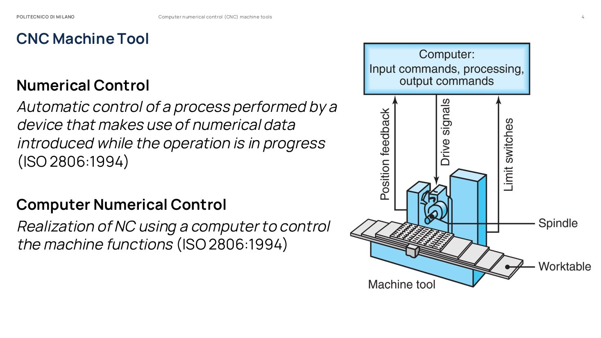

- **Prof — the capability of a Cartesian machine is described by (1) the number of axes and (2) how many can be interpolated together.** More axes make it easier to reach a point but harder to compute how to get there. **Z = spindle axis** in every machine: turning (spindle rotates the work), milling and drilling (spindle rotates the tool). "Depth" is subjective, so Z is defined by the spindle.
- **Exam alert — name axes in the rest position:** in his 6-axis example the head tilts (B) and the extending quill is **W** (parallel to Z). If B rotates the head 90°, the quill is still **W**, not U, because each axis is named once so it can be commanded independently and in sync. Practise naming the axes on the 3-, 5- and 6-axis drawings.
- **Prof — CNC vs robot:** on a CNC you can drive **one motor alone** (cut along X); on a 6-DOF robot almost **all joints move together**, so you command the motion and the robot computes the joints.

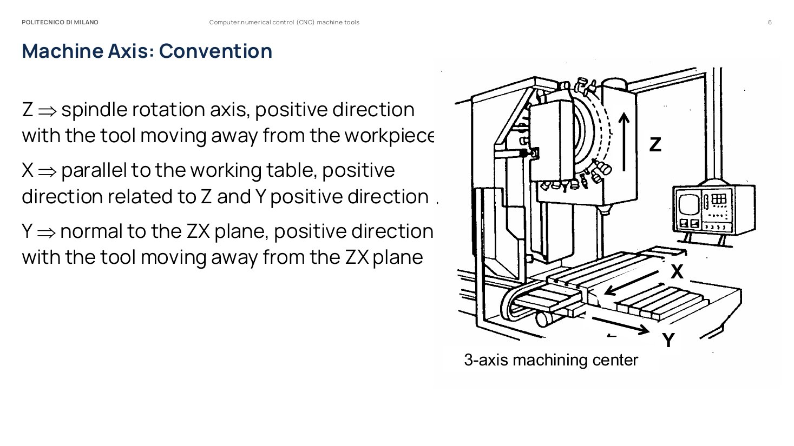

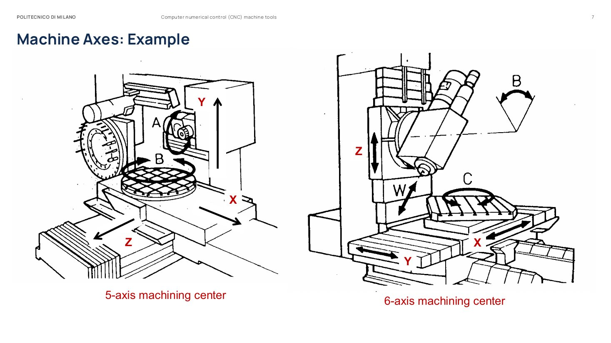

### Architecture

- **Positioning system:** CNC controller → actuator (motor) → rotary-to-linear conversion → axis motion, with **position and velocity sensors** feeding back.
- **CNC architecture:** user interface + part program → CNC → interfaces to drives, spindle and auxiliaries → machine/tool, with axis position and machine state fed back.
- **CNC functions:**
  - **NCK (Numerical Control Kernel):** servo and drive control: code parsing, **interpreter**, **interpolator**, **error compensator**.
  - **PLC:** sequential logic (microprocessor, memory, logic, counters, timers): **tool change, spindle speed, workpiece change, I/O signals**.
  - **MMI (man–machine interface):** communication, editing, executing commands, displaying status.
- **Part program** = an ordered set of instructions, in the required language and format, to perform operations under automatic control.

* **Prof — open vs closed loop positioning:** stepper + pulse train = **open loop**: the commanded pulses should equal the position, but gear imprecision and screw/nut play make the real position differ. **DC servo + feedback**: position readout → comparator → error → DAC, all in **real time**. Motors give high speed and low torque, so a **gearbox** reduces speed and raises torque, then a lead/ball screw converts to linear motion. The encoder **on the motor** catches errors early; a sensor **on the table** also catches coupling, nut and screw errors.
* **Class discussion — how precise must positioning be?** 0.1 mm = **100 µm is a lot**; conventional milling wants **tens of µm**, high-precision about **1 µm**, micromachining **nanometres**.
* **Prof — NCK vs PLC, the two "brains":** **NCK** = very fast calculation of **one task** (where to go, in real time, updated every **millisecond**, i.e. kHz). Like a car taking a corner: the right speed doesn't mean the right position, so it must correct the position continuously, harder at high speed and short segments. **PLC** = slower, many simple **on/off states in the right sequence** (door lock, coolant, spindle on). Example: **coolant on before cutting**, otherwise a hot tool hit by coolant cracks (thermal shock). PLC = microprocessor + memory + logic + **counter + timer**.
* **Prof — the NCK pipeline (turning example):** part program → MMI shows the planned path (offline) → **interpreter** applies tool compensation and computes end points → **interpolator** generates velocity profiles for each axis with real **acceleration and deceleration** (axes can't jump to speed) → **error compensation**: tabulated (known systematic errors such as **backlash**, the dead gap at motion reversal) or measured in real time (PID) → drives turn this into velocity control, and controlling velocity over time gives position.

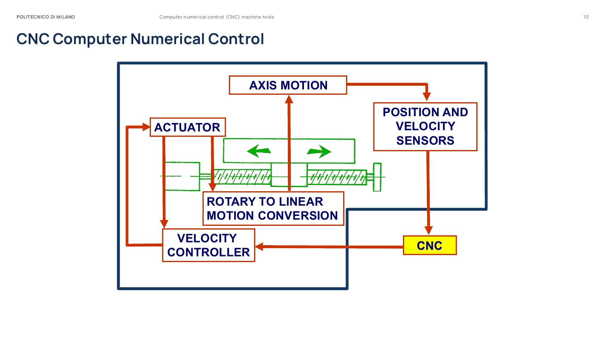

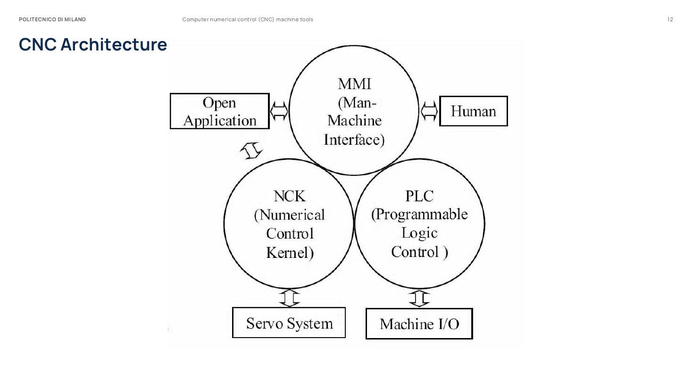

### Tool path control and interpolation

| Point-to-point | Continuous path (contouring) |
| --- | --- |
| Axes driven independently, minimum travel time; the path between points doesn't matter | Fully controlled path; complex trajectories |
| Drilling, punching, one-axis milling | Lathes, grinders, machining centres, welding |

- **Prof — point-to-point:** X and Y motors can move **independently** to the next hole (any path), minimising **time**, not necessarily path length. Then only Z plunges. Uses: drilling, punching, **spot welding** (go there, weld on, weld off). **Contouring:** a diagonal needs both motors to **collaborate**; on a circle both axes' speeds vary continuously.
- **Exam alert — "what determines how many axes a machine has?"** The complexity of the geometry and tool path. **"Does it interpolate all axes all the time?"** No. In the 5-axis **helmet video** the roughing was **2.5D** (two axes in the plane, then step down, leaving a visible **staircase**, cheaper and computationally lighter), then the part was tilted (C and B) and finished with **true 5-axis interpolation** (staircase disappears), using smaller tools for finer detail. 1D (drilling, a channel), 2D, 2.5D (switchable plane), 3D, and 5 axes for sculptured surfaces such as helicopter blades.

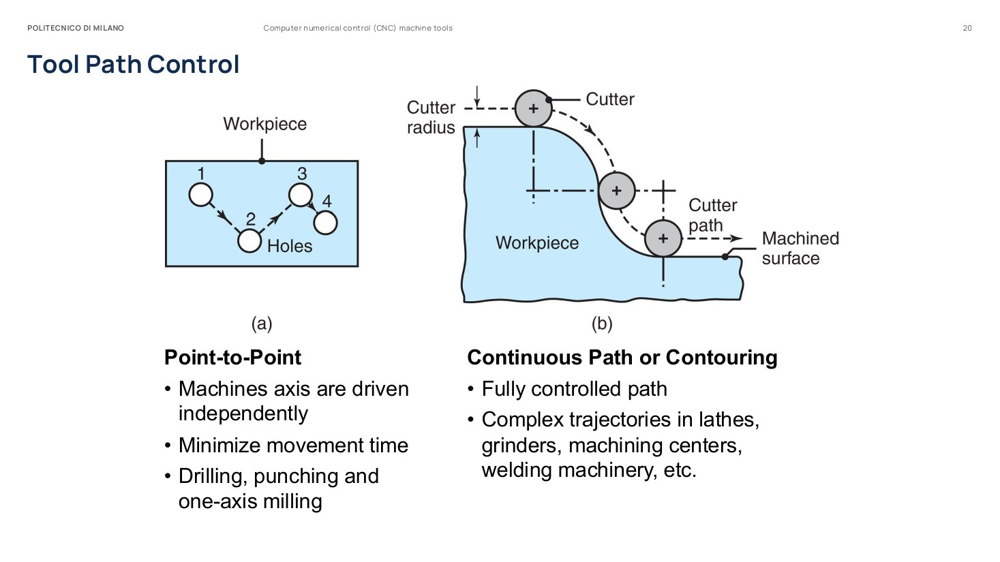

**Interpolation** = computing intermediate points on the desired path from a function. **Linear** and **circular** are standard. **Helical** = circular in two axes + linear in the third (threads, helical milling). **Parabolic/cubic** = free-form approximation; computationally heavy, used in aerospace and automotive. A curve approximated by segments needs a **tolerance band**: inside only, outside only, or both sides of the curve.

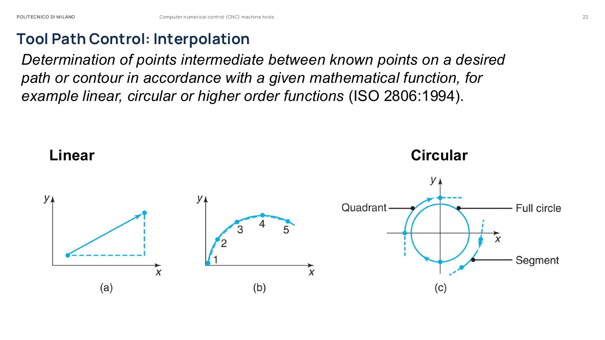

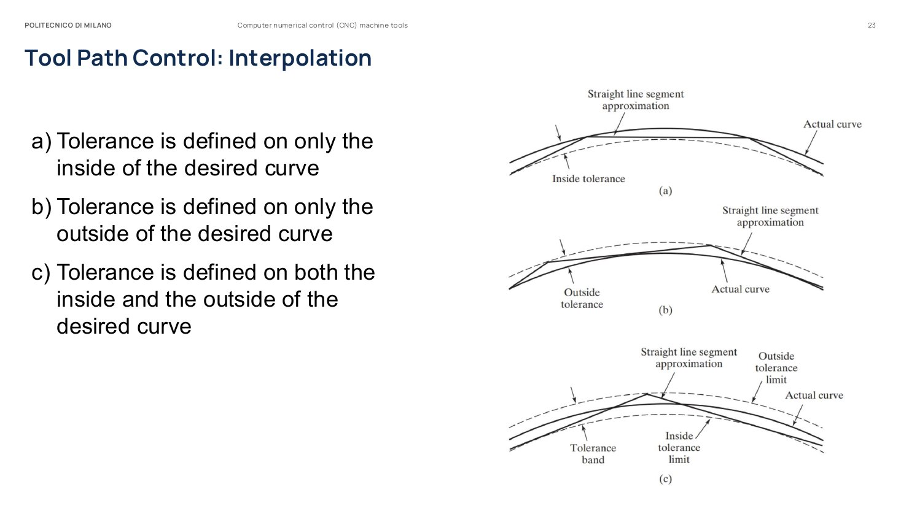

- **Prof:** a circle is easy to write mathematically; the difficulty is **updating the target between each segment** in real time. Linear segments approximate a circle ("fast and furious"); true circular interpolation computes the curve. Even with correct maths, **calculation and actuation timing** cause deviations, hence the tolerance band (inside, outside, or both). The cost of computing rises from linear to circular to helical to parabolic/cubic. **Helical** (circle + depth) is used e.g. to mill **pockets**. Free-form curves: polynomial segments sit between many tiny lines (fast) and one high-order curve (precise but slow).

### Part program: ISO code

**Block example:** `N10 G28 X2300 Y5600 Z1780 F350 S200 T19 M06` = block number + **geometric** information (G, coordinates) + **technological** information (F, S, T, M).

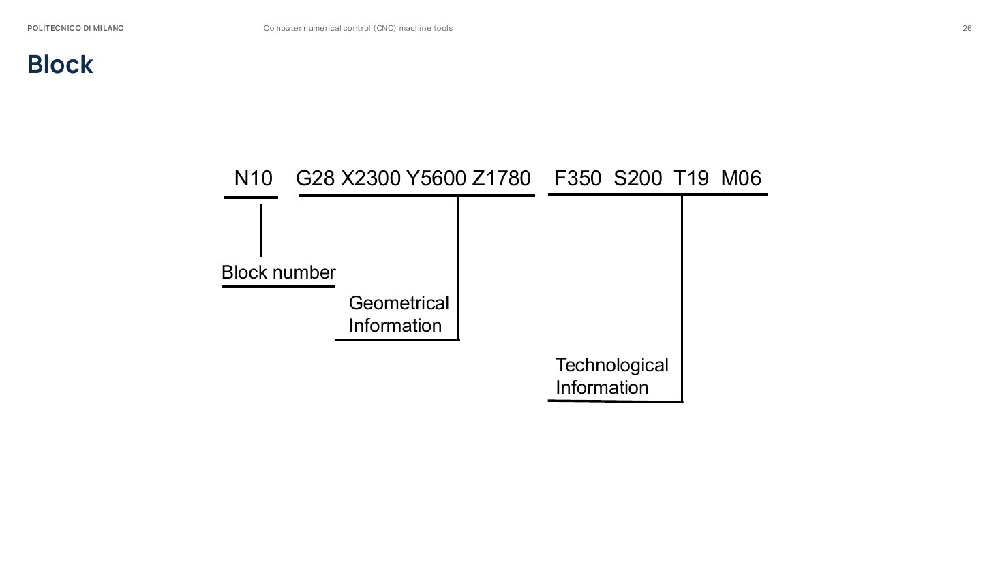

- Motion addresses: A, B, C, U, V, W, X, Y, Z. Machine functions: F, G, M, N, S, T.
- **Modal** = stays active in following blocks until cancelled (e.g. G01, G90, F). **Non-modal** = valid only in its own block.

| Code | Meaning |
| --- | --- |
| **G00** | Rapid positioning (no cutting; each axis at its own rapid rate) |
| **G01** | Linear interpolation at feed F |
| **G02 / G03** | Circular interpolation **CW / CCW** |
| G17 / G18 / G19 | Plane XY (centre I, J) / XZ (I, K) / YZ (J, K) |
| **G90 / G91** | **Absolute / incremental** coordinates |
| G94 / G95 | Feed in **mm/min** / **mm/rev** |
| G96 / G97 | S = constant **cutting speed m/min** / S = **spindle rpm** |
| G41 / G42 / G40 | Cutter radius compensation left / right / cancel (standard ISO) |
| M00 | Program stop |
| **M03 / M04 / M05** | Spindle **CW / CCW / stop** |
| **M06** | Automatic tool change |
| M08 / M09 | Coolant on / off |
| M10 / M11 | Chuck open / close (lathe) |
| M60 | Automatic pallet change |
| **M30** | End of program |

- **G-codes (preparatory):** movement, local coordinate systems (Cartesian, polar, rotated), interpolation (line, arc, helix, spline), miscellaneous (tool compensation, safety checks).
- **M-codes (auxiliary):** coolant, program start/end, spindle, tool or pallet change. **At most 3 M per block**, and they are **executed before the motion** in the same block. Example: `N10 G00 X-60 Y-20 S500 M03 M08` starts the spindle and coolant, then moves.
- **Spindle:** it won't turn until **both the speed (S) and the direction (M03/M04)** are given. M05 stops it; M00, M01, M02 and M30 also stop it.
- **Feed (F):** the maximum is set by the manufacturer; the operator can hold or override the feed while running.
- **Turning:** absolute X values are on the **diameter**, incremental on the **radius**.
- **Circular syntax:** start point + (centre I/J/K **or** radius R) + (end point **or** angle).

* **Class discussion — does spindle direction matter?** In turning, the cutting edge must meet the chip the right way, otherwise it rubs instead of cutting. In milling it also sets **up vs down milling** (L1.6), so direction is technological information, not just motion.
* **Class discussion — when must you limit spindle speed?** With **constant cutting speed (G96)**, n = v/(πD) goes to **infinity as the radius goes to 0**, e.g. in **facing** towards the centre. So you set a maximum rpm and accept the lower v near the axis. ("We choose the cutting speed; the spindle speed is a consequence.")
* **Prof — G94 vs G95:** feed per revolution keeps the **chip load and forces** under control (our calculations use f and v\_c); feed per minute keeps the **pace** constant.
* **Prof — feed override:** on the feed (not the speed) because feed sets the **cycle time** (t = L/v\_f). Use it mainly to **slow down when testing a new program**; "overriding is dangerous".
* **Prof — G00 explained:** each axis moves at its **own full speed** with no trajectory computed, so the path may **not be a straight line** (the faster axis finishes first). Use it only when you are sure **nothing is in the way**: at the **start** (approach to a safety point, e.g. 2–3 mm from the part) and the **end** (retreat). **Never disengage from the material with G00**: first move away with G01, then rapid away (risk of jerk or hitting the part). Same logic in welding: rapid close → torch on → weld → torch off → move away → rapid.
* **Prof — G02/G03:** CW vs CCW decides **convex or concave**. You need the start point (previous line), the direction, the plane (G17/18/19), and then either **centre + end point** or **radius + end point**.

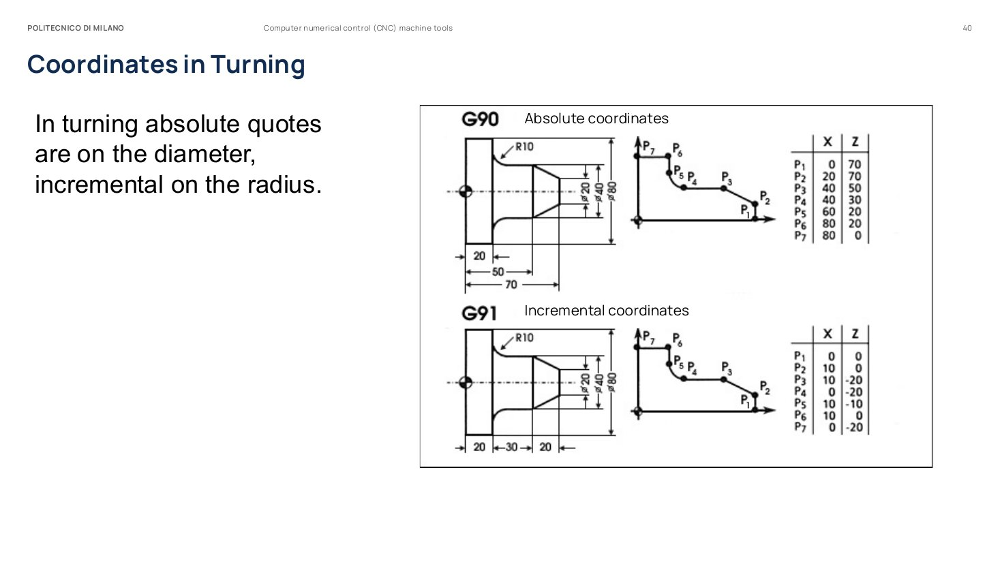

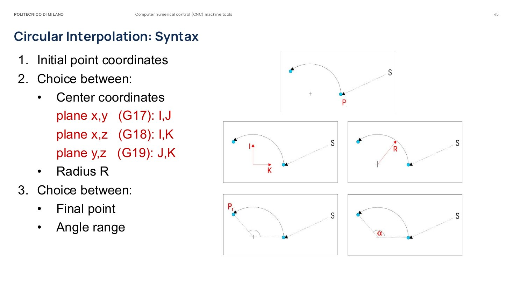

**Turning example (slide):** `N180 G00 X20 Z2` (rapid to a safety point 2 mm from the face) → `N190 G01 Z-15 F0.2` (turn Ø20 along 15 mm at 0.2 mm/rev) → `N200 G01 X40 Z-25` (taper to Ø40).

- **Prof — finishing that example:** after N200, don't retreat with G00 from contact. First G01 slightly away (the shortest safe move, e.g. up in X), **then** G00 to a far point (e.g. X70 Z10).
- **Prof — absolute vs incremental (blackboard example):** tracing a stepped profile P1→P7, **G90** gives each point's coordinates from the zero (X on the **diameter**); **G91** gives each move relative to the previous point (X on the **radius**; e.g. a diagonal = X+10, Z−20, because Z decreases towards the chuck). Incremental matches how a turner thinks ("cut 10 more, then step"). Today CAM does it automatically.
- **Exam alert — typical CAM Shop mistakes:** confusing **machine and workpiece coordinates** ("you break something"); **decimal comma vs point** (an Italian-locale PC writes 2,5, so the machine misreads it and values scale by 10); **wrong feed units** (m/min vs mm/s). "Open the code you made and check it; also run simulations."

### Coordinate systems and reference points

- **Machine coordinate system:** fixed on the machine, origin = **machine zero M** (set by the manufacturer).
- **Workpiece coordinate system:** origin = **part zero W**, chosen from the technical drawing, for convenience of setup, and for safety.
- **Tool zero E**. The path is programmed for a specific **tool point**.
- **Tool (cutter-radius) compensation:** the drawing gives the part contour, but the tool centre must be offset by the radius R. The NC computes the offset path, so you **program the drawing dimensions directly**.

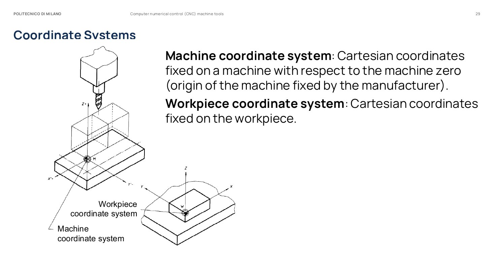

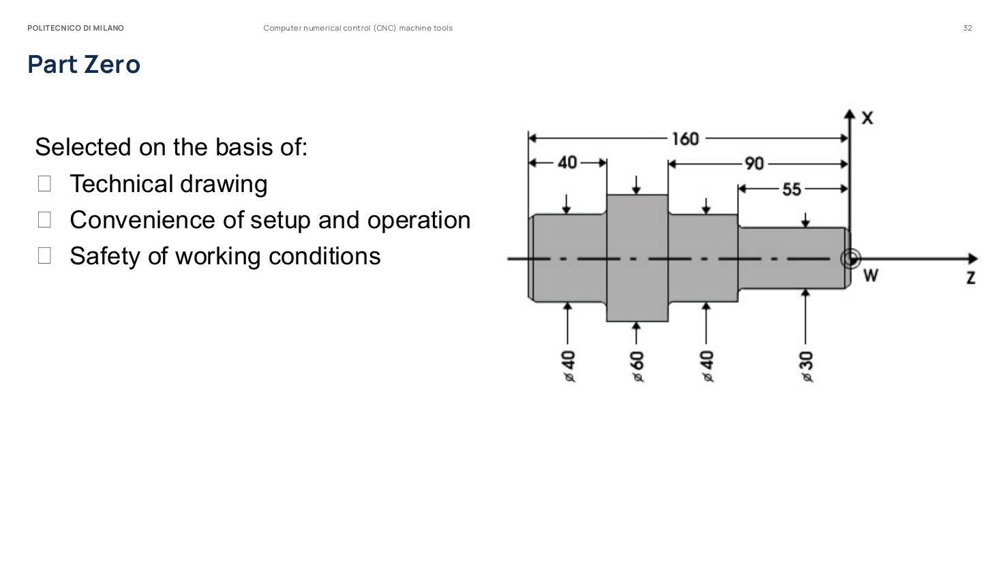

- **Class discussion — where is zero?** Not the tool rest position (it depends on tool length), but a **fixed physical point** in the machine set by the manufacturer (milling: often the lower-left corner of the work volume, so everything is positive; turning: **behind/at the spindle**). The workpiece zero (often the **front face** in turning, so cutting Z values are negative) is always **referred to machine zero**. In turning the workpiece zero must lie **on the spindle axis**. You can also shift local coordinate systems inside the program.
- **Exam alert:** "The part zero is **where the part is expected to be**, not where it actually is." If the part is clamped slightly off, the machine doesn't know, so **fixturing and positioning** must be correct. The machine must also know the **sizes** of part and tool (avoid collisions).
- **Prof — tool compensation:** program the **drawing coordinates**; the CNC offsets by the tool radius (G41 left / G42 right / G40 off). Without it, a milled outer contour comes out **smaller by the radius** all round. Outer contour: compensate **outside**; pocket: compensate **inside**.
- **Prof (26 Oct) — compensation is not only for milling:** in welding/cladding the offset equals the **bead size**, which you get from experiments or from the thermal models (width of the melt isotherm, L1.3). "This is why it is necessary to model." The **kernel (NCK)** computes the compensated path. He called these "nice questions for an oral exam".

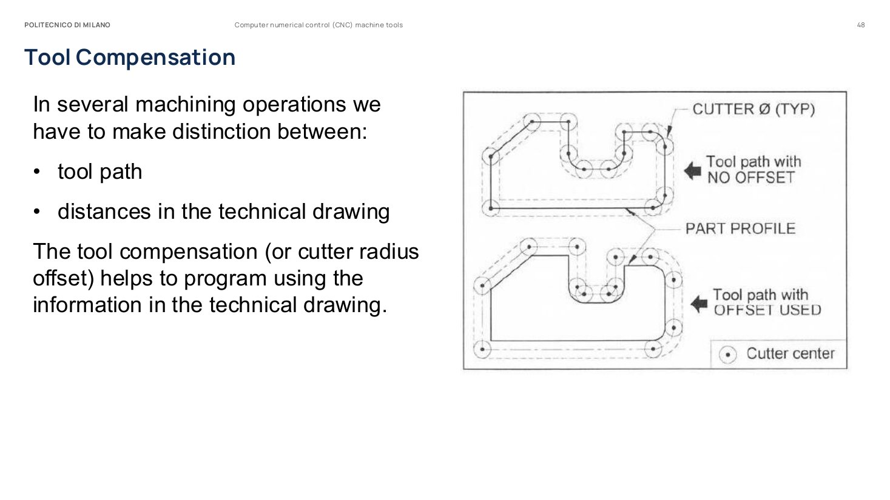

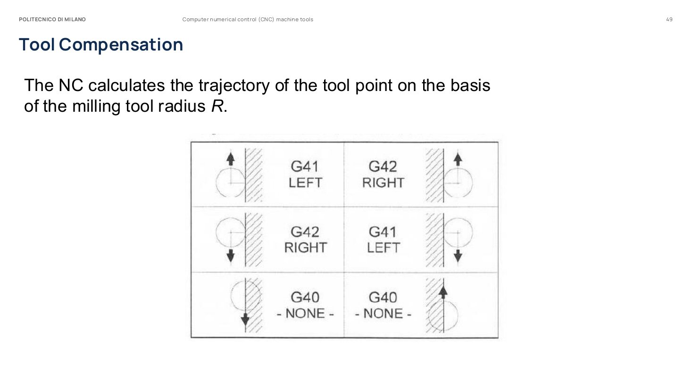

### CAD/CAM integration

CAM is used when the part is complex, has difficult features, or involves several programmers. Flow: CAD part model + fixture + tools + machine database → define machining operations → NC sequence → **CL-file** (cutter location, e.g. **APT** language) → **post-processor** → ISO code for that specific CNC.

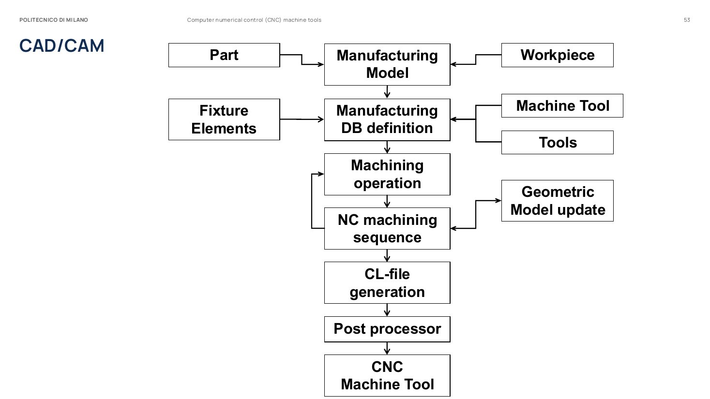

- **Prof — why two steps:** the CAM output (APT/CL) is English-like and **universal**; the **post-processor is machine-specific** (it knows that controller's dialect). When you buy a CAM licence you pay mostly for the post-processors: free tools can write generic ISO code but usually lack a post-processor for your machine.
- **Prof — machining sequence in turning (the CAM example):** **facing first** (fixes the length / Z reference), then **external turning in several passes**, then **threading** (done in two passes), then **grooving**.
- **Exam alert — "How would you determine the number of passes?"** (1) the **tool's capacity** (max depth of cut for that insert); (2) the material, via **k\_cs / k\_c** → cutting force → **power**, checked against the **machine's power limit** (L1.6 models); (3) **surface quality**: roughing passes, then a **finishing pass at lower feed**. This links CAM directly to the process models.

Tool-path strategies for free-form surfaces: **Z-level curves, constant-parameter curves, parallel-plane curves, spiral, radial**. Typical problems: approximating the path within tolerance, gouging, compensation on curved surfaces. **This is what you do in Fusion 360 in CAM Lab.**

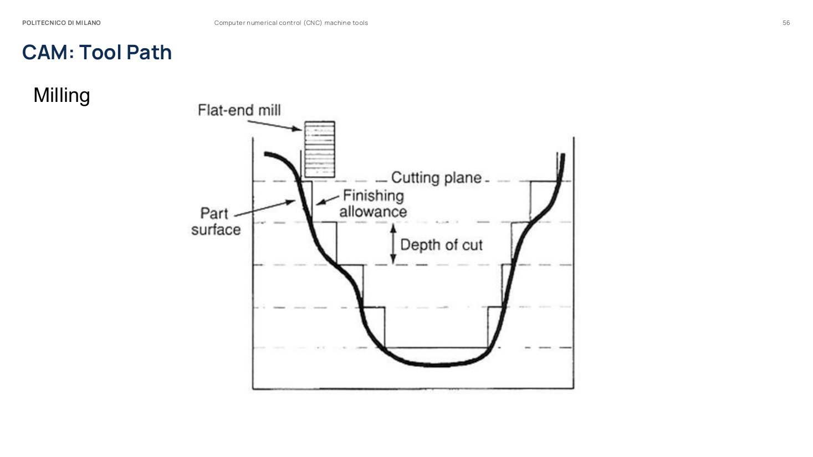

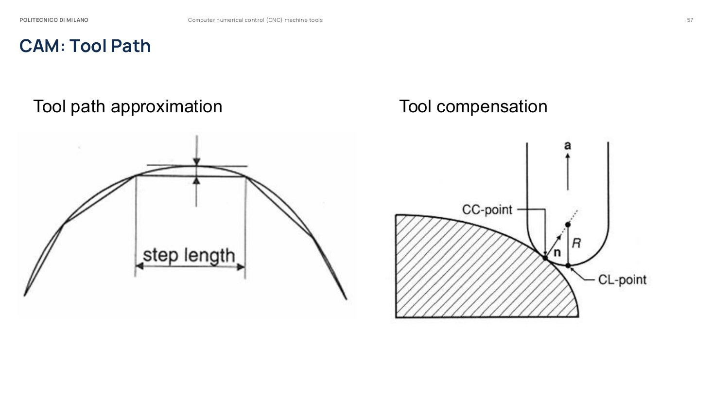

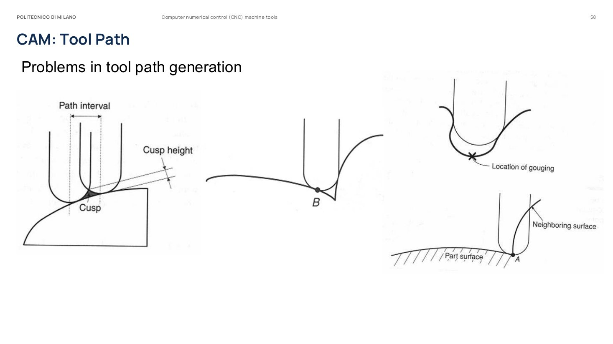

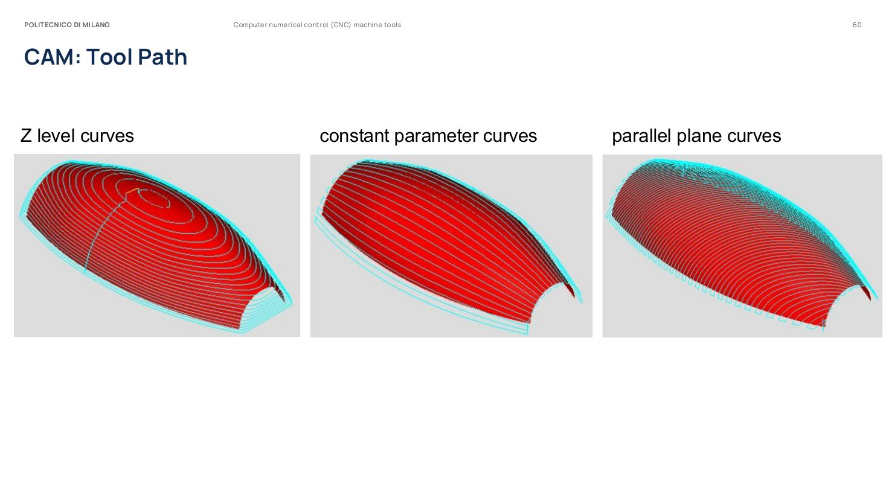

- **Prof — concentric vs zigzag pocketing:** concentric (offset) paths keep the **tool engagement constant** → steady force and power; zigzag gives **force jumps at the corners**, where engagement suddenly rises, and you risk breaking the tool. Same logic as the constant-engagement (constant-parameter) strategy.
- **2.5D staircase:** roughing a free-form surface layer by layer leaves steps. A smaller axial depth reduces them but takes longer, so: **rough with layers, then finish with a ball-end mill** — which in turn leaves **scallops (cusps)** between passes, so the stepover sets the surface quality.
- **Path approximation:** the CNC moves in short lines/arcs, so the curve is approximated within a chordal tolerance (smaller tolerance → more blocks).
- **Compensation on curved surfaces:** the **contact point** moves around the ball while the programmed point is the **tool centre**, so the offset is along the surface normal, not a fixed radius in XY. Cusps can differ across directions, so you may machine in several directions.
- **Gouging / collisions:** the tool cuts where it shouldn't (concave regions tighter than the tool radius, or the holder hits the part). Fixes: a **smaller tool** or **more axes**.
- **Sharp corners:** possible on an outer (embossed) shape, **not inside a pocket**: an inside corner always keeps the tool radius (a smaller tool reduces it; even laser cutting leaves a small radius = half the kerf).
- **Why 5 axes:** they keep the **tool inclination to the surface constant** (his example: machining a helmet shape), so cutting conditions and surface finish stay uniform.

### Machine components

| Motor | Pros | Cons | Use |
| --- | --- | --- | --- |
| AC | Robust, cheap, reliable | High starting current; torque not proportional to current | Spindle |
| DC (brushed) | Easy speed/torque control, high torque at low speed | Maintenance (brushes) | Axes, spindle |
| Brushless DC | High constant torque, high acceleration and speed, reliable | Cost | Axes, spindle |
| Stepper | **Open-loop**, cheap, reliable, high torque at low speed, simple | < 5 kW, torque falls with speed | Axes (e.g. small machines like the Snapmaker) |

- **Prof — motors in plain words:** **DC brushed**: simple control, but the **brushes wear**. **Brushless**: permanent magnets, the electronics convert DC → AC (commutation), no brushes to wear. **AC**: speed set by number of poles and **supply frequency** (inverter/frequency control) — the usual **spindle** motor. **Stepper**: **open loop**, the controller just **counts pulses**; cheap but **inaccurate for small moves** and it can lose steps without knowing.
- **Why rotary motors at all?** They can **rotate indefinitely in a small footprint**; the linear motion is then obtained through a transmission (ball screw, belt, rack).

* **Spindle:** characterised by power, torque, speed (power/torque vs rpm curve) and stiffness.
* **Prof — spindle curve:** a **pulley or gearbox** gives low speed with high torque. On the torque–power vs rpm curve the torque is **constant up to the base speed (≈1540 rpm on the slide)**, then **power is constant** and torque falls (P = T·ω). Same shape as an **electric car**; a combustion engine instead has a torque peak and then drops. Exam link: at low rpm you are **torque-limited**, at high rpm **power-limited** (check both in the L1.6 exercises).
* 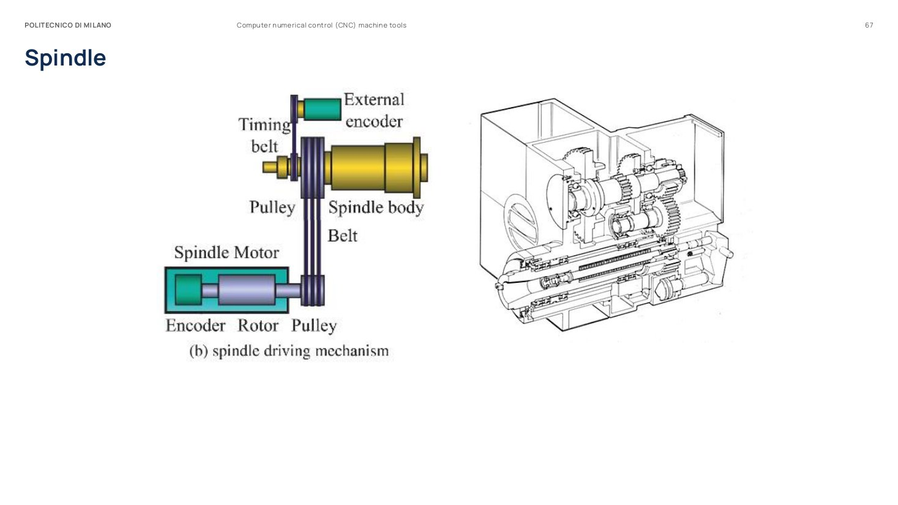
* **Rotary to linear:** **ball screw** (low friction, high efficiency, **no backlash with preload**, accuracy depends on the lead), rack and pinion, pulley/belt.
* **Prof — ball screw:** the balls turn sliding into **rolling** → less friction and less heat. **Backlash** = the play when the direction reverses; he compared it to the small drop you feel when an elevator stops — the axis moves a bit before the load follows. Preload removes it. The **lead** (mm per turn) together with the encoder sets the **minimum displacement**.
* 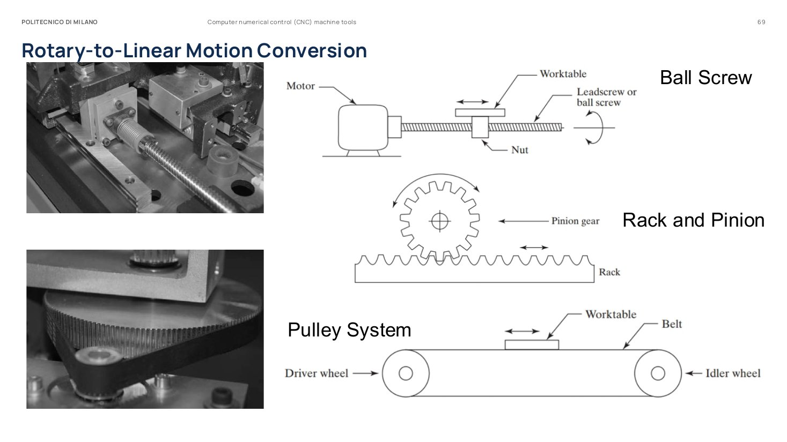
* **Guideways:** sliding (integral in the casting or added) vs **rolling** (μ 0.0005–0.005, accurate, high load, **no stick-slip**, low wear and maintenance).
* **Linear motor:** no transmission chain, rapid feeds about 120 m/min, about 20 m/s², low inertia, accurate. But costly, high voltage, heating, chip protection, complex control, magnetic fields.
* **Prof — linear motor:** it is a rotary motor "unrolled": the **windings lie along the axis**. Drawbacks he stressed: **eddy-current heating** and the **magnetic field** (attracts chips, disturbs sensors).
* 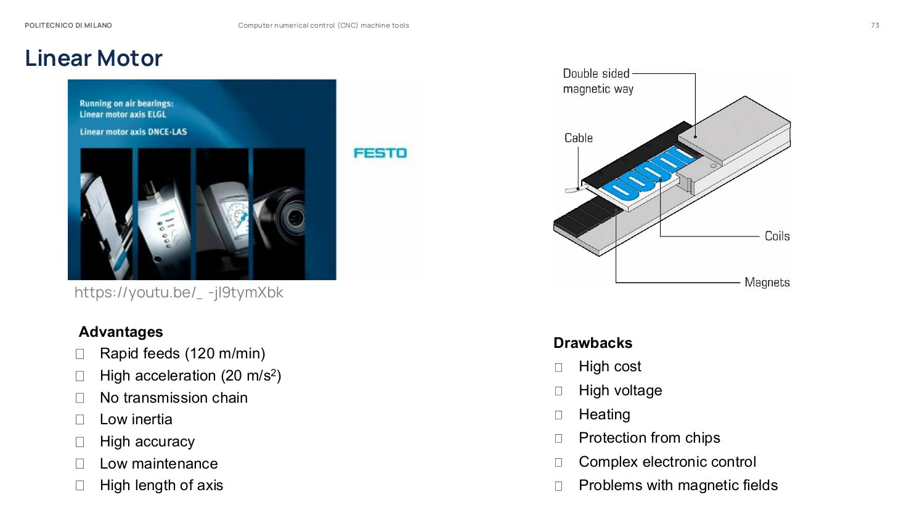
* **Position sensing:** **direct** (scale on the table: measures the real table position) vs **indirect** (encoder on the motor or screw: misses screw errors and backlash). **Inductosyn** (inductive, analog, cyclic absolute, sine/cosine output); **linear scales** (optical transmission/reflection, interferential, laser interferometer; 20 µm grating); **incremental encoder** (slotted disk, square-wave output, resolution = number of slots, counts can accumulate errors); **absolute encoder** (concentric tracks, binary code, **noise does not accumulate**).
* **Prof — sensors:** indirect (motor encoder) is cheap but **misses slip and transmission errors**; direct (table scale) sees the real position. **Inductosyn** = etched copper patterns, works by induction. **Optical scales** give **two phase-shifted signals (90°)**: the phase order gives the **direction**, interpolating them increases **resolution**; **reference marks** give the absolute zero. A **laser interferometer** reaches **below a nanometre** (red light ≈ 660 nm wavelength, then fringe interpolation). **Incremental encoder**: slots plus an **index slot** (one per turn) for referencing. **Absolute encoder**: concentric tracks, the position is known at power-on.
* 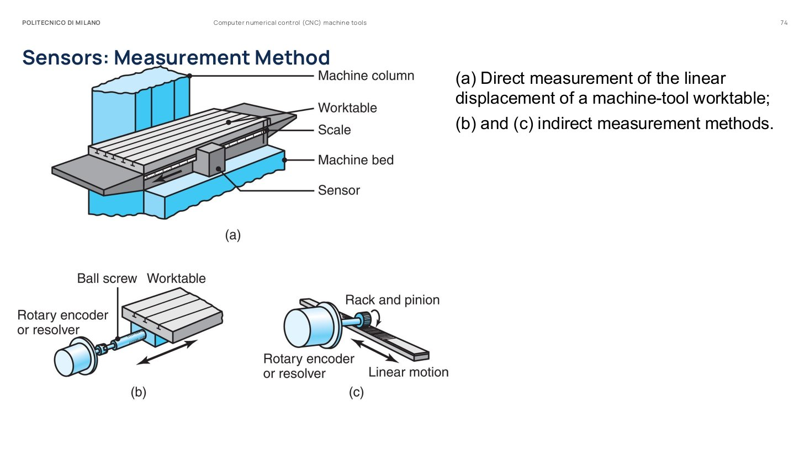
* 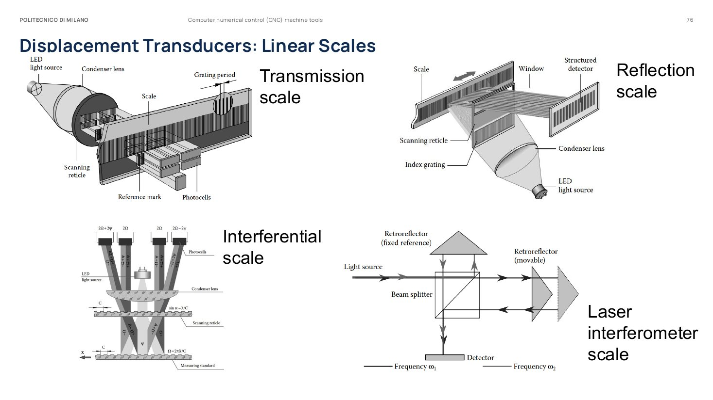
* 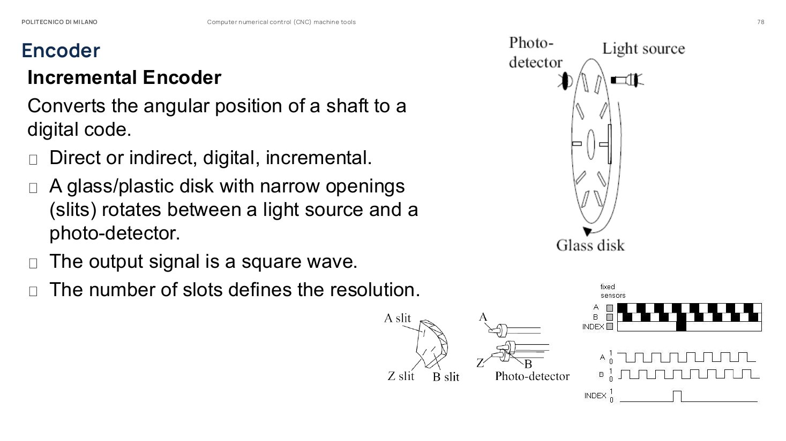
* **Accuracy** = average positioning error (bias). **Repeatability** = spread of repeated positionings. **Resolution** = smallest axis displacement. (Robot repeatability was about 1 mm in L0.0; machine tools are in the micrometre range.)
* **Exam alert — accuracy vs repeatability:** a machine can be **very repeatable but wrong** (e.g. calibration off: it always lands in the same wrong place). High accuracy **and** repeatability require the right **motor + transmission + position readout** together — be ready to explain which component limits which.
* 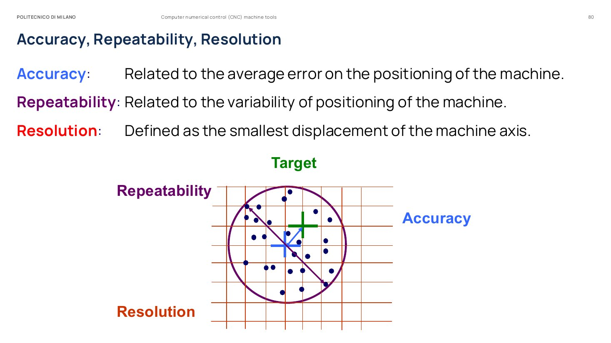
* **Structure:** stiffness, damping, thermal distortion, assembly, foundations; bed in **cast iron** (damping) or **welded steel**.
* **Prof (27 Oct) — avoid errors before compensating them:** positioning errors propagate along the chain motor → transmission → screw → guideways, and "it is better to avoid" than to measure and compensate. Machining loads are **cyclic** (milling), so vibrations add positioning and geometric errors. Higher **stiffness** raises the natural frequency, higher **mass** lowers it: keep the structure's natural frequencies away from the process frequency and **damp passively** (material damping). **Thermal distortion** is a very low-frequency error: the scales move with the expansion, so you read the right position but are off.
* **Class discussion — how do you make a machine rigid if you can't just add weight?** Material (heavy **cast iron**: spheroidal/nodular graphite damps vibration; **polymer concrete** is an option, carbon-fibre composites are not), then **geometry** (ribs, symmetric shapes so expansions cancel), then the environment (**climate-controlled room** for the highest precision). Welded steel beds are lighter but need geometric stiffening.
* **Prof — assembly and the last resort:** bolting can rotate, displace or deform parts; welding distorts (local heating and cooling); gluing only for low forces. Precision costs money; past a saturation point you **characterise the machine's errors and correct them in real time with a lookup table**.

### Machine classes

- **Single-purpose** NC machines (one process) vs **multi-purpose**: **turning centre** (loader/unloader manipulator, one or two turrets used at once, **driven tools** for drilling, tapping and milling) and **machining centre** (tool storage → tool changer → spindle).
- **Prof — turret = short, indexed tool change:** tools are mounted and referenced on the turret **offline**, so a change takes seconds and the machine knows where each tool is (by hand: minutes, then re-referencing). **Two turrets** = two more axes (Z, X each): shorter machining time, higher cost. A **robot for loading/unloading** cuts preparation time but raises capital cost, so there is a break-even quantity between more and less automated set-ups (L1.9).
- **Prof — driven tools (C1, C2):** C1 = the spindle stops and **positions** the workpiece, C2 = rotation of the driven tool. So you can mill, drill and tap on a turning centre, e.g. the **keyway pocket on a shaft** without moving it to a milling machine. In his video (brass part): facing, grooving, external turning, pre-drill + drilling, milling a pocket with the spindle interpolated with the 3-axis driven tool, tapping, cut-off.
- **Prof — machining centre:** a powerful spindle (MRR), **tool storage + tool-change arm** (a magazine can be loaded while cutting), **pallets** (load the next part while machining). Unlike the turret, the tool must be swapped into the spindle. 5-axis = X, Y, Z + A, B; with a C-axis it can even turn. Programming = plan the order of operations, set them up, keep checking **collisions**.
- **Exam alert — "how would you program a 5-axis machine?":** you won't be asked to program one (the course stops at **3-axis milling**). Know the basis: machining **planning** (order of operations), the CAM strategies, and how to compare them (e.g. spiral vs 2.5D: time, precision).
- **Touch probes** in machining centres: find the workpiece X–Y position and surface height, the cutter diameter (radius compensation) and the tool length (length offset). This is **in-cycle measurement** (L1.6), used for GAC.
- **Prof — probing, and how to avoid it:** the code assumes the part is at a given position; probing finds the real offsets, which the NC applies. Probing takes time; optical sensors are faster but struggle with oil and chips. Better to **avoid** the need: **fixtures** (and pallets) guarantee the position. Probe anyway for very precise parts. A probe senses a contact force and reads the axis position.
- **Class discussion — why is the coolant always on when drilling?** The chip has nowhere to go but **up** the hole; it rubs and heats. Coolant cools and helps break and evacuate the chip (very deep holes risk breaking the drill).
- **Prof — low-force processes on Cartesian machines:** without cutting forces you exploit **precision + speed**, e.g. **laser cutting**: Z sets the **focal point**, the kerf is a "virtual tool" to compensate, and a 6-axis tube cutter measures the rolled stock first and inclines the head to cut mating edges. Laser safety: the door stays locked while the beam can be on.

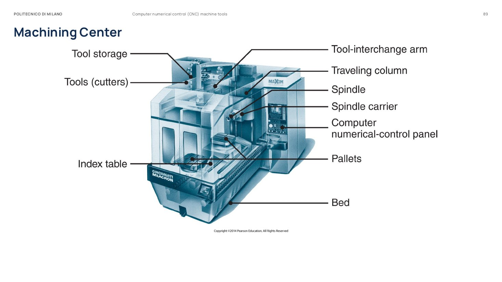

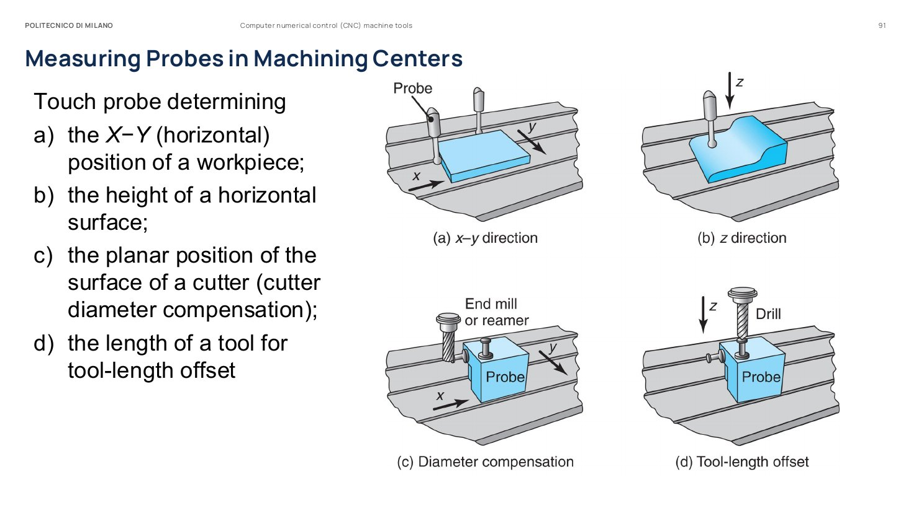

## Professor background (less exam-critical)

- **Prof:** "this part is more explanation than equations", but **a lot can be asked from it**. A transformation process "doesn't become a manufacturing process unless you automate it": synchronising events, motion and auxiliaries. NC is **very recent** compared to casting and cutting (millennia old). Context: post-war prosperity plus the needs of aviation (complex blades and wings). Punch cards: pins go through holes and close circuits. The birth of CNC is **tied to the birth of the electronic computer**.
- **Prof:** numerical control doesn't have to be a computer: a car engine's **camshaft** is mechanical automation (it opens valves on a timing). CNC = done by computer: input commands, then drive signals (spindle, table axes), then **read back position** to close the loop. Limit switches tell an axis it has reached its end. Examples are mostly machining (it needs the most motion), but put a **welding torch** on the same machine and you control position plus heat input instead of force.
- **Class discussion — why is machine motion harder than driving a car?** The car's error is in **cm**, it has (usually) **one motor**, and only friction and aerodynamics resist it. A machine has **several motors** that must move together with µm accuracy **under heavy process loads**. **Milling vs welding on the same machine:** welding adds no cutting force, but its **heat** makes the part and the machine **expand and shrink**, which matters when you count micrometres.
- **Prof — industrial MMI design:** soft keys, a dedicated key block (not QWERTY), **feed override wheel**, and the **emergency button**. It should be "easy to use, **but not too easy**", since a too-easy change means easy mistakes. Touchscreens are often avoided in industry. Robots use a hand-held **teach pendant** (you need to see where the robot moves). AR goggles are emerging.
- **Prof (20 Oct) — the code must match the hardware:** 3-axis code can't run on a machine without 3 axes, and **CAM must know the machine** (post-processor). Trigonometric functions are avoided in real-time computing because they are inefficient.
- **Class discussion — why not put a more powerful computer in the machine?** (1) **cost**; (2) machines live far longer than PCs (write-off 5 years, but often used much longer; you don't scrap a half-million-euro investment because faster chips exist); (3) even with every point precomputed, the controller must still **read each line and drive the motors in real time**, a physical limit. **Retrofitting** an external PC is possible (his lab has run real-time sensor control of a 2015 laser cutter for about 11 years, via real-time fieldbus such as Profibus, not USB), but it **voids the warranty**, needs specialists, and is not **universal** across plants. "If you want to make a start-up, think about it."
- **Prof — why ISO code survives:** understood by machines **worldwide**, and **readable by humans**. It is executed **block by block** (a letter + a number = a word). Block numbers go in **tens** (N10, N20…) so you can insert lines later. It can also call sub-programs, display messages, set variables and do conditional calls. "For complex codes nobody opens them, but simple ones you can still write by hand."
- **Prof:** everything from the process theory is now **coded**: feed, spindle speed (from your power calculations), even the **tool** to use (T19).
- **Prof — guideways:** classic sliding guides are **dovetails with lubricant**; modern **rolling guideways** reach about **5 m/s and 30 g**.
- **Class discussion — pneumatic actuators?** Impulsive, imprecise, **hard to close the loop** (air is compressible), so not for machine-tool axes. Acceptable uses: the **die-casting plunger** (L1.2) and **pick-and-place**. Forging uses **hydraulics** (force). In battery manufacturing, **electromagnetic and vacuum** grippers are used for handling.
- **Prof (27 Oct) — examples:** a company near Lecco makes satellite mirrors in clean, climate-controlled rooms (nanometric precision); the brass turned-part video; a 5-axis compressor impeller ("if you ask me how to program this I wouldn't know, but the essentials are the same"); a 6-axis laser tube cutter like the ones students see on the BLM visit. Interested students can take on tool-path challenges in the lab.

## Practice exercises

*No dedicated exercise. All formulas: [formula sheet](../formula-sheet.md).*

## Likely oral questions

- **How do you make a machine tool precise beyond the servo loop?** Avoid errors first: stiff and well-damped structure (cast iron, polymer concrete, geometry) with natural frequencies away from the process frequency, thermal stability (symmetry, climate control), careful assembly; then characterise residual errors and compensate them with lookup tables; probe or fixture the part so the program's zero matches reality.
