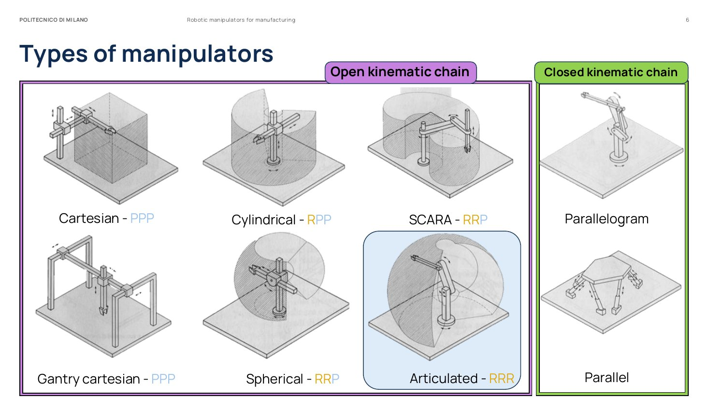
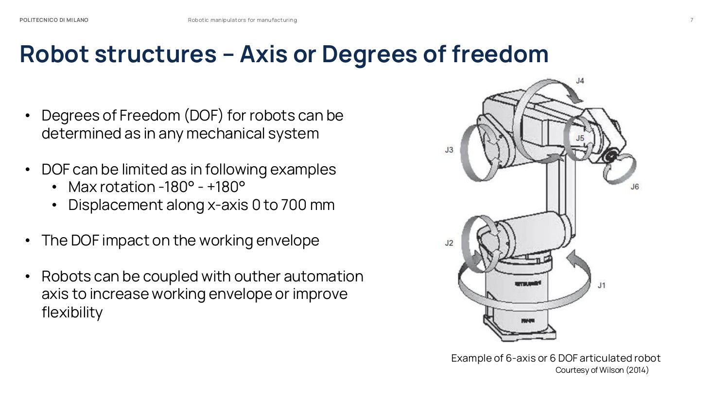
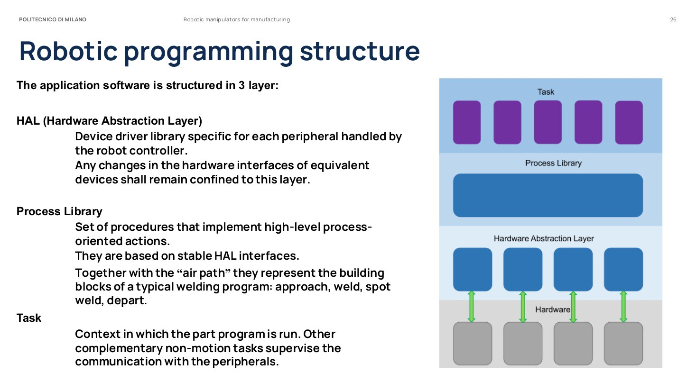
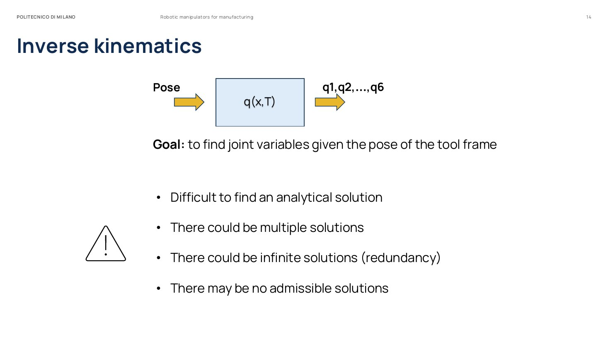
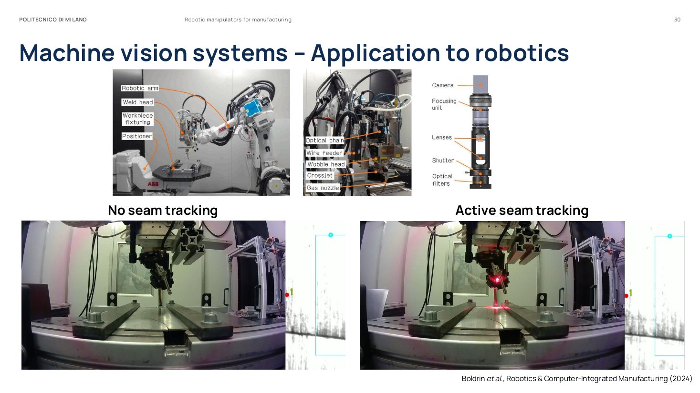
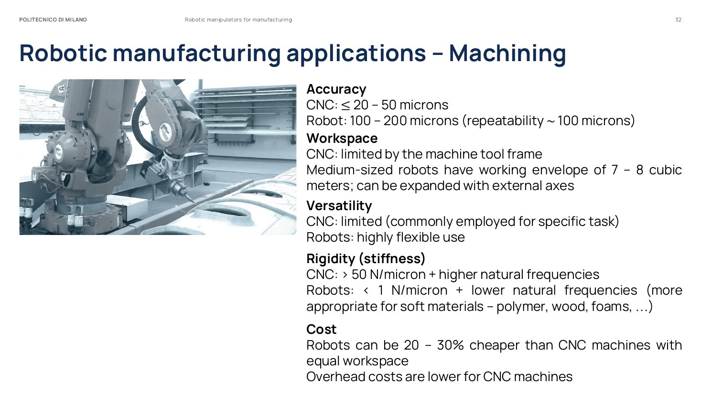

# L2.2 Robotic manipulators for manufacturing

> Part of the CAM study guide. Source of truth: [the study guide](https://claude.ai/artifact/WrGc96ueegSH8ZXZdT4FaB). Generated by `tools/build_guide.py`; edit the guide, not this file.

## Slides and professor's explanations (exam material)

Robots trade **accuracy and stiffness** for **workspace, flexibility and cost**. Programming them is harder than programming a CNC: the same tool pose has **multiple joint solutions** (inverse kinematics), plus **singularities** and joint limits. So robots suit welding, polishing, cutting, AM and soft-material machining, while 5-axis CNC stays the choice for stiff, precise metal cutting. *(Slides + recording of 27 Oct (intro, robot types, frames, inverse kinematics) and 3 Nov (recap, robotic additive manufacturing). The 28 Oct recording has no audio, so programming methods and the other applications are from the slides. Professor's comments inline.)*

### Definitions (ISO 8373:2012)

- **Robot:** actuated mechanism programmable in ≥ 2 axes, with some autonomy, moving within its environment to perform tasks.
- **Industrial robot:** automatically controlled, **reprogrammable, multipurpose manipulator**, programmable in **≥ 3 axes**, fixed or mobile.
- **Manipulator:** segments jointed or sliding relative to each other, to grasp or move parts or tools. **Mobile robot:** travels under its own control (platform with or without a manipulator).

* **Prof (27 Oct) — why robots in this course:** CNC and CAM are standardised and target productivity; robots make processes feasible thanks to their **geometric freedom**, less standardised but more flexible for new processes. Compare robots and CNC on **accuracy, stiffness, flexibility, accessibility and cost**: some are worse, some better.
* **Class discussion — what are CNC machines good at?** **Precise**, **rigid** (Cartesian/gantry, few motors on rigid guideways), therefore **fast** and deflecting less, and programmed in a **standardised language** (ISO). Robot CAM is **controller-specific** (each manufacturer has its own).
* **Prof — example, robotic incremental forming vs deep drawing:** deep drawing needs a press (say €500k) and a die (say €50k), so 1 part costs at least €550k and 5 parts €110k each. A robot pressing locally with a small tool on a **fixture** removes press and die: low capital, but the difficulty moves to **programming and process knowledge** (enough force? local stress = F/A). Worth it for 1–10 parts (L1.9 cost model).

### Kinematic types

| Open chain | Joints | Closed chain |
| --- | --- | --- |
| Cartesian / gantry | PPP | Parallelogram |
| Cylindrical | RPP | Parallel (delta, hexapod) |
| Spherical | RRP |  |
| **SCARA** | RRP |  |
| **Articulated (anthropomorphic)** | RRR (+ wrist = 6 DOF) |  |

P = prismatic, R = revolute. DOF are limited by joint ranges (e.g. ±180°, 0–700 mm), which shape the **working envelope**. **External axes** (linear tracks, 2-DOF positioners) enlarge it or improve access.

- **Prof — workspace shapes:** Cartesian → prismatic volume, cylindrical → cylinder, spherical → sphere, SCARA → complex shape. The **gantry** is the most rigid (built between columns); the **articulated arm** grows around a single column, a compromise between rigidity and flexibility. Closed chains: one actuator's motion is limited by the others.
- **Prof — joint limits and envelope:** joints may not rotate fully (e.g. ±180°) because of collisions or actuation; linear axes have stroke limits (e.g. 700 mm). Mounting the robot on an **external linear axis** adds a DOF and enlarges the envelope. A 4-DOF robot cannot reach every orientation.

### Frames and targets (ABB RAPID as the example)

- **Pose** = \[\[x, y, z\], \[q1, q2, q3, q4\]\] = position + orientation as a **quaternion**.
- Frames: base/world **wobj0**, default tool **tool0** (flange), user tool frames (e.g. **tWeldGun**, defining the TCP), and a **work-object frame** (wobj) attached to the part. All points are referred to a wobj, so if the part moves you re-teach only the wobj.
- **TCP** = Tool Centre Point (torch tip, cutter tip, forming-tool contact point).
- **RobTarget** = \[\[pose\], \[confdata\], \[ext axes\]\]: TCP position + orientation + **configuration** (cf1, cf4, cf6, cfx, which select the joint solution) + external axes. **JointTarget** = the joint angles directly.
- **Inverse kinematics:** from the tool pose find q1…q6. It is often hard to solve analytically; there can be **multiple** solutions, **infinite** ones (redundancy), or **none** admissible (joint limits, reach).

* **Exam alert — why robot programming is different from CNC:** on a CNC one motor moves one axis in one direction. On a 6-DOF arm X, Y, Z still exist but **are not the axes**, so reaching a point needs **all joints together**. You move the **tool**, not a joint, hence frames: the **base frame** (useless for the process), the **tool frame / TCP** (position + orientation), and the **work object** (everything referred to the workpiece). Pose = X, Y, Z + **quaternion** (4 numbers with unit norm, so 3 are free).
* **Class discussion — why specify the configuration as well (confdata)?** The same TCP pose can be reached with different arm configurations, and the choice matters for **collisions**, **stability** (centre of mass near or far from the base under process forces), **speed**, and avoiding **singularities** (aligned joints) and jerky motion. External axes (tilt-rotate positioner) add DOF and need their own frame.
* **Prof — inverse kinematics from the manufacturing side:** from the target pose to the joint variables. It is hard to solve analytically and can have **multiple, infinite (redundancy) or no** solutions, so you fill the choice with manufacturing knowledge: accessibility, process forces, collision avoidance. That's why robot programming relies more on experience and simulation and is less standardised than NC programming.

### Move instructions

| Instruction | Path | Notes |
| --- | --- | --- |
| **MoveL** | TCP in a **straight line** | Can stop at a **singularity** |
| **MoveJ** | Joint interpolation, **not** a straight TCP path | Singularity not a problem; fast repositioning |
| **MoveAbsJ** | To absolute joint angles | Same as MoveJ from the same start and configuration |
| **MoveC** | TCP along an arc |  |

A weld program = **air paths** (MoveL/MoveAbsJ for fast moves between seams) + **process paths** (process moves with the welding active). Software layers: **HAL** (device drivers; hardware changes stay here) → **process library** (approach, weld, spot weld, depart) → **task** (runs the part program; other tasks handle peripheral communication).

### CNC vs robot: from CAD/CAM to execution

| CNC | Robot |
| --- | --- |
| NC post-processor → ISO/G-code | Robot post-processor / **offline programming** → robot program + configurations |
| CNC interpolation and axis control | **Kinematic planning and joint control** |

- **Robot pros:** flexible tool position and orientation; easy reconfiguration; integration of external axes, sensors and adaptive control; joint- and Cartesian-space programming.
- **Robot cons:** multiple IK solutions and **singularities**; joint limits constrain paths and speeds; complex path and configuration planning; **sensitive to calibration and positioning errors**.
- **Languages:** ABB **RAPID**, FANUC **KAREL**, KUKA **KRL**, Stäubli **VAL3**. CAM vendors offer plug-ins/post-processors; some NC makers propose G-code for robots.

### Programming methods

| Offline – coding | Online – teach pendant | Offline – virtual (simulation) |
| --- | --- | --- |
| Needs programming skill; no visual feedback; allows complex programs | Easiest; short setup; less accurate | Needs software skill; **safe and cheap testing** |

**Lead-through programming (cobots):** the operator moves the arm by hand to targets and adds nodes with buttons on the flange (see Marco Bruni's research from L0.0: programming-free robotics).

**Auxiliary automation:** conveyors (belt, chain, roller), **AGVs**, part feeders (bowl, linear), positioners (1-axis, 2-axis, double station). **Machine vision:** active seam tracking vs none (Boldrin et al. 2024), linking to L1.4.

### Robot vs CNC for machining (exam numbers)

|  | CNC | Robot |
| --- | --- | --- |
| Accuracy | ≤ 20–50 µm | 100–200 µm (repeatability about 100 µm) |
| Workspace | Limited by the frame | Medium robot about 7–8 m³, expandable with external axes |
| Versatility | Limited, task-specific | Highly flexible |
| **Stiffness** | **> 50 N/µm**, high natural frequencies | **< 1 N/µm**, low natural frequencies, so soft materials (polymers, wood, foam) |
| Cost | Lower overheads | **20–30% cheaper** for equal workspace |

Robot machining is "unconventional because of low rigidity"; 5-axis CNC is often preferred. This is the class discussion from L1.1 (robot milling wood slowly) with numbers.

### Applications

- **Spot welding:** among the first industrial robot uses (automotive); flexible joint access; now being replaced by laser welding. **Arc/GMAW cells:** digital twin + sensing + cell calibration; large structures.
- **Laser welding** (BLM LW-S); **hybrid laser–arc** (Fronius LaserHybrid: laser + MIG head, up to 8 m/min, gap bridging + filler).
- **Cobot welding:** easy programming for high variability / low batches, but slower air moves.
- **Mobile/field:** LaserSnake (5 kW fibre, snake arm, nuclear decommissioning), AL-Rock Mobil (6 kW, tracked, no fixed cell). **Humanoid welding** (Kepler, Persona AI).
- **Polishing, laser cutting, bending, incremental forming** (the L0.0 Machina Labs video).
- **Additive:** **WAAM** (ABB IRB 2600 + 2-DOF positioner + Fronius TPS 400i: Tornaquindici's research), laser metal deposition (8-axis), extrusion AM.

* **Prof (3 Nov) — the robot vs CNC summary:** robots give **flexibility** and are cheaper to buy, but lose **positioning precision and rigidity**, and are harder to program, so operating costs can be higher (skilled operators, engineers). They are complementary: machining (high forces) → CNC, or a robot with error compensation, low-force tool paths, or moving the part instead of the tool; welding (no process force, positioning matters) → robots widely used; forming → robot incremental forming removes the tooling but is slow and hard to program.
* **Prof — robotic additive manufacturing:** **wire-arc AM** = a MIG-like torch on a 6-DOF robot + 2-DOF tilt-rotate table, depositing tracks layer by layer (heat input must be regulated or the part warps). **Directed energy deposition** with laser + powder: the deposition plane can keep changing axis, e.g. a horn-shaped part built with a helical path on a curved centreline while the table keeps the laser roughly perpendicular to the surface. "The automation capabilities translate into your design capabilities."
* **Prof — large-scale polymer printing:** a whole boat printed in one piece in about 160 h, with **no mould or dedicated tooling** (good for one-off, customised products). It builds at about **45°**, a choice set by both programming and the material's strength. "Sky is the limit" for adding robots or axes, "but nothing works if you do not have a clear idea about the process" (the extrusion is thermal and must be modelled to be controlled).

**Exam link:** robots are **programmable/flexible automation** (L1.1). Their low stiffness is a **process-force** problem (L1.5/L1.6 force models). Their positioning error needs sensing and calibration (seam tracking, L1.4).

## Professor background (less exam-critical)

- **Prof (27 Oct):** "this is another robotics lecture on its own"; the course looks at robots performing the transformation, not pick-and-place. ABB RAPID is used only as an example ("we're not sponsored"); in the lab you'll do similar things with the Dobot. Mobile robots ("the usual suspect is the dog robot") are becoming interesting, e.g. for repair.
- **Prof (3 Nov):** the printed boat is by **Caracol**, an SME near Milan that also makes aerospace parts (6-DOF arm on a linear guide; "this thing actually sailed"). The horn-shaped laser-DED part and the wire-arc parts were made in his lab. How boats are usually made: fibreglass and resin laid in a mould, or bent and welded steel.

## Practice exercises

*No dedicated exercise. All formulas: [formula sheet](../formula-sheet.md).*

## Likely oral questions

- **Why is programming a 6-DOF robot harder than a CNC?** Cartesian X, Y, Z are not joint axes, so every move needs inverse kinematics over all joints; you define frames (base, tool/TCP, work object), the pose (position + quaternion) and the configuration; IK has multiple or no solutions, chosen with process knowledge (collisions, forces, singularities, stability). Robot languages and CAM are controller-specific, while ISO code is standard.
- **When does a robot make sense for additive manufacturing?** For large or complex parts and one-offs: a 6-DOF arm + positioner (or a linear axis) gives a huge, reorientable workspace without dedicated tooling (wire-arc AM, laser DED, big polymer prints such as the boat). The cost is moved into programming and process knowledge (heat input, warping, build angle), which must be modelled and monitored.
