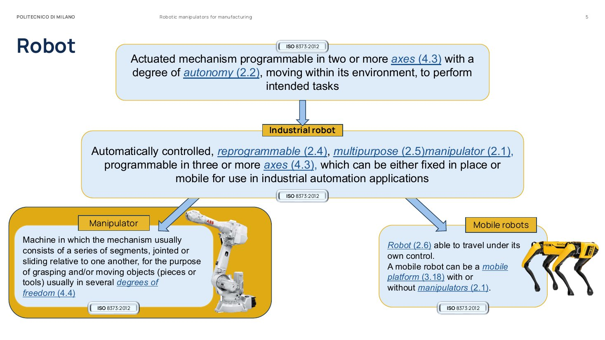
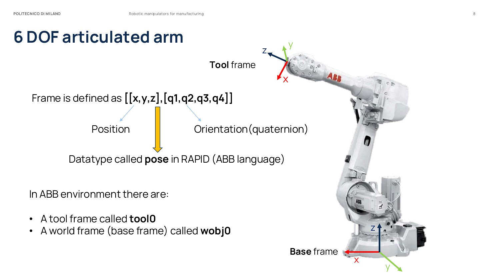
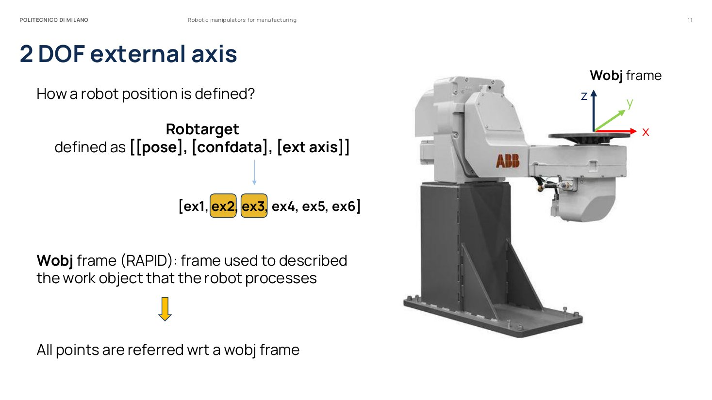
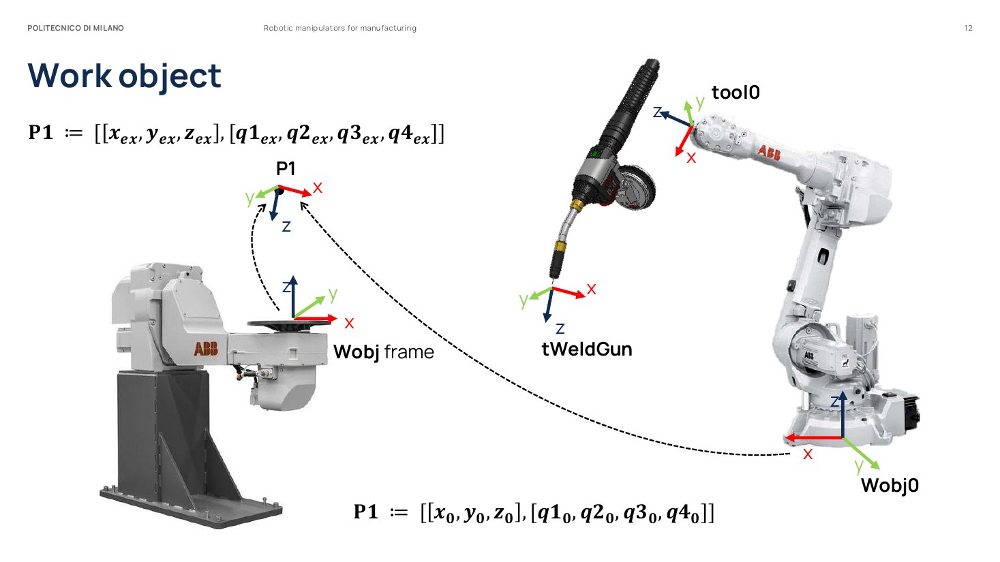
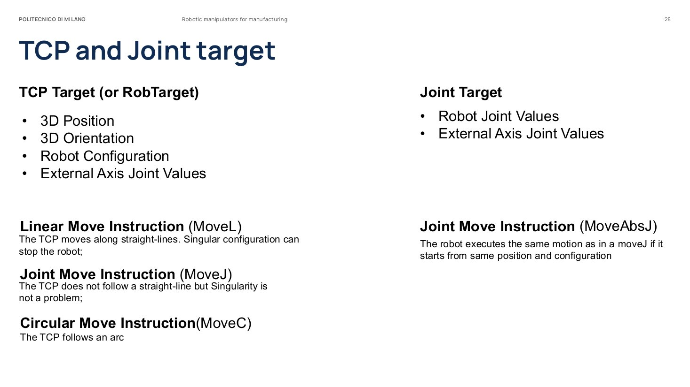
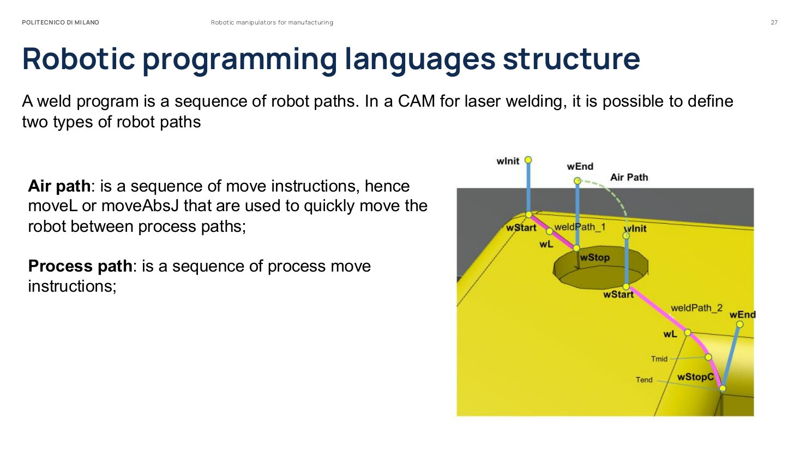
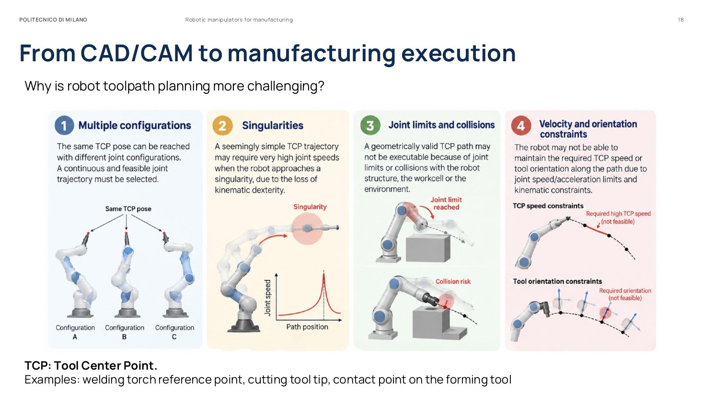
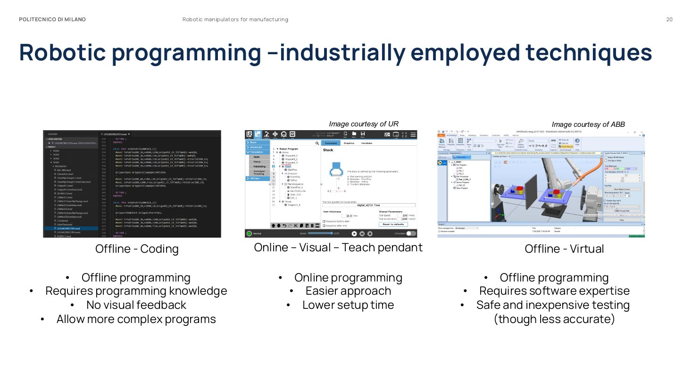
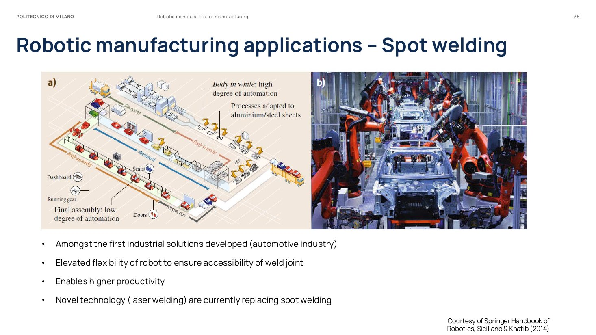

# L2.2 Robotic manipulators for manufacturing

> Part of the CAM study guide. Source of truth: [the study guide](https://claude.ai/artifact/WrGc96ueegSH8ZXZdT4FaB). Generated by `tools/build_guide.py`; edit the guide, not this file.

## Slides and professor's explanations (exam material)

Robots trade **accuracy and stiffness** for **workspace, flexibility and cost**. Programming them is harder than programming a CNC: the same tool pose has **multiple joint solutions** (inverse kinematics), plus **singularities** and joint limits. So robots suit welding, polishing, cutting, AM and soft-material machining, while 5-axis CNC stays the choice for stiff, precise metal cutting. *(From the slides.)*

### Definitions (ISO 8373:2012)

- **Robot:** actuated mechanism programmable in ≥ 2 axes, with some autonomy, moving within its environment to perform tasks.
- **Industrial robot:** automatically controlled, **reprogrammable, multipurpose manipulator**, programmable in **≥ 3 axes**, fixed or mobile.
- **Manipulator:** segments jointed or sliding relative to each other, to grasp or move parts or tools. **Mobile robot:** travels under its own control (platform with or without a manipulator).

### Kinematic types

| Open chain | Joints | Closed chain |
| --- | --- | --- |
| Cartesian / gantry | PPP | Parallelogram |
| Cylindrical | RPP | Parallel (delta, hexapod) |
| Spherical | RRP |  |
| **SCARA** | RRP |  |
| **Articulated (anthropomorphic)** | RRR (+ wrist = 6 DOF) |  |

P = prismatic, R = revolute. DOF are limited by joint ranges (e.g. ±180°, 0–700 mm), which shape the **working envelope**. **External axes** (linear tracks, 2-DOF positioners) enlarge it or improve access.

### Frames and targets (ABB RAPID as the example)

- **Pose** = \[\[x, y, z\], \[q1, q2, q3, q4\]\] = position + orientation as a **quaternion**.
- Frames: base/world **wobj0**, default tool **tool0** (flange), user tool frames (e.g. **tWeldGun**, defining the TCP), and a **work-object frame** (wobj) attached to the part. All points are referred to a wobj, so if the part moves you re-teach only the wobj.
- **TCP** = Tool Centre Point (torch tip, cutter tip, forming-tool contact point).
- **RobTarget** = \[\[pose\], \[confdata\], \[ext axes\]\]: TCP position + orientation + **configuration** (cf1, cf4, cf6, cfx, which select the joint solution) + external axes. **JointTarget** = the joint angles directly.
- **Inverse kinematics:** from the tool pose find q1…q6. It is often hard to solve analytically; there can be **multiple** solutions, **infinite** ones (redundancy), or **none** admissible (joint limits, reach).

### Move instructions

| Instruction | Path | Notes |
| --- | --- | --- |
| **MoveL** | TCP in a **straight line** | Can stop at a **singularity** |
| **MoveJ** | Joint interpolation, **not** a straight TCP path | Singularity not a problem; fast repositioning |
| **MoveAbsJ** | To absolute joint angles | Same as MoveJ from the same start and configuration |
| **MoveC** | TCP along an arc |  |

A weld program = **air paths** (MoveL/MoveAbsJ for fast moves between seams) + **process paths** (process moves with the welding active). Software layers: **HAL** (device drivers; hardware changes stay here) → **process library** (approach, weld, spot weld, depart) → **task** (runs the part program; other tasks handle peripheral communication).

### CNC vs robot: from CAD/CAM to execution

| CNC | Robot |
| --- | --- |
| NC post-processor → ISO/G-code | Robot post-processor / **offline programming** → robot program + configurations |
| CNC interpolation and axis control | **Kinematic planning and joint control** |

- **Robot pros:** flexible tool position and orientation; easy reconfiguration; integration of external axes, sensors and adaptive control; joint- and Cartesian-space programming.
- **Robot cons:** multiple IK solutions and **singularities**; joint limits constrain paths and speeds; complex path and configuration planning; **sensitive to calibration and positioning errors**.
- **Languages:** ABB **RAPID**, FANUC **KAREL**, KUKA **KRL**, Stäubli **VAL3**. CAM vendors offer plug-ins/post-processors; some NC makers propose G-code for robots.

### Programming methods

| Offline – coding | Online – teach pendant | Offline – virtual (simulation) |
| --- | --- | --- |
| Needs programming skill; no visual feedback; allows complex programs | Easiest; short setup; less accurate | Needs software skill; **safe and cheap testing** |

**Lead-through programming (cobots):** the operator moves the arm by hand to targets and adds nodes with buttons on the flange (see Marco Bruni's research from L0.0: programming-free robotics).

**Auxiliary automation:** conveyors (belt, chain, roller), **AGVs**, part feeders (bowl, linear), positioners (1-axis, 2-axis, double station). **Machine vision:** active seam tracking vs none (Boldrin et al. 2024), linking to L1.4.

### Robot vs CNC for machining (exam numbers)

|  | CNC | Robot |
| --- | --- | --- |
| Accuracy | ≤ 20–50 µm | 100–200 µm (repeatability about 100 µm) |
| Workspace | Limited by the frame | Medium robot about 7–8 m³, expandable with external axes |
| Versatility | Limited, task-specific | Highly flexible |
| **Stiffness** | **> 50 N/µm**, high natural frequencies | **< 1 N/µm**, low natural frequencies, so soft materials (polymers, wood, foam) |
| Cost | Lower overheads | **20–30% cheaper** for equal workspace |

Robot machining is "unconventional because of low rigidity"; 5-axis CNC is often preferred. This is the class discussion from L1.1 (robot milling wood slowly) with numbers.

### Applications

- **Spot welding:** among the first industrial robot uses (automotive); flexible joint access; now being replaced by laser welding. **Arc/GMAW cells:** digital twin + sensing + cell calibration; large structures.
- **Laser welding** (BLM LW-S); **hybrid laser–arc** (Fronius LaserHybrid: laser + MIG head, up to 8 m/min, gap bridging + filler).
- **Cobot welding:** easy programming for high variability / low batches, but slower air moves.
- **Mobile/field:** LaserSnake (5 kW fibre, snake arm, nuclear decommissioning), AL-Rock Mobil (6 kW, tracked, no fixed cell). **Humanoid welding** (Kepler, Persona AI).
- **Polishing, laser cutting, bending, incremental forming** (the L0.0 Machina Labs video).
- **Additive:** **WAAM** (ABB IRB 2600 + 2-DOF positioner + Fronius TPS 400i: Tornaquindici's research), laser metal deposition (8-axis), extrusion AM.

**Exam link:** robots are **programmable/flexible automation** (L1.1). Their low stiffness is a **process-force** problem (L1.5/L1.6 force models). Their positioning error needs sensing and calibration (seam tracking, L1.4).

## Professor background (less exam-critical)

*No background comments for this chapter.*

## Practice exercises

*No dedicated exercise. All formulas: [formula sheet](../formula-sheet.md).*

## Likely oral questions

*No dedicated question; see [cross-topic links](../cross-topic-links.md) and [all oral questions](../oral-questions.md).*
