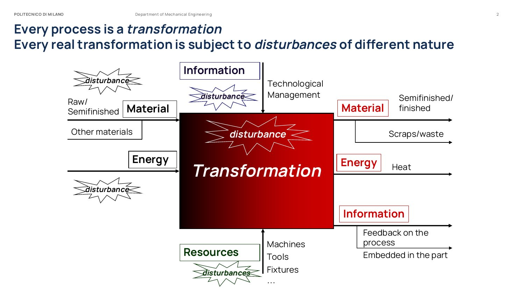
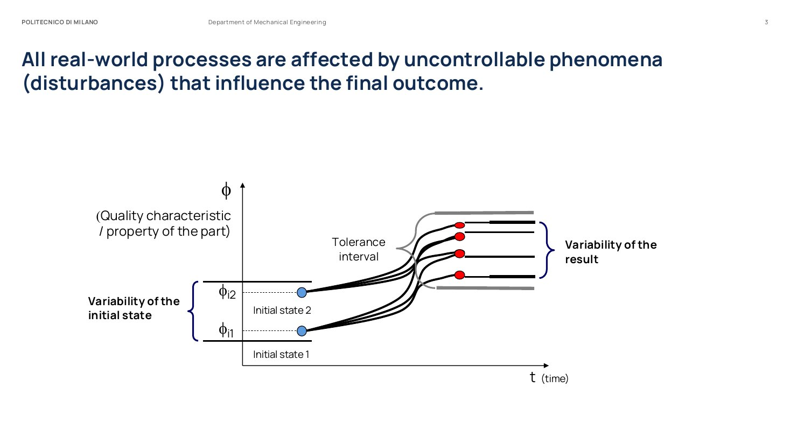
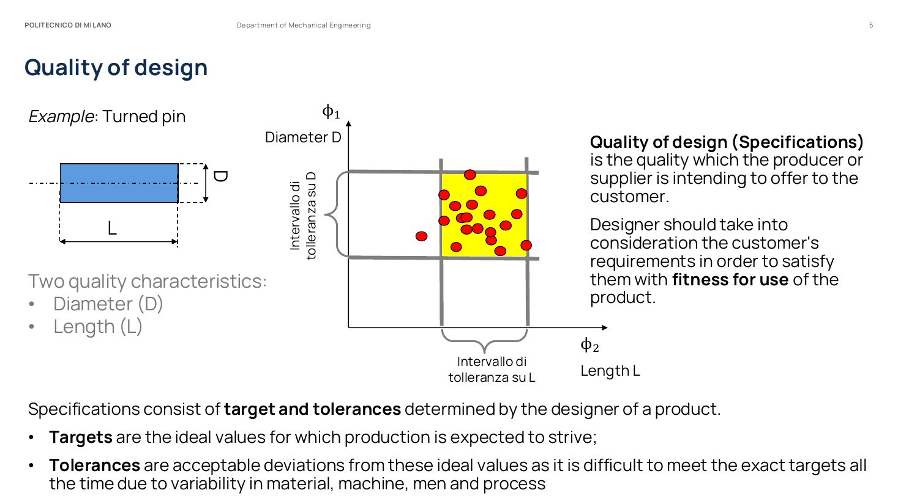
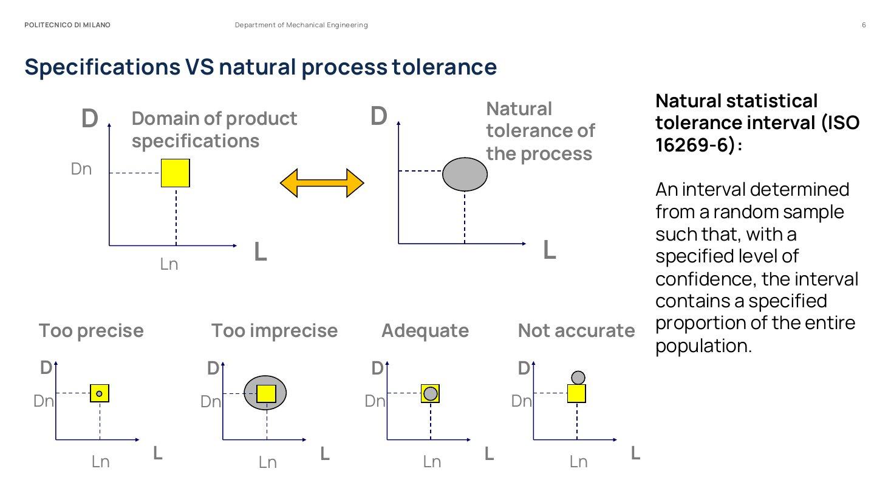
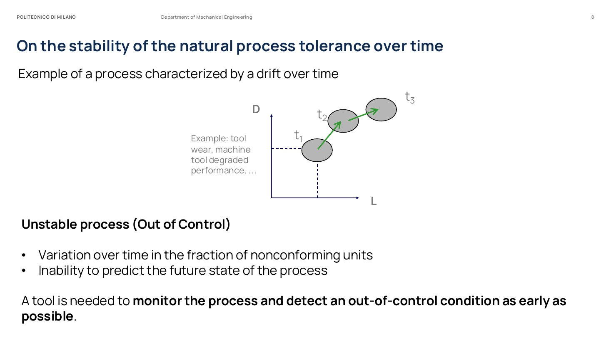
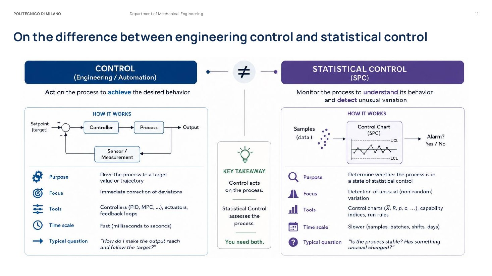
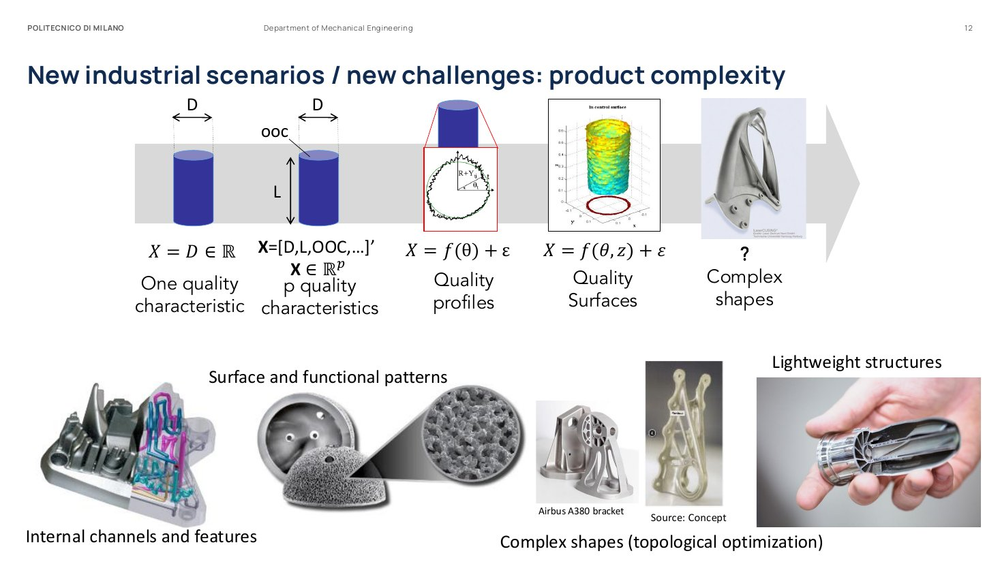

# L3.1 Smart manufacturing – introduction

> Part of the CAM study guide. Source of truth: [the study guide](https://claude.ai/artifact/WrGc96ueegSH8ZXZdT4FaB). Generated by `tools/build_guide.py`; edit the guide, not this file.

## Slides and professor's explanations (exam material)

Every process is a transformation hit by **disturbances**, so quality characteristics are **random variables**. Statistical process monitoring asks two questions: is the process **stable** (in statistical control → control charts) and is it **capable** of meeting specifications (→ capability analysis)? New products and processes make classic product-based SPC too slow, which drives a shift to **in-process monitoring of sensor data**. This intro leads into the written test's **quality-monitoring numerical exercise**. *(From the slides, Prof. Grasso.)*

### Disturbances and variability

- A transformation takes material, energy and information in, and puts parts, scrap/waste, heat and information out. Disturbances can be **technological, management, material, energy, information, resources** (machines, tools, fixtures).
- "All real-world processes are affected by uncontrollable phenomena (disturbances) that influence the final outcome." Variability in the initial state plus variability of the process gives variability of the result, which must fall within the **tolerance interval**. This is Shewhart from L0.0, now formalised.
- **Quality characteristics are random variables.** Continuous examples: hardness, UTS (material); forged height, rolled thickness (forming); wall thickness, hole diameter, density (casting); turned diameter, roundness, milled flatness (machining). Discrete examples: number of scratches, number of nonconforming parts in a sample.

### Specifications vs natural tolerance

- **Quality of design (specifications):** what the producer intends to offer, from customer requirements and fitness for use. Specifications = **target** (ideal value) + **tolerances** (acceptable deviations, because material, machine, people and process vary). Example: turned pin with diameter D and length L.
- **Natural statistical tolerance interval (ISO 16269-6):** an interval from a random sample that, with a given confidence, contains a given proportion of the population. It is what the process actually produces.

| Case | Natural tolerance vs specification | Meaning |
| --- | --- | --- |
| Too precise | Much narrower than the spec | Works, but over-investment (see L1.9: "specify only what is needed") |
| Too imprecise | Wider than the spec | Nonconforming parts produced |
| **Adequate** | Fits inside the spec with margin, centred | Desired |
| Not accurate | Narrow enough but **off-centre** | Bias: re-centre the process |

The adequate case holds only if the process is **stable**, in steady state with no drifts or malfunctions. **First problem:** is the process stable (in statistical control)? Use **SPC/SPM control charts**. **Second problem:** is it capable of meeting the specs? Use **capability analysis**.

**Drift example:** tool wear or a degraded machine moves the natural tolerance over time (t₁ → t₂ → t₃). The result is an **out-of-control** process: the fraction of nonconforming units changes, and you cannot predict the future state. You need a tool that detects out-of-control conditions **as early as possible**.

### How SPC/SPM works

- Classic SPC looks at the **output** (product quality characteristics) to judge process stability.
- **Phase I (design):** use in-control (IC) samples to estimate the control limits. **Phase II (use):** check new production samples; a point outside the limits signals **out-of-control (OOC)**, meaning an **assignable cause** to investigate.
- **Statistical control vs engineering control:** SPC **detects** that something changed (an assignable cause) and leaves the diagnosis to the engineer. Engineering (feedback) control continuously **adjusts** an input to hold an output on target (the PI/MPC loops in L1.2, L1.4, L1.8). They are complementary.

### New challenges

1. **Product complexity:** from one characteristic X = D ∈ ℝ to many (X ∈ ℝᵖ), then **profiles** X = f(θ) + ε, **surfaces** X = f(θ, z) + ε, complex shapes (lattices, internal channels, topology-optimised parts like the Airbus A380 bracket).
2. **Transformed production chain:** **part consolidation** (one complex monolithic AM part replaces an assembly), highly digital chains where physical and virtual coexist, dark factories.
3. **Need for quicker detection:** a titanium landing-gear bracket milled for **> 10–20 hours** and inspected only at the end, so a fault early on wastes the whole part.
4. **Expensive quality assurance:** a large extrusion-AM composite part (> 1 week) where final inspection is extremely costly or barely feasible.
5. **No time to learn:** one-off or fully customised parts (ESA spacecraft bracket, custom prostheses) give no in-control samples for Phase I.

**New opportunities:** heavily sensorised machines, in-line big data, IoT, high computing power, ML/AI, cyber-physical systems and **digital twins**.

### Paradigm shift: from product to process monitoring

|  | Product monitoring | Process (signal) monitoring |
| --- | --- | --- |
| Data | Quality characteristics after production | Sensor signals during production |
| Latency | Hours or days | **Seconds** |
| Evolution | — | Simple → complex data (images, point clouds, voxels, multimodal); normal → massive; slow → fast; single → multiple streams |

Examples: cutting forces in titanium milling, thrust force in drilling hybrid materials, pressure in waterjet cutting, high-speed and IR video in metal AM (300–500 fps), 3D point clouds with deviation maps from optical scanning, glass-bottle inspection.

### Definition

- **ISO/IEC:** "Manufacturing that improves its performance aspects with integrated and intelligent use of processes and resources in cyber, physical and human spheres to create and deliver products and services, which also collaborates with other domains within enterprises' value chains."
- **Simpler:** the use of **sensing, connectivity, data and intelligent decision-making** to **monitor, predict and adapt** manufacturing processes in real time. A smart system uses data from the physical process to learn its state and to support or autonomously make better decisions.

**Exam link:** this closes the loop of the whole course. L0.0's Shewhart (variability) and Toyoda (stop on a fault) → L1.1's model errors vs disturbances → sensors in every process (L1.4 OCT/photodiodes, L1.6 current/vibration, L1.8 laser profiler) → SPC detects drifts such as tool wear (L1.5) → closed-loop control corrects them. Note: L3.1 is the introduction only. The control-chart and capability formulas (X̄–R charts, C\_p, C\_pk) for the numerical exercise are in later L3 slides; send them if you have them.

## Professor background (less exam-critical)

*No background comments for this chapter.*

## Practice exercises

*No dedicated exercise. All formulas: [formula sheet](../formula-sheet.md).*

## Likely oral questions

*No dedicated question; see [cross-topic links](../cross-topic-links.md) and [all oral questions](../oral-questions.md).*
