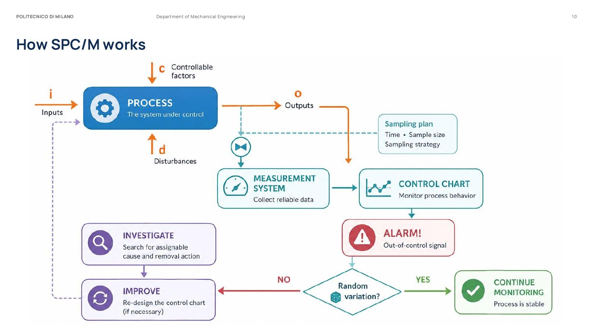
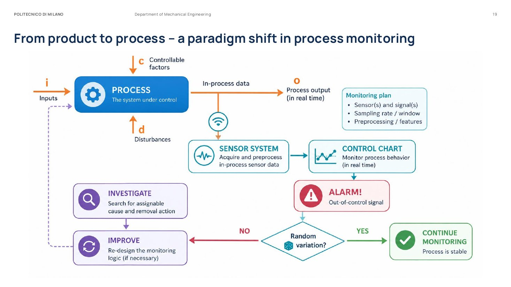
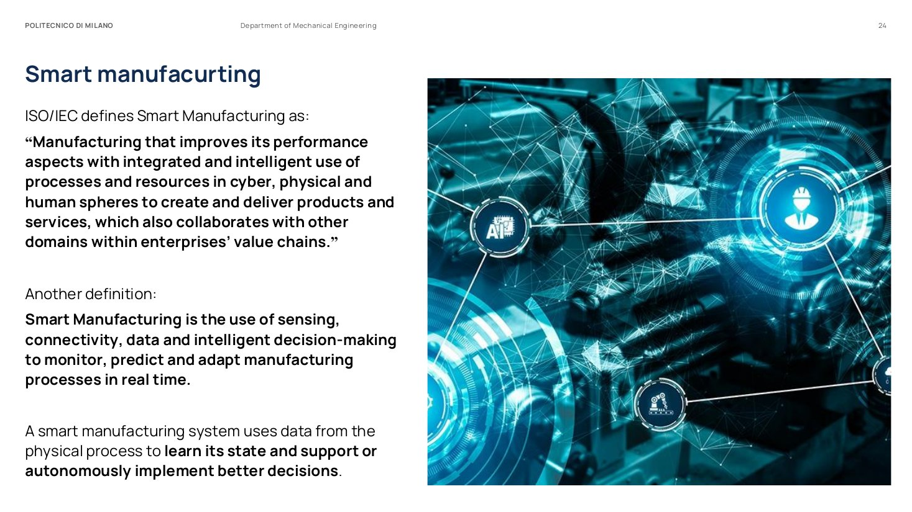

# L3.1 Smart manufacturing – introduction

> Part of the CAM study guide. Source of truth: [the study guide](https://claude.ai/artifact/WrGc96ueegSH8ZXZdT4FaB). Generated by `tools/build_guide.py`; edit the guide, not this file.

## Slides and professor's explanations (exam material)

Every process is a transformation hit by **disturbances**, so quality characteristics are **random variables**. Statistical process monitoring asks two questions: is the process **stable** (in statistical control → control charts) and is it **capable** of meeting specifications (→ capability analysis)? New products and processes make classic product-based SPC too slow, which drives a shift to **in-process monitoring of sensor data**. This intro leads into the written test's **quality-monitoring numerical exercise**. *(Slides by Prof. Grasso + recording of 4 Nov, Prof. Demir's introduction. Professor's comments inline.)*

### Disturbances and variability

- A transformation takes material, energy and information in, and puts parts, scrap/waste, heat and information out. Disturbances can be **technological, management, material, energy, information, resources** (machines, tools, fixtures).
- "All real-world processes are affected by uncontrollable phenomena (disturbances) that influence the final outcome." Variability in the initial state plus variability of the process gives variability of the result, which must fall within the **tolerance interval**. This is Shewhart from L0.0, now formalised.
- **Quality characteristics are random variables.** Continuous examples: hardness, UTS (material); forged height, rolled thickness (forming); wall thickness, hole diameter, density (casting); turned diameter, roundness, milled flatness (machining). Discrete examples: number of scratches, number of nonconforming parts in a sample.

* **Prof (4 Nov) — a disturbance on every input:** material (sheet thickness varies), energy (supply fluctuations change spindle speed; a melt meant to be at 700 °C arrives at 650 °C), information (wrong data, the wrong material delivered: "much more common than you think"), resources (wear or defects of tools, machines, fixtures), and the process itself (someone changes the parameters).
* **Prof — disturbances differ in nature:** some **shouldn't happen** (an unauthorised parameter change), some **can be modelled** (tool wear: Taylor), some are **hard to control** (factory temperature, 35 °C in summer vs 0 °C in winter). The information coming out of the process is what lets you learn and correct the inputs.
* **Prof — the shaft example:** the incoming bar diameter varies, and the process adds its own variability (vibration, wear), so the turned diameter is a **random variable** that must stay inside the tolerance band.

### Specifications vs natural tolerance

- **Quality of design (specifications):** what the producer intends to offer, from customer requirements and fitness for use. Specifications = **target** (ideal value) + **tolerances** (acceptable deviations, because material, machine, people and process vary). Example: turned pin with diameter D and length L.
- **Natural statistical tolerance interval (ISO 16269-6):** an interval from a random sample that, with a given confidence, contains a given proportion of the population. It is what the process actually produces.

* **Prof — continuous vs discrete characteristics:** continuous = measured on a continuous scale (hardness, strength, forged height, wall thickness, turned diameter, roundness, flatness); discrete = counts (scratches on a surface, non-conforming parts in a sample), where a normal distribution may not fit. For the pin, diameter and length together define a rectangle of acceptability: each produced part is a dot, and a dot outside is non-conforming.

| Case | Natural tolerance vs specification | Meaning |
| --- | --- | --- |
| Too precise | Much narrower than the spec | Works, but over-investment (see L1.9: "specify only what is needed") |
| Too imprecise | Wider than the spec | Nonconforming parts produced |
| **Adequate** | Fits inside the spec with margin, centred | Desired |
| Not accurate | Narrow enough but **off-centre** | Bias: re-centre the process |

The adequate case holds only if the process is **stable**, in steady state with no drifts or malfunctions. **First problem:** is the process stable (in statistical control)? Use **SPC/SPM control charts**. **Second problem:** is it capable of meeting the specs? Use **capability analysis**.

- **Class discussion — reading the four cases:** natural tolerance much tighter than the specs = **too precise, too costly** (you are stressing the system, e.g. an expensive extra support where a tailstock would do); too wide = **too imprecise**, a wrong process set-up (e.g. a three-jaw chuck that isn't rigid enough); the right width but offset = **wrong machine settings**. A **statistical tolerance interval** contains a stated proportion of the population (e.g. 99%) with a stated confidence.

**Drift example:** tool wear or a degraded machine moves the natural tolerance over time (t₁ → t₂ → t₃). The result is an **out-of-control** process: the fraction of nonconforming units changes, and you cannot predict the future state. You need a tool that detects out-of-control conditions **as early as possible**.

**Prof — "as early as possible" depends on volume:** finding one defective part and stopping is early if you make millions; if you make one part (or one batch), it's too late. Then "early" means **during the process**.

### How SPC/SPM works

- Classic SPC looks at the **output** (product quality characteristics) to judge process stability.
- **Phase I (design):** use in-control (IC) samples to estimate the control limits. **Phase II (use):** check new production samples; a point outside the limits signals **out-of-control (OOC)**, meaning an **assignable cause** to investigate.
- **Statistical control vs engineering control:** SPC **detects** that something changed (an assignable cause) and leaves the diagnosis to the engineer. Engineering (feedback) control continuously **adjusts** an input to hold an output on target (the PI/MPC loops in L1.2, L1.4, L1.8). They are complementary.

* **Prof — the two phases:** first measure **in-control samples** (parts known to be good) to find the size of the natural variability and build the control chart; then, in production, check whether new points fall inside or outside the limits.
* **Prof — the sampling plan is like signal sampling:** decide **how often, how many and where** to sample. Measuring every part tells you each part's state but costs time and money (a bottleneck); every 10th or 100th part is cheaper but slower to detect. After an alarm: random variation (false alarm, carry on) or a real cause → investigate and improve.
* **Exam alert — engineering control vs statistical control:** engineering (automatic) control **acts** on the process in real time to follow a target (controller → process → measurement → correction, e.g. a welding robot tracking its path). Statistical control **assesses** the process from samples, batches, shifts or days to detect non-random variation: "is the process stable, did something unusual happen?" **You need both**: a robot can track its path perfectly while an oil spot on one part makes that weld burst, so the process left statistical control for that part.

### New challenges

1. **Product complexity:** from one characteristic X = D ∈ ℝ to many (X ∈ ℝᵖ), then **profiles** X = f(θ) + ε, **surfaces** X = f(θ, z) + ε, complex shapes (lattices, internal channels, topology-optimised parts like the Airbus A380 bracket).
2. **Transformed production chain:** **part consolidation** (one complex monolithic AM part replaces an assembly), highly digital chains where physical and virtual coexist, dark factories.
3. **Need for quicker detection:** a titanium landing-gear bracket milled for **> 10–20 hours** and inspected only at the end, so a fault early on wastes the whole part.
4. **Expensive quality assurance:** a large extrusion-AM composite part (> 1 week) where final inspection is extremely costly or barely feasible.
5. **No time to learn:** one-off or fully customised parts (ESA spacecraft bracket, custom prostheses) give no in-control samples for Phase I.

- **Prof — the data get more complex:** one number per part (diameter) → P characteristics (diameter + length) → a **profile** (roundness as a function) → a **surface** (3D scan) → a **volume** (CT). AM parts (lattice hip cup, aerospace brackets, internal channels, **part consolidation**, e.g. 20 parts fused into one) have no single diameter to chart. This is a source of big data.
- **Class discussion — the titanium landing-gear bracket:** milled from a solid block (welds would be weak points), about **20 h** per part. If you only inspect at the end, a fault at hour 5 wastes the block and 20 h. Faster options: measure the surface during the process (still intermittent), use models to set the process (reliable, but they don't see disturbances), or **monitor in-process signals** such as **vibrations**. That's where the course is going.
- **Prof — no time to learn:** for a high-value AM part the cost is roughly 40% process, 30% post-processing, 30% **qualification**, so inspection costs as much as making it. One-off parts (a custom prosthesis; the ESA spacecraft bracket, made twice: one flies, one is tested) leave no samples to build a control chart from.

**New opportunities:** heavily sensorised machines, in-line big data, IoT, high computing power, ML/AI, cyber-physical systems and **digital twins**.

### Paradigm shift: from product to process monitoring

|  | Product monitoring | Process (signal) monitoring |
| --- | --- | --- |
| Data | Quality characteristics after production | Sensor signals during production |
| Latency | Hours or days | **Seconds** |
| Evolution | — | Simple → complex data (images, point clouds, voxels, multimodal); normal → massive; slow → fast; single → multiple streams |

- **Prof — sensors give data in seconds:** the part may take hours or days, the sensors answer in seconds, so you can learn the in-control behaviour and spot drifts with fewer parts. Some signals are already inside the machine: **spindle power or current** on a milling machine. Examples: the cutting force in titanium milling suddenly dropping after a certain part (a signalling event), drilling signals, water-jet pressure, AM process emissions, camera inspection of every bottle in a fraction of a second, 3D scan vs CAD **error maps**, X-ray CT for internal voids, high-speed and thermal cameras (hundreds of frames per second, terabytes of data).

Examples: cutting forces in titanium milling, thrust force in drilling hybrid materials, pressure in waterjet cutting, high-speed and IR video in metal AM (300–500 fps), 3D point clouds with deviation maps from optical scanning, glass-bottle inspection.

### Definition

- **ISO/IEC:** "Manufacturing that improves its performance aspects with integrated and intelligent use of processes and resources in cyber, physical and human spheres to create and deliver products and services, which also collaborates with other domains within enterprises' value chains."
- **Simpler:** the use of **sensing, connectivity, data and intelligent decision-making** to **monitor, predict and adapt** manufacturing processes in real time. A smart system uses data from the physical process to learn its state and to support or autonomously make better decisions.

**Prof — in short:** use all the data you have, from before, during and after the process, to improve and keep quality and use resources better. The data are big, so their analysis has to be automated too (AI and machine learning). Industry expects quality control to be one of the biggest challenges of the next years.

**Exam link:** this closes the loop of the whole course. L0.0's Shewhart (variability) and Toyoda (stop on a fault) → L1.1's model errors vs disturbances → sensors in every process (L1.4 OCT/photodiodes, L1.6 current/vibration, L1.8 laser profiler) → SPC detects drifts such as tool wear (L1.5) → closed-loop control corrects them. Note: L3.1 is the introduction only. The control-chart and capability formulas (X̄–R charts, C\_p, C\_pk) for the numerical exercise are in later L3 slides; send them if you have them.

## Professor background (less exam-critical)

- **Prof (4 Nov):** examples of AM parts that are hard to measure: a tooling insert with internal channels, a titanium lattice hip cup, Airbus brackets, a small turbine; **Camozzi**, an Italian company making large gantry AM machines; with colleagues in Germany his lab collected about 4 TB of process-camera data. The statistics part of the course follows (Prof. Grasso's module).

## Practice exercises

*No dedicated exercise. All formulas: [formula sheet](../formula-sheet.md).*

## Likely oral questions

- **Engineering control vs statistical process control?** Engineering control acts on the process in real time to follow a target (feedback loop, fast). SPC assesses the process from samples over batches, shifts or days to detect non-random variation and decide whether it is stable (control charts, phase I/II, sampling plan). You need both: a tracking robot can be in control while an oil spot makes one weld fail.
- **Why is classic SPC not enough for high-value or one-off parts, and what replaces it?** Product-based charts need many sampled parts and only see faults at the end; a 20 h titanium bracket, a one-week AM part or a custom prosthesis can't wait, and one-offs give no samples. Use in-line/in-process sensor data (spindle power, vibration, force, emissions, cameras, scans, CT) to learn the in-control behaviour quickly and detect drifts during production.
