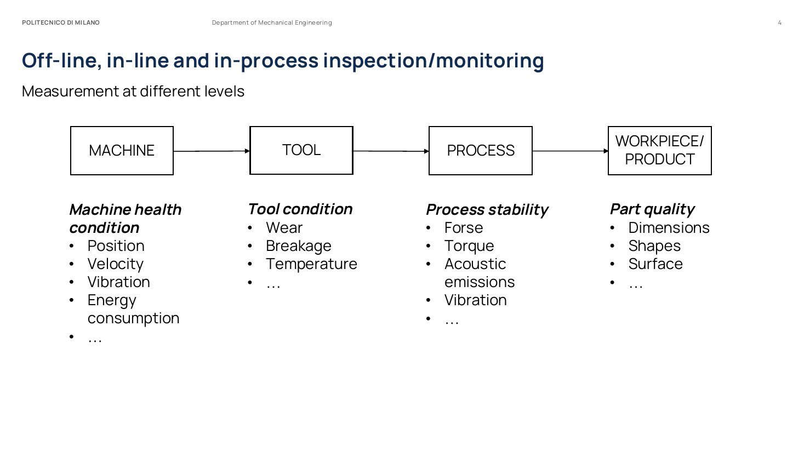
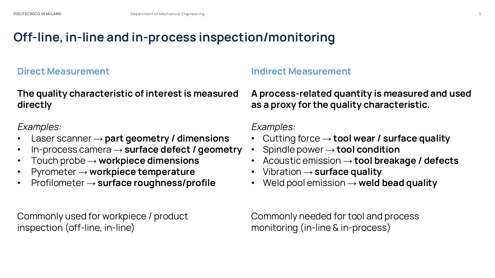
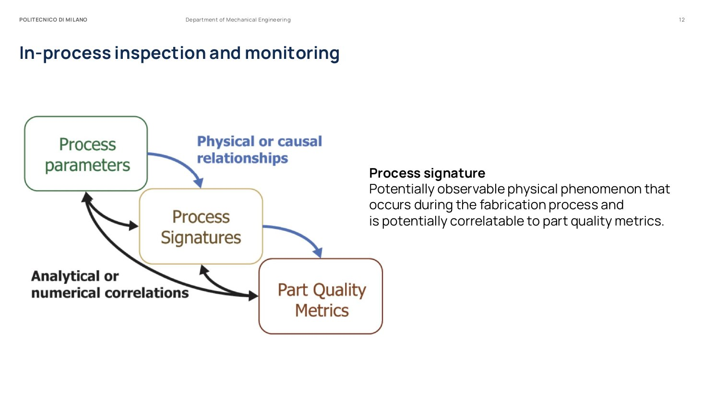
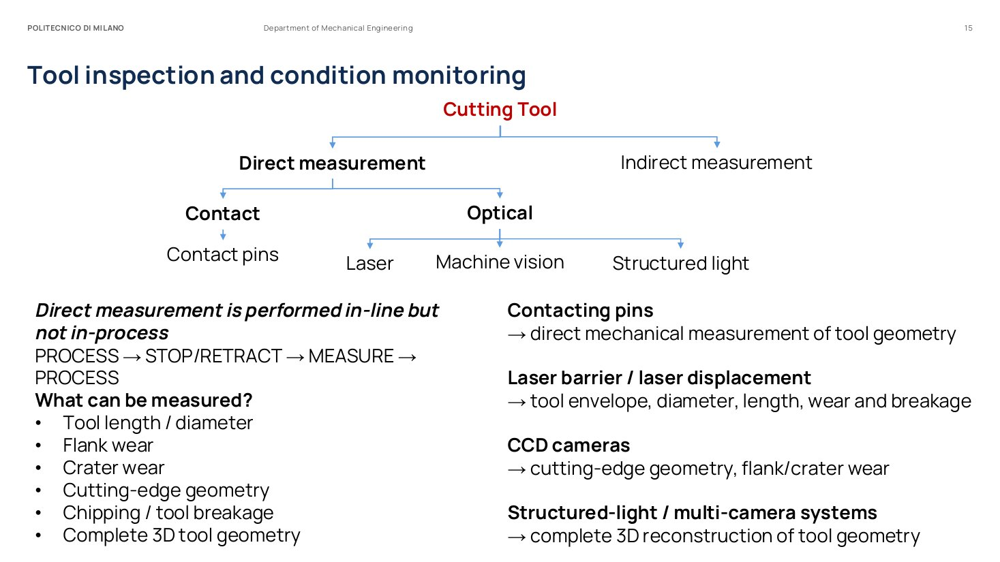
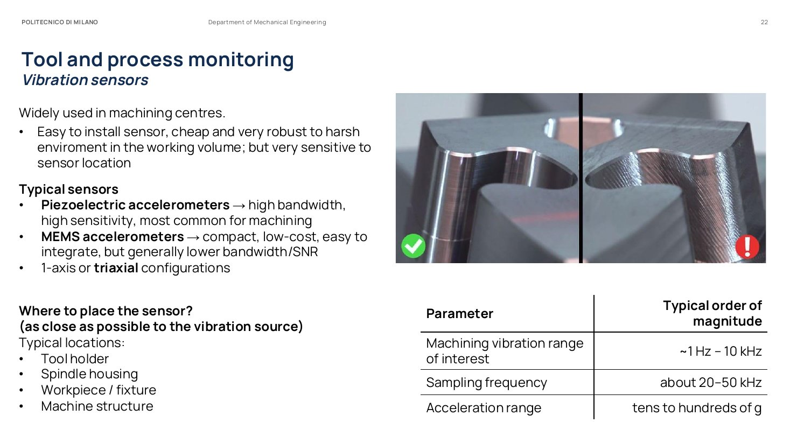
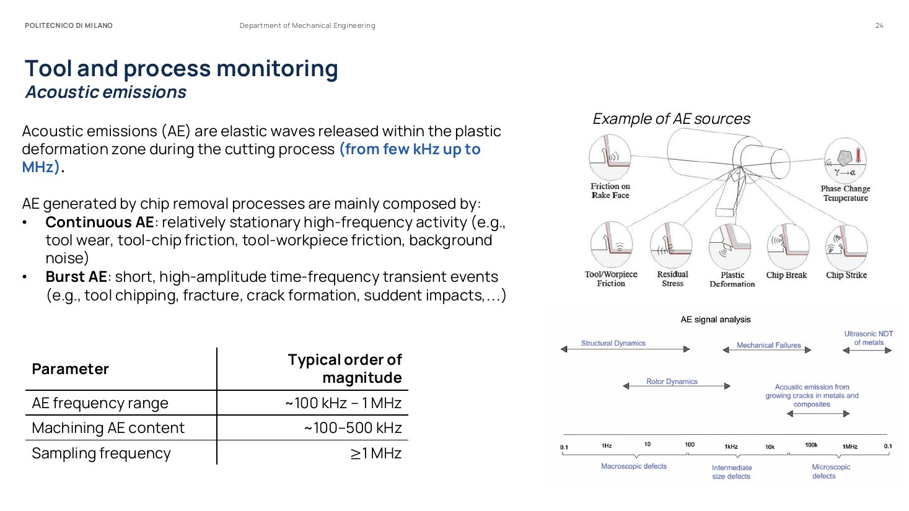
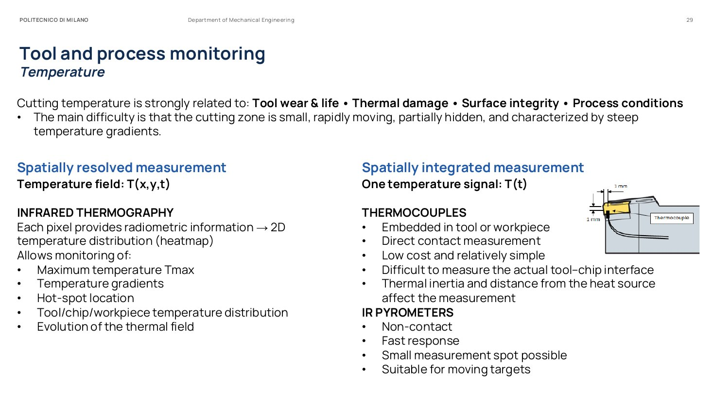
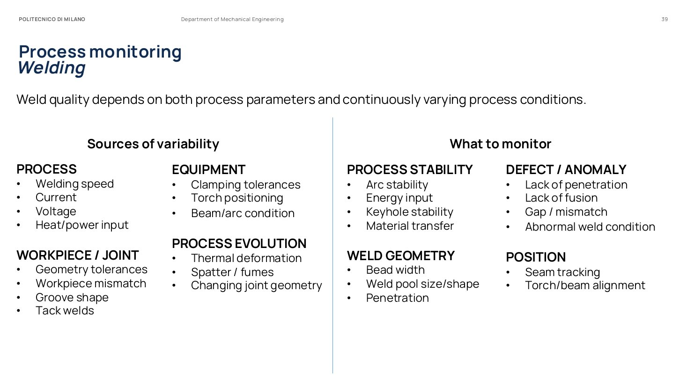
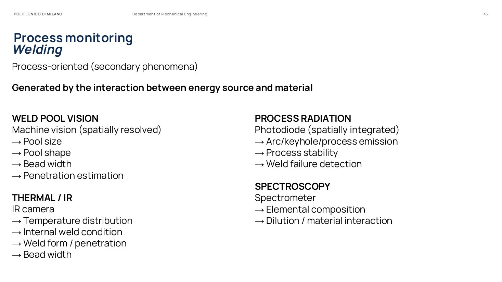
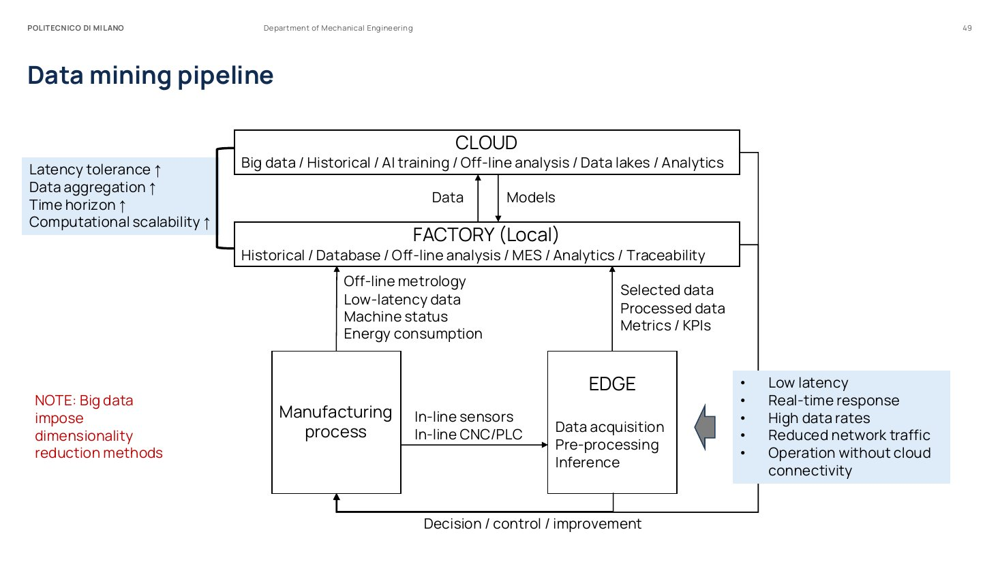

# L3.2 Smart manufacturing – sensing and data mining

> Part of the CAM study guide. Source of truth: [the study guide](https://claude.ai/artifact/WrGc96ueegSH8ZXZdT4FaB). Generated by `tools/build_guide.py`; edit the guide, not this file.

## Slides and professor's explanations (exam material)

Before you can monitor a process you must decide **what** to measure (machine, tool, process or part), **where and when** (off-line, in-line, in-process, in-situ), and whether you measure the quality characteristic **directly** or a process signal that acts as a **proxy** for it. For each process family (machining, forming, welding, AM) the slides list the sensors, their frequency ranges and their limits, and then the **data-mining pipeline** from acquisition to decision, split between edge, factory and cloud. *(Slides + recordings of 9 Nov (inspection vs testing, where and when to measure, direct vs indirect, off-line inspection, process signature, machining sensors, first forming examples) and 10 Nov (forming and welding sensors, data pipeline), Prof. Demir. Professor's comments inline.)*

### Inspection vs testing

- **Inspection** = assessment against the design specifications: **measurement** (the actual value, e.g. diameter = 20.03 mm) or **gauging** (is the requirement met? GO / NO-GO).
- **Testing** = assessment of **functional performance**, under operation or representative conditions: does it work as intended, does it withstand the expected conditions? It can be destructive or non-destructive.
- **Prof (9 Nov) — inspection first, testing last:** inspection is cheaper and easier to automate; testing usually comes at the end of the whole chain (mount the shaft: does it rotate correctly, does it stay in place?). A part that fails inspection won't pass testing, so inspection is the cheap way to predict function and testing is the last check. Both can be done on every part or on a sample: a question of timing and cost.
- **Class discussion (9 Nov) — if a part passes inspection, does it always pass testing?** No. A **false positive**: inspection says OK but the measurement itself was wrong, so a faulty part goes on and may fail in use. A **false negative**: inspection rejects a part that would have worked, so you lose money on a good part. Both are bad, and the statistics of L3.3 are built to keep them low. Careful with the names: here "positive" means "passed". In L3.3 terms, rejecting a good part is a **false alarm (Type I, α)** and accepting a bad one is a **missed detection (Type II, β)**.

### Where and when you measure

- **Off-line**: inspection after the process step, as a separate station. **In-line**: an inspection station inside the production line, between steps. **In-line & in-process**: monitoring while the process runs.
- **Prof (9 Nov) — the shaft example and the speed of the loop:** a shaft needs n turning steps (external turning, facing, grooving…). **Off-line** = measured after it leaves the machine; **in-line** = measured between the steps, with the machine stopped and a gauge; **in-process** = while the tool cuts (an optical diameter measurement, or monitoring vibration and force), which is close to monitoring. Off-line inspection is a **very slow closed loop**: a wrong part is already scrap and only the next ones can be corrected; in-line catches the problem before the part moves on; in-process lets you correct the process parameters during the process.
- **In-situ** = the sensor sits inside the machine where the process takes place; **ex-situ** = outside the machine (metrology room, test facility).
- **Class discussion (9 Nov) — the CAM shop:** you will bend a pipe with the robot and measure it afterwards with a camera: **off-line and ex-situ**. A camera next to the bending tool filming the bend: **in-situ and in-process**, so an error can still be corrected instead of becoming scrap.
- **Four levels**: machine (health: position, velocity, vibration, energy), tool (wear, breakage, temperature), process (stability: force, torque, acoustic emission, vibration), workpiece/product (quality: dimensions, shape, surface).
- **Prof (9 Nov) — the chain of conformity:** what must stay conformal is the last link, the **workpiece** (dimensions, shape, surface, weight, internal density, even microstructure). That needs a **process** under control (correct forces and torque, no abnormal acoustic emission or vibration), which needs a conformal **tool** (not worn, not broken, not too hot), which needs a healthy **machine** (correct position and velocity, limited vibration, energy under control). Each expectation is also a measuring point: position from **encoders** (linear or rotary), velocity from position, vibration from **accelerometers**, energy from the motors' voltage and current (an energy peak hints that something is wrong in the cut). The tool can be measured in-line with a (laser) microscope in the machine; in-process only through a sensor on the tool.

### Direct vs indirect measurement

| Direct | Indirect |
| --- | --- |
| The quality characteristic itself is measured | A process quantity is measured as a **proxy** for it |
| Laser scanner → geometry; in-process camera → surface defects; touch probe → dimensions; pyrometer → workpiece temperature; profilometer → roughness | Cutting force → tool wear / surface quality; spindle power → tool condition; acoustic emission → tool breakage; vibration → surface quality; weld-pool emission → bead quality |
| Typical for **part inspection** (off-line, in-line) | Typical for **tool and process monitoring** (in-line, in-process) |

**Prof (9 Nov) — every measurement is a model:** a direct measurement gives the output in the unit you need (mm, K) through a simple, stable model you never retune. Even a touch probe has one: "if the force is below this threshold, there is no obstacle". An indirect measurement needs a **process model** between signal and quality (a worn tool cuts with a higher force; a sound weld emits constant light) and **data** to know "how high is high" (turning planned at 1.5 kN and you read double: something is wrong). So it is data-driven, and the threshold must avoid false positives and negatives. Its advantages (from the class): cheaper, no mechanical access to the part, sensors integrated in the machine, so faster and usable in-line and in-process, non-invasive. Example: a laser scanner inside a lathe needs a clean surface, which the coolant prevents; an AE sensor just hears the peak when the tool breaks.

**Off-line part inspection** comes in three families: **contact** (CMM: a probe moved on a physical Cartesian frame, ISO 10360-1; dimensions and tolerances), **non-contact** (optical microscopy, machine vision, laser scanners, structured light; geometry and surface), and **volumetric** (**X-ray CT**: X-ray images at many rotations rebuilt into a 3D volume; it sees internal defects and features that contact and optical probes can't reach).

- **Prof (9 Nov) — CMM:** it looks like a three-axis CNC machine with a probe; each touch (a small contact force) becomes one point in space. The machine is very rigid, its errors are tabulated, and it sits in a **climate-controlled room** so it doesn't dilate. It gives dimensions, geometry and tolerances (is the shaft really cylindrical?), very precise but **few points and slow**, and it must be **programmed** (where to touch). Probe tips are ceramic balls, which don't wear on rough surfaces; it changes probes like a milling machine changes tools, with dedicated probes even for internal geometry (and each probe must itself be measured first: chicken and egg). A roughness stylus works like a record player.
- **Prof (9 Nov) — sample or measure every part?** It depends on the part's value: engines are usually sampled against production capacity, but an engine for a very expensive car, or turbine parts made in small numbers, are measured one by one.
- **Prof (9 Nov) — optical scanners:** structured light plus two cameras (stereo vision → 3D), moved by a robot over the surface; also laser triangulation. Less precise than the CMM but **much faster**; the output is a false-colour height map. Planning the measurement (where, how often) matters as much as the result, because measuring costs time.
- **Prof (9 Nov) — X-ray CT:** transmission, not contact or reflection: X-rays pass through the part, which is rotated, and the slices are recombined by computation (computed tomography). Output = **voxels** (volume pixels), each with a density value: little attenuation = empty or less dense (plastic), more attenuation = denser (metal). It reaches internal channels and reveals **pores**: gas trapped when liquid metal solidifies in casting (poured in air), and in powder-bed-fusion AM. Pores reduce the load-bearing section and concentrate stress, so cracks start from them.

**Process signature** = a physical phenomenon you can observe during fabrication that can be correlated with part quality metrics. Sensor data come in seconds, while product data come after hours or days, and the data are getting more complex (signals, images, point clouds, voxels, multimodal), bigger, faster and multi-stream.

**Prof (9 Nov) — the turning example:** in the first part of the course we linked parameters and quality analytically (Ra from the tool nose radius and the feed). But things change: an operator sets a wrong feed, the tool wears. A worn tool no longer cuts as designed, so **forces rise**, and with them temperature, sound and vibration: the signature changes **before** you measure the final diameter. You don't need a perfect model of the sound: learn what it looks like when the process is in control and measure how far it moves away. Data size: 300 shafts a day used to mean 300 diameters; a 10 s cut sampled at 1 kHz gives 10,000 points per shaft, **3 million a day** from one sensor, arriving at kHz rate instead of one value per minute, and often from several sensors at once.

### Machining: what and how to monitor

- **Workpiece:** in-line but not in-process = cut → retract the tool → measure (touch probe, laser, vision) → correct → cut. In-process options: pneumatic, ultrasonic, electromagnetic, displacement sensors, vision, or indirect process signals. You measure **macro-geometry** (diameter, dimensions, form, position) or **micro-geometry** (profile, roughness, topography, surface integrity).
- **Prof (9 Nov) — in-line, not in-process:** the touch probe finds the part still oversize, so you give another pass: in-line (on board the machine, between steps) but not in-process, because measuring while cutting isn't practical. The trend is to replace these stops with in-process estimates: roughness needs a stylus (stop the machine), so instead you train a machine-learning model on vision and process signals to estimate it indirectly.
- **Tool, direct** (in-line, the process stops): contact pins (geometry), a **laser barrier** (envelope, diameter, length, wear, breakage), CCD cameras (edge geometry, flank and crater wear), structured light (full 3D tool shape).
- **Prof (9 Nov) — measuring the tool:** with a contact pin, a **worn tool travels farther** before touching it. A **laser barrier**: the tool passes between emitter and receiver and blocks the light; side to side gives the diameter, top to bottom the length. It is measured **while rotating** to see **runout** (rotation off its axis) and off-axis vibration, which would break the tool when it meets the workpiece. Trade-off (slide): a **high approach speed** shortens the measuring time but increases the error in length and diameter; slower is more accurate but takes longer. Decide how often and how long you can afford to measure. Another option is an IR flash: heat the surface briefly and image it.
- **Tool, indirect:** sensors **integrated in the tool** (a thin conductive film near the edge wears away, so its electrical resistance changes; a pneumatic nozzle whose back-pressure changes with the tool–nozzle gap), machine/IR vision, **load signals** (force, torque, spindle/motor current and power), **vibration and acoustics**. Typical information: wear, chipping, breakage.
- **Prof (9 Nov) — indirect tool sensors:** the thin film reports wear "not in millimetres but as a change of electrical resistance". With the pneumatic nozzle, an unworn tool leaves a small gap and a high back-pressure; a worn one leaves a bigger gap and a lower pressure ("there is no limit to imagination"). Cameras see wear (thermal camera or pyrometer: heating; visible light: shape), but coolant, chip reflections and the moving tool get in the way. In AE, a sudden small peak suggests breakage and a slowly rising level suggests gradual wear. Where the sensors go (slide): dynamometer plate under the workpiece, strain gauges on the tool, force on the spindle bearing, power on the spindle, torque sensor in the milling spindle, AE on the workpiece (milling) or tool holder (turning), fluid-coupled AE in the coolant jet, accelerometer on the table or workpiece holder. A sensor-embedded spindle carries radial and axial accelerometers, temperature, static and dynamic force sensors and a spindle-growth (axial displacement) sensor.

| Signal | Strengths | Limits | Typical numbers |
| --- | --- | --- | --- |
| **Vibration** (piezo accelerometers; MEMS cheaper but lower bandwidth and SNR) | Easy to install, cheap, robust | Very sensitive to **sensor location**: place it as close to the source as possible (tool holder, spindle housing, fixture) | Range of interest \~1 Hz–10 kHz; sampling 20–50 kHz; tens to hundreds of g |
| **Acoustic emission** (structure-borne elastic waves; airborne = microphones) | Sees the cutting zone: continuous AE (wear, friction), **burst** AE (chipping, fracture, cracks) | Needs mechanical coupling | \~100 kHz–1 MHz (machining \~100–500 kHz); sampling ≥ 1 MHz |
| **Force / torque** (piezo dynamometers, rotating dynamometers, torque sensors) | The most sensitive to cutting conditions; components x, y, z react differently to wear; used to calibrate other sensors | Intrusive, hard to integrate, **bandwidth only \~1–2 kHz** | Force 1 N–50 kN; torque 10 Nm–1 kNm |
| **Power / current** | Almost "sensorless": read from the CNC/PLC (axes, spindle) | Small loads masked by motor losses, friction, dynamics, no-load power; slow; sampling limited by the CNC interface | — |
| **Machine vision** | Can replace the operator's eye | Occlusion, motion blur, chips and coolant, reflections: mostly used **in-line, not in-process** | 10–100 fps industrial; ≥ 500–1000 fps research |
| **Temperature** | Linked to wear, thermal damage, surface integrity | Small, moving, hidden zone with steep gradients | IR thermography = field T(x,y,t); thermocouple / pyrometer = one signal T(t) |

- **Prof (9 Nov) — vibration:** chatter marks on the surface don't mean a wrong tool path: tool and part go into **self-excited vibration** because the system changes during the process, so you want to catch the onset. Piezo sensors give high bandwidth and sensitivity; MEMS are compact and cheap but have lower bandwidth and SNR; single or multi-axis. On the tool holder they also show runout.
- **Prof (9 Nov) — acoustic emission:** airborne sound (microphones) vs structure-borne elastic waves from a rapid energy release, travelling in the solid. In cutting the sources are rake-face and tool–workpiece friction, plastic deformation, residual stresses, chips breaking and hitting the part, even phase changes. **Continuous** AE = chip formation (stationary); **bursts** = short and high-amplitude, cracking or tool breakage. The frequency tells you the size of the source (smaller mass → higher natural frequency): low = structural dynamics, kHz to hundreds of kHz = mechanical failures and growing cracks, MHz = microscopic defects (ultrasonic testing), which tells you where to filter. Sampling above 1 MHz is affordable because it is a 1-D signal. Welding too: the laser keyhole "sings" as vapour escapes, a thinner part changes the penetration and the sound, and cracks make sound.
- **Prof (9 Nov) — force and torque:** in the milling plot the largest component is the cutting force, then the feed force; the axial (z) force is the smallest, a good sign (no vibration in height); the other in-plane one isn't zero because the rotating tool also pushes sideways. Spindle-mounted force sensors give rich information but are intrusive (cables through the spindle). **Magnetostrictive torque sensors**: the spindle's torsion under load changes a magnetic field. Splitting the signal into frequency bands separates transient peaks (a surface issue) from the continuous chatter of the multi-tooth rotation.
- **Prof (9 Nov) — spindle power:** force → torque → power, so power is the "sensorless" way to see the force, and its profile follows the milling power computed in L1, only noisier. The no-load power needed just to run the machine masks small cutting loads, and the CNC samples slowly because its computer won't spend capacity on it. The engineer must tell noise from data.
- **Prof (9 Nov) — machine vision:** **motion blur**: while the shutter is open the object moves, so it smears (his Monza photos of race cars). Standard cameras run at 10–100 fps, high-speed ones at \~1000 fps, and then the data become the problem: transfer can take longer than acquisition. Harsh environment (chips, coolant mist, dirty optics), uncontrolled light (even an operator walking past casts a shadow), reflective surfaces that change with orientation.
- **Prof (9 Nov) — temperature:** an IR camera sees **emitted**, not reflected, light (thermal emission is strongest in the infrared): a map T(x, y, t) with hot spots and the split between tool, chip and workpiece; it needs temporal, spatial and temperature resolution, and calibration. A **thermocouple** is a contact wire: no x, y, so faster in time, cheap and embeddable, but hard to put at the tool–workpiece interface, and the farther it is from the hot spot, the more the heat must conduct to reach it. A **pyrometer** is optical and resolves one point, suitable for moving targets (like the forehead thermometers of the COVID period).

**Exam alert — check the bandwidth against the phenomenon (slide 25):** at 20,000 rpm the spindle turns at 333 Hz (the slide rounds to 340 Hz); with 4 teeth the **tooth-passing frequency is ≈ 1,360 Hz**, already **above the \~1 kHz bandwidth of a dynamometer**. The same reasoning as the L1.6 sampling-rate question and L1.4's latency rule: the sensor must be faster than what you want to see.

**Prof (9 Nov) — the question as asked in class:** "Is double the spindle speed enough?" No: in each revolution z edges hit the part, so the phenomenon is at z·n = 4 × 340 Hz ≈ 1,360 Hz, and Nyquist asks for at least double, so **about 3 kHz**. Sampling below the phenomenon loses information: **aliasing**, whose sign in the slide's plot is force peaks that go up and down. Is that real, or badly acquired? "That is your task." Why not just buy a 10 kHz device? It costs, and so does **storing the data**.

### Forming and welding

- **Forming:** monitor the tool (load, wear, galling, breakage, temperature), the process (force/torque, contact pressure, friction, material flow, temperature) and the part (geometry, draw-in, strain, **springback**, wrinkling, cracks). **Direct:** camera → bend angle, laser → draw-in, force sensor → forming force. **Indirect:** force signature → wrinkling or fracture, AE → wear or galling, force + geometry → springback prediction. Examples: punch breakage seen in force and AE, smart dies with embedded pressure and temperature sensors, load cells in rotary-draw-bending dies, in-line laser measurement of the springback angle (L1.8).
- **Prof (9 Nov) — forming examples:** the same levels as machining (machine, tool, process, part) and mostly the same sensors. **Direct**: a camera beside a press brake extracts the profile and the bend angle, plus the force ("something we will try in the CAM shop"). **Indirect**: in bending, after the bend you sit on the die and still apply some force; with a **broken punch** the force barely changes, though it leaves its signature, while the AE RMS clearly jumps ("a small bang"). Dies and punches are expensive and slow to replace, so sensor plates go between tool and press brake, near the deformation zone and on the press table. Deep drawing: AE sensors on the blank holder, die, punch and table plus a microphone outside give several high-rate channels at different points (a multi-dimensional measurement); thermocouples in dies, punches and rollers, a thermal camera on rolling; load cells, fibre-optic sensors in bearings, capacitive and ultrasonic sensors in large tooling.
- **Class discussion (10 Nov) — why measure temperature in deep drawing, a cold process?** Deformation itself makes heat ("internal friction": bend a paper clip back and forth and its middle warms up). More importantly for the **machine**: a punch or roll is hit hundreds of thousands of times, the recipe for **fatigue**. The paper clip breaks by low-cycle fatigue (high load, few cycles); machinery usually fails by many fast cycles at low load, i.e. **vibrations** (at 50 Hz, 10 million cycles take under 3 days). So sensors also go in punches, rollers and bearings: heat and force spikes reveal wear and coming breakage. Good sensing links each signal to a **physical cause**, so an alarm can be traced to what is happening in the process.
- **Prof — sensor signals enrich our models:** our force and springback models give **one number** (the maximum force, to check the machine can deliver it; one springback value). Sensors show the **whole force history** (the material flows step by step) and the **spread of springback** part to part (each tube differs slightly in thickness and material). Example: **rotary draw bending** of tubes (as at BLM): load cells in the pressure die plus an in-line laser for the bend angle; a flexible mandrel inside stops the tube collapsing, because "the idea is to bend it, not break it". From multi-point pressure signals in a car-door die you can extract mean, standard deviation, peak-to-peak and covariance, and build acceptance bands.
- **Welding:** variability comes from the process (speed, current, voltage, heat input), the equipment (clamping, torch position, beam condition), the joint (tolerances, mismatch, groove) and the process evolution (thermal deformation, spatter). **Geometry-oriented sensors** (mechanical probe, wire touch sensing, laser stripe + CCD, eddy current, ultrasound) tell you **where** to weld, not the weld quality. **Process-oriented, primary phenomena** (current, voltage, arc length, beam power and position), e.g. **through-the-arc sensing**: the torch-to-work distance changes the wire stick-out, hence the resistance, current and voltage, which can be used for seam tracking. **Secondary phenomena** (energy–material interaction): weld-pool vision (size, shape, bead width), photodiodes (process stability), IR cameras, spectroscopy (composition, dilution) (L1.4).
- **Prof — why welding needs monitoring most:** a machined or formed part can be measured afterwards; a weld **hides its defects inside**, and welds are safety-critical (and mostly made by robots, whose precision the sensors must also correct). The sources of variability in his words: unstable clamping opens gaps; the torch must adapt to two parts, each with its own tolerances; the groove is machined beforehand; **tack welds** come first so the parts don't distort thermally; **spatter** (the sparks everyone likes in photos) is lost material, so a bad weld; fumes are metal vapour; a change of joint (butt ↔ lap, a corner) destabilises the process.
- **Prof — geometry sensors in practice:** a mechanical probe running in the groove (simple, robust, can even steer the torch passively); **touch sensing** with the wire before the arc starts, at the start and end of the seam, interpolating in between (on a 20 m ship weld a tiny angle error means centimetres off); a **laser stripe**: a low-power diode and a cylindrical lens make a line (like a supermarket barcode scanner) and a camera at a known angle sees it deformed, so triangulation gives the groove profile, also usable for real-time closed loop; **eddy current**: excitation + detection coil, the closer the surface the higher the voltage read (a copper nozzle can be the sensor); **ultrasound**: echo time = twice the distance, like radar. Optical ones are the most used. Geometry and process sensors work **in hierarchy or together** (first find the part, then check the weld).
- **Prof — primary signals, arc vs laser:** in GMAW a higher torch means longer stick-out and higher resistance, so **the current drops even at constant voltage**: the current tells you the height (seam tracking). In TIG the arc length shows in the voltage. In a laser the power is set directly, but **out of focus** the spot grows and the **intensity drops**, and **dirty optics** lose power and beam quality (his anecdote: the engineer who showed "clean" optics with his finger on them).
- **Prof — the subsea-pump weld (arc resistance in polar coordinates):** a stable weld has its own **process signature**; variations near the end come from the part heating and expanding (the distance changes), and misalignment or gaps push the signal out of its band. The polar plot also tells you **where** along the joint the problem is.
- **Prof — choosing optical sensors:** **photodiodes** are the fastest (MHz bandwidth, often several used together), spatially integrated; **spectrometers** are slower but resolve wavelengths (the white light of a weld split into colours: composition, flares); **thermal cameras** add space; **weld-pool vision** uses reflected light (pool size, shape, bead width, penetration estimate). High resolution means huge data: an industrial 1-million-fps camera records about 1 s, then cools down for 10 min and needs 15 min to unload, so choose the device for the decision time you need.
- **AM:** the layer-by-layer process gives new chances to monitor in-situ and inspect every layer, from the sensorised machine to the intelligent machine.

### The data-mining pipeline

**Acquisition → pre-processing → inference (SPM, or ML/AI: regression, classification, anomaly detection) → decision.** Where it runs depends on the time scale:

- **Prof — the pipeline in his words:** **acquire** (chosen sensors, plus CNC/PLC data: the position from the CNC and the temperature from a pyrometer together make a 3D heat map; metrology data); **pre-process** (filter the frequency band of interest, synchronise in time and space, e.g. a weld signal mapped onto its polar position, drop irrelevant or redundant features, keep the AC or the DC component); **extract features** (mean, standard deviation, frequency content) and **fuse sensors**. **Inference only gives an alarm**; the **decision** is a chain: is there an anomaly → does it point to a defect → does the defect reduce quality (scrap or keep, or even a predicted strength in MPa, or the remaining tool life)? If acquisition-to-decision is fast enough you can close a **feedback loop**.
- **Prof — where the models live:** train them on historical data in the cloud, deploy them to the factory and run them at the edge on real-time data ("we make the cables short"). **Exam alert:** time-critical events (a CNC collision, a broken tool, excess vibration, AE bursts, a shape deviation during the process) must be handled at the **edge**; slow ones (machine accuracy drifting over a month, tool wear, sensor drift, input material properties, final conformity) belong to factory or cloud analysis.

* **Edge** (at the machine): low latency, real-time response, high data rates, less network traffic, works without the cloud. Big data force **dimensionality reduction** here.
* **Factory**: databases, MES, traceability, off-line metrology, KPIs, energy.
* **Cloud**: historical big data, AI training, data lakes; latency tolerance, aggregation and time horizon all grow.
* **Time scales:** CNC control µs–ms (positioning, collisions); edge monitoring ms–s (tool chipping or breakage, vibration, AE bursts); factory analysis hours–days (tool wear, slow drifts, final conformity); cloud analytics days–weeks (thermal deformation, input material).

**Exam link:** this deck is the catalogue behind every "what would you measure?" question in L1.2–L1.8. Answer with the level (tool, process, part), direct or indirect, the sensor, its bandwidth vs the phenomenon, and where the data are processed.

## Professor background (less exam-critical)

- **Prof (9 Nov):** our eyes see 400–700 nm (violet to red); near-infrared runs from about 0.7 to 2 µm, then mid-infrared and beyond; we see green best, "probably because we needed to eat: grass". Neutron tomography exists but is rare in industry. Phone cameras now reach about 100 fps. "Has anybody welded? It makes a sound." The department's CMM sits in its own climate-controlled room in the lab.
- **Prof (10 Nov):** AM monitoring videos from his lab: in powder-bed fusion a spot that stays hot later comes out defective; photos of every layer stacked into a pseudo-tomography; electron-beam melting looks like four beams but is one beam jumping at about 8 km/s; heat build-up in polymer extrusion. On Politecnico being "too theoretical": most of what is shown comes from research, and the labs are open to students once they have the grounding.

## Practice exercises

*No dedicated exercise. All formulas: [formula sheet](../formula-sheet.md).*

## Likely oral questions

- **Direct vs indirect monitoring: which sensor would you use to detect tool breakage in milling?** Direct = measure the characteristic itself (laser barrier or camera on the tool, in-line with the process stopped); indirect = a process signal as a proxy, in-process. For breakage: acoustic emission bursts (100 kHz–1 MHz, sampled ≥ 1 MHz, needs mechanical coupling) or vibration close to the source; force is the most sensitive but intrusive and only \~1–2 kHz (at 20,000 rpm with 4 teeth the tooth frequency is already \~1.4 kHz); spindle power is free from the CNC but too slow and masked by friction. Process it at the edge (ms–s).
- **Why put sensors in the tools and machine of a cold forming process?** Deformation generates heat, and punches, rolls and bearings take hundreds of thousands of cyclic loads, so they wear and fail by fatigue (mostly many fast cycles at low load: vibration). Force, temperature and vibration sensors in the punch, rolls or bearings reveal wear and coming breakage; they also show the whole force history and the part-to-part spread of springback that our single-number models can't give.
- **Edge, factory or cloud: where do you run monitoring?** It depends on the time scale of the decision: time-critical events (collision, tool breakage, vibration, AE bursts, in-process shape deviation) at the edge with low latency; slow drifts (machine accuracy, tool wear, sensor drift, material, final conformity) at factory or cloud level, where models are trained on historical data and then deployed back to the edge.
- **Inspection vs testing: can a part pass inspection and fail testing?** Inspection checks against the design specs (measurement, or GO/NO-GO gauging) and is cheap and easy to automate; testing checks function under real or representative conditions, usually at the end of the chain. Passing inspection usually means passing testing, but not always: a wrong measurement lets a faulty part through (it fails in use) or rejects a good one (money lost). In L3.3 terms: missed detection (Type II, β) and false alarm (Type I, α). Both can be done on 100% of the parts or on a sample: timing and cost.
- **Off-line, in-line, in-process, in-situ, ex-situ: explain with an example.** A shaft measured after the machine (off-line), between turning steps with the machine stopped (in-line), or while cutting (in-process, e.g. vibration or force monitoring). In-situ = the sensor is inside the machine; ex-situ = metrology room. The faster the loop, the less scrap: off-line is a very slow closed loop, in-process can correct parameters during the cut. CAM shop: a pipe measured later with a camera = off-line, ex-situ; a camera next to the bending tool = in-situ, in-process.
- **Compare CMM, optical scanning and X-ray CT.** CMM: contact probe on a rigid Cartesian frame in a climate-controlled room; very precise dimensions, geometry and tolerances, but few points, slow, and it must be programmed. Scanner: structured light + stereo cameras, or laser triangulation, on a robot; much faster and dense, but less precise. CT: X-ray transmission at many rotations rebuilt into voxels with density; it sees internal channels and pores (casting gas, AM), which reduce the section and start cracks. Sample or measure every part depending on the part's value.
- **What is a process signature? Use turning as the example.** An observable phenomenon during the process that correlates with part quality. Tool wear breaks the analytical parameter–quality link (e.g. Ra from feed and nose radius): forces rise, so temperature, sound and vibration change before the diameter is measured. Learn the in-control signature from data and measure deviations from it. Mind the data volume: 10 s at 1 kHz × 300 parts = 3 million points a day per sensor.
