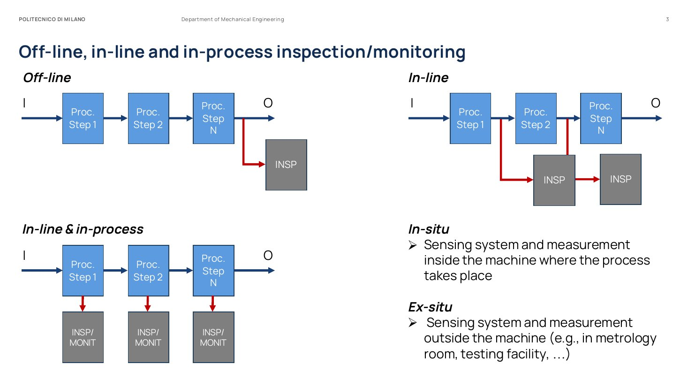
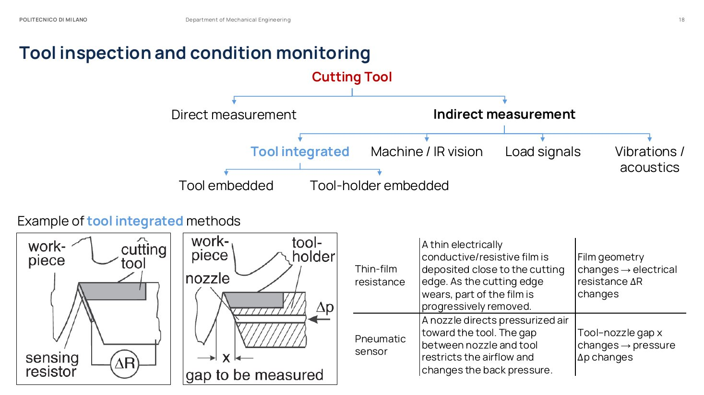
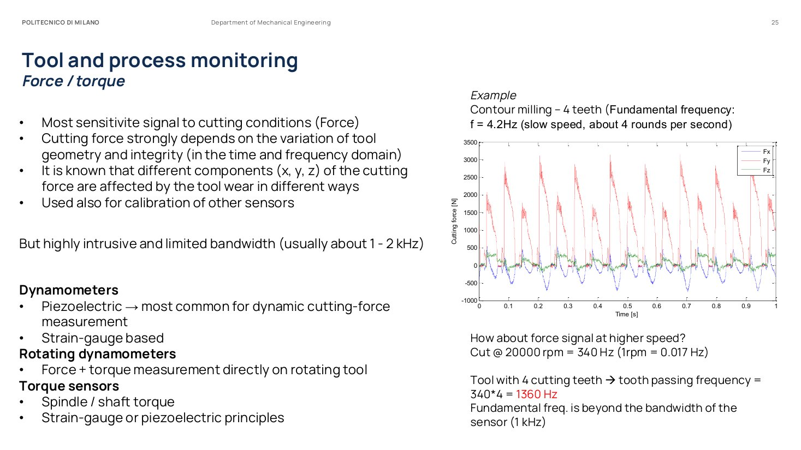
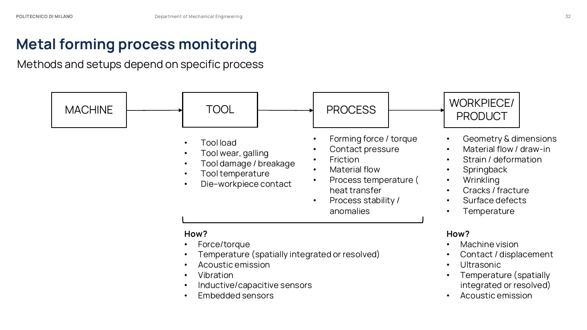
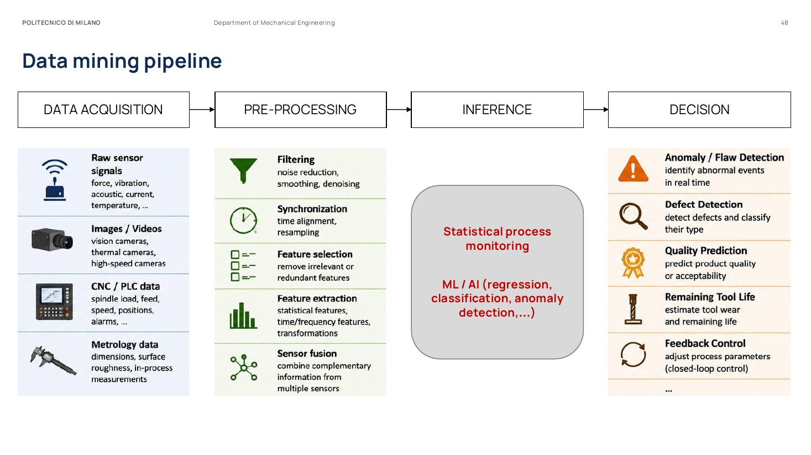
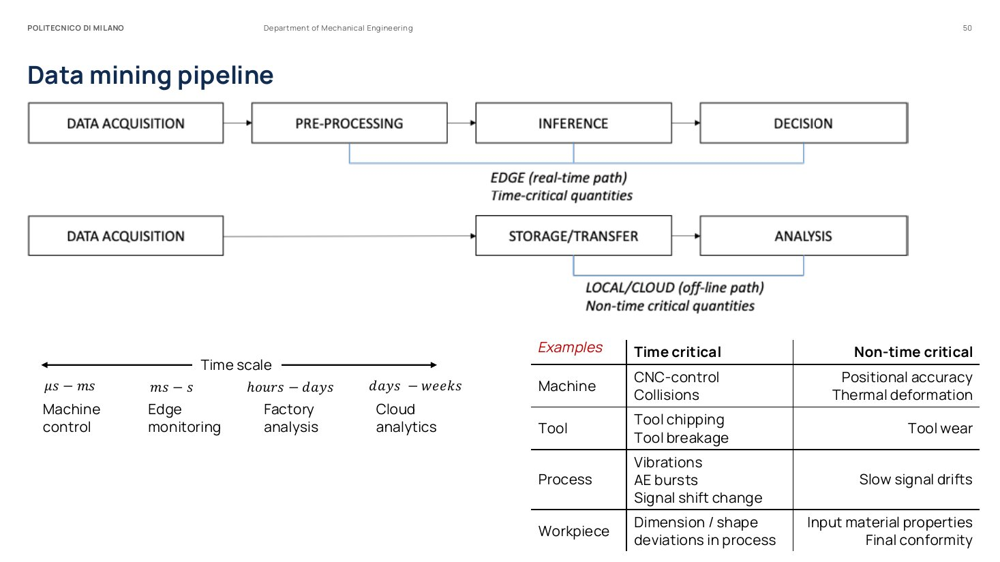

# L3.2 Smart manufacturing – sensing and data mining

> Part of the CAM study guide. Source of truth: [the study guide](https://claude.ai/artifact/WrGc96ueegSH8ZXZdT4FaB). Generated by `tools/build_guide.py`; edit the guide, not this file.

## Slides and professor's explanations (exam material)

Before you can monitor a process you must decide **what** to measure (machine, tool, process or part), **where and when** (off-line, in-line, in-process, in-situ), and whether you measure the quality characteristic **directly** or a process signal that acts as a **proxy** for it. For each process family (machining, forming, welding, AM) the slides list the sensors, their frequency ranges and their limits, and then the **data-mining pipeline** from acquisition to decision, split between edge, factory and cloud. *(From the slides, Prof. Grasso. No recording yet.)*

### Inspection vs testing

- **Inspection** = assessment against the design specifications: **measurement** (the actual value, e.g. diameter = 20.03 mm) or **gauging** (is the requirement met? GO / NO-GO).
- **Testing** = assessment of **functional performance**, under operation or representative conditions: does it work as intended, does it withstand the expected conditions? It can be destructive or non-destructive.

### Where and when you measure

- **Off-line**: inspection after the process step, as a separate station. **In-line**: an inspection station inside the production line, between steps. **In-line & in-process**: monitoring while the process runs.
- **In-situ** = the sensor sits inside the machine where the process takes place; **ex-situ** = outside the machine (metrology room, test facility).
- **Four levels**: machine (health: position, velocity, vibration, energy), tool (wear, breakage, temperature), process (stability: force, torque, acoustic emission, vibration), workpiece/product (quality: dimensions, shape, surface).

### Direct vs indirect measurement

| Direct | Indirect |
| --- | --- |
| The quality characteristic itself is measured | A process quantity is measured as a **proxy** for it |
| Laser scanner → geometry; in-process camera → surface defects; touch probe → dimensions; pyrometer → workpiece temperature; profilometer → roughness | Cutting force → tool wear / surface quality; spindle power → tool condition; acoustic emission → tool breakage; vibration → surface quality; weld-pool emission → bead quality |
| Typical for **part inspection** (off-line, in-line) | Typical for **tool and process monitoring** (in-line, in-process) |

**Off-line part inspection** comes in three families: **contact** (CMM: a probe moved on a physical Cartesian frame, ISO 10360-1; dimensions and tolerances), **non-contact** (optical microscopy, machine vision, laser scanners, structured light; geometry and surface), and **volumetric** (**X-ray CT**: X-ray images at many rotations rebuilt into a 3D volume; it sees internal defects and features that contact and optical probes can't reach).

**Process signature** = a physical phenomenon you can observe during fabrication that can be correlated with part quality metrics. Sensor data come in seconds, while product data come after hours or days, and the data are getting more complex (signals, images, point clouds, voxels, multimodal), bigger, faster and multi-stream.

### Machining: what and how to monitor

- **Workpiece:** in-line but not in-process = cut → retract the tool → measure (touch probe, laser, vision) → correct → cut. In-process options: pneumatic, ultrasonic, electromagnetic, displacement sensors, vision, or indirect process signals. You measure **macro-geometry** (diameter, dimensions, form, position) or **micro-geometry** (profile, roughness, topography, surface integrity).
- **Tool, direct** (in-line, the process stops): contact pins (geometry), a **laser barrier** (envelope, diameter, length, wear, breakage), CCD cameras (edge geometry, flank and crater wear), structured light (full 3D tool shape).
- **Tool, indirect:** sensors **integrated in the tool** (a thin conductive film near the edge wears away, so its electrical resistance changes; a pneumatic nozzle whose back-pressure changes with the tool–nozzle gap), machine/IR vision, **load signals** (force, torque, spindle/motor current and power), **vibration and acoustics**. Typical information: wear, chipping, breakage.

| Signal | Strengths | Limits | Typical numbers |
| --- | --- | --- | --- |
| **Vibration** (piezo accelerometers; MEMS cheaper but lower bandwidth and SNR) | Easy to install, cheap, robust | Very sensitive to **sensor location**: place it as close to the source as possible (tool holder, spindle housing, fixture) | Range of interest \~1 Hz–10 kHz; sampling 20–50 kHz; tens to hundreds of g |
| **Acoustic emission** (structure-borne elastic waves; airborne = microphones) | Sees the cutting zone: continuous AE (wear, friction), **burst** AE (chipping, fracture, cracks) | Needs mechanical coupling | \~100 kHz–1 MHz (machining \~100–500 kHz); sampling ≥ 1 MHz |
| **Force / torque** (piezo dynamometers, rotating dynamometers, torque sensors) | The most sensitive to cutting conditions; components x, y, z react differently to wear; used to calibrate other sensors | Intrusive, hard to integrate, **bandwidth only \~1–2 kHz** | Force 1 N–50 kN; torque 10 Nm–1 kNm |
| **Power / current** | Almost "sensorless": read from the CNC/PLC (axes, spindle) | Small loads masked by motor losses, friction, dynamics, no-load power; slow; sampling limited by the CNC interface | — |
| **Machine vision** | Can replace the operator's eye | Occlusion, motion blur, chips and coolant, reflections: mostly used **in-line, not in-process** | 10–100 fps industrial; ≥ 500–1000 fps research |
| **Temperature** | Linked to wear, thermal damage, surface integrity | Small, moving, hidden zone with steep gradients | IR thermography = field T(x,y,t); thermocouple / pyrometer = one signal T(t) |

**Exam alert — check the bandwidth against the phenomenon (slide 25):** at 20,000 rpm the spindle turns at 333 Hz (the slide rounds to 340 Hz); with 4 teeth the **tooth-passing frequency is ≈ 1,360 Hz**, already **above the \~1 kHz bandwidth of a dynamometer**. The same reasoning as the L1.6 sampling-rate question and L1.4's latency rule: the sensor must be faster than what you want to see.

### Forming and welding

- **Forming:** monitor the tool (load, wear, galling, breakage, temperature), the process (force/torque, contact pressure, friction, material flow, temperature) and the part (geometry, draw-in, strain, **springback**, wrinkling, cracks). **Direct:** camera → bend angle, laser → draw-in, force sensor → forming force. **Indirect:** force signature → wrinkling or fracture, AE → wear or galling, force + geometry → springback prediction. Examples: punch breakage seen in force and AE, smart dies with embedded pressure and temperature sensors, load cells in rotary-draw-bending dies, in-line laser measurement of the springback angle (L1.8).
- **Welding:** variability comes from the process (speed, current, voltage, heat input), the equipment (clamping, torch position, beam condition), the joint (tolerances, mismatch, groove) and the process evolution (thermal deformation, spatter). **Geometry-oriented sensors** (mechanical probe, wire touch sensing, laser stripe + CCD, eddy current, ultrasound) tell you **where** to weld, not the weld quality. **Process-oriented, primary phenomena** (current, voltage, arc length, beam power and position), e.g. **through-the-arc sensing**: the torch-to-work distance changes the wire stick-out, hence the resistance, current and voltage, which can be used for seam tracking. **Secondary phenomena** (energy–material interaction): weld-pool vision (size, shape, bead width), photodiodes (process stability), IR cameras, spectroscopy (composition, dilution) (L1.4).
- **AM:** the layer-by-layer process gives new chances to monitor in-situ and inspect every layer, from the sensorised machine to the intelligent machine.

### The data-mining pipeline

**Acquisition → pre-processing → inference (SPM, or ML/AI: regression, classification, anomaly detection) → decision.** Where it runs depends on the time scale:

- **Edge** (at the machine): low latency, real-time response, high data rates, less network traffic, works without the cloud. Big data force **dimensionality reduction** here.
- **Factory**: databases, MES, traceability, off-line metrology, KPIs, energy.
- **Cloud**: historical big data, AI training, data lakes; latency tolerance, aggregation and time horizon all grow.
- **Time scales:** CNC control µs–ms (positioning, collisions); edge monitoring ms–s (tool chipping or breakage, vibration, AE bursts); factory analysis hours–days (tool wear, slow drifts, final conformity); cloud analytics days–weeks (thermal deformation, input material).

**Exam link:** this deck is the catalogue behind every "what would you measure?" question in L1.2–L1.8. Answer with the level (tool, process, part), direct or indirect, the sensor, its bandwidth vs the phenomenon, and where the data are processed.

## Professor background (less exam-critical)

*No background comments for this chapter.*

## Practice exercises

*No dedicated exercise. All formulas: [formula sheet](../formula-sheet.md).*

## Likely oral questions

- **Direct vs indirect monitoring: which sensor would you use to detect tool breakage in milling?** Direct = measure the characteristic itself (laser barrier or camera on the tool, in-line with the process stopped); indirect = a process signal as a proxy, in-process. For breakage: acoustic emission bursts (100 kHz–1 MHz, sampled ≥ 1 MHz, needs mechanical coupling) or vibration close to the source; force is the most sensitive but intrusive and only \~1–2 kHz (at 20,000 rpm with 4 teeth the tooth frequency is already \~1.4 kHz); spindle power is free from the CNC but too slow and masked by friction. Process it at the edge (ms–s).
