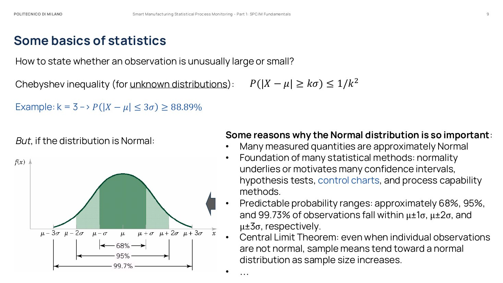
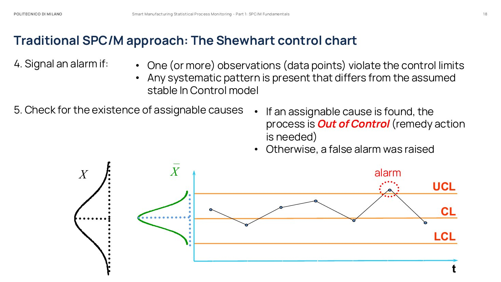
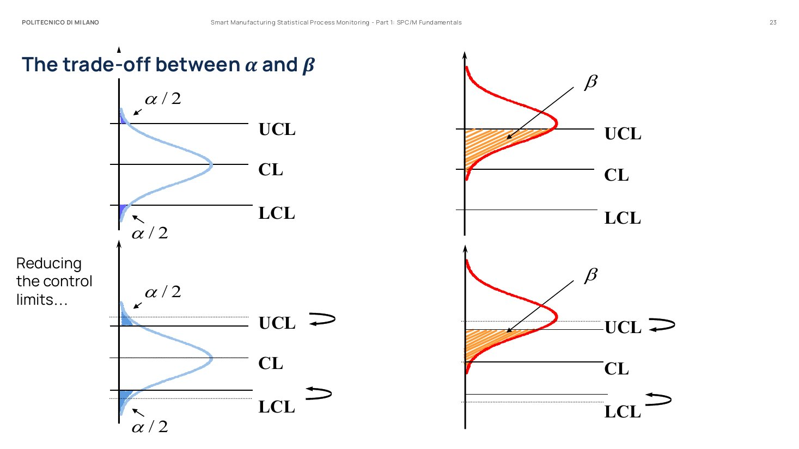
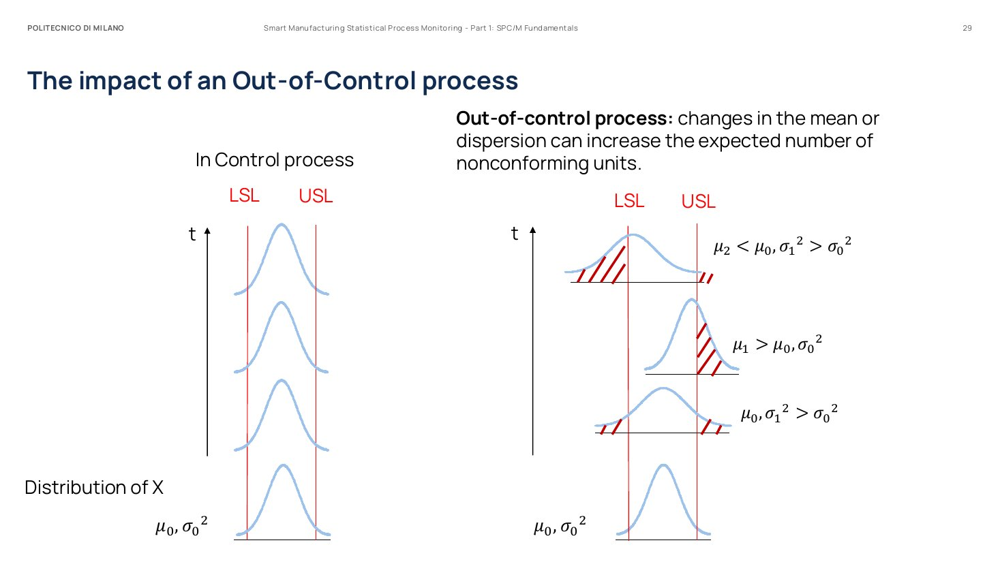
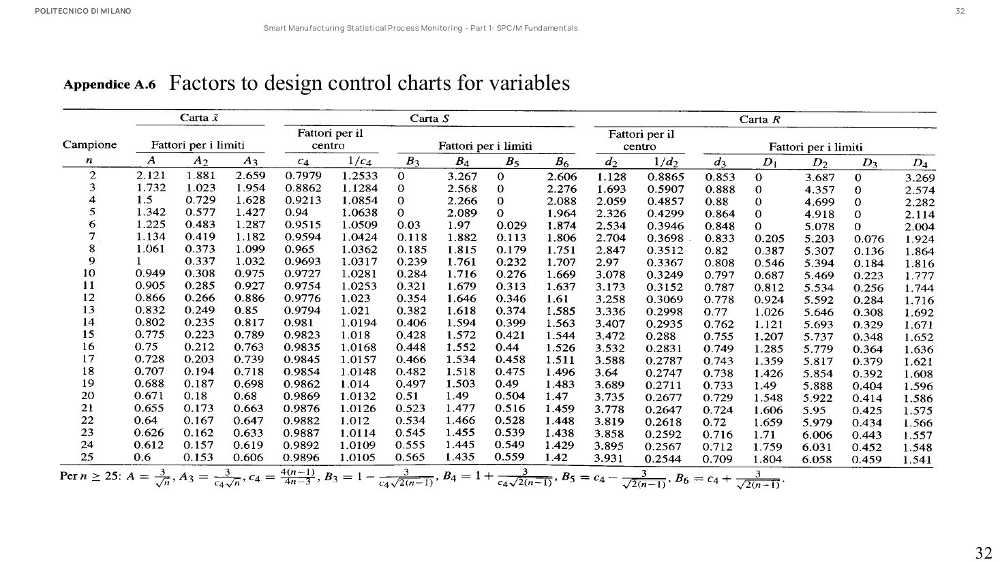
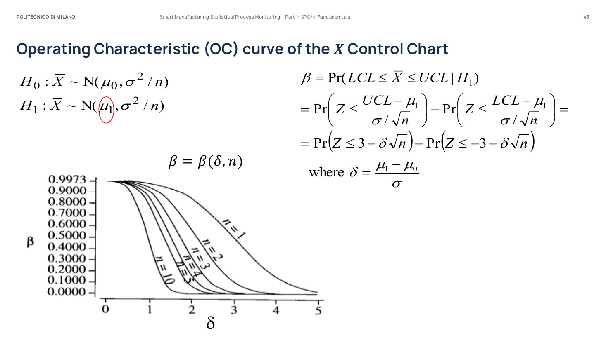
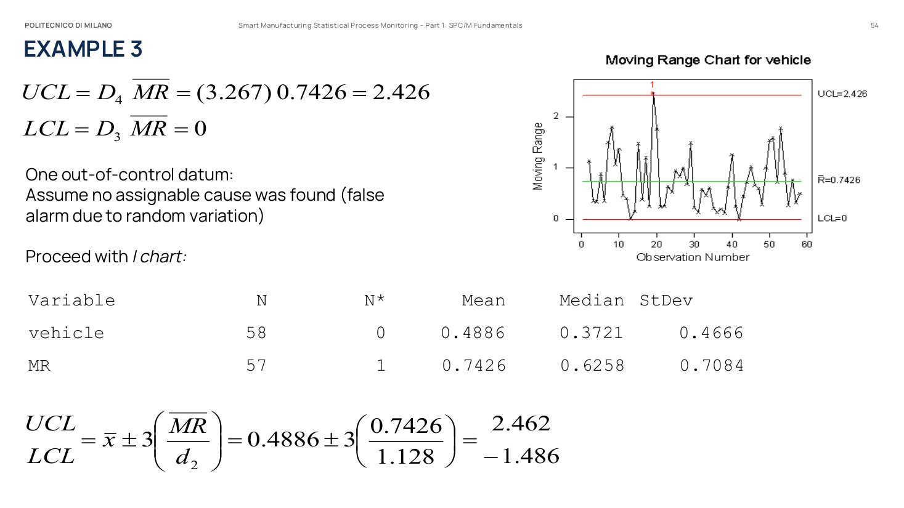

# L3.3 Statistical process monitoring – part 1: SPC fundamentals

> Part of the CAM study guide. Source of truth: [the study guide](https://claude.ai/artifact/WrGc96ueegSH8ZXZdT4FaB). Generated by `tools/build_guide.py`; edit the guide, not this file.

## Slides and professor's explanations (exam material)

Shewhart control charts monitor **one** quality characteristic by taking **rational subgroups** (samples of size n taken at regular intervals under the same conditions) and plotting a statistic against **control limits** estimated from in-control data. A point outside the limits, or a non-random pattern, is an alarm; you then look for an **assignable cause**. The design trades the false-alarm rate α against the missed-detection rate β, measured by the **ARL**. In practice the parameters are unknown, so the limits are built in **Phase 1** with the tabulated constants (A₂, D₃, D₄, d₂ …) and used in **Phase 2**. This is the core of the **quality-monitoring numerical exercise**. *(From the slides, Prof. Grasso / Prof. Demir; reference: Montgomery, Introduction to Statistical Quality Control. No recording yet.)*


### Statistics you need

- A **random variable** has one numerical value per measurement; a **sample** is a set of measurements from a larger population; a **probability distribution** (pdf f(x) for continuous variables, mass function for discrete ones) models how likely each value is. Mean μ = E(X), variance σ² = V(X) = E(X²) − μ², standard deviation σ.
- **Independence:** P(x₁∈E₁, …, xₙ∈Eₙ) = ∏ P(xᵢ∈Eᵢ). Independent ⇒ covariance = 0 (for normal variables the converse also holds).
- **Normal distribution** X \~ N(μ, σ): about **68 / 95 / 99.73%** of values within μ ± 1σ / 2σ / 3σ. The **sample mean** of n independent values: X̄ \~ N(μ, σ/√n).
- **Chebyshev** (any distribution): P(|X − μ| ≥ kσ) ≤ 1/k², so only ≥ 88.9% within 3σ if you don't know the distribution.
- **Central Limit Theorem:** the sum or average of many independent variables tends to a normal distribution whatever their own distribution, so **X̄ is approximately normal** for large enough n.
- **Standardisation:** Z = (X − μ)/σ \~ N(0, 1), P(X ≤ x) = Φ(z). An estimator Θ is **unbiased** if E(Θ) = θ; otherwise E(Θ) − θ is the bias.



### The process model

```latex
Y_t = \mu_t + \varepsilon_t, \quad \mu_t = \mu \ (\text{constant}), \quad \varepsilon_t \sim N(0, \sigma^2) \ \text{i.i.d.}
```

Assumptions: **normal** (many small causes, none dominant), **independent**, **constant variance**. Then the best prediction is ŷ = μ and the process is **in statistical control**: stable and predictable. You need a model to predict the future and detect departures from the expected pattern ("unstable but predictable" processes need a different model).


### The Shewhart chart, step by step (shaft diameter example)

1. Take random samples of size n (e.g. 5 shafts) at regular intervals.
2. Compute the sample mean X̄ \~ N(μ, σ/√n). With μ = 74.000 mm and σ = 0.010 mm, n = 5: σ\_X̄ = 0.0045 mm.
3. Control limits with K = 3: **UCL = 74.000 + 3·0.0045 = 74.0135**, CL = 74.000, **LCL = 73.9865** mm.
4. Alarm if a point falls outside the limits **or** a systematic pattern appears.
5. Look for an **assignable cause**: found → out of control, act; not found → false alarm.




- **Common causes** = natural variability from many sources (material, machines, operators, measurement); reducing them is management's job. **Special (assignable) causes** = identifiable issues (bad material batch, operator error, wrong setup, wear); the operator or a higher-level decision can remove them.

### Errors, K, α, β and ARL

- H₀ = in control, H₁ = out of control. **Type I error α** = P(alarm | in control) = **false alarm**. **Type II error β** = P(no alarm | out of control) = **missed detection**; 1 − β = **power**. (Slide 20's table labels the missed detection "Type I (β)": it is a **Type II** error.)
- **K and α:** K = z\_{α/2}. **K = 3 → α = 0.0027** (0.00135 in each tail).
- **Trade-off:** narrower limits lower β but raise α, and vice versa. β depends on the size of the shift δ: β(δ = 0) = 1 − α.
- **ARL** (average run length) = expected number of points before an alarm (geometric distribution):

```latex
ARL_0 = \frac{1}{\alpha} \ (= 370.4 \text{ for } K = 3), \qquad ARL_1 = \frac{1}{1-\beta}, \qquad ATS = h \cdot ARL
```

- **Worked example (slide 27):** individual values, the mean shifts by 2σ, K = 3. 1 − β = P(Z < −5) + P(Z > 1) = 0 + 0.1587 = **0.159**, so **ARL₁ ≈ 6.3** points to detect it.
- **ATS** (average time to signal) = sampling interval h × ARL. To detect faster: shorter h (but watch independence) or larger n.





**Exam alert — control limits ≠ specification limits:**

|  | Control limits | Specification limits |
| --- | --- | --- |
| Based on | Process data | Customer requirements |
| Purpose | Monitor **stability** | Decide if the product is **acceptable** |
| Apply to | Sample statistics (X̄, R, S) | Individual quality characteristics |
| Can change? | Yes, with the process | No, fixed by design |
| Method | SPC/SPM | Process capability |

An out-of-control process (mean shift or larger dispersion) raises the expected number of non-conforming parts.




### X̄–R and X̄–S charts

Monitor **both** the mean (X̄ chart) and the dispersion (R chart with R = max − min, or S chart with the sample standard deviation). **X̄–R** is easy and works as well as X̄–S for **small, constant n (≤ 6)**; **X̄–S** is preferred for large or variable n. Both use the scheme UCL = μ\_V + Kσ\_V, CL = μ\_V, LCL = μ\_V − Kσ\_V.

```latex
\text{Unknown parameters (Phase 1, } m \ge 20\text{–25 samples):}\quad \hat\mu = \bar{\bar x},\ \hat\sigma = \frac{\bar R}{d_2(n)} \\
\bar X:\ UCL/LCL = \bar{\bar x} \pm A_2(n)\,\bar R \qquad R:\ UCL = D_4(n)\,\bar R,\ CL = \bar R,\ LCL = D_3(n)\,\bar R \\
\bar X:\ UCL/LCL = \bar{\bar x} \pm A_3(n)\,\bar s \qquad S:\ UCL = B_4(n)\,\bar s,\ CL = \bar s,\ LCL = B_3(n)\,\bar s,\ \hat\sigma = \bar s / c_4(n)
```

With known μ and σ: X̄ limits μ ± A(n)σ with A = 3/√n; R limits D₁σ and D₂σ around d₂σ; S limits B₅σ and B₆σ around c₄σ. The constants come from the table (slide 32); the exam gives you a formula sheet. Most used values: n = 2: d₂ = 1.128, D₄ = 3.267; n = 5: A₂ = 0.577, D₃ = 0, D₄ = 2.114, d₂ = 2.326.



**Phase 1 (design):** take m ≥ 20–25 samples in a stable regime, estimate the parameters, plot the data against the limits computed from them. If a point is out: assignable cause found → remove it and recompute; none found → keep it (or remove it if it is far out, since it distorts the limits). **Start with the dispersion chart**, then the mean chart (its limits use R̄). One or two iterations are normal; re-check the assumptions after removing samples. **Phase 2 (use):** plot new samples against the fixed limits; alarm + cause → act and redesign; no cause → false alarm. Revise the limits periodically (every week, month, 100 samples, new product) or when n or the process changes.


**Operating characteristic (OC) curve:** β as a function of the shift δ = (μ₁ − μ₀)/σ and n: β = Φ(3 − δ√n) − Φ(−3 − δ√n). Bigger n detects small shifts better. For the R chart the shift is the ratio σ₁/σ₀.



**Worked example 1 (X-ray detector cells, slides 37–42):** 25 samples of n = 5 cells (testing all 912 cells takes \~30 h). First look at the data (scatter plot, boxplots) and check normality and independence. **R chart:** R̄ = 1.775, UCL = D₄R̄ = 2.114·1.775 = **3.752**, LCL = 0. Sample 22 (R = 4.21) is out; assume an assignable cause, remove it: R̄ = 40.158/24 = **1.673**, UCL = **3.537**, all in control. **X̄ chart:** x̄̄ = 24,000.378/24 = **1000.016**, limits 1000.016 ± 0.577·1.673 = **\[999.051, 1000.981\]**, all in control: Phase 1 is over.


### Individual measurements: the I–MR chart (n = 1)

Used when only one value per sample makes sense: low-throughput processes, continuous processes (chemicals), company KPIs, and **in-line / in-situ measurements**. Short-term variability comes from the **moving range** MRᵢ = |Xᵢ − Xᵢ₋₁|:

```latex
I:\ UCL/LCL = \bar x \pm 3\,\frac{\overline{MR}}{d_2(2)} = \bar x \pm 2.66\,\overline{MR} \qquad MR:\ UCL = D_4(2)\,\overline{MR} = 3.267\,\overline{MR},\ LCL = 0
```

Careful: MR values are **autocorrelated** (consecutive MRs share a point) and **not normal** (non-negative, skewed), so an MR alarm may just be the wrong distribution: redesign the MR chart with **probability limits** (UCL = D\_{1−α/2}·MR̄/d₂, LCL = D\_{α/2}·MR̄/d₂, from the half-normal distribution of MR).


**Worked example 3 (car-body hole position, slides 53–55):** 48 laser sensors measure 95 dimensions on each body; the data are the y-shift (mm) of a coupling hole, 58 bodies. x̄ = 0.4886, MR̄ = 0.7426. **MR chart:** UCL = 3.267·0.7426 = **2.426**, LCL = 0; one point is out but no cause is found (false alarm). **I chart:** 0.4886 ± 3·0.7426/1.128 → **UCL ≈ 2.46, LCL ≈ −1.49**, no violations: design over.



## Professor background (less exam-critical)

*No background comments for this chapter.*

## Practice exercises

### N. Control charts (worked examples from the L3.3 slides)

1. **Known parameters:** shaft μ = 74.000 mm, σ = 0.010 mm, n = 5, K = 3 → σ\_X̄ = 0.0045, limits **73.9865 / 74.0135 mm**.
2. **ARL:** K = 3 → α = 0.0027, ARL₀ = **370.4**. A 2σ shift of individual values: 1 − β = P(Z > 1) = 0.159 → ARL₁ ≈ **6.3**.
3. **X̄–R, unknown parameters (25 samples, n = 5):** R̄ = 1.775 → UCL\_R = 2.114·1.775 = 3.752, sample 22 out → removed → R̄ = 1.673, UCL\_R = **3.537**; x̄̄ = 1000.016 → X̄ limits **999.051 / 1000.981** (A₂ = 0.577, D₃ = 0, D₄ = 2.114 for n = 5).
4. **I–MR:** x̄ = 0.4886, MR̄ = 0.7426 → MR chart UCL = 3.267·MR̄ = **2.426**; I chart 0.4886 ± 3·0.7426/1.128 = **−1.49 / 2.46**.

Order of work: look at the data, check normality and independence, dispersion chart first, then the mean chart, remove points only with an assignable cause, recompute.

All formulas: [formula sheet](../formula-sheet.md).

## Likely oral questions

- **Control limits vs specification limits?** Control limits come from process data and monitor stability of sample statistics (SPC); specification limits come from the customer or design and decide whether each part is acceptable (capability). A process can be in control but out of spec, or vice versa.
- **Type I and Type II errors, ARL: what does K change?** α = false alarm, β = missed shift. K = 3 gives α = 0.0027 and ARL₀ = 1/α = 370; narrower limits cut β but raise α. ARL₁ = 1/(1 − β) depends on the shift and n (a 2σ shift with n = 1 needs about 6.3 points). ATS = h·ARL.
- **How do you design an X̄–R chart when μ and σ are unknown?** Phase 1: m ≥ 20–25 subgroups in stable conditions; check normality and independence; design the R chart first (R̄, D₃R̄, D₄R̄), then the X̄ chart (x̄̄ ± A₂R̄); remove points with an assignable cause and recompute. Phase 2: plot new subgroups against the fixed limits, investigate alarms, revise the limits periodically. Use X̄–S for large or variable n, I–MR for n = 1.
