# L3.3 Statistical process monitoring – part 1: SPC fundamentals

> Part of the CAM study guide. Source of truth: [the study guide](https://claude.ai/artifact/WrGc96ueegSH8ZXZdT4FaB). Generated by `tools/build_guide.py`; edit the guide, not this file.

## Slides and professor's explanations (exam material)

Shewhart control charts monitor **one** quality characteristic by taking **rational subgroups** (samples of size n taken at regular intervals under the same conditions) and plotting a statistic against **control limits** estimated from in-control data. A point outside the limits, or a non-random pattern, is an alarm; you then look for an **assignable cause**. The design trades the false-alarm rate α against the missed-detection rate β, measured by the **ARL**. In practice the parameters are unknown, so the limits are built in **Phase 1** with the tabulated constants (A₂, D₃, D₄, d₂ …) and used in **Phase 2**. This is the core of the **quality-monitoring numerical exercise**. *(From the slides, Prof. Grasso / Prof. Demir; reference: Montgomery, Introduction to Statistical Quality Control. Recordings of 10 and 11 Nov, Prof. Demir: rational subgroups, statistics basics, Shewhart chart, α/β, ARL, control vs specification limits; 16 Nov: X̄–R and X̄–S charts, design and use phases, OC curves and ARL, the X-ray example, I–MR.)*

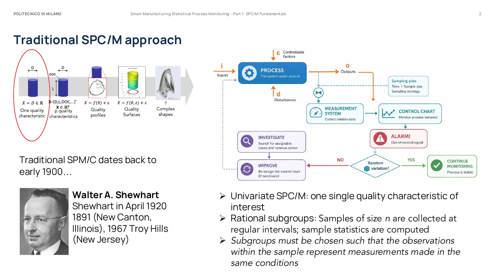

- **Prof (10 Nov) — rational subgroups with shafts:** you make 1,000 shafts a day; the sampling questions are **how many** (say n = 20) and **how often** (every day). The subgroup must be taken in the same conditions and represent **in-control** production: with a month of daily samples known to be good you build the bounds, then sample the next day and check it stays inside. On an alarm, first check whether it is just random variation before stopping everything. Daily sampling is slow; the same logic applied to sensor data (e.g. vibration) can come close to real-time control.
- **Exam alert — tolerances are not probabilistic, control bounds are:** a tolerance says the diameter must be within ±0.1 mm. A probability distribution says that, e.g., 99% of the diameters fall within a range. Control bounds come from the distribution of the in-control process, not from the drawing.

### Statistics you need

- A **random variable** has one numerical value per measurement; a **sample** is a set of measurements from a larger population; a **probability distribution** (pdf f(x) for continuous variables, mass function for discrete ones) models how likely each value is. Mean μ = E(X), variance σ² = V(X) = E(X²) − μ², standard deviation σ.
- **Prof — the basics in his words:** we sample instead of measuring the whole population because it costs less, so the sample must be representative. The spread of diameters comes from vibration, material, tool wear, temperature, and some causes aren't worth controlling ("I don't try to control the temperature of Milan"). Continuous variable = the shaft diameter (pdf: probability = an integral, the CDF climbs to 1); discrete = cars sold (mass function: sums instead of integrals). Rules for expected values: E(c) = c, E(cX) = c·E(X), E(X + Y) = E(X) + E(Y), V(cX) = c²·V(X).
- **Independence:** P(x₁∈E₁, …, xₙ∈Eₙ) = ∏ P(xᵢ∈Eᵢ). Independent ⇒ covariance = 0 (for normal variables the converse also holds).
- **Prof (11 Nov) — dependent or independent?** Two temperatures measured on the same mould are not independent (if one rises, the other probably does too); a shaft's diameter and length made in two separate operations should be. Covariance is computed like the variance, but with the two distances E\[(X₁ − μ₁)(X₂ − μ₂)\]; zero for independent variables. For control charts, prefer variables that are independent.
- **Normal distribution** X \~ N(μ, σ): about **68 / 95 / 99.73%** of values within μ ± 1σ / 2σ / 3σ. The **sample mean** of n independent values: X̄ \~ N(μ, σ/√n).
- **Prof — the numbers made concrete:** heights in Italy, say mean 174 cm and σ = 10 cm: 164–184 holds 68%, 154–194 holds 95%, 144–204 holds 99.7%, so a 210 cm person is "out of the ordinary". A shaft of 100 mm with σ = 0.1 mm measured at 101 mm sits 10σ away: the distribution turns your subjective "engineering judgement" into an objective statement. **Why ±3σ:** it leaves out 0.27%: 3 parts in 1,000, but about 2,700 in a million, so it is a compromise between catching problems and not widening the band forever (the normal tails never end).
- **Chebyshev** (any distribution): P(|X − μ| ≥ kσ) ≤ 1/k², so only ≥ 88.9% within 3σ if you don't know the distribution.
- **Central Limit Theorem:** the sum or average of many independent variables tends to a normal distribution whatever their own distribution, so **X̄ is approximately normal** for large enough n.
- **Prof — why the CLT matters for us:** even if the shaft diameter itself is not normal (other distributions exist: uniform, Poisson, Weibull), the **daily sample means** tend to a normal distribution. That is what makes the X̄ chart work.
- **Standardisation:** Z = (X − μ)/σ \~ N(0, 1), P(X ≤ x) = Φ(z). An estimator Θ is **unbiased** if E(Θ) = θ; otherwise E(Θ) − θ is the bias.
- **Prof — examples:** P(height ≤ 180 cm) with μ = 174, σ = 10 → z = (180 − 174)/10 = 0.6, then read Φ(0.6) from the standard normal table. We never know the true population (55 million Italians), so we estimate μ with the sample mean x̄ and σ² with the sample variance Σ(xᵢ − x̄)²/(n − 1). A **biased** sample: measuring heights only on a basketball court.


### The process model

```math
Y_t = \mu_t + \varepsilon_t, \quad \mu_t = \mu \ (\text{constant}), \quad \varepsilon_t \sim N(0, \sigma^2) \ \text{i.i.d.}
```

Assumptions: **normal** (many small causes, none dominant), **independent**, **constant variance**. Then the best prediction is ŷ = μ and the process is **in statistical control**: stable and predictable. You need a model to predict the future and detect departures from the expected pattern ("unstable but predictable" processes need a different model).

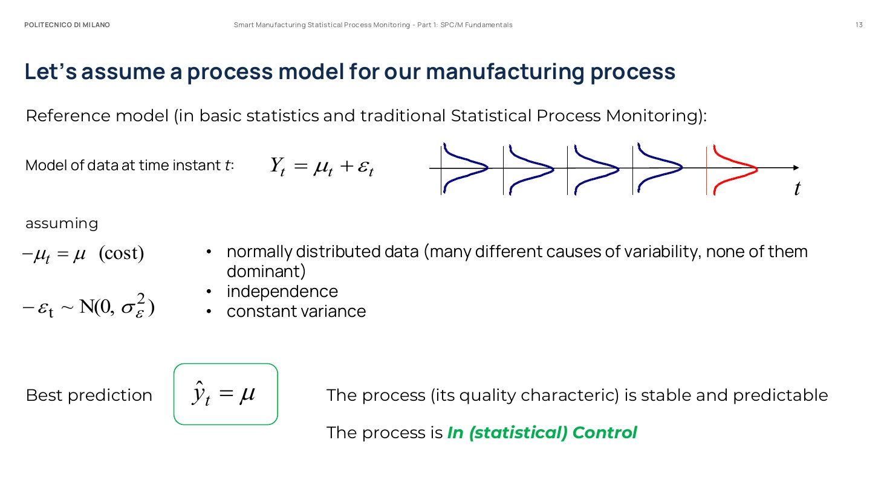

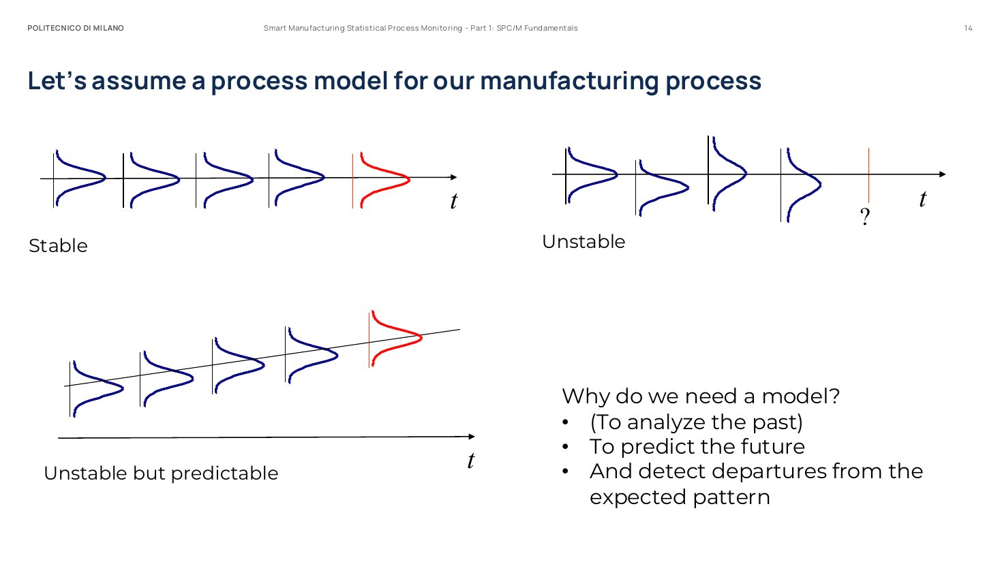

### The Shewhart chart, step by step (shaft diameter example)

1. Take random samples of size n (e.g. 5 shafts) at regular intervals.
2. Compute the sample mean X̄ \~ N(μ, σ/√n). With μ = 74.000 mm and σ = 0.010 mm, n = 5: σ\_X̄ = 0.0045 mm.
3. Control limits with K = 3: **UCL = 74.000 + 3·0.0045 = 74.0135**, CL = 74.000, **LCL = 73.9865** mm.
4. Alarm if a point falls outside the limits **or** a systematic pattern appears.
5. Look for an **assignable cause**: found → out of control, act; not found → false alarm.

- **Class discussion (11 Nov) — what is critical about this simple chart?** (1) An out-of-control point may mean scrapping the whole day's parts or stopping production, so first look for an **assignable cause** (re-measure, was the sample representative?). (2) Points going out and back in are suspicious. (3) It is statistics: the point may still belong to the population (it is in the 99.9% even if outside the 99.7%). (4) This chart watches **only the mean**: the same mean with a **wider spread** goes unnoticed, so you also need a dispersion chart. (5) A point inside the limits can hide a real shift: **missed alarms exist as well as false alarms** (his COVID analogy: why a test is repeated).

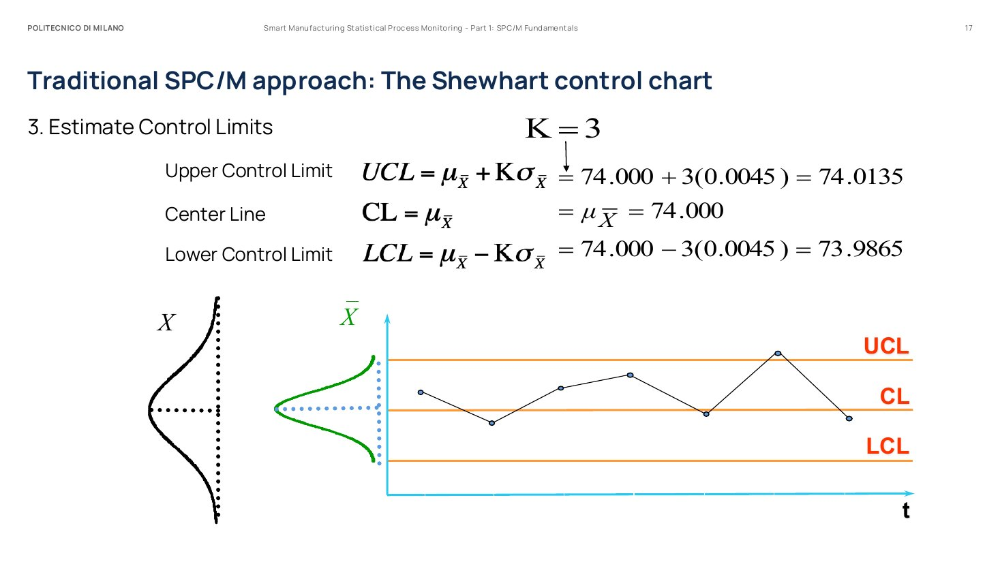


- **Common causes** = natural variability from many sources (material, machines, operators, measurement); reducing them is management's job. **Special (assignable) causes** = identifiable issues (bad material batch, operator error, wrong setup, wear); the operator or a higher-level decision can remove them.

**Prof — why the type of cause matters:** a **common cause** means improving the process itself (often a big investment); a **special cause** is a momentary fault you find and remove so it doesn't happen again. A **shrinking** σ is also a change in the system (sometimes a lucky one: serendipity).

### Errors, K, α, β and ARL

- H₀ = in control, H₁ = out of control. **Type I error α** = P(alarm | in control) = **false alarm**. **Type II error β** = P(no alarm | out of control) = **missed detection**; 1 − β = **power**. (Slide 20's table labels the missed detection "Type I (β)": it is a **Type II** error.)
- **K and α:** K = z\_{α/2}. **K = 3 → α = 0.0027** (0.00135 in each tail).
- **Trade-off:** narrower limits lower β but raise α, and vice versa. β depends on the size of the shift δ: β(δ = 0) = 1 − α.
- **ARL** (average run length) = expected number of points before an alarm (geometric distribution):

```math
ARL_0 = \frac{1}{\alpha} \ (= 370.4 \text{ for } K = 3), \qquad ARL_1 = \frac{1}{1-\beta}, \qquad ATS = h \cdot ARL
```

**Prof — reading the ARL:** after a shift, the chance of detecting it at the j-th sample is β^(j−1)·(1 − β), so the expected run length is 1/(1 − β). ARL₀ = 1/0.0027 ≈ 370: with one sample a day, about **one false alarm a year**, "reasonably good for a lot of applications".

- **Exam alert — don't swap the labels:** in class, as on slide 20, the names came out swapped. Remember: **Type I = α = false alarm** (the process is in control, the point falls outside), **Type II = β = missed alarm** (the process is out of control, the point falls inside). You want α small and the power 1 − β high.
- **Class discussion — how do you reduce α?** Increase K, but the wider band lowers the power (β grows), and you accept a wider range; or reduce σ itself, which costs money. The power also depends on **how far the process shifts**: a shaft drifting from 100.01 to 100.1 mm is hard to catch, one at 100.2 mm is easy. With no shift (δ = 0), β = 1 − α: you correctly say "in control" 99.73% of the time.

* **Worked example (slide 27):** individual values, the mean shifts by 2σ, K = 3. 1 − β = P(Z < −5) + P(Z > 1) = 0 + 0.1587 = **0.159**, so **ARL₁ ≈ 6.3** points to detect it.
* **ATS** (average time to signal) = sampling interval h × ARL. To detect faster: shorter h (but watch independence) or larger n.

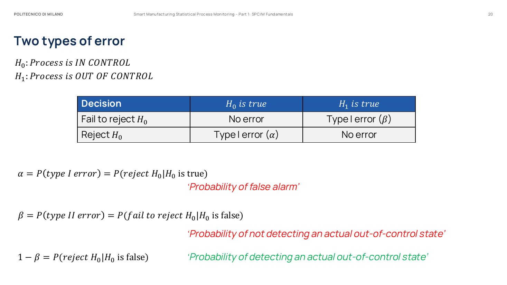


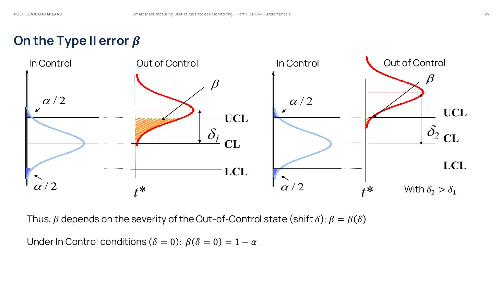

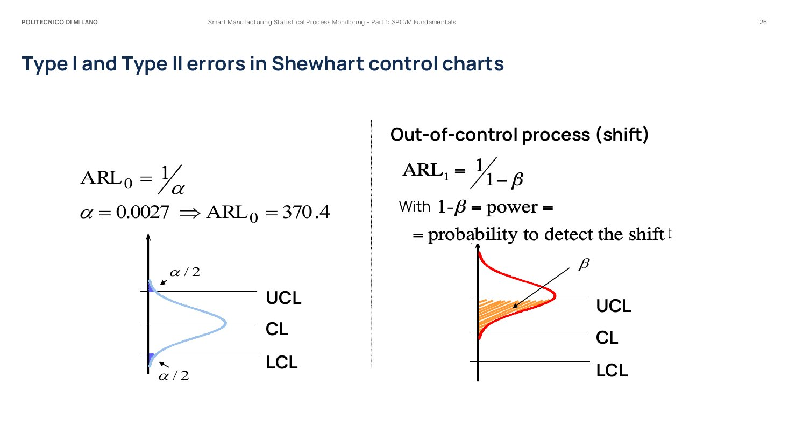

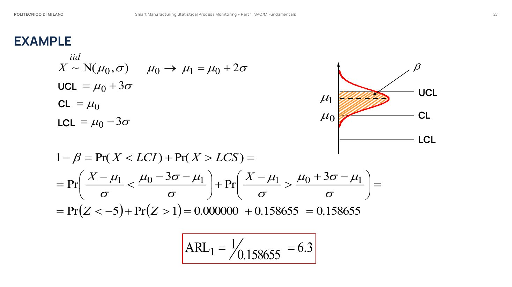

**Exam alert — control limits ≠ specification limits:**

|  | Control limits | Specification limits |
| --- | --- | --- |
| Based on | Process data | Customer requirements |
| Purpose | Monitor **stability** | Decide if the product is **acceptable** |
| Apply to | Sample statistics (X̄, R, S) | Individual quality characteristics |
| Can change? | Yes, with the process | No, fixed by design |
| Method | SPC/SPM | Process capability |

**Prof — the chart doesn't know the tolerances:** control limits only say whether the process is **stable**; we assume it was set up **capable** of meeting the tolerances in the first place (checked with process capability). Three out-of-control pictures and their likely causes: same mean, **wider spread** → the machine is vibrating; **shifted mean**, same spread → the tool is mounted in the wrong place; **both** → the machine is set wrong. Raise an alarm in every case, which is why you chart the mean **and** the dispersion (X̄ with R = max − min for small n, or S, the sample standard deviation with n − 1, for large n).

An out-of-control process (mean shift or larger dispersion) raises the expected number of non-conforming parts.

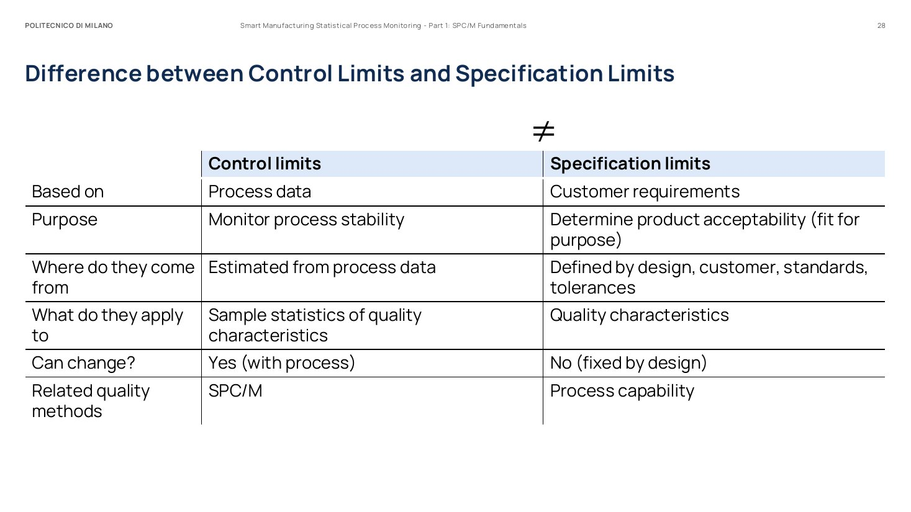


### X̄–R and X̄–S charts

Monitor **both** the mean (X̄ chart) and the dispersion (R chart with R = max − min, or S chart with the sample standard deviation). **X̄–R** is easy and works as well as X̄–S for **small, constant n (≤ 6)**; **X̄–S** is preferred for large or variable n. Both use the scheme UCL = μ\_V + Kσ\_V, CL = μ\_V, LCL = μ\_V − Kσ\_V.

**Prof (16 Nov) — why a second chart:** the X̄ chart only sees a shift of the mean; a process can also go out of control through a **wider dispersion at the same mean**, or both at once. So each sample gives two points, its mean on the X̄ chart and its range (or s) on the dispersion chart, and the process is in control only if both stay inside. With few samples (n ≤ 6) the range is the practical choice; with more, s (divided by n − 1 because it is estimated from a sample) is more precise, since it uses every point and not only the two extremes. The range has no simple distribution, so the chart works on the **relative range W = R/σ**, whose mean d₂(n) and standard deviation d₃(n) are tabulated: CL = d₂σ, limits d₂σ ± 3d₃σ, given directly as D₂σ and D₁σ. For s the theory goes through the χ² distribution ((n − 1)S²/σ² \~ χ² with n − 1 degrees of freedom; a standard deviation can't be negative), and the table gives c₄ and the B constants. "This table will follow us": use the tabulated constants instead of recomputing normal quantiles.

```math
\begin{gathered}
\text{Unknown parameters (Phase 1, } m \ge 20\text{–25 samples):}\quad \hat\mu = \bar{\bar x},\ \hat\sigma = \frac{\bar R}{d_2(n)} \\
\bar X:\ UCL/LCL = \bar{\bar x} \pm A_2(n)\,\bar R \qquad R:\ UCL = D_4(n)\,\bar R,\ CL = \bar R,\ LCL = D_3(n)\,\bar R \\
\bar X:\ UCL/LCL = \bar{\bar x} \pm A_3(n)\,\bar s \qquad S:\ UCL = B_4(n)\,\bar s,\ CL = \bar s,\ LCL = B_3(n)\,\bar s,\ \hat\sigma = \bar s / c_4(n)
\end{gathered}
```

With known μ and σ: X̄ limits μ ± A(n)σ with A = 3/√n; R limits D₁σ and D₂σ around d₂σ; S limits B₅σ and B₆σ around c₄σ. The constants come from the table (slide 32); the exam gives you a formula sheet. Most used values: n = 2: d₂ = 1.128, D₄ = 3.267; n = 5: A₂ = 0.577, D₃ = 0, D₄ = 2.114, d₂ = 2.326.

**Class discussion (16 Nov) — when are μ and σ "known"?** Not from the tolerances: "tolerances are targets", while μ and σ describe what the process physically makes. They can be treated as known when there is a long **historical record** of the process in control, e.g. 5 parts a day × 200 days a year × 5 years = 5,000 values. They are unknown for a new product or process, or an old one that was never measured. Even then the chart is built only once the process is in control: "you don't try to make a control chart if the process is out of control".


**Phase 1 (design):** take m ≥ 20–25 samples in a stable regime, estimate the parameters, plot the data against the limits computed from them. If a point is out: assignable cause found → remove it and recompute; none found → keep it (or remove it if it is far out, since it distorts the limits). **Start with the dispersion chart**, then the mean chart (its limits use R̄). One or two iterations are normal; re-check the assumptions after removing samples. **Phase 2 (use):** plot new samples against the fixed limits; alarm + cause → act and redesign; no cause → false alarm. Revise the limits periodically (every week, month, 100 samples, new product) or when n or the process changes.

- **Prof (16 Nov) — the design phase in practice:** take last month's data: m = 20 days, n = 5 shafts a day; for each day compute the mean and the range. The CL of the X̄ chart is the average of all values, which is the same as the average of the daily means; the CL of the R chart is the average range. With **estimated** parameters the limits come out **wider** than with known ones, because you are less sure.
- **Prof (16 Nov) — remove or keep an out-of-control point?** A point outside may be a false alarm, so look for the cause first. Cause found: it really was out of control, so remove it; the limits shrink (R̄ was inflated by it) and are rebuilt correctly. No cause: it belongs to the natural distribution, so keep it and the limits stay wide (unless it is far out and would distort them). If you are still removing points at the third iteration, question the assumptions: maybe the process isn't in control, or the data aren't normal.
- **Prof (16 Nov) — the use phase:** a new point out with an assignable cause (machine fault, worn tool) means acting on the machine, and perhaps redesigning the limits if the variability has grown; a false alarm means no action. Limits from 25 days are not valid forever: re-check them if n changes (from 5 to 4 samples, since the limits depend on n), if the process changes (a higher feed may widen the dispersion), and periodically (every week, ten days, month).

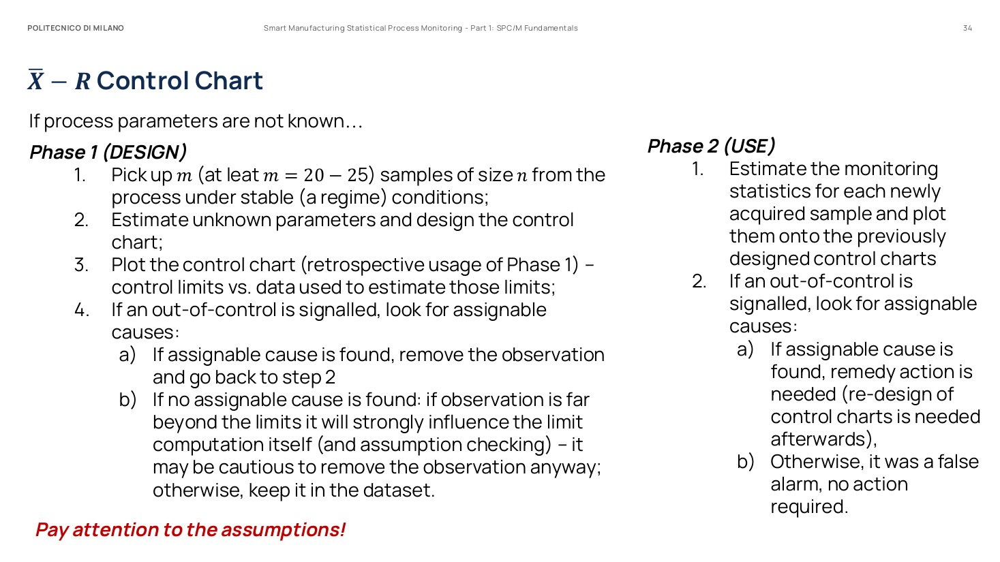

**Operating characteristic (OC) curve:** β as a function of the shift δ = (μ₁ − μ₀)/σ and n: β = Φ(3 − δ√n) − Φ(−3 − δ√n). Bigger n detects small shifts better. For the R chart the shift is the ratio σ₁/σ₀.

- **Prof (16 Nov) — what makes a chart strong ("a nice oral exam question"):** α depends only on how wide the limits are (K, fixed at 3). β depends on K, on the **size of the shift** from the centre line (δ in units of σ) and on the **sample size n** (it shrinks σ\_X̄). For a 2σ shift: β ≈ 0.84 with n = 1, 0.57 with n = 2, 0.07 with n = 5, ≈ 0 with n = 10. So ARL₁ = 1/(1 − β) ≈ 6.3 samples with n = 1 (a week if you sample daily) but ≈ 1.1 with n = 5: caught almost at the first sample. ARL₀ doesn't depend on the shift or on n, only on α. ATS = h·ARL: a shorter interval h signals sooner, but consecutive samples may stop being independent.
- **Exam alert — the numbers:** with K = 3, α = 0.0027 and ARL₀ = 1/α ≈ 370. In class on 16 Nov it came out as "α is 5%, about 600 samples", which is wrong (α = 5% would give ARL₀ = 20). The Type I/II labels also came out swapped once more at the start (Type I = false alarm, Type II = missed shift), then right.


**Worked example 1 (X-ray detector cells, slides 37–42):** 25 samples of n = 5 cells (testing all 912 cells takes \~30 h). First look at the data (scatter plot, boxplots) and check normality and independence. **R chart:** R̄ = 1.775, UCL = D₄R̄ = 2.114·1.775 = **3.752**, LCL = 0. Sample 22 (R = 4.21) is out; assume an assignable cause, remove it: R̄ = 40.158/24 = **1.673**, UCL = **3.537**, all in control. **X̄ chart:** x̄̄ = 24,000.378/24 = **1000.016**, limits 1000.016 ± 0.577·1.673 = **\[999.051, 1000.981\]**, all in control: Phase 1 is over.

**Prof (16 Nov) — the X-ray example, step by step:** each cell is a scintillator + photodiode, and X-rays can damage it, so the test shines the beam with no body in front and compares the high dose with the normal dose (×1000 just stretches the numbers). Testing 5 of the 912 cells is the same idea as sampling 5 shafts out of 1,000. **Visualise before anything**: in the table the means all look like \~1000, but the ranges go from about 2 down to half that, and one is 4.2 (sample 22); the individual-value plot and the boxplots show it at once. Independence, physically: measuring one cell must not alter the next. That isn't obvious: in a camera an overcharged pixel leaks charge into its neighbour (**pixel crosstalk**), so don't test adjacent cells one after the other. Which chart first? **The R chart**, because the X̄ limits need σ and σ comes from R̄. R can't fall below its LCL (that would be negative variability). After removing sample 22, R̄ drops and the UCL with it (it is a multiple of R̄). If a mean then fell out with a cause, you would go back to the R chart, because that sample's range must go too. "No anomalous systematic pattern" = no runs that keep going up, keep going down, or oscillate inside the limits.

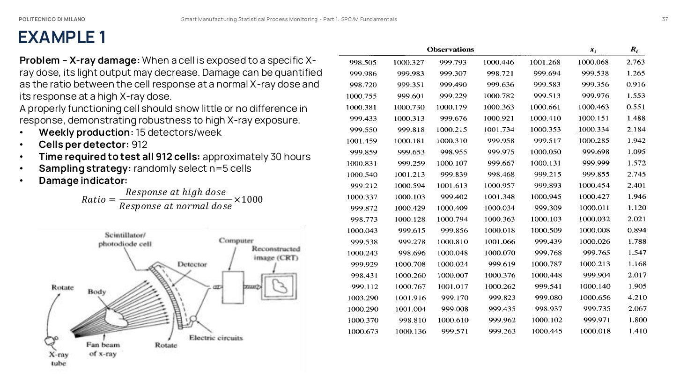

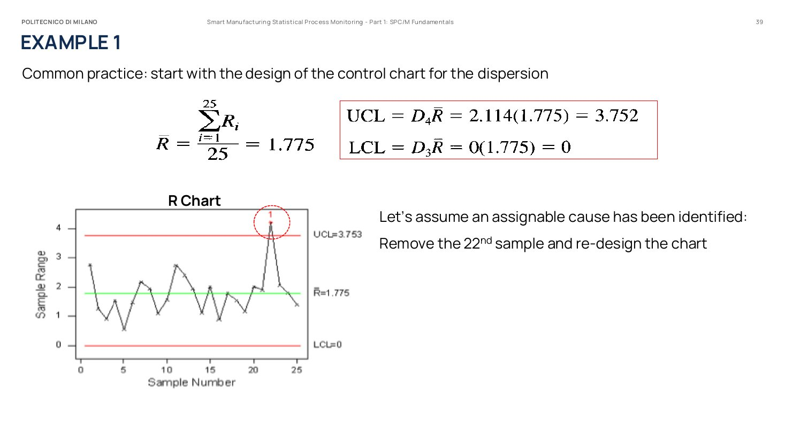

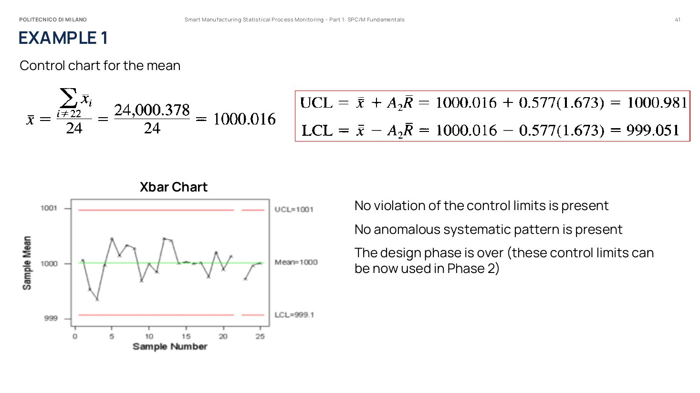

### Individual measurements: the I–MR chart (n = 1)

Used when only one value per sample makes sense: low-throughput processes, continuous processes (chemicals), company KPIs, and **in-line / in-situ measurements**. Short-term variability comes from the **moving range** MRᵢ = |Xᵢ − Xᵢ₋₁|:

```math
I:\ UCL/LCL = \bar x \pm 3\,\frac{\overline{MR}}{d_2(2)} = \bar x \pm 2.66\,\overline{MR} \qquad MR:\ UCL = D_4(2)\,\overline{MR} = 3.267\,\overline{MR},\ LCL = 0
```

Careful: MR values are **autocorrelated** (consecutive MRs share a point) and **not normal** (non-negative, skewed), so an MR alarm may just be the wrong distribution: redesign the MR chart with **probability limits** (UCL = D\_{1−α/2}·MR̄/d₂, LCL = D\_{α/2}·MR̄/d₂, from the half-normal distribution of MR).

**Prof (16 Nov) — why n = 1 matters:** one huge, expensive shaft a day is the whole population; a time signal can't be sampled from a population at each instant (it starts and it moves); a chemical plant's yield or a company's turnover is one number. "This is the link between SPC and checking that a signal behaves as expected" (L3.4). With n data you get n − 1 moving ranges; σ̂ = MR̄/d₂(2) = MR̄/1.128, so the I limits are x̄ ± 2.66·MR̄, and the MR chart uses D₄(2) = 3.267: n = 2, because each MR uses two points. Check that there is no autocorrelation (systematic patterns). Two series with the same mean but different spread are told apart by the MR chart.

**Prof (17 Nov) — recap:** the R chart's LCL is often 0 because R's real distribution isn't normal (the ±3σ construction assumes W is close to normal); MR is half-normal because the absolute value folds every difference to positive. A chemical plant's yield probably violates independence, since it depends on the plant's previous state.

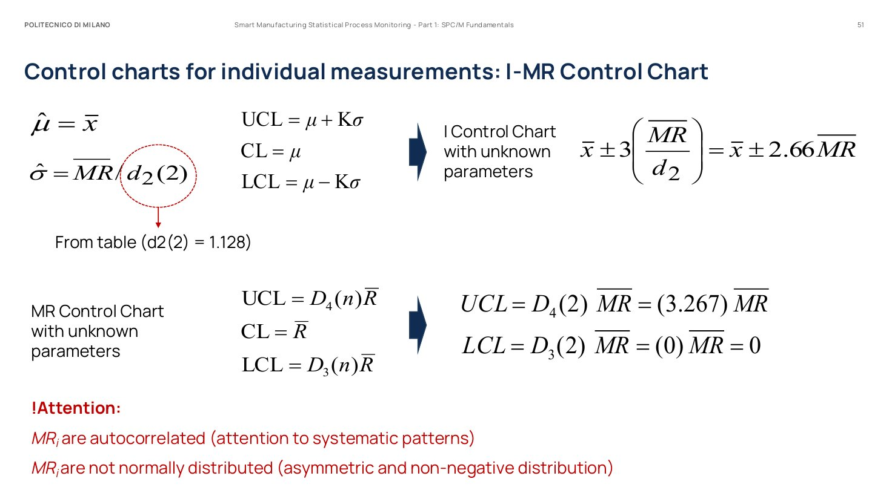

**Worked example 3 (car-body hole position, slides 53–55):** 48 laser sensors measure 95 dimensions on each body; the data are the y-shift (mm) of a coupling hole, 58 bodies. x̄ = 0.4886, MR̄ = 0.7426. **MR chart:** UCL = 3.267·0.7426 = **2.426**, LCL = 0; one point is out but no cause is found (false alarm). **I chart:** 0.4886 ± 3·0.7426/1.128 → **UCL ≈ 2.46, LCL ≈ −1.49**, no violations: design over.

**Prof (16 Nov):** the order is the same as before: MR chart first, then the I chart. The MR point slightly out has no cause, so it stays in the calculation; it may be out only because MR isn't normal (redo the MR chart with probability limits to check). The slide prints UCL = 2.462; with these numbers 0.4886 + 3·0.7426/1.128 = 2.464.


## Professor background (less exam-critical)

- **Prof (10 Nov):** Shewhart's charts date from the 1920s, the time of the production line; the maths is a century old, but today we can compute it instantly and extend it to several characteristics, profiles, surfaces and volumes.

## Practice exercises

### N. Control charts (worked examples from the L3.3 slides)

1. **Known parameters:** shaft μ = 74.000 mm, σ = 0.010 mm, n = 5, K = 3 → σ\_X̄ = 0.0045, limits **73.9865 / 74.0135 mm**.
2. **ARL:** K = 3 → α = 0.0027, ARL₀ = **370.4**. A 2σ shift of individual values: 1 − β = P(Z > 1) = 0.159 → ARL₁ ≈ **6.3**.
3. **X̄–R, unknown parameters (25 samples, n = 5):** R̄ = 1.775 → UCL\_R = 2.114·1.775 = 3.752, sample 22 out → removed → R̄ = 1.673, UCL\_R = **3.537**; x̄̄ = 1000.016 → X̄ limits **999.051 / 1000.981** (A₂ = 0.577, D₃ = 0, D₄ = 2.114 for n = 5).
4. **I–MR:** x̄ = 0.4886, MR̄ = 0.7426 → MR chart UCL = 3.267·MR̄ = **2.426**; I chart 0.4886 ± 3·0.7426/1.128 = **−1.49 / 2.46**.

Order of work: look at the data, check normality and independence, dispersion chart first, then the mean chart, remove points only with an assignable cause, recompute.

All formulas: [formula sheet](../formula-sheet.md).

## Likely oral questions

- **Control limits vs specification limits?** Control limits come from process data and monitor stability of sample statistics (SPC); specification limits come from the customer or design and decide whether each part is acceptable (capability). A process can be in control but out of spec, or vice versa.
- **Type I and Type II errors, ARL: what does K change?** α = false alarm, β = missed shift. K = 3 gives α = 0.0027 and ARL₀ = 1/α = 370; narrower limits cut β but raise α. ARL₁ = 1/(1 − β) depends on the shift and n (a 2σ shift with n = 1 needs about 6.3 points). ATS = h·ARL.
- **How do you design an X̄–R chart when μ and σ are unknown?** Phase 1: m ≥ 20–25 subgroups in stable conditions; check normality and independence; design the R chart first (R̄, D₃R̄, D₄R̄), then the X̄ chart (x̄̄ ± A₂R̄); remove points with an assignable cause and recompute. Phase 2: plot new subgroups against the fixed limits, investigate alarms, revise the limits periodically. Use X̄–S for large or variable n, I–MR for n = 1.
- **A point falls outside the control limits: what do you do?** Don't stop or scrap straight away: check whether it is a false alarm (α = 0.27% per point with K = 3, so about 1 in 370 samples) by looking for an assignable cause and re-measuring or checking the sample was representative. If a special cause is found, remove it and act on the parts; if it is a common cause, the process itself must be improved. Also check the dispersion chart: a wider spread with the same mean is out of control too.
- **When can μ and σ be treated as known, and what changes when they aren't?** Known from a long in-control history (e.g. 5 parts a day × 200 days × 5 years = 5,000 values), never from the tolerances, which are targets. Unknown (new product or process): estimate them from m ≥ 20–25 subgroups (x̄̄, σ̂ = R̄/d₂ or s̄/c₄); the limits come out wider. In the design phase remove a point only if it has an assignable cause, then recompute; revise the limits when n or the process changes, and periodically.
- **Range or standard deviation for the dispersion chart, and which chart do you design first?** R for small, constant n (≤ 6): easy, and its relative range W = R/σ has tabulated d₂, d₃. S for larger or variable n: more precise because it uses every point (its theory goes through χ²; constants c₄, B₃–B₆). Design the dispersion chart first, because the X̄ limits use R̄ (or s̄); a sample removed for a cause goes out of both charts.
- **How do you monitor a process when you get one value at a time?** I–MR chart: one big part a day, continuous processes, KPIs, sensor signals. MRᵢ = |xᵢ − xᵢ₋₁| (n − 1 values), σ̂ = MR̄/1.128, I limits x̄ ± 2.66·MR̄, MR chart UCL = 3.267·MR̄, LCL = 0. MR is not normal (half-normal) and consecutive MRs are correlated, so an MR alarm may be a false one: use probability limits. Car-body example: x̄ = 0.4886, MR̄ = 0.7426 → MR UCL 2.426, I limits −1.486 / 2.464.
