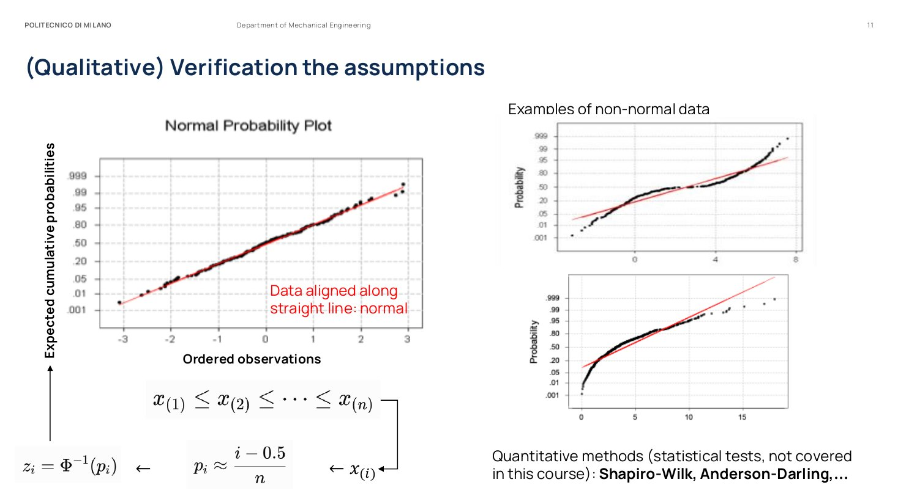
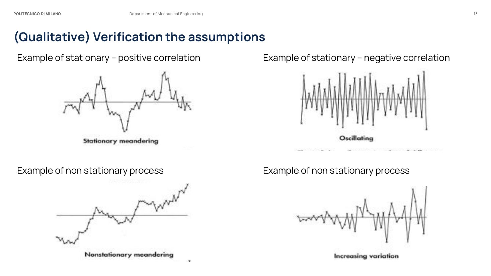
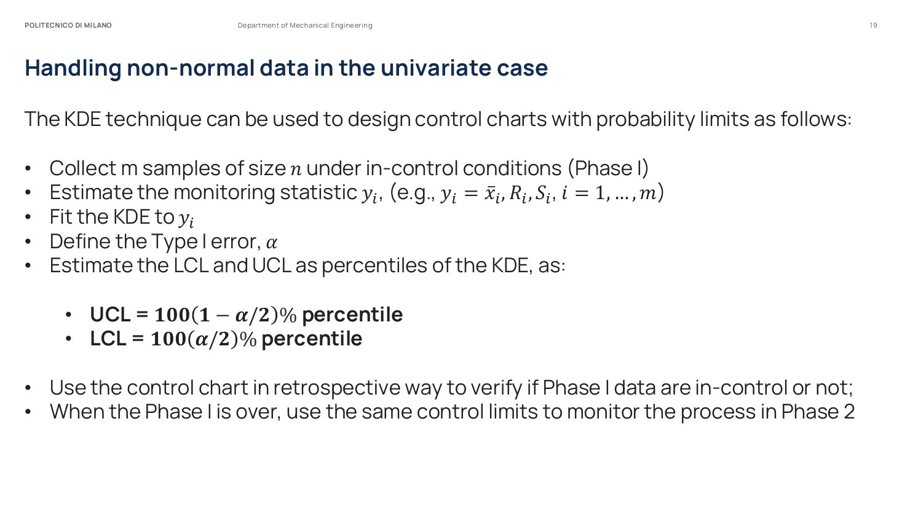

# L3.4 Statistical process monitoring – part 2: in-process monitoring

> Part of the CAM study guide. Source of truth: [the study guide](https://claude.ai/artifact/WrGc96ueegSH8ZXZdT4FaB). Generated by `tools/build_guide.py`; edit the guide, not this file.

## Slides and professor's explanations (exam material)

In-process monitoring applies the same Phase 1 / Phase 2 logic of SPC to **sensor signals** instead of sampled product measurements. The signal is cut into **time windows**, each window is summarised by **features** (synthetic descriptors), and the features are monitored, usually with an I–MR chart. But sensor features are often **non-normal** and **autocorrelated**, which breaks the chart's assumptions: you then use **probability limits from a KDE**, **gapping/batching**, or **model-based (residual) charts**. Cyclic signals are monitored as **profiles**. *(From the slides, Prof. Grasso. No recording yet.)*

### From product to process

| Traditional SPC | In-process monitoring |
| --- | --- |
| Product measurements, sampled inspection | Process sensor signals, continuous high-frequency acquisition |
| Subgroups of n observations | Individual observations, time series |
| Low data rate (e.g. 1 sample/h with n = 5 → 5 values per hour) | Very high data rate (e.g. one signal at 50 kHz → **180 million points per hour**) |
| Direct quality characteristics | Mostly indirect, process-related |
| X̄, R, S | Signal features |

Pipeline: **process → signal → pre-processing** (filtering, resampling, synchronisation, normalisation) **→ feature extraction → monitoring** (SPM, ML, AI). The SPC logic still applies: Phase 1 learns the natural pattern and the limits from training data; Phase 2 signals violations.


### Windows and features

- Window length T\_w, window shift ΔT, overlap = T\_w − ΔT. **Longer window** = more stable statistics and spectra but poorer time resolution; **more overlap** = faster updates but redundant, dependent features; **more features** = more sensitivity but more dimensions and redundancy. The choice must match the time and frequency scales of the phenomenon you want to see.
- **Time-domain features:** mean, standard deviation, skewness, kurtosis, peak, peak-to-peak, RMS, crest factor. **Frequency / time-frequency features:** dominant frequency, spectral peak amplitude, band energy/power, spectral entropy, harmonic amplitudes, energy in bands over time, transient descriptors.
- With one signal and one feature, the model is z(τ) = μ + ε(τ) with the usual assumptions, so you monitor it with an **I–MR chart**.


**Industry vs best practice:** industry mostly uses **user-defined thresholds** (normal / warning / alarm) set from experience, specifications or trial and error, tuned at commissioning: simple and transparent, but blind to natural variability. The best practice, less common, is **baseline training → data-driven limits** (Phase I → Phase II), suited to repetitive operations and large lots, and it needs training data representative of normal variability.


### Check the assumptions

**Exam alert:** in-process features are often **non-normal** (skewed, heavy-tailed, multimodal; RMS, energy, peaks and spectral power are non-normal by construction) and **autocorrelated** (process dynamics and inertia, high sampling rates, overlapping windows, drifts such as tool wear). **Violated assumptions ⇒ wrong control limits and a wrong false-alarm rate.** (Big data's 5 V's: volume, velocity, variety, veracity, value.)

- **Normality, qualitatively:** a **normal probability plot** (ordered data vs expected cumulative probabilities): normal data lie on a straight line. Tests (Shapiro–Wilk, Anderson–Darling) are not covered.
- **Independence, qualitatively:** the **sample autocorrelation function** r\_k = correlation between x\_t and x\_{t+k}; for independent data r\_k ≈ 0 at every lag. Positive autocorrelation = slow wandering; negative = oscillation; non-stationary = trend. Tests (runs, Bartlett, LBQ) are not covered.







### Non-normal data: KDE probability limits

Remedies: the Central Limit Theorem (average more values), Box–Cox transformation and non-parametric charts (not covered), or **probability limits**. **Kernel density estimation** fits the pdf from the data: put a kernel (e.g. a Gaussian bump) on every data point and add them up:

```latex
\hat f_h(x) = \frac{1}{n h} \sum_{i=1}^{n} K\!\left(\frac{x - x_i}{h}\right)
```

The **bandwidth h** sets the smoothing: too large = **underfitting** (hides features of the distribution), too small = **overfitting** (exaggerates the sample's quirks). The empirical CDF F\_n(x) = (1/n)Σ 1(Xᵢ ≤ x) jumps at each observed value.

**Procedure:** collect in-control data (Phase I) → compute the monitored statistic (x, R, S …) → fit the KDE → choose α → **UCL = 100(1 − α/2)% percentile, LCL = 100(α/2)% percentile** of the KDE → check Phase I retrospectively → use the limits in Phase II.




### Autocorrelated data

With autocorrelation the real ARL₀ is not the nominal one (usually many more false alarms).

- **Gapping:** keep only every g-th observation, with g large enough for the autocorrelation to vanish. Drawback: you throw data away and detect later.
- **Batching:** group consecutive observations into windows and monitor their summary features. Drawback: careful with overlapping windows, which re-create dependence.
- **Model-based (special-cause) charts**, more effective: if the dependence is part of the natural behaviour, **model it**, z\_τ = f(z\_{τ−1}, z\_{τ−2}, …, inputs) + ε\_τ (linear, AR, ARMA, ARIMA models), then **monitor the residuals** ε\_τ = z\_τ − ẑ\_τ, which are NID(0, σ²) if the model is adequate, e.g. with an I–MR chart.


### Cyclic signals: profile monitoring

- **Location control chart** (Boeing, 1990s): from M in-control cycles compute the average profile x̄\_t and the standard deviation s\_t at each point of the cycle; the limits are an **envelope** x̄\_t ± K·s\_t. A new cycle partly outside the envelope → alarm. Industrial example: Marposs–Artis tool monitoring on cutting-force cycles.
- **Model-based profile monitoring:** fit a model y\_j(t) = f(θ, t) + ε to each profile and monitor the **model parameters** and the **residuals** with a multivariate chart. For the same Type I error it has a **lower Type II error** (more power for small shifts). Examples: water-jet cutting pressure signals for machine health and process monitoring.


**Exam link:** the in-process signals of L1.4 (photodiode acceptance band), L1.6 (spindle power) and L1.8 (punch force) are exactly what this chapter monitors. Say how you would window the signal, which feature you would extract, how you would check normality and independence, and which chart you would use.

## Professor background (less exam-critical)

*No background comments for this chapter.*

## Practice exercises

*No dedicated exercise. All formulas: [formula sheet](../formula-sheet.md).*

## Likely oral questions

- **Why do in-process signal features break the SPC assumptions, and what do you do?** Features such as RMS or band energy are non-normal by construction, and windows at high rates, process dynamics and drifts make them autocorrelated, so the limits and false-alarm rate are wrong. Check with a normal probability plot and the autocorrelation function; then use KDE probability limits, gapping or batching, or model the dynamics (AR/ARMA) and chart the residuals.
- **How would you monitor a cyclic signal, such as the cutting force of a repeated operation?** Profile monitoring: from in-control cycles build the average profile and an envelope x̄\_t ± K·s\_t (location control chart) and alarm when a new cycle leaves it; or fit a model to each profile and chart its parameters and residuals, which detects small shifts with higher power.
