# L3.4 Statistical process monitoring – part 2: in-process monitoring

> Part of the CAM study guide. Source of truth: [the study guide](https://claude.ai/artifact/WrGc96ueegSH8ZXZdT4FaB). Generated by `tools/build_guide.py`; edit the guide, not this file.

## Slides and professor's explanations (exam material)

In-process monitoring applies the same Phase 1 / Phase 2 logic of SPC to **sensor signals** instead of sampled product measurements. The signal is cut into **time windows**, each window is summarised by **features** (synthetic descriptors), and the features are monitored, usually with an I–MR chart. But sensor features are often **non-normal** and **autocorrelated**, which breaks the chart's assumptions: you then use **probability limits from a KDE**, **gapping/batching**, or **model-based (residual) charts**. Cyclic signals are monitored as **profiles**. *(Slides by Prof. Grasso. Recording of 17 Nov, Prof. Demir: from product to process, pre-processing, windows and features, the assumptions, normal probability plot, autocorrelation, KDE limits. Recording of 23 Nov (first half): autocorrelated data (gapping, batching, model-based charts), profile monitoring, the water-jet example. Professor's comments inline.)*

### From product to process

| Traditional SPC | In-process monitoring |
| --- | --- |
| Product measurements, sampled inspection | Process sensor signals, continuous high-frequency acquisition |
| Subgroups of n observations | Individual observations, time series |
| Low data rate (e.g. 1 sample/h with n = 5 → 5 values per hour) | Very high data rate (e.g. one signal at 50 kHz → **180 million points per hour**) |
| Direct quality characteristics | Mostly indirect, process-related |
| X̄, R, S | Signal features |

**Prof (17 Nov) — what changes from product to process:** measuring products costs money (an operator or an automated machine) and is slow, but it gives direct quality characteristics (the diameter: within tolerance or not). Sensors (force, vibration, sound) give indirect, process-related data at kHz or even MHz rates: one signal at 50 kHz is 180 million points per hour against 5 values per hour, so storage becomes a problem too. Instead of x̄, R and s of a sample you extract **signal-derived features** (amplitude, peak, peak-to-peak, RMS, dominant frequency…). This works for microphones and accelerometers but also for images and videos, "if you know what you're looking for": linking each feature to a process factor is the bridge between data analysis and manufacturing.

Pipeline: **process → signal → pre-processing** (filtering, resampling, synchronisation, normalisation) **→ feature extraction → monitoring** (SPM, ML, AI). The SPC logic still applies: Phase 1 learns the natural pattern and the limits from training data; Phase 2 signals violations.

**Class discussion (17 Nov) — reading a raw signal and pre-processing it:** "noise is what you cannot model immediately", but it always comes from something (50 Hz in a measurement = the mains). The example signal oscillates around zero, has one big peak (a manufacturing event, not noise) and recurring small peaks. **Filtering** keeps a band: the processed version has lost its high frequencies, so a low-pass filter ("I prefer to say not of our interest" rather than noise). **Resampling** takes fewer points. **Synchronisation** aligns two signals, or aligns a signal to where the process becomes interesting, and fixes drifting timestamps: data come as index, timestamp, value, and the sampling rate may be changed on purpose (to save space) or the acquisition triggered. **Normalisation** maps the range to \[0, 1\] or \[−1, 1\] (it has nothing to do with the normal distribution). The filtered signal has a high-frequency, low-amplitude component and a low-frequency, high-amplitude one, so its values are probably **bimodal**: not usable directly in an X̄ or MR chart, hence features computed over windows.

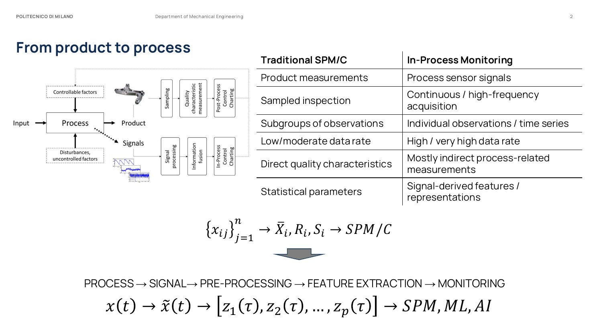

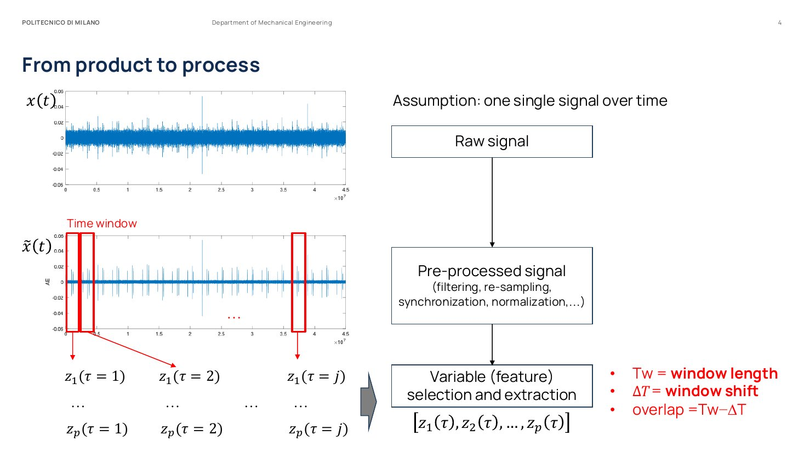

### Windows and features

- Window length T\_w, window shift ΔT, overlap = T\_w − ΔT. **Longer window** = more stable statistics and spectra but poorer time resolution; **more overlap** = faster updates but redundant, dependent features; **more features** = more sensitivity but more dimensions and redundancy. The choice must match the time and frequency scales of the phenomenon you want to see.
- **Prof (17 Nov) — choosing features and windows:** the class proposed peak amplitude, peak-to-peak, mean, standard deviation, RMS, the number of threshold crossings (he avoids calling them "outliers", a statistical term), the dominant frequency, the number of harmonics. Why a spectrum per window and not of the whole signal? The whole-signal FFT shows every frequency present but not **when** it changed: in turning the vibration frequency shifts when the tool hits the part, and only a moving window shows where. A longer window gives better spectral information but worse time resolution (the shortest window is a single point). Detached windows may skip information; adjacent or overlapping windows smooth it. Choose **complementary** features (mean and standard deviation say different things), and use physical knowledge of the process to decide where to look and how long the window should be.
- **Time-domain features:** mean, standard deviation, skewness, kurtosis, peak, peak-to-peak, RMS, crest factor. **Frequency / time-frequency features:** dominant frequency, spectral peak amplitude, band energy/power, spectral entropy, harmonic amplitudes, energy in bands over time, transient descriptors.
- With one signal and one feature, the model is z(τ) = μ + ε(τ) with the usual assumptions, so you monitor it with an **I–MR chart**.
- **Prof (17 Nov):** the raw signal need not be normal, but a window feature can be, and then the I–MR chart applies directly. Bonus: the signal is reduced to a few numbers, so it is easier to store. Independence now means choosing the windows so that one window's value doesn't depend on the previous one.

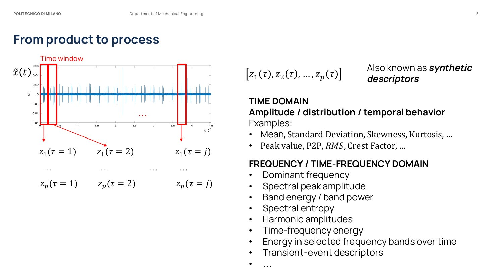

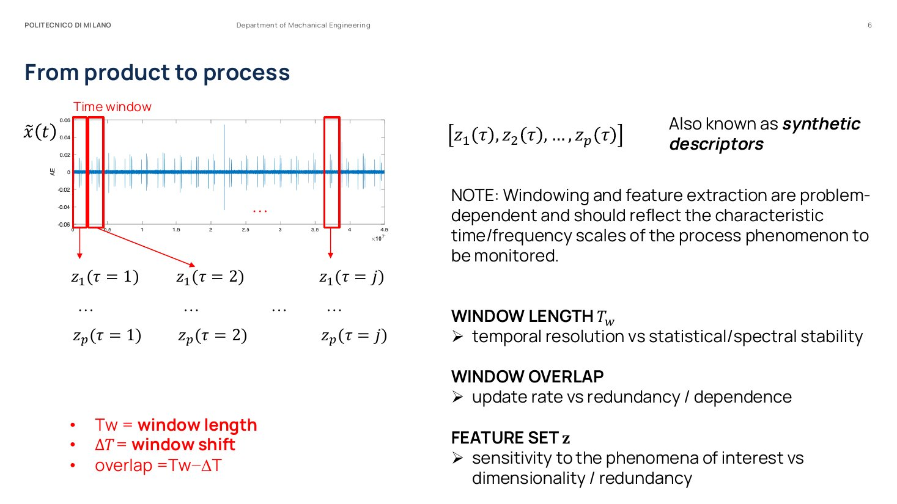

**Industry vs best practice:** industry mostly uses **user-defined thresholds** (normal / warning / alarm) set from experience, specifications or trial and error, tuned at commissioning: simple and transparent, but blind to natural variability. The best practice, less common, is **baseline training → data-driven limits** (Phase I → Phase II), suited to repetitive operations and large lots, and it needs training data representative of normal variability.

**Class discussion (17 Nov) — when are vibrations "too high"?** The class: a threshold on the amplitude; the frequency (close to a resonance = danger); a value from a model. "Experience of who? Is it too cautious? Is it too expensive?" That is why data-driven limits are better: in the slide example each operation gets its own limits from statistical data rather than from experience.

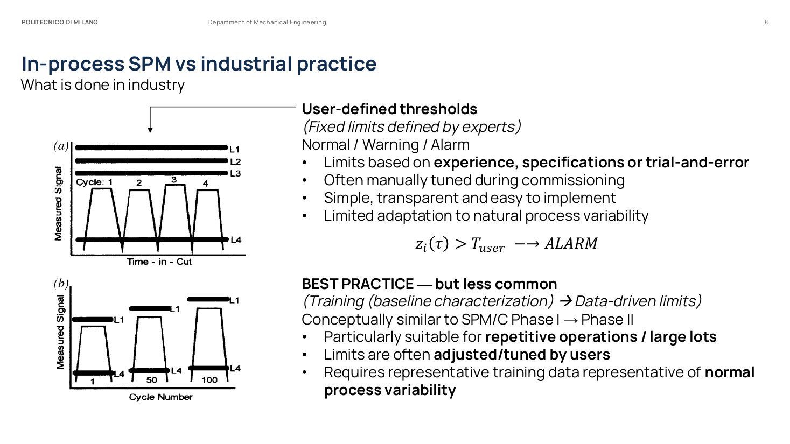

### Check the assumptions

**Exam alert:** in-process features are often **non-normal** (skewed, heavy-tailed, multimodal; RMS, energy, peaks and spectral power are non-normal by construction) and **autocorrelated** (process dynamics and inertia, high sampling rates, overlapping windows, drifts such as tool wear). **Violated assumptions ⇒ wrong control limits and a wrong false-alarm rate.** (Big data's 5 V's: volume, velocity, variety, veracity, value.)

- **Prof (17 Nov) — the physics behind broken assumptions:** non-normal: RMS squares every value, energy and spectral power can't be negative, peaks aren't normal; multimodal data are like the grades of students who attend and those who don't. Dependent: milling forces (one edge cuts after the other), sampling so fast that you see the process inertia, overlapping windows (full overlap = correlation 1), tool wear (each cut affects the next). "These are often linked to the physics of the process": a drift is the same tool wearing more and more; a second mode is the machine starting to vibrate at another natural frequency. With broken assumptions the band around z = μ + ε is wrong: points outside may be in control and points inside may be out of control, so the band must change shape (a non-normal ε, or a model that includes the correlation).
- **Prof (17 Nov) — the 5 V's in his words:** **volume** (enough data for the design phase), **velocity** (sampling fast enough to see the change), **variety** (several data types tell you why: tool wear, fixture or machine instability), **veracity** (are you measuring what you think you are? sensor choice, position, sampling rate, working condition), **value** (clean, stored and actually used; stored data alone do nothing).

* **Normality, qualitatively:** a **normal probability plot** (ordered data vs expected cumulative probabilities): normal data lie on a straight line. Tests (Shapiro–Wilk, Anderson–Darling) are not covered.
* **Prof (17 Nov) — the normal probability plot step by step:** sort the data from smallest to largest; give the i-th value the probability pᵢ = (i − 0.5)/n; plot the ordered (standardised, about −3 to 3) values against the expected cumulative probability: on a straight line = normal. In the slide, one data set piles up around 0 and around 5 (bimodal), another around small values (skewed): neither lies on the line. Even without the plot, a histogram with two peaks or strong skew already says "not normal". These tools "are here so that you know them": they can come up at the oral, the formal tests won't.
* **Independence, qualitatively:** the **sample autocorrelation function** r\_k = correlation between x\_t and x\_{t+k}; for independent data r\_k ≈ 0 at every lag. Positive autocorrelation = slow wandering; negative = oscillation; non-stationary = trend. Tests (runs, Bartlett, LBQ) are not covered.
* **Prof (17 Nov) — autocorrelation:** slide the signal over itself; at lag 0 the coefficient is 1: rₖ = Σ(xₜ − x̄)(xₜ₋ₖ − x̄) / Σ(xₜ − x̄)². For a sine, r = 1 at a lag of 2π and −1 at π. The slide's ACF starts high, dies off and turns negative; bars above the dashed band mean significant autocorrelation (here up to lag 4). It is hard to see by eye in the time series, but look at the data first anyway. Non-stationary signals (a trend, or a constant mean with growing variance) are not necessarily out of control: first understand whether that is the signal's nature.

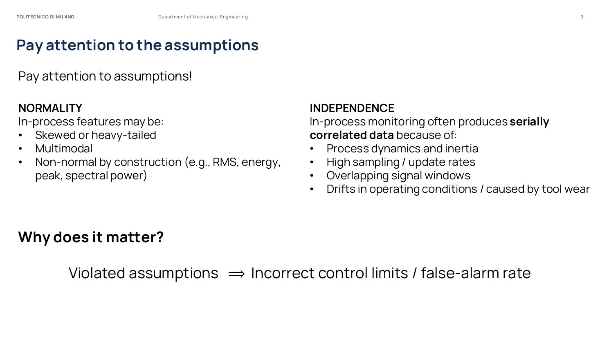


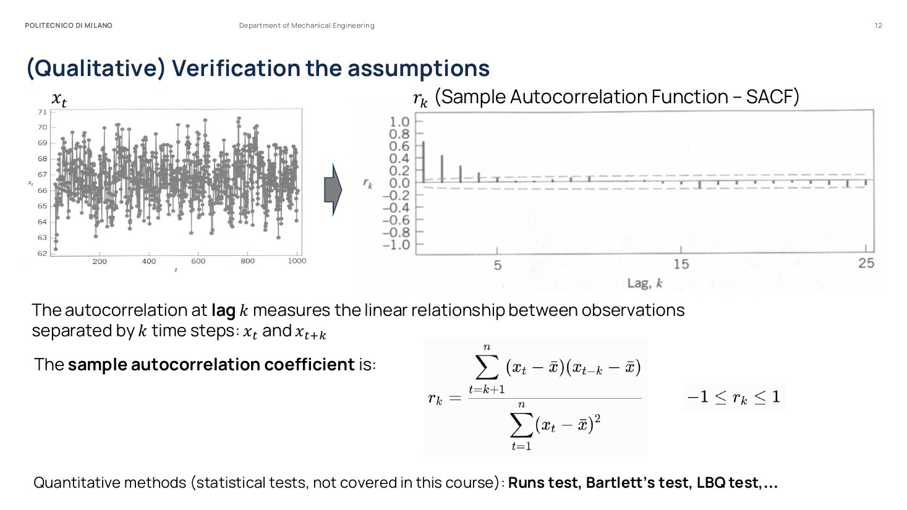


### Non-normal data: KDE probability limits

Remedies: the Central Limit Theorem (average more values), Box–Cox transformation and non-parametric charts (not covered), or **probability limits**. **Kernel density estimation** fits the pdf from the data: put a kernel (e.g. a Gaussian bump) on every data point and add them up:

```math
\hat f_h(x) = \frac{1}{n h} \sum_{i=1}^{n} K\!\left(\frac{x - x_i}{h}\right)
```

**Class discussion (17 Nov) — how do you handle a trend or non-normal data?** The class: transform the data towards a normal distribution (Box–Cox); fit the trend (e.g. a linear fit) and subtract it, i.e. change the model from "mean + error" to something richer (the idea behind model-based charts); average more points (CLT); non-parametric charts. Or estimate the distribution from the data itself: **KDE**. Each point gets a bell (Gaussian kernel) centred on it; where points crowd, the bells pile up; the sum, fitted with a smooth function, is the estimated pdf (slide example: systolic blood pressure). The result "has no name" and isn't a standard distribution, but it represents the data, and from it you can place the limits.

The **bandwidth h** sets the smoothing: too large = **underfitting** (hides features of the distribution), too small = **overfitting** (exaggerates the sample's quirks). The empirical CDF F\_n(x) = (1/n)Σ 1(Xᵢ ≤ x) jumps at each observed value.

**Procedure:** collect in-control data (Phase I) → compute the monitored statistic (x, R, S …) → fit the KDE → choose α → **UCL = 100(1 − α/2)% percentile, LCL = 100(α/2)% percentile** of the KDE → check Phase I retrospectively → use the limits in Phase II.

**Prof (17 Nov) — the slide example:** the distribution ends at zero, so there is only an upper limit: UCL = 100(1 − α)% percentile (all of α in one tail) and LCL = 0, with the median as centre line. Some Phase I points are above the UCL: as always, assignable cause → remove; none → keep. (In class "α = 2.27" was a slip for α = 0.0027, i.e. 0.27%, the K = 3 value.)

**Exam alert (23 Nov recap):** in class the Phase I rule came out reversed ("assignable cause → leave it"). It is: assignable cause → remove the point; no cause → keep it. And α at K = 3 is 0.0027 (0.27%).


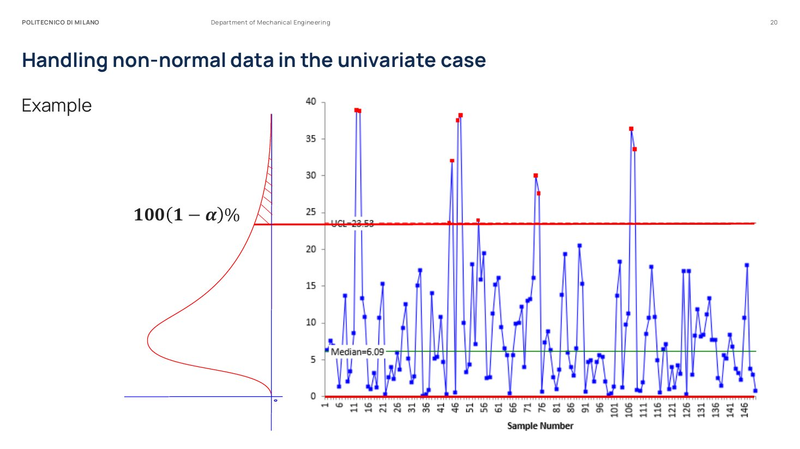

### Autocorrelated data

With autocorrelation the real ARL₀ is not the nominal one (usually many more false alarms).

**Prof (23 Nov) — why dependence breaks the chart:** data with a trend, a level shift, stationary meandering, trend + cycle, oscillation or growing variance don't fit "mean + normal error". A milling force is cyclic by nature: fixed limits around its mean get crossed far more often than α says, even with the process stable, "because the underlying model is incorrect". The class found both remedies: (1) take values far enough apart, or windows long enough to absorb the cycle, so they become nearly independent (gapping, batching; synchronisation matters, since you must keep sampling at the same phase of a known cycle); (2) accept the dependence and change the model, e.g. mean + trend + error, and chart the distance from the fitted trend.

- **Gapping:** keep only every g-th observation, with g large enough for the autocorrelation to vanish. Drawback: you throw data away and detect later.
- **Batching:** group consecutive observations into windows and monitor their summary features. Drawback: careful with overlapping windows, which re-create dependence.
- **Class discussion (23 Nov) — what do gapping and batching cost?** Information: short spurious events (a value that jumps out and back) are smoothed away, and the autocorrelation itself can be informative. Batching a milling force gives a good average per cycle, but a defect inside a single cycle disappears. Hence the third option: if the temporal dependence is part of the natural variability, "do not discard it, model it".
- **Model-based (special-cause) charts**, more effective: if the dependence is part of the natural behaviour, **model it**, z\_τ = f(z\_{τ−1}, z\_{τ−2}, …, inputs) + ε\_τ (linear, AR, ARMA, ARIMA models), then **monitor the residuals** ε\_τ = z\_τ − ẑ\_τ, which are NID(0, σ²) if the model is adequate, e.g. with an I–MR chart.
- **Prof (23 Nov):** the model can be physical, or statistical (linear, AR, ARMA); then chart the residuals (observed − expected) with an I–MR chart: if they leave the limits, the process no longer behaves as the model expects. "Shewhart charts fit the process to the model; statistical modelling fits the model to the process."

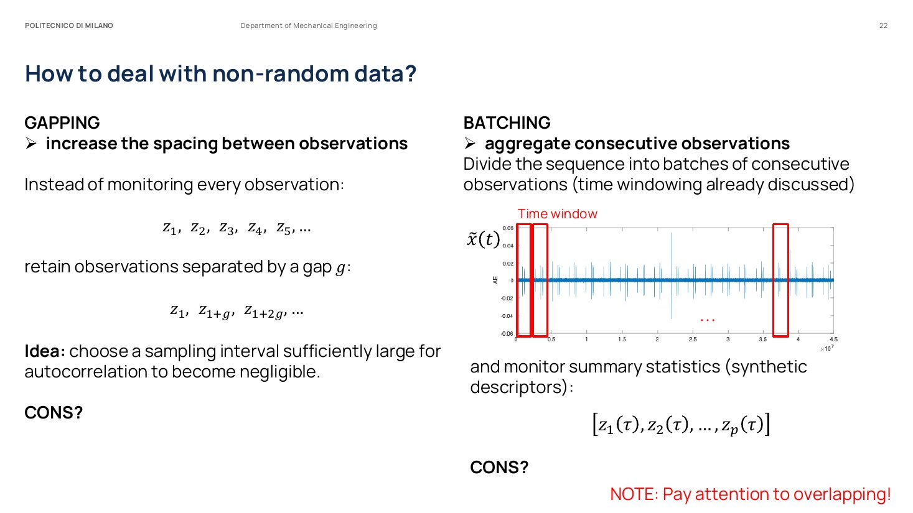

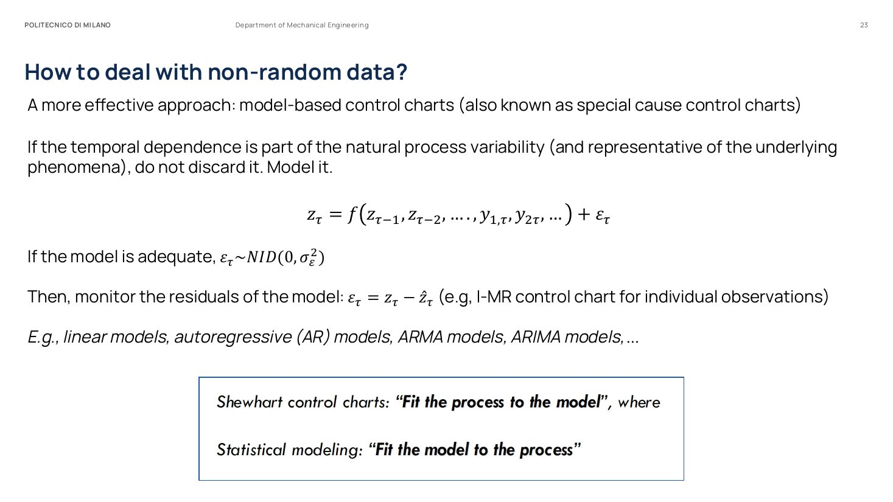

### Cyclic signals: profile monitoring

- **Location control chart** (Boeing, 1990s): from M in-control cycles compute the average profile x̄\_t and the standard deviation s\_t at each point of the cycle; the limits are an **envelope** x̄\_t ± K·s\_t. A new cycle partly outside the envelope → alarm. Industrial example: Marposs–Artis tool monitoring on cutting-force cycles.
- **Prof (23 Nov) — charting across cycles, not along time:** if the cycle repeats (e.g. 15 drilling or tapping cycles), compute at each time point of the cycle the mean and the standard deviation **across the cycles**: CL = the average profile, limits ± K·s. The limits then follow the cycle's shape. It needs very good **synchronisation** (know exactly when each cycle starts and ends), otherwise the profiles shift. The industrial system in the tapping video learns the limits from the first in-control cycles; the user can tune the sensitivity (α), compensate for wear and add customer limits, and the machine stops before damage when the signal leaves the band.
- **Model-based profile monitoring:** fit a model y\_j(t) = f(θ, t) + ε to each profile and monitor the **model parameters** and the **residuals** with a multivariate chart. For the same Type I error it has a **lower Type II error** (more power for small shifts). Examples: water-jet cutting pressure signals for machine health and process monitoring.
- **Prof (23 Nov) — model-based profiles and the water-jet example:** fit, e.g., a 4th-order polynomial to each profile: 5 coefficients plus the residuals per cycle, monitored with a multivariate chart; for the same α it has a lower β, especially for small shifts. Water-jet cutting: a motor drives a pump, and high-pressure water through a nozzle accelerates abrasive particles that erode the material. **Three plungers** work in turn (active stroke, suction, gap, pre-compression, like an engine), so the outlet pressure is continuous but cyclic, with minor and major transients. Understand what the signal means before analysing it, instead of doing "what data scientists do in the absence of information". What wears: the nozzle (no Taylor's law to predict its life), the abrasive feed, and corrosion from high-pressure water. Split the signal into high-frequency, low-frequency and cyclic parts, plus the transients, and chart each. Images can be profiles too (2D signals): crack sizes, or the nozzle diameter growing with wear, and they correlate with the pump's pressure signature. What SPC adds to just looking at the signal: "you know when the process was in reliable conditions".

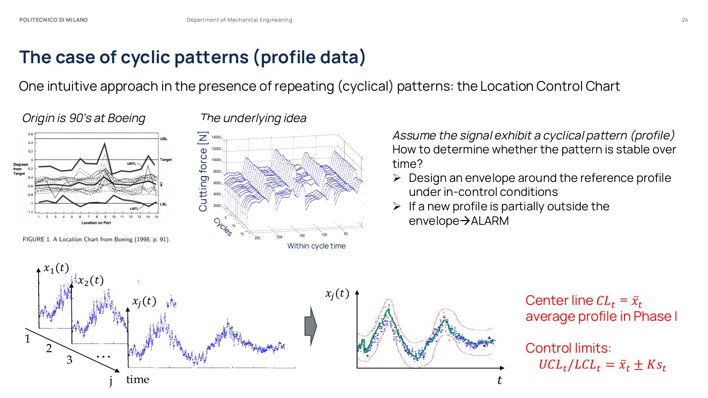

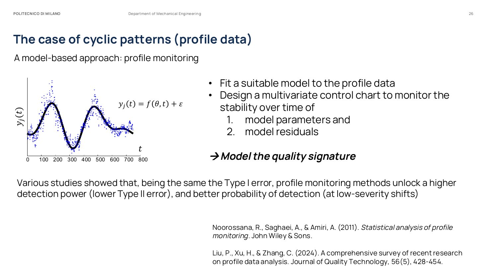

**Exam link:** the in-process signals of L1.4 (photodiode acceptance band), L1.6 (spindle power) and L1.8 (punch force) are exactly what this chapter monitors. Say how you would window the signal, which feature you would extract, how you would check normality and independence, and which chart you would use.

## Professor background (less exam-critical)

*No background comments for this chapter.*

## Practice exercises

*No dedicated exercise. All formulas: [formula sheet](../formula-sheet.md).*

## Likely oral questions

- **Why do in-process signal features break the SPC assumptions, and what do you do?** Features such as RMS or band energy are non-normal by construction, and windows at high rates, process dynamics and drifts make them autocorrelated, so the limits and false-alarm rate are wrong. Check with a normal probability plot and the autocorrelation function; then use KDE probability limits, gapping or batching, or model the dynamics (AR/ARMA) and chart the residuals.
- **How would you monitor a cyclic signal, such as the cutting force of a repeated operation?** Profile monitoring: from in-control cycles build the average profile and an envelope x̄\_t ± K·s\_t (location control chart) and alarm when a new cycle leaves it; or fit a model to each profile and chart its parameters and residuals, which detects small shifts with higher power.
- **How do you turn a raw sensor signal into something you can put on a control chart?** Pre-process (filter the band of interest, resample, synchronise timestamps or align to the event, normalise), cut it into windows (length T\_w, shift ΔT, overlap), extract complementary features per window (mean, standard deviation, RMS, peak-to-peak, crest factor, dominant frequency, band energy…), then chart each feature, e.g. with an I–MR chart. Longer windows: better statistics and spectra, worse time resolution; a windowed spectrum shows when a frequency changes, the FFT of the whole signal doesn't. Then check normality and independence, because RMS, energy and overlapping windows break them.
- **What is kernel density estimation, and how do you get control limits from it?** Put a kernel (e.g. a Gaussian bump) on every Phase I value and sum them: f̂(x) = (1/nh)ΣK((x − xᵢ)/h). The bandwidth h sets the smoothing: too large underfits, too small overfits (compare with the empirical CDF). Choose α, take UCL and LCL as the 100(1 − α/2)% and 100(α/2)% percentiles of the KDE (one-sided 100(1 − α)% with LCL = 0 if the statistic can't be negative), check Phase I retrospectively, then use the limits in Phase II.
- **Your signal features are autocorrelated: what can you do, and what does each option cost?** Gapping (keep every g-th value, or sample at the same phase of a known cycle) and batching (windows long enough to absorb the cycle, then summary features) make the data nearly independent, but smooth away short events and throw away the autocorrelation, which may itself be informative. If the dependence is part of the natural behaviour, model it (physical model, trend, AR/ARMA) and chart the residuals with an I–MR chart. For repeated cycles, chart across cycles: an envelope of the average profile ± K·s at each time point (needs good synchronisation), or fit a model per profile and chart its coefficients and residuals.
