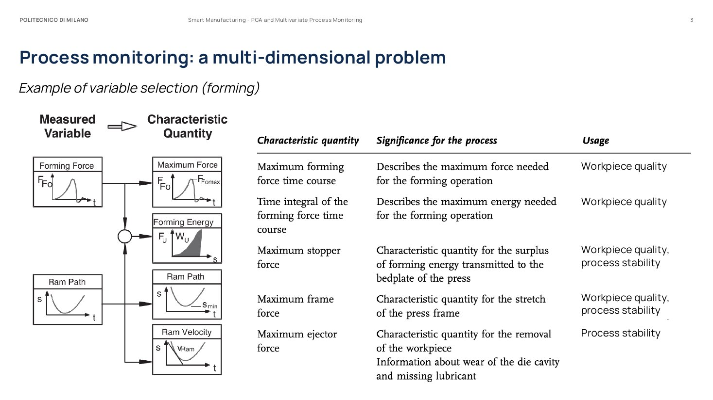
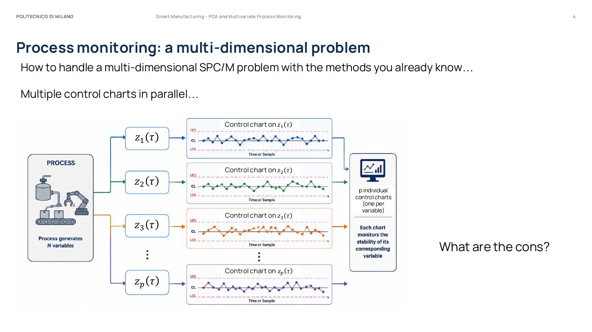
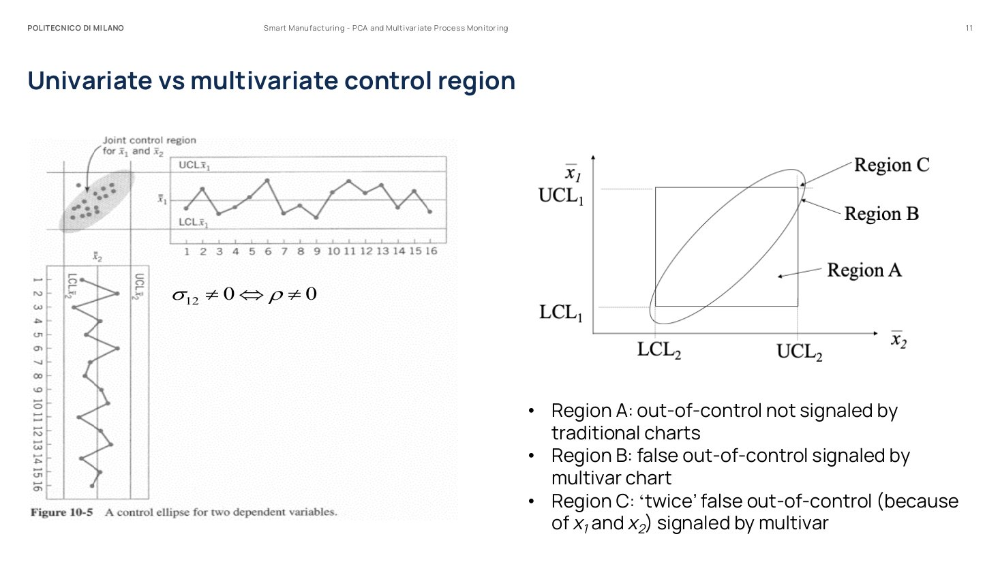
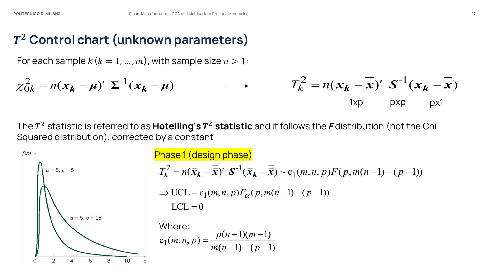
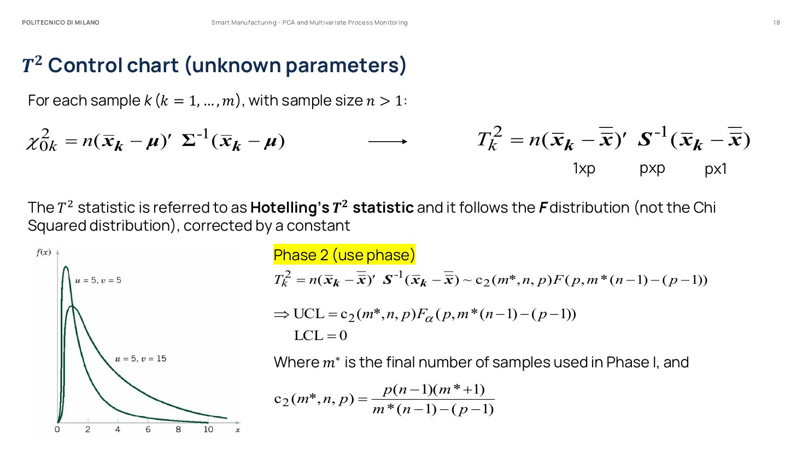
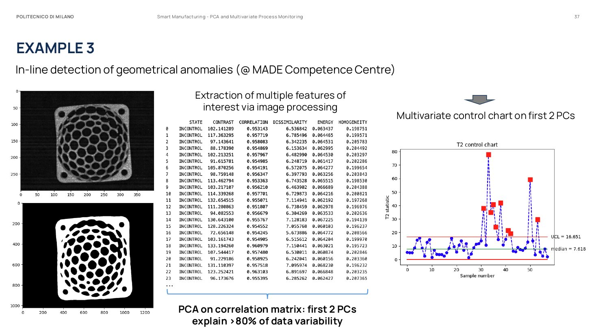

# L3.5 Smart manufacturing – PCA and multivariate process monitoring

> Part of the CAM study guide. Source of truth: [the study guide](https://claude.ai/artifact/WrGc96ueegSH8ZXZdT4FaB). Generated by `tools/build_guide.py`; edit the guide, not this file.

## Slides and professor's explanations (exam material)

Real monitoring has **many variables** at once: several features from one signal, several signals, images and multimodal data. Running one chart per variable inflates the false-alarm rate and ignores the correlations, so you either **correct α** (Bonferroni) or monitor the **joint distribution** with a χ² chart (known parameters) or **Hotelling's T²** chart (estimated parameters). When the number of variables is large (beyond about 10) T² loses power, so you first reduce the dimension with **principal component analysis (PCA)** and then monitor the retained components with T² **plus** the reconstruction error (SSE). *(From the slides, Prof. Grasso; references: Montgomery, Introduction to Statistical Quality Control; Jolliffe, Principal Component Analysis. No recording yet.)*

### A multi-dimensional problem

- **One signal, many features** z₁(τ) … z\_p(τ) (L3.4); **many signals**, each with its own features (watch the **synchronisation**); **images, videos, multimodal** data. Example (forming): punch force, stroke, energy and so on, each chosen because it tells you about part quality or process stability.
- **The naive way:** one control chart per variable in parallel. The cons: the overall false-alarm rate grows with p, and correlations between variables are ignored.






### Familywise Type I error and Bonferroni

With p **independent** charts, each with false-alarm rate α, the probability that **at least one** raises a false alarm is:

```math
\alpha' = 1 - (1-\alpha)^p \qquad \Rightarrow \qquad \alpha = 1 - (1-\alpha')^{1/p}
```

With α = 0.05: p = 2 → α′ = 0.0975 (ARL₀ ≈ 10); p = 3 → 0.143 (ARL₀ ≈ 7); p = 4 → 0.185 (ARL₀ ≈ 5.4; the slide rounds it to 6). You expected ARL₀ = 20. So **correct each chart's α** to hit the target familywise α′. If the variables are **not independent**, use **Bonferroni**: α′ ≤ Σαᵢ, so choose **αᵢ = α\_fam / p** for each chart (e.g. p = 4, α\_fam = 0.05 → αᵢ = 0.0125). It is conservative but always safe.


### From univariate to multivariate: the χ² chart

The multivariate normal pdf replaces (x − μ)²/σ² with the **Mahalanobis-type distance** (x − μ)′Σ⁻¹(x − μ). Key property: for X̄ \~ Nₚ(μ, Σ/n),

```math
\chi_0^2 = n\,(\bar{\mathbf x} - \mathbf{\mu})'\,\mathbf{\Sigma}^{-1}(\bar{\mathbf x} - \mathbf{\mu}) \sim \chi^2(p) \qquad UCL = \chi^2_{\alpha}(p),\ \text{no LCL (squared statistic)}
```

- For p = 2 the in-control region is an **ellipse** in the (x̄₁, x̄₂) plane, tilted by the covariance σ₁₂. With σ₁ = σ₂ = σ and σ₁₂ = 0 it becomes a **circle of radius (σ/√n)·√χ²\_α(2)**.
- **Exam alert — the ellipse vs the rectangle:** two separate charts give a **rectangle**. Region A = points inside the rectangle but outside the ellipse: real **out-of-control states the univariate charts miss** (the combination of x₁ and x₂ is unusual even though each looks fine). Region B = inside the ellipse but outside the rectangle: **false alarms** from the univariate charts. Region C = outside the rectangle on both variables but inside the ellipse: a "double" false alarm.
- Matching the two approaches at the same familywise α′ (independent variables, α = 1 − √(1 − α′)): α′ = 0.05 → circle radius factor √χ² = 2.448 vs z\_{α/2} = 2.237; α′ = 0.01 → 3.035 vs 2.806. (The slide's third row, labelled α′ = 0.005, actually shows the values for **α′ = 0.001**: 3.717 and 3.481; for 0.005 they would be 3.255 and 3.023.)
- The χ² chart assumes **known** μ and Σ; if unknown, estimate them in a design phase (Phase 1) and use them in Phase 2, as for univariate charts.





### Hotelling's T² chart (unknown parameters)

From m samples of size n: the mean of each variable in each sample x̄\_jk, the variances S²\_jk and covariances S\_jhk within each sample; then the **grand means** x̄̄\_j and the **averages** of the variances S²\_j and covariances S\_jh across samples. These give the estimates **μ → x̄̄** and **Σ → S**.

```math
\begin{gathered}
T_k^2 = n\,(\bar{\mathbf x}_k - \bar{\bar{\mathbf x}})'\,\mathbf S^{-1}(\bar{\mathbf x}_k - \bar{\bar{\mathbf x}}) \\
\text{Phase 1: } UCL = \frac{p(m-1)(n-1)}{mn-m-p+1}\,F_{\alpha,\,p,\,mn-m-p+1} \qquad \text{Phase 2: } UCL = \frac{p(m+1)(n-1)}{mn-m-p+1}\,F_{\alpha,\,p,\,mn-m-p+1} \qquad LCL = 0
\end{gathered}
```

Because Σ is **estimated**, T² follows a scaled **F** distribution, not χ². In Phase 2, m is the final number of Phase 1 samples (m\*).





**Individual observations (n = 1):** as for the I–MR chart, estimate Σ from **successive differences**. The "long-period" estimator S₁ = Σ(xᵢ − x̄)(xᵢ − x̄)′/(m − 1) is very sensitive to outliers; the **short-period** estimator uses vᵢ = xᵢ₊₁ − xᵢ stacked in a matrix V:

```math
\begin{gathered}
\mathbf S_2 = \frac{1}{2}\,\frac{\mathbf V'\mathbf V}{m-1} \qquad T^2 = (\mathbf x - \bar{\mathbf x})'\mathbf S^{-1}(\mathbf x - \bar{\mathbf x}) \\
\text{Phase I: } UCL = \frac{(m-1)^2}{m}\,\beta_{\alpha,\,p/2,\,(m-p-1)/2} \qquad \text{Phase II: } UCL = \frac{p(m+1)(m-1)}{m^2 - mp}\,F_{\alpha,\,p,\,m-p} \qquad LCL = 0
\end{gathered}
```

**Exam alert — the curse of dimensionality:** these charts work well only up to about **p ≤ 10**. As p grows, the out-of-control ARL for the same shift grows (slide 21: for a shift δ = 1, ARL₁ ≈ 11 with p = 2 but ≈ 20 with p = 15). Hence **dimensionality reduction**.


### Principal component analysis

PCA (also called the Karhunen–Loève or Hotelling transform) is used for dimensionality reduction, visualisation, exploratory analysis, noise reduction, feature extraction and **process monitoring / fault detection**. Idea: rotate the p correlated variables into a new **orthonormal** system z₁ … z\_p where the first few axes carry most of the variability, and keep only the first **m ≪ p**.

- **Basics:** mean vector μ = E(x); covariance matrix Σ with σᵢⱼ = cov(xᵢ, xⱼ); correlation matrix P with ρᵢⱼ = cov/√(VᵢVⱼ). Key property: **V(a′x) = a′Σa** for a constant vector a.
- **First PC:** the linear combination z₁ = α₁′x with **maximum variance** α₁′Σα₁ subject to α₁′α₁ = 1. With a Lagrange multiplier: (Σ − λI)α₁ = 0, so **α₁ is the eigenvector of Σ with the largest eigenvalue λ₁**, and the variance of z₁ is λ₁.
- **Next PCs:** maximise the variance while staying uncorrelated (orthogonal) to the previous ones → the other **eigenvectors**, in decreasing order of eigenvalue λ₁ ≥ λ₂ ≥ … ≥ λ\_p.
- **Scores** = the projections z (the new variables); **loadings** = the eigenvector coefficients α (the weights of the original variables).
- **Centre** the data first (subtract each column's mean). If the variables have different units or very different variances, **standardise** them, which is the same as doing PCA on the **correlation matrix** instead of the covariance matrix; the two give different results and you can't convert one into the other. If Σ is unknown, use the sample matrix S.


**How many PCs?** The total variance is preserved: Σλᵢ = ΣVar(xₖ). Plot the **scree plot** (λᵢ/Σλ, explained variance per PC) and the **cumulative explained variance**, and keep the smallest m that reaches a chosen threshold (e.g. 80–90%), or stop at the elbow of the scree plot. (Slide 31's example says "threshold 0.9 → m = 2", but in its plot the cumulative variance at 2 PCs is about 0.87, just below the line; with a strict 0.9 threshold you would keep 3.)


### Monitoring with PCA: T² + SSE

Project the p features onto the m retained PCs and run a **T² chart on the m scores** (low-dimensional space). But T² only sees variation **along the retained PCs**: a new kind of anomaly may show up in the discarded directions. So also chart the **residual sum of squares** of the PCA reconstruction with an individuals (I) chart:

```math
SSE_i = \lVert \mathbf x_i - \hat{\mathbf x}_i^{(k)} \rVert^2, \qquad \hat{\mathbf x}_i^{(k)} = \bar{\mathbf x} + \sum_{j=1}^{k} z_{ij}\,\mathbf{\alpha}_j
```

**Decision rule:** signal an anomaly if **either T² or SSE** exceeds its Phase I limit. (With standardised data the reconstruction is standardised too.)


**Examples from the slides:** (1) p signal features → PCA keeps 3 PCs (80% of the variance) → new signals projected into that space; (2) **water-jet cutting pressure profiles**: PCA on the profiles instead of many univariate charts with Bonferroni limits; (3) **in-line detection of geometric defects** in 3D-printed fan covers (HP Multi Jet Fusion, MADE Competence Centre): features extracted by image processing, PCA on the correlation matrix, the first 2 PCs explain over 80% of the variability, then a multivariate chart on them.




**Exam link:** this closes the chain started in L3.2: sensors → features (L3.4) → many correlated features → PCA → T² + SSE charts → alarm → assignable cause. For any process (welding photodiode + camera, milling force + vibration + power), say which features you would extract, why one chart per feature is a bad idea (familywise α, correlations), and how PCA + T²/SSE fixes it.

## Professor background (less exam-critical)

*No background comments for this chapter.*

## Practice exercises

### O. Multivariate monitoring (from the L3.5 slides)

1. **Familywise false alarms:** p independent charts each with α = 0.05 → α′ = 1 − 0.95ᵖ: p = 2 → 0.0975 (ARL₀ ≈ 10), p = 3 → 0.143 (≈ 7), p = 4 → 0.185 (≈ 5.4). To get α′ = 0.05 with p = 2 independent charts: α = 1 − √0.95 = **0.0253**, z\_{α/2} = **2.237**. **Bonferroni** (any dependence): αᵢ = α\_fam/p, e.g. 0.05/4 = **0.0125**.
2. **χ² region for p = 2, σ₁ = σ₂ = σ, σ₁₂ = 0:** circle of radius (σ/√n)·√χ²\_{α′}(2); √χ²\_{0.05}(2) = **2.448**, √χ²\_{0.01}(2) = **3.035** (for p = 2, χ²\_α(2) = −2 ln α).
3. **Hotelling T² limits:** n > 1: Phase 1 UCL = p(m−1)(n−1)/(mn−m−p+1)·F\_{α,p,mn−m−p+1}, Phase 2 the same with (m+1). n = 1: Phase I (m−1)²/m·β\_{α,p/2,(m−p−1)/2}, Phase II p(m+1)(m−1)/(m²−mp)·F\_{α,p,m−p}, with Σ from successive differences S₂ = V′V/(2(m−1)).
4. **PCA:** eigen-decompose S (or the correlation matrix if units differ); explained variance of PC i = λᵢ/Σλ; keep the smallest m whose cumulative share reaches the threshold; monitor T² on the m scores **and** SSE of the reconstruction.

All formulas: [formula sheet](../formula-sheet.md).

## Likely oral questions

- **Why not just use one control chart per variable?** The false-alarm rate adds up: with p independent charts at α each, α′ = 1 − (1 − α)ᵖ (p = 3, α = 0.05 → 0.14, ARL₀ ≈ 7 instead of 20), so you must lower each α (exact correction for independent variables, Bonferroni α/p otherwise). And separate charts ignore correlations: the joint in-control region is an ellipse, not a rectangle, so they miss unusual combinations and raise false alarms elsewhere. Monitor the joint distribution with χ² or Hotelling's T².
- **χ² vs Hotelling's T²?** Both measure n(x̄ − μ)′Σ⁻¹(x̄ − μ). χ² uses known μ and Σ, so it follows χ²(p) and UCL = χ²\_α(p). T² uses the estimates x̄̄ and S from Phase 1, so its limits come from a scaled F distribution (beta in Phase I for n = 1), different for Phase 1 and Phase 2. Only an upper limit, since the statistic is squared. For n = 1, estimate Σ from successive differences.
- **Explain PCA and how you use it for monitoring.** Find orthonormal directions of maximum variance: the eigenvectors of the covariance (or correlation, if units differ) matrix, ordered by eigenvalue; scores = projections, loadings = coefficients. Keep m ≪ p components covering most of the variance (scree plot, cumulative share). Then monitor T² on the m scores plus SSE of the reconstruction, because T² can't see anomalies in the discarded directions; alarm if either exceeds its limit. Needed because T² loses power above about 10 variables.
