# L3.5 Smart manufacturing – PCA and multivariate process monitoring

> Part of the CAM study guide. Source of truth: [the study guide](https://claude.ai/artifact/WrGc96ueegSH8ZXZdT4FaB). Generated by `tools/build_guide.py`; edit the guide, not this file.

## Slides and professor's explanations (exam material)

Real monitoring has **many variables** at once: several features from one signal, several signals, images and multimodal data. Running one chart per variable inflates the false-alarm rate and ignores the correlations, so you either **correct α** (Bonferroni) or monitor the **joint distribution** with a χ² chart (known parameters) or **Hotelling's T²** chart (estimated parameters). When the number of variables is large (beyond about 10) T² loses power, so you first reduce the dimension with **principal component analysis (PCA)** and then monitor the retained components with T² **plus** the reconstruction error (SSE). *(From the slides, Prof. Grasso; references: Montgomery, Introduction to Statistical Quality Control; Jolliffe, Principal Component Analysis. Recording of 23 Nov (second half), Prof. Demir: why many variables, familywise α and Bonferroni, from one bell to the χ² chart, regions A/B/C. Recording of 24 Nov: χ² and T² charts, individual observations, the curse of dimensionality, PCA, T² + SSE, the water-jet and fan-cover examples. Professor's comments inline.)*

### A multi-dimensional problem

- **One signal, many features** z₁(τ) … z\_p(τ) (L3.4); **many signals**, each with its own features (watch the **synchronisation**); **images, videos, multimodal** data. Example (forming): punch force, stroke, energy and so on, each chosen because it tells you about part quality or process stability.
- **Prof (23 Nov) — why many outputs, and the forming example:** a shaft must have the right diameter, the right length and be truly cylindrical: one output is rarely enough. On a deep-drawing press (close to the CAM-shop lab), from the force and ram-position signals you derive: the **maximum forming force** (what we compute to check the press; too high → poor lubrication or an obstacle, too low → incomplete forming); the **forming energy** (the integral of force over distance; constant energy is reassuring even if the peak shifts slightly); the **final ram position** (does the punch reach its point?); the **ram velocity** (derivative of the position); the **maximum stopper force** (surplus energy sent to the bed plate); the **maximum frame force** (the press frame stretching elastically: if the machine deforms instead of the part, quality drops); the **ejector force** (higher → the part sticks: die wear or missing lubricant). Together they say not only whether the process is out of control but **where** (part, press, die).
- **The naive way:** one control chart per variable in parallel. The cons: the overall false-alarm rate grows with p, and correlations between variables are ignored.
- **Class discussion (23 Nov) — five indicators, an I–MR chart for each = 10 charts: what's wrong?** The class: the variables may be correlated; too much information for a control loop; some matter more than others. "All true, but there is a fundamental issue": each chart has its own false-alarm probability, and when they run together the probability that **one** of them gives a false alarm is no longer α.

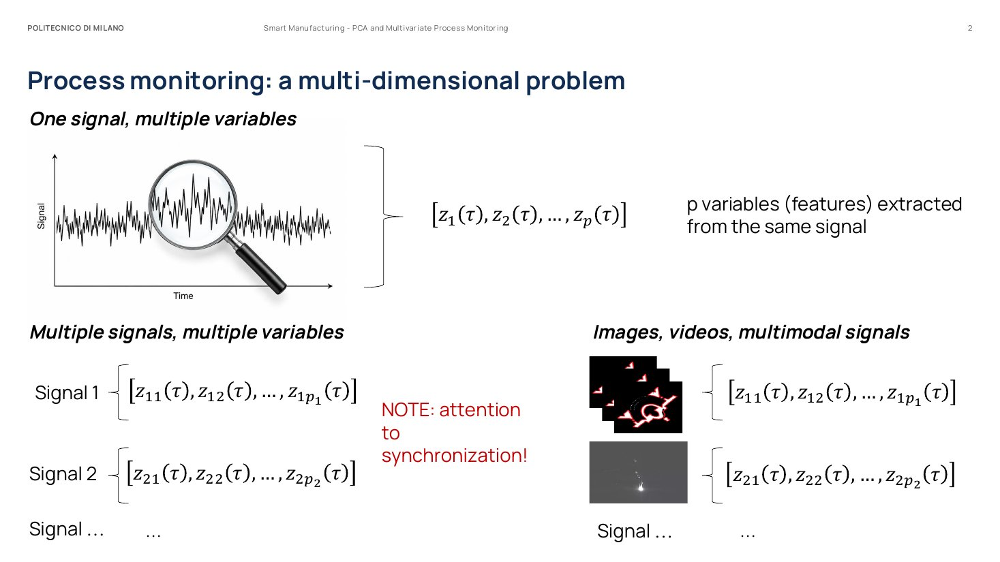


### Familywise Type I error and Bonferroni

With p **independent** charts, each with false-alarm rate α, the probability that **at least one** raises a false alarm is:

```math
\alpha' = 1 - (1-\alpha)^p \qquad \Rightarrow \qquad \alpha = 1 - (1-\alpha')^{1/p}
```

With α = 0.05: p = 2 → α′ = 0.0975 (ARL₀ ≈ 10); p = 3 → 0.143 (ARL₀ ≈ 7); p = 4 → 0.185 (ARL₀ ≈ 5.4; the slide rounds it to 6). You expected ARL₀ = 20. So **correct each chart's α** to hit the target familywise α′. If the variables are **not independent**, use **Bonferroni**: α′ ≤ Σαᵢ, so choose **αᵢ = α\_fam / p** for each chart (e.g. p = 4, α\_fam = 0.05 → αᵢ = 0.0125). It is conservative but always safe.

- **Prof (23 Nov) — Bonferroni's price:** dividing α by p widens each chart's limits: false alarms stay limited, but **β grows**, so each chart becomes less sensitive to real shifts ("alpha and beta operate together"). Better: one multivariate chart that pools the variables into a single statistic with a joint region. (A student proposed combining all the variables into one; that is where this leads, at the cost of losing some information.)
- **Exam alert:** in class "α = 0.27% gave an ARL of about 600". Wrong again: ARL₀ = 1/0.0027 ≈ 370. And for p = 4 the ARL₀ is about 5.4, not 6.

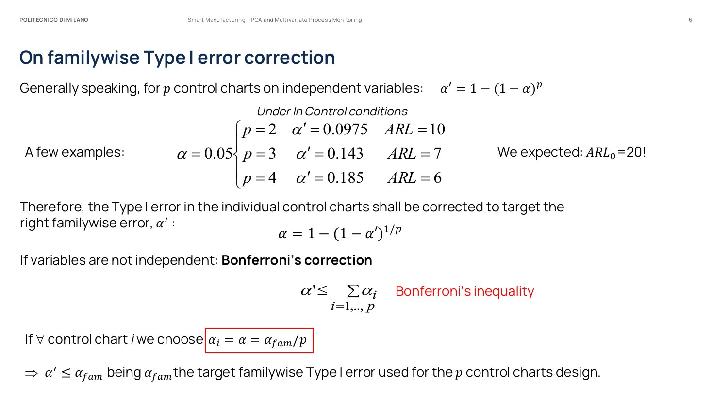

### From univariate to multivariate: the χ² chart

The multivariate normal pdf replaces (x − μ)²/σ² with the **Mahalanobis-type distance** (x − μ)′Σ⁻¹(x − μ). Key property: for X̄ \~ Nₚ(μ, Σ/n),

```math
\chi_0^2 = n\,(\bar{\mathbf x} - \mathbf{\mu})'\,\mathbf{\Sigma}^{-1}(\bar{\mathbf x} - \mathbf{\mu}) \sim \chi^2(p) \qquad UCL = \chi^2_{\alpha}(p),\ \text{no LCL (squared statistic)}
```

- For p = 2 the in-control region is an **ellipse** in the (x̄₁, x̄₂) plane, tilted by the covariance σ₁₂. With σ₁ = σ₂ = σ and σ₁₂ = 0 it becomes a **circle of radius (σ/√n)·√χ²\_α(2)**.
- **Exam alert — the ellipse vs the rectangle:** two separate charts give a **rectangle**. Region A = points inside the rectangle but outside the ellipse: real **out-of-control states the univariate charts miss** (the combination of x₁ and x₂ is unusual even though each looks fine). Region B = inside the ellipse but outside the rectangle: **false alarms** from the univariate charts. Region C = outside the rectangle on both variables but inside the ellipse: a "double" false alarm.
- **Prof (23 Nov) — from one bell to a surface:** write (x − μ)/σ in vector form: μ becomes a vector and σ² the covariance matrix Σ (variances on the diagonal, **covariances, not correlations**, off it; zero if the variables are independent). For two variables the bell becomes a surface, and n(x̄ − μ)′Σ⁻¹(x̄ − μ) follows χ² with p = 2 degrees of freedom. The statistic is squared, so LCL = 0 and only a UCL is needed. Region A: both separate charts say in control, but the pair is out: a **Type II** error of the separate charts that the multivariate chart catches. Region B: in control but flagged by one chart: **Type I**. Region C: flagged by both charts but in control: **Type I twice**. So the multivariate chart improves both errors. In practice (2 variables, α = 5%): compute the χ² statistic for each sample and compare it with the single UCL, with no separate charts.
- Matching the two approaches at the same familywise α′ (independent variables, α = 1 − √(1 − α′)): α′ = 0.05 → circle radius factor √χ² = 2.448 vs z\_{α/2} = 2.237; α′ = 0.01 → 3.035 vs 2.806. (The slide's third row, labelled α′ = 0.005, actually shows the values for **α′ = 0.001**: 3.717 and 3.481; for 0.005 they would be 3.255 and 3.023.)
- The χ² chart assumes **known** μ and Σ; if unknown, estimate them in a design phase (Phase 1) and use them in Phase 2, as for univariate charts.
- **Prof (24 Nov) — what the χ² chart monitors:** one scalar per sample, compared with one UCL = χ²\_α(p): only a UCL, because the statistic is squared and can't be negative; the degrees of freedom are the number of variables (1 univariate, 2 bivariate, p in general). It plays the role of the **X̄ chart**: it monitors the mean vector, with Σ known. A multivariate counterpart of the R/S chart exists but is more complex and isn't covered. Advantages over p separate charts: a truer in-control region (the ellipse), and no splitting of α. (In class the cost of Bonferroni was called "type one error" and α "0.027": the cost is a larger β, and α at K = 3 is 0.0027.)

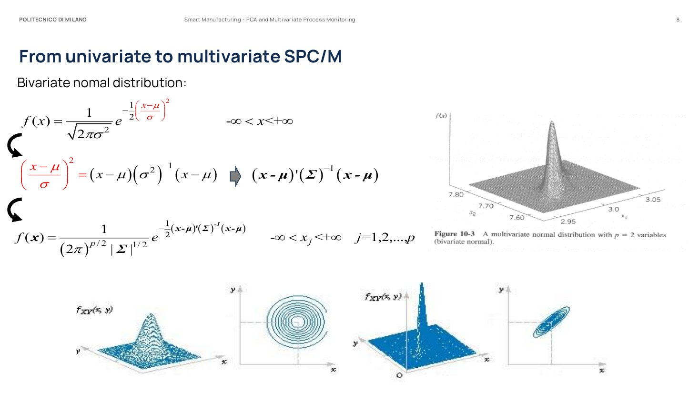

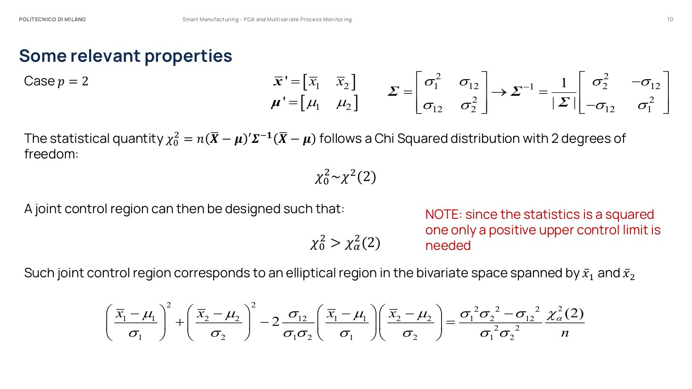


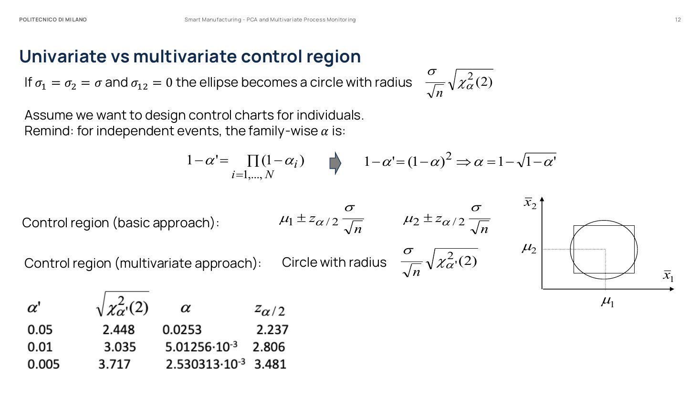

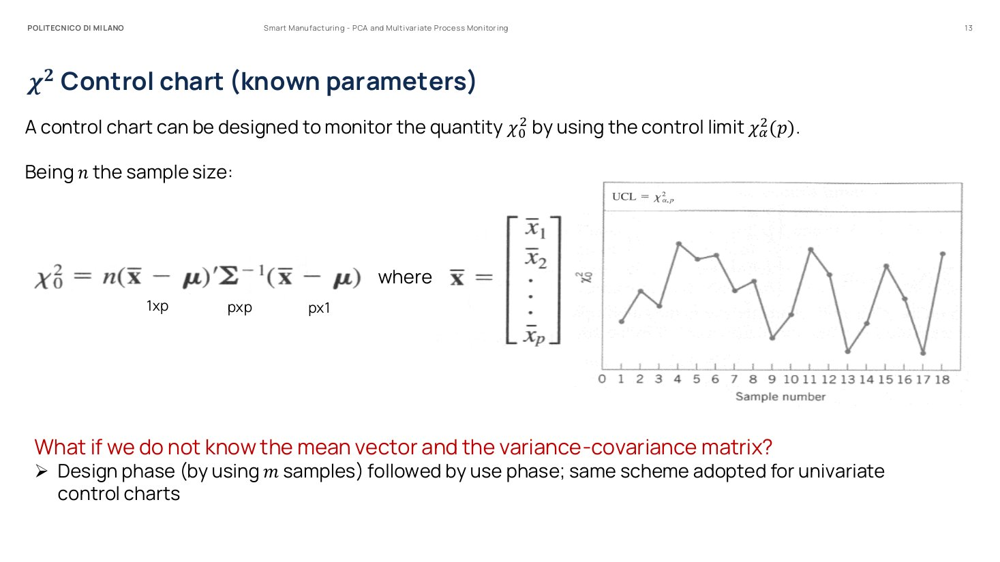

### Hotelling's T² chart (unknown parameters)

From m samples of size n: the mean of each variable in each sample x̄\_jk, the variances S²\_jk and covariances S\_jhk within each sample; then the **grand means** x̄̄\_j and the **averages** of the variances S²\_j and covariances S\_jh across samples. These give the estimates **μ → x̄̄** and **Σ → S**.

```math
\begin{gathered}
T_k^2 = n\,(\bar{\mathbf x}_k - \bar{\bar{\mathbf x}})'\,\mathbf S^{-1}(\bar{\mathbf x}_k - \bar{\bar{\mathbf x}}) \\
\text{Phase 1: } UCL = \frac{p(m-1)(n-1)}{mn-m-p+1}\,F_{\alpha,\,p,\,mn-m-p+1} \qquad \text{Phase 2: } UCL = \frac{p(m+1)(n-1)}{mn-m-p+1}\,F_{\alpha,\,p,\,mn-m-p+1} \qquad LCL = 0
\end{gathered}
```

Because Σ is **estimated**, T² follows a scaled **F** distribution, not χ². In Phase 2, m is the final number of Phase 1 samples (m\*).

**Prof (24 Nov) — T² in words:** replace μ with the grand mean x̄̄ (the mean of the sample means of each variable over the m samples, e.g. 20 days × 5 shafts) and Σ with S (the averages of the within-sample variances and covariances). The shape of the distribution barely changes, but its values move "to a more secure region": the F distribution is more conservative than χ². Phase 1: a point out with an assignable cause is removed and the limit recomputed with the new m (the constant depends on m and n); Phase 2 uses m\*, the final number of Phase 1 samples.


**Individual observations (n = 1):** as for the I–MR chart, estimate Σ from **successive differences**. The "long-period" estimator S₁ = Σ(xᵢ − x̄)(xᵢ − x̄)′/(m − 1) is very sensitive to outliers; the **short-period** estimator uses vᵢ = xᵢ₊₁ − xᵢ stacked in a matrix V:

```math
\begin{gathered}
\mathbf S_2 = \frac{1}{2}\,\frac{\mathbf V'\mathbf V}{m-1} \qquad T^2 = (\mathbf x - \bar{\mathbf x})'\mathbf S^{-1}(\mathbf x - \bar{\mathbf x}) \\
\text{Phase I: } UCL = \frac{(m-1)^2}{m}\,\beta_{\alpha,\,p/2,\,(m-p-1)/2} \qquad \text{Phase II: } UCL = \frac{p(m+1)(m-1)}{m^2 - mp}\,F_{\alpha,\,p,\,m-p} \qquad LCL = 0
\end{gathered}
```

**Exam alert — the oral question he gave away (24 Nov):** "five sensors, three features each (mean, peak-to-peak, standard deviation): which chart?" One value per sample, so separately you would need 15 I charts (30 with the MR charts): too many alarms, and Bonferroni makes each chart weaker. Answer: **a T² chart for individual observations** (μ and Σ unknown, Σ from successive differences), with Phase 1 (design) and Phase 2 (use). "I wouldn't ask you to write the exact numbers, but you should know **which distribution**": χ² with known parameters; F for T² with subgroups; **beta in Phase I and F in Phase II** for individual observations.

**Exam alert — the curse of dimensionality:** these charts work well only up to about **p ≤ 10**. As p grows, the out-of-control ARL for the same shift grows (slide 21: for a shift δ = 1, ARL₁ ≈ 11 with p = 2 but ≈ 20 with p = 15). Hence **dimensionality reduction**.

- **Prof (24 Nov):** "in a perfect world one indicator would explain everything, with many samples each time". Today it is the opposite (a phone alone has an accelerometer, gyroscope, temperature sensor, camera, IR sensor and microphone): many indicators, one value each. Five sensors × three features = 15, already beyond the comfortable p ≤ 10.
- **Exam alert:** in the slide-21 table, ARL₁ ≈ 11 (δ = 1, p = 2) is the number of samples needed to **detect** the shift, not the time to a false alarm, as it came out in class. As p grows the chart detects real shifts later; it does not raise more false alarms.
- **Class discussion — how do you get below 10 variables?** Turn some signals off; sum or combine them; make engineering choices (the cutting force rather than the humidity). With 25 features, "the argument starts, and nobody leaves the room satisfied": PCA is an objective way to combine them.

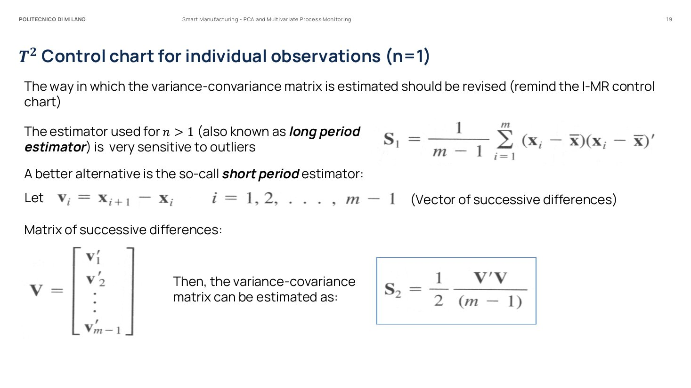

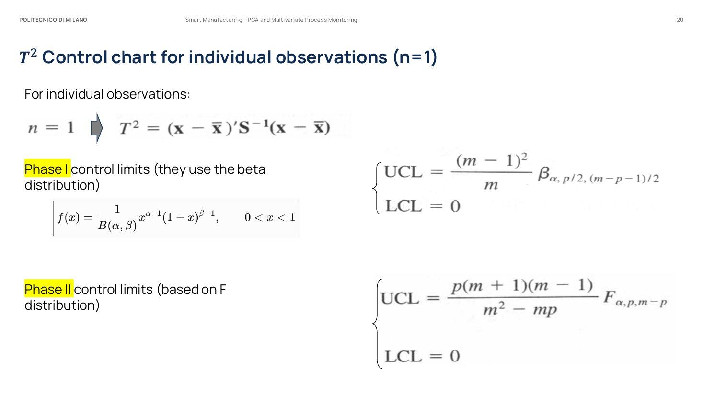

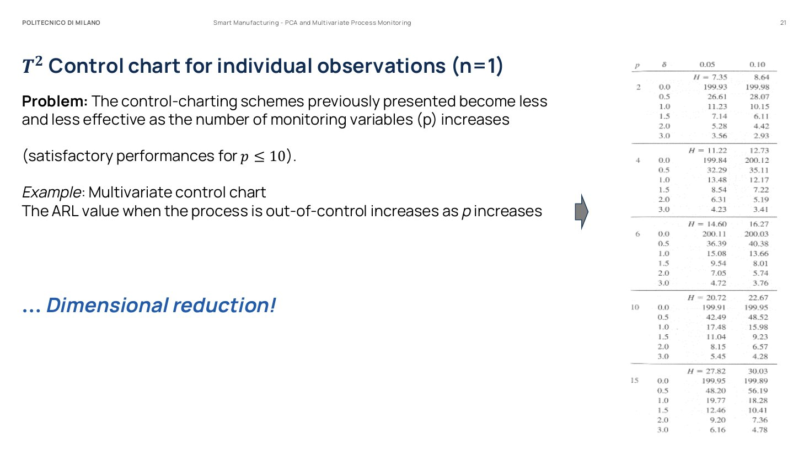

### Principal component analysis

PCA (also called the Karhunen–Loève or Hotelling transform) is used for dimensionality reduction, visualisation, exploratory analysis, noise reduction, feature extraction and **process monitoring / fault detection**. Idea: rotate the p correlated variables into a new **orthonormal** system z₁ … z\_p where the first few axes carry most of the variability, and keep only the first **m ≪ p**.

- **Basics:** mean vector μ = E(x); covariance matrix Σ with σᵢⱼ = cov(xᵢ, xⱼ); correlation matrix P with ρᵢⱼ = cov/√(VᵢVⱼ). Key property: **V(a′x) = a′Σa** for a constant vector a.
- **First PC:** the linear combination z₁ = α₁′x with **maximum variance** α₁′Σα₁ subject to α₁′α₁ = 1. With a Lagrange multiplier: (Σ − λI)α₁ = 0, so **α₁ is the eigenvector of Σ with the largest eigenvalue λ₁**, and the variance of z₁ is λ₁.
- **Next PCs:** maximise the variance while staying uncorrelated (orthogonal) to the previous ones → the other **eigenvectors**, in decreasing order of eigenvalue λ₁ ≥ λ₂ ≥ … ≥ λ\_p.
- **Scores** = the projections z (the new variables); **loadings** = the eigenvector coefficients α (the weights of the original variables).
- **Prof (24 Nov) — PCA in pictures and in practice:** with two correlated features, z₁ follows the direction along which the cloud rises (most of the variability) and z₂ the orthogonal spread; in p dimensions you keep finding orthogonal directions. Projecting 3D data on PC1–PC2 reveals the clusters and lets you draw bounding regions. Centring makes the data swing around zero. **Loadings** as "the perfect sensor": how much of each of the 15 features you would mix if you could have only one sensor. Keeping \~90% of the variance and dropping the rest also acts as a noise filter. His lab once had a sensor giving 4,000 values per signal: windowing or hand-made features lost information, while PCA reduced it to 3 components, and the loadings showed which parts of the signal mattered.
- **Centre** the data first (subtract each column's mean). If the variables have different units or very different variances, **standardise** them, which is the same as doing PCA on the **correlation matrix** instead of the covariance matrix; the two give different results and you can't convert one into the other. If Σ is unknown, use the sample matrix S.

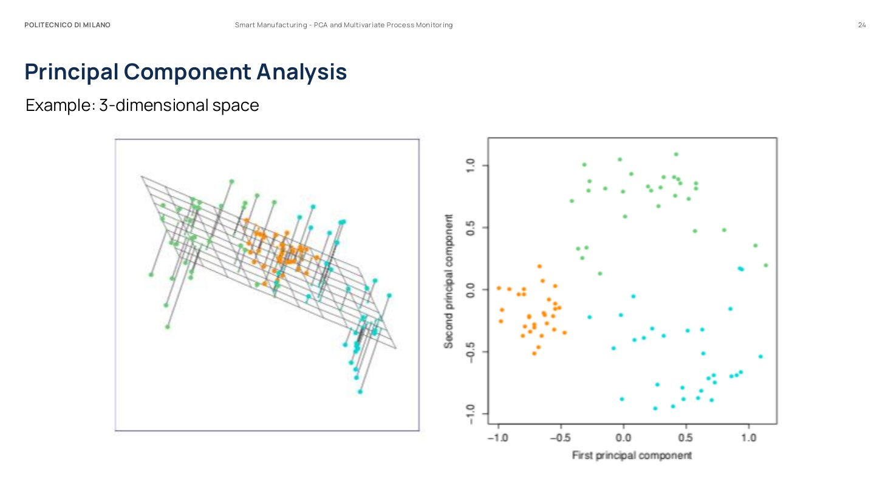

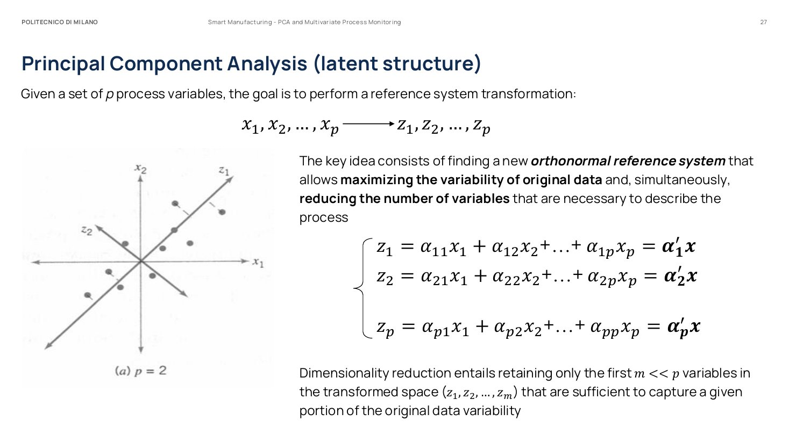

**How many PCs?** The total variance is preserved: Σλᵢ = ΣVar(xₖ). Plot the **scree plot** (λᵢ/Σλ, explained variance per PC) and the **cumulative explained variance**, and keep the smallest m that reaches a chosen threshold (e.g. 80–90%), or stop at the elbow of the scree plot. (Slide 31's example says "threshold 0.9 → m = 2", but in its plot the cumulative variance at 2 PCs is about 0.87, just below the line; with a strict 0.9 threshold you would keep 3.)

**Prof (24 Nov):** never as many PCs as variables (15 to explain 15 is no reduction); a common rule is to stop at 90% cumulative variance. Reducing 25 features to 3 PCs would be a good result.

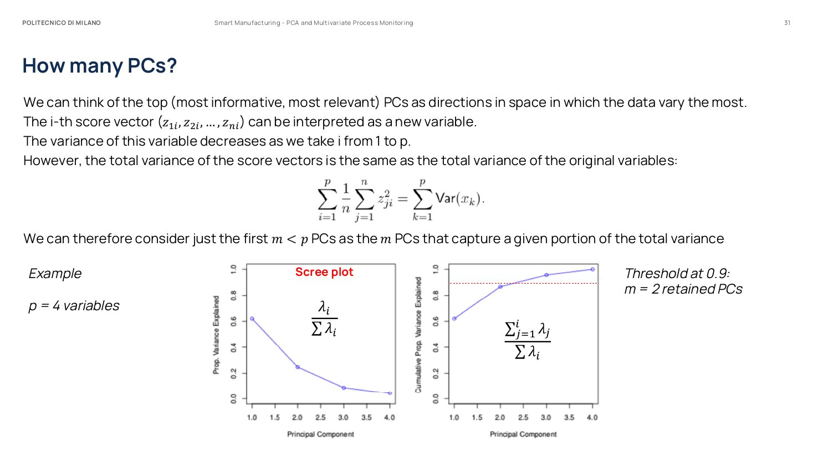

### Monitoring with PCA: T² + SSE

Project the p features onto the m retained PCs and run a **T² chart on the m scores** (low-dimensional space). But T² only sees variation **along the retained PCs**: a new kind of anomaly may show up in the discarded directions. So also chart the **residual sum of squares** of the PCA reconstruction with an individuals (I) chart:

```math
SSE_i = \lVert \mathbf x_i - \hat{\mathbf x}_i^{(k)} \rVert^2, \qquad \hat{\mathbf x}_i^{(k)} = \bar{\mathbf x} + \sum_{j=1}^{k} z_{ij}\,\mathbf{\alpha}_j
```

**Decision rule:** signal an anomaly if **either T² or SSE** exceeds its Phase I limit. (With standardised data the reconstruction is standardised too.)

**Prof (24 Nov) — why SSE too, shown with one PC:** the T² chart only sees where a new point falls along the retained PC. A point can sit within the T² limits along PC1 yet lie far from the PC line in the original (x₁, x₂) space: the squared distance from its projection is the reconstruction error. "Don't leave out this information": add an I chart on the residual sum of squares. The pipeline: synchronised sensors → features per window → the PCA model fitted in Phase 1 → scores → T² chart + SSE chart. If the PCA used the correlation matrix, standardise new data the same way.

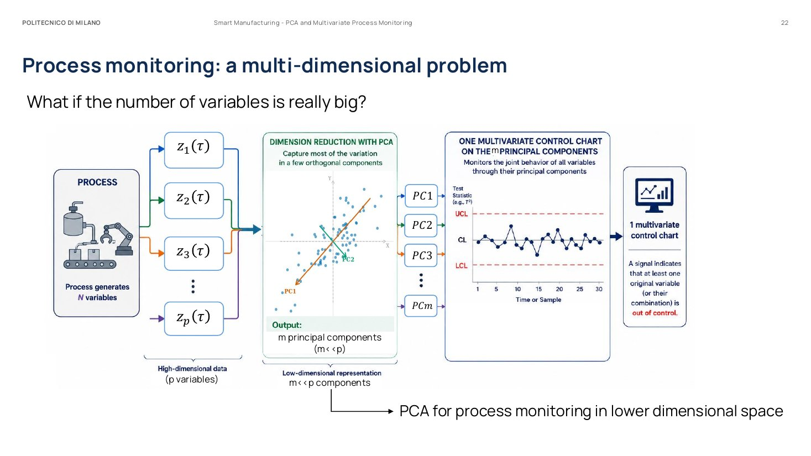

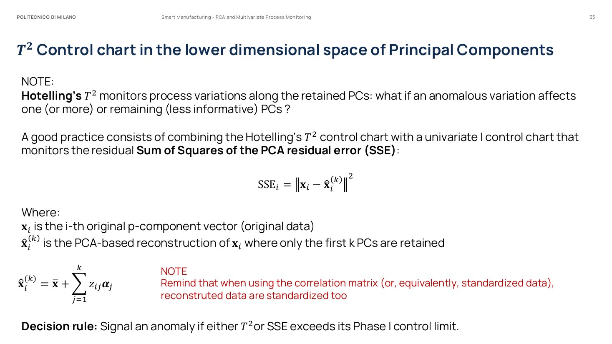

**Examples from the slides:** (1) p signal features → PCA keeps 3 PCs (80% of the variance) → new signals projected into that space; (2) **water-jet cutting pressure profiles**: PCA on the profiles instead of many univariate charts with Bonferroni limits; (3) **in-line detection of geometric defects** in 3D-printed fan covers (HP Multi Jet Fusion, MADE Competence Centre): features extracted by image processing, PCA on the correlation matrix, the first 2 PCs explain over 80% of the variability, then a multivariate chart on them.

**Class discussion (24 Nov) — the fan covers as an exercise:** which sensor? A weight scale gives one number; a camera (CMOS) gives \~3 million pixels, far too many to chart. His colleagues converted each image to grayscale, binarised it with a threshold and extracted texture features (contrast, correlation, energy, homogeneity), then PCA (80% of the variance) → a T² chart, with 23 in-control parts for the design and the rest to test. Advantage over pixel similarity or deep learning: a much lighter model to run on the machine. Water jet: features from forces, vibrations and motor power (means, variances, power spectra, RMS), about 13 features → 3 PCs (80%); new signals projected into that space fall outside the cluster when anomalous.

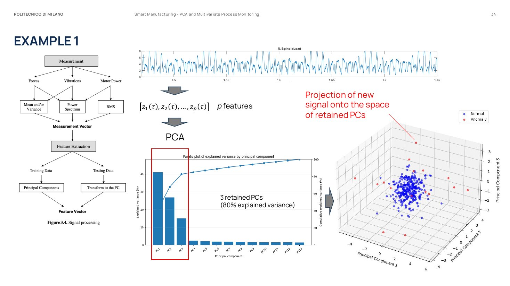

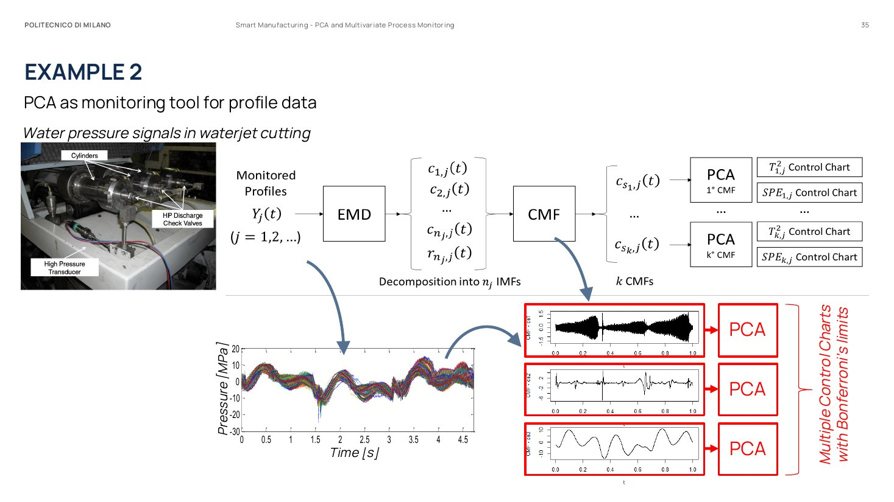


**Exam link:** this closes the chain started in L3.2: sensors → features (L3.4) → many correlated features → PCA → T² + SSE charts → alarm → assignable cause. For any process (welding photodiode + camera, milling force + vibration + power), say which features you would extract, why one chart per feature is a bad idea (familywise α, correlations), and how PCA + T²/SSE fixes it.

## Professor background (less exam-critical)

*No background comments for this chapter.*

## Practice exercises

### O. Multivariate monitoring (from the L3.5 slides)

1. **Familywise false alarms:** p independent charts each with α = 0.05 → α′ = 1 − 0.95ᵖ: p = 2 → 0.0975 (ARL₀ ≈ 10), p = 3 → 0.143 (≈ 7), p = 4 → 0.185 (≈ 5.4). To get α′ = 0.05 with p = 2 independent charts: α = 1 − √0.95 = **0.0253**, z\_{α/2} = **2.237**. **Bonferroni** (any dependence): αᵢ = α\_fam/p, e.g. 0.05/4 = **0.0125**.
2. **χ² region for p = 2, σ₁ = σ₂ = σ, σ₁₂ = 0:** circle of radius (σ/√n)·√χ²\_{α′}(2); √χ²\_{0.05}(2) = **2.448**, √χ²\_{0.01}(2) = **3.035** (for p = 2, χ²\_α(2) = −2 ln α).
3. **Hotelling T² limits:** n > 1: Phase 1 UCL = p(m−1)(n−1)/(mn−m−p+1)·F\_{α,p,mn−m−p+1}, Phase 2 the same with (m+1). n = 1: Phase I (m−1)²/m·β\_{α,p/2,(m−p−1)/2}, Phase II p(m+1)(m−1)/(m²−mp)·F\_{α,p,m−p}, with Σ from successive differences S₂ = V′V/(2(m−1)).
4. **PCA:** eigen-decompose S (or the correlation matrix if units differ); explained variance of PC i = λᵢ/Σλ; keep the smallest m whose cumulative share reaches the threshold; monitor T² on the m scores **and** SSE of the reconstruction.

All formulas: [formula sheet](../formula-sheet.md).

## Likely oral questions

- **Why not just use one control chart per variable?** The false-alarm rate adds up: with p independent charts at α each, α′ = 1 − (1 − α)ᵖ (p = 3, α = 0.05 → 0.14, ARL₀ ≈ 7 instead of 20), so you must lower each α (exact correction for independent variables, Bonferroni α/p otherwise). And separate charts ignore correlations: the joint in-control region is an ellipse, not a rectangle, so they miss unusual combinations and raise false alarms elsewhere. Monitor the joint distribution with χ² or Hotelling's T².
- **χ² vs Hotelling's T²?** Both measure n(x̄ − μ)′Σ⁻¹(x̄ − μ). χ² uses known μ and Σ, so it follows χ²(p) and UCL = χ²\_α(p). T² uses the estimates x̄̄ and S from Phase 1, so its limits come from a scaled F distribution (beta in Phase I for n = 1), different for Phase 1 and Phase 2. Only an upper limit, since the statistic is squared. For n = 1, estimate Σ from successive differences.
- **Explain PCA and how you use it for monitoring.** Find orthonormal directions of maximum variance: the eigenvectors of the covariance (or correlation, if units differ) matrix, ordered by eigenvalue; scores = projections, loadings = coefficients. Keep m ≪ p components covering most of the variance (scree plot, cumulative share). Then monitor T² on the m scores plus SSE of the reconstruction, because T² can't see anomalies in the discarded directions; alarm if either exceeds its limit. Needed because T² loses power above about 10 variables.
- **Which quantities would you monitor on a deep-drawing press, and what does each tell you?** Maximum forming force (press capacity; too high = poor lubrication or an obstacle, too low = incomplete forming), forming energy (∫F ds), final ram position and ram velocity, maximum stopper force (surplus energy to the bed plate), maximum frame force (the press deforming instead of the part), ejector force (sticking part: die wear, missing lubricant). Together they locate the problem (part, press or die), but monitoring them one chart each inflates the false-alarm rate, so use a multivariate chart.
- **Why does a multivariate chart beat two separate charts? Explain regions A, B and C.** Separate charts give a rectangle, the joint χ² (or T²) region is an ellipse tilted by the covariance. A: inside the rectangle, outside the ellipse = an out-of-control pair the separate charts miss (Type II). B: inside the ellipse, outside the rectangle on one variable = a false alarm (Type I). C: outside on both, inside the ellipse = two false alarms. The multivariate chart also keeps a single α instead of 1 − (1 − α)ᵖ, without the loss of power that Bonferroni's wider limits bring.
- **Five sensors, three features each (mean, peak-to-peak, standard deviation): which control chart, and why?** One value per window, so univariate charts would be I–MR: 15 I charts (30 with MR), and the familywise false-alarm rate explodes; Bonferroni (α/p) fixes α but widens every limit and raises β. Use one multivariate chart: Hotelling's T² for individual observations, with μ and Σ estimated in Phase 1 (Σ from successive differences; beta-distribution limit in Phase I, F in Phase II). With p = 15 > 10 the chart loses power, so first reduce with PCA and chart T² on the retained scores plus SSE on the residuals.
- **How would you build a control chart for parts inspected by a camera?** A raw image is millions of pixels, so extract a few features: grayscale → threshold/binarise → texture or shape descriptors (e.g. contrast, correlation, energy, homogeneity, edge or hole counts). Reduce them with PCA (e.g. 2 PCs for > 80% of the variance), design a T² chart (+ SSE) on in-control parts in Phase 1 (e.g. 23 fan covers), then flag new parts in Phase 2. Lighter than a deep-learning model and gives a statistically controlled false-alarm rate.
