# CAM – Study Guide (Prof. Demir, A.Y. 2026-27)

Nov 3, 2026 · @Davide

## How to use this guide

The 30 cum laude comes from the oral (60%), and the oral rewards **linking topics**: every process is studied as *physics → model → disturbances → sensing → control*. Each lecture section below combines the slides with what Prof. Demir said in class. **Exam alert** marks points he stressed; **Class discussion** gives the answers to questions he asked the room.

| Part | Weight | Content (from L0.0 + what he said) |
| --- | --- | --- |
| Written | 40% | 1) numerical exercise on process modelling; 2) numerical exercise on quality monitoring / data analysis; 3) CAM software question. You bring your own laptop and submit software files. |
| Oral | 60% | Basic topics; open questions testing your ability to **link topics**; the whole CAM Lab + CAM Shop workflow. Allowed only after passing the written, **in the same session**. |
| CAM Shop (elective) | +0 to 3 points | Group of 6, four activities (milling + air bending), one report per week. Points are **added**, not averaged. |

**Exam alert — cum laude:** "You cannot get cum laude if you haven't done the project." The CAM Shop assignment is elective, but without it 30L is impossible.

**Exam alert (3 Nov) — written-exam rules:** a **formula sheet is provided**; you work on your own computer, but **no notes and no AI**, so practise with a calculator (Excel is allowed, "but we shouldn't see weird windows pop up on your screens").

Other things he said: attending only theory and lab is "not really good", since the oral covers everything. Five exam calls a year (2 winter, 2 summer, 1 September). Use your university e-mail, and ask for office appointments well before the exam, not on the Sunday before.

**What to study:** each chapter (L0.0 to L3.1) is the exam material: the slide content plus only the professor's comments that matter for the exam (marked **Prof**, **Class discussion** or **Exam alert**). The rest of what he said in class (stories, videos, lab demos, history) is in **Background from the lectures**, the last section at the end of the guide. Read it once and don't memorise it.

## L0.0 Introduction to CAM

Automation matters in manufacturing because the market demands two opposite things at once: **near-zero defects at high volume** and **fast product changes**. CAM gives control engineers the link between the virtual world (calculation, simulation) and the physical process. *(Recording: 14 Sep, morning, first hour.)*

### Why automate? The chair example

- **Productivity** goes up, so cost per part goes down.
- **Repeatability:** you cannot expect 10,000 identical good parts. The first parts during set-up may be faulty, and process **uncertainty** shows up as **quality** problems.
- A scrapped part costs money; a faulty part **sold to the market** costs much more (recalls, lost customer trust).
- **Flexibility:** a phone takes about 1.5–2 years from design to market, a car about 5. If the automation can't follow product changes, you lose competitiveness.
- Target **good** quality, not maximum quality: maximum quality means higher cost.

### Two historical figures (slide 3)

- **Sakichi Toyoda** (Toyota founder): a loom line where a **thread breaks if a part is faulty**, so the line stops instead of mounting the bad part. His point: this is not just automated but **intelligent manufacturing** — "a thread would do what software does today".
- **Walter Shewhart** (Bell Labs, chip making): **embrace variability**. You cannot make 10,000 identical good parts, so observe and measure the sources of variability and combine that with process physics to reduce them. This is the root of statistical quality control.

**Exam alert:** the course aims to make manufacturing **more intelligent** (Toyoda) and to **tackle variability** (Shewhart). Use these two names as the frame for the whole course.

### The four videos (slides 4–7) = the three process families of the course

| Video | Question | What he said |
| --- | --- | --- |
| DMG Mori (milling) | Can I check my process digitally before running it? | High-end manufacturing is run in the digital platform first: 5-axis machine (X, Y, Z + 2 rotations), collision checks, even the measurement cycle is simulated. |
| Machina Labs (sheet metal) | 3D parts from sheet without dedicated dies? | Two robots (6 DOF + 1 linear axis each) press the sheet in small increments: **flexible** instead of dedicated automation, since a die is expensive and slow to make. |
| BLM (laser welding) | Can a robot work autonomously? | Today someone programs the robot for every new part, and every physical part sits slightly off. Future: the machine finds the weld itself via machine vision / AI seam tracking. |
| Dark factory | — | Fully automated plant; humans do intellectual work only. Strong economic pressure on speed and resources. |

**Numbers to remember:** an industrial 6-DOF robot positions to about **1 mm** (about 0.5 mm if well calibrated); a human hair is about **70 µm**. Whether 1 mm is good "depends on what you're manufacturing". For the sheet-forming robots it would be disastrous, so you need **closed-loop** control of where the part and actuators are.

### Industrial revolutions

1. Steam power (1800s, Britain/Netherlands).
2. **Production line** (Henry Ford, inspired by a slaughterhouse line).
3. **Electronics** (1970s): computation, robotics.
4. **Industry 4.0** (\~2010): **sensing and data**. "Fourth one is where we are today, and fourth one is this course."
5. **Industry 5.0** (today): putting the **human back** in the system. Example: nobody wants to be a welder, but you can program a collaborative robot to weld.

### Course map (slide 8)

Intro → **process fundamentals** (3 families: melting/fusion, plastic deformation, chip removal; for each, physics + simplest model + automation and monitoring needs) → **manufacturing automation** (Cartesian systems, anthropomorphic robots, humanoids, drones) → **smart manufacturing** (sensor data, statistics, input–output link to improve the process). Textbooks: Groover, *Fundamentals of Modern Manufacturing* and *Automation, Production Systems and CIM*.

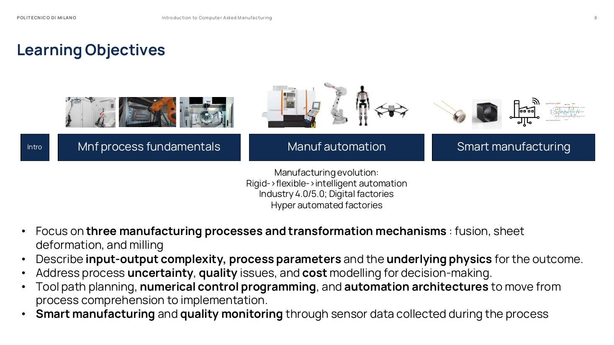

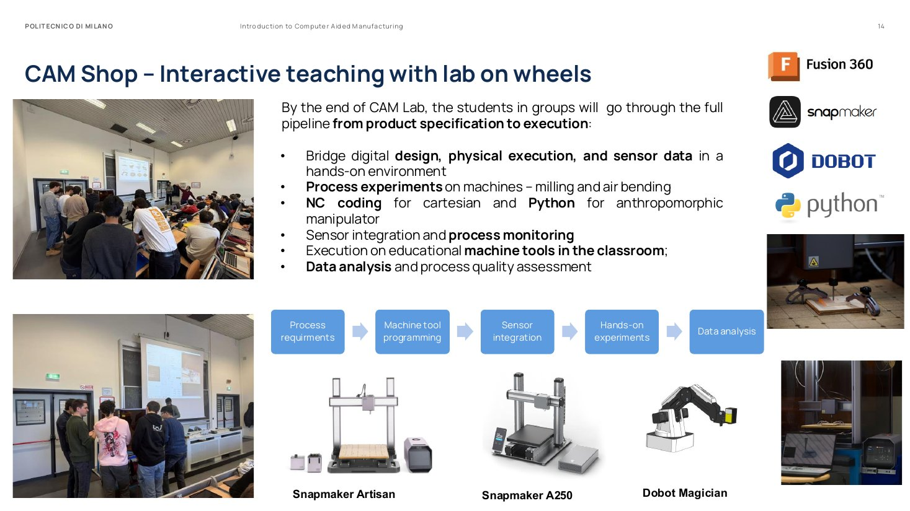

## L1.1 Manufacturing and automation – introduction

The choice between **fixed, programmable and flexible automation** depends on **how many parts** and **how many variants** you need. Control and optimisation always need a **model of the process**, and no model is perfect. *(Recordings: 14 Sep morning, second half, and 14 Sep afternoon.)*

**Exam alert:** "Distinguish between fixed, programmable and flexible automation. This is probably one important concept that you need to take home — a simple link between quality, cost and flexibility."

### Definitions

- **Manufacturing** (*manus* + *factus*, "made by hand"): today the set of **controlled physical transformations** that turn raw materials into parts and products, by manual or automated labour.
- **Manufacturing system:** workers + equipment doing processing and assembly.
- **Manufacturing cell:** a small system, one machine or a small group, doing one or more operations on a part.
- **Production line:** an ordered sequence of machines/workstations; the product moves through processing, handling, inspection and assembly.
- **Automation** (slide 11): **mechanisation** replaces human *power* (muscle); **robotisation** replaces human *manipulation*; **computerisation** replaces human *intelligence*. Automation also makes output more predictable: a technician works differently in the morning and on a hot afternoon.

### Class discussion — the coin line (U.S. Mint, slide 4)

Sequence: melting & casting → rolling → coil weighing → annealing → cleaning → cladding → rolling to blank thickness → blanking → riddling → annealing & cleaning → upsetting → coining (stamping) → inspection → weighing → counting & bagging. **Weighing steps** check for material lost by evaporation (melting) or scrap (deformation). **Annealing** = heating to restore malleability after deformation ("manufacturing is the kitchen of the industry").

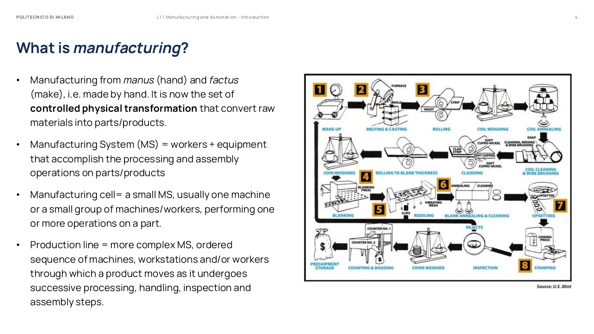

| Where | What to automate | What to control |
| --- | --- | --- |
| Casting | Pouring (the metal is hot and dangerous) | Flow speed, volume, **temperature** (too hot wastes energy, too cold won't cast) |
| Weighing | Electronic scales, cameras to count | The coin is worth more than its metal, so weight must be checked |
| Blanking | Conveyors feeding the press | — |
| Coining (most critical) | Press + automated inspection | **Force** and **stroke**: too low gives no imprint, too high damages the coin |

### The production system (slide 5)

- **Factory level**, read bottom-up: manufacturing processes and assembly ← automation & control technologies + material handling technologies → manufacturing systems.
- **Enterprise level:** manufacturing support systems (planning, design, scheduling, production management, **CAD/CAM**).
- **Quality control systems** span both levels: faulty parts are caught in the factory, but the enterprise must check that released parts still conform and what the market still wants.

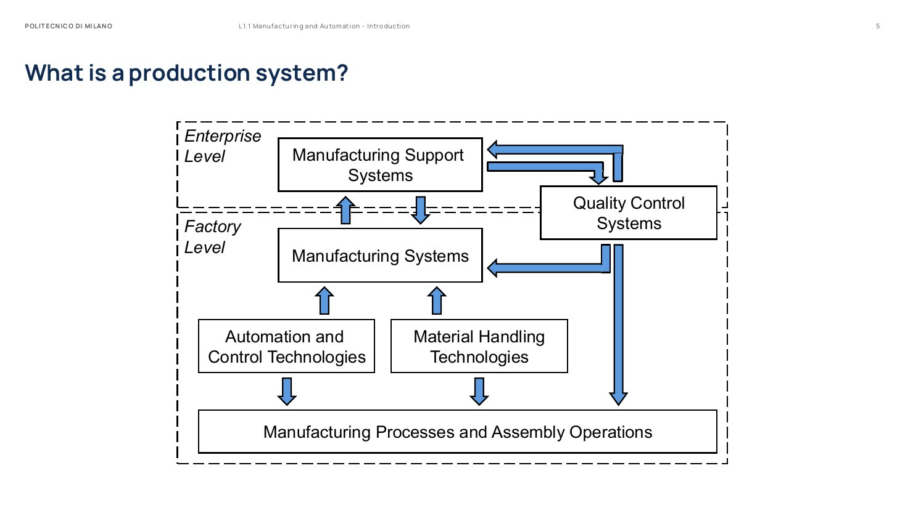

### Classification of processes (slide 6)

- **Processing operations**
  - *Shaping:* **solidification** (liquid fills a cavity; additive), particulate processing (powder pressed + heated), **deformation** (solid state; volume in = volume out), **material removal** (solid state; subtractive). The course covers the three in bold.
  - *Property enhancing:* heat treatment. Class example: clear ice needs air removed and **slow solidification**, because the cooling rate changes the crystal structure and so the mechanical properties.
  - *Surface processing:* cleaning (subtractive), coating/deposition (additive). Needed for mating tolerances, corrosion protection, biomedical implants (the body may reject a bad surface), semiconductors (flatness).
- **Assembly operations:** joining (welding: both parts melted locally; brazing/soldering: only the filler melts, lower temperature; adhesive bonding) or mechanical fastening (bolts, rivets).

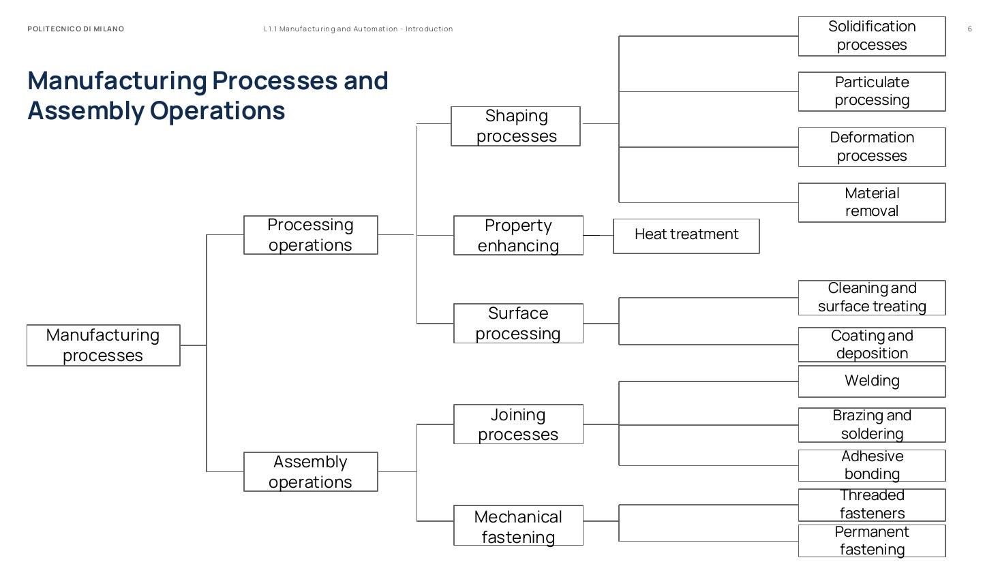

### Manufacturing in the economy (slides 7–10)

- Manufacturing's **share** of GDP is falling (EU about 15%, China about 25%) due to outsourcing, international competition and rich countries consuming more services. Italy: 27% of the workforce around 1970, about 15–16% today.
- But total GDP is growing, so manufacturing output still grows. **One manufacturing job generates up to about 4 service jobs** (retail, transport, software, after-sales).
- Italy: **2nd manufacturing economy in Europe**, 8th in the world (1.8%). Strength = specialisation, quality, design, know-how. Trade surplus 2023: automation & machinery +73 bn€, food & beverage +32, fashion +29, furniture & appliances +15. Europe's industrial "golden belt": UK (Milton Keynes) → Belgium/Netherlands → Baden-Württemberg → Lombardy/Piedmont.
- **Key drivers of competitiveness:** product (function & quality, reliability, cost & delivery, sustainability); **process** (cycle time, yield, flexibility, labour productivity, energy & capital, utilisation); supply chain (stable access to materials, skills, logistics, data); innovation (prototype → scaled production, manufacturing readiness).

**Class discussion — does a factory that produces nothing spend money?** Yes: people, land, energy (heating), running the company. Fixed costs exist anyway, so a shorter **cycle time** directly lowers **cost per part**. Yield = sellable parts / parts made. Flexibility example: the yogurt maker who decides to put 10% more yogurt in each cup — can the machine handle it?

### Levels of automation (slide 15)

Enterprise (corporate information system) → plant (production system) → cell/system (groups of machines) → machine (individual machines) → device (sensors, actuators). **Exam alert:** the data flow is **bidirectional** — neither purely top-down commands nor purely bottom-up data.

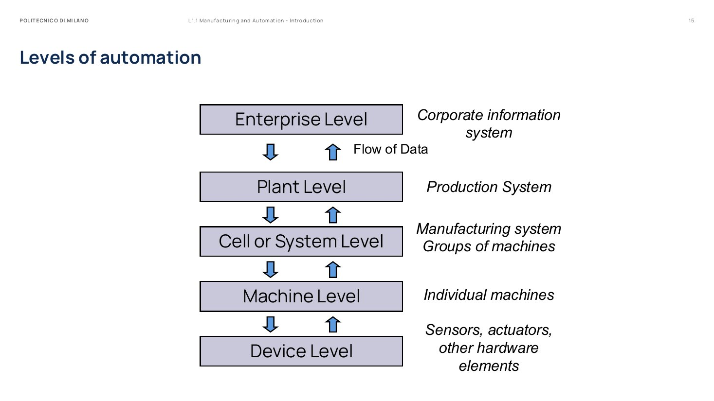

- **Device** — which sensor for which process? Casting: **temperature**. Milling: **position** readout, then velocity (first derivative) and acceleration; accelerometers give **force** (F = m·a).
- **Cell** — material flow between machines: too many parts cause congestion, too few leave machine 2 idle.
- **Plant** — scheduling, resource allocation, **maintenance** (things wear out; stop before catastrophic failure), quality management.

### Fixed vs programmable vs flexible automation

|  | Fixed (dedicated) | Programmable | Flexible |
| --- | --- | --- | --- |
| Characteristics | Fixed process/assembly sequence; simple operations integrated into a complex system | Sequence controlled by a **program**; can be changed; requires **changeover** | Mixed product variants; medium volume; continuous production of a variable mix |
| Investment | High: **custom-engineered** equipment and dedicated tooling | High: **general-purpose** machines, cheap standard tools | High: **custom-engineered system** |
| Rate | High | Lower | Medium |
| Product change | Relatively inflexible | Flexible to variation | Flexible to design variation, with minimal interruption |
| Application | Very large quantities, high rates (automotive) | **Batch** production, low–medium volume (F1, aerospace, custom implants) | Batch, low–medium volume, part families |
| Examples | Machining transfer lines, assembly machines, continuous-motion assembly, high-precision machining | **NC machine tools, industrial robots, PLCs** | Flexible manufacturing cells (FMC) and systems (FMS) |

**Fixed — Tesla Model Y rear underbody (Giga casting).** Class discussion: "how is it made?" Students guessed sheet-metal deformation, which is the traditional way: many stamped parts plus assembly and sub-assembly. Tesla instead **die-casts it as one part** (liquid aluminium injected into a die) and aims for the whole body structure in about three castings (rear, front, centre). The press is made in Italy near Brescia (Idra); 36 million impressions of the video in a month. Changing the part means a **new die**, which must be manufactured, and the swap stops production for days. Automotive downtime costs millions of euros per day. **Transfer lines** (deep-drawing press lines) are the other fixed example.

**Exam alert — dies and moulds:** the press can be reused, but the die is dedicated and expensive, the result of extensive engineering. It is **intellectual property**, often owned by the design authority (e.g. Tesla), even when someone else builds it: "if I gave you my tool, potentially you can copy what I did".

**Programmable — 50 customised gears** milled on a CNC machine. The geometry changes by **writing a new program**; tools are standard and can be replaced in minutes. The gear could also be made by casting + machining, deformation or sintering, but for 50 parts you don't buy dedicated equipment. "It is not really a game of cost, it is a game of how many I need." Fixed = cars sold by the hundreds of thousands; programmable = a gear for next week's Grand Prix.

**Class discussion — robot milling vs Cartesian machine (slide 23).** The robot has a larger reach, so it can work on large parts such as composite moulds. But it is slower because: (1) a straight line needs six motors working together, while a linear axis needs one or two; (2) the robot arm is **compliant**, so cutting forces deflect it, and going faster means higher forces and more power. It was cutting wood, not metal. "Robot without any load will move fast, robot trying to cut cannot move fast" — this is the **link between motion and process dynamics** (position x → velocity x′ → forces).

**Class discussion — fixed or programmable for drilling 10 holes in an engine block (slide 24)?** It depends on **(1) the number of parts** (many → fixed multi-spindle head; few → programmable CNC) and **(2) the number of variants** (many → programmable). **Exam alert — don't assume fixed is always faster or cheaper.** First compute the real cycle time, since drilling 10 holes at once generates large forces, and the dedicated tooling may cost more. The market wants everything cheap, customised and "for yesterday", so you must handle variability and cost together.

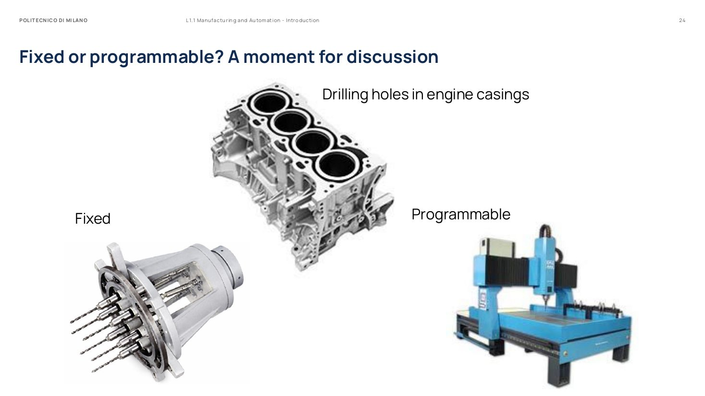

He drew the classic chart (from Groover): **parts per year vs number of variants**. Fixed = few variants, very high volume; programmable = many variants, small batches (roughly 10–100 parts); flexible in between (roughly 1,000–10,000).

**Flexible — Haas EC-400 with pallet pool (slide 27).** The machine changes not only its own tools but also the **workpiece**, through a pallet changer: you load one part while another is machined. The automation challenge is the right position at the right time; any positioning error ruins the part, so **fixtures** must be high quality. **Programmable vs flexible (slide 28):** a general-purpose machine (Mikron) handles only the process. A flexible cell also handles loading, placement and unloading, with several stations (milling, drilling, turning) linked by a transfer system for a **family of similar parts**. It is more productive but less able to change design instantly.


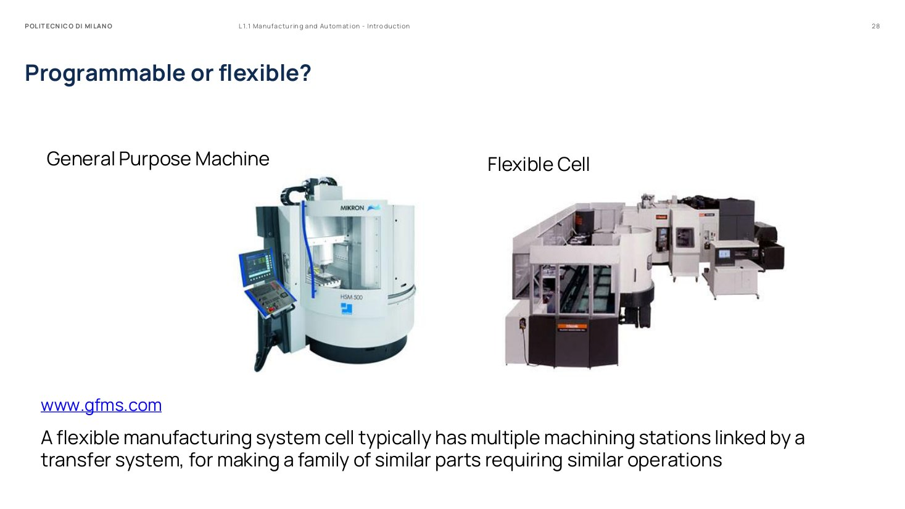

### Process models for control (slides 29–32)

The control pyramid, bottom to top: **process regulation** → **supervisory control** → operations optimisation → production scheduling → business planning. Going up, scope and impact grow; going down, **information fidelity** grows.

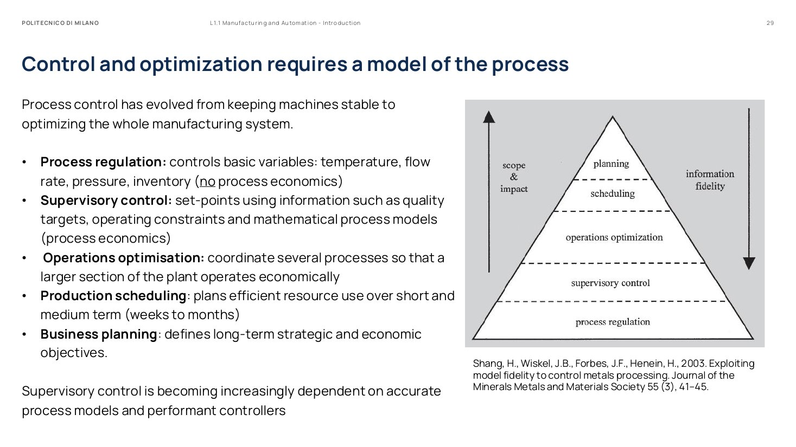

- **Process regulation:** basic variables (temperature, flow, pressure, inventory, tool velocity), with **no process economics**.
- **Supervisory control:** chooses **set-points** using quality targets, constraints and **mathematical process models**. His example: not "keep feed at 500 mm/min" but "which feed rate meets the quality target **without excessive tool wear**?"
- **Operations optimisation:** several processes, so a larger part of the plant runs economically. **Scheduling:** weeks to months. **Planning:** long-term strategy.
- **Exam alert:** "Supervisory control is becoming increasingly dependent on accurate process models." If force matters in milling, you need a model that **predicts the force**: force = cutting pressure × chip area, and chip area depends on the parameters you choose (see L1.5).

**Which kind of model?** Slide 30 example: the spindle power and vibration rise — is it tool wear, chatter, more friction, a temperature rise or a change in material? To optimise you must predict how the process responds to a change in conditions.

- **Physics-based:** from conservation laws and process mechanisms (analytical or numerical).
- **Data-driven:** learned from measured data; useful when data are abundant and first-principles modelling is hard.
- **Hybrid:** physics + data-driven corrections; often the most attractive for industrial supervisory control.

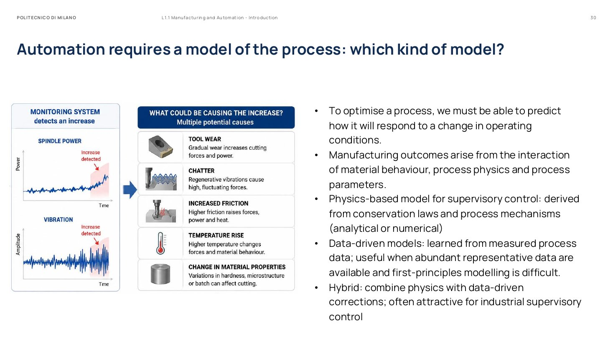

**No process model is perfect (slide 31):**

|  | Model errors | Disturbances |
| --- | --- | --- |
| What | Uncertainty in using the model, e.g. the tool–workpiece interface evolves (friction coefficient depends on pressure, temperature, speed) | Everything beyond what the model should predict |
| Affected by the control signal? | **Yes** | **No** |
| Examples | Friction coefficient varying 0.09–0.145 | Springback / post-processing after the main action; unexpected interruptions |

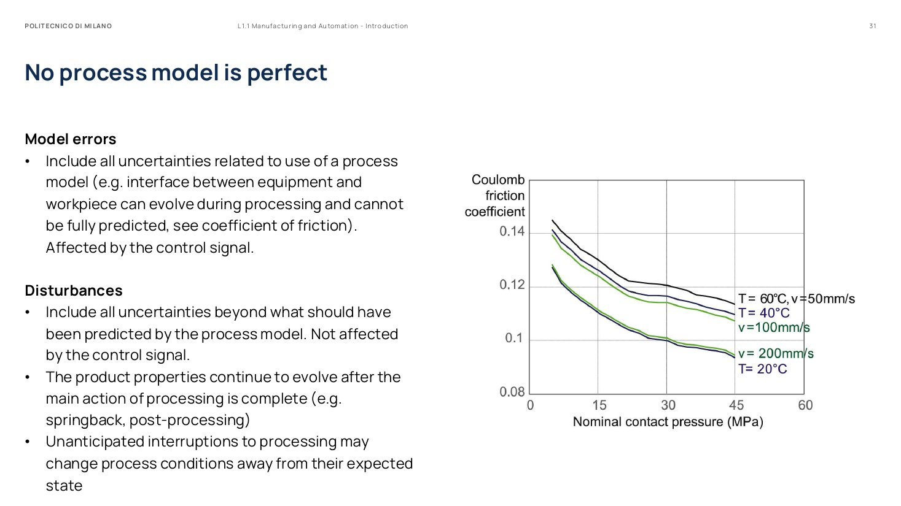

**Physical process vs digital model (slide 32, Allwood et al. 2016):** schedule planner (target zᵣ → input u) → \[equipment ↔ interface ↔ workpiece\], exchanging positions/angles (x, θ) and forces/heat (t, q) → post-process → product property z. A **process model** runs in parallel; its mismatch Δₚ, plus disturbances dₚ and dₚₚ, explains why **equipment sensors** and **product sensors** are needed to close the loop.

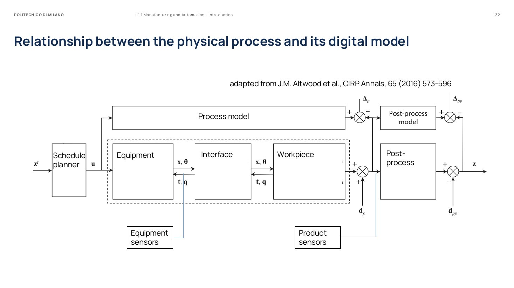

**What he added in class about models:**

- **History:** low computing power, so physical models were "our best guess" → then sensors, so monitoring without a physical model ("it vibrates more, maybe change the tool" = **data-driven**: rising spindle power is linked to tool wear) → today, high computing power + widespread sensors, so **hybrid**. Example: the cutting force is pressure × area, but the cutting pressure usually comes from tabulated data. In a hybrid model you **compute the force online from machine-sensor data** instead.
- **Model error example:** friction force = normal force × friction coefficient ("high-school physics"). The model is easy to use, but the coefficient **drops as the system heats up** and depends on contact pressure and speed, so the simple model is not fully representative. Unexpected obstacles that raise or lower friction are **disturbances**. "This is why today we model, we verify, and we keep the system under control."
- The "interface" in the block diagram is **how you talk to the machine**: the programming language, the touchscreen.
- Each operation (including post-processing such as surface finishing) is a **small closed loop**: equipment and product sensors measure how far you deviate from requirements. You use that to **improve the process model** or to **change the process plan**.
- **Exam alert — gear example:** if the process model predicts a tolerance but the gear **always comes out smaller**, you can make the designed geometry bigger so it comes out right, i.e. **compensate a systematic, modelled error**.

## L1.2 Transformation by solidification – casting

Every casting process solves two coupled problems: **fill the cavity before the flow freezes**, and **remove heat so the part solidifies in the right sequence**. Sand casting is gravity-driven in an insulating mould; die casting is pressure-driven in a conductive permanent die. *(Slides + recordings of 15 Sep morning and the start of 16 Sep, which covers the MPC example.)*

### What casting is

Sequence: pattern/mould making → melt preparation → mould filling → solidification/cooling → removal/breakout → secondary processing.

Why it matters strategically: huge size range (zipper teeth to a 10 m ship propeller); a vast number of castable alloys; EU sector of €31 bn, 2,300+ companies, about 138,000 workers; automotive is the largest customer by tonnage; circular economy (80–90% scrap input). Casting suits **complex parts, reasonably high melting-point materials, both large and small**.

- **Prof — melting temperatures decide everything** ("our fundamental parameter is temperature"). Approximate values: **steel about 1500 °C**, Ni alloys about 1350 °C, **Al about 660 °C**, Mg about 630 °C, **Zn about 400 °C**. The mould must withstand the melt: you can cast Al in a steel die, but not steel in steel ("they weld together"). Say "aluminium **alloy**", "steel", never "iron".

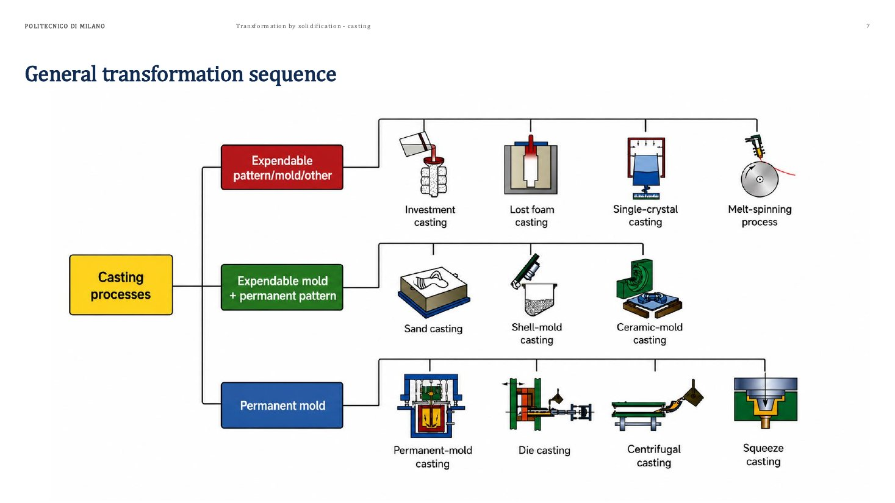

### The three processes

|  | Sand casting | Die casting | Investment casting |
| --- | --- | --- | --- |
| Mould | Disposable, compacted refractory sand; pattern = outside, **cores** = internal passages; **cope** (top) + **drag** (bottom) along a parting line | Permanent metal die (tool steel) | Ceramic shell built on a **wax pattern** tree, dewaxed and fired |
| Filling | Gravity, through the gating system | **Pressure** (up to 1000 MPa) | Gravity into a preheated shell (vacuum/pressure/centrifugal possible) |
| Surface Ra | 6.3–25 µm, so post-machining needed | 0.8–3.2 µm | Fine detail |
| Tooling cost | Low, very common, large parts | High, so high volumes | Medium |
| Cycle | Labour-intensive, long | Fast (die removes heat quickly) | Long (shell building) |
| Notes | 3D-printed moulds/cores allow previously impossible shapes | Die suffers thermal cycling, pressure, erosion, corrosion; steel choice, cooling layout, maintenance are central | Shell knock-out, cut from tree |

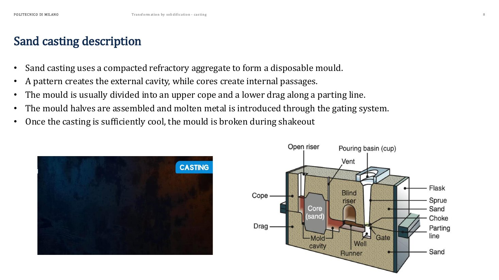

- **Prof — why sand casting is gravity casting:** sand doesn't melt (it vitrifies above about 3000 °C), so it withstands any melt, but it **can't withstand force**. The metal is never pushed in; the speed comes only from potential energy, so it is **set by the mould design** (sprue height). A **matte surface** tells you a part was sand cast. "Almost everything starts in casting", then gets machined.
- **Prof — automation needs:** make the mould every cycle (it's broken each time); bring the melt to the pouring station; pour at the right time and volume (too slow and it freezes, too fast and it damages the mould); extract; recirculate sand; extract fumes and dust. Molten Al about 700 °C, steel about double, and even the **radiation** harms operators.

**Die-casting machines:** **cold chamber** = metal is ladled or dosed into a separate shot sleeve, then a plunger drives it in (**Al alloys**; the Giga Press is the largest cold-chamber machine, see the Tesla example in L1.1). **Hot chamber** = gooseneck and injection cylinder immersed in the melt, fast filling (**Zn, Mg alloys**).

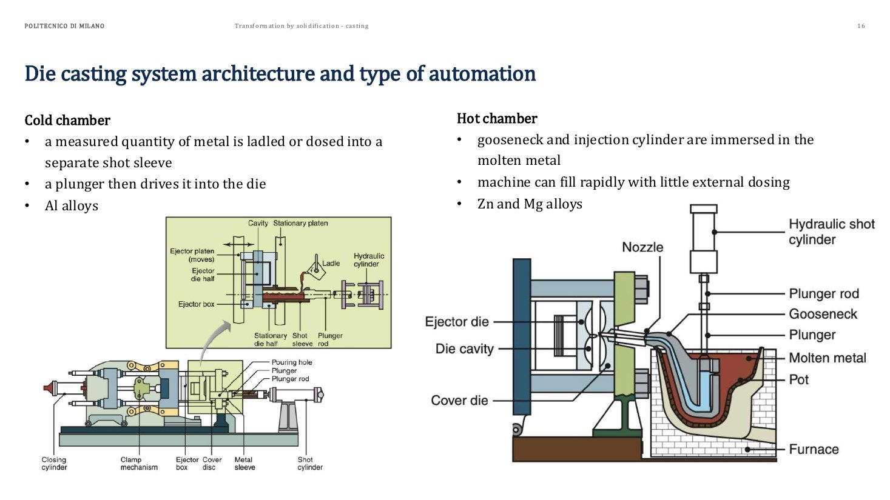

- **Prof — die casting:** "die" = permanent; pressure makes it faster and pushes the air out. The die is **steel**, so Al, Mg, Zn. The die wears (thermal cycling, erosion), so the **part geometry drifts**, "always an automation and control opportunity". **Cold chamber** (Al): a ladle doses each shot, slower, less wear, more precise. **Hot chamber** (Zn, Mg): a gooseneck sits in the pot, more automatable, but more wear. Classic small parts: belt buckles, electronics housings, **matchbox toy cars**.
- **Class discussion — how do you make the die and the pattern?** Only 1–10 dies are needed, so **programmable automation: mill it from a block** (or cast + machine if huge). Patterns: plastic, wood or metal, also milled (or 3D-printed, which is flexible). **Exam alert:** this is process selection by "how many do I need?" (L1.1).

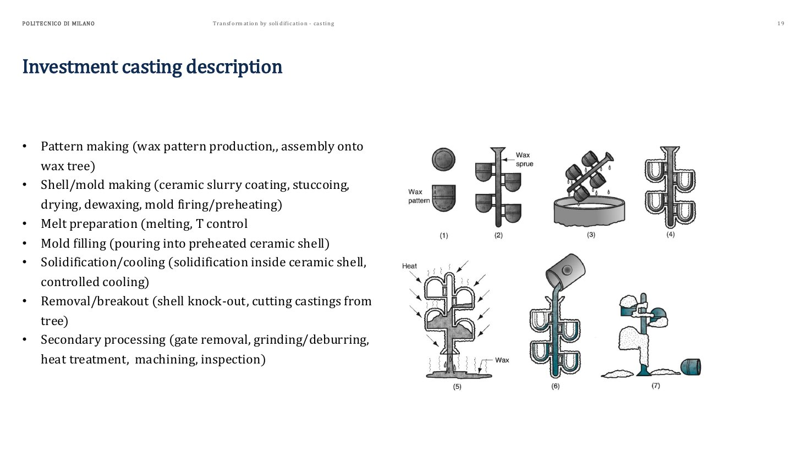

### Automation in casting

- **Sand — material handling:** conveyors (belt, bucket, roller, pallet, monorail, overhead), cranes, trucks, robots. Less manual carrying and waiting, less damage to fragile moulds and cores, less exposure to hot metal.
- **Sand — moulding and cores:** automated sand preparation (moisture, binder, temperature, mixing time); high-pressure moulding machines; core blowers and robot insertion.
- **Sand — pouring, shakeout, environment:** automatic pouring controls metal mass, stream position and timing; shakeout feeds sand reclamation; dust/fume extraction.
- **Die casting:** automation targets **cycle time**. **Investment casting:** robots dip the wax trees into the slurry.

### Physics: what goes wrong

- **Filling:** liquid velocity too high gives turbulence and gas entrapment; too slow gives regions of isolated liquid.
- **Solidification:** the wrong sequence gives shrinkage porosity, plus effects on microstructure and residual stress.

* **Prof:** too slow means freezing and incomplete filling; too fast means **turbulence, entrapped air, porosity**. Metals **shrink** when they solidify, and uneven thick/thin sections give residual stress and bending. The course models **filling only**, not solidification.

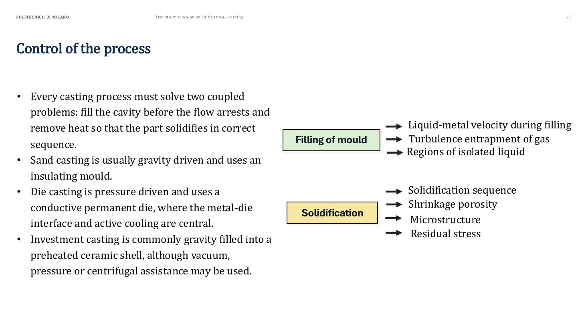

### Model 1 — gravity pouring (sand casting)

Bernoulli between two points of the gating system:

```math
P_1 + \tfrac{1}{2}\rho v_1^2 + \rho g h_1 - \Delta P_{loss} = P_2 + \tfrac{1}{2}\rho v_2^2 + \rho g h_2
```

Atmospheric pressure at both points, no friction, top of sprue (v₁ = 0, h₁ = h) to base (h₂ = 0):

```math
v = \sqrt{2 g h}
```

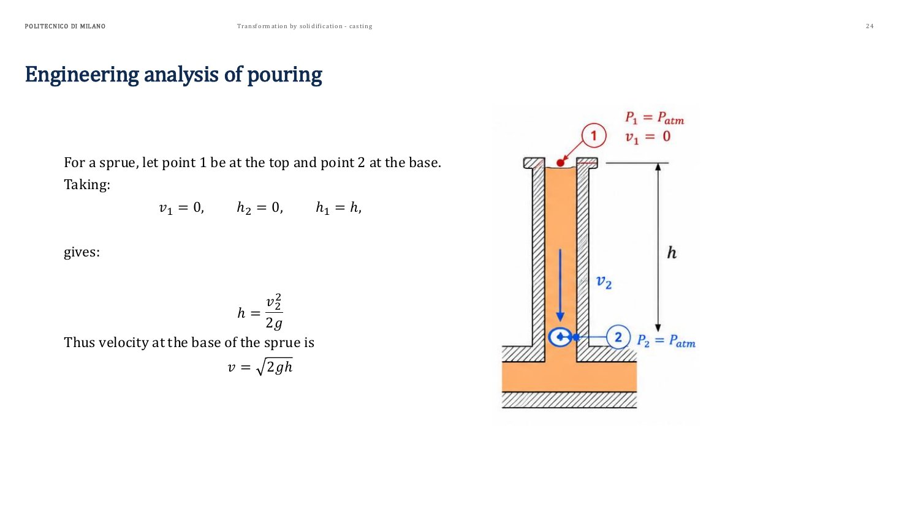

Continuity (incompressible): Q = A v = constant, so A₁v₁ = A₂v₂. The metal speeds up as it falls, so **the sprue must be tapered**, narrower at the base. Otherwise the stream separates from the wall and aspirates air.

Mould filling time for cavity volume V:

```math
T_{MF} = \frac{V}{Q} = \frac{V}{A\sqrt{2gh}}
```

This is a **theoretical minimum**: it neglects friction, changes of direction, contractions and expansions, turbulence, losses in runners and gates, and partial obstruction.

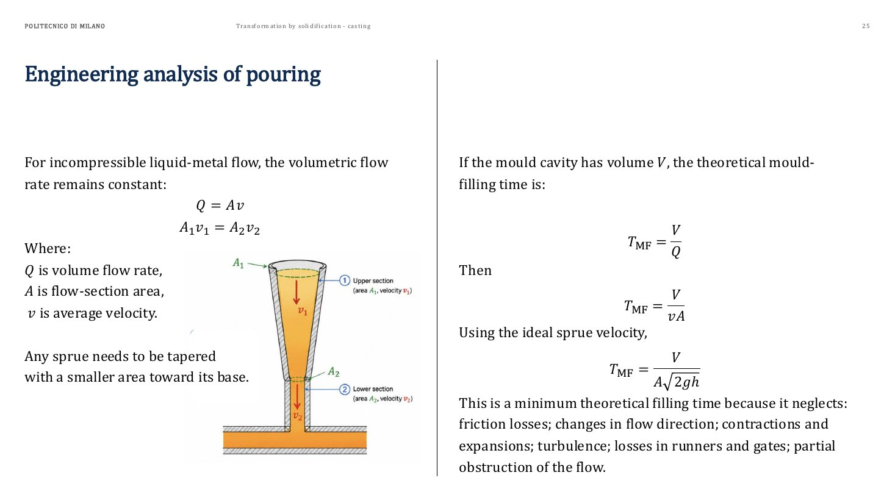

**Worked example (slide 26):** sprue 20 cm long, base area 2.5 cm², cavity 1560 cm³. v = √(2 · 981 · 20) = **198.1 cm/s**; Q = 2.5 · 198.1 = **495.3 cm³/s**; T\_MF = 1560 / 495.3 = **3.15 s ≈ 3.2 s**. Watch the units: g = 981 cm/s² when lengths are in cm.

- **Prof:** derived on the blackboard: higher speed means a **taller sprue** (within design limits). **Exam alert:** "I ask students to **draw** during the oral exams", so be ready to sketch the sprue and gating. On 3.2 s: "is this a lot?" It depends on the volume, and cooling time comes on top; die casting fills the same cavity in **under a second**.

### Model 2 — pressure filling (die casting)

The driving term is the injection pressure ΔP\_inj = P\_shot − P\_cavity. Neglecting losses, with discharge coefficient C\_d:

```math
v_g = C_d\sqrt{\frac{2\,\Delta P_{inj}}{\rho}} \qquad t_{fill} = \frac{V_{cavity}}{A_g C_d \sqrt{2\Delta P_{inj}/\rho}}
```

Plunger continuity: A\_p v\_p = A\_g v\_g, so v\_g = (A\_p / A\_g) v\_p. **Small gate sections produce very high gate velocities.** Die casting must fill very fast, before the metal loses heat to the die.

- **Prof:** in die casting **losses can't be neglected but are hard to measure**, hence C\_d < 1. In practice you **control force/plunger velocity**, not pressure: a large plunger area pushed slowly through a small gate gives high gate velocity, "this is how pumps work".

### Process control example — MPC for low-pressure die casting of Al wheels (Maijer et al., 2009)

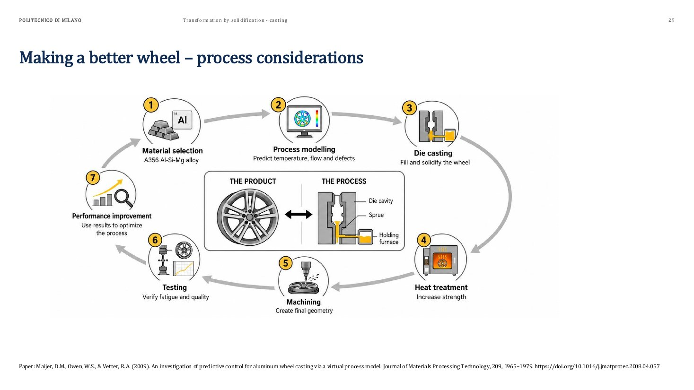

- **Problem:** recipes (die-close time, cooling durations, pressure, ejection time) run **open-loop**. That works only if the environment is perfectly repeatable, but furnace temperature drifts, coatings age, filters load, operators extend die-open time, cooling flow changes, and the die heats up from start-up to steady cycling.
- **Why not use the detailed model directly:** the 3D FE thermal model is too expensive for real time. Instead, run **virtual bump tests** on it (step each input from nominal, hold the others, run 100 cycles to reveal gains, delays and time constants), then identify a **reduced-order discrete state-space model** with **N4SID** (system identification). That model is ready for MPC.
- **Sampling instant = one casting cycle k**; the model predicts next-cycle temperatures.
- **Controlled outputs:** PV1–PV3 = **maximum-cycle die temperature** of the bottom, top and side die (one target per cycle instead of tracking within the cycle). Rationale: macro-shrinkage comes from **liquid encapsulation**; if die temperatures near the critical region repeat the optimal cycle, the solidification path repeats.
- **Manipulated inputs:** CV1 bottom-die cooling duration, CV2 top-die cooling duration, CV3 die-closed time.
- **Measured disturbances (feedforward):** FF1 incoming metal temperature, FF2 die-open time (operator-dependent).

* **Prof (16 Sep):** casting → heat treatment → machining → sample testing → field data is "a **very slow loop**"; with a model and in-process data you get quality without waiting for testing. Recipes are often set "based on pure experience". A 20 °C summer–winter difference is about **3% of the Al melting temperature**. Dies age, filters load, **operators get tired**. Some disturbances are impossible to control (outside temperature), others we **prefer not to** (humidity).
* **Prof:** "if your simulation takes two days, the humidity has already changed", hence reduced models. **One wheel = one data point**: a million wheels a year is a rich data set. **Proxy:** you can't put a sensor in the melt, so you measure the **die** (peak about 545 °C), one max per cycle; today you can analyse the **whole temperature profile**. Detecting a bad part is already a gain; ideally you **intervene** (e.g. pour hotter if a point reads low). Virtual experiments also allow **offline optimisation**.
* **Exam alert:** "The perfect process may not happen, not because of lack of engineering competence, but because there are disturbances from the outside."

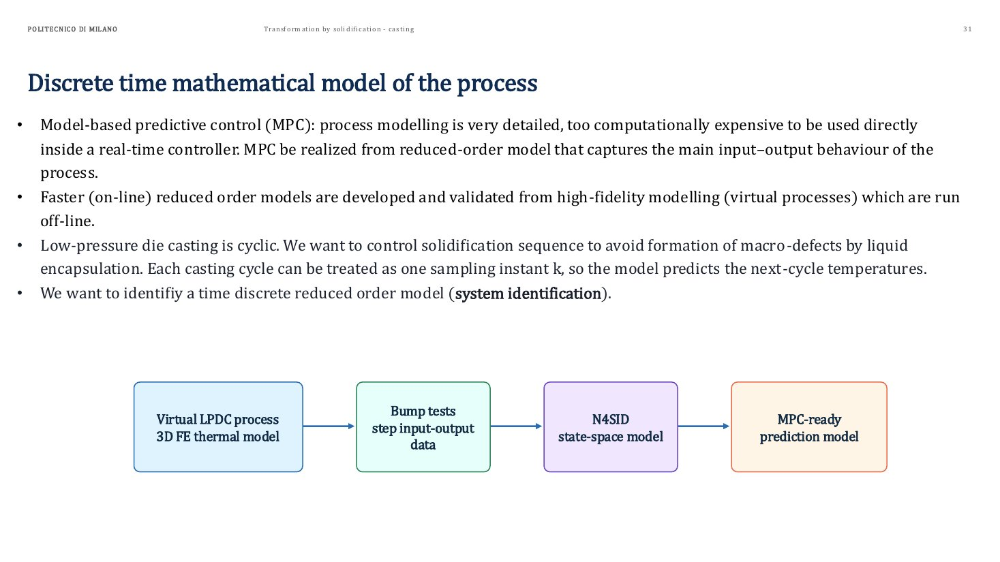

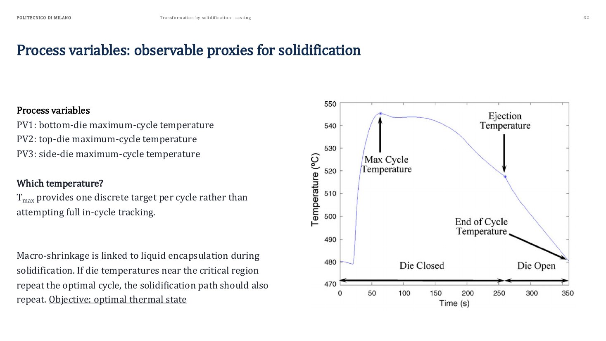

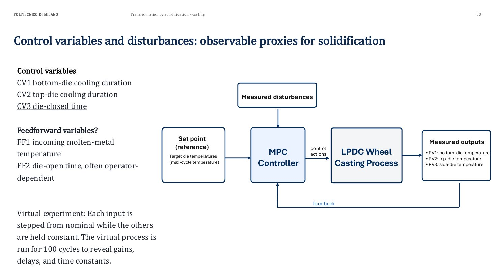

```math
x(k+1) = A\,x(k) + B_{cv}\,u_{cv}(k) + B_{ff}\,u_{ff}(k), \qquad y(k) = C\,x(k)
```

A = natural thermal evolution from one cycle to the next; B\_cv = effect of the control variables; B\_ff = effect of the measured disturbances; C maps internal states to the measured die temperatures.

**Exam link:** this is the L1.1 control pyramid in practice. A high-fidelity model is used offline, a reduced model online, sensors close the loop, and disturbances are handled by feedforward.

## L1.3 Transformation by fusion welding

**Power density decides whether a heat source melts, does nothing, or drills**: too low and heat conducts away; too high and the metal vaporises. Laser welding runs in **conduction** mode (< 10⁶ W/cm², wide and shallow) or **keyhole** mode (> 10⁶ W/cm², narrow and deep). *(Slides + recording of 16 Sep afternoon.)*

### Joining and welding

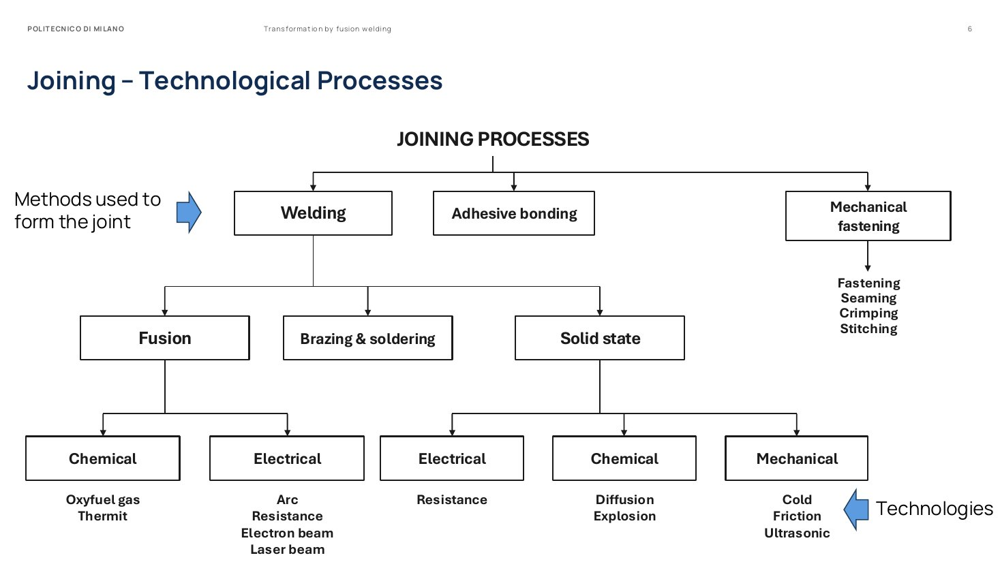

- **Joining** = fastening components into a continuous form or unit. An ideal design has no joints (joints are local weaknesses), but joining is needed for **manufacturability** and/or **functionality** (the four design goals: manufacturability, functionality, cost, aesthetics).
- Families: welding, brazing & soldering, adhesive bonding, mechanical fastening (also seaming, crimping, stitching).
- **Welding** = atoms brought close enough to form primary bonds, by heat and/or pressure; the result is a **weldment**.
- **Fusion welding:** both parts melted, sometimes with filler. No filler = **autogenous** weld. Examples: arc, oxyfuel, resistance spot (strictly not fusion), laser, electron beam.
- **Solid-state welding:** heat/pressure, no melting, no filler (forge, diffusion, friction).

* **Class discussion — which zone is strongest?** Usually the **fusion zone** (cools fastest), then the base metal; the **HAZ is weakest**, so a good weld breaks **near the HAZ**. Smaller seam = smaller HAZ = usually safer.

### Heat sources

| Process | Power density (W/mm²) | Notes |
| --- | --- | --- |
| Oxyfuel | 10 | Fuel-gas combustion |
| Arc | 50 | Plasma 8,000–20,000 K; overall ≈ 10⁸ W/m² |
| Resistance | 1,000 | Spot and seam welding |
| Laser beam | 9,000 | 10⁹–10¹¹ W/m² |
| Electron beam | 10,000 |  |

**Arc welding:** the power source sets a voltage between electrode and workpiece; touch and withdraw to strike the arc. Current flows through an ionised gas (**plasma**); arc temperatures > 5500 °C. **More heat is generated at the anode**, because electrons are much lighter and faster than ions. The weld pool solidifies behind the moving electrode to form the bead.

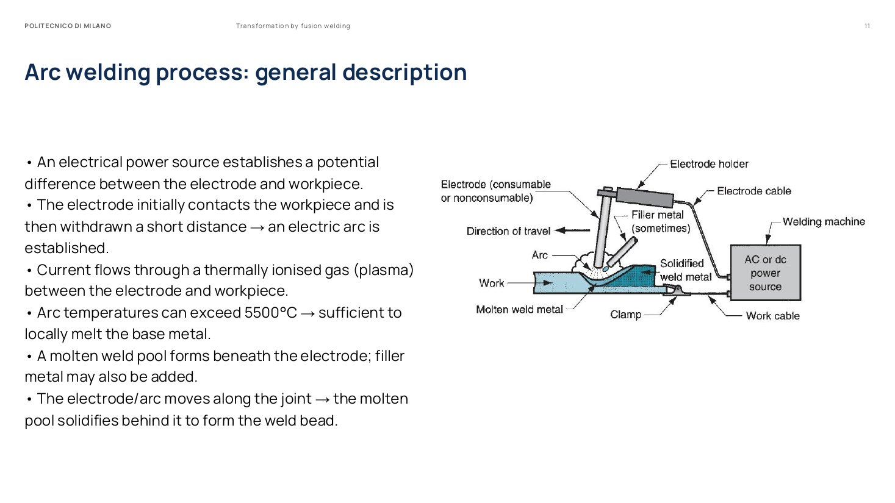

|  | Manual metal arc | TIG | MIG/MAG |
| --- | --- | --- | --- |
| Electrode | Consumable (coated) | **Non-consumable** W | Consumable wire = filler |
| Shielding | None (coating) | Ar, He (inert) | Ar, He (MIG, inert) / CO₂ mixes (MAG, active) |
| Current | 10–500 A | 200–500 A | 500 A |
| Voltage | 17–45 V | 55 V | 16–30 V |
| Spatter / distortion | High / large | Low / smaller | Low / smaller |

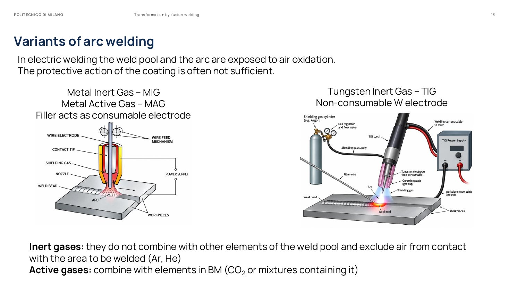

**Inert** gases do not combine with the weld pool and exclude air; **active** gases react with the base metal.

```math
P = I\,V \qquad PD = \frac{\eta P}{\pi d_s^2/4} \qquad d_s \approx 10\text{–}20\ \text{mm (arc size ≈ bead width)}
```

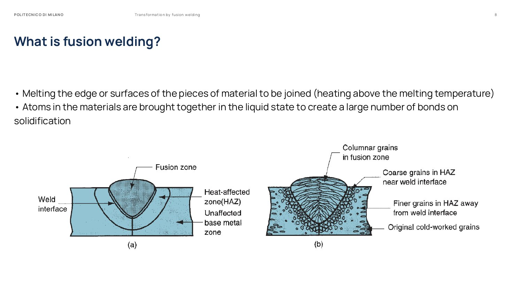

### High power density beams (laser, electron beam)

- 10¹⁰–10¹¹ W/m² is right for welding; above it, vaporisation removes material (drilling).
- High power density + high speed gives a **narrow heat-affected zone (HAZ)**. Usually **autogenous** (no filler).
- **LASER** = Light Amplification by Stimulated Emission of Radiation. Coherent light focuses to a sub-mm spot. The optical cavity has a laser medium (solid or gas), mirrors and a pump. Types: CO₂ (earliest high-power CW), Nd:YAG, **fibre lasers (most used today)**.
- **Fibre laser delivery:** double-clad fibre (active core, inner cladding, outer cladding), pump guided by total internal reflection. Focused spot about 0.5–2 mm, power about 2–20 kW, so 10⁹–10¹¹ W/m². The intensity is **not uniform** across the spot (often Gaussian).
- **Delivery arrangements:** flexible fibre to a head on a robot, or **remote welding with a galvo scanner**.
- **Industrial example:** ABB IRB 4600 arm + rotary-tilting table, IPG 6 kW fibre laser (150 µm waist), wobble head with galvo scanners, wire feeder. **Teaching system:** Snapmaker A350 (10 W) and A250 (1.6 W) diode lasers, 450–460 nm, 0.005 mm repeatability.

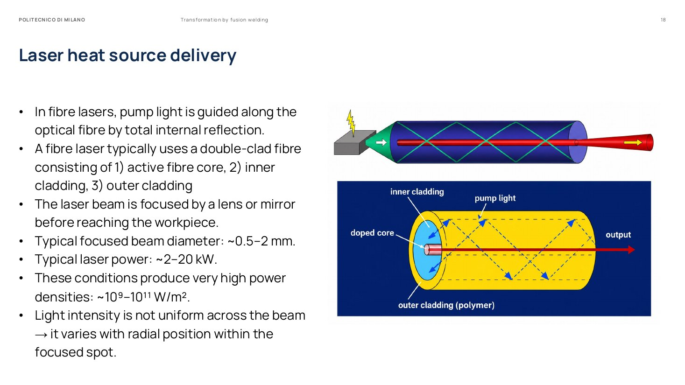

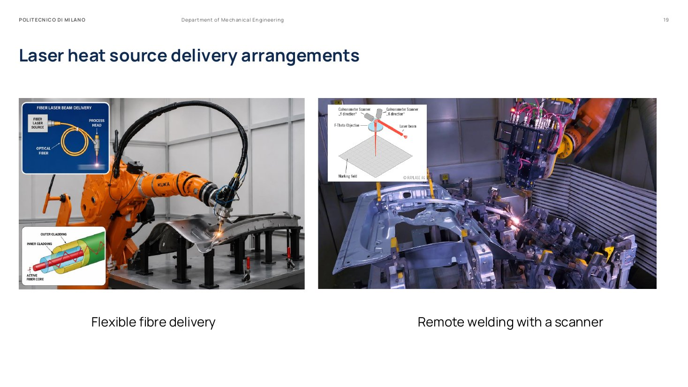

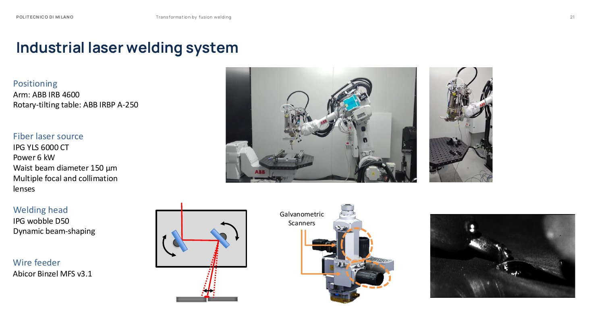

- **Prof — laser:** spot 1–2 orders of magnitude smaller than an arc, power 100 W–20 kW, so it can **vaporise**, giving narrow seams and a small HAZ. Same laser on his samples: about 5 mm seam (beam **wobbled**) vs < 1 mm. Filler welds **bulge**; autogenous welds are flat. Spot down to 0.1 mm on a robot with about 1 mm repeatability, so **trajectory control is the challenge**. Scanners move a **massless beam** with small mirrors.
- **Prof — power density:** PD ∝ P/d², so a smaller spot raises intensity much faster than more power. Spot size is where the peak falls to **13.5%** (1/e²); just remember the beam is **more intense at the centre** with **no sharp edge**. A moving source **preheats ahead and post-heats behind**.

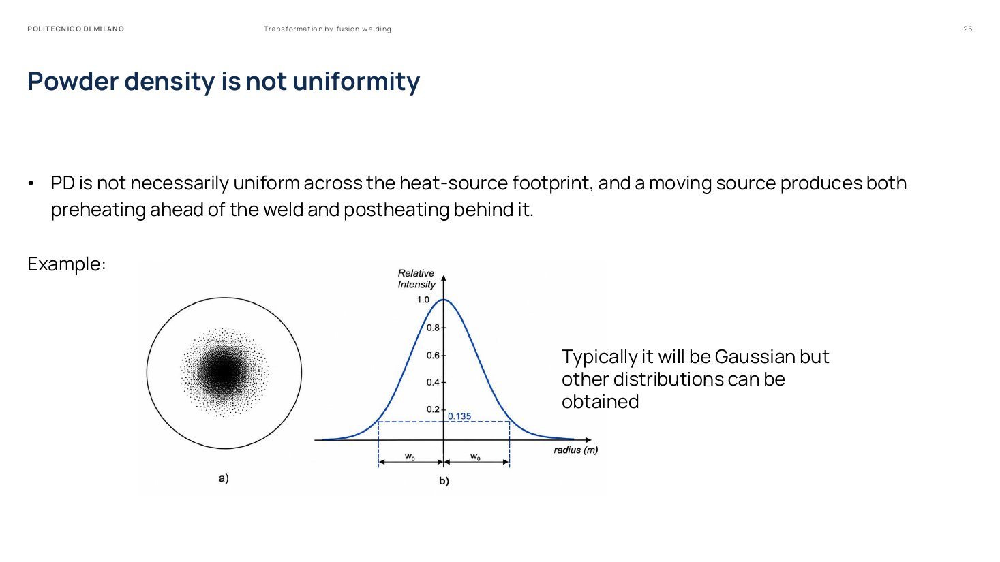

### Conduction vs keyhole

|  | Conduction | Keyhole (deep penetration) |
| --- | --- | --- |
| Intensity | < 10⁶ W/cm² | > 10⁶ W/cm² |
| Mechanism | Absorbed at the surface, then conducted | Vaporisation opens a **vapour cavity**; **vapour pressure** holds back the melt |
| Pool shape | Wide, shallow, near-hemispherical | **Narrow, deep** (high depth/width ratio) |
| Absorption | Surface absorptivity | Multiple reflections in the keyhole, close to 100% |
| Notes |  | Threshold depends little on speed; small spots reach it easily (CO₂ > 1 kW; single-mode fibre even < 1 kW). **Unstable keyholes trap porosity.** Chevron ripples form behind the beam as the keyhole closes. |

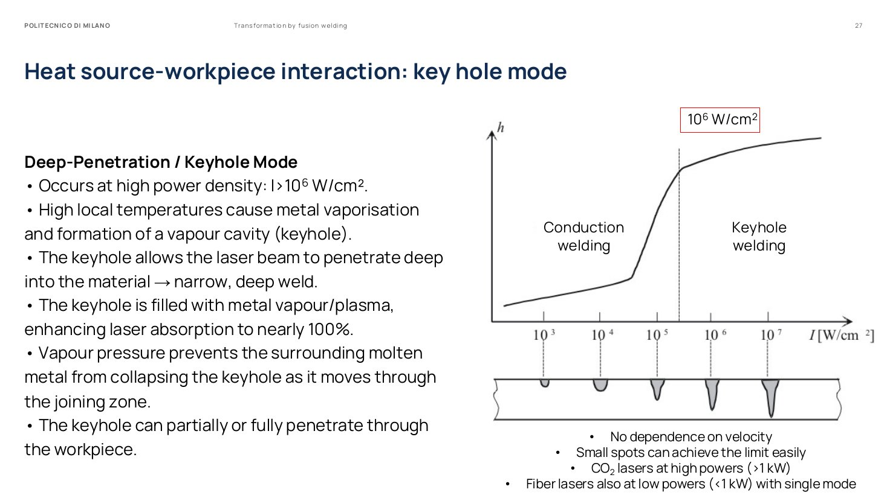

- **Prof:** conduction = **low aspect ratio** (depth/width). Keyhole "because you can **see through**": his 5 mm sample was welded through the full thickness. Absorption is like a green shirt reflecting green; at about 1 µm **copper absorbs little**, steel a lot.

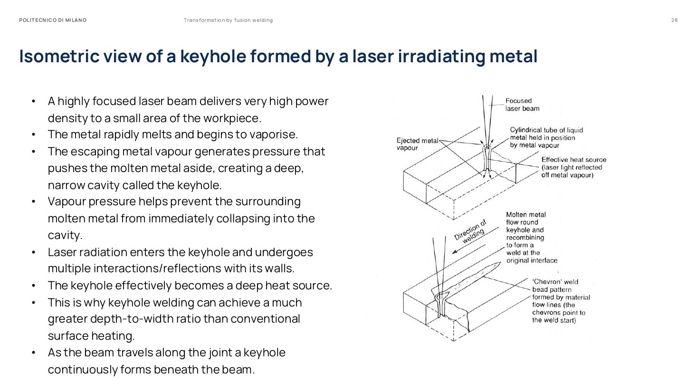

**Absorption:** light is absorbed, reflected or transmitted. Absorptivity is **higher at shorter wavelengths**, and depends on temperature, angle of incidence, roughness and surface films.

### Heat balance (key formula for numerical exercises)

Absorbed power = power needed to heat and melt the volume swept per second:

```math
A\,P = w\,h\,v\;\rho\left[c_p\,(T_m - T_a) + L_m\right]
```

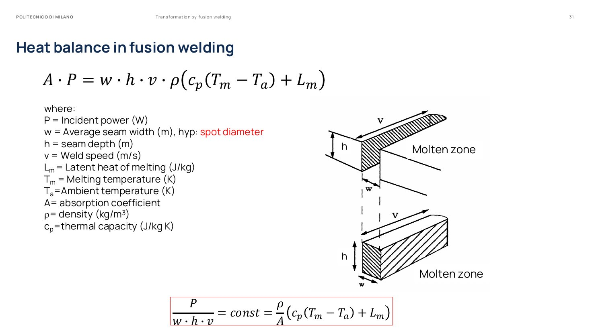

A = absorptivity, P = incident power (W), w = seam width (m, often taken as spot diameter), h = penetration depth (m), v = weld speed (m/s), ρ = density, c\_p = specific heat, T\_m = melting temperature, T\_a = ambient, L\_m = latent heat of melting.

Define the **volumetric energy to melt** E\_v = ρ\[c\_p(T\_m − T\_a) + L\_m\] (J/mm³), so **P/(w·h·v) = E\_v / A = constant** for a material.

| Material | ρ (kg/m³) | c\_p (J/kg·K) | L\_m (kJ/kg) | T\_m (°C) | E\_v (J/mm³) |
| --- | --- | --- | --- | --- | --- |
| Al alloy | 2,700 | 900 | 390 | 660 | 2.60 |
| Steel | 7,850 | 470 | 270 | 1,500 | 7.56 |
| Ni alloy | 8,400 | 440 | 290 | 1,350 | 7.33 |
| Stainless steel | 8,000 | 500 | 260 | 1,450 | 7.78 |
| Brass | 8,500 | 380 | 180 | 930 | 4.45 |
| Mg alloy | 1,800 | 1,020 | 370 | 630 | 1.78 |

Consequence (YLR fibre laser data on stainless steel, 420 µm spot): **penetration rises with power and falls with speed**, since h ∝ A·P / (w·v·E\_v).

- **Prof — reading the balance:** with w ≈ spot, **deeper means slower or more power** (keyhole regime). Al needs less energy per volume (low T\_m **and** low density). No perfect choice: a small weld is safer (small HAZ), a large seam tolerates fit-up better.

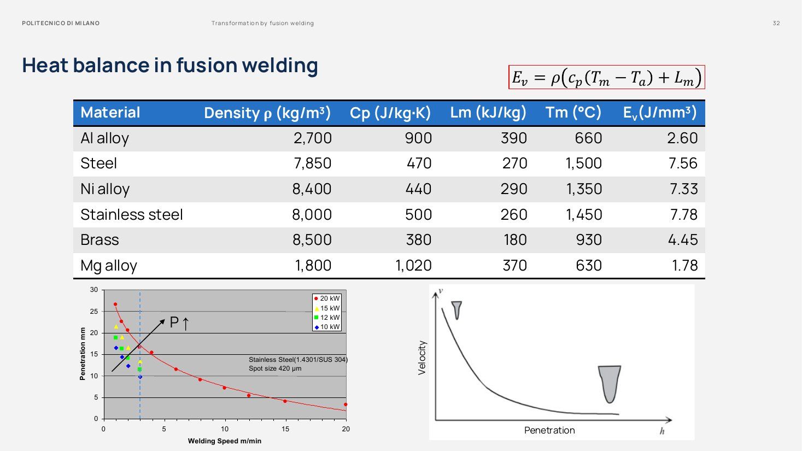

**Independent variables:** beam power, beam diameter, material absorptivity, traverse speed. **Dependent:** penetration depth, microstructure and metallurgical properties.

- **Class discussion — what would you control to avoid defects?** (1) **Speed**: axes must accelerate and decelerate at corners, so the real speed isn't the programmed one, and you must **balance power against actual speed**; (2) **seam position tracking**: are the parts where you think?; (3) **cleanliness**: oxide raises arc resistance, contamination changes laser absorption, oil causes flashes and spatter. "Better to see that in process", which leads into L1.4: **think about which sensors to put on the process**.

## L1.4 Welding modelling and automation

"Automation is not just moving the torch; it is **closing the loop between target, signal and correction**." A sensor is useful for control only if it observes a controllable state, responds before the defect forms, and samples fast enough. *(Slides + recording of 30 Sep afternoon. Professor's comments are inline, marked Prof / Class discussion / Exam alert.)*

### Why automate welding

Repeatable heat input despite operator, fixture and part variation; higher productivity (a robot or laser moves faster than a hand torch); **safety** (arc radiation, fume, high-power beam, hot metal); **traceability** (every weld linked to its process data); a **zero-defect** ambition (detect drift and intervene before scrap).

- **Prof — three kinds of variability:** person to person, **fixture to fixture** (one worn, one new), **part to part**. Welding is tricky because you assemble at least two parts, so **both tolerances and how they sit together** matter.

### Motion systems for beam welding

The beam can be moved by the part, the optics, the head, or combinations. The choice affects accuracy, acceleration, access, payload and sensing. **Scanner:** small fields, remote welding. **Gantry:** precision over large flat sheets. **Robot:** 3D access, but **accuracy and calibration dominate**.

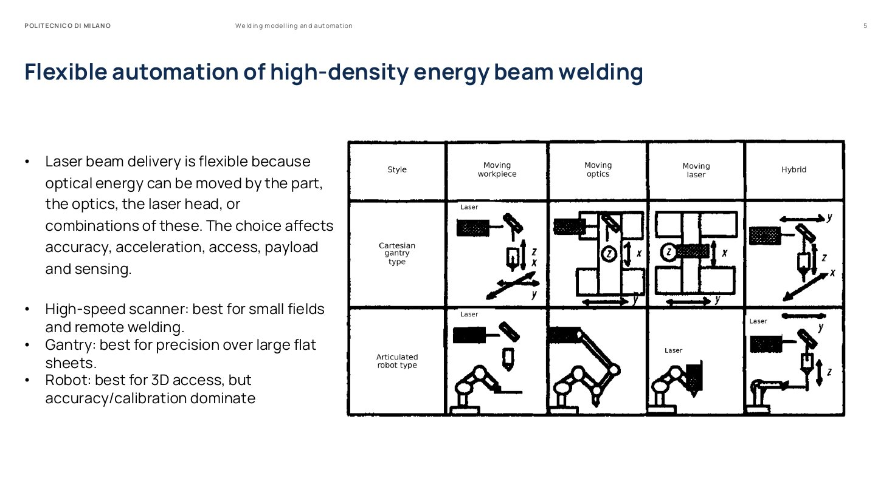

- **Class discussion — gantry vs articulated robot:** the robot has more DOF, so better **access**. But the gantry is **rigid**, so it is more precise and faster ("a high-speed train on rails is faster than most cars"), at the cost of being bulky and expensive. Robot freedom can mean a **"wobbly" system**. Scanner: the laser source is heaviest, the head lighter, light has **no mass**, so mirrors are fastest, but only over **small areas**.

**A robotic welding cell needs:** fixtures (repeatable joint position and fit-up), positioners (access + best weld orientation), robot + welding package (coordinated path and process control), **two stations** (weld on one while loading/unloading the other), torch service equipment.

- **Prof:** an arc robot carries the torch (about 5 kg) plus wire feeder; the power source is integrated with the controller (turn the arc on/off, current, voltage, polarity). Offline programming repeats the same path, but **"the programmed position is where you hope the part will be"**. Fit-up and manufacturing errors shift the part, so the trajectory needs correction.
- **Exam alert — positioner vs spindle:** a spindle turns indefinitely and you control its **velocity**; a **positioner controls position** (rotary positioner for long parts, tilting-rotating table). The lab has three cells of 6-DOF robot + positioner.

**Programmed vs adaptive welding — handling joint variability:** **touch sensing** (find the joint before welding), **through-arc tracking** (correct the path from welding-current variation), **vision tracking** (locate and follow the seam). More sensing gives more flexibility but higher cost and complexity.

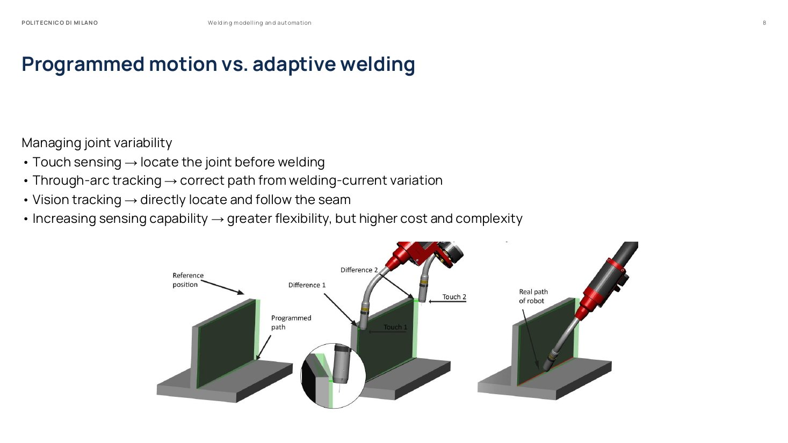

- **Class discussion — why do parts move during welding?** **Thermal drift**: one part is hot, the other cold, so it expands unevenly. Pre-weld sensing corrects the initial misplacement, but not what happens once things heat up. Hence the push for **real-time vision compensation**.
- **Prof — touch sensing explained:** not pressure. The torch is already part of an **electrical circuit** (built to make an arc), so touching the part **closes the circuit**. Knowing the robot position and torch geometry, you map the real seam.

### Open vs closed loop

- **Open loop:** power, speed and focus are preset. No measurement means no correction, yet industrial processes have disturbances.
- **Closed loop:** measure continuously, compare with a target, adjust a control variable (laser power, travel speed, focal position, powder feed).
- **Four questions to ask (slide "Time to reflect"):** (1) what process variable or product quality can we measure? (2) how do we interpret the signal and separate it from noise? (3) how do we improve the process, and on what timescale? (4) what do we change, and by how much?
- Motivation: weld failures caused the Seongsu Bridge collapse (1994), a wind-turbine tower collapse (Germany, 2014) and the SS Schenectady tanker fracture (1943).

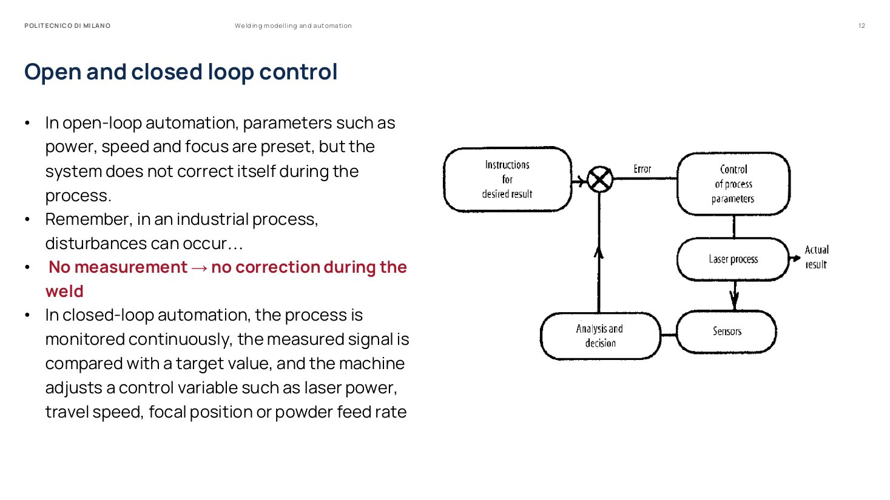

- **Class discussion — which disturbances cause poor laser welds?** Room temperature (only with extreme seasonal swings) → bad positioning or fixturing → **dirty optics / fumes** → **change of material lot** (purchasing switches supplier for price, and the surface or chemistry changes slightly without anyone telling you) → oxidised vs clean surfaces → system-to-system variability → and **human error** ("people press the wrong button"). "If you don't sensorise the process, you have no idea of these issues."
- **Prof:** the critical outputs (**depth, width, internal defects**) usually can't be measured directly, so we measure **indirectly**. "That opens up the world of big data and machine learning."

### What must be controlled, and the defects when it isn't

| Beam | Workstation | Workpiece | Process (observable) |
| --- | --- | --- | --- |
| Source type, power P, diameter D, energy distribution, position | Traverse speed, focal position, seam location, vibration, gas nozzle/flow | Absorptivity, joint gap, surface condition, temperature, material batch | Melt pool size, keyhole stability, plume/plasma, spatter, acoustic emission |

- **Class discussion — the 4 questions applied (useful oral method):**
  1. **What to measure? Use the human senses:** see (camera, IR temperature), hear (**microphone**, since the keyhole emits a high-pitched sound), smell (gas sensor; an argon sensor is a "smell sensor" for safety), touch (contact probe on bead height/width). "Engineering applications derive from these ideas."
  2. **Signal vs noise (microphone):** air movement, echoes, factory noise (low frequency), machine whine (high frequency), so band-pass filtering. Or the **Shazam approach**: FFT plus a learned signature. Two philosophies: physics-based filtering vs **training a model** on many repeated welds.
  3. **Timescale (worked example):** 10 mm weld at 30 mm/s gives **0.33 s**. Acquisition must resolve that window, and you must ask **when the defect forms**. A microphone and a photodiode can; a camera depends on its frame rate.
  4. **What to change?** If the signal says depth is dropping, **increase power** (or reduce speed), reading straight off the heat balance P/(w·h·v) = const. "All of a sudden we go back to our models. Simple yet powerful."
- **Prof:** in practice we control mainly the **beam** and the **workstation (motion)**; the workpiece and process columns are what we observe.

* **Wrong beam intensity:** lack of penetration, lack of fusion, spatter, keyhole defects (porosity).
* **Wrong workstation:** missed weld, oxidation (bad shielding), overheating at corners, underfill.
* **Wrong parameters, thermal side:** distortion and residual stress.

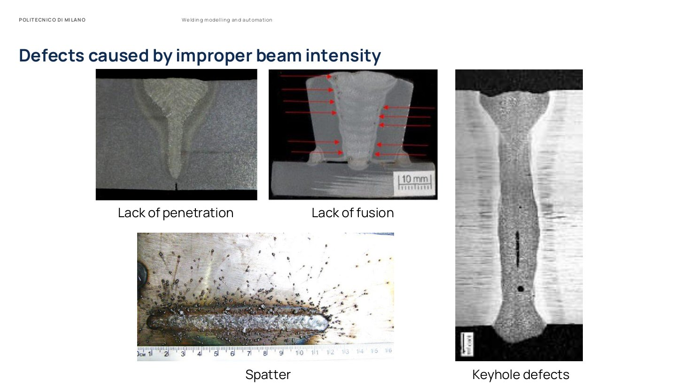

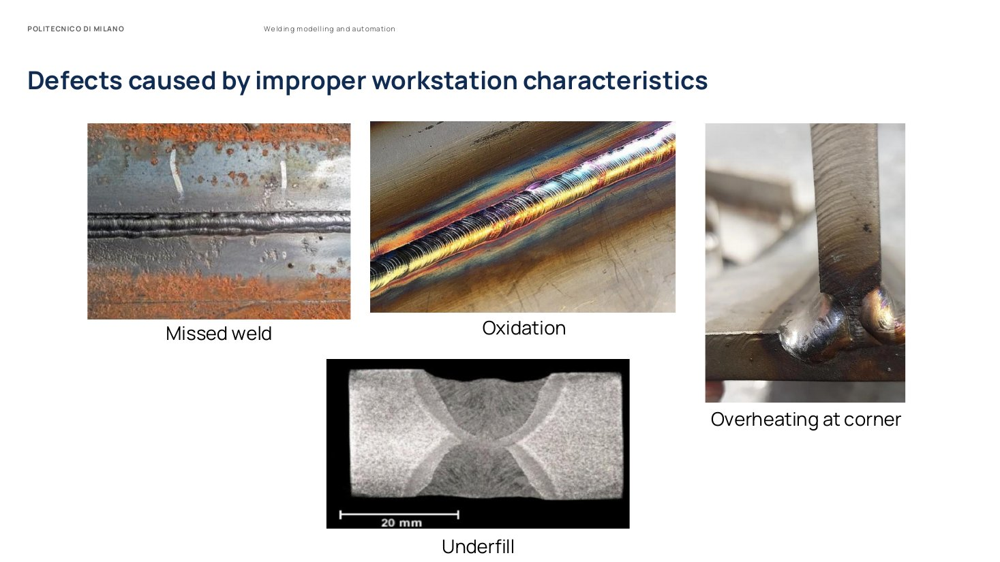

- **Prof — process signatures:** seeing the keyhole needs **X-rays**, which isn't feasible industrially, so watch what comes out: **plume** (vapour, emits light; a deeper or shallower keyhole changes it), **spatter**, melt-pool size from the top.
- **Exam alert — why even a tiny lack of penetration matters:** "that is the region where a **crack will start**." Pores and keyhole voids are **crack initiators**. Spatter on the surface means **voids inside** ("mass is conserved"). Oxidation is bad because it **corrodes more easily later**. Overheated corners and underfill = missing material, so stress concentration.

### Distortion vs residual stress

Both come from **thermally induced stresses**: non-uniform, fast heating and cooling create temperature gradients, so regions expand differently. If the structure is **free**, the result is **distortion** (fit-up and accuracy problems). If it is **restrained**, the result is **residual stress** (cracks, lower service properties).

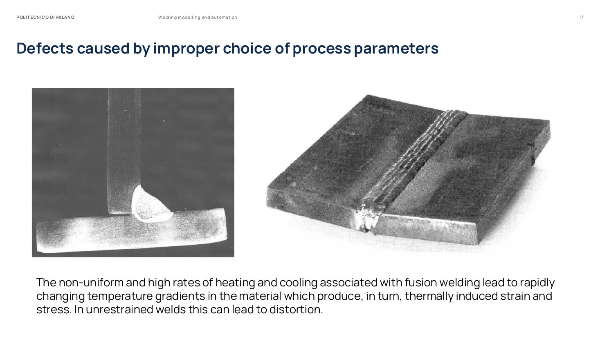

Material properties that matter: thermal expansion coefficient α; **solidification shrinkage** (about 3% steel, about 7% Al); solid-state phase changes (austenite → martensite in steel; none in Al or Ni alloys); E and yield strength falling with temperature. Stresses are much harder to compute than temperatures: they need 2D/3D elastic–plastic analysis.

- **Prof:** the **fixture is a process choice**. Free parts distort; clamped parts keep **residual stress**, which can be released later when you unclamp or **machine some material away**, and then the part moves. More molten metal at the top than the bottom makes the top expand more. **Hot metal is weaker**, so hot zones deform first. Stresses need simulations, so in practice they are handled experimentally.

### In-process monitoring examples

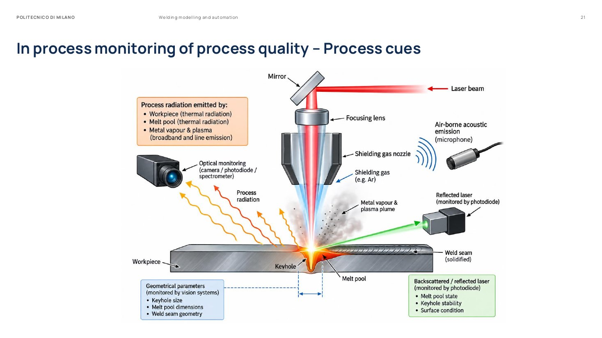

- **Optical seam tracking (workstation):** a laser line projected at a known angle; the camera sees it shift or deform at edges and gaps, giving seam position, gap, edge offset and tool orientation. The data go to the robot to correct the path (compensating part tolerances and fixture errors). Example: 60 Hz, 150 mm working distance, 50 × 60 mm range.
- **Digital image correlation (distortion):** high-temperature speckle pattern + two synchronised cameras, giving full-field 3D displacement and strain before, during and after welding.
- **OCT / inline coherent imaging (keyhole):** a low-power measurement beam, coaxial with the process laser, enters the keyhole. Interferometry of the path-length difference gives **keyhole depth directly**.
- **Photodiodes (fault detection):** Ti6Al4V lap joints, 2 mm. The signal reveals a 50 W power drop, reduced He shielding (−10 l/min) and local lack of contact between plates.

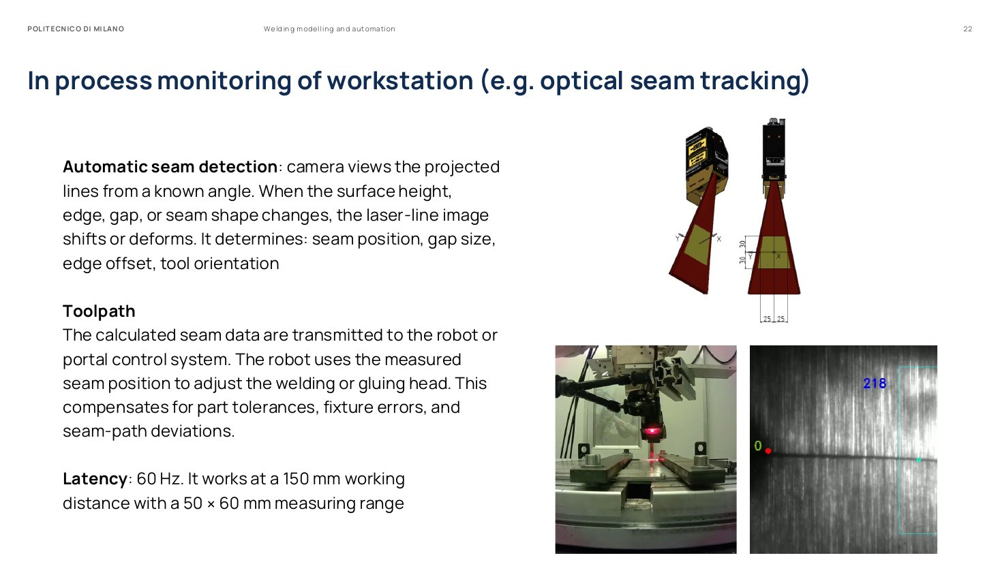

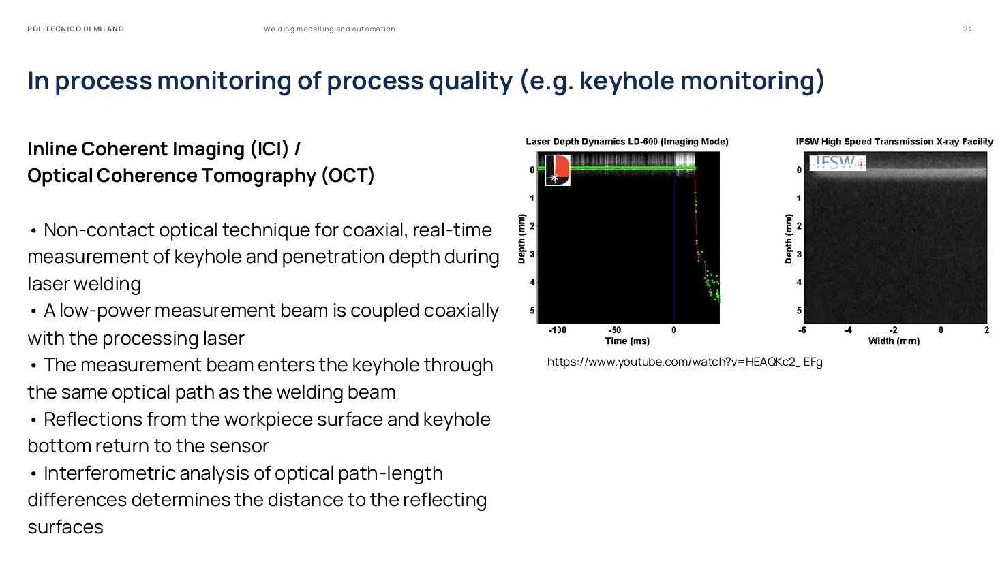

- **Prof — physical basis of the optical signals:** **thermal radiation** (hot metal glows red → yellow → white; our bodies emit IR too); **reflected laser light**, since absorption + reflection = 1, so measuring reflection tells you the absorbed energy; **plume emission**; **airborne acoustic emission** (the keyhole vibrates).
- **Exam alert — space vs time trade-off:** "the data flow remains more or less the same". A **camera** gives more data in **space**, so lower frame rate. A **photodiode** is a camera with one pixel, so very fast in **time**. A spectrometer splits wavelengths and is slower.

### When is a measurement usable for closed-loop control?

1. It observes a **controllable** state with enough signal-to-noise ratio.
2. It **responds before the defect develops**:

```math
\tau_{total} = \tau_{sensor} + \tau_{processing} + \tau_{controller} + \tau_{actuator} < \tau_{defect}
```

3. It samples fast enough (Nyquist): f\_s > 2 f\_process. Sensor, controller and actuator must all be faster than the defect dynamics.

| Sensor | Observes | Sampling | Implication |
| --- | --- | --- | --- |
| Photodiode | Plume, reflected laser, thermal radiation | 1–100 kHz | Very fast and simple, but **indirect** |
| Camera | Plume, melt pool, keyhole | 0.5–5 kHz | Rich information, heavy processing |
| Spectrometer | Plasma spectrum | 0.1–1 kHz | High spectral resolution, poorer real time |
| OCT | Keyhole depth | 1–300 kHz | **Direct depth**, fast, robust |

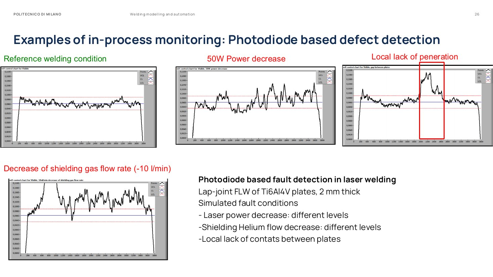

- **Prof — latency worked example:** defect forms in **1 ms**; acquire 1 ms + process 20 ms + send to controller 5 ms + actuate 1 ms = **about 27 ms**, so you can't act on that defect. Choose the sensor to match the phenomenon.
- **Prof — photodiode monitoring (Ti alloy):** weld under reference conditions, build an **acceptance band**, then introduce faults (power drop, lack of penetration, less shielding gas) and the signal leaves the band. "These are **not absolute measurement systems**, they require **teaching**." In band = OK, out of band = not OK, without knowing the cause. Today **ML learns the signature of each defect**, so it can tell the cause too. The bands are built later in the course (L3, control charts).

### Closed-loop example — penetration control by spectroscopy (Sibillano et al., 2012)

- Question: estimate penetration **without destructive testing** and control the laser power automatically.
- Setup: CO₂ laser lap weld, AISI 304, 1 mm + 2 mm sheets (max penetration 3 mm), v = 50 mm/s.
- Signal: **plasma electron temperature T\_e** from optical emission spectroscopy. Calibration: 2 mm depth gives T\_e,ref = 5460 K (P ≈ 1200 W); 3 mm gives 5300 K (P ≈ 1800 W). **Deeper penetration means lower T\_e.**
- Error e(t) = T\_e(t) − T\_e,ref, fed to a **PI controller** acting on laser power.
- Test: start 20% low (960 W, under-penetration), so T\_e is above the set point. The PI raises the power towards 1200 W, T\_e converges to 5460 K, and metallography confirms about 2 mm. It corrects disturbances in both directions.

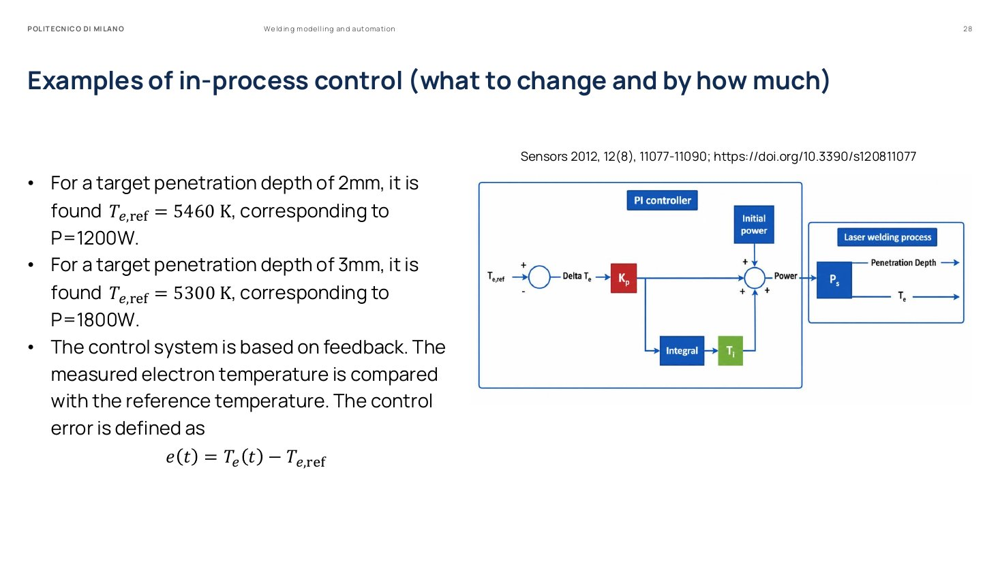

- **Prof:** this is "from monitoring to control": not just identifying issues but a more intelligent process. The electron temperature is **not the part's temperature** but the **ionisation of the plume**; it has an inverse relationship with depth. When the controller starts, the power ramps slowly to the target and the temperature reading decays to the set point.

### Analytical thermal models

| Source | Gradient | Motionless beam | Moving beam (quasi-stationary) |
| --- | --- | --- | --- |
| Planar | Thickness only (x) | T(x,t) | T(x,v) |
| Line | Normal to the beam (x,y) | T(x,y,t) | T(x,y) |
| Point | All directions (x,y,z) | T(x,y,z,t) | T(x,y,z) |

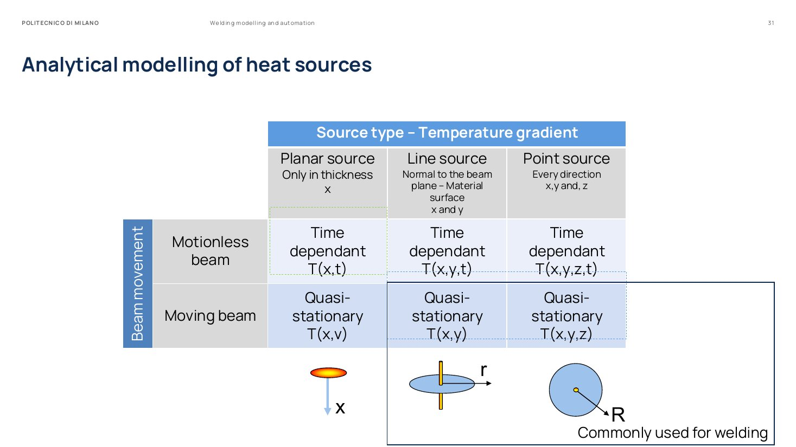

- **Prof:** a motionless beam suits on/off processes such as heat treatment; welding uses a **moving** beam. **Keyhole looks like a line source** (heat roughly constant through the depth); **conduction looks like a point source** (varies in every direction). "I will not derive the equations, but help you **read** them."

**Rosenthal moving point source** (semi-infinite body; surface weld):

```math
T - T_0 = \frac{Q}{2\pi k R}\exp\!\left[-\frac{v\,(x - R)}{2\alpha}\right], \qquad R = \sqrt{x^2+y^2+z^2}, \quad \alpha = \frac{k}{\rho c_p}
```

(Written exactly as on slide 32, with x along the travel direction in coordinates moving with the source.) Assumptions: constant properties, no radiation loss, **no melting, no latent heat**, semi-infinite workpiece.

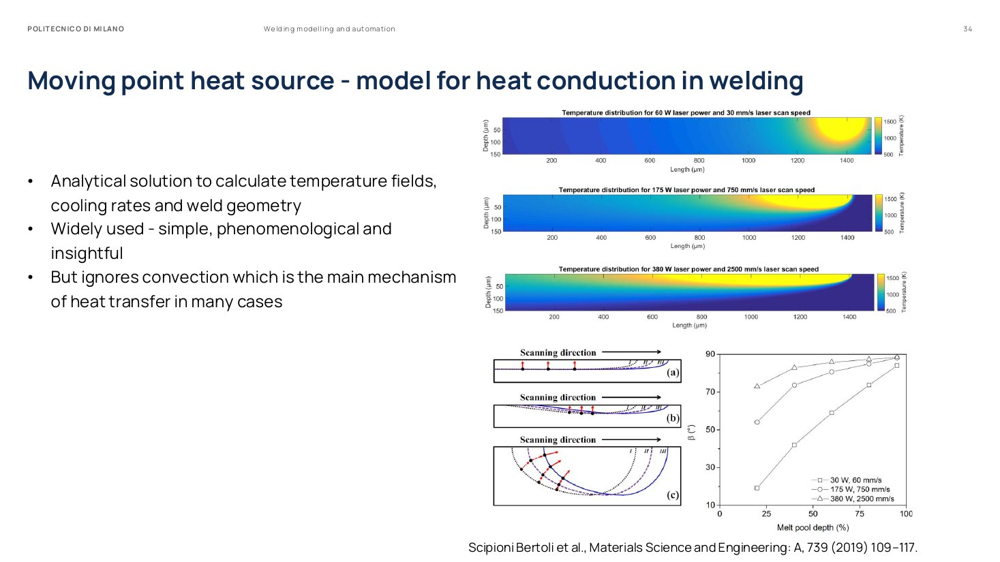

- **Prof — how to read Rosenthal (likely oral):** more power Q means a higher temperature rise; **higher conductivity k** (denominator) makes it harder to heat; at **R = 0 the formula goes to infinity**, which isn't physical because it assumes pure conduction; away from the source it **decays exponentially**; **higher speed** dissipates faster. Example maps (60 W at 30 mm/s up to higher power and speed): the isotherms **stretch into a tail** behind the source. The **melt isotherm gives the molten width**, and the maximum width **lags behind** the source, more so at higher speed. (The g in the slide's symbol list is a copy-paste leftover; it isn't used in the point-source formula.)

Centre-line cooling rate (**square** dependence on temperature):

```math
\frac{\partial T}{\partial t} = 2\pi k\left(\frac{v}{Q}\right)(T - T_0)^2
```

Cooling is faster at **higher speed** and **lower power** (slide 33). For steel (k = 52 W/m·K, T\_m = 1500 °C) at 1000 mm/s it is about 7·10⁵ °C/s at Q = 1 kW, but under 10⁵ °C/s at Q = 10 kW. The slides write the cooling rates as magnitudes.

- **Prof:** the cooling rate matters because **fast cooling can be more damaging** (residual stress, microstructure). You can make maps to choose between high speed or high power. To get the same cooling rate at **10 kW instead of 1 kW**, the speed must go from about **100 to about 1100 mm/s**.

**Rosenthal moving line source** (full-penetration keyhole; heat spread through thickness g; K₀ = modified Bessel function, second kind, order zero):

```math
T - T_0 = \frac{Q}{2\pi k g}\exp\!\left(\frac{v x}{2\alpha}\right) K_0\!\left(\frac{v R}{2\alpha}\right)
```

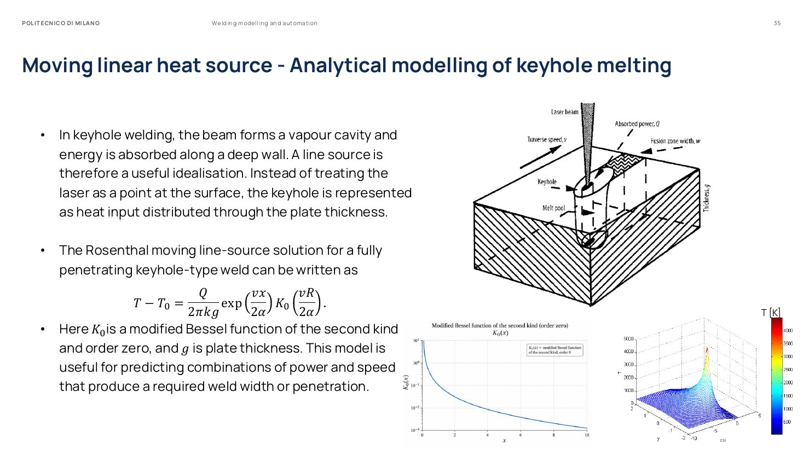

Centre-line cooling rate (**cubic** dependence, so cooling changes rapidly with small temperature changes):

```math
\frac{\partial T}{\partial t} = 2\pi k \rho c_p \left(\frac{v g}{Q}\right)^2 (T - T_0)^3
```

**Dimensionless groups:** normalised speed Y = vR/(2α), normalised power X = Q / \[2π(T\_m − T₀) k g\]. A Y–X plot estimates the **required power for a given thickness, speed and material**.

**Limits of conduction models:** they ignore **convection** in the melt pool, which is often the main heat-transfer mechanism. They cannot predict the variety of real pool shapes, or the effect of welding orientation; that needs fluid flow (numerical models). **Trade-off:** model fidelity vs computational cost, the same theme as the casting MPC.

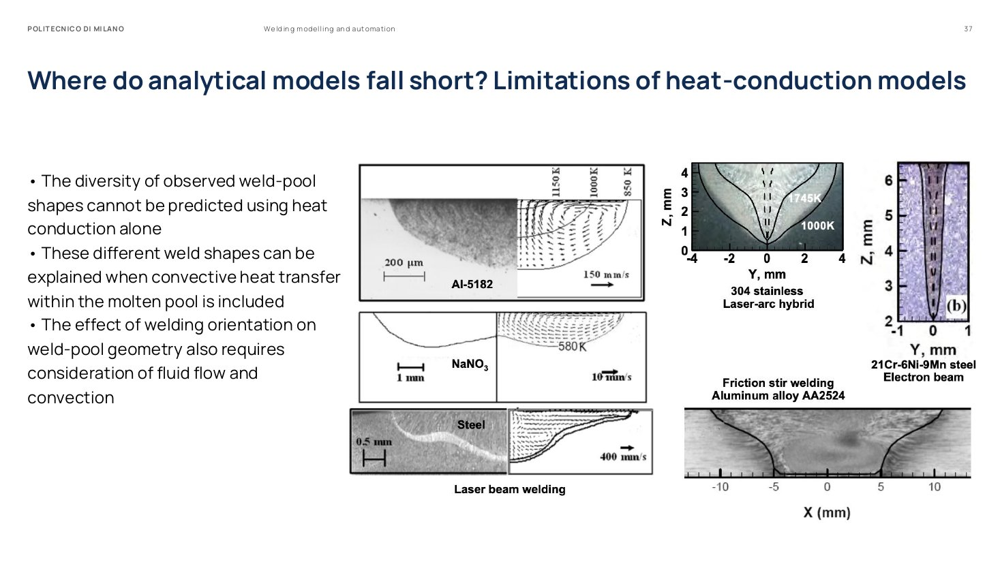

- **Prof (5 Oct recap):** α has units of **m²/s** (how fast heat spreads over an area); vx/2α is dimensionless, a "form factor". Convention: **x = beam travel direction, z = depth, y = lateral**. Use the point source on a computer (Excel, MATLAB, Python): find where T = T\_m, the **melting isotherm**, which gives the half-width and depth (a near-spherical cross-section). K₀ is tabulated in any solver.
- **Class question — what if the weld is not fully penetrated?** The line source assumes **full penetration (depth = g)**. For partial penetration it's chicken and egg (you need the depth to compute the depth), so you **calibrate with experimental data**.
- **Limits (his words):** you must assume the equilibrium **in advance** (conduction → point, keyhole → line), another chicken-and-egg problem. No oxidation, no extra reactions, no material heterogeneity: "a perfect world". None of the model shapes looks like a real keyhole weld (wide top + deep narrow root). Fix: **combine two heat sources**, one for the top and one for the deep penetration.

## L1.5 Transformation by chip removal – turning and tool life

Machining is a **disturbance-rich** process: you command speed, feed and depth, but the outcome also depends on states you cannot see directly (**tool wear, chatter, thermal error**). That is why it motivates monitoring and automation (L1.8). *(Slides + recording of 5 Oct morning. Professor's comments inline.)*

### Material removal and why machining

- **Material removal processes:** machining (sharp tool: turning, milling, drilling), abrasive processes (grinding), non-traditional processes (other energy forms).
- **Why machining:** great flexibility of shapes; dimensions and finishes hard to get otherwise; works on a wide range of materials. But it is **resource-intensive** (time, energy, material), so it comes **after a near-net-shape process** (casting, forming).
- **Sequence:** workpiece material → datum & fixturing → rough machining → semi-finishing → finishing/grinding → cleaning/deburring → inspection. "Each step offers opportunities for automation."

* **Why roughing then finishing, not one pass?** Removing a lot of material at once makes it hard to keep good surface quality, because of the **forces and power** involved.
* **Exam alert:** "In engineering, **we don't maximise** these things. If you maximise productivity, quality decreases, and vice versa. We try to reach the **requirements**."

### Machining from an automation perspective (slide 8)

| Commands (inputs) | Process | Measurable signals | Outputs |
| --- | --- | --- | --- |
| N, v, f, d, tool path | Plastic shear + friction, chip formation | Force, power, current, vibration, temperature | Dimensions, roughness, cycle time |

**Unknown states:** tool wear, chatter, thermal error. **Control decisions:** change feed, speed, offset, path. This block diagram links straight to L1.1 (model errors, disturbances, sensors).

**Study framework for any machining process:** (1) relative motions and workpiece symmetry, (2) workholding, (3) tool geometry, (4) chip-formation mechanics, (5) tool wear, (6) machining capability. Tool wear shares the same physics across processes.


### Turning: motions and parameters

Turning makes **rotational parts**. Three motions: **cutting** (workpiece rotation, cutting speed v), **feed** (tool moves parallel to the axis, f in mm/rev), **depth setting** (tool moves perpendicular, depth of cut a\_p).

- **Prof — the orange analogy:** to peel an orange you rotate it and move the knife continuously (turning: cutting motion on the workpiece, feed on the tool), unlike a carrot where you cut, then rotate. In turning **the spindle controls speed, not position**. Feed is in **mm per revolution** because "the tool is obliged to follow the rotation". External cylindrical turning: the tool moves along the axis; **facing**: it moves radially.
- **Exam alert:** "Often I will tell you what I like asking in the oral exams. **I usually like to see a drawing of this kind**": the cylinder with D₀ and D\_f, the tool, the feed direction, the symmetry axis drawn as a long-dash/short-dash line.

```math
v = \frac{\pi D_0 n}{1000}\ [\text{m/min}] \qquad a_p = \frac{D_0 - D_f}{2} \qquad t_m = \frac{L}{f\,n} \qquad MRR = v\,f\,a_p
```


n = spindle speed (rpm), D₀ = starting diameter (mm), D\_f = final diameter, L = length of cut (mm). The slide writes v = 1000πD₀/n, but dimensionally v \[m/min\] = π D₀ \[mm\] · n / 1000. For MRR in mm³/min, convert v to mm/min (× 1000).

- **Exam alert — units:** "In a written exam your **unit should be correct**. If it's numerically correct but you wrote km/h, it's wrong." Cutting speed is taken at the **initial diameter** D₀; the 1000 converts to m/min. **A depth of cut of 2 mm reduces the diameter by 4 mm.** Machining time = distance / feed velocity = L/(f·n).

### Workholding, tools, machines

- **Between centres:** long workpieces (high L/D). **Chuck:** 3 or 4 jaws, self-centring; long parts also need a tailstock. **Collet:** clamps bar stock; accurate, good for repetitive production, but each collet covers a narrow diameter range. **Faceplate:** custom clamps for large or irregular parts.
- **Single-point tool:** rake face, flank face, **cutting edge** where they meet; side rake angle, side relief angle, cutting-edge angle. **Inserts:** multiple edges, a trade-off between strength and accessibility.
- **High-production automation:** automatic tool feed and turret indexing in chucking machines; **automatic bar feeding** (feed through the collet, machine, cut off, index the stock).
- **CNC lathe → CNC turning centre:** loader/feeder/unloader, turrets (e.g. 10 tools, some powered), automatic chip removal, tool indexing including **driven tools** (drilling, tapping, milling), tool storage, tool monitoring and setting, programmed cycles for parallel turning.
- **Shapes:** straight turning, facing, taper, contour, form, chamfer, grooving/cutoff, threading (feed synchronised with spindle rotation to make a helix), boring (internal), drilling/reaming on the axis, knurling.


### Capability: tolerance and roughness

Typical tolerance: D < 25 mm → ±0.025 mm; 25–50 mm → ±0.05 mm; D > 50 mm → ±0.075 mm. Typical roughness about 1 µm Ra. **Ra** = mean absolute deviation of the profile from its mean line (areas above = areas below).

```math
R_a \approx \frac{f^2}{32\,r}\cdot 10^3\ [\mu\text{m}] \qquad (f \text{ in mm/rev},\ r = \text{nose radius in mm})
```


**Exam alert (likely numerical):** roughness grows with the **square of the feed** and falls with a **larger nose radius**. The real finish is worse because of work material, built-up edge, tool wear, vibration/chatter and machine/fixture stiffness.

- **Prof — where the formula comes from:** at each revolution the tool leaves its **imprint**; the profile repeats with period f and the shape of the nose radius r. Peak-to-valley **R\_t = f²/(8r)** and **R\_a ≈ R\_t/4**, hence f²/(32r). Threading: **feed = thread pitch**. Knurling deforms the surface for grip.
- **Exam alert:** "Often we will ask you to calculate the expected surface roughness." **"I may ask you when this equation holds"**: only with **no vibrations** (the tool path changes) and **no tool wear** (the tool no longer has radius r).
- **Class discussion — why not a flat tool (r → ∞, so Ra → 0)?** The flat face would be in **full contact with surface you're not cutting** (cutting happens on the rake edge), so friction **heats and oxidises** the surface and damages it. Very large radii also leave a large imprint at the end of the cut, outside specifications. "Usually there is **not a single optimum**." Example tool nose radius is about 0.3 mm, comparable to the roughness scale.

### Chip formation, heat, forces and power

- **Orthogonal cutting** (2D model): material ahead of the edge undergoes large plastic shear in a thin **primary shear zone** at shear angle φ; friction between chip and rake face is the **secondary zone**.
- **Heat:** about **98% of the energy becomes heat**, about 2% stays as elastic energy in the chip. Heat is generated in three zones (primary, secondary, tertiary). High temperatures **reduce tool life**, make hot chips (a safety hazard) and cause **dimensional errors** through thermal expansion.
- **Power:** P = F⃗·v⃗ = F\_c v\_c + F\_f v\_f + F\_D v\_D. With v\_D = 0, v\_f ≪ v\_c and F\_f < F\_c:


- **Prof — three heat zones explained:** **primary** = shearing the material along the shear plane (internal friction; this is the **useful** energy); **secondary** = the chip sliding on the rake face (friction, "not really required"); **tertiary** = the flank still slightly rubbing the new surface. Can you minimise secondary and tertiary? Only with a thinner tool, which **breaks more easily**. Hence **coolants**: they lubricate (less friction) and carry heat away.
- **Prof — why we need forces at all:** (1) to choose a **machine with enough power**; (2) because the tool's **life is finite** and depends on the load.


```math
P \approx P_c = F_c\,v_c
```


**Cutting-pressure (k\_c) method** for the cutting force:

```math
F_c = k_c\,A_D, \quad A_D = f\,a_p = b\,h_D, \quad h_D = f\sin\kappa_r, \quad k_c = \frac{k_{cs}}{h_D^{\,x}} \;\Rightarrow\; F_c = \frac{k_{cs}}{(\sin\kappa_r)^x}\,f^{\,1-x}\,a_p
```

k\_cs = specific cutting pressure (material-dependent, tabulated), x = exponent, κ\_r = cutting-edge (approach) angle, h\_D = undeformed chip thickness. **The specific cutting energy depends on both the material and the chip thickness**: thinner chips cost more energy per unit volume. This is the "force = cutting pressure × chip area" model from L1.1, and why supervisory control needs a force model.


- **Prof:** the thrust force pushes back, but in a **stable** process the part doesn't move, and v\_f ≪ v\_c, so the power comes from the cutting force. **Force = pressure × area.** Chip area ≈ **f × a\_p** (a geometrical approximation; a student noticed the units come out as mm²/rev, and he agreed it's an approximation). **k\_c = k\_cs / h\_Dˣ is the Kronenberg relation**, determined **experimentally**: tool makers give tabulated k\_cs and x for each workpiece–tool pair.
- **Exam alert — reading the formula:** F\_c depends on the **material** (k\_cs), **tool geometry** (κ\_r), **tool material** (x), and your **parameters** (f, a\_p). Since **0 < x < 1**, raising f or a\_p raises the force. "Force calculations in chip removal are very simple and will always be **pressure times area**."

### Tool wear and tool life

- **Failure modes:** **fracture** (excessive forces or vibration cause brittle fracture), **temperature** (too hot for the tool material), **gradual wear** (preferred, because it gives the longest tool use).
- **Where:** **crater wear** on the rake face; **flank wear** on the flank, which affects **dimensional accuracy and surface finish**, measured by **VB** (average) and VB\_max.
- **Wear curve VB(t):** break-in (rapid initial wear) → steady state (uniform rate) → failure region (accelerating). Higher v\_c gives faster wear.
- **Tool life T** = the time to reach a chosen **VB\_limit** (the failure criterion that tells you when to change the tool).


**Taylor's law:**

```math
v_c\,T^{\,n} = C \quad\Leftrightarrow\quad \ln T = \frac{1}{n}\ln C - \frac{1}{n}\ln v_c
```


n depends mainly on the **tool material**; C on the **workpiece material** and the other parameters (feed, depth). On a log–log plot it is a straight line, so **two (v, T) tests are enough to find n and C**. Generalised form: v\_c Tⁿ fᵐ a\_p^q = C\*.

- **Exam alert:** "When I ask **what is the end of tool life**, you shouldn't answer *when the tool breaks*." It's when wear reaches the **limit we decide** (typically VB about 0.5 mm, no need to memorise). After breakage the tool has **already cut unreliable parts**. We prefer **gradual wear** because it is **predictable**.
- **Prof:** on a coated (gold) insert you can see where the coating is worn: rake face, flank face and nose radius, where friction is. Flank wear exists because the flank still rubs slightly; **crater** wear because the chip slides over the rake face. Measure VB under a microscope. Wear curve: rapid initial (surface imperfections wear off) → steady → accelerating (integrity lost).
- **Exam alert — Taylor:** "If I ask you about this, you need to speak about **experiments, not a proof**." n and C are empirical fits. Tool materials: **ceramics fastest, carbides fast, high-speed steel slowest**, and not all speeds suit all tool materials. In the generalised law, feed and depth also shorten life, but less strongly (exponents < 1).

**Exam link:** tool wear is an **unknown state** that slowly changes force, power and roughness. Monitoring spindle power or vibration (data-driven, see L1.1) or estimating forces online (hybrid) are how automation decides when to change the tool.

## L1.6 Milling, drilling and process control in machining

Milling is **interrupted cutting** with a multi-tooth tool, so chip thickness, force and torque vary as each tooth enters and leaves. Process control in machining means **adaptive control**: ACO optimises a performance index during the cut; GAC corrects geometric errors part to part. Both need monitoring. *(Slides + recordings of 5 Oct afternoon (milling and drilling models) and 6 Oct morning (process control and worked exercises). Professor's comments inline.)*

### Milling: motions, operations, tools

- **Milling** = the workpiece is fed against a rotating multi-edge cutter (teeth); the cutter axis is basically perpendicular to the feed. It mainly makes flat surfaces; other shapes come from the cutter path or cutter shape.
- Motions: **cutting** (tool rotation, v\_c), **feed** (workpiece or tool, linear/curvilinear, feed rate in mm/min), **depth setting**.
- **Peripheral (slab) milling:** cutter axis parallel to the surface, outer teeth cut. **Face milling:** axis perpendicular, end + peripheral teeth cut. Peripheral milling can be **up milling** (conventional) or **down milling** (climb).
- **Cutters:** plain (helical teeth, slab), form (profile copied into the part, e.g. gear-tooth spaces), face (HSS or carbide inserts), **end mills** (square, radiused, ball ends: slots, pockets, profiles, contouring, die sinking).
- **Interrupted cutting:** each tooth repeatedly enters and exits, giving **cyclic mechanical impact and thermal loading** (unlike turning).
- **Workholding:** vise (general purpose) vs **fixture** (custom, accurate, faster). The trade-off between capital cost and labour/setup cost is modelled in L1.9. **Pallets/shuttle:** while the CNC isn't cutting it loses money, so an interchangeable worktable lets you load one part while another is machined.
- **Capability:** peripheral and face milling about ±0.025 mm, end milling about ±0.05 mm; roughness about 0.4 µm Ra. **Ball-nose scallops (cusps):** a ridge stays between passes, so a smaller stepover gives a better finish but more time.
- **Teaching machine:** Snapmaker A350/A250 with a 50 W CNC module, 6,000–12,000 rpm, max stepdown 1 mm beech / 0.5 mm acrylic, 0.005 mm repeatability (CAM Shop).


- **Prof:** in milling each tooth cuts for part of the rotation and is idle for the rest, so it makes sense to put **multiple teeth** on the tool. In slab milling you never immerse the tool deeper than its **radius**. Milling is "arguably one of the most flexible manufacturing processes" because of (1) **more axes** and (2) many **tool shapes**. **This is the CAM Shop milling process** (pocket milling, like the slide).
- **Exam alert — up vs down milling ("we like to discuss this during oral exams"):** be ready to **draw** a 4-tooth cutter. **Up milling:** the chip starts at **zero thickness and grows**, so the force increases through the cut; it tends to **pull the workpiece up off the fixture**, giving slightly **higher roughness**. **Down milling:** the tooth enters at **maximum thickness**, so the force decreases to zero; less lifting, but it creates issues for the motion and machine architecture. Outside slab milling you can't always choose.
- **Prof — axes and interpolation:** face, partial face and slot milling = **1D** motion; profile = **2D** (two axes interpolated); pocket = **2.5D** (Z dives, then X–Y move, so you see a **staircase**); surface contouring with a **ball-end mill** = full **3D** (a dome follows any contour). "Having axes doesn't mean they can be interpolated together." 5-axis = 3 linear + rotary + tilting table.


### Vibration and stiffness

**Forced vibration** comes from an external periodic excitation and is easy to identify. **Chatter** is self-excited: it comes from the interaction between the cutting process and the **dynamic stiffness** of the whole system (machine, spindle, tool, workpiece, fixture), which can change during an operation. Remedies: a stiffer frame cross-section, higher-modulus materials, better fixtures, and especially **passive or active damping**.


- **Class discussion — a vertical mill vs a thinner universal mill:** the thinner one **vibrates and deforms more**. Intermittent cutting is **more prone to vibration** than continuous cutting, because each tooth hits the work. Old machines fought this with **weight** (heavy cast iron damps vibration), but weight costs money. Natural frequency depends on **stiffness and mass**, so modern machines are **light but rigid** by design.
- **Prof:** chatter is different because **you are cutting the mass**: the part changes shape and therefore its vibration properties during the cut. When it goes unstable you see **chatter marks**. A student suggested choosing parameters that avoid vibration: that's **stability lobes**, computed from a machine model. Stable below the lobes, unstable outside (no details required).

### Milling model

```math
v_c = \frac{\pi D n}{1000}\ [\text{m/min}] \qquad v_f = f_z\,Z\,n\ [\text{mm/min}] \qquad MRR = a_e\,a_p\,v_f \qquad T_m = \frac{L + A}{v_f}
```

Z = number of teeth, f\_z = feed per tooth, a\_p / a\_e = axial / radial depth (the meaning swaps between face and slab milling), A = approach distance. Slab: A = √(d(D−d)). Face, cutter centred on the part: A = ½(D − √(D² − w²)). Face, cutter offset to one side: A = √(w(D−w)). (w = work width.) Typical ranges: D 0.2–2000 mm, Z 2–200, f\_z 0.01–1 mm, v\_c 30–500 m/min.


- **Prof — approach distance:** you don't start counting time when the tool touches the part (it would crash). The machining length is L + A, where A is where engagement completes, from a simple triangle: D²/4 = A² + (D/2 − d)², which gives A = √(d(D − d)).

**Chip thickness (slab milling):** the tooth path is a cycloid. At tooth angle θ = ωt:


```math
h_D(\theta) = f_z\sin\theta, \quad h_{D,max} = f_z\sin\varphi, \quad 1-\cos\varphi = \frac{2a_e}{D}, \quad h_{D,av} = \frac{1}{\varphi}\int_0^{\varphi} f_z\sin\theta\,d\theta = \frac{f_z}{\varphi}\frac{2a_e}{D}
```


φ = engagement angle. Number of teeth in contact z = φ/φ₀ with tooth pitch φ₀ = 2π/Z.

- **Prof:** f\_z (mm per rev per tooth) ≠ f (mm per rev); f = Z·f\_z. Each tooth traces a **cycloid** (rotation + feed), and consecutive teeth lag by f\_z. Tooth spacing: 4 teeth → 90°, 6 → 60°, 8 → 45°. **z = φ/φ₀ = how many teeth fit in the contact arc.** In face milling the tool is usually **wider than the workpiece**; in slab milling you don't dive past the radius.
- **Prof — why sum torques, not forces:** forces are **vectors** pointing different ways for each tooth, but all torques act about the same axis, so you add them.

**Force, torque, power** (same k\_c method as turning): F\_c(θ) = k\_c,θ·A\_D,θ, with A\_D,θ = h\_D,θ·a\_p and k\_c,θ = k\_cs·h\_D,θ^(−x). Torque T\_c = Σ F\_c(θᵢ)·(D/2)/1000 \[Nm\]; power P\_c = T\_c·ω with ω = 2πn/60.

- **z ≤ 1** (at most one tooth cutting): design for the **peak**, F\_c,max = k\_c,max·f\_z·sinφ·a\_p.
- **z > 2:** use the **average**, T\_c ≈ z·F\_c,av·(D/2)/1000, with F\_c,av = k\_cs·h\_D,av^(−x)·h\_D,av·a\_p. This simplifies to:

```math
P_c = k_{c,av}\,\frac{a_e\,a_p\,v_f}{60\cdot 1000}\ [\text{W}] \qquad (= k_{c,av}\times MRR)
```

**Exam alert (likely numerical):** milling power = average specific cutting pressure × MRR. Mind the units: k\_c in N/mm², MRR in mm³/min, divide by 60·1000 to get W.

- **Prof — the shape of the force signal:** for one tooth, h\_D follows a **sine**; k\_c starts from infinity at zero thickness (non-physical) and drops, so the force follows roughly the chip-thickness profile. **z ≤ 1:** separate peaks with gaps, so size for the **maximum chip thickness**. **z > 2:** overlapping teeth **smooth** the torque towards an average, so use **average chip thickness × number of teeth**. **1 < z < 2:** neither applies, so **compute numerically** (or solve analytically for the maximum, which you may see in the exercise).
- **Prof — face milling difference:** the part is offset from the cutter axis for stability; angles are measured from the vertical, h\_D = f\_z·**cosθ**, and you get an **up-milling then down-milling** passage in one rotation. The chip thickness **doesn't necessarily start or end at zero**, so you must find θ₁ and θ₂ from the geometry.
- **Exam alert — the chain to remember for every milling question:** power = torque × angular speed; torque = force × arm; force = pressure × area, all **angle-dependent**. Size the machine on the **maximum power**.

* **Exam alert (6 Oct):** "The usual question I ask in the oral: *is this face milling up or down milling?* The answer is **both**." It starts as up milling and becomes down milling after the cutter axis, so the stability issues of both are present. Example of z: contact angle 60° with 8 teeth (45° pitch) gives z ≈ 1.33, so while one tooth cuts, the next is already entering.


### Drilling

Round hole with a drill bit on a drill press. f = 0.01–0.8 mm/rev, D = 1–50 mm, v\_c = 5–300 m/min. Chip section A\_D = f·D/4 (two cutting lips, each removing f/2 over a length of D/2). F\_c = k\_c·A\_D; torque T\_c = F\_c·(D/2)/1000 \[Nm\]; P = T\_c·ω.


- **Prof — why drilling is a special case:** in milling the chip has room to escape; in drilling the chip can **only go up** out of the hole, and you must **push** the drill in (anyone who has drilled a wall knows). So the **thrust force becomes relevant**, unlike in turning and milling, and it is a more delicate process. Holes are for assembly, cables, fluid passages.
- **Prof:** a drill is like a **2-tooth mill moving only in depth**. Each lip removes a section of height D/2 and width f/2, so A\_D = f·D/4. The torque of each lip acts at **half the radius**, so the formula gives the **total** torque T\_c = k\_c·A\_D·D/(2·1000).

### Machine tool control and monitoring

- **Why automate:** productivity, quality, cycle time, cost, less reliance on experienced operators. **Tool failure accounts for about 20% of machine-tool downtime.**
- **CNC chain:** CAD → CAM → NC/G-code → CNC interpreter → interpolator → servo loops → machine + cutting process, with sensors (encoders, current, force, vibration, probe) feeding back. CNC controls position, velocity and path, but **what happens in the cut?**
- **The 4 control questions, answered for machining:** (1) measure dimensional accuracy, finish, force, tool wear, chatter; (2) with dynamometers, spindle power/current, accelerometers, acoustic emission, temperature; (3) act on feed, speed, depth, tool path, coolant; (4) **within the cut** or **part to part**.


- **Class discussion — what to measure:** roughness and dimensions (the outputs, but these are **consequences**). To know if the process is under control, check whether what you **calculated** (force, power) stays as modelled. Force is hard to measure; **power is easy: the spindle motor is a sensor** (current × voltage).
- **Class discussion — why would spindle power rise in turning, where force should stay constant?** Material batch variability; **tool wear** (a blunt tool rubs, so more friction and heat); a **clogged coolant line** ("you think these are not remarkable issues, but these things happen"). Interpreting dimensions: measure every part and notice that part 13 is out of tolerance.
- **Prof — choosing the sampling rate (worked reasoning):** the force/power in milling repeats at each **tooth passage**, so the basic cycle is the rotation. At 3000 rpm = **50 rev/s**, you must sample **well above 50 Hz** (higher still to resolve single teeth). Undersampling distorts the profile, but "you don't go immediately to 200 kHz: too much data is not easy to deploy".
- **Prof — what to change if power is excessive:** check the tool, check the coolant, or reduce process parameters: in milling, **almost everything** lowers power (a\_e, a\_p, f\_z, n). If you don't intervene: overheating, then wear, then non-conforming parts and new tools, so both quality and productivity suffer.


|  | ACO — Adaptive Control with Optimisation | GAC — Geometric Adaptive Control |
| --- | --- | --- |
| Goal | Optimise a **performance index** (min time, min unit cost, max MRR) | Compensate **geometric errors**: tool wear, deflection, thermal effects, finish variation |
| Acts on | Feed, spindle speed, depth, using models + feedback | Tool offsets, feed override |
| Timescale | During the cut | **Between parts or features** (finishing) |
| Example | Early systems maximised MRR by changing feed and speed | Shaft diameter grows with tool wear: measure the part, adjust the offset before the next one; adjust feed to hold Ra |
| Caveat | Needs process knowledge and physical interpretation | Linked to part quality, but what is the response time? |


- **Prof — ACO example, done offline in CAM:** a milling path where the axial depth of cut **increases** over one stretch. With constant feed, power rises and you **may break the tool**. So reduce the feed where the depth grows, then go fast where there is no cutting, keeping **power roughly constant**. Constant feed looks more productive, but carries the risk.
- **Prof — GAC example:** turning a shaft while the tool wears produces a **conical** part (the diameter grows towards the end). A **touch probe** (ceramic ball, doesn't deflect) measures the real diameter and the offset is corrected. But every stop adds time and cost, so it is reasonable for **critical, high-value parts**.


**Monitoring vocabulary:** what to monitor = surface texture, surface integrity, dimensions, tool condition, chatter. There is **no universal sensor**, so **sensor fusion**. **Direct** sensing measures the quantity itself; **indirect** sensing estimates it from another signal. **In-process** = during cutting; **in-cycle** = periodically, e.g. between parts.

|  | External: piezo dynamometers, spindle/tool-holder sensors | Internal: servo/spindle motor current |
| --- | --- | --- |
| Pros | Direct, accurate, reliable, good resolution | No extra sensor, cheap, easy CNC integration |
| Cons | Expensive, hard to install, thermal compensation | Feed current disturbed by friction and dynamics; hard for continuous force in milling; spindle current mainly reflects the **tangential** force (fine for torque) |

- **Prof:** a table dynamometer means **the fixture becomes the sensor**. Calibrated forces in **newtons** (not an uncalibrated amplitude); one axis per sensing direction. Used for expensive parts or **experiments**. Force on the workpiece matters for vibration; force on the tool lets you act **before it breaks**. Feed-axis current also includes guide **friction**, not just cutting.
- **Exam alert — the method he repeats for every process (casting, welding, machining):** describe the phenomenon in words → model it mathematically → know which physical effects an error produces (in machining: **vibration, sound, heat, more power**) → pick the sensor that observes that effect (power meter, thermal camera, accelerometer/dynamometer, microphone) → trade off precision vs invasiveness vs cost (a mounted dynamometer measures directly; a microphone needs **training**). Instabilities change chip area and material response, so power changes, so signals can be used to **update the parameters** in our simplified equations.

**Tool condition monitoring:** wear isn't seen directly, so watch signals that change as the tool deteriorates. **Accelerometers** are simple, non-invasive and real-time; **motor current** is already in the drive. Interpreting the signal is the challenge (the data-driven / hybrid models from L1.1).

## L1.7 Transformation by deformation: forming processes

In forming, a die applies stresses **above the yield strength**, so the metal deforms plastically to the die's shape. Volume is conserved: no material is added or removed. Force and formability depend on **strain hardening, temperature, strain rate and friction**, captured by the flow curve Y\_f = Kεⁿ. *(Slides + recordings of 7 Oct (introduction, bulk vs sheet) and 12 Oct morning (cutting, bending, drawing, material behaviour). Professor's comments inline.)*

### Bulk vs sheet

|  | Bulk deformation | Sheet-metal working |
| --- | --- | --- |
| Surface/volume | Low (billets, bars) | **High** (sheets, strips, coils) |
| Deformation | Large, massive shape change | Cutting, bending, drawing |
| Examples | Rolling, forging, extrusion, wire/bar drawing | **Pressworking**: punch + die, parts are **stampings** |


- **Prof:** deformation processes are **constant-volume** (casting and welding add material, machining removes it). **Elastic** = springs back (he bent a metal bar in class); **plastic** = keeps the new shape. The die must deform the part without deforming itself, "just like the cutting tools". "If casting was making ice cubes, **this is making pasta**."


Sheet = 0.4–6 mm thick (plate > 6 mm), usually **cold worked**. It starts from **flat rolling** (volume conservation, hot or cold). Applications: food tanks and cans, aerospace nozzles and nose cones, car body panels, doors, hoods, architectural roofing and façades. Industrial stampings usually combine all three operations in a die sequence: cut → draw → trim → pierce → flange → hem.

### Cutting

- **Shearing:** a straight cut between two edges with a small **clearance**; for large sheets.
- **Blanking:** the cut-out piece (**blank**) is the part. **Punching:** the cut-out piece (**slug**) is scrap and the hole is the feature.
- **Progressive die** (high volume): a sequence of operations in **one press**; the strip advances step by step and the part stays attached until the final cutoff. **Pilot holes** align the strip with each station. Can include lancing (partial cuts) and bending.


- **Prof — shearing mechanics:** a punch alone can't cut; the **die provides the reaction**, and the **clearance** gives the material room to flow. The sheared area = **thickness × length** (straight cut) or **thickness × circumference** (round punch). The force is the same whether you keep the blank or the sheet; the name only matters for the process sequence.
- **Class discussion — what's the catch with doing all operations in one press?** **More power**: all punches work at once, so the forces add. They move at the same ram speed, but **bigger holes need more force** (P = F·v summed). The forces must also be **balanced** across the die, and the sequence must be well studied.


### Bending

The sheet is strained around a straight axis: the inside of the **neutral plane** is compressed, the outside stretched. **Bend allowance** = length of the neutral axis in the bend, needed so the flat blank gives the right final dimensions:


- **Prof:** in bending you can't treat the thickness as negligible. Stretching outside and compressing inside mean the **final length changes**: a 1 m flat blank doesn't give 1 m after bending. The issue is **where the neutral axis is**, since the arc length = r′·angle needs the right radius.

```math
A_b = 2\pi\,\frac{\alpha}{360}\,(R + K_{ba}\,t), \qquad K_{ba} = 0.33 \text{ if } R < 2t, \quad K_{ba} = 0.50 \text{ if } R \ge 2t
```


α = bend angle (°), R = bend radius, t = thickness.

- **Prof — reading K\_ba:** **easy bend** (large R, thin sheet) means the neutral axis stays at the middle (K\_ba = 0.5). **Hard bend** (R < 2t: small radius, thick sheet) means it moves to **one third** of the thickness (K\_ba = 0.33), so the allowance is smaller. **Flat blank length = straight segments + A\_b.** Wrong length gives a part that is too long or too short (an exercise will use this).

| Type | Notes |
| --- | --- |
| **V-bending** | V-die on a **press brake**; simple, cheap dies; low production. **This is the CAM Shop air-bending activity.** |
| Edge bending | Wiping die + pressure pad; high production; costly dies |
| Flanging | Small flange relative to the part: stiffness, rounded edges, easier assembly |
| Hemming | Fold the edge over: edge quality, stiffness, hides burrs |
| Curling / wiring | Rounded edge (around a wire): stiffens, removes sharp edges |
| Corrugating | Repeated wavy ribs: stiffness without more thickness (roofing, panels) |
| Successive bending | Progressive pressworking, one station per bend, strip advanced intermittently |


- **Prof — V-bending:** the punch **always has a tip radius** (that's the R in A\_b; "zero tip radius doesn't exist"). A 60° die gives a final angle **wider than 60°** because of springback. The V-die must be at least as long as the bend. **Edge bending:** the pressure pad holds the sheet by friction; the die clearance must be **at least t** so the bent metal fits.
- **Exam alert — cutting vs bending is a matter of radii:** shearing tools have **sharp corners** to **concentrate pressure** and break the metal; bending (and drawing) tools have **controlled radii** so the metal **flows instead of rupturing**. "Otherwise the schematic looks like shearing. Why doesn't it cut? Because of this radius."

### Deep drawing (axisymmetric cup)

- A blank over a die cavity is pushed in by a punch, making cups, boxes and hollow shapes. **Clearance c = 1.1t** (about 10% more than the thickness).
- **Steps:** (1) bending over the punch radius; (2) bending over the die radius, then straightening into the cylindrical wall; (3) flange material flows inwards. The punch force must exceed the **friction** under the flange. The flange is compressed circumferentially, so it tends to **wrinkle**; a **blankholder** presses it flat.
- **Stress state:** all the force reaches the flange **through the cup walls**, so the walls are highly **tensioned** and can **tear**. Characteristic failures: wrinkling (flange or wall), tearing (near the bottom), earing (anisotropy), surface scratches.


- **Class discussion — drawing looks like shearing, so why doesn't it cut?** (1) **larger clearance** (about 1.1t) so the sheet can flow in; (2) **radii** on both punch and die; (3) the **blank holder**, which doesn't stop the sheet but **slows it down** so it flows under control without buckling out of plane (shearing has no blank holder; drawing is in between). Volume is constant: blank area × t = cup volume, so you can size the blank.
- **Prof:** deep drawing is a **sequence of bend-and-straighten** cycles: metal bent over the die radius is then straightened into the wall. The flange is in **circumferential compression** (so it wrinkles, prevented by the blank holder); the wall is in **tension** (it carries all the punch force); the corners see bending. The bottom corner started deforming earliest and accumulates the most strain, so **tearing happens there** if thickness doesn't stay constant.
- **Class discussion — 1000 good cups, then tearing starts. Why?** Punch or die **wear**; the material **lot changed**; **lubrication failing** (local friction, so the metal can't flow). How to detect it: temperature rise, end-of-line vision inspection, and above all **punch force increasing**. That is monitoring.


### Formability and material models

- Most bulk processes are compressive; some forming stretches (tension), bending gives tension + compression, cutting gives shear. **Desirable:** low yield strength, high ductility. Both improve with temperature; strain rate and friction also matter.
- **Simple force models (slide):**


- **Prof:** formability = deforming **without breaking** (or breaking under control, as in cutting), ideally at low force, power and energy. In machining we used pressure × area; in forming it's **stress × area**, compared to material strength. Which strength depends on the process: **cutting** needs the **UTS** (rupture); **bending** needs the **yield point** (start of flow); stretching is in between.

```math
F_{shear} = \sigma_{UTS}\,b\,h \qquad F_{stretch} = \frac{\sigma_{UTS} + \sigma_y}{2}\,b\,h \qquad F_{bending} = \frac{\sigma_y\,b\,h^2}{L}
```

b = width, h = thickness, L = die opening/span. **Exam alert:** a model that fits one tensile curve is not automatically valid for a forming operation. It depends on stress state, strain path, temperature, rate and unloading (springback) — the "no model is perfect" theme from L1.1.

- **Tensile test** (UNI EN 10002, ISO, ASTM E646) gives the flow curve.
- **Hollomon (work hardening):** σ = Kεⁿ (K = strength coefficient, n = strain-hardening exponent). **Flow stress** Y\_f = Kεⁿ = the instantaneous yield strength. **Average flow stress** up to final strain ε:


- **Exam alert — the curve is the material's "ID card":** linear **elastic** region (Hooke; release and it returns; he pushed and released an Al bar) → **yield** → **plastic** region with **strain hardening** → max = **UTS** → rupture. Area under the elastic part = **resilience** (a bridge must stay here); area up to rupture = **toughness** (a bent sheet needs it). **Forming works in the plastic region**, between yield and rupture.
- **Class discussion — Al vs steel curves:** Al **yields at lower stress** (easier to deform), breaks at lower stress, but **deforms more before breaking**, and has a **smaller slope (E)**, so it is easier to deform elastically. Steel has a higher E.
- **Prof — why strain hardening:** deformation happens through internal **defects**; as they **jam** against each other it gets harder to move them. Hollomon describes this. True area at any point comes from constant volume, since the machine measures length, not area. **Poisson's ratio** links the contraction in x and y to the extension in z (< 1).
- **Prof — why average flow stress:** in bending, the whole bend line deforms together; in **rolling**, material enters undeformed and leaves fully deformed, so the strain varies through the zone. Hence Ȳ\_f = Kεⁿ/(1+n), with ε the final strain. **Units:** σ in MPa = N/mm²; ε dimensionless; strain rate in s⁻¹.

```math
\bar{Y}_f = \frac{K\,\varepsilon^{\,n}}{1+n}
```


- **Elastic–perfectly plastic:** σ = Eε for ε < ε\_y, σ = Y beyond (K = Y, n = 0). It captures bending well: an **elastic core** stores recoverable energy (**springback**) and the **plastic outer layers** keep the curvature. **Elastic–strain hardening:** K > Y, n > 0, how most ductile metals behave cold.
- **Strain rate:** at hot-working temperatures the flow stress rises with strain rate (**strain-rate sensitivity**). With rising temperature, C falls and the exponent m rises.

### Cold vs hot working

|  | Cold working (room temperature) | Hot working (T > 0.5 T\_m, above recrystallisation) |
| --- | --- | --- |
| Flow curve | Strain hardening (n > 0) | K drops, **n → 0**, ductility up |
| Pros | Accuracy, tolerances, surface finish, strength from hardening, grain flow, no heating | Large deformation, low forces |
| Cons | High forces/power, clean surfaces needed, limited deformation, may need annealing | Lower accuracy, heating energy, oxidation, shorter tool life |

**Exam alert (3 Nov) — is it hot or cold?** Read it from the data: if K and n (strain hardening) are given, it is a **cold** process. Hot working is above a fraction of the melting point (this time he said about **0.7·T\_m**: steel ≈ 1050 °C, Al ≈ 500 °C; earlier 0.5·T\_m): lower E, lower yield, **no strain hardening**, so a hot tube is easier to bend, but also easier to break. "Hot and cold does not respond to human beings": it depends on the material. You need the **average** flow stress when the strain varies through the deformation zone (e.g. rolling: zero strain at entry, full strain at exit). Worked numbers: formula sheet, K.

- **Prof — "hot" is relative to the material:** hot working means T > 0.5·T\_m: for Al (T\_m ≈ 600 °C) about **300 °C**; for steel (about 1500 °C) about **750 °C**. Hot: lower yield, **no strain hardening** (elastic–perfectly plastic plateau), lower E. Heat gives defects energy to **slide past each other**. But heating **costs energy too**, and causes oxidation. Cold: more **precise**, since there's no uneven heat exchange changing properties point to point.
- **Prof — strain rate:** deform faster and it gets **harder** (flow stress rises with ε̇, on log axes). How do you change ε̇? Through **process speed**: punch, rolls, extrusion ram. With rising temperature the constant C falls but the material becomes **more sensitive to strain rate** (m rises).
- **Prof — the procedure for any forming force:** know the deformation the process requires → is it hot or cold? → read the strength from the flow curve (Hooke / Hollomon, temperature, rate) → **force = stress × area**.


Warm working sits in between. **Temperature as a control variable:** it changes the whole flow curve, the strain-rate sensitivity and E (Ti-6Al-4V curves from 700 to 900 °C), but too hot changes the microstructure or oxidises. "The thermal actuator must be constrained by a **processing window**, not used simply to minimise force."


**Measurable during sheet operations (link to L1.8 and CAM Shop):** punch force and stroke, angle/springback, process signatures that reveal defects or tool state.

## L1.8 Sheet-metal forming control and automation

"The machine controls its own axes; the customer specifies the state of the product. Between those two statements lies the **mechanics of the workpiece**." A press can repeat a stroke perfectly and still give different bend angles, because the sheet varies. The central problem is **springback**, solved by open-loop compensation, direct feedback, model-based feedback or adaptive control. This is the **CAM Shop air-bending activity**. *(Slides + recordings of 12 Oct afternoon (online) and 13 Oct morning (control strategies). Professor's comments inline.)*

### Why automate, and automation vs flexibility

- Stamping makes about 10–30% of vehicle body components. A panel goes through drawing, trimming, flanging and piercing, so **a disturbance in the first operation propagates down the line**. Conventionally, defects are found only after forming: scrap, then manual press correction.
- Automation raises productivity (fewer interruptions and manual set-ups), cuts scrap (catches drift before a big batch), encodes operator knowledge into measurements, models and rules, and gives **traceability** (force, position, temperature, angle per part or coil).
- **Flexibility** = ability to change product, geometry or route. **A dedicated mechanical press can be highly automated yet have little product flexibility** (automation is not flexibility; see L1.1).
- **Stamping sequence:** coil preparation & blanking → drawing → trimming → piercing/notching → re-drawing/calibration → flanging & hemming.
- **Tandem line:** separate presses + robots transferring panels. Flexible (a press can be serviced or reassigned, dies arranged for panel families), but limited by transfer time, synchronisation and part stability. **Transfer press:** several die stations in one press, crossbar grippers moving the panels. The trajectory must avoid die collisions and match the press opening.

* **Prof — the drifting-hole example:** a punched hole whose centre drifts slightly compromises the whole downstream geometry. Conventionally you discover it by measuring parts one by one, **when it's too late** and many parts are scrapped. The causes (tool wear, lubrication, wrong settings) **can be sensed**, on the part or through the press's **power consumption**, and corrected possibly in real time. In automotive, cost dominates: automation looks expensive but **cuts scrap cost**.

### Automation vs product quality: sources of variability

The same punch stroke gives different bend angles because the sheet varies in **thickness, yield strength, E, hardening, orientation (anisotropy)**, and friction varies with **lubrication, contact pressure, sliding speed, tool wear**. "Even a perfect servo system cannot remove workpiece variations unless the product state is **measured or inferred**."

- **Prof:** "What we control is the **motion of a tool**. Material flow is controlled only **indirectly**, through tool geometry." Sheet thickness has its own tolerance, e.g. a 2 mm sheet at **±0.1 mm**, varying within a sheet and between batches. Yield, E and hardening vary because the sheet itself comes from rolling or casting with its own variability. In hot forming, **delays between operations** change the temperature of the part and the tool, and therefore wear.
- **Prof — springback data (high-strength steel, 1.2 mm, open die):** at 50–90° bend angle springback is about **10°** and fairly stable, then it **grows at larger angles**. The values come **with a scatter** (standard deviation), so there isn't a single springback value, which is why measuring other quantities helps keep control.


| Model errors | Disturbances | Material variability |
| --- | --- | --- |
| Mismatch between model and reality: E, hardening, anisotropy, friction | Outside the model: unplanned stock variation, part temperature, frame vibration, damaged lubricant film | Often counted as a disturbance: microstructure, tool/interface variability, wear |


- **Prof:** models are deliberately limited (we may neglect friction or hardening for a simpler solution), so the calculated value differs from reality. Example: springback with vs without strain hardening gives slightly different results. Disturbances are things "supposedly fixed" that vary; better to know them and correct. Material variability: **within one coil** some parts are harder or softer. **Tool wear changes the punch tip radius**, so the bend changes. Strategy: **limit** uncertainty, **measure** it, then **update the model**.

**The 4 control questions, answered for forming:** (1) measure thickness distribution, absence of wrinkles, draw-in; (2) with transducers, force cells, cameras, strain measurement; (3) act on blank-holder force, draw-bead penetration, local lubrication, tool temperature; (4) between strokes / part to part.


- **Prof:** strain gauges and load cells on the part are direct but **invasive**, used mostly to **calibrate**. The easiest is the **punch force**: poor lubrication raises friction, which raises force, so **the machine itself is the sensor**. Changes are applied **part to part** (use one stroke's force to correct the next part). **Anisotropy:** rolling aligns the microstructure, so properties differ along x, y, z.

| Machine/tooling | Workpiece | Interface | Process (output) |
| --- | --- | --- | --- |
| Punch stroke/depth, punch force, punch speed, die opening, tool geometry | Temperature, material model, anisotropy, geometry | Lubrication, heat transfer | **Bend angle, springback**, residual stress |


### Actuators

- **Mechanical (force/displacement):** mechanical presses; **hydraulic/servo-hydraulic** (control position, velocity *and* force during the stroke, most flexible); **servo-electric** ball screws (accurate, clean, less force for huge parts); **piezoelectric** (very high resolution and speed, tiny stroke, for fine correction or vibration compensation); **electromagnetic pulse** (short high-energy pulse for high-strength materials, reduces springback); pneumatic.
- **Thermal:** laser, resistance, induction, furnaces, spray cooling. They don't move the punch but **lower the flow stress** (L1.7: within a processing window).


- **Prof — actuator trade-offs:** hydraulic = **very high force** but limited precision ("workhorses"; possible oil spills, hence servo-electric is "clean"); piezo = **tiny, very precise** motion; electromagnetic pulse = huge force for a **very short time** ("like a small blast"); pneumatic = **fast** but not precise. Force profile: hydraulic is a long plateau, electromagnetic a short spike.
- **Prof — thermal actuators explained:** instead of a uniform material, you create **hot and cold zones**: the hot zone behaves like hot working, the cold zone like cold working. Deformation goes **where it's hot**, so far less mechanical force and simpler machines. **Drawback:** local heating needs **complex tools and dies**.

### Punch force and velocity

```math
F_{load} \propto \frac{\sigma_y\,L\,t_0^2}{V} \qquad v_p = \frac{ds_p}{dt} \qquad \dot\varepsilon \approx \frac{v_p}{l_c} \qquad P_{form} = F_p\,v_p
```


L = bend length, V = die opening, t₀ = thickness, l\_c = characteristic deformation length. **Punch force is a diagnostic signal** for sheet, tool and interface. Velocity sets the deformation timescale and affects lubrication, friction, heat and vibration; faster means more power, which can exceed what the actuator can respond to.

- **Prof:** to dimension a forming process you need **power = force × velocity**. Force comes from the geometry you want (yield × bend length × t² / die opening); a **faster stroke means more power**, which may exceed what the actuator can deliver. A rising force signals changes in geometry, material or friction.

### Sensing

- **Force:** strain-gauge load cells, piezo sensors, hydraulic pressure transducers, instrumented tools. **Placement matters**: frame cells pick up inertial and off-axis loads; sensors near the punch are more direct but face high pressure and little space. Several cells detect eccentric loading or misplaced sheets. Force is an **indirect** quality measure (affected by strength, thickness, friction, tool radius, machine compliance). It is useful for identification, contact detection, overload protection and anomalies.
- **Position:** linear encoders, optical scales, **LVDT** (a movable ferromagnetic core changes the coupling between primary and secondary coils). In precision bending the useful variable is the **punch–die relative position under load**, not the unloaded machine coordinate.
- **Bend angle:** contact (pins, yokes, discs: insensitive to reflectivity, but may mark the part or block tooling) vs non-contact optical (triangulation lasers, line scanners, cameras, structured light: troubled by shiny sheet, oil, scale, incidence angle). **Laser profiler:** a laser line + CMOS triangulation reconstructs the cross-section, both flanks are fitted, giving the included angle. Measure the **loaded** angle (punch in contact) **and the unloaded** angle (after release), and their difference **is the springback**.


- **Exam alert — C-frame example:** under load the **machine frame itself bends** slightly, so even if the encoder says the tool reached the right position, the part reflects the frame deflection. Hence: measure the **punch–die relative position under load**. If thickness or material shifts the bend, move the punch to compensate (**you'll try something like this in CAM Shop**).
- **Prof — laser triangulation in plain words:** a laser line hits the surface at an angle; on the camera a flat surface is a straight line and a height step shifts the line, so simple trigonometry gives the height of each point, then the bend edges, then the **angle**. **CAM Shop:** you'll measure the real bend angle by **image analysis** (loaded vs released gives springback).


### Bending mechanics

- Outside in tension, inside in compression; **neutral axis** where the stress changes sign, at about **0.4t from the inner surface**. It moves **closer to the inner surface** with smaller radius, thicker sheet, or a larger bend.
- If the maximum stress exceeds UTS: fracture; between yield and UTS: plastic; below the elastic limit: elastic. **Material near the neutral axis stays elastic and pulls the part back after unloading: springback.**


- **Prof — where springback comes from:** only the bend zone is stressed; outside it there is no stress or strain. Compare the outer-fibre stress X to the "ID card": **X > UTS → fracture; yield ≤ X ≤ UTS → plastic; X ≤ elastic limit → elastic**. Near the neutral axis the material always stays elastic and **wants to return**, so springback. The compressive side has a smaller zone (the neutral axis has shifted), so a lower peak stress, but also an elastic core. Springback gets heavier or lighter with **t/R and the bend angle**.


**Strain** (sheet thickness t, width w, mid-plane radius r, distance z from the mid-plane):

```math
e_x = \frac{(r+z)\theta - r\theta}{r\theta} = \frac{z}{r}, \qquad \varepsilon_x = \ln\!\left(1 + \frac{z}{r}\right) \approx \frac{z}{r} = \kappa z
```


Strain is **linear through the thickness**. Wide sheet (w ≫ t) means ε\_y ≈ 0: **plane strain**, with E′ = E/(1−ν²). Yield starts at z/r = Y/E′, so the **elastic core half-thickness** is z\_e = Y r / E′.

- **Prof:** engineering strain z/r and true strain ln(1 + z/r) coincide because z ≪ r. **Plane strain** because the sheet is wide (w ≫ t): no strain along the width. You need **z\_e** to know where yielding starts through the thickness.

**Elastic–perfectly plastic sheet:**

```math
M = 2\int_0^{t/2} w\,\sigma_x\,z\,dz = \frac{w\,Y\,t^2}{4} \qquad \Delta M = \frac{w E' t^3}{12}\left(\frac{1}{r} - \frac{1}{r'}\right)
```


Unloading is elastic, and the final moment must be zero (M − ΔM = 0):

```math
\frac{1}{r} - \frac{1}{r'} = \frac{3Y}{t\,E'} \qquad \Delta\theta_{sb} \approx L_b\left(\frac{1}{r} - \frac{1}{r'}\right), \quad \theta_f = \theta_L - \Delta\theta_{sb}
```

r′ = radius after springback, L\_b = bend arc length. With von Mises plane strain, Y = (2/√3)σ\_Y, so 1/r − 1/r′ = 2√3·σ\_Y(1−ν²)/(E t).

- **Prof — reading the springback equation:** you need material properties (Y, E, ν), the **thickness t** and the **punch radius r**, and you get the **unloaded radius r′ > r**, then the angle change = arc length × (1/r − 1/r′), and **final angle = target − springback**. The uniaxial test gives σ\_Y, but bending is plane strain, so multiply by 2/√3 ("a given, you don't need the demonstration"). Including hardening (K, n) gives slightly different values: the model-error example. He went through these derivations quickly online: **know the steps and how to read the result**.

**Residual stress after springback:** σ′\_x/Y = 1 − 3z/t, which gives **−Y/2 (compression) at the outer surface** z = t/2, although it was in tension under load.

**Strain-hardening sheet** (σ = K(z/r)ⁿ): M = \[2wK/(n+2)\]·(t/2)^(n+2)·κⁿ and

```math
\frac{1}{r} - \frac{1}{r'} = \frac{6}{n+2}\,\frac{K}{E}\left(\frac{t}{2r}\right)^{n}\frac{1}{t} \qquad \text{Gardiner: } \frac{r}{r'} = 4\left(\frac{r\sigma_Y}{Et}\right)^3 - 3\,\frac{r\sigma_Y}{Et} + 1
```

Residual stress becomes non-linear through the thickness; n = 0 gives back the perfectly plastic result. **Higher temperature usually reduces springback.**

**Limits:** for sharp bends the neutral axis shifts inwards, the inner layers thicken and the outer layers thin (t\_i ≈ t₀/(1 + z\_i/ρ)), and compression exceeds tension. High-accuracy models need neutral-axis shift, thickness change, tension–compression asymmetry, evolving modulus and kinematic hardening.

### Springback trends (for open-loop compensation)

- **Higher strength** (higher elastic limit) → **more** springback.
- **Smaller radius**, **larger bend angle**, **thicker sheet** (more plastic deformation) → **less** springback.
- Compensation methods: **overbending** to a preset angle; **bottoming** (coining the radius zone so it deforms plastically through the volume).


- **Prof (13 Oct) — "I prefer to speak about how to interpret it":** hot forming means no hardening, so the perfectly plastic formula; **cold forming** (the usual case) means use the **strain-hardening** formula. Read it: springback grows with the **ratio K/E** (from the formula: a **stiffer** material with higher E springs back **less**, a stronger one with higher K **more**) and depends on t/r. All of it assumes the **neutral axis at mid-plane**, so the model is limited to its assumptions.
- **Prof — material data are averages:** repeat a tensile test and you get scatter, so **calibration** means finding a good estimate **and an interval**. **Lookup tables** from past bends (material, thickness, tool → "to get 90°, bend to 95°") are still very useful, but they fail when grade, thickness, orientation, wear or lubrication change.
- **Prof — bottoming:** a sharp-tipped punch **squeezes** the bend zone at the bottom of the die so **no region is left elastic**, which kills springback. Open-loop compensation is always "modelled behaviour": either numbers from the equation or a phenomenological understanding.

### Control strategies

| Strategy | How | Limits |
| --- | --- | --- |
| **Open-loop compensation** | Overbend predicted from nominal material data + tooling; lookup tables, empirical bend deductions | Fails when grade, thickness, orientation, tool wear or lubrication change |
| **Direct feedback (part to part)** | Measure the unloaded angle θ(k); e(k) = θ\_target − θ(k); **PI** correction of the stroke for the next part | Corrects only after a part is made |
| **Model-based feedback (hybrid)** | Partial bend: measure loaded and unloaded angle, **estimate material properties**, compute the final stroke | Extrapolates better than fixed gains; the decision is interpretable |
| **Adaptive** | Update model parameters (physical, e.g. effective E, or empirical, e.g. angle–stroke slope) during production | Must be slower than the noise but fast enough to follow real drift |


- **Prof:** the analytical model puts the neutral axis at mid-plane, but in sharp bends it's asymmetric: inner layers **thicken**, outer layers **thin**, and compressive strain exceeds tensile. Accurate springback models must include neutral-axis shift, thickness change and the asymmetry, which is why industry combines models with **measurement and feedback** (table above).

* **Prof — direct feedback is a slow loop:** you correct the **next** part, not the current one, because measuring and acting take time. It requires **air bending** (open die), where the final angle depends on **how far the punch goes**, unlike a V-die. **You'll do something close to this in CAM Shop.**
* **Prof — why model-based (hybrid) is better:** the PI loop only knows "error → stroke"; the hybrid puts the **process model in the controller** and back-calculates material parameters (inverse solution). Then the **same model works for other thicknesses and materials**, and decisions are **interpretable**: "I increased the stroke because E changed by X". "**Black-box models** are very useful, but in industry their **trustability is questioned**."
* **Prof — adaptive:** update parameters between parts, over long production runs.


```math
\Delta s(k) = K_p\,e(k) + K_i\sum_{j=0}^{k} e(j), \qquad s(k+1) = s(k) + \Delta s(k)
```


**Wang et al. 2008 — incremental air bending:** partial bend, release, measure the loaded/unloaded angle, repeat. Each pair gives a radius, R = (w·tanθ₁ + T/2 − d)/(secθ₁ − 1). Then find the thickness T, modulus E and yield Y that **minimise the residuals** between predicted and measured unloaded radii, and compute the final punch displacement. **The angle error fell from 2° to 0.5°.**


- **Prof — how many measurements?** With **4 unknowns you need at least 4 data points**, and then you have no margin for error, so repeat several partial bends and **best-fit**. Fitting bounds parameters around a **starting value** (shown as % change). Each parameter has its own effect: yield gives a linear trend, E a parabolic one. **2° → 0.5° is a 75% reduction, and angular errors are amplified over distance.**

**High-precision 90° bending (Tekiner):** target ±0.25°, calculation < 1 s. A single **pre-release** shortly before the target: the shape and stroke give an effective **n**, the load gives an effective **strength K**, the springback gives an effective **E**. The controller predicts springback at the target and computes the final stroke.

**Exam link:** this is the L1.1 block diagram made real. The process model (bending mechanics) has model errors (E, n, anisotropy) and disturbances (sheet variation), product sensors (laser profiler) measure the angle, and the loop closes **part to part** or **within the stroke**. Compare with GAC in machining (L1.6) and the PI penetration control in welding (L1.4).

## L1.9 Cost estimation in manufacturing

The unit cost is **material + tooling/N + capital/(L·t\_wo·Ṅ) + overhead/Ṅ**. Fixed costs spread over volume, so a high-investment process (die casting, fixed automation) wins only **above a crossover quantity**. This turns L1.1's "how many parts?" question into a number. *(Slides + recordings of 13 Oct morning and 14 Oct afternoon (machining economics). Professor's comments inline.)*

### Cost, price, value

A viable product needs **Cost < Price < Value** (cost = what it costs the maker; price = what the customer pays; value = what it is worth to the customer). Estimates are used to set prices for bids, check profitability, **justify investment in equipment and automation**, and benchmark productivity. For high-tech products, competitiveness depends more on performance than on cost; the price ceiling depends on perceived value, market size, competition and brand.


| Approach | Evidence | Best use |
| --- | --- | --- |
| Top-down | Costs of comparable products or projects | Early concepts, rapid screening |
| Bottom-up | Bill of materials, process steps, times and rates (from CAM cycle estimates, PLC/CNC logs, MES, time studies, supplier quotes) | Detailed planning, quotations |


**Four rules for minimising cost:** keep things **standard** (bought-in parts, standard materials); keep things **simple** (no unnecessary features or difficult setups); **design for assembly** (fewer parts, self-aligning, simple joining); **specify only what is needed** (no unnecessarily tight tolerances or finishes). Pyramid of Giza example: casing stones flat to 0.2 mm, placed to 0.1 mm. Tight tolerances have always been possible, but "a tighter specification needs a reason".

- **Exam alert — linking tolerances to cost:** cost rises **steeply** with quality. A tighter roughness may need an extra operation, or in turning a **lower feed** (Ra = f²/32r), which means lower productivity. "Specify only what is needed", and specify it **correctly**: often missing in engineering projects.

### Cost behaviour and allocation

- **Fixed** cost per unit falls with volume: C\_fixed,unit = F/N. **Variable** cost per unit is constant: v. So C\_unit = F/N + v.
- **Direct** costs are traceable to one product (its aluminium, its insert, its operator, a dedicated fixture, a robot bought only for that line). **Indirect** costs (rent, supervision, maintenance, heating, IT, shared metrology) must still be **allocated**.
- **Material:** purchased mass = m/(1−f), with scrap fraction f (material yield). The price depends on grade, form, quantity, supplier and date.
- **Labour:** Σ operator time per part × hourly rate, based on **actual operator involvement**, not machine running time (one operator can supervise several machines).
- **Overhead rate** = cost pool / allocation-base units (machine hours, labour hours, volume). Automation adds its own indirect costs: maintenance, compressed air, software licences, safety systems, data infrastructure. To reduce overhead: JIT (less WIP), shorter lead times, produce only to demand, total cost of ownership.


- **Prof:** C\_unit = F/N + v goes to **infinity at N = 0** and tends to **v as N → ∞**. Direct-cost examples for the implant: its titanium, its cutting tool, its fixture, a robot bought just for it. Indirect: "how much does it cost **to exist**?" (space, staff, IP). Material prices **change daily** (London Metal Exchange for Al ingots; polymers come from oil, so they shift with world events) and depend on form: powder, ingot, wire, sheet. One operator can watch several machines, so **labour = actual involvement**. **Overhead is in €/hour**: what it costs the company to stay alive per hour.

### Process-based unit-cost model (key formula)

```math
C_{unit} = \frac{m\,C_m}{1-f} + \frac{C_t}{N} + \frac{1}{\dot N}\left(\frac{C_c}{L\,t_{wo}} + C_{oh}\right)
```


- **Prof — orders of magnitude (14 Oct):** dedicated dies for bending or deep drawing cost from about **€5k to €100k** depending on complexity; equipment (robot, CNC) costs **tens to hundreds of thousands**; overhead about **€50 to several hundred per hour**. For an assembly, compute the cost **for each sub-part** and sum.

m C\_m/(1−f) = material with scrap; C\_t = dedicated tooling written off over quantity N; C\_c = capital equipment written off over t\_wo (**in hours**) at load factor L; C\_oh = overhead rate (€/h); Ṅ = production rate (parts/h). For ranking options a **relative** cost is enough; for bids you need an **absolute** one.


- **Prof — term by term:** **scrap fraction f**: you need more than 1 kg to make a 1 kg part (sprues and gates in casting, chips in machining, trims in forming). **Tooling**: the press-brake punch and die are tooling, the press brake is capital; spread over the **planned quantity N**. **Capital write-off time**: "in 5 years the machine has to **pay itself off**" (about 5 years for machine tools, because new technology arrives). **Load factor L**: you can't produce 365 days × 24 h, so it counts shifts, working days and **changeover speed**. Energy and information (R&D, patents) are folded into the overhead rate.
- **Exam alert — read the formula to reduce cost:** reduce **scrap**, **produce more** (N), **load the machine** (L), **produce faster** (Ṅ). "All the things we know intuitively come down to a mathematical calculation."

* **Class discussion (4 Nov) — how can automation lower the unit cost? Read the model term by term:** **material/scrap** (precise, automated processes make fewer defects, so f falls; "nobody speaks about this", yet it doesn't depend on volume); **tooling** (monitor tool wear; flexible, non-dedicated tools plus more automation, e.g. robot bending with a generic tool); **overhead** (fewer people, but more energy, maintenance, software licences and know-how: "it's not a simple game"); **capital/rate** (automated handling cuts idle time and raises Ṅ, at a higher C\_c). Much equipment is under-used because of missing knowledge or poor choices, so productivity can often rise without new investment. The model is for **interpretation**, not a final price, and the numbers shift every day.
* **Prof — more load factor isn't automatically better:** in exercise M, a second operator doubles L but also the overhead, and the break-even production rate goes **up** (from ≥ 3.6 to ≥ 4.1 parts/h).

### Worked example (slide): sand casting vs die casting

Normalised to material cost, f = 0, L = 1, t\_wo = 5 years = 5 · 365 · 24 = 43,800 h.

|  | Sand casting | Die casting |
| --- | --- | --- |
| Material m C\_m | 1 | 1 |
| Overhead C\_oh (per h) | 20 | 20 |
| Dedicated tooling C\_t | 210 | 16,000 |
| Capital C\_c | 10,000 | 300,000 |
| Rate Ṅ (per h) | 5 | 200 |


Material cancels. Sand: 210/n + (10,000/43,800 + 20)/5 = 210/n + 4.046. Die: 16,000/n + (300,000/43,800 + 20)/200 = 16,000/n + 0.134. Setting them equal: 15,790/n = 3.911, so **n ≈ 4,037 parts**. Below that, sand casting (low tooling) is cheaper; above it, die casting wins. At small n tooling dominates; at large n the time-related costs (labour/overhead) dominate. **Exam alert:** convert t\_wo to hours.


- **Prof:** the die is expensive because it must **last**; the sand mould is broken every time. Die-casting **machinery** is pricier (automated injection), and sand casting **looks cheaper but is slow**. **Small batches: tooling and capital dominate; large batches: overhead (time) dominates.** **Exam alert:** "higher technology or more sophisticated automation doesn't necessarily mean cheaper": it depends on the quantity.

### Break-even sales volume

At break-even, price p = C\_unit(N\_BE):

```math
N_{BE} = \frac{C_t}{p - \dfrac{m C_m}{1-f} - \dfrac{C_c}{L\,t_{wo}\,\dot N} - \dfrac{C_{oh}}{\dot N}}
```


Graphically: plot total cost and total revenue (p × N); they cross at N\_BE.

- **Prof — when to use the crossover:** for a **new investment** (an existing factory has already paid its capital). **Combine the two models:** from a price, find the minimum quantity for profit, then pick the cheaper process for that quantity; or from a given quantity, pick the process and then the price that gives a profit.

* **Prof:** total cost starts at the fixed costs, so you **can't profit from the first part**; profit = revenue (p × N) − total cost. A higher price lowers N\_BE, "but this doesn't mean *increase the price and everything is OK*: if it's too high, nobody buys." High tooling cost raises N\_BE. **Where to find the data:** mass from the design; material price from the market (time-dependent); scrap from the process and your quality; tooling and capital from **supplier quotes**; load factor and overhead from **company history**; write-off about 5 years. "You see why we call it an **estimate**."

### Machining economics (links L1.5 Taylor to cost)

Cycle time per part = handling + machining + share of tool change:

```math
T_c = T_h + T_m + \frac{T_t}{n_p}, \qquad T_m = \frac{\pi D L}{f v}, \qquad T = \left(\frac{C}{v}\right)^{1/n}, \qquad n_p = \frac{T}{T_m} = \frac{f\,C^{1/n}}{\pi D L\,v^{1/n-1}}
```


Raising v shortens machining time but also tool life, so there is an optimum.

- **Prof — why machining gets its own model:** other tools (bending dies, casting dies) also wear, but the cutting tool's life is **well modelled (Taylor)** and depends on v, which also sets productivity. Faster cutting = more parts per hour, but **more tool changes**. Handling time T\_h is fixed (shorter with more automation); tool change T\_t is fixed (minutes by hand, seconds with a turret) but is spread over n\_p parts. In T\_c(v): handling is constant, machining falls as 1/v, tool change **rises with v^(1/n−1)**, so the sum has a **minimum**.

**Maximum production rate** (dT\_c/dv = 0, tool price ignored; use it when the machine is the **bottleneck**):

```math
v_{max} = \frac{C}{\left[\left(\frac{1}{n} - 1\right)T_t\right]^{n}}, \qquad T_{max} = \left(\frac{1}{n} - 1\right)T_t
```


**Minimum unit cost**, with C\_r = C\_c/(L·t\_wo) + C\_oh (machine + overhead rate) and C\_e = cost per cutting edge:

```math
C_{unit}(v) = \frac{mC_m}{1-f} + \frac{C_t}{N} + C_r T_h + C_r T_m(v) + \frac{C_r T_t + C_e}{n_p(v)}
```

```math
v_{min} = C\left[\frac{n}{1-n}\,\frac{C_r}{C_r T_t + C_e}\right]^{n}, \qquad T_{min} = \left(\frac{1}{n} - 1\right)\left(T_t + \frac{C_e}{C_r}\right)
```


v\_min < v\_max because the cost optimum also pays for tool edges. **Exam alert:** is v\_max compatible with spindle power, force limits, rigidity, surface finish and tolerance? This links back to the force/power models in L1.5 and L1.6.

- **Prof — the cost curve:** handling cost is flat, machining cost falls with v, tool cost (edges + change time) rises with v, so the total has a minimum: to the left you **machine too slowly**, to the right **tool wear dominates**. Plotted together, the **minimum-time speed is higher than the minimum-cost speed** (a global optimum lies between; not covered). In C\_unit the fixed tooling C\_t is "tooling except the cutting edge"; the edge is the **consumable** C\_e.
- **Exercise (14 Oct):** see **J** in the formula sheet.

**Exam link:** cost is what decides fixed vs programmable vs flexible automation (L1.1). A robot or CNC investment raises C\_c but can raise Ṅ, utilisation L and yield (lower f), which shows up directly in C\_unit. Fixtures vs vises in milling (L1.6) is the same trade-off: capital vs labour/setup.

## L2.1 CNC machine tools

A CNC machine is a **positioning system** (motor → rotary-to-linear conversion → axis, with position/velocity sensors closing the loop) driven by a **part program** in ISO G-code. CAM generates the tool path, and a **post-processor** turns it into the code for a specific machine. This is the basis of the **CAM software question** in the written test and the CAM Lab. *(Slides + recordings of 19 Oct (architecture, axes, interpolation), 20 Oct (G-code programming), 26 Oct (CAD/CAM, tool paths, machine components) and 27 Oct (structure, turning and machining centres). Professor's comments inline.)*

### History and definitions

- **1947** John T. Parsons: punch-card computation to interpolate helicopter-blade curves. **1948** Air Corps contract for tapered aircraft wings (IBM, MIT for servos). **1952** first NC machine tool demonstrated at MIT; the EIA defines NC.
- **NC** = automatic control of a process by a device using numerical data introduced while the operation is in progress. **CNC** = NC realised with a computer (ISO 2806:1994).
- **Machine axis** = principal direction of linear or rotary motion. **Convention:** **Z = spindle axis**, positive with the tool moving **away** from the workpiece; X parallel to the table; Y completes the right-handed frame. A, B, C = rotations about X, Y, Z; U, V, W = secondary motions parallel to X, Y, Z. 3-, 5- and 6-axis machining centres.


- **Prof — the capability of a Cartesian machine is described by (1) the number of axes and (2) how many can be interpolated together.** More axes make it easier to reach a point but harder to compute how to get there. **Z = spindle axis** in every machine: turning (spindle rotates the work), milling and drilling (spindle rotates the tool). "Depth" is subjective, so Z is defined by the spindle.
- **Exam alert — name axes in the rest position:** in his 6-axis example the head tilts (B) and the extending quill is **W** (parallel to Z). If B rotates the head 90°, the quill is still **W**, not U, because each axis is named once so it can be commanded independently and in sync. Practise naming the axes on the 3-, 5- and 6-axis drawings.
- **Prof — CNC vs robot:** on a CNC you can drive **one motor alone** (cut along X); on a 6-DOF robot almost **all joints move together**, so you command the motion and the robot computes the joints.


### Architecture

- **Positioning system:** CNC controller → actuator (motor) → rotary-to-linear conversion → axis motion, with **position and velocity sensors** feeding back.
- **CNC architecture:** user interface + part program → CNC → interfaces to drives, spindle and auxiliaries → machine/tool, with axis position and machine state fed back.
- **CNC functions:**
  - **NCK (Numerical Control Kernel):** servo and drive control: code parsing, **interpreter**, **interpolator**, **error compensator**.
  - **PLC:** sequential logic (microprocessor, memory, logic, counters, timers): **tool change, spindle speed, workpiece change, I/O signals**.
  - **MMI (man–machine interface):** communication, editing, executing commands, displaying status.
- **Part program** = an ordered set of instructions, in the required language and format, to perform operations under automatic control.

* **Prof — open vs closed loop positioning:** stepper + pulse train = **open loop**: the commanded pulses should equal the position, but gear imprecision and screw/nut play make the real position differ. **DC servo + feedback**: position readout → comparator → error → DAC, all in **real time**. Motors give high speed and low torque, so a **gearbox** reduces speed and raises torque, then a lead/ball screw converts to linear motion. The encoder **on the motor** catches errors early; a sensor **on the table** also catches coupling, nut and screw errors.
* **Class discussion — how precise must positioning be?** 0.1 mm = **100 µm is a lot**; conventional milling wants **tens of µm**, high-precision about **1 µm**, micromachining **nanometres**.
* **Prof — NCK vs PLC, the two "brains":** **NCK** = very fast calculation of **one task** (where to go, in real time, updated every **millisecond**, i.e. kHz). Like a car taking a corner: the right speed doesn't mean the right position, so it must correct the position continuously, harder at high speed and short segments. **PLC** = slower, many simple **on/off states in the right sequence** (door lock, coolant, spindle on). Example: **coolant on before cutting**, otherwise a hot tool hit by coolant cracks (thermal shock). PLC = microprocessor + memory + logic + **counter + timer**.
* **Prof — the NCK pipeline (turning example):** part program → MMI shows the planned path (offline) → **interpreter** applies tool compensation and computes end points → **interpolator** generates velocity profiles for each axis with real **acceleration and deceleration** (axes can't jump to speed) → **error compensation**: tabulated (known systematic errors such as **backlash**, the dead gap at motion reversal) or measured in real time (PID) → drives turn this into velocity control, and controlling velocity over time gives position.


### Tool path control and interpolation

| Point-to-point | Continuous path (contouring) |
| --- | --- |
| Axes driven independently, minimum travel time; the path between points doesn't matter | Fully controlled path; complex trajectories |
| Drilling, punching, one-axis milling | Lathes, grinders, machining centres, welding |

- **Prof — point-to-point:** X and Y motors can move **independently** to the next hole (any path), minimising **time**, not necessarily path length. Then only Z plunges. Uses: drilling, punching, **spot welding** (go there, weld on, weld off). **Contouring:** a diagonal needs both motors to **collaborate**; on a circle both axes' speeds vary continuously.
- **Exam alert — "what determines how many axes a machine has?"** The complexity of the geometry and tool path. **"Does it interpolate all axes all the time?"** No. In the 5-axis **helmet video** the roughing was **2.5D** (two axes in the plane, then step down, leaving a visible **staircase**, cheaper and computationally lighter), then the part was tilted (C and B) and finished with **true 5-axis interpolation** (staircase disappears), using smaller tools for finer detail. 1D (drilling, a channel), 2D, 2.5D (switchable plane), 3D, and 5 axes for sculptured surfaces such as helicopter blades.


**Interpolation** = computing intermediate points on the desired path from a function. **Linear** and **circular** are standard. **Helical** = circular in two axes + linear in the third (threads, helical milling). **Parabolic/cubic** = free-form approximation; computationally heavy, used in aerospace and automotive. A curve approximated by segments needs a **tolerance band**: inside only, outside only, or both sides of the curve.


- **Prof:** a circle is easy to write mathematically; the difficulty is **updating the target between each segment** in real time. Linear segments approximate a circle ("fast and furious"); true circular interpolation computes the curve. Even with correct maths, **calculation and actuation timing** cause deviations, hence the tolerance band (inside, outside, or both). The cost of computing rises from linear to circular to helical to parabolic/cubic. **Helical** (circle + depth) is used e.g. to mill **pockets**. Free-form curves: polynomial segments sit between many tiny lines (fast) and one high-order curve (precise but slow).

### Part program: ISO code

**Block example:** `N10 G28 X2300 Y5600 Z1780 F350 S200 T19 M06` = block number + **geometric** information (G, coordinates) + **technological** information (F, S, T, M).


- Motion addresses: A, B, C, U, V, W, X, Y, Z. Machine functions: F, G, M, N, S, T.
- **Modal** = stays active in following blocks until cancelled (e.g. G01, G90, F). **Non-modal** = valid only in its own block.

| Code | Meaning |
| --- | --- |
| **G00** | Rapid positioning (no cutting; each axis at its own rapid rate) |
| **G01** | Linear interpolation at feed F |
| **G02 / G03** | Circular interpolation **CW / CCW** |
| G17 / G18 / G19 | Plane XY (centre I, J) / XZ (I, K) / YZ (J, K) |
| **G90 / G91** | **Absolute / incremental** coordinates |
| G94 / G95 | Feed in **mm/min** / **mm/rev** |
| G96 / G97 | S = constant **cutting speed m/min** / S = **spindle rpm** |
| G41 / G42 / G40 | Cutter radius compensation left / right / cancel (standard ISO) |
| M00 | Program stop |
| **M03 / M04 / M05** | Spindle **CW / CCW / stop** |
| **M06** | Automatic tool change |
| M08 / M09 | Coolant on / off |
| M10 / M11 | Chuck open / close (lathe) |
| M60 | Automatic pallet change |
| **M30** | End of program |

- **G-codes (preparatory):** movement, local coordinate systems (Cartesian, polar, rotated), interpolation (line, arc, helix, spline), miscellaneous (tool compensation, safety checks).
- **M-codes (auxiliary):** coolant, program start/end, spindle, tool or pallet change. **At most 3 M per block**, and they are **executed before the motion** in the same block. Example: `N10 G00 X-60 Y-20 S500 M03 M08` starts the spindle and coolant, then moves.
- **Spindle:** it won't turn until **both the speed (S) and the direction (M03/M04)** are given. M05 stops it; M00, M01, M02 and M30 also stop it.
- **Feed (F):** the maximum is set by the manufacturer; the operator can hold or override the feed while running.
- **Turning:** absolute X values are on the **diameter**, incremental on the **radius**.
- **Circular syntax:** start point + (centre I/J/K **or** radius R) + (end point **or** angle).

* **Class discussion — does spindle direction matter?** In turning, the cutting edge must meet the chip the right way, otherwise it rubs instead of cutting. In milling it also sets **up vs down milling** (L1.6), so direction is technological information, not just motion.
* **Class discussion — when must you limit spindle speed?** With **constant cutting speed (G96)**, n = v/(πD) goes to **infinity as the radius goes to 0**, e.g. in **facing** towards the centre. So you set a maximum rpm and accept the lower v near the axis. ("We choose the cutting speed; the spindle speed is a consequence.")
* **Prof — G94 vs G95:** feed per revolution keeps the **chip load and forces** under control (our calculations use f and v\_c); feed per minute keeps the **pace** constant.
* **Prof — feed override:** on the feed (not the speed) because feed sets the **cycle time** (t = L/v\_f). Use it mainly to **slow down when testing a new program**; "overriding is dangerous".
* **Prof — G00 explained:** each axis moves at its **own full speed** with no trajectory computed, so the path may **not be a straight line** (the faster axis finishes first). Use it only when you are sure **nothing is in the way**: at the **start** (approach to a safety point, e.g. 2–3 mm from the part) and the **end** (retreat). **Never disengage from the material with G00**: first move away with G01, then rapid away (risk of jerk or hitting the part). Same logic in welding: rapid close → torch on → weld → torch off → move away → rapid.
* **Prof — G02/G03:** CW vs CCW decides **convex or concave**. You need the start point (previous line), the direction, the plane (G17/18/19), and then either **centre + end point** or **radius + end point**.


**Turning example (slide):** `N180 G00 X20 Z2` (rapid to a safety point 2 mm from the face) → `N190 G01 Z-15 F0.2` (turn Ø20 along 15 mm at 0.2 mm/rev) → `N200 G01 X40 Z-25` (taper to Ø40).

- **Prof — finishing that example:** after N200, don't retreat with G00 from contact. First G01 slightly away (the shortest safe move, e.g. up in X), **then** G00 to a far point (e.g. X70 Z10).
- **Prof — absolute vs incremental (blackboard example):** tracing a stepped profile P1→P7, **G90** gives each point's coordinates from the zero (X on the **diameter**); **G91** gives each move relative to the previous point (X on the **radius**; e.g. a diagonal = X+10, Z−20, because Z decreases towards the chuck). Incremental matches how a turner thinks ("cut 10 more, then step"). Today CAM does it automatically.
- **Exam alert — typical CAM Shop mistakes:** confusing **machine and workpiece coordinates** ("you break something"); **decimal comma vs point** (an Italian-locale PC writes 2,5, so the machine misreads it and values scale by 10); **wrong feed units** (m/min vs mm/s). "Open the code you made and check it; also run simulations."

### Coordinate systems and reference points

- **Machine coordinate system:** fixed on the machine, origin = **machine zero M** (set by the manufacturer).
- **Workpiece coordinate system:** origin = **part zero W**, chosen from the technical drawing, for convenience of setup, and for safety.
- **Tool zero E**. The path is programmed for a specific **tool point**.
- **Tool (cutter-radius) compensation:** the drawing gives the part contour, but the tool centre must be offset by the radius R. The NC computes the offset path, so you **program the drawing dimensions directly**.


- **Class discussion — where is zero?** Not the tool rest position (it depends on tool length), but a **fixed physical point** in the machine set by the manufacturer (milling: often the lower-left corner of the work volume, so everything is positive; turning: **behind/at the spindle**). The workpiece zero (often the **front face** in turning, so cutting Z values are negative) is always **referred to machine zero**. In turning the workpiece zero must lie **on the spindle axis**. You can also shift local coordinate systems inside the program.
- **Exam alert:** "The part zero is **where the part is expected to be**, not where it actually is." If the part is clamped slightly off, the machine doesn't know, so **fixturing and positioning** must be correct. The machine must also know the **sizes** of part and tool (avoid collisions).
- **Prof — tool compensation:** program the **drawing coordinates**; the CNC offsets by the tool radius (G41 left / G42 right / G40 off). Without it, a milled outer contour comes out **smaller by the radius** all round. Outer contour: compensate **outside**; pocket: compensate **inside**.
- **Prof (26 Oct) — compensation is not only for milling:** in welding/cladding the offset equals the **bead size**, which you get from experiments or from the thermal models (width of the melt isotherm, L1.3). "This is why it is necessary to model." The **kernel (NCK)** computes the compensated path. He called these "nice questions for an oral exam".


### CAD/CAM integration

CAM is used when the part is complex, has difficult features, or involves several programmers. Flow: CAD part model + fixture + tools + machine database → define machining operations → NC sequence → **CL-file** (cutter location, e.g. **APT** language) → **post-processor** → ISO code for that specific CNC.


- **Prof — why two steps:** the CAM output (APT/CL) is English-like and **universal**; the **post-processor is machine-specific** (it knows that controller's dialect). When you buy a CAM licence you pay mostly for the post-processors: free tools can write generic ISO code but usually lack a post-processor for your machine.
- **Prof — machining sequence in turning (the CAM example):** **facing first** (fixes the length / Z reference), then **external turning in several passes**, then **threading** (done in two passes), then **grooving**.
- **Exam alert — "How would you determine the number of passes?"** (1) the **tool's capacity** (max depth of cut for that insert); (2) the material, via **k\_cs / k\_c** → cutting force → **power**, checked against the **machine's power limit** (L1.6 models); (3) **surface quality**: roughing passes, then a **finishing pass at lower feed**. This links CAM directly to the process models.

Tool-path strategies for free-form surfaces: **Z-level curves, constant-parameter curves, parallel-plane curves, spiral, radial**. Typical problems: approximating the path within tolerance, gouging, compensation on curved surfaces. **This is what you do in Fusion 360 in CAM Lab.**


- **Prof — concentric vs zigzag pocketing:** concentric (offset) paths keep the **tool engagement constant** → steady force and power; zigzag gives **force jumps at the corners**, where engagement suddenly rises, and you risk breaking the tool. Same logic as the constant-engagement (constant-parameter) strategy.
- **2.5D staircase:** roughing a free-form surface layer by layer leaves steps. A smaller axial depth reduces them but takes longer, so: **rough with layers, then finish with a ball-end mill** — which in turn leaves **scallops (cusps)** between passes, so the stepover sets the surface quality.
- **Path approximation:** the CNC moves in short lines/arcs, so the curve is approximated within a chordal tolerance (smaller tolerance → more blocks).
- **Compensation on curved surfaces:** the **contact point** moves around the ball while the programmed point is the **tool centre**, so the offset is along the surface normal, not a fixed radius in XY. Cusps can differ across directions, so you may machine in several directions.
- **Gouging / collisions:** the tool cuts where it shouldn't (concave regions tighter than the tool radius, or the holder hits the part). Fixes: a **smaller tool** or **more axes**.
- **Sharp corners:** possible on an outer (embossed) shape, **not inside a pocket**: an inside corner always keeps the tool radius (a smaller tool reduces it; even laser cutting leaves a small radius = half the kerf).
- **Why 5 axes:** they keep the **tool inclination to the surface constant** (his example: machining a helmet shape), so cutting conditions and surface finish stay uniform.

### Machine components

| Motor | Pros | Cons | Use |
| --- | --- | --- | --- |
| AC | Robust, cheap, reliable | High starting current; torque not proportional to current | Spindle |
| DC (brushed) | Easy speed/torque control, high torque at low speed | Maintenance (brushes) | Axes, spindle |
| Brushless DC | High constant torque, high acceleration and speed, reliable | Cost | Axes, spindle |
| Stepper | **Open-loop**, cheap, reliable, high torque at low speed, simple | < 5 kW, torque falls with speed | Axes (e.g. small machines like the Snapmaker) |

- **Prof — motors in plain words:** **DC brushed**: simple control, but the **brushes wear**. **Brushless**: permanent magnets, the electronics convert DC → AC (commutation), no brushes to wear. **AC**: speed set by number of poles and **supply frequency** (inverter/frequency control) — the usual **spindle** motor. **Stepper**: **open loop**, the controller just **counts pulses**; cheap but **inaccurate for small moves** and it can lose steps without knowing.
- **Why rotary motors at all?** They can **rotate indefinitely in a small footprint**; the linear motion is then obtained through a transmission (ball screw, belt, rack).

* **Spindle:** characterised by power, torque, speed (power/torque vs rpm curve) and stiffness.
* **Prof — spindle curve:** a **pulley or gearbox** gives low speed with high torque. On the torque–power vs rpm curve the torque is **constant up to the base speed (≈1540 rpm on the slide)**, then **power is constant** and torque falls (P = T·ω). Same shape as an **electric car**; a combustion engine instead has a torque peak and then drops. Exam link: at low rpm you are **torque-limited**, at high rpm **power-limited** (check both in the L1.6 exercises).
* 
* **Rotary to linear:** **ball screw** (low friction, high efficiency, **no backlash with preload**, accuracy depends on the lead), rack and pinion, pulley/belt.
* **Prof — ball screw:** the balls turn sliding into **rolling** → less friction and less heat. **Backlash** = the play when the direction reverses; he compared it to the small drop you feel when an elevator stops — the axis moves a bit before the load follows. Preload removes it. The **lead** (mm per turn) together with the encoder sets the **minimum displacement**.
* 
* **Guideways:** sliding (integral in the casting or added) vs **rolling** (μ 0.0005–0.005, accurate, high load, **no stick-slip**, low wear and maintenance).
* **Linear motor:** no transmission chain, rapid feeds about 120 m/min, about 20 m/s², low inertia, accurate. But costly, high voltage, heating, chip protection, complex control, magnetic fields.
* **Prof — linear motor:** it is a rotary motor "unrolled": the **windings lie along the axis**. Drawbacks he stressed: **eddy-current heating** and the **magnetic field** (attracts chips, disturbs sensors).
* 
* **Position sensing:** **direct** (scale on the table: measures the real table position) vs **indirect** (encoder on the motor or screw: misses screw errors and backlash). **Inductosyn** (inductive, analog, cyclic absolute, sine/cosine output); **linear scales** (optical transmission/reflection, interferential, laser interferometer; 20 µm grating); **incremental encoder** (slotted disk, square-wave output, resolution = number of slots, counts can accumulate errors); **absolute encoder** (concentric tracks, binary code, **noise does not accumulate**).
* **Prof — sensors:** indirect (motor encoder) is cheap but **misses slip and transmission errors**; direct (table scale) sees the real position. **Inductosyn** = etched copper patterns, works by induction. **Optical scales** give **two phase-shifted signals (90°)**: the phase order gives the **direction**, interpolating them increases **resolution**; **reference marks** give the absolute zero. A **laser interferometer** reaches **below a nanometre** (red light ≈ 660 nm wavelength, then fringe interpolation). **Incremental encoder**: slots plus an **index slot** (one per turn) for referencing. **Absolute encoder**: concentric tracks, the position is known at power-on.
* 
* 
* 
* **Accuracy** = average positioning error (bias). **Repeatability** = spread of repeated positionings. **Resolution** = smallest axis displacement. (Robot repeatability was about 1 mm in L0.0; machine tools are in the micrometre range.)
* **Exam alert — accuracy vs repeatability:** a machine can be **very repeatable but wrong** (e.g. calibration off: it always lands in the same wrong place). High accuracy **and** repeatability require the right **motor + transmission + position readout** together — be ready to explain which component limits which.
* 
* **Structure:** stiffness, damping, thermal distortion, assembly, foundations; bed in **cast iron** (damping) or **welded steel**.
* **Prof (27 Oct) — avoid errors before compensating them:** positioning errors propagate along the chain motor → transmission → screw → guideways, and "it is better to avoid" than to measure and compensate. Machining loads are **cyclic** (milling), so vibrations add positioning and geometric errors. Higher **stiffness** raises the natural frequency, higher **mass** lowers it: keep the structure's natural frequencies away from the process frequency and **damp passively** (material damping). **Thermal distortion** is a very low-frequency error: the scales move with the expansion, so you read the right position but are off.
* **Class discussion — how do you make a machine rigid if you can't just add weight?** Material (heavy **cast iron**: spheroidal/nodular graphite damps vibration; **polymer concrete** is an option, carbon-fibre composites are not), then **geometry** (ribs, symmetric shapes so expansions cancel), then the environment (**climate-controlled room** for the highest precision). Welded steel beds are lighter but need geometric stiffening.
* **Prof — assembly and the last resort:** bolting can rotate, displace or deform parts; welding distorts (local heating and cooling); gluing only for low forces. Precision costs money; past a saturation point you **characterise the machine's errors and correct them in real time with a lookup table**.

### Machine classes

- **Single-purpose** NC machines (one process) vs **multi-purpose**: **turning centre** (loader/unloader manipulator, one or two turrets used at once, **driven tools** for drilling, tapping and milling) and **machining centre** (tool storage → tool changer → spindle).
- **Prof — turret = short, indexed tool change:** tools are mounted and referenced on the turret **offline**, so a change takes seconds and the machine knows where each tool is (by hand: minutes, then re-referencing). **Two turrets** = two more axes (Z, X each): shorter machining time, higher cost. A **robot for loading/unloading** cuts preparation time but raises capital cost, so there is a break-even quantity between more and less automated set-ups (L1.9).
- **Prof — driven tools (C1, C2):** C1 = the spindle stops and **positions** the workpiece, C2 = rotation of the driven tool. So you can mill, drill and tap on a turning centre, e.g. the **keyway pocket on a shaft** without moving it to a milling machine. In his video (brass part): facing, grooving, external turning, pre-drill + drilling, milling a pocket with the spindle interpolated with the 3-axis driven tool, tapping, cut-off.
- **Prof — machining centre:** a powerful spindle (MRR), **tool storage + tool-change arm** (a magazine can be loaded while cutting), **pallets** (load the next part while machining). Unlike the turret, the tool must be swapped into the spindle. 5-axis = X, Y, Z + A, B; with a C-axis it can even turn. Programming = plan the order of operations, set them up, keep checking **collisions**.
- **Exam alert — "how would you program a 5-axis machine?":** you won't be asked to program one (the course stops at **3-axis milling**). Know the basis: machining **planning** (order of operations), the CAM strategies, and how to compare them (e.g. spiral vs 2.5D: time, precision).
- **Touch probes** in machining centres: find the workpiece X–Y position and surface height, the cutter diameter (radius compensation) and the tool length (length offset). This is **in-cycle measurement** (L1.6), used for GAC.
- **Prof — probing, and how to avoid it:** the code assumes the part is at a given position; probing finds the real offsets, which the NC applies. Probing takes time; optical sensors are faster but struggle with oil and chips. Better to **avoid** the need: **fixtures** (and pallets) guarantee the position. Probe anyway for very precise parts. A probe senses a contact force and reads the axis position.
- **Class discussion — why is the coolant always on when drilling?** The chip has nowhere to go but **up** the hole; it rubs and heats. Coolant cools and helps break and evacuate the chip (very deep holes risk breaking the drill).
- **Prof — low-force processes on Cartesian machines:** without cutting forces you exploit **precision + speed**, e.g. **laser cutting**: Z sets the **focal point**, the kerf is a "virtual tool" to compensate, and a 6-axis tube cutter measures the rolled stock first and inclines the head to cut mating edges. Laser safety: the door stays locked while the beam can be on.


## L2.2 Robotic manipulators for manufacturing

Robots trade **accuracy and stiffness** for **workspace, flexibility and cost**. Programming them is harder than programming a CNC: the same tool pose has **multiple joint solutions** (inverse kinematics), plus **singularities** and joint limits. So robots suit welding, polishing, cutting, AM and soft-material machining, while 5-axis CNC stays the choice for stiff, precise metal cutting. *(Slides + recording of 27 Oct (intro, robot types, frames, inverse kinematics) and 3 Nov (recap, robotic additive manufacturing). The 28 Oct recording has no audio, so programming methods and the other applications are from the slides. Professor's comments inline.)*

### Definitions (ISO 8373:2012)

- **Robot:** actuated mechanism programmable in ≥ 2 axes, with some autonomy, moving within its environment to perform tasks.
- **Industrial robot:** automatically controlled, **reprogrammable, multipurpose manipulator**, programmable in **≥ 3 axes**, fixed or mobile.
- **Manipulator:** segments jointed or sliding relative to each other, to grasp or move parts or tools. **Mobile robot:** travels under its own control (platform with or without a manipulator).

* **Prof (27 Oct) — why robots in this course:** CNC and CAM are standardised and target productivity; robots make processes feasible thanks to their **geometric freedom**, less standardised but more flexible for new processes. Compare robots and CNC on **accuracy, stiffness, flexibility, accessibility and cost**: some are worse, some better.
* **Class discussion — what are CNC machines good at?** **Precise**, **rigid** (Cartesian/gantry, few motors on rigid guideways), therefore **fast** and deflecting less, and programmed in a **standardised language** (ISO). Robot CAM is **controller-specific** (each manufacturer has its own).
* **Prof — example, robotic incremental forming vs deep drawing:** deep drawing needs a press (say €500k) and a die (say €50k), so 1 part costs at least €550k and 5 parts €110k each. A robot pressing locally with a small tool on a **fixture** removes press and die: low capital, but the difficulty moves to **programming and process knowledge** (enough force? local stress = F/A). Worth it for 1–10 parts (L1.9 cost model).


### Kinematic types

| Open chain | Joints | Closed chain |
| --- | --- | --- |
| Cartesian / gantry | PPP | Parallelogram |
| Cylindrical | RPP | Parallel (delta, hexapod) |
| Spherical | RRP |  |
| **SCARA** | RRP |  |
| **Articulated (anthropomorphic)** | RRR (+ wrist = 6 DOF) |  |


P = prismatic, R = revolute. DOF are limited by joint ranges (e.g. ±180°, 0–700 mm), which shape the **working envelope**. **External axes** (linear tracks, 2-DOF positioners) enlarge it or improve access.

- **Prof — workspace shapes:** Cartesian → prismatic volume, cylindrical → cylinder, spherical → sphere, SCARA → complex shape. The **gantry** is the most rigid (built between columns); the **articulated arm** grows around a single column, a compromise between rigidity and flexibility. Closed chains: one actuator's motion is limited by the others.
- **Prof — joint limits and envelope:** joints may not rotate fully (e.g. ±180°) because of collisions or actuation; linear axes have stroke limits (e.g. 700 mm). Mounting the robot on an **external linear axis** adds a DOF and enlarges the envelope. A 4-DOF robot cannot reach every orientation.


### Frames and targets (ABB RAPID as the example)

- **Pose** = \[\[x, y, z\], \[q1, q2, q3, q4\]\] = position + orientation as a **quaternion**.
- Frames: base/world **wobj0**, default tool **tool0** (flange), user tool frames (e.g. **tWeldGun**, defining the TCP), and a **work-object frame** (wobj) attached to the part. All points are referred to a wobj, so if the part moves you re-teach only the wobj.
- **TCP** = Tool Centre Point (torch tip, cutter tip, forming-tool contact point).
- **RobTarget** = \[\[pose\], \[confdata\], \[ext axes\]\]: TCP position + orientation + **configuration** (cf1, cf4, cf6, cfx, which select the joint solution) + external axes. **JointTarget** = the joint angles directly.
- **Inverse kinematics:** from the tool pose find q1…q6. It is often hard to solve analytically; there can be **multiple** solutions, **infinite** ones (redundancy), or **none** admissible (joint limits, reach).

* **Exam alert — why robot programming is different from CNC:** on a CNC one motor moves one axis in one direction. On a 6-DOF arm X, Y, Z still exist but **are not the axes**, so reaching a point needs **all joints together**. You move the **tool**, not a joint, hence frames: the **base frame** (useless for the process), the **tool frame / TCP** (position + orientation), and the **work object** (everything referred to the workpiece). Pose = X, Y, Z + **quaternion** (4 numbers with unit norm, so 3 are free).
* **Class discussion — why specify the configuration as well (confdata)?** The same TCP pose can be reached with different arm configurations, and the choice matters for **collisions**, **stability** (centre of mass near or far from the base under process forces), **speed**, and avoiding **singularities** (aligned joints) and jerky motion. External axes (tilt-rotate positioner) add DOF and need their own frame.
* **Prof — inverse kinematics from the manufacturing side:** from the target pose to the joint variables. It is hard to solve analytically and can have **multiple, infinite (redundancy) or no** solutions, so you fill the choice with manufacturing knowledge: accessibility, process forces, collision avoidance. That's why robot programming relies more on experience and simulation and is less standardised than NC programming.


### Move instructions

| Instruction | Path | Notes |
| --- | --- | --- |
| **MoveL** | TCP in a **straight line** | Can stop at a **singularity** |
| **MoveJ** | Joint interpolation, **not** a straight TCP path | Singularity not a problem; fast repositioning |
| **MoveAbsJ** | To absolute joint angles | Same as MoveJ from the same start and configuration |
| **MoveC** | TCP along an arc |  |


A weld program = **air paths** (MoveL/MoveAbsJ for fast moves between seams) + **process paths** (process moves with the welding active). Software layers: **HAL** (device drivers; hardware changes stay here) → **process library** (approach, weld, spot weld, depart) → **task** (runs the part program; other tasks handle peripheral communication).


### CNC vs robot: from CAD/CAM to execution

| CNC | Robot |
| --- | --- |
| NC post-processor → ISO/G-code | Robot post-processor / **offline programming** → robot program + configurations |
| CNC interpolation and axis control | **Kinematic planning and joint control** |

- **Robot pros:** flexible tool position and orientation; easy reconfiguration; integration of external axes, sensors and adaptive control; joint- and Cartesian-space programming.
- **Robot cons:** multiple IK solutions and **singularities**; joint limits constrain paths and speeds; complex path and configuration planning; **sensitive to calibration and positioning errors**.
- **Languages:** ABB **RAPID**, FANUC **KAREL**, KUKA **KRL**, Stäubli **VAL3**. CAM vendors offer plug-ins/post-processors; some NC makers propose G-code for robots.


### Programming methods

| Offline – coding | Online – teach pendant | Offline – virtual (simulation) |
| --- | --- | --- |
| Needs programming skill; no visual feedback; allows complex programs | Easiest; short setup; less accurate | Needs software skill; **safe and cheap testing** |


**Lead-through programming (cobots):** the operator moves the arm by hand to targets and adds nodes with buttons on the flange (see Marco Bruni's research from L0.0: programming-free robotics).

**Auxiliary automation:** conveyors (belt, chain, roller), **AGVs**, part feeders (bowl, linear), positioners (1-axis, 2-axis, double station). **Machine vision:** active seam tracking vs none (Boldrin et al. 2024), linking to L1.4.


### Robot vs CNC for machining (exam numbers)

|  | CNC | Robot |
| --- | --- | --- |
| Accuracy | ≤ 20–50 µm | 100–200 µm (repeatability about 100 µm) |
| Workspace | Limited by the frame | Medium robot about 7–8 m³, expandable with external axes |
| Versatility | Limited, task-specific | Highly flexible |
| **Stiffness** | **> 50 N/µm**, high natural frequencies | **< 1 N/µm**, low natural frequencies, so soft materials (polymers, wood, foam) |
| Cost | Lower overheads | **20–30% cheaper** for equal workspace |


Robot machining is "unconventional because of low rigidity"; 5-axis CNC is often preferred. This is the class discussion from L1.1 (robot milling wood slowly) with numbers.

### Applications

- **Spot welding:** among the first industrial robot uses (automotive); flexible joint access; now being replaced by laser welding. **Arc/GMAW cells:** digital twin + sensing + cell calibration; large structures.
- **Laser welding** (BLM LW-S); **hybrid laser–arc** (Fronius LaserHybrid: laser + MIG head, up to 8 m/min, gap bridging + filler).
- **Cobot welding:** easy programming for high variability / low batches, but slower air moves.
- **Mobile/field:** LaserSnake (5 kW fibre, snake arm, nuclear decommissioning), AL-Rock Mobil (6 kW, tracked, no fixed cell). **Humanoid welding** (Kepler, Persona AI).
- **Polishing, laser cutting, bending, incremental forming** (the L0.0 Machina Labs video).
- **Additive:** **WAAM** (ABB IRB 2600 + 2-DOF positioner + Fronius TPS 400i: Tornaquindici's research), laser metal deposition (8-axis), extrusion AM.

* **Prof (3 Nov) — the robot vs CNC summary:** robots give **flexibility** and are cheaper to buy, but lose **positioning precision and rigidity**, and are harder to program, so operating costs can be higher (skilled operators, engineers). They are complementary: machining (high forces) → CNC, or a robot with error compensation, low-force tool paths, or moving the part instead of the tool; welding (no process force, positioning matters) → robots widely used; forming → robot incremental forming removes the tooling but is slow and hard to program.
* **Prof — robotic additive manufacturing:** **wire-arc AM** = a MIG-like torch on a 6-DOF robot + 2-DOF tilt-rotate table, depositing tracks layer by layer (heat input must be regulated or the part warps). **Directed energy deposition** with laser + powder: the deposition plane can keep changing axis, e.g. a horn-shaped part built with a helical path on a curved centreline while the table keeps the laser roughly perpendicular to the surface. "The automation capabilities translate into your design capabilities."
* **Prof — large-scale polymer printing:** a whole boat printed in one piece in about 160 h, with **no mould or dedicated tooling** (good for one-off, customised products). It builds at about **45°**, a choice set by both programming and the material's strength. "Sky is the limit" for adding robots or axes, "but nothing works if you do not have a clear idea about the process" (the extrusion is thermal and must be modelled to be controlled).


**Exam link:** robots are **programmable/flexible automation** (L1.1). Their low stiffness is a **process-force** problem (L1.5/L1.6 force models). Their positioning error needs sensing and calibration (seam tracking, L1.4).

## L3.1 Smart manufacturing – introduction

Every process is a transformation hit by **disturbances**, so quality characteristics are **random variables**. Statistical process monitoring asks two questions: is the process **stable** (in statistical control → control charts) and is it **capable** of meeting specifications (→ capability analysis)? New products and processes make classic product-based SPC too slow, which drives a shift to **in-process monitoring of sensor data**. This intro leads into the written test's **quality-monitoring numerical exercise**. *(Slides by Prof. Grasso + recording of 4 Nov, Prof. Demir's introduction. Professor's comments inline.)*

### Disturbances and variability

- A transformation takes material, energy and information in, and puts parts, scrap/waste, heat and information out. Disturbances can be **technological, management, material, energy, information, resources** (machines, tools, fixtures).
- "All real-world processes are affected by uncontrollable phenomena (disturbances) that influence the final outcome." Variability in the initial state plus variability of the process gives variability of the result, which must fall within the **tolerance interval**. This is Shewhart from L0.0, now formalised.
- **Quality characteristics are random variables.** Continuous examples: hardness, UTS (material); forged height, rolled thickness (forming); wall thickness, hole diameter, density (casting); turned diameter, roundness, milled flatness (machining). Discrete examples: number of scratches, number of nonconforming parts in a sample.

* **Prof (4 Nov) — a disturbance on every input:** material (sheet thickness varies), energy (supply fluctuations change spindle speed; a melt meant to be at 700 °C arrives at 650 °C), information (wrong data, the wrong material delivered: "much more common than you think"), resources (wear or defects of tools, machines, fixtures), and the process itself (someone changes the parameters).
* **Prof — disturbances differ in nature:** some **shouldn't happen** (an unauthorised parameter change), some **can be modelled** (tool wear: Taylor), some are **hard to control** (factory temperature, 35 °C in summer vs 0 °C in winter). The information coming out of the process is what lets you learn and correct the inputs.
* **Prof — the shaft example:** the incoming bar diameter varies, and the process adds its own variability (vibration, wear), so the turned diameter is a **random variable** that must stay inside the tolerance band.


### Specifications vs natural tolerance

- **Quality of design (specifications):** what the producer intends to offer, from customer requirements and fitness for use. Specifications = **target** (ideal value) + **tolerances** (acceptable deviations, because material, machine, people and process vary). Example: turned pin with diameter D and length L.
- **Natural statistical tolerance interval (ISO 16269-6):** an interval from a random sample that, with a given confidence, contains a given proportion of the population. It is what the process actually produces.

* **Prof — continuous vs discrete characteristics:** continuous = measured on a continuous scale (hardness, strength, forged height, wall thickness, turned diameter, roundness, flatness); discrete = counts (scratches on a surface, non-conforming parts in a sample), where a normal distribution may not fit. For the pin, diameter and length together define a rectangle of acceptability: each produced part is a dot, and a dot outside is non-conforming.


| Case | Natural tolerance vs specification | Meaning |
| --- | --- | --- |
| Too precise | Much narrower than the spec | Works, but over-investment (see L1.9: "specify only what is needed") |
| Too imprecise | Wider than the spec | Nonconforming parts produced |
| **Adequate** | Fits inside the spec with margin, centred | Desired |
| Not accurate | Narrow enough but **off-centre** | Bias: re-centre the process |


The adequate case holds only if the process is **stable**, in steady state with no drifts or malfunctions. **First problem:** is the process stable (in statistical control)? Use **SPC/SPM control charts**. **Second problem:** is it capable of meeting the specs? Use **capability analysis**.

- **Class discussion — reading the four cases:** natural tolerance much tighter than the specs = **too precise, too costly** (you are stressing the system, e.g. an expensive extra support where a tailstock would do); too wide = **too imprecise**, a wrong process set-up (e.g. a three-jaw chuck that isn't rigid enough); the right width but offset = **wrong machine settings**. A **statistical tolerance interval** contains a stated proportion of the population (e.g. 99%) with a stated confidence.

**Drift example:** tool wear or a degraded machine moves the natural tolerance over time (t₁ → t₂ → t₃). The result is an **out-of-control** process: the fraction of nonconforming units changes, and you cannot predict the future state. You need a tool that detects out-of-control conditions **as early as possible**.

**Prof — "as early as possible" depends on volume:** finding one defective part and stopping is early if you make millions; if you make one part (or one batch), it's too late. Then "early" means **during the process**.


### How SPC/SPM works

- Classic SPC looks at the **output** (product quality characteristics) to judge process stability.
- **Phase I (design):** use in-control (IC) samples to estimate the control limits. **Phase II (use):** check new production samples; a point outside the limits signals **out-of-control (OOC)**, meaning an **assignable cause** to investigate.
- **Statistical control vs engineering control:** SPC **detects** that something changed (an assignable cause) and leaves the diagnosis to the engineer. Engineering (feedback) control continuously **adjusts** an input to hold an output on target (the PI/MPC loops in L1.2, L1.4, L1.8). They are complementary.

* **Prof — the two phases:** first measure **in-control samples** (parts known to be good) to find the size of the natural variability and build the control chart; then, in production, check whether new points fall inside or outside the limits.
* **Prof — the sampling plan is like signal sampling:** decide **how often, how many and where** to sample. Measuring every part tells you each part's state but costs time and money (a bottleneck); every 10th or 100th part is cheaper but slower to detect. After an alarm: random variation (false alarm, carry on) or a real cause → investigate and improve.
* **Exam alert — engineering control vs statistical control:** engineering (automatic) control **acts** on the process in real time to follow a target (controller → process → measurement → correction, e.g. a welding robot tracking its path). Statistical control **assesses** the process from samples, batches, shifts or days to detect non-random variation: "is the process stable, did something unusual happen?" **You need both**: a robot can track its path perfectly while an oil spot on one part makes that weld burst, so the process left statistical control for that part.


### New challenges

1. **Product complexity:** from one characteristic X = D ∈ ℝ to many (X ∈ ℝᵖ), then **profiles** X = f(θ) + ε, **surfaces** X = f(θ, z) + ε, complex shapes (lattices, internal channels, topology-optimised parts like the Airbus A380 bracket).
2. **Transformed production chain:** **part consolidation** (one complex monolithic AM part replaces an assembly), highly digital chains where physical and virtual coexist, dark factories.
3. **Need for quicker detection:** a titanium landing-gear bracket milled for **> 10–20 hours** and inspected only at the end, so a fault early on wastes the whole part.
4. **Expensive quality assurance:** a large extrusion-AM composite part (> 1 week) where final inspection is extremely costly or barely feasible.
5. **No time to learn:** one-off or fully customised parts (ESA spacecraft bracket, custom prostheses) give no in-control samples for Phase I.

- **Prof — the data get more complex:** one number per part (diameter) → P characteristics (diameter + length) → a **profile** (roundness as a function) → a **surface** (3D scan) → a **volume** (CT). AM parts (lattice hip cup, aerospace brackets, internal channels, **part consolidation**, e.g. 20 parts fused into one) have no single diameter to chart. This is a source of big data.
- **Class discussion — the titanium landing-gear bracket:** milled from a solid block (welds would be weak points), about **20 h** per part. If you only inspect at the end, a fault at hour 5 wastes the block and 20 h. Faster options: measure the surface during the process (still intermittent), use models to set the process (reliable, but they don't see disturbances), or **monitor in-process signals** such as **vibrations**. That's where the course is going.
- **Prof — no time to learn:** for a high-value AM part the cost is roughly 40% process, 30% post-processing, 30% **qualification**, so inspection costs as much as making it. One-off parts (a custom prosthesis; the ESA spacecraft bracket, made twice: one flies, one is tested) leave no samples to build a control chart from.


**New opportunities:** heavily sensorised machines, in-line big data, IoT, high computing power, ML/AI, cyber-physical systems and **digital twins**.

### Paradigm shift: from product to process monitoring

|  | Product monitoring | Process (signal) monitoring |
| --- | --- | --- |
| Data | Quality characteristics after production | Sensor signals during production |
| Latency | Hours or days | **Seconds** |
| Evolution | — | Simple → complex data (images, point clouds, voxels, multimodal); normal → massive; slow → fast; single → multiple streams |

- **Prof — sensors give data in seconds:** the part may take hours or days, the sensors answer in seconds, so you can learn the in-control behaviour and spot drifts with fewer parts. Some signals are already inside the machine: **spindle power or current** on a milling machine. Examples: the cutting force in titanium milling suddenly dropping after a certain part (a signalling event), drilling signals, water-jet pressure, AM process emissions, camera inspection of every bottle in a fraction of a second, 3D scan vs CAD **error maps**, X-ray CT for internal voids, high-speed and thermal cameras (hundreds of frames per second, terabytes of data).


Examples: cutting forces in titanium milling, thrust force in drilling hybrid materials, pressure in waterjet cutting, high-speed and IR video in metal AM (300–500 fps), 3D point clouds with deviation maps from optical scanning, glass-bottle inspection.

### Definition

- **ISO/IEC:** "Manufacturing that improves its performance aspects with integrated and intelligent use of processes and resources in cyber, physical and human spheres to create and deliver products and services, which also collaborates with other domains within enterprises' value chains."
- **Simpler:** the use of **sensing, connectivity, data and intelligent decision-making** to **monitor, predict and adapt** manufacturing processes in real time. A smart system uses data from the physical process to learn its state and to support or autonomously make better decisions.

**Prof — in short:** use all the data you have, from before, during and after the process, to improve and keep quality and use resources better. The data are big, so their analysis has to be automated too (AI and machine learning). Industry expects quality control to be one of the biggest challenges of the next years.


**Exam link:** this closes the loop of the whole course. L0.0's Shewhart (variability) and Toyoda (stop on a fault) → L1.1's model errors vs disturbances → sensors in every process (L1.4 OCT/photodiodes, L1.6 current/vibration, L1.8 laser profiler) → SPC detects drifts such as tool wear (L1.5) → closed-loop control corrects them. Note: L3.1 is the introduction only. The control-chart and capability formulas (X̄–R charts, C\_p, C\_pk) for the numerical exercise are in later L3 slides; send them if you have them.

## L3.2 Smart manufacturing – sensing and data mining

Before you can monitor a process you must decide **what** to measure (machine, tool, process or part), **where and when** (off-line, in-line, in-process, in-situ), and whether you measure the quality characteristic **directly** or a process signal that acts as a **proxy** for it. For each process family (machining, forming, welding, AM) the slides list the sensors, their frequency ranges and their limits, and then the **data-mining pipeline** from acquisition to decision, split between edge, factory and cloud. *(Slides + recordings of 9 Nov (inspection vs testing, where and when to measure, direct vs indirect, off-line inspection, process signature, machining sensors, first forming examples) and 10 Nov (forming and welding sensors, data pipeline), Prof. Demir. Professor's comments inline.)*

### Inspection vs testing

- **Inspection** = assessment against the design specifications: **measurement** (the actual value, e.g. diameter = 20.03 mm) or **gauging** (is the requirement met? GO / NO-GO).
- **Testing** = assessment of **functional performance**, under operation or representative conditions: does it work as intended, does it withstand the expected conditions? It can be destructive or non-destructive.
- **Prof (9 Nov) — inspection first, testing last:** inspection is cheaper and easier to automate; testing usually comes at the end of the whole chain (mount the shaft: does it rotate correctly, does it stay in place?). A part that fails inspection won't pass testing, so inspection is the cheap way to predict function and testing is the last check. Both can be done on every part or on a sample: a question of timing and cost.
- **Class discussion (9 Nov) — if a part passes inspection, does it always pass testing?** No. A **false positive**: inspection says OK but the measurement itself was wrong, so a faulty part goes on and may fail in use. A **false negative**: inspection rejects a part that would have worked, so you lose money on a good part. Both are bad, and the statistics of L3.3 are built to keep them low. Careful with the names: here "positive" means "passed". In L3.3 terms, rejecting a good part is a **false alarm (Type I, α)** and accepting a bad one is a **missed detection (Type II, β)**.

### Where and when you measure

- **Off-line**: inspection after the process step, as a separate station. **In-line**: an inspection station inside the production line, between steps. **In-line & in-process**: monitoring while the process runs.
- **Prof (9 Nov) — the shaft example and the speed of the loop:** a shaft needs n turning steps (external turning, facing, grooving…). **Off-line** = measured after it leaves the machine; **in-line** = measured between the steps, with the machine stopped and a gauge; **in-process** = while the tool cuts (an optical diameter measurement, or monitoring vibration and force), which is close to monitoring. Off-line inspection is a **very slow closed loop**: a wrong part is already scrap and only the next ones can be corrected; in-line catches the problem before the part moves on; in-process lets you correct the process parameters during the process.
- **In-situ** = the sensor sits inside the machine where the process takes place; **ex-situ** = outside the machine (metrology room, test facility).
- **Class discussion (9 Nov) — the CAM shop:** you will bend a pipe with the robot and measure it afterwards with a camera: **off-line and ex-situ**. A camera next to the bending tool filming the bend: **in-situ and in-process**, so an error can still be corrected instead of becoming scrap.
- **Four levels**: machine (health: position, velocity, vibration, energy), tool (wear, breakage, temperature), process (stability: force, torque, acoustic emission, vibration), workpiece/product (quality: dimensions, shape, surface).
- **Prof (9 Nov) — the chain of conformity:** what must stay conformal is the last link, the **workpiece** (dimensions, shape, surface, weight, internal density, even microstructure). That needs a **process** under control (correct forces and torque, no abnormal acoustic emission or vibration), which needs a conformal **tool** (not worn, not broken, not too hot), which needs a healthy **machine** (correct position and velocity, limited vibration, energy under control). Each expectation is also a measuring point: position from **encoders** (linear or rotary), velocity from position, vibration from **accelerometers**, energy from the motors' voltage and current (an energy peak hints that something is wrong in the cut). The tool can be measured in-line with a (laser) microscope in the machine; in-process only through a sensor on the tool.


### Direct vs indirect measurement

| Direct | Indirect |
| --- | --- |
| The quality characteristic itself is measured | A process quantity is measured as a **proxy** for it |
| Laser scanner → geometry; in-process camera → surface defects; touch probe → dimensions; pyrometer → workpiece temperature; profilometer → roughness | Cutting force → tool wear / surface quality; spindle power → tool condition; acoustic emission → tool breakage; vibration → surface quality; weld-pool emission → bead quality |
| Typical for **part inspection** (off-line, in-line) | Typical for **tool and process monitoring** (in-line, in-process) |


**Prof (9 Nov) — every measurement is a model:** a direct measurement gives the output in the unit you need (mm, K) through a simple, stable model you never retune. Even a touch probe has one: "if the force is below this threshold, there is no obstacle". An indirect measurement needs a **process model** between signal and quality (a worn tool cuts with a higher force; a sound weld emits constant light) and **data** to know "how high is high" (turning planned at 1.5 kN and you read double: something is wrong). So it is data-driven, and the threshold must avoid false positives and negatives. Its advantages (from the class): cheaper, no mechanical access to the part, sensors integrated in the machine, so faster and usable in-line and in-process, non-invasive. Example: a laser scanner inside a lathe needs a clean surface, which the coolant prevents; an AE sensor just hears the peak when the tool breaks.

**Off-line part inspection** comes in three families: **contact** (CMM: a probe moved on a physical Cartesian frame, ISO 10360-1; dimensions and tolerances), **non-contact** (optical microscopy, machine vision, laser scanners, structured light; geometry and surface), and **volumetric** (**X-ray CT**: X-ray images at many rotations rebuilt into a 3D volume; it sees internal defects and features that contact and optical probes can't reach).

- **Prof (9 Nov) — CMM:** it looks like a three-axis CNC machine with a probe; each touch (a small contact force) becomes one point in space. The machine is very rigid, its errors are tabulated, and it sits in a **climate-controlled room** so it doesn't dilate. It gives dimensions, geometry and tolerances (is the shaft really cylindrical?), very precise but **few points and slow**, and it must be **programmed** (where to touch). Probe tips are ceramic balls, which don't wear on rough surfaces; it changes probes like a milling machine changes tools, with dedicated probes even for internal geometry (and each probe must itself be measured first: chicken and egg). A roughness stylus works like a record player.
- **Prof (9 Nov) — sample or measure every part?** It depends on the part's value: engines are usually sampled against production capacity, but an engine for a very expensive car, or turbine parts made in small numbers, are measured one by one.
- **Prof (9 Nov) — optical scanners:** structured light plus two cameras (stereo vision → 3D), moved by a robot over the surface; also laser triangulation. Less precise than the CMM but **much faster**; the output is a false-colour height map. Planning the measurement (where, how often) matters as much as the result, because measuring costs time.
- **Prof (9 Nov) — X-ray CT:** transmission, not contact or reflection: X-rays pass through the part, which is rotated, and the slices are recombined by computation (computed tomography). Output = **voxels** (volume pixels), each with a density value: little attenuation = empty or less dense (plastic), more attenuation = denser (metal). It reaches internal channels and reveals **pores**: gas trapped when liquid metal solidifies in casting (poured in air), and in powder-bed-fusion AM. Pores reduce the load-bearing section and concentrate stress, so cracks start from them.

**Process signature** = a physical phenomenon you can observe during fabrication that can be correlated with part quality metrics. Sensor data come in seconds, while product data come after hours or days, and the data are getting more complex (signals, images, point clouds, voxels, multimodal), bigger, faster and multi-stream.

**Prof (9 Nov) — the turning example:** in the first part of the course we linked parameters and quality analytically (Ra from the tool nose radius and the feed). But things change: an operator sets a wrong feed, the tool wears. A worn tool no longer cuts as designed, so **forces rise**, and with them temperature, sound and vibration: the signature changes **before** you measure the final diameter. You don't need a perfect model of the sound: learn what it looks like when the process is in control and measure how far it moves away. Data size: 300 shafts a day used to mean 300 diameters; a 10 s cut sampled at 1 kHz gives 10,000 points per shaft, **3 million a day** from one sensor, arriving at kHz rate instead of one value per minute, and often from several sensors at once.


### Machining: what and how to monitor

- **Workpiece:** in-line but not in-process = cut → retract the tool → measure (touch probe, laser, vision) → correct → cut. In-process options: pneumatic, ultrasonic, electromagnetic, displacement sensors, vision, or indirect process signals. You measure **macro-geometry** (diameter, dimensions, form, position) or **micro-geometry** (profile, roughness, topography, surface integrity).
- **Prof (9 Nov) — in-line, not in-process:** the touch probe finds the part still oversize, so you give another pass: in-line (on board the machine, between steps) but not in-process, because measuring while cutting isn't practical. The trend is to replace these stops with in-process estimates: roughness needs a stylus (stop the machine), so instead you train a machine-learning model on vision and process signals to estimate it indirectly.
- **Tool, direct** (in-line, the process stops): contact pins (geometry), a **laser barrier** (envelope, diameter, length, wear, breakage), CCD cameras (edge geometry, flank and crater wear), structured light (full 3D tool shape).
- **Prof (9 Nov) — measuring the tool:** with a contact pin, a **worn tool travels farther** before touching it. A **laser barrier**: the tool passes between emitter and receiver and blocks the light; side to side gives the diameter, top to bottom the length. It is measured **while rotating** to see **runout** (rotation off its axis) and off-axis vibration, which would break the tool when it meets the workpiece. Trade-off (slide): a **high approach speed** shortens the measuring time but increases the error in length and diameter; slower is more accurate but takes longer. Decide how often and how long you can afford to measure. Another option is an IR flash: heat the surface briefly and image it.
- **Tool, indirect:** sensors **integrated in the tool** (a thin conductive film near the edge wears away, so its electrical resistance changes; a pneumatic nozzle whose back-pressure changes with the tool–nozzle gap), machine/IR vision, **load signals** (force, torque, spindle/motor current and power), **vibration and acoustics**. Typical information: wear, chipping, breakage.
- **Prof (9 Nov) — indirect tool sensors:** the thin film reports wear "not in millimetres but as a change of electrical resistance". With the pneumatic nozzle, an unworn tool leaves a small gap and a high back-pressure; a worn one leaves a bigger gap and a lower pressure ("there is no limit to imagination"). Cameras see wear (thermal camera or pyrometer: heating; visible light: shape), but coolant, chip reflections and the moving tool get in the way. In AE, a sudden small peak suggests breakage and a slowly rising level suggests gradual wear. Where the sensors go (slide): dynamometer plate under the workpiece, strain gauges on the tool, force on the spindle bearing, power on the spindle, torque sensor in the milling spindle, AE on the workpiece (milling) or tool holder (turning), fluid-coupled AE in the coolant jet, accelerometer on the table or workpiece holder. A sensor-embedded spindle carries radial and axial accelerometers, temperature, static and dynamic force sensors and a spindle-growth (axial displacement) sensor.


| Signal | Strengths | Limits | Typical numbers |
| --- | --- | --- | --- |
| **Vibration** (piezo accelerometers; MEMS cheaper but lower bandwidth and SNR) | Easy to install, cheap, robust | Very sensitive to **sensor location**: place it as close to the source as possible (tool holder, spindle housing, fixture) | Range of interest \~1 Hz–10 kHz; sampling 20–50 kHz; tens to hundreds of g |
| **Acoustic emission** (structure-borne elastic waves; airborne = microphones) | Sees the cutting zone: continuous AE (wear, friction), **burst** AE (chipping, fracture, cracks) | Needs mechanical coupling | \~100 kHz–1 MHz (machining \~100–500 kHz); sampling ≥ 1 MHz |
| **Force / torque** (piezo dynamometers, rotating dynamometers, torque sensors) | The most sensitive to cutting conditions; components x, y, z react differently to wear; used to calibrate other sensors | Intrusive, hard to integrate, **bandwidth only \~1–2 kHz** | Force 1 N–50 kN; torque 10 Nm–1 kNm |
| **Power / current** | Almost "sensorless": read from the CNC/PLC (axes, spindle) | Small loads masked by motor losses, friction, dynamics, no-load power; slow; sampling limited by the CNC interface | — |
| **Machine vision** | Can replace the operator's eye | Occlusion, motion blur, chips and coolant, reflections: mostly used **in-line, not in-process** | 10–100 fps industrial; ≥ 500–1000 fps research |
| **Temperature** | Linked to wear, thermal damage, surface integrity | Small, moving, hidden zone with steep gradients | IR thermography = field T(x,y,t); thermocouple / pyrometer = one signal T(t) |

- **Prof (9 Nov) — vibration:** chatter marks on the surface don't mean a wrong tool path: tool and part go into **self-excited vibration** because the system changes during the process, so you want to catch the onset. Piezo sensors give high bandwidth and sensitivity; MEMS are compact and cheap but have lower bandwidth and SNR; single or multi-axis. On the tool holder they also show runout.
- **Prof (9 Nov) — acoustic emission:** airborne sound (microphones) vs structure-borne elastic waves from a rapid energy release, travelling in the solid. In cutting the sources are rake-face and tool–workpiece friction, plastic deformation, residual stresses, chips breaking and hitting the part, even phase changes. **Continuous** AE = chip formation (stationary); **bursts** = short and high-amplitude, cracking or tool breakage. The frequency tells you the size of the source (smaller mass → higher natural frequency): low = structural dynamics, kHz to hundreds of kHz = mechanical failures and growing cracks, MHz = microscopic defects (ultrasonic testing), which tells you where to filter. Sampling above 1 MHz is affordable because it is a 1-D signal. Welding too: the laser keyhole "sings" as vapour escapes, a thinner part changes the penetration and the sound, and cracks make sound.
- **Prof (9 Nov) — force and torque:** in the milling plot the largest component is the cutting force, then the feed force; the axial (z) force is the smallest, a good sign (no vibration in height); the other in-plane one isn't zero because the rotating tool also pushes sideways. Spindle-mounted force sensors give rich information but are intrusive (cables through the spindle). **Magnetostrictive torque sensors**: the spindle's torsion under load changes a magnetic field. Splitting the signal into frequency bands separates transient peaks (a surface issue) from the continuous chatter of the multi-tooth rotation.
- **Prof (9 Nov) — spindle power:** force → torque → power, so power is the "sensorless" way to see the force, and its profile follows the milling power computed in L1, only noisier. The no-load power needed just to run the machine masks small cutting loads, and the CNC samples slowly because its computer won't spend capacity on it. The engineer must tell noise from data.
- **Prof (9 Nov) — machine vision:** **motion blur**: while the shutter is open the object moves, so it smears (his Monza photos of race cars). Standard cameras run at 10–100 fps, high-speed ones at \~1000 fps, and then the data become the problem: transfer can take longer than acquisition. Harsh environment (chips, coolant mist, dirty optics), uncontrolled light (even an operator walking past casts a shadow), reflective surfaces that change with orientation.
- **Prof (9 Nov) — temperature:** an IR camera sees **emitted**, not reflected, light (thermal emission is strongest in the infrared): a map T(x, y, t) with hot spots and the split between tool, chip and workpiece; it needs temporal, spatial and temperature resolution, and calibration. A **thermocouple** is a contact wire: no x, y, so faster in time, cheap and embeddable, but hard to put at the tool–workpiece interface, and the farther it is from the hot spot, the more the heat must conduct to reach it. A **pyrometer** is optical and resolves one point, suitable for moving targets (like the forehead thermometers of the COVID period).

**Exam alert — check the bandwidth against the phenomenon (slide 25):** at 20,000 rpm the spindle turns at 333 Hz (the slide rounds to 340 Hz); with 4 teeth the **tooth-passing frequency is ≈ 1,360 Hz**, already **above the \~1 kHz bandwidth of a dynamometer**. The same reasoning as the L1.6 sampling-rate question and L1.4's latency rule: the sensor must be faster than what you want to see.

**Prof (9 Nov) — the question as asked in class:** "Is double the spindle speed enough?" No: in each revolution z edges hit the part, so the phenomenon is at z·n = 4 × 340 Hz ≈ 1,360 Hz, and Nyquist asks for at least double, so **about 3 kHz**. Sampling below the phenomenon loses information: **aliasing**, whose sign in the slide's plot is force peaks that go up and down. Is that real, or badly acquired? "That is your task." Why not just buy a 10 kHz device? It costs, and so does **storing the data**.


### Forming and welding

- **Forming:** monitor the tool (load, wear, galling, breakage, temperature), the process (force/torque, contact pressure, friction, material flow, temperature) and the part (geometry, draw-in, strain, **springback**, wrinkling, cracks). **Direct:** camera → bend angle, laser → draw-in, force sensor → forming force. **Indirect:** force signature → wrinkling or fracture, AE → wear or galling, force + geometry → springback prediction. Examples: punch breakage seen in force and AE, smart dies with embedded pressure and temperature sensors, load cells in rotary-draw-bending dies, in-line laser measurement of the springback angle (L1.8).
- **Prof (9 Nov) — forming examples:** the same levels as machining (machine, tool, process, part) and mostly the same sensors. **Direct**: a camera beside a press brake extracts the profile and the bend angle, plus the force ("something we will try in the CAM shop"). **Indirect**: in bending, after the bend you sit on the die and still apply some force; with a **broken punch** the force barely changes, though it leaves its signature, while the AE RMS clearly jumps ("a small bang"). Dies and punches are expensive and slow to replace, so sensor plates go between tool and press brake, near the deformation zone and on the press table. Deep drawing: AE sensors on the blank holder, die, punch and table plus a microphone outside give several high-rate channels at different points (a multi-dimensional measurement); thermocouples in dies, punches and rollers, a thermal camera on rolling; load cells, fibre-optic sensors in bearings, capacitive and ultrasonic sensors in large tooling.
- **Class discussion (10 Nov) — why measure temperature in deep drawing, a cold process?** Deformation itself makes heat ("internal friction": bend a paper clip back and forth and its middle warms up). More importantly for the **machine**: a punch or roll is hit hundreds of thousands of times, the recipe for **fatigue**. The paper clip breaks by low-cycle fatigue (high load, few cycles); machinery usually fails by many fast cycles at low load, i.e. **vibrations** (at 50 Hz, 10 million cycles take under 3 days). So sensors also go in punches, rollers and bearings: heat and force spikes reveal wear and coming breakage. Good sensing links each signal to a **physical cause**, so an alarm can be traced to what is happening in the process.
- **Prof — sensor signals enrich our models:** our force and springback models give **one number** (the maximum force, to check the machine can deliver it; one springback value). Sensors show the **whole force history** (the material flows step by step) and the **spread of springback** part to part (each tube differs slightly in thickness and material). Example: **rotary draw bending** of tubes (as at BLM): load cells in the pressure die plus an in-line laser for the bend angle; a flexible mandrel inside stops the tube collapsing, because "the idea is to bend it, not break it". From multi-point pressure signals in a car-door die you can extract mean, standard deviation, peak-to-peak and covariance, and build acceptance bands.
- **Welding:** variability comes from the process (speed, current, voltage, heat input), the equipment (clamping, torch position, beam condition), the joint (tolerances, mismatch, groove) and the process evolution (thermal deformation, spatter). **Geometry-oriented sensors** (mechanical probe, wire touch sensing, laser stripe + CCD, eddy current, ultrasound) tell you **where** to weld, not the weld quality. **Process-oriented, primary phenomena** (current, voltage, arc length, beam power and position), e.g. **through-the-arc sensing**: the torch-to-work distance changes the wire stick-out, hence the resistance, current and voltage, which can be used for seam tracking. **Secondary phenomena** (energy–material interaction): weld-pool vision (size, shape, bead width), photodiodes (process stability), IR cameras, spectroscopy (composition, dilution) (L1.4).
- **Prof — why welding needs monitoring most:** a machined or formed part can be measured afterwards; a weld **hides its defects inside**, and welds are safety-critical (and mostly made by robots, whose precision the sensors must also correct). The sources of variability in his words: unstable clamping opens gaps; the torch must adapt to two parts, each with its own tolerances; the groove is machined beforehand; **tack welds** come first so the parts don't distort thermally; **spatter** (the sparks everyone likes in photos) is lost material, so a bad weld; fumes are metal vapour; a change of joint (butt ↔ lap, a corner) destabilises the process.
- **Prof — geometry sensors in practice:** a mechanical probe running in the groove (simple, robust, can even steer the torch passively); **touch sensing** with the wire before the arc starts, at the start and end of the seam, interpolating in between (on a 20 m ship weld a tiny angle error means centimetres off); a **laser stripe**: a low-power diode and a cylindrical lens make a line (like a supermarket barcode scanner) and a camera at a known angle sees it deformed, so triangulation gives the groove profile, also usable for real-time closed loop; **eddy current**: excitation + detection coil, the closer the surface the higher the voltage read (a copper nozzle can be the sensor); **ultrasound**: echo time = twice the distance, like radar. Optical ones are the most used. Geometry and process sensors work **in hierarchy or together** (first find the part, then check the weld).
- **Prof — primary signals, arc vs laser:** in GMAW a higher torch means longer stick-out and higher resistance, so **the current drops even at constant voltage**: the current tells you the height (seam tracking). In TIG the arc length shows in the voltage. In a laser the power is set directly, but **out of focus** the spot grows and the **intensity drops**, and **dirty optics** lose power and beam quality (his anecdote: the engineer who showed "clean" optics with his finger on them).
- **Prof — the subsea-pump weld (arc resistance in polar coordinates):** a stable weld has its own **process signature**; variations near the end come from the part heating and expanding (the distance changes), and misalignment or gaps push the signal out of its band. The polar plot also tells you **where** along the joint the problem is.
- **Prof — choosing optical sensors:** **photodiodes** are the fastest (MHz bandwidth, often several used together), spatially integrated; **spectrometers** are slower but resolve wavelengths (the white light of a weld split into colours: composition, flares); **thermal cameras** add space; **weld-pool vision** uses reflected light (pool size, shape, bead width, penetration estimate). High resolution means huge data: an industrial 1-million-fps camera records about 1 s, then cools down for 10 min and needs 15 min to unload, so choose the device for the decision time you need.
- **AM:** the layer-by-layer process gives new chances to monitor in-situ and inspect every layer, from the sensorised machine to the intelligent machine.


### The data-mining pipeline

**Acquisition → pre-processing → inference (SPM, or ML/AI: regression, classification, anomaly detection) → decision.** Where it runs depends on the time scale:

- **Prof — the pipeline in his words:** **acquire** (chosen sensors, plus CNC/PLC data: the position from the CNC and the temperature from a pyrometer together make a 3D heat map; metrology data); **pre-process** (filter the frequency band of interest, synchronise in time and space, e.g. a weld signal mapped onto its polar position, drop irrelevant or redundant features, keep the AC or the DC component); **extract features** (mean, standard deviation, frequency content) and **fuse sensors**. **Inference only gives an alarm**; the **decision** is a chain: is there an anomaly → does it point to a defect → does the defect reduce quality (scrap or keep, or even a predicted strength in MPa, or the remaining tool life)? If acquisition-to-decision is fast enough you can close a **feedback loop**.
- **Prof — where the models live:** train them on historical data in the cloud, deploy them to the factory and run them at the edge on real-time data ("we make the cables short"). **Exam alert:** time-critical events (a CNC collision, a broken tool, excess vibration, AE bursts, a shape deviation during the process) must be handled at the **edge**; slow ones (machine accuracy drifting over a month, tool wear, sensor drift, input material properties, final conformity) belong to factory or cloud analysis.

* **Edge** (at the machine): low latency, real-time response, high data rates, less network traffic, works without the cloud. Big data force **dimensionality reduction** here.
* **Factory**: databases, MES, traceability, off-line metrology, KPIs, energy.
* **Cloud**: historical big data, AI training, data lakes; latency tolerance, aggregation and time horizon all grow.
* **Time scales:** CNC control µs–ms (positioning, collisions); edge monitoring ms–s (tool chipping or breakage, vibration, AE bursts); factory analysis hours–days (tool wear, slow drifts, final conformity); cloud analytics days–weeks (thermal deformation, input material).


**Exam link:** this deck is the catalogue behind every "what would you measure?" question in L1.2–L1.8. Answer with the level (tool, process, part), direct or indirect, the sensor, its bandwidth vs the phenomenon, and where the data are processed.

## L3.3 Statistical process monitoring – part 1: SPC fundamentals

Shewhart control charts monitor **one** quality characteristic by taking **rational subgroups** (samples of size n taken at regular intervals under the same conditions) and plotting a statistic against **control limits** estimated from in-control data. A point outside the limits, or a non-random pattern, is an alarm; you then look for an **assignable cause**. The design trades the false-alarm rate α against the missed-detection rate β, measured by the **ARL**. In practice the parameters are unknown, so the limits are built in **Phase 1** with the tabulated constants (A₂, D₃, D₄, d₂ …) and used in **Phase 2**. This is the core of the **quality-monitoring numerical exercise**. *(From the slides, Prof. Grasso / Prof. Demir; reference: Montgomery, Introduction to Statistical Quality Control. Recordings of 10 and 11 Nov, Prof. Demir: rational subgroups, statistics basics, Shewhart chart, α/β, ARL, control vs specification limits; 16 Nov: X̄–R and X̄–S charts, design and use phases, OC curves and ARL, the X-ray example, I–MR.)*


- **Prof (10 Nov) — rational subgroups with shafts:** you make 1,000 shafts a day; the sampling questions are **how many** (say n = 20) and **how often** (every day). The subgroup must be taken in the same conditions and represent **in-control** production: with a month of daily samples known to be good you build the bounds, then sample the next day and check it stays inside. On an alarm, first check whether it is just random variation before stopping everything. Daily sampling is slow; the same logic applied to sensor data (e.g. vibration) can come close to real-time control.
- **Exam alert — tolerances are not probabilistic, control bounds are:** a tolerance says the diameter must be within ±0.1 mm. A probability distribution says that, e.g., 99% of the diameters fall within a range. Control bounds come from the distribution of the in-control process, not from the drawing.

### Statistics you need

- A **random variable** has one numerical value per measurement; a **sample** is a set of measurements from a larger population; a **probability distribution** (pdf f(x) for continuous variables, mass function for discrete ones) models how likely each value is. Mean μ = E(X), variance σ² = V(X) = E(X²) − μ², standard deviation σ.
- **Prof — the basics in his words:** we sample instead of measuring the whole population because it costs less, so the sample must be representative. The spread of diameters comes from vibration, material, tool wear, temperature, and some causes aren't worth controlling ("I don't try to control the temperature of Milan"). Continuous variable = the shaft diameter (pdf: probability = an integral, the CDF climbs to 1); discrete = cars sold (mass function: sums instead of integrals). Rules for expected values: E(c) = c, E(cX) = c·E(X), E(X + Y) = E(X) + E(Y), V(cX) = c²·V(X).
- **Independence:** P(x₁∈E₁, …, xₙ∈Eₙ) = ∏ P(xᵢ∈Eᵢ). Independent ⇒ covariance = 0 (for normal variables the converse also holds).
- **Prof (11 Nov) — dependent or independent?** Two temperatures measured on the same mould are not independent (if one rises, the other probably does too); a shaft's diameter and length made in two separate operations should be. Covariance is computed like the variance, but with the two distances E\[(X₁ − μ₁)(X₂ − μ₂)\]; zero for independent variables. For control charts, prefer variables that are independent.
- **Normal distribution** X \~ N(μ, σ): about **68 / 95 / 99.73%** of values within μ ± 1σ / 2σ / 3σ. The **sample mean** of n independent values: X̄ \~ N(μ, σ/√n).
- **Prof — the numbers made concrete:** heights in Italy, say mean 174 cm and σ = 10 cm: 164–184 holds 68%, 154–194 holds 95%, 144–204 holds 99.7%, so a 210 cm person is "out of the ordinary". A shaft of 100 mm with σ = 0.1 mm measured at 101 mm sits 10σ away: the distribution turns your subjective "engineering judgement" into an objective statement. **Why ±3σ:** it leaves out 0.27%: 3 parts in 1,000, but about 2,700 in a million, so it is a compromise between catching problems and not widening the band forever (the normal tails never end).
- **Chebyshev** (any distribution): P(|X − μ| ≥ kσ) ≤ 1/k², so only ≥ 88.9% within 3σ if you don't know the distribution.
- **Central Limit Theorem:** the sum or average of many independent variables tends to a normal distribution whatever their own distribution, so **X̄ is approximately normal** for large enough n.
- **Prof — why the CLT matters for us:** even if the shaft diameter itself is not normal (other distributions exist: uniform, Poisson, Weibull), the **daily sample means** tend to a normal distribution. That is what makes the X̄ chart work.
- **Standardisation:** Z = (X − μ)/σ \~ N(0, 1), P(X ≤ x) = Φ(z). An estimator Θ is **unbiased** if E(Θ) = θ; otherwise E(Θ) − θ is the bias.
- **Prof — examples:** P(height ≤ 180 cm) with μ = 174, σ = 10 → z = (180 − 174)/10 = 0.6, then read Φ(0.6) from the standard normal table. We never know the true population (55 million Italians), so we estimate μ with the sample mean x̄ and σ² with the sample variance Σ(xᵢ − x̄)²/(n − 1). A **biased** sample: measuring heights only on a basketball court.


### The process model

```math
Y_t = \mu_t + \varepsilon_t, \quad \mu_t = \mu \ (\text{constant}), \quad \varepsilon_t \sim N(0, \sigma^2) \ \text{i.i.d.}
```

Assumptions: **normal** (many small causes, none dominant), **independent**, **constant variance**. Then the best prediction is ŷ = μ and the process is **in statistical control**: stable and predictable. You need a model to predict the future and detect departures from the expected pattern ("unstable but predictable" processes need a different model).


### The Shewhart chart, step by step (shaft diameter example)

1. Take random samples of size n (e.g. 5 shafts) at regular intervals.
2. Compute the sample mean X̄ \~ N(μ, σ/√n). With μ = 74.000 mm and σ = 0.010 mm, n = 5: σ\_X̄ = 0.0045 mm.
3. Control limits with K = 3: **UCL = 74.000 + 3·0.0045 = 74.0135**, CL = 74.000, **LCL = 73.9865** mm.
4. Alarm if a point falls outside the limits **or** a systematic pattern appears.
5. Look for an **assignable cause**: found → out of control, act; not found → false alarm.

- **Class discussion (11 Nov) — what is critical about this simple chart?** (1) An out-of-control point may mean scrapping the whole day's parts or stopping production, so first look for an **assignable cause** (re-measure, was the sample representative?). (2) Points going out and back in are suspicious. (3) It is statistics: the point may still belong to the population (it is in the 99.9% even if outside the 99.7%). (4) This chart watches **only the mean**: the same mean with a **wider spread** goes unnoticed, so you also need a dispersion chart. (5) A point inside the limits can hide a real shift: **missed alarms exist as well as false alarms** (his COVID analogy: why a test is repeated).


- **Common causes** = natural variability from many sources (material, machines, operators, measurement); reducing them is management's job. **Special (assignable) causes** = identifiable issues (bad material batch, operator error, wrong setup, wear); the operator or a higher-level decision can remove them.

**Prof — why the type of cause matters:** a **common cause** means improving the process itself (often a big investment); a **special cause** is a momentary fault you find and remove so it doesn't happen again. A **shrinking** σ is also a change in the system (sometimes a lucky one: serendipity).

### Errors, K, α, β and ARL

- H₀ = in control, H₁ = out of control. **Type I error α** = P(alarm | in control) = **false alarm**. **Type II error β** = P(no alarm | out of control) = **missed detection**; 1 − β = **power**. (Slide 20's table labels the missed detection "Type I (β)": it is a **Type II** error.)
- **K and α:** K = z\_{α/2}. **K = 3 → α = 0.0027** (0.00135 in each tail).
- **Trade-off:** narrower limits lower β but raise α, and vice versa. β depends on the size of the shift δ: β(δ = 0) = 1 − α.
- **ARL** (average run length) = expected number of points before an alarm (geometric distribution):

```math
ARL_0 = \frac{1}{\alpha} \ (= 370.4 \text{ for } K = 3), \qquad ARL_1 = \frac{1}{1-\beta}, \qquad ATS = h \cdot ARL
```

**Prof — reading the ARL:** after a shift, the chance of detecting it at the j-th sample is β^(j−1)·(1 − β), so the expected run length is 1/(1 − β). ARL₀ = 1/0.0027 ≈ 370: with one sample a day, about **one false alarm a year**, "reasonably good for a lot of applications".

- **Exam alert — don't swap the labels:** in class, as on slide 20, the names came out swapped. Remember: **Type I = α = false alarm** (the process is in control, the point falls outside), **Type II = β = missed alarm** (the process is out of control, the point falls inside). You want α small and the power 1 − β high.
- **Class discussion — how do you reduce α?** Increase K, but the wider band lowers the power (β grows), and you accept a wider range; or reduce σ itself, which costs money. The power also depends on **how far the process shifts**: a shaft drifting from 100.01 to 100.1 mm is hard to catch, one at 100.2 mm is easy. With no shift (δ = 0), β = 1 − α: you correctly say "in control" 99.73% of the time.

* **Worked example (slide 27):** individual values, the mean shifts by 2σ, K = 3. 1 − β = P(Z < −5) + P(Z > 1) = 0 + 0.1587 = **0.159**, so **ARL₁ ≈ 6.3** points to detect it.
* **ATS** (average time to signal) = sampling interval h × ARL. To detect faster: shorter h (but watch independence) or larger n.


**Exam alert — control limits ≠ specification limits:**

|  | Control limits | Specification limits |
| --- | --- | --- |
| Based on | Process data | Customer requirements |
| Purpose | Monitor **stability** | Decide if the product is **acceptable** |
| Apply to | Sample statistics (X̄, R, S) | Individual quality characteristics |
| Can change? | Yes, with the process | No, fixed by design |
| Method | SPC/SPM | Process capability |

**Prof — the chart doesn't know the tolerances:** control limits only say whether the process is **stable**; we assume it was set up **capable** of meeting the tolerances in the first place (checked with process capability). Three out-of-control pictures and their likely causes: same mean, **wider spread** → the machine is vibrating; **shifted mean**, same spread → the tool is mounted in the wrong place; **both** → the machine is set wrong. Raise an alarm in every case, which is why you chart the mean **and** the dispersion (X̄ with R = max − min for small n, or S, the sample standard deviation with n − 1, for large n).

An out-of-control process (mean shift or larger dispersion) raises the expected number of non-conforming parts.


### X̄–R and X̄–S charts

Monitor **both** the mean (X̄ chart) and the dispersion (R chart with R = max − min, or S chart with the sample standard deviation). **X̄–R** is easy and works as well as X̄–S for **small, constant n (≤ 6)**; **X̄–S** is preferred for large or variable n. Both use the scheme UCL = μ\_V + Kσ\_V, CL = μ\_V, LCL = μ\_V − Kσ\_V.

**Prof (16 Nov) — why a second chart:** the X̄ chart only sees a shift of the mean; a process can also go out of control through a **wider dispersion at the same mean**, or both at once. So each sample gives two points, its mean on the X̄ chart and its range (or s) on the dispersion chart, and the process is in control only if both stay inside. With few samples (n ≤ 6) the range is the practical choice; with more, s (divided by n − 1 because it is estimated from a sample) is more precise, since it uses every point and not only the two extremes. The range has no simple distribution, so the chart works on the **relative range W = R/σ**, whose mean d₂(n) and standard deviation d₃(n) are tabulated: CL = d₂σ, limits d₂σ ± 3d₃σ, given directly as D₂σ and D₁σ. For s the theory goes through the χ² distribution ((n − 1)S²/σ² \~ χ² with n − 1 degrees of freedom; a standard deviation can't be negative), and the table gives c₄ and the B constants. "This table will follow us": use the tabulated constants instead of recomputing normal quantiles.

```math
\begin{gathered}
\text{Unknown parameters (Phase 1, } m \ge 20\text{–25 samples):}\quad \hat\mu = \bar{\bar x},\ \hat\sigma = \frac{\bar R}{d_2(n)} \\
\bar X:\ UCL/LCL = \bar{\bar x} \pm A_2(n)\,\bar R \qquad R:\ UCL = D_4(n)\,\bar R,\ CL = \bar R,\ LCL = D_3(n)\,\bar R \\
\bar X:\ UCL/LCL = \bar{\bar x} \pm A_3(n)\,\bar s \qquad S:\ UCL = B_4(n)\,\bar s,\ CL = \bar s,\ LCL = B_3(n)\,\bar s,\ \hat\sigma = \bar s / c_4(n)
\end{gathered}
```

With known μ and σ: X̄ limits μ ± A(n)σ with A = 3/√n; R limits D₁σ and D₂σ around d₂σ; S limits B₅σ and B₆σ around c₄σ. The constants come from the table (slide 32); the exam gives you a formula sheet. Most used values: n = 2: d₂ = 1.128, D₄ = 3.267; n = 5: A₂ = 0.577, D₃ = 0, D₄ = 2.114, d₂ = 2.326.

**Class discussion (16 Nov) — when are μ and σ "known"?** Not from the tolerances: "tolerances are targets", while μ and σ describe what the process physically makes. They can be treated as known when there is a long **historical record** of the process in control, e.g. 5 parts a day × 200 days a year × 5 years = 5,000 values. They are unknown for a new product or process, or an old one that was never measured. Even then the chart is built only once the process is in control: "you don't try to make a control chart if the process is out of control".


**Phase 1 (design):** take m ≥ 20–25 samples in a stable regime, estimate the parameters, plot the data against the limits computed from them. If a point is out: assignable cause found → remove it and recompute; none found → keep it (or remove it if it is far out, since it distorts the limits). **Start with the dispersion chart**, then the mean chart (its limits use R̄). One or two iterations are normal; re-check the assumptions after removing samples. **Phase 2 (use):** plot new samples against the fixed limits; alarm + cause → act and redesign; no cause → false alarm. Revise the limits periodically (every week, month, 100 samples, new product) or when n or the process changes.

- **Prof (16 Nov) — the design phase in practice:** take last month's data: m = 20 days, n = 5 shafts a day; for each day compute the mean and the range. The CL of the X̄ chart is the average of all values, which is the same as the average of the daily means; the CL of the R chart is the average range. With **estimated** parameters the limits come out **wider** than with known ones, because you are less sure.
- **Prof (16 Nov) — remove or keep an out-of-control point?** A point outside may be a false alarm, so look for the cause first. Cause found: it really was out of control, so remove it; the limits shrink (R̄ was inflated by it) and are rebuilt correctly. No cause: it belongs to the natural distribution, so keep it and the limits stay wide (unless it is far out and would distort them). If you are still removing points at the third iteration, question the assumptions: maybe the process isn't in control, or the data aren't normal.
- **Prof (16 Nov) — the use phase:** a new point out with an assignable cause (machine fault, worn tool) means acting on the machine, and perhaps redesigning the limits if the variability has grown; a false alarm means no action. Limits from 25 days are not valid forever: re-check them if n changes (from 5 to 4 samples, since the limits depend on n), if the process changes (a higher feed may widen the dispersion), and periodically (every week, ten days, month).


**Operating characteristic (OC) curve:** β as a function of the shift δ = (μ₁ − μ₀)/σ and n: β = Φ(3 − δ√n) − Φ(−3 − δ√n). Bigger n detects small shifts better. For the R chart the shift is the ratio σ₁/σ₀.

- **Prof (16 Nov) — what makes a chart strong ("a nice oral exam question"):** α depends only on how wide the limits are (K, fixed at 3). β depends on K, on the **size of the shift** from the centre line (δ in units of σ) and on the **sample size n** (it shrinks σ\_X̄). For a 2σ shift: β ≈ 0.84 with n = 1, 0.57 with n = 2, 0.07 with n = 5, ≈ 0 with n = 10. So ARL₁ = 1/(1 − β) ≈ 6.3 samples with n = 1 (a week if you sample daily) but ≈ 1.1 with n = 5: caught almost at the first sample. ARL₀ doesn't depend on the shift or on n, only on α. ATS = h·ARL: a shorter interval h signals sooner, but consecutive samples may stop being independent.
- **Exam alert — the numbers:** with K = 3, α = 0.0027 and ARL₀ = 1/α ≈ 370. In class on 16 Nov it came out as "α is 5%, about 600 samples", which is wrong (α = 5% would give ARL₀ = 20). The Type I/II labels also came out swapped once more at the start (Type I = false alarm, Type II = missed shift), then right.


**Worked example 1 (X-ray detector cells, slides 37–42):** 25 samples of n = 5 cells (testing all 912 cells takes \~30 h). First look at the data (scatter plot, boxplots) and check normality and independence. **R chart:** R̄ = 1.775, UCL = D₄R̄ = 2.114·1.775 = **3.752**, LCL = 0. Sample 22 (R = 4.21) is out; assume an assignable cause, remove it: R̄ = 40.158/24 = **1.673**, UCL = **3.537**, all in control. **X̄ chart:** x̄̄ = 24,000.378/24 = **1000.016**, limits 1000.016 ± 0.577·1.673 = **\[999.051, 1000.981\]**, all in control: Phase 1 is over.

**Prof (16 Nov) — the X-ray example, step by step:** each cell is a scintillator + photodiode, and X-rays can damage it, so the test shines the beam with no body in front and compares the high dose with the normal dose (×1000 just stretches the numbers). Testing 5 of the 912 cells is the same idea as sampling 5 shafts out of 1,000. **Visualise before anything**: in the table the means all look like \~1000, but the ranges go from about 2 down to half that, and one is 4.2 (sample 22); the individual-value plot and the boxplots show it at once. Independence, physically: measuring one cell must not alter the next. That isn't obvious: in a camera an overcharged pixel leaks charge into its neighbour (**pixel crosstalk**), so don't test adjacent cells one after the other. Which chart first? **The R chart**, because the X̄ limits need σ and σ comes from R̄. R can't fall below its LCL (that would be negative variability). After removing sample 22, R̄ drops and the UCL with it (it is a multiple of R̄). If a mean then fell out with a cause, you would go back to the R chart, because that sample's range must go too. "No anomalous systematic pattern" = no runs that keep going up, keep going down, or oscillate inside the limits.


### Individual measurements: the I–MR chart (n = 1)

Used when only one value per sample makes sense: low-throughput processes, continuous processes (chemicals), company KPIs, and **in-line / in-situ measurements**. Short-term variability comes from the **moving range** MRᵢ = |Xᵢ − Xᵢ₋₁|:

```math
I:\ UCL/LCL = \bar x \pm 3\,\frac{\overline{MR}}{d_2(2)} = \bar x \pm 2.66\,\overline{MR} \qquad MR:\ UCL = D_4(2)\,\overline{MR} = 3.267\,\overline{MR},\ LCL = 0
```

Careful: MR values are **autocorrelated** (consecutive MRs share a point) and **not normal** (non-negative, skewed), so an MR alarm may just be the wrong distribution: redesign the MR chart with **probability limits** (UCL = D\_{1−α/2}·MR̄/d₂, LCL = D\_{α/2}·MR̄/d₂, from the half-normal distribution of MR).

**Prof (16 Nov) — why n = 1 matters:** one huge, expensive shaft a day is the whole population; a time signal can't be sampled from a population at each instant (it starts and it moves); a chemical plant's yield or a company's turnover is one number. "This is the link between SPC and checking that a signal behaves as expected" (L3.4). With n data you get n − 1 moving ranges; σ̂ = MR̄/d₂(2) = MR̄/1.128, so the I limits are x̄ ± 2.66·MR̄, and the MR chart uses D₄(2) = 3.267: n = 2, because each MR uses two points. Check that there is no autocorrelation (systematic patterns). Two series with the same mean but different spread are told apart by the MR chart.

**Prof (17 Nov) — recap:** the R chart's LCL is often 0 because R's real distribution isn't normal (the ±3σ construction assumes W is close to normal); MR is half-normal because the absolute value folds every difference to positive. A chemical plant's yield probably violates independence, since it depends on the plant's previous state.


**Worked example 3 (car-body hole position, slides 53–55):** 48 laser sensors measure 95 dimensions on each body; the data are the y-shift (mm) of a coupling hole, 58 bodies. x̄ = 0.4886, MR̄ = 0.7426. **MR chart:** UCL = 3.267·0.7426 = **2.426**, LCL = 0; one point is out but no cause is found (false alarm). **I chart:** 0.4886 ± 3·0.7426/1.128 → **UCL ≈ 2.46, LCL ≈ −1.49**, no violations: design over.

**Prof (16 Nov):** the order is the same as before: MR chart first, then the I chart. The MR point slightly out has no cause, so it stays in the calculation; it may be out only because MR isn't normal (redo the MR chart with probability limits to check). The slide prints UCL = 2.462; with these numbers 0.4886 + 3·0.7426/1.128 = 2.464.


## L3.4 Statistical process monitoring – part 2: in-process monitoring

In-process monitoring applies the same Phase 1 / Phase 2 logic of SPC to **sensor signals** instead of sampled product measurements. The signal is cut into **time windows**, each window is summarised by **features** (synthetic descriptors), and the features are monitored, usually with an I–MR chart. But sensor features are often **non-normal** and **autocorrelated**, which breaks the chart's assumptions: you then use **probability limits from a KDE**, **gapping/batching**, or **model-based (residual) charts**. Cyclic signals are monitored as **profiles**. *(Slides by Prof. Grasso. Recording of 17 Nov, Prof. Demir: from product to process, pre-processing, windows and features, the assumptions, normal probability plot, autocorrelation, KDE limits. Recording of 23 Nov (first half): autocorrelated data (gapping, batching, model-based charts), profile monitoring, the water-jet example. Professor's comments inline.)*

### From product to process

| Traditional SPC | In-process monitoring |
| --- | --- |
| Product measurements, sampled inspection | Process sensor signals, continuous high-frequency acquisition |
| Subgroups of n observations | Individual observations, time series |
| Low data rate (e.g. 1 sample/h with n = 5 → 5 values per hour) | Very high data rate (e.g. one signal at 50 kHz → **180 million points per hour**) |
| Direct quality characteristics | Mostly indirect, process-related |
| X̄, R, S | Signal features |

**Prof (17 Nov) — what changes from product to process:** measuring products costs money (an operator or an automated machine) and is slow, but it gives direct quality characteristics (the diameter: within tolerance or not). Sensors (force, vibration, sound) give indirect, process-related data at kHz or even MHz rates: one signal at 50 kHz is 180 million points per hour against 5 values per hour, so storage becomes a problem too. Instead of x̄, R and s of a sample you extract **signal-derived features** (amplitude, peak, peak-to-peak, RMS, dominant frequency…). This works for microphones and accelerometers but also for images and videos, "if you know what you're looking for": linking each feature to a process factor is the bridge between data analysis and manufacturing.

Pipeline: **process → signal → pre-processing** (filtering, resampling, synchronisation, normalisation) **→ feature extraction → monitoring** (SPM, ML, AI). The SPC logic still applies: Phase 1 learns the natural pattern and the limits from training data; Phase 2 signals violations.

**Class discussion (17 Nov) — reading a raw signal and pre-processing it:** "noise is what you cannot model immediately", but it always comes from something (50 Hz in a measurement = the mains). The example signal oscillates around zero, has one big peak (a manufacturing event, not noise) and recurring small peaks. **Filtering** keeps a band: the processed version has lost its high frequencies, so a low-pass filter ("I prefer to say not of our interest" rather than noise). **Resampling** takes fewer points. **Synchronisation** aligns two signals, or aligns a signal to where the process becomes interesting, and fixes drifting timestamps: data come as index, timestamp, value, and the sampling rate may be changed on purpose (to save space) or the acquisition triggered. **Normalisation** maps the range to \[0, 1\] or \[−1, 1\] (it has nothing to do with the normal distribution). The filtered signal has a high-frequency, low-amplitude component and a low-frequency, high-amplitude one, so its values are probably **bimodal**: not usable directly in an X̄ or MR chart, hence features computed over windows.


### Windows and features

- Window length T\_w, window shift ΔT, overlap = T\_w − ΔT. **Longer window** = more stable statistics and spectra but poorer time resolution; **more overlap** = faster updates but redundant, dependent features; **more features** = more sensitivity but more dimensions and redundancy. The choice must match the time and frequency scales of the phenomenon you want to see.
- **Prof (17 Nov) — choosing features and windows:** the class proposed peak amplitude, peak-to-peak, mean, standard deviation, RMS, the number of threshold crossings (he avoids calling them "outliers", a statistical term), the dominant frequency, the number of harmonics. Why a spectrum per window and not of the whole signal? The whole-signal FFT shows every frequency present but not **when** it changed: in turning the vibration frequency shifts when the tool hits the part, and only a moving window shows where. A longer window gives better spectral information but worse time resolution (the shortest window is a single point). Detached windows may skip information; adjacent or overlapping windows smooth it. Choose **complementary** features (mean and standard deviation say different things), and use physical knowledge of the process to decide where to look and how long the window should be.
- **Time-domain features:** mean, standard deviation, skewness, kurtosis, peak, peak-to-peak, RMS, crest factor. **Frequency / time-frequency features:** dominant frequency, spectral peak amplitude, band energy/power, spectral entropy, harmonic amplitudes, energy in bands over time, transient descriptors.
- With one signal and one feature, the model is z(τ) = μ + ε(τ) with the usual assumptions, so you monitor it with an **I–MR chart**.
- **Prof (17 Nov):** the raw signal need not be normal, but a window feature can be, and then the I–MR chart applies directly. Bonus: the signal is reduced to a few numbers, so it is easier to store. Independence now means choosing the windows so that one window's value doesn't depend on the previous one.


**Industry vs best practice:** industry mostly uses **user-defined thresholds** (normal / warning / alarm) set from experience, specifications or trial and error, tuned at commissioning: simple and transparent, but blind to natural variability. The best practice, less common, is **baseline training → data-driven limits** (Phase I → Phase II), suited to repetitive operations and large lots, and it needs training data representative of normal variability.

**Class discussion (17 Nov) — when are vibrations "too high"?** The class: a threshold on the amplitude; the frequency (close to a resonance = danger); a value from a model. "Experience of who? Is it too cautious? Is it too expensive?" That is why data-driven limits are better: in the slide example each operation gets its own limits from statistical data rather than from experience.


### Check the assumptions

**Exam alert:** in-process features are often **non-normal** (skewed, heavy-tailed, multimodal; RMS, energy, peaks and spectral power are non-normal by construction) and **autocorrelated** (process dynamics and inertia, high sampling rates, overlapping windows, drifts such as tool wear). **Violated assumptions ⇒ wrong control limits and a wrong false-alarm rate.** (Big data's 5 V's: volume, velocity, variety, veracity, value.)

- **Prof (17 Nov) — the physics behind broken assumptions:** non-normal: RMS squares every value, energy and spectral power can't be negative, peaks aren't normal; multimodal data are like the grades of students who attend and those who don't. Dependent: milling forces (one edge cuts after the other), sampling so fast that you see the process inertia, overlapping windows (full overlap = correlation 1), tool wear (each cut affects the next). "These are often linked to the physics of the process": a drift is the same tool wearing more and more; a second mode is the machine starting to vibrate at another natural frequency. With broken assumptions the band around z = μ + ε is wrong: points outside may be in control and points inside may be out of control, so the band must change shape (a non-normal ε, or a model that includes the correlation).
- **Prof (17 Nov) — the 5 V's in his words:** **volume** (enough data for the design phase), **velocity** (sampling fast enough to see the change), **variety** (several data types tell you why: tool wear, fixture or machine instability), **veracity** (are you measuring what you think you are? sensor choice, position, sampling rate, working condition), **value** (clean, stored and actually used; stored data alone do nothing).

* **Normality, qualitatively:** a **normal probability plot** (ordered data vs expected cumulative probabilities): normal data lie on a straight line. Tests (Shapiro–Wilk, Anderson–Darling) are not covered.
* **Prof (17 Nov) — the normal probability plot step by step:** sort the data from smallest to largest; give the i-th value the probability pᵢ = (i − 0.5)/n; plot the ordered (standardised, about −3 to 3) values against the expected cumulative probability: on a straight line = normal. In the slide, one data set piles up around 0 and around 5 (bimodal), another around small values (skewed): neither lies on the line. Even without the plot, a histogram with two peaks or strong skew already says "not normal". These tools "are here so that you know them": they can come up at the oral, the formal tests won't.
* **Independence, qualitatively:** the **sample autocorrelation function** r\_k = correlation between x\_t and x\_{t+k}; for independent data r\_k ≈ 0 at every lag. Positive autocorrelation = slow wandering; negative = oscillation; non-stationary = trend. Tests (runs, Bartlett, LBQ) are not covered.
* **Prof (17 Nov) — autocorrelation:** slide the signal over itself; at lag 0 the coefficient is 1: rₖ = Σ(xₜ − x̄)(xₜ₋ₖ − x̄) / Σ(xₜ − x̄)². For a sine, r = 1 at a lag of 2π and −1 at π. The slide's ACF starts high, dies off and turns negative; bars above the dashed band mean significant autocorrelation (here up to lag 4). It is hard to see by eye in the time series, but look at the data first anyway. Non-stationary signals (a trend, or a constant mean with growing variance) are not necessarily out of control: first understand whether that is the signal's nature.


### Non-normal data: KDE probability limits

Remedies: the Central Limit Theorem (average more values), Box–Cox transformation and non-parametric charts (not covered), or **probability limits**. **Kernel density estimation** fits the pdf from the data: put a kernel (e.g. a Gaussian bump) on every data point and add them up:

```math
\hat f_h(x) = \frac{1}{n h} \sum_{i=1}^{n} K\!\left(\frac{x - x_i}{h}\right)
```

**Class discussion (17 Nov) — how do you handle a trend or non-normal data?** The class: transform the data towards a normal distribution (Box–Cox); fit the trend (e.g. a linear fit) and subtract it, i.e. change the model from "mean + error" to something richer (the idea behind model-based charts); average more points (CLT); non-parametric charts. Or estimate the distribution from the data itself: **KDE**. Each point gets a bell (Gaussian kernel) centred on it; where points crowd, the bells pile up; the sum, fitted with a smooth function, is the estimated pdf (slide example: systolic blood pressure). The result "has no name" and isn't a standard distribution, but it represents the data, and from it you can place the limits.

The **bandwidth h** sets the smoothing: too large = **underfitting** (hides features of the distribution), too small = **overfitting** (exaggerates the sample's quirks). The empirical CDF F\_n(x) = (1/n)Σ 1(Xᵢ ≤ x) jumps at each observed value.

**Procedure:** collect in-control data (Phase I) → compute the monitored statistic (x, R, S …) → fit the KDE → choose α → **UCL = 100(1 − α/2)% percentile, LCL = 100(α/2)% percentile** of the KDE → check Phase I retrospectively → use the limits in Phase II.

**Prof (17 Nov) — the slide example:** the distribution ends at zero, so there is only an upper limit: UCL = 100(1 − α)% percentile (all of α in one tail) and LCL = 0, with the median as centre line. Some Phase I points are above the UCL: as always, assignable cause → remove; none → keep. (In class "α = 2.27" was a slip for α = 0.0027, i.e. 0.27%, the K = 3 value.)

**Exam alert (23 Nov recap):** in class the Phase I rule came out reversed ("assignable cause → leave it"). It is: assignable cause → remove the point; no cause → keep it. And α at K = 3 is 0.0027 (0.27%).


### Autocorrelated data

With autocorrelation the real ARL₀ is not the nominal one (usually many more false alarms).

**Prof (23 Nov) — why dependence breaks the chart:** data with a trend, a level shift, stationary meandering, trend + cycle, oscillation or growing variance don't fit "mean + normal error". A milling force is cyclic by nature: fixed limits around its mean get crossed far more often than α says, even with the process stable, "because the underlying model is incorrect". The class found both remedies: (1) take values far enough apart, or windows long enough to absorb the cycle, so they become nearly independent (gapping, batching; synchronisation matters, since you must keep sampling at the same phase of a known cycle); (2) accept the dependence and change the model, e.g. mean + trend + error, and chart the distance from the fitted trend.

- **Gapping:** keep only every g-th observation, with g large enough for the autocorrelation to vanish. Drawback: you throw data away and detect later.
- **Batching:** group consecutive observations into windows and monitor their summary features. Drawback: careful with overlapping windows, which re-create dependence.
- **Class discussion (23 Nov) — what do gapping and batching cost?** Information: short spurious events (a value that jumps out and back) are smoothed away, and the autocorrelation itself can be informative. Batching a milling force gives a good average per cycle, but a defect inside a single cycle disappears. Hence the third option: if the temporal dependence is part of the natural variability, "do not discard it, model it".
- **Model-based (special-cause) charts**, more effective: if the dependence is part of the natural behaviour, **model it**, z\_τ = f(z\_{τ−1}, z\_{τ−2}, …, inputs) + ε\_τ (linear, AR, ARMA, ARIMA models), then **monitor the residuals** ε\_τ = z\_τ − ẑ\_τ, which are NID(0, σ²) if the model is adequate, e.g. with an I–MR chart.
- **Prof (23 Nov):** the model can be physical, or statistical (linear, AR, ARMA); then chart the residuals (observed − expected) with an I–MR chart: if they leave the limits, the process no longer behaves as the model expects. "Shewhart charts fit the process to the model; statistical modelling fits the model to the process."


### Cyclic signals: profile monitoring

- **Location control chart** (Boeing, 1990s): from M in-control cycles compute the average profile x̄\_t and the standard deviation s\_t at each point of the cycle; the limits are an **envelope** x̄\_t ± K·s\_t. A new cycle partly outside the envelope → alarm. Industrial example: Marposs–Artis tool monitoring on cutting-force cycles.
- **Prof (23 Nov) — charting across cycles, not along time:** if the cycle repeats (e.g. 15 drilling or tapping cycles), compute at each time point of the cycle the mean and the standard deviation **across the cycles**: CL = the average profile, limits ± K·s. The limits then follow the cycle's shape. It needs very good **synchronisation** (know exactly when each cycle starts and ends), otherwise the profiles shift. The industrial system in the tapping video learns the limits from the first in-control cycles; the user can tune the sensitivity (α), compensate for wear and add customer limits, and the machine stops before damage when the signal leaves the band.
- **Model-based profile monitoring:** fit a model y\_j(t) = f(θ, t) + ε to each profile and monitor the **model parameters** and the **residuals** with a multivariate chart. For the same Type I error it has a **lower Type II error** (more power for small shifts). Examples: water-jet cutting pressure signals for machine health and process monitoring.
- **Prof (23 Nov) — model-based profiles and the water-jet example:** fit, e.g., a 4th-order polynomial to each profile: 5 coefficients plus the residuals per cycle, monitored with a multivariate chart; for the same α it has a lower β, especially for small shifts. Water-jet cutting: a motor drives a pump, and high-pressure water through a nozzle accelerates abrasive particles that erode the material. **Three plungers** work in turn (active stroke, suction, gap, pre-compression, like an engine), so the outlet pressure is continuous but cyclic, with minor and major transients. Understand what the signal means before analysing it, instead of doing "what data scientists do in the absence of information". What wears: the nozzle (no Taylor's law to predict its life), the abrasive feed, and corrosion from high-pressure water. Split the signal into high-frequency, low-frequency and cyclic parts, plus the transients, and chart each. Images can be profiles too (2D signals): crack sizes, or the nozzle diameter growing with wear, and they correlate with the pump's pressure signature. What SPC adds to just looking at the signal: "you know when the process was in reliable conditions".


**Exam link:** the in-process signals of L1.4 (photodiode acceptance band), L1.6 (spindle power) and L1.8 (punch force) are exactly what this chapter monitors. Say how you would window the signal, which feature you would extract, how you would check normality and independence, and which chart you would use.

## L3.5 Smart manufacturing – PCA and multivariate process monitoring

Real monitoring has **many variables** at once: several features from one signal, several signals, images and multimodal data. Running one chart per variable inflates the false-alarm rate and ignores the correlations, so you either **correct α** (Bonferroni) or monitor the **joint distribution** with a χ² chart (known parameters) or **Hotelling's T²** chart (estimated parameters). When the number of variables is large (beyond about 10) T² loses power, so you first reduce the dimension with **principal component analysis (PCA)** and then monitor the retained components with T² **plus** the reconstruction error (SSE). *(From the slides, Prof. Grasso; references: Montgomery, Introduction to Statistical Quality Control; Jolliffe, Principal Component Analysis. Recording of 23 Nov (second half), Prof. Demir: why many variables, familywise α and Bonferroni, from one bell to the χ² chart, regions A/B/C. Recording of 24 Nov: χ² and T² charts, individual observations, the curse of dimensionality, PCA, T² + SSE, the water-jet and fan-cover examples. Professor's comments inline.)*

### A multi-dimensional problem

- **One signal, many features** z₁(τ) … z\_p(τ) (L3.4); **many signals**, each with its own features (watch the **synchronisation**); **images, videos, multimodal** data. Example (forming): punch force, stroke, energy and so on, each chosen because it tells you about part quality or process stability.
- **Prof (23 Nov) — why many outputs, and the forming example:** a shaft must have the right diameter, the right length and be truly cylindrical: one output is rarely enough. On a deep-drawing press (close to the CAM-shop lab), from the force and ram-position signals you derive: the **maximum forming force** (what we compute to check the press; too high → poor lubrication or an obstacle, too low → incomplete forming); the **forming energy** (the integral of force over distance; constant energy is reassuring even if the peak shifts slightly); the **final ram position** (does the punch reach its point?); the **ram velocity** (derivative of the position); the **maximum stopper force** (surplus energy sent to the bed plate); the **maximum frame force** (the press frame stretching elastically: if the machine deforms instead of the part, quality drops); the **ejector force** (higher → the part sticks: die wear or missing lubricant). Together they say not only whether the process is out of control but **where** (part, press, die).
- **The naive way:** one control chart per variable in parallel. The cons: the overall false-alarm rate grows with p, and correlations between variables are ignored.
- **Class discussion (23 Nov) — five indicators, an I–MR chart for each = 10 charts: what's wrong?** The class: the variables may be correlated; too much information for a control loop; some matter more than others. "All true, but there is a fundamental issue": each chart has its own false-alarm probability, and when they run together the probability that **one** of them gives a false alarm is no longer α.


### Familywise Type I error and Bonferroni

With p **independent** charts, each with false-alarm rate α, the probability that **at least one** raises a false alarm is:

```math
\alpha' = 1 - (1-\alpha)^p \qquad \Rightarrow \qquad \alpha = 1 - (1-\alpha')^{1/p}
```

With α = 0.05: p = 2 → α′ = 0.0975 (ARL₀ ≈ 10); p = 3 → 0.143 (ARL₀ ≈ 7); p = 4 → 0.185 (ARL₀ ≈ 5.4; the slide rounds it to 6). You expected ARL₀ = 20. So **correct each chart's α** to hit the target familywise α′. If the variables are **not independent**, use **Bonferroni**: α′ ≤ Σαᵢ, so choose **αᵢ = α\_fam / p** for each chart (e.g. p = 4, α\_fam = 0.05 → αᵢ = 0.0125). It is conservative but always safe.

- **Prof (23 Nov) — Bonferroni's price:** dividing α by p widens each chart's limits: false alarms stay limited, but **β grows**, so each chart becomes less sensitive to real shifts ("alpha and beta operate together"). Better: one multivariate chart that pools the variables into a single statistic with a joint region. (A student proposed combining all the variables into one; that is where this leads, at the cost of losing some information.)
- **Exam alert:** in class "α = 0.27% gave an ARL of about 600". Wrong again: ARL₀ = 1/0.0027 ≈ 370. And for p = 4 the ARL₀ is about 5.4, not 6.


### From univariate to multivariate: the χ² chart

The multivariate normal pdf replaces (x − μ)²/σ² with the **Mahalanobis-type distance** (x − μ)′Σ⁻¹(x − μ). Key property: for X̄ \~ Nₚ(μ, Σ/n),

```math
\chi_0^2 = n\,(\bar{\mathbf x} - \mathbf{\mu})'\,\mathbf{\Sigma}^{-1}(\bar{\mathbf x} - \mathbf{\mu}) \sim \chi^2(p) \qquad UCL = \chi^2_{\alpha}(p),\ \text{no LCL (squared statistic)}
```

- For p = 2 the in-control region is an **ellipse** in the (x̄₁, x̄₂) plane, tilted by the covariance σ₁₂. With σ₁ = σ₂ = σ and σ₁₂ = 0 it becomes a **circle of radius (σ/√n)·√χ²\_α(2)**.
- **Exam alert — the ellipse vs the rectangle:** two separate charts give a **rectangle**. Region A = points inside the rectangle but outside the ellipse: real **out-of-control states the univariate charts miss** (the combination of x₁ and x₂ is unusual even though each looks fine). Region B = inside the ellipse but outside the rectangle: **false alarms** from the univariate charts. Region C = outside the rectangle on both variables but inside the ellipse: a "double" false alarm.
- **Prof (23 Nov) — from one bell to a surface:** write (x − μ)/σ in vector form: μ becomes a vector and σ² the covariance matrix Σ (variances on the diagonal, **covariances, not correlations**, off it; zero if the variables are independent). For two variables the bell becomes a surface, and n(x̄ − μ)′Σ⁻¹(x̄ − μ) follows χ² with p = 2 degrees of freedom. The statistic is squared, so LCL = 0 and only a UCL is needed. Region A: both separate charts say in control, but the pair is out: a **Type II** error of the separate charts that the multivariate chart catches. Region B: in control but flagged by one chart: **Type I**. Region C: flagged by both charts but in control: **Type I twice**. So the multivariate chart improves both errors. In practice (2 variables, α = 5%): compute the χ² statistic for each sample and compare it with the single UCL, with no separate charts.
- Matching the two approaches at the same familywise α′ (independent variables, α = 1 − √(1 − α′)): α′ = 0.05 → circle radius factor √χ² = 2.448 vs z\_{α/2} = 2.237; α′ = 0.01 → 3.035 vs 2.806. (The slide's third row, labelled α′ = 0.005, actually shows the values for **α′ = 0.001**: 3.717 and 3.481; for 0.005 they would be 3.255 and 3.023.)
- The χ² chart assumes **known** μ and Σ; if unknown, estimate them in a design phase (Phase 1) and use them in Phase 2, as for univariate charts.
- **Prof (24 Nov) — what the χ² chart monitors:** one scalar per sample, compared with one UCL = χ²\_α(p): only a UCL, because the statistic is squared and can't be negative; the degrees of freedom are the number of variables (1 univariate, 2 bivariate, p in general). It plays the role of the **X̄ chart**: it monitors the mean vector, with Σ known. A multivariate counterpart of the R/S chart exists but is more complex and isn't covered. Advantages over p separate charts: a truer in-control region (the ellipse), and no splitting of α. (In class the cost of Bonferroni was called "type one error" and α "0.027": the cost is a larger β, and α at K = 3 is 0.0027.)


### Hotelling's T² chart (unknown parameters)

From m samples of size n: the mean of each variable in each sample x̄\_jk, the variances S²\_jk and covariances S\_jhk within each sample; then the **grand means** x̄̄\_j and the **averages** of the variances S²\_j and covariances S\_jh across samples. These give the estimates **μ → x̄̄** and **Σ → S**.

```math
\begin{gathered}
T_k^2 = n\,(\bar{\mathbf x}_k - \bar{\bar{\mathbf x}})'\,\mathbf S^{-1}(\bar{\mathbf x}_k - \bar{\bar{\mathbf x}}) \\
\text{Phase 1: } UCL = \frac{p(m-1)(n-1)}{mn-m-p+1}\,F_{\alpha,\,p,\,mn-m-p+1} \qquad \text{Phase 2: } UCL = \frac{p(m+1)(n-1)}{mn-m-p+1}\,F_{\alpha,\,p,\,mn-m-p+1} \qquad LCL = 0
\end{gathered}
```

Because Σ is **estimated**, T² follows a scaled **F** distribution, not χ². In Phase 2, m is the final number of Phase 1 samples (m\*).

**Prof (24 Nov) — T² in words:** replace μ with the grand mean x̄̄ (the mean of the sample means of each variable over the m samples, e.g. 20 days × 5 shafts) and Σ with S (the averages of the within-sample variances and covariances). The shape of the distribution barely changes, but its values move "to a more secure region": the F distribution is more conservative than χ². Phase 1: a point out with an assignable cause is removed and the limit recomputed with the new m (the constant depends on m and n); Phase 2 uses m\*, the final number of Phase 1 samples.


**Individual observations (n = 1):** as for the I–MR chart, estimate Σ from **successive differences**. The "long-period" estimator S₁ = Σ(xᵢ − x̄)(xᵢ − x̄)′/(m − 1) is very sensitive to outliers; the **short-period** estimator uses vᵢ = xᵢ₊₁ − xᵢ stacked in a matrix V:

```math
\begin{gathered}
\mathbf S_2 = \frac{1}{2}\,\frac{\mathbf V'\mathbf V}{m-1} \qquad T^2 = (\mathbf x - \bar{\mathbf x})'\mathbf S^{-1}(\mathbf x - \bar{\mathbf x}) \\
\text{Phase I: } UCL = \frac{(m-1)^2}{m}\,\beta_{\alpha,\,p/2,\,(m-p-1)/2} \qquad \text{Phase II: } UCL = \frac{p(m+1)(m-1)}{m^2 - mp}\,F_{\alpha,\,p,\,m-p} \qquad LCL = 0
\end{gathered}
```

**Exam alert — the oral question he gave away (24 Nov):** "five sensors, three features each (mean, peak-to-peak, standard deviation): which chart?" One value per sample, so separately you would need 15 I charts (30 with the MR charts): too many alarms, and Bonferroni makes each chart weaker. Answer: **a T² chart for individual observations** (μ and Σ unknown, Σ from successive differences), with Phase 1 (design) and Phase 2 (use). "I wouldn't ask you to write the exact numbers, but you should know **which distribution**": χ² with known parameters; F for T² with subgroups; **beta in Phase I and F in Phase II** for individual observations.

**Exam alert — the curse of dimensionality:** these charts work well only up to about **p ≤ 10**. As p grows, the out-of-control ARL for the same shift grows (slide 21: for a shift δ = 1, ARL₁ ≈ 11 with p = 2 but ≈ 20 with p = 15). Hence **dimensionality reduction**.

- **Prof (24 Nov):** "in a perfect world one indicator would explain everything, with many samples each time". Today it is the opposite (a phone alone has an accelerometer, gyroscope, temperature sensor, camera, IR sensor and microphone): many indicators, one value each. Five sensors × three features = 15, already beyond the comfortable p ≤ 10.
- **Exam alert:** in the slide-21 table, ARL₁ ≈ 11 (δ = 1, p = 2) is the number of samples needed to **detect** the shift, not the time to a false alarm, as it came out in class. As p grows the chart detects real shifts later; it does not raise more false alarms.
- **Class discussion — how do you get below 10 variables?** Turn some signals off; sum or combine them; make engineering choices (the cutting force rather than the humidity). With 25 features, "the argument starts, and nobody leaves the room satisfied": PCA is an objective way to combine them.


### Principal component analysis

PCA (also called the Karhunen–Loève or Hotelling transform) is used for dimensionality reduction, visualisation, exploratory analysis, noise reduction, feature extraction and **process monitoring / fault detection**. Idea: rotate the p correlated variables into a new **orthonormal** system z₁ … z\_p where the first few axes carry most of the variability, and keep only the first **m ≪ p**.

- **Basics:** mean vector μ = E(x); covariance matrix Σ with σᵢⱼ = cov(xᵢ, xⱼ); correlation matrix P with ρᵢⱼ = cov/√(VᵢVⱼ). Key property: **V(a′x) = a′Σa** for a constant vector a.
- **First PC:** the linear combination z₁ = α₁′x with **maximum variance** α₁′Σα₁ subject to α₁′α₁ = 1. With a Lagrange multiplier: (Σ − λI)α₁ = 0, so **α₁ is the eigenvector of Σ with the largest eigenvalue λ₁**, and the variance of z₁ is λ₁.
- **Next PCs:** maximise the variance while staying uncorrelated (orthogonal) to the previous ones → the other **eigenvectors**, in decreasing order of eigenvalue λ₁ ≥ λ₂ ≥ … ≥ λ\_p.
- **Scores** = the projections z (the new variables); **loadings** = the eigenvector coefficients α (the weights of the original variables).
- **Prof (24 Nov) — PCA in pictures and in practice:** with two correlated features, z₁ follows the direction along which the cloud rises (most of the variability) and z₂ the orthogonal spread; in p dimensions you keep finding orthogonal directions. Projecting 3D data on PC1–PC2 reveals the clusters and lets you draw bounding regions. Centring makes the data swing around zero. **Loadings** as "the perfect sensor": how much of each of the 15 features you would mix if you could have only one sensor. Keeping \~90% of the variance and dropping the rest also acts as a noise filter. His lab once had a sensor giving 4,000 values per signal: windowing or hand-made features lost information, while PCA reduced it to 3 components, and the loadings showed which parts of the signal mattered.
- **Centre** the data first (subtract each column's mean). If the variables have different units or very different variances, **standardise** them, which is the same as doing PCA on the **correlation matrix** instead of the covariance matrix; the two give different results and you can't convert one into the other. If Σ is unknown, use the sample matrix S.


**How many PCs?** The total variance is preserved: Σλᵢ = ΣVar(xₖ). Plot the **scree plot** (λᵢ/Σλ, explained variance per PC) and the **cumulative explained variance**, and keep the smallest m that reaches a chosen threshold (e.g. 80–90%), or stop at the elbow of the scree plot. (Slide 31's example says "threshold 0.9 → m = 2", but in its plot the cumulative variance at 2 PCs is about 0.87, just below the line; with a strict 0.9 threshold you would keep 3.)

**Prof (24 Nov):** never as many PCs as variables (15 to explain 15 is no reduction); a common rule is to stop at 90% cumulative variance. Reducing 25 features to 3 PCs would be a good result.


### Monitoring with PCA: T² + SSE

Project the p features onto the m retained PCs and run a **T² chart on the m scores** (low-dimensional space). But T² only sees variation **along the retained PCs**: a new kind of anomaly may show up in the discarded directions. So also chart the **residual sum of squares** of the PCA reconstruction with an individuals (I) chart:

```math
SSE_i = \lVert \mathbf x_i - \hat{\mathbf x}_i^{(k)} \rVert^2, \qquad \hat{\mathbf x}_i^{(k)} = \bar{\mathbf x} + \sum_{j=1}^{k} z_{ij}\,\mathbf{\alpha}_j
```

**Decision rule:** signal an anomaly if **either T² or SSE** exceeds its Phase I limit. (With standardised data the reconstruction is standardised too.)

**Prof (24 Nov) — why SSE too, shown with one PC:** the T² chart only sees where a new point falls along the retained PC. A point can sit within the T² limits along PC1 yet lie far from the PC line in the original (x₁, x₂) space: the squared distance from its projection is the reconstruction error. "Don't leave out this information": add an I chart on the residual sum of squares. The pipeline: synchronised sensors → features per window → the PCA model fitted in Phase 1 → scores → T² chart + SSE chart. If the PCA used the correlation matrix, standardise new data the same way.


**Examples from the slides:** (1) p signal features → PCA keeps 3 PCs (80% of the variance) → new signals projected into that space; (2) **water-jet cutting pressure profiles**: PCA on the profiles instead of many univariate charts with Bonferroni limits; (3) **in-line detection of geometric defects** in 3D-printed fan covers (HP Multi Jet Fusion, MADE Competence Centre): features extracted by image processing, PCA on the correlation matrix, the first 2 PCs explain over 80% of the variability, then a multivariate chart on them.

**Class discussion (24 Nov) — the fan covers as an exercise:** which sensor? A weight scale gives one number; a camera (CMOS) gives \~3 million pixels, far too many to chart. His colleagues converted each image to grayscale, binarised it with a threshold and extracted texture features (contrast, correlation, energy, homogeneity), then PCA (80% of the variance) → a T² chart, with 23 in-control parts for the design and the rest to test. Advantage over pixel similarity or deep learning: a much lighter model to run on the machine. Water jet: features from forces, vibrations and motor power (means, variances, power spectra, RMS), about 13 features → 3 PCs (80%); new signals projected into that space fall outside the cluster when anomalous.


**Exam link:** this closes the chain started in L3.2: sensors → features (L3.4) → many correlated features → PCA → T² + SSE charts → alarm → assignable cause. For any process (welding photodiode + camera, milling force + vibration + power), say which features you would extract, why one chart per feature is a bad idea (familywise α, correlations), and how PCA + T²/SSE fixes it.

## L3.6 Smart manufacturing – AI-driven monitoring and automation

When in-control data are **not multivariate normal** (skewed, lying on a curved manifold, multimodal), the elliptical T² region of L3.5 no longer fits them. One answer is a **data-driven control region**: extend KDE (L3.4) to p dimensions, or use a **one-class support vector machine (SVDD)**, which wraps the Phase I data in the tightest kernel boundary and uses the kernel distance from its centre as the monitored statistic. The second half of the deck surveys where AI in manufacturing quality is going: deep learning that learns its own features, foundation models with few- and zero-shot learning, synthetic data from generative AI, explainable AI and federated learning. *(From the slides, Prof. Grasso. No recording yet.)*

### "Wild" multivariate data

The T² chart assumes the in-control data form one elliptical cloud. Real data can be **non-normal**, lie on a **manifold** (a curved band), or be **multimodal** (several clusters, e.g. different operating modes). An ellipse around them either includes large empty regions (missed alarms) or cuts through real data (false alarms). Options: a **p-dimensional KDE** (as in L3.4) or a non-parametric method such as **support vector machines**.


### Support vector machines (two classes)

An SVM separates two classes with the **hyperplane that has the largest margin**, i.e. the widest empty band ("slab") between the classes. The **support vectors** are the points closest to the hyperplane, on the edge of the slab: only they define the solution.

- A **hyperplane** in p dimensions is a flat subspace of dimension p − 1 (a line when p = 2); β = (β₁, …, β\_p) is its normal vector:

```math
f(X) = \beta_0 + \beta_1 X_1 + \beta_2 X_2 + \dots + \beta_p X_p = 0
```

- f(X) > 0 on one side and < 0 on the other. Code the classes as y = +1 and y = −1: if yᵢ·f(xᵢ) > 0 for every point, the hyperplane separates them. Among all separating hyperplanes, the **maximal margin classifier** solves

```math
\max_{\beta_0,\dots,\beta_p} M \quad \text{subject to} \quad \sum_{j=1}^{p} \beta_j^2 = 1, \qquad y_i\,(\beta_0 + \beta_1 x_{i1} + \dots + \beta_p x_{ip}) \ge M \quad \forall\, i = 1,\dots,N
```

- **The same problem written the other way (slide 6):** instead of fixing ‖β‖ = 1, fix the closest points at yᵢf(xᵢ) = 1; then the slab is 2/‖β‖ wide, so maximising the margin = **minimising ‖β‖**:

```math
\min_{\beta_0,\beta} \lVert \beta \rVert \quad \text{subject to} \quad y_i\, f(x_i) \ge 1 \ \ \forall\, i \qquad \Longleftrightarrow \qquad \text{margin width } 2M = \frac{2}{\lVert \beta \rVert}
```

- If the classes overlap, the same idea holds with relaxed constraints (some points may sit inside the margin).
- **Non-linear boundaries, the kernel trick:** when no straight line separates the classes, replace the inner products with a **kernel** K. The boundary becomes non-linear in the original space (it is linear in an implicit, very high-dimensional feature space), but you still use the linear algorithm:

```math
f(x) = \beta_0 + \sum_{i \in \mathcal S} \hat\alpha_i\, K(x, x_i), \qquad K_{poly}(x, y) = (x^\top y + 1)^d, \qquad K_{RBF}(x, y) = \exp\!\left(-\gamma \lVert x - y \rVert^2\right)
```

(𝒮 = the support vectors; the Gaussian/RBF kernel is the usual choice.)


### One-class SVM as a control chart

**Exam alert:** in SPC there is only **one class** in Phase 1: the in-control data. The **one-class SVM** (also called **support vector data description, SVDD**) adapts the SVM to this case:

- Find the **minimum-volume region** that encloses a chosen **percentage of the Phase I data** (this plays the role of 1 − α).
- The boundary is an **iso-distance line in kernel terms**: every point on it has the same kernel distance from the centre o, so the region can take any shape that follows the data (bananas, several islands).
- **As a control chart:** the monitored statistic is each new point's **kernel distance from the centre o**; the control limit **h** is the kernel distance of the boundary. Distance > h → alarm.
- **Tune the kernel parameters** (e.g. γ of the RBF kernel) to avoid **overfitting** (a boundary hugging every Phase I point: false alarms on new in-control data) and **underfitting** (a blob that also covers empty space: missed shifts). The same bias–variance trade-off as the KDE bandwidth in L3.4.


### Machine learning vs deep learning

In **machine learning** (SVM, PCA + T², …) you design the features yourself from domain knowledge (L3.4: RMS, band energy …) and the algorithm classifies, regresses or predicts from them. In **deep learning** the **feature extraction is inside the network**: convolutional layers learn the features directly from raw data such as images, with no domain knowledge needed, but with much more data and less transparency.


### Where AI in manufacturing quality is going

- **Adoption:** 2015–2020 mostly off-line defect detection and predictive-maintenance pilots (computer vision for scratches, cracks, welds); 2020–2025 AI embedded in the QA workflow and connected to MES/QMS, with edge computing and IIoT for real-time feedback; next, self-adapting and autonomous processes (adaptive parameter tuning, self-correction), physical and agentic AI, under regulation (EU AI Act, ISO 9001, IEC 61508). Data foundations and organisation are the main barriers.
- **"The green way":** accuracy is not the only goal: computational cost and energy matter too, so prefer the model that is accurate enough at the lowest cost.
- **Foundation models** change five things: task-specific → **general-purpose** (one model for many tasks; transfer, few- and zero-shot learning); data-hungry → **data-efficient** (vital, because industrial datasets are small, fragmented and proprietary); narrow → **multimodal** (images, text, signals, logs and quality reports in one model); training → **adaptation** (big players train, factories only fine-tune or prompt); siloed → **shared intelligence** across lines and factories (Quality 4.0).
- **Few-/zero-shot learning:** recognise classes with few or no labelled examples by using auxiliary information such as text descriptions, e.g. **CLIP**, which links images and natural language and has been applied to quality monitoring and defect detection.
- **Synthetic data / generative AI** to balance rare defect classes, create conditions that are hard or impossible to capture, generalise across domains (2D → 3D), and cut expensive experiments and labelling. Families: **GANs** (high-quality images and videos), **VAEs** (compression, reconstruction), **diffusion models** (high-fidelity images, image-to-image translation), **transformers** (text, prompt-based generation). Data augmentation → better training → better accuracy and generalisation.
- **Explainable AI (XAI):** shows which features or signals drove a decision, so engineers and auditors can trust, justify and audit why the AI flagged a defect or changed a process, which industrial standards and regulation require.
- **Federated learning:** each factory (client) trains the model **locally on its own data** and sends only the parameter updates; a server aggregates them into a global model and sends it back, repeatedly. Everyone benefits from the others' data **without sharing raw data** (privacy, ownership, compliance).


**Exam link:** the monitoring chain of L3.2–L3.6 now has a choice at the last step: univariate charts (L3.3–L3.4), T² / PCA (L3.5) when the features are many but roughly normal, a one-class SVM or KDE region when they are not, and deep learning when the data are raw images. Be ready to say which one fits a given process and why.

## Cross-topic links for the oral

Every process in the course follows the same chain, so the strongest oral answers place a detail in that chain: **physics → simplified model → what the model misses (model errors + disturbances) → what you can sense → how you close the loop → which automation level it sits in.** The oral explicitly tests "the ability to reason and develop links among the different topics".

|  | Casting (L1.2) | Welding (L1.3–L1.4) | Turning (L1.5) |
| --- | --- | --- | --- |
| Physics | Fluid flow + heat extraction + solidification | Heat source + melting (conduction / keyhole) | Plastic shear + friction, chip formation |
| Simple model | Bernoulli + continuity, T\_MF = V/(A√2gh) | Heat balance AP = whv·E\_v; Rosenthal | v, MRR, Ra = f²/32r, F\_c = k\_c·A\_D, Taylor |
| What it ignores | Friction, turbulence, gate losses (gives a **minimum** fill time) | Convection in the pool, latent heat (Rosenthal) | Built-up edge, wear, chatter, stiffness |
| Disturbances | Furnace drift, coating ageing, operator die-open time, die warm-up | Joint gap, fit-up, surface condition, shielding gas, material batch | Tool wear, chatter, thermal error, material hardness |
| Defects | Gas entrapment, shrinkage porosity (liquid encapsulation) | Lack of penetration/fusion, keyhole porosity, distortion, residual stress | Tolerance and roughness out of spec, tool fracture |
| Sensing | Die thermocouples (max-cycle temperature) | Photodiode, camera, spectrometer, **OCT**, seam tracker, DIC | Spindle power/current, force, vibration, position |
| Control example | **MPC** on reduced state-space model (N4SID) | **PI** on laser power from plasma electron temperature | Adapt feed/speed/offset; change tool at VB\_limit |
| Automation type | Giga casting = **fixed**; sand-casting lines = material handling | Robot cells, scanners = **programmable/flexible** | CNC lathe = **programmable**; turning centre/FMC = **flexible** |

**Recurring threads to name explicitly:**

1. **Fixed vs programmable vs flexible** (L1.1) reappears in every process: Giga casting (fixed, die = IP), robotic welding (programmable, needs repeatable fit-up), CNC turning (programmable → flexible with bar feeders, turrets, pallet changers).
2. **Model fidelity vs computational cost:** FE casting model → reduced model for MPC; Rosenthal (fast, conduction only) vs numerical fluid-flow welding models; tabulated k\_c vs online force estimation (hybrid).
3. **Model errors vs disturbances** (L1.1): friction coefficient (model error, affected by the control) vs operator die-open time (disturbance, not affected) — which is why die-open time is a **feedforward** input in the casting MPC.
4. **Sensor usability for control** (L1.4): observable + fast enough (f\_s > 2 f\_process) + total latency < defect time. Apply it to any sensor the examiner names.
5. **Toyoda and Shewhart** (L0.0): intelligent stopping on a fault, and variability that must be measured and reduced. These are the historical roots of in-process monitoring and closed-loop control.
6. **Power density** links the heat sources: arc 50 W/mm², laser 9,000 W/mm². It also explains why laser welding is narrow and deep with a small HAZ, and why it suits **flexible** automation (fibre delivery, scanners).

## Formula sheet and practice exercises

The written test opens with a **numerical process-modelling exercise**. These are all the models in L1.2–L1.5, then worked exercises in the style of the slide examples. Exercises A–F are **my practice problems**, not from the course; check your numbers against them.

| Topic | Formula | Watch out |
| --- | --- | --- |
| Sprue velocity | v = √(2gh) | g = 981 cm/s² if lengths in cm |
| Continuity | Q = A·v; A₁v₁ = A₂v₂ | Sprue tapered towards the base |
| Mould filling time | T\_MF = V / Q = V / (A√(2gh)) | Theoretical **minimum** |
| Die-casting gate velocity | v\_g = C\_d√(2ΔP\_inj/ρ); v\_g = (A\_p/A\_g)·v\_p | Small gate gives high velocity |
| Die-casting fill time | t\_fill = V / (A\_g v\_g) = V / (A\_p v\_p) |  |
| Arc power / density | P = I·V; PD = ηP / (πdₛ²/4) | dₛ ≈ 10–20 mm |
| Laser power density | PD = A·P / (πdₛ²/4) | Keyhole above 10⁶ W/cm² |
| Weld heat balance | A·P = w·h·v·ρ\[cₚ(Tₘ−Tₐ)+Lₘ\] = w·h·v·E\_v | E\_v in J/mm³; ignores conduction losses, so a lower bound on P |
| Rosenthal point | T−T₀ = Q/(2πkR)·exp\[−v(x−R)/(2α)\], α = k/(ρcₚ) | No melting, no latent heat |
| Cooling, point | ∂T/∂t = 2πk(v/Q)(T−T₀)² | Faster at higher v, lower Q |
| Cooling, line | ∂T/∂t = 2πkρcₚ(vg/Q)²(T−T₀)³ | Cubic, very sensitive |
| Sensor for control | τ\_total < τ\_defect; f\_s > 2f\_process |  |
| Cutting speed | v = πD₀n/1000 \[m/min\] | D₀ in mm |
| Depth, time, MRR | aₚ = (D₀−D\_f)/2; tₘ = L/(f·n); MRR = v·f·aₚ | Convert v to mm/min for mm³/min |
| Roughness | Rₐ ≈ f²/(32r)·10³ \[µm\] | f mm/rev, r mm |
| Cutting force | F\_c = k\_c·f·aₚ, k\_c = k\_cs/h\_Dˣ, h\_D = f·sinκ\_r |  |
| Cutting power | P ≈ F\_c·v\_c | v in m/s gives W |
| Taylor | v·Tⁿ = C; n = ln(v₁/v₂)/ln(T₂/T₁) | Straight line on log–log |

### A. Sprue design (inverse of the slide example)

Same mould (h = 20 cm, V = 1560 cm³), but you want T\_MF = 2 s. Required base area? v = 198.1 cm/s as before, so A = V / (T·v) = 1560 / (2 · 198.1) = **3.94 cm²**. A shorter fill time needs a larger section (or a taller sprue).

### B. Die casting

Plunger area 20 cm² moving at 2 m/s, gate 1 cm², cavity 400 cm³. v\_g = (20/1)·2 = **40 m/s**. Q = 20·10⁻⁴ · 2 = 4·10⁻³ m³/s, so t\_fill = 400·10⁻⁶ / 4·10⁻³ = **0.1 s** (compare 3 s for gravity sand casting).

### C. Arc power density

MIG at I = 200 A, V = 25 V, efficiency η = 0.7, arc diameter 15 mm. P = 5000 W, absorbed 3500 W; area = π·15²/4 = 176.7 mm², so **PD ≈ 20 W/mm²**, the same order as the arc's tabulated 50 W/mm². Laser welding needs about 10⁴ W/mm².

### D. Laser heat balance

Steel (E\_v = 7.56 J/mm³), seam width 0.5 mm, penetration 3 mm, speed 2 m/min = 33.3 mm/s, absorptivity 0.8. Melted volume rate = 0.5 · 3 · 33.3 = 50 mm³/s, so absorbed power = 50 · 7.56 = 378 W and P = 378 / 0.8 ≈ **473 W** (minimum; real values are higher because of conduction losses). For aluminium (E\_v = 2.60), the same weld needs about 3× less energy per volume, but Al's low absorptivity works against it.

### E. Turning (parameters, roughness, force, power)

D₀ = 50 mm → D\_f = 46 mm, n = 1000 rpm, f = 0.2 mm/rev, L = 200 mm, nose radius r = 0.8 mm, κ\_r = 90°, k\_cs = 1800 N/mm², x = 0.25.

1. aₚ = (50 − 46)/2 = **2 mm**; v = π·50·1000/1000 = **157.1 m/min** (2.62 m/s).
2. tₘ = 200 / (0.2·1000) = **1 min**.
3. MRR = 157.1·10³ · 0.2 · 2 = **62,800 mm³/min** (≈ 62.8 cm³/min).
4. Rₐ = 0.2²/(32·0.8)·10³ = **1.56 µm**. Halving the feed gives 0.39 µm (÷4), but doubles tₘ.
5. h\_D = 0.2 mm; k\_c = 1800 / 0.2⁰·²⁵ = 1800 / 0.669 = 2692 N/mm²; F\_c = 2692 · 0.2 · 2 = **1077 N**.
6. P ≈ 1077 · 2.62 = **2.8 kW** at the spindle.

### F. Taylor tool life

Tests: 200 m/min gives T = 10 min; 150 m/min gives T = 40 min. n = ln(200/150) / ln(40/10) = 0.2877 / 1.3863 = **0.21**; C = 200 · 10⁰·²⁰⁷⁵ = **322.5 m/min**. At 180 m/min: T = (322.5/180)^(1/0.2075) = 1.792^4.82 ≈ **16.6 min**. A small speed reduction gives a big gain in life, because n < 1.

### G. Past exam: turning (summer 2021, solved in class 6 Oct)

Bar Ø80 mm, 300 mm long, 3-jaw chuck. **External** turning over 120 mm: a\_p = 1 mm, f = 0.4 mm/rev, v\_c = 250 m/min. **Internal** turning over 20 mm: a\_p = 0.5 mm, f = 0.1 mm/rev. k\_cs = 1995 MPa, x = 0.29, κ\_r = 95°, nose radius r = 0.4 mm. Lathe: 5 kW electric, 90% efficiency.

1. h\_D = 0.4·sin95° = 0.398 mm; k\_c = 1995 / 0.398^0.29 ≈ **2605 MPa**. (Thinner chips need higher pressure: "it is harder to cut material when it is thinner".)
2. A\_D = 0.4 × 1 = 0.4 mm², so F\_c ≈ **1.04 kN** (about 100 kg-force).
3. P\_c = 1042 × 250/60 ≈ **4.3 kW**. Available = 0.9 × 5 = **4.5 kW**, so **feasible**. If not: reduce a\_p (two passes), f or v\_c.
4. Final diameter = 80 − 2·1 = **78 mm**; n = 250·1000/(π·78) ≈ **1020 rpm**; v\_f = 0.4 × 1020 = **408 mm/min**. (In class he used the final diameter 78 mm here, while the L1.5 slide defines v at D₀. The difference is about 2.5%, but state which diameter you use.)
5. **Trap:** cutting length = 120 + **1 mm exit** (the tool must disengage past the part) = 121 mm, so t\_m = 121/408 min ≈ **17.8 s**.
6. Internal R\_a = 0.1²/(32·0.4)·10³ ≈ **0.78 µm**. (Feel: 0.1 µm = mirror; about 1 µm = dull; 10 µm = sandy to the touch.)

**Exam alert:** no software in the written test, only a **calculator**; draw the part first; don't round until the end; watch units (v\_f is in mm/**min**).

### H. Past exam: drilling (2021, solved in class 6 Oct)

Through hole Ø28 mm, depth 60 mm. v\_c = 290 m/min, f = 0.1 mm/rev, **k\_c = 2100 MPa given directly** (common for drilling, because of the thrust and the complexity; point angle 160° not needed). Machine 7.5 kW, 90%.

1. Per lip: base f/2 = 0.05 mm, height D/2 = 14 mm, so A\_D = **0.7 mm²**; F\_c = 2100 × 0.7 = **1470 N**.
2. Each lip's force acts at D/4 = 7 mm: T = 2 × 1470 × 7/1000 = **20.58 Nm**.
3. n = 290·1000/(π·28) ≈ **3297 rpm**; ω = 2πn/60 = **345.3 rad/s**.
4. P = 20.58 × 345.3 ≈ **7.1 kW** > available 6.75 kW, so **not feasible** ("well done, you found it before breaking anything").
5. **Fixes (class discussion):** reduce v\_c; reduce f; drill a **smaller pilot hole** and then enlarge it. Every fix **increases time**: "it's not an unbounded optimisation". Lowering v\_c at the same f (mm/rev) doesn't change the material per revolution, only n, so the same material takes longer.
6. Drilling easily needs more power than turning, because the whole hole volume becomes chip.

### I. Past exam: face milling (summer 2021, solved in class 7 Oct)

Steel square 300 × 300 mm, roughing allowance (axial depth) **a\_p = 4 mm**. Face mill D = 80 mm, Z = 8, κ\_r = 90°, k\_cs = 1600 MPa, x = 0.197, f\_z = 0.15 mm, v\_c = 250 m/min. Machine 15 kW, 80%. Zig-zag path: **25% of the tool overhangs** one side; start and finish **5% of D** away from the part; **5 passes** with step-over = **75% of D** (so a\_e = 0.75D = 60 mm).

1. **Engagement angles** (draw it!): φ₁ = arcsin((0.5D − 0.25D)/0.5D) = arcsin(0.5) = **30°**; φ₂ = **90°** (the tool can't cut past its axis line). Total φ = 120° = **2.094 rad**. The maximum possible in face milling is 180°.
2. Tooth pitch = 2π/8 = 0.785 rad, so **z = 2.094/0.785 = 2.67** teeth on average, which is > 2, so use the **average chip thickness** method.
3. h\_D,av = (f\_z/φ)·(2a\_e/D) = (0.15/2.094)·(2·60/80) = **0.107 mm**; A\_D,av = 0.107 × 4 = **0.43 mm²**.
4. k\_c(h\_av) = 1600 × 0.107^(−0.197) ≈ **2480 MPa**. "It's not the average pressure: it's the pressure **at** the average chip thickness." F\_c,av ≈ **1.06 kN** per tooth.
5. T = z · F · D/2 = 2.67 × 1064 × 40/1000 = **113.6 Nm**; ω = v\_c/(D/2) = (250·1000/60)/40 = **104.2 rad/s**; P = **11.8 kW**.
6. Available = 0.8 × 15 = **12 kW**, so **feasible**. (In practice peaks can exceed the average, but short peaks are usually fine; you could compute the exact peak numerically.)
7. **Path length:** each pass = 0.05D + L + D + 0.05D = L + 1.1D = 388 mm, times 5 passes, plus 4 step-overs × 0.75D = 240 mm, so about **2180 mm**. n = 250·1000/(π·80) ≈ 995 rpm; v\_f = Z·f\_z·n ≈ **1194 mm/min**, so t ≈ **110 s** (almost 2 min).

**Class discussion — why this zig-zag with entry and exit margins? ("this type of discussion is what we do during the oral exam")** Five passes because the mill is narrower than the part. Enter and exit **in the plane, from outside the part**, rather than plunging, for **precision**: you're sure everything is cut, and forces and power ramp up smoothly (zero chip → stationary → zero), so vibration risk is lower. An arc entry is possible but engages more of the tool at once. Downside: **longer time**, since all moves near the part are at feed speed. If roughing and finishing were separate, you could rough fast and finish delicately. **Size the machine on the stationary (maximum) condition**, not the entry or exit.

**Prof — where k\_cs and x come from:** they come with the **tool**, which is chosen for the workpiece material (tools for Al, steel, Ti…), along with recommended ranges of f\_z and v\_c. "They don't fall from the sky."

**Exam alert — decimals:** keep decimals with a physical meaning. In mm, the 3rd decimal is a **micrometre**, the 6th a nanometre, the 9th a picometre ("the distance between atoms"). Three decimals are enough; excess digits "are just a bit embarrassing".

### J. Turning + minimum-cost tool life (solved in class 14 Oct)

Steel bar Ø100 × 300 mm, 3-jaw chuck + **tailstock**. Turn to Ø94 over 180 mm in roughing + finishing; **roughing a\_p = 2.5 mm** (Ø100 → 95). k\_cs = 1610 MPa, x = 0.29, κ\_r = 45°, f = 0.15 mm/rev, v\_c = 260 m/min. Economics: tool change T\_t = 160 s, cutting edge C\_e = €1, machine cost rate C\_r = €180/h, Taylor n = 0.122, C = 250.

1. h\_D = 0.15·sin45° = 0.106 mm; k\_c = 1610/0.106^0.29 ≈ **3090 MPa** (about 3000).
2. A\_D = 0.15 × 2.5 = **0.375 mm²**; F\_c ≈ **1.16 kN**; P = F·v = 1157 × 260/60 ≈ **5.0 kW**.
3. **Minimum-cost tool life:** T\_min = (1/n − 1)(T\_t + C\_e/C\_r). In consistent units: C\_r = 180/60 = **€3/min**, so C\_e/C\_r = 0.33 min; T\_t = 2.67 min; T\_min = (8.20 − 1) × 3.0 ≈ **21.6 min (about 22 min)**.
4. **Cutting speed for minimum cost:** from Taylor, v = C/Tⁿ = 250/21.6^0.122 ≈ **172 m/min**. That is lower than the 260 m/min used for roughing, consistent with v\_min < v\_max. (In class he stopped at the formula; the final number here is my calculation.)

**Watch units:** put time in minutes (or seconds) everywhere: T\_t, C\_e/C\_r and Taylor's C.

### K. Forming exercises (solved in class 3 Nov)

1. **Flow stress:** K = 550 MPa, n = 0.22, final true strain ε = 0.85. Y\_f = Kεⁿ ≈ **530 MPa**; average Ȳ\_f = Kεⁿ/(1+n) ≈ **435 MPa**. (Strain hardening is given, so it's a cold process.)
2. **From a tensile test:** K = 850 MPa, n = 0.30, gauge length 100 → 157 mm. ε = ln(157/100) = **0.451**; Y\_f ≈ **669 MPa**; Ȳ\_f ≈ **515 MPa**.
3. **Find K and n from two points** (0.35, 217 MPa) and (0.68, 259 MPa): n = ln(σ₂/σ₁)/ln(ε₂/ε₁) ≈ **0.27**; K = σ₁/ε₁ⁿ ≈ **290 MPa** (K is the stress at ε = 1). **Prof:** with an automated tensile test you have many sampled points, so fit by **least squares on log–log axes**: slope = n, value at ε = 1 = K.
4. **Blank size for a bend:** t = 5 mm cold-rolled steel, R = 8.5 mm, bend angle 140° (the part is bent to 40°). R/t = 1.7 < 2, so K\_ba = 0.33. A\_b = 2π(α/360)(R + K\_ba·t) ≈ **24.8 mm**. The straight legs are the drawing dimensions minus (R + t): (85 − 13.5) + (46.5 − 13.5) = 104.5 mm. Blank length ≈ **129.3 mm**. Why bother: the inside compresses and the outside stretches, so a blank cut to the developed outline would come out too long.
5. **Fraction that doesn't yield in a bend:** t = 1 mm, bend radius 120 mm, Y′ = 210 MPa, E′ = 224 GPa. ε\_y = Y′/E′ ≈ 9.4·10⁻⁴; elastic core half-thickness z\_e = ε\_y·r ≈ **0.1125 mm**, so 2·0.1125 = 0.225 mm = **22.5% of the thickness stays elastic**. Thin sheet + large radius = a big elastic core = springback.
6. **Tool radius to compensate springback:** t = 1.2 mm, Y′ = 300 MPa, E′ = 224 GPa, wanted final radius r′ = 250 mm. From 1/r − 1/r′ = 3Y′/(tE′): **r ≈ 136 mm** (no strain hardening, neutral axis at mid-plane). It comes from M\_p = wYt²/4 and the elastic recovery ΔM = (wE′t³/12)(1/r − 1/r′).

### L. Cost: casting vs additive manufacturing (solved in class 3 Nov)

Part 0.7 kg, material €50/kg. Casting: f = 0.40, C\_t = €8,000, Ṅ = 2.5 parts/h, C\_c = €100k. AM: f = 0.10, C\_t = €16,000 (consumables), Ṅ = 5 parts/h, C\_c = €500k. Both: C\_oh = €30/h, L = 0.3, t\_wo = 5 years, so hours = 24·365·5·0.3 = 13,140 h.

- Casting: C = 0.7·50/0.6 + (100,000/13,140 + 30)/2.5 + 8,000/N ≈ **73.4 + 8,000/N** €
- AM: C = 0.7·50/0.9 + (500,000/13,140 + 30)/5 + 16,000/N ≈ **52.5 + 16,000/N** €
- Equal cost at **N ≈ 383 parts** (casting is cheaper below, AM above). Casting at N = 100: **≈ €153/part**.
- If the material price rises, casting (40% scrap) suffers more, so the crossover moves to **fewer parts**.

### M. Cost: minimum production rate to keep the profit (solved in class 4 Nov)

Prosthesis 0.9 kg, stamping with f = 0.30, sold at €250 with €30 profit, so C ≤ **€220**. Material €100/kg in 2026, **+20%** (tariffs) in 2027 → €120/kg. C\_t = €5,000, N = 10,000, C\_oh = €100/h (one person), L = 0.3, t\_wo = 5 years, C\_c = €1.8M, so hours = 24·365·5·0.3 = 13,140 h.

1. Material 0.9·120/0.7 = €154.3; tooling 5,000/10,000 = €0.5; the rest must stay ≤ 220 − 154.8 = €65.2 = (1.8M/13,140 + 100)/Ṅ = 237/Ṅ, so **Ṅ ≥ 3.63 → at least 4 parts/h** (with the 2026 price, 2.6 parts/h was enough).
2. Two operators: L = 0.6 but C\_oh = €200/h, so (68.5 + 200)/Ṅ ≤ 65.2 → **Ṅ ≥ 4.1 parts/h**: you must produce faster, so it's a **disadvantage** under these assumptions.

Note the inequality direction: the cost must stay **below** €220, so the rate comes out as a **minimum**.

### N. Control charts (worked examples from the L3.3 slides)

1. **Known parameters:** shaft μ = 74.000 mm, σ = 0.010 mm, n = 5, K = 3 → σ\_X̄ = 0.0045, limits **73.9865 / 74.0135 mm**.
2. **ARL:** K = 3 → α = 0.0027, ARL₀ = **370.4**. A 2σ shift of individual values: 1 − β = P(Z > 1) = 0.159 → ARL₁ ≈ **6.3**.
3. **X̄–R, unknown parameters (25 samples, n = 5):** R̄ = 1.775 → UCL\_R = 2.114·1.775 = 3.752, sample 22 out → removed → R̄ = 1.673, UCL\_R = **3.537**; x̄̄ = 1000.016 → X̄ limits **999.051 / 1000.981** (A₂ = 0.577, D₃ = 0, D₄ = 2.114 for n = 5).
4. **I–MR:** x̄ = 0.4886, MR̄ = 0.7426 → MR chart UCL = 3.267·MR̄ = **2.426**; I chart 0.4886 ± 3·0.7426/1.128 = **−1.49 / 2.46**.

Order of work: look at the data, check normality and independence, dispersion chart first, then the mean chart, remove points only with an assignable cause, recompute.

### O. Multivariate monitoring (from the L3.5 slides)

1. **Familywise false alarms:** p independent charts each with α = 0.05 → α′ = 1 − 0.95ᵖ: p = 2 → 0.0975 (ARL₀ ≈ 10), p = 3 → 0.143 (≈ 7), p = 4 → 0.185 (≈ 5.4). To get α′ = 0.05 with p = 2 independent charts: α = 1 − √0.95 = **0.0253**, z\_{α/2} = **2.237**. **Bonferroni** (any dependence): αᵢ = α\_fam/p, e.g. 0.05/4 = **0.0125**.
2. **χ² region for p = 2, σ₁ = σ₂ = σ, σ₁₂ = 0:** circle of radius (σ/√n)·√χ²\_{α′}(2); √χ²\_{0.05}(2) = **2.448**, √χ²\_{0.01}(2) = **3.035** (for p = 2, χ²\_α(2) = −2 ln α).
3. **Hotelling T² limits:** n > 1: Phase 1 UCL = p(m−1)(n−1)/(mn−m−p+1)·F\_{α,p,mn−m−p+1}, Phase 2 the same with (m+1). n = 1: Phase I (m−1)²/m·β\_{α,p/2,(m−p−1)/2}, Phase II p(m+1)(m−1)/(m²−mp)·F\_{α,p,m−p}, with Σ from successive differences S₂ = V′V/(2(m−1)).
4. **PCA:** eigen-decompose S (or the correlation matrix if units differ); explained variance of PC i = λᵢ/Σλ; keep the smallest m whose cumulative share reaches the threshold; monitor T² on the m scores **and** SSE of the reconstruction.

## Likely oral questions with model answers

Prof. Demir teaches by asking the class questions, and the oral will likely sound the same. Answer in the chain (physics → model → disturbance → sensing → control), give one number, and link to another lecture.

1. **Fixed, programmable or flexible automation: how do you choose?** By parts per year and number of variants. Fixed: high investment in custom equipment and dedicated tooling, high rate, inflexible (Giga casting; the die is IP). Programmable: general-purpose machines, a program changes the sequence, changeover needed, batch/low-medium volume (CNC, robots, PLCs; the 50 gears). Flexible: a custom system handling a mix of variants with minimal interruption (FMC/FMS, pallet changers). Then add his warning: fixed is **not automatically faster or cheaper** — compute the cycle time (forces) and the tooling cost (engine-block drilling example).
2. **Why is a robot slower than a CNC machine at milling?** A straight line needs 6 coordinated motors instead of 1–2 linear axes, and the arm is compliant, so cutting forces deflect it. Faster means more force and power. Repeatability is about 1 mm vs micrometres. It is used for large, soft parts (composite moulds). This is the link between motion and process dynamics.
3. **Model errors vs disturbances?** Model errors are uncertainty inside the model and are affected by the control signal (the friction coefficient changes with temperature and pressure). Disturbances lie outside the model and are not affected by the control (springback, interruptions, operator die-open time). Hence the need for sensors and closed loop, and for feedforward on measured disturbances (casting MPC).
4. **Physics-based, data-driven or hybrid model?** Physics = conservation laws (Bernoulli, Rosenthal, k\_c). Data-driven = learned from measurements when physics is hard (power rise means tool wear). Hybrid = physics + data corrections, e.g. computing the force online from machine sensors instead of tabulated k\_c; most attractive for supervisory control.
5. **Explain the control pyramid.** Process regulation (temperature, flow, speed; no economics) → supervisory control (set-points from quality targets + process models: which feed meets the quality without excessive tool wear?) → operations optimisation → scheduling → planning. Fidelity rises downwards, scope upwards. Supervisory control increasingly depends on accurate models.
6. **How would you control die casting?** Open-loop recipes fail because of drifts (furnace, coatings, operator, warm-up). The FE model is too slow, so run virtual bump tests and identify a reduced state-space model (N4SID) with one sample per cycle. Outputs: max-cycle die temperatures. Inputs: cooling durations, die-closed time. Feedforward: metal temperature, die-open time. MPC keeps the solidification path the same, avoiding liquid encapsulation and shrinkage.
7. **Why taper the sprue?** Continuity: the metal accelerates as it falls (v = √2gh), so A must shrink to keep Q constant. Otherwise the stream separates and aspirates air (gas defects). And why is T\_MF a minimum? It ignores friction, turbulence and gate losses.
8. **Conduction vs keyhole welding?** The threshold is about 10⁶ W/cm². Keyhole: vaporisation opens a cavity held by vapour pressure; multiple reflections give near-100% absorption and a deep narrow weld. Risk: unstable keyhole means porosity. Conduction: surface absorption, wide shallow pool.
9. **Why does power density matter?** Too low and heat conducts away with no melting; too high and the metal vaporises. Oxyfuel 10, arc 50, laser 9,000 W/mm². High PD + speed gives a narrow HAZ and less distortion.
10. **When can a sensor be used for closed-loop control?** It observes a controllable state with good SNR, total latency is below the defect formation time, and f\_s > 2f\_process. Compare photodiode (fast, indirect), camera (rich, slow processing), spectrometer (slow), OCT (direct depth, fast).
11. **Describe the penetration-control example.** Plasma electron temperature from spectroscopy as a proxy for depth (deeper means lower T\_e). Set point 5460 K for 2 mm. A PI controller acts on laser power; starting from 960 W it converges to about 1200 W; metallography confirms. It works in both directions.
12. **Distortion vs residual stress?** Both come from thermal stresses due to gradients. Free structure gives distortion; restrained gives residual stress. Key properties: α, solidification shrinkage (3% steel, 7% Al), phase changes, E and yield strength vs temperature.
13. **Assumptions and limits of Rosenthal?** Constant properties, no radiation, no melting or latent heat, semi-infinite body; it ignores convection, so it can't predict real pool shapes. Point source for surface welds, line source for keyhole. Cooling rate ∝ (T−T₀)² (point) or (T−T₀)³ (line).
14. **How do feed and nose radius affect roughness?** Rₐ ≈ f²/32r: doubling the feed gives 4× the roughness, a larger radius lowers it. Real finish is worse because of built-up edge, wear, chatter and stiffness. The trade-off is productivity (MRR = v·f·aₚ) against finish.
15. **Tool wear: types and how to manage it.** Crater (rake face), flank (VB; affects dimensions and finish). The curve has break-in, steady state and accelerating wear; tool life = time to VB\_limit; Taylor v·Tⁿ = C. Wear is an unknown state, so monitor spindle power or vibration and change the tool before failure (plant-level maintenance, L1.1).
16. **Why is manufacturing still important if its share of GDP is falling?** Absolute output still grows; one manufacturing job creates up to about 4 service jobs. Italy is 2nd in Europe, with a surplus in machinery (+73 bn€). Automation keeps manufacturing alive in high-labour-cost countries (Industry 4.0 = data, 5.0 = human back in the loop).
17. **Toyoda and Shewhart: what do they teach?** Toyoda: a thread breaks and stops the line on a faulty part, so intelligent manufacturing ("a thread doing what software does today"). Shewhart: accept variability, measure it, reduce its sources, the basis of quality monitoring. The course's two goals: make manufacturing intelligent, and tackle variability.
18. **Levels of automation and data flow?** Device → machine → cell → plant → enterprise; bidirectional. Give one example per level (temperature sensor in casting; CNC; material flow between machines; scheduling and maintenance; business planning).
19. **Also prepare:** the full CAM Lab and CAM Shop workflow (process requirements → machine programming in Fusion 360 / NC code for the Snapmaker, Python for the Dobot → sensor integration → experiments → data analysis). It is explicitly part of the oral.

**More oral questions (L1.6–L1.9):**

1. **Why is milling harder to model and monitor than turning?** Interrupted cutting: chip thickness h\_D = f\_z·sinθ varies with tooth angle, the number of engaged teeth z = φ/(2π/Z) varies, and teeth suffer cyclic impact and thermal load. So force and torque are periodic. For z ≤ 1 you design on the peak force, for z > 2 on the average; P\_c = k\_c,av·MRR.
2. **Forced vibration vs chatter?** Forced = external periodic excitation, easy to identify. Chatter = self-excited, from the interaction between the cut and the **dynamic stiffness** of machine + spindle + tool + workpiece + fixture, which changes during the operation. Remedies: stiffer structure, better fixtures, passive/active damping.
3. **ACO vs GAC?** ACO optimises a performance index (min time or cost, max MRR) by adjusting feed and speed during the cut, using models + feedback. GAC compensates geometric errors (wear, deflection, thermal) between parts or features through offsets, e.g. the shaft diameter growing as the tool wears. Both need monitoring, and the key question is response time.
4. **Dynamometer or motor current?** Dynamometer: direct, accurate, good resolution, but expensive, hard to install, needs thermal compensation. Motor current: no extra sensor, cheap, already in the CNC, but indirect; feed current is disturbed by friction and dynamics; spindle current reflects mainly the tangential force. No universal sensor, so sensor fusion. Also: direct vs indirect, in-process vs in-cycle.
5. **Why does the same press stroke give different bend angles?** The sheet varies (thickness, yield, E, hardening, anisotropy) and friction varies (lubrication, pressure, speed, wear). The machine controls its axes, the customer specifies the product, and in between is workpiece mechanics. Even a perfect servo can't fix this unless the product state is measured or inferred.
6. **What is springback and what affects it?** The elastic core near the neutral axis recovers after unloading. For a perfectly plastic sheet, 1/r − 1/r′ = 3Y/(tE′). It increases with strength (Y/E) and decreases with thicker sheet, smaller radius and larger bend angle; higher temperature reduces it. The outer surface ends with residual compression of −Y/2.
7. **Compare springback control strategies.** Open-loop overbend from tables (fails when the material changes) → direct PI feedback part to part on the stroke → model-based: partial bend, measure loaded and unloaded angles, fit T, E, Y, compute the final stroke (Wang: 2° down to 0.5°) → adaptive parameter updating (slower than noise, faster than drift).
8. **How do you measure bend angle in process?** Contact probes (robust to reflections, may mark the part) vs optical laser profiler (triangulation, fit both flanks; problems with shine, oil, incidence angle). Loaded minus unloaded angle = springback. For position, the useful variable is the punch–die position under load (LVDT, encoders).
9. **Deep drawing: what fails and why?** All the force passes through the cup walls, so they are in tension and can **tear**. The flange is compressed circumferentially, so it **wrinkles** (prevented by a blankholder, but too much blankholder force causes tearing). Clearance c = 1.1t. Control variables: blankholder force, draw beads, lubrication.
10. **Cold vs hot working?** Hot (T > 0.5T\_m): K falls, n → 0, large deformation, low forces, but poor accuracy, oxidation, energy and short tool life. Cold: accuracy, finish, strain hardening, but high forces and limited ductility. Temperature as an actuator must stay inside a processing window.
11. **How do you decide between sand and die casting economically?** C\_unit = mC\_m/(1−f) + C\_t/N + (C\_c/(L t\_wo) + C\_oh)/Ṅ. Die casting has high C\_t and C\_c but high Ṅ. In the slide example the crossover is at about 4,000 parts. This quantifies the L1.1 fixed-vs-programmable choice.
12. **v\_max vs v\_min in machining economics?** v\_max minimises cycle time (bottleneck machine, tool cost ignored), T\_max = (1/n − 1)T\_t. v\_min minimises cost by also paying for edges, T\_min = (1/n − 1)(T\_t + C\_e/C\_r), so v\_min < v\_max. Check against spindle power, forces, rigidity, finish.
13. **Cost, price, value?** Cost < Price < Value. Bottom-up estimates use CAM cycle times, CNC/PLC logs, MES. Rules: standard, simple, design for assembly, specify only what is needed (tolerances cost money).
14. **How do you make a machine tool precise beyond the servo loop?** Avoid errors first: stiff and well-damped structure (cast iron, polymer concrete, geometry) with natural frequencies away from the process frequency, thermal stability (symmetry, climate control), careful assembly; then characterise residual errors and compensate them with lookup tables; probe or fixture the part so the program's zero matches reality.
15. **Why is programming a 6-DOF robot harder than a CNC?** Cartesian X, Y, Z are not joint axes, so every move needs inverse kinematics over all joints; you define frames (base, tool/TCP, work object), the pose (position + quaternion) and the configuration; IK has multiple or no solutions, chosen with process knowledge (collisions, forces, singularities, stability). Robot languages and CAM are controller-specific, while ISO code is standard.
16. **How would you find K and n for a material?** From a tensile test: convert force and length to true stress and true strain (constant volume), take the plastic part, and fit σ = Kεⁿ by least squares on log–log axes (slope = n, intercept at ε = 1 = K). With only two points, n = ln(σ₂/σ₁)/ln(ε₂/ε₁). A hot process shows almost no hardening (n → 0).
17. **When does a robot make sense for additive manufacturing?** For large or complex parts and one-offs: a 6-DOF arm + positioner (or a linear axis) gives a huge, reorientable workspace without dedicated tooling (wire-arc AM, laser DED, big polymer prints such as the boat). The cost is moved into programming and process knowledge (heat input, warping, build angle), which must be modelled and monitored.
18. **Engineering control vs statistical process control?** Engineering control acts on the process in real time to follow a target (feedback loop, fast). SPC assesses the process from samples over batches, shifts or days to detect non-random variation and decide whether it is stable (control charts, phase I/II, sampling plan). You need both: a tracking robot can be in control while an oil spot makes one weld fail.
19. **Why is classic SPC not enough for high-value or one-off parts, and what replaces it?** Product-based charts need many sampled parts and only see faults at the end; a 20 h titanium bracket, a one-week AM part or a custom prosthesis can't wait, and one-offs give no samples. Use in-line/in-process sensor data (spindle power, vibration, force, emissions, cameras, scans, CT) to learn the in-control behaviour quickly and detect drifts during production.
20. **How can automation reduce the unit cost?** Term by term: less scrap (precision), cheaper or longer-lived tooling (wear monitoring, flexible tooling), higher production rate (handling, fewer idle times) at higher capital cost, and overhead that may go down (people) or up (energy, maintenance, licences). Check with the model, e.g. doubling the load factor with a second operator can raise the required rate.
21. **Direct vs indirect monitoring: which sensor would you use to detect tool breakage in milling?** Direct = measure the characteristic itself (laser barrier or camera on the tool, in-line with the process stopped); indirect = a process signal as a proxy, in-process. For breakage: acoustic emission bursts (100 kHz–1 MHz, sampled ≥ 1 MHz, needs mechanical coupling) or vibration close to the source; force is the most sensitive but intrusive and only \~1–2 kHz (at 20,000 rpm with 4 teeth the tooth frequency is already \~1.4 kHz); spindle power is free from the CNC but too slow and masked by friction. Process it at the edge (ms–s).
22. **Control limits vs specification limits?** Control limits come from process data and monitor stability of sample statistics (SPC); specification limits come from the customer or design and decide whether each part is acceptable (capability). A process can be in control but out of spec, or vice versa.
23. **Type I and Type II errors, ARL: what does K change?** α = false alarm, β = missed shift. K = 3 gives α = 0.0027 and ARL₀ = 1/α = 370; narrower limits cut β but raise α. ARL₁ = 1/(1 − β) depends on the shift and n (a 2σ shift with n = 1 needs about 6.3 points). ATS = h·ARL.
24. **How do you design an X̄–R chart when μ and σ are unknown?** Phase 1: m ≥ 20–25 subgroups in stable conditions; check normality and independence; design the R chart first (R̄, D₃R̄, D₄R̄), then the X̄ chart (x̄̄ ± A₂R̄); remove points with an assignable cause and recompute. Phase 2: plot new subgroups against the fixed limits, investigate alarms, revise the limits periodically. Use X̄–S for large or variable n, I–MR for n = 1.
25. **Why do in-process signal features break the SPC assumptions, and what do you do?** Features such as RMS or band energy are non-normal by construction, and windows at high rates, process dynamics and drifts make them autocorrelated, so the limits and false-alarm rate are wrong. Check with a normal probability plot and the autocorrelation function; then use KDE probability limits, gapping or batching, or model the dynamics (AR/ARMA) and chart the residuals.
26. **How would you monitor a cyclic signal, such as the cutting force of a repeated operation?** Profile monitoring: from in-control cycles build the average profile and an envelope x̄\_t ± K·s\_t (location control chart) and alarm when a new cycle leaves it; or fit a model to each profile and chart its parameters and residuals, which detects small shifts with higher power.
27. **Why not just use one control chart per variable?** The false-alarm rate adds up: with p independent charts at α each, α′ = 1 − (1 − α)ᵖ (p = 3, α = 0.05 → 0.14, ARL₀ ≈ 7 instead of 20), so you must lower each α (exact correction for independent variables, Bonferroni α/p otherwise). And separate charts ignore correlations: the joint in-control region is an ellipse, not a rectangle, so they miss unusual combinations and raise false alarms elsewhere. Monitor the joint distribution with χ² or Hotelling's T².
28. **χ² vs Hotelling's T²?** Both measure n(x̄ − μ)′Σ⁻¹(x̄ − μ). χ² uses known μ and Σ, so it follows χ²(p) and UCL = χ²\_α(p). T² uses the estimates x̄̄ and S from Phase 1, so its limits come from a scaled F distribution (beta in Phase I for n = 1), different for Phase 1 and Phase 2. Only an upper limit, since the statistic is squared. For n = 1, estimate Σ from successive differences.
29. **Explain PCA and how you use it for monitoring.** Find orthonormal directions of maximum variance: the eigenvectors of the covariance (or correlation, if units differ) matrix, ordered by eigenvalue; scores = projections, loadings = coefficients. Keep m ≪ p components covering most of the variance (scree plot, cumulative share). Then monitor T² on the m scores plus SSE of the reconstruction, because T² can't see anomalies in the discarded directions; alarm if either exceeds its limit. Needed because T² loses power above about 10 variables.
30. **How do you monitor many variables when the in-control data are not multivariate normal?** The T² ellipse would cover empty space or cut through real data. Use a data-driven region: a p-dimensional KDE, or a one-class SVM (SVDD) that finds the minimum-volume kernel boundary enclosing a chosen share of the Phase I data. The statistic is each point's kernel distance from the centre, the control limit h is the distance of the boundary; tune the kernel (e.g. RBF γ) to avoid over- and underfitting.
31. **What does an SVM do, and what is the kernel trick?** It separates two classes with the maximum-margin hyperplane; only the support vectors (closest points) matter; maximising the margin 2/‖β‖ = minimising ‖β‖. The kernel trick replaces inner products with a kernel (polynomial, RBF) so a linear method draws a non-linear boundary in the original space.
32. **Which AI trends matter for quality monitoring?** Deep learning learns features from raw data; foundation models give few- and zero-shot learning (e.g. CLIP) when labelled defects are rare; generative AI makes synthetic data for rare classes; explainable AI makes decisions auditable; federated learning lets factories train a shared model without sharing raw data; and cost and energy ("the green way") matter as well as accuracy.
33. **Why put sensors in the tools and machine of a cold forming process?** Deformation generates heat, and punches, rolls and bearings take hundreds of thousands of cyclic loads, so they wear and fail by fatigue (mostly many fast cycles at low load: vibration). Force, temperature and vibration sensors in the punch, rolls or bearings reveal wear and coming breakage; they also show the whole force history and the part-to-part spread of springback that our single-number models can't give.
34. **Edge, factory or cloud: where do you run monitoring?** It depends on the time scale of the decision: time-critical events (collision, tool breakage, vibration, AE bursts, in-process shape deviation) at the edge with low latency; slow drifts (machine accuracy, tool wear, sensor drift, material, final conformity) at factory or cloud level, where models are trained on historical data and then deployed back to the edge.
35. **A point falls outside the control limits: what do you do?** Don't stop or scrap straight away: check whether it is a false alarm (α = 0.27% per point with K = 3, so about 1 in 370 samples) by looking for an assignable cause and re-measuring or checking the sample was representative. If a special cause is found, remove it and act on the parts; if it is a common cause, the process itself must be improved. Also check the dispersion chart: a wider spread with the same mean is out of control too.
36. **Inspection vs testing: can a part pass inspection and fail testing?** Inspection checks against the design specs (measurement, or GO/NO-GO gauging) and is cheap and easy to automate; testing checks function under real or representative conditions, usually at the end of the chain. Passing inspection usually means passing testing, but not always: a wrong measurement lets a faulty part through (it fails in use) or rejects a good one (money lost). In L3.3 terms: missed detection (Type II, β) and false alarm (Type I, α). Both can be done on 100% of the parts or on a sample: timing and cost.
37. **Off-line, in-line, in-process, in-situ, ex-situ: explain with an example.** A shaft measured after the machine (off-line), between turning steps with the machine stopped (in-line), or while cutting (in-process, e.g. vibration or force monitoring). In-situ = the sensor is inside the machine; ex-situ = metrology room. The faster the loop, the less scrap: off-line is a very slow closed loop, in-process can correct parameters during the cut. CAM shop: a pipe measured later with a camera = off-line, ex-situ; a camera next to the bending tool = in-situ, in-process.
38. **Compare CMM, optical scanning and X-ray CT.** CMM: contact probe on a rigid Cartesian frame in a climate-controlled room; very precise dimensions, geometry and tolerances, but few points, slow, and it must be programmed. Scanner: structured light + stereo cameras, or laser triangulation, on a robot; much faster and dense, but less precise. CT: X-ray transmission at many rotations rebuilt into voxels with density; it sees internal channels and pores (casting gas, AM), which reduce the section and start cracks. Sample or measure every part depending on the part's value.
39. **What is a process signature? Use turning as the example.** An observable phenomenon during the process that correlates with part quality. Tool wear breaks the analytical parameter–quality link (e.g. Ra from feed and nose radius): forces rise, so temperature, sound and vibration change before the diameter is measured. Learn the in-control signature from data and measure deviations from it. Mind the data volume: 10 s at 1 kHz × 300 parts = 3 million points a day per sensor.
40. **When can μ and σ be treated as known, and what changes when they aren't?** Known from a long in-control history (e.g. 5 parts a day × 200 days × 5 years = 5,000 values), never from the tolerances, which are targets. Unknown (new product or process): estimate them from m ≥ 20–25 subgroups (x̄̄, σ̂ = R̄/d₂ or s̄/c₄); the limits come out wider. In the design phase remove a point only if it has an assignable cause, then recompute; revise the limits when n or the process changes, and periodically.
41. **Range or standard deviation for the dispersion chart, and which chart do you design first?** R for small, constant n (≤ 6): easy, and its relative range W = R/σ has tabulated d₂, d₃. S for larger or variable n: more precise because it uses every point (its theory goes through χ²; constants c₄, B₃–B₆). Design the dispersion chart first, because the X̄ limits use R̄ (or s̄); a sample removed for a cause goes out of both charts.
42. **How do you monitor a process when you get one value at a time?** I–MR chart: one big part a day, continuous processes, KPIs, sensor signals. MRᵢ = |xᵢ − xᵢ₋₁| (n − 1 values), σ̂ = MR̄/1.128, I limits x̄ ± 2.66·MR̄, MR chart UCL = 3.267·MR̄, LCL = 0. MR is not normal (half-normal) and consecutive MRs are correlated, so an MR alarm may be a false one: use probability limits. Car-body example: x̄ = 0.4886, MR̄ = 0.7426 → MR UCL 2.426, I limits −1.486 / 2.464.
43. **How do you turn a raw sensor signal into something you can put on a control chart?** Pre-process (filter the band of interest, resample, synchronise timestamps or align to the event, normalise), cut it into windows (length T\_w, shift ΔT, overlap), extract complementary features per window (mean, standard deviation, RMS, peak-to-peak, crest factor, dominant frequency, band energy…), then chart each feature, e.g. with an I–MR chart. Longer windows: better statistics and spectra, worse time resolution; a windowed spectrum shows when a frequency changes, the FFT of the whole signal doesn't. Then check normality and independence, because RMS, energy and overlapping windows break them.
44. **What is kernel density estimation, and how do you get control limits from it?** Put a kernel (e.g. a Gaussian bump) on every Phase I value and sum them: f̂(x) = (1/nh)ΣK((x − xᵢ)/h). The bandwidth h sets the smoothing: too large underfits, too small overfits (compare with the empirical CDF). Choose α, take UCL and LCL as the 100(1 − α/2)% and 100(α/2)% percentiles of the KDE (one-sided 100(1 − α)% with LCL = 0 if the statistic can't be negative), check Phase I retrospectively, then use the limits in Phase II.
45. **Your signal features are autocorrelated: what can you do, and what does each option cost?** Gapping (keep every g-th value, or sample at the same phase of a known cycle) and batching (windows long enough to absorb the cycle, then summary features) make the data nearly independent, but smooth away short events and throw away the autocorrelation, which may itself be informative. If the dependence is part of the natural behaviour, model it (physical model, trend, AR/ARMA) and chart the residuals with an I–MR chart. For repeated cycles, chart across cycles: an envelope of the average profile ± K·s at each time point (needs good synchronisation), or fit a model per profile and chart its coefficients and residuals.
46. **Which quantities would you monitor on a deep-drawing press, and what does each tell you?** Maximum forming force (press capacity; too high = poor lubrication or an obstacle, too low = incomplete forming), forming energy (∫F ds), final ram position and ram velocity, maximum stopper force (surplus energy to the bed plate), maximum frame force (the press deforming instead of the part), ejector force (sticking part: die wear, missing lubricant). Together they locate the problem (part, press or die), but monitoring them one chart each inflates the false-alarm rate, so use a multivariate chart.
47. **Why does a multivariate chart beat two separate charts? Explain regions A, B and C.** Separate charts give a rectangle, the joint χ² (or T²) region is an ellipse tilted by the covariance. A: inside the rectangle, outside the ellipse = an out-of-control pair the separate charts miss (Type II). B: inside the ellipse, outside the rectangle on one variable = a false alarm (Type I). C: outside on both, inside the ellipse = two false alarms. The multivariate chart also keeps a single α instead of 1 − (1 − α)ᵖ, without the loss of power that Bonferroni's wider limits bring.
48. **Five sensors, three features each (mean, peak-to-peak, standard deviation): which control chart, and why?** One value per window, so univariate charts would be I–MR: 15 I charts (30 with MR), and the familywise false-alarm rate explodes; Bonferroni (α/p) fixes α but widens every limit and raises β. Use one multivariate chart: Hotelling's T² for individual observations, with μ and Σ estimated in Phase 1 (Σ from successive differences; beta-distribution limit in Phase I, F in Phase II). With p = 15 > 10 the chart loses power, so first reduce with PCA and chart T² on the retained scores plus SSE on the residuals.
49. **How would you build a control chart for parts inspected by a camera?** A raw image is millions of pixels, so extract a few features: grayscale → threshold/binarise → texture or shape descriptors (e.g. contrast, correlation, energy, homogeneity, edge or hole counts). Reduce them with PCA (e.g. 2 PCs for > 80% of the variance), design a T² chart (+ SSE) on in-control parts in Phase 1 (e.g. 23 fan covers), then flag new parts in Phase 2. Lighter than a deep-learning model and gives a statistically controlled false-alarm rate.

## Background from the lectures (less exam-critical)

*Professor comments moved here from the chapters: anecdotes, videos, lab demos, history, and vocabulary the slides already cover. Read them once for context. The chapters below keep the slides plus only what the professor said that matters for the exam.*

### L0.0 Introduction to CAM

He started from a classroom chair: made in thousands to tens of thousands a year, never by hand. Know the **order of magnitude** of volumes, not exact numbers ("we change numbers by a logarithmic scale").

**Class discussion — which engineering resources must you take care of?** Materials, energy, machines/software, **human beings** (manpower *and* knowledge) and **land**. He added that AI data centres also use land and cooling water.

**Class discussion — what is new compared to CAM in the 1980s?** NC dates from the 1950s and CAM from the 1980s. New today: far more computing power, **wireless communication** (code no longer sent over a long cable), and **sensors on the machine**, which means much more **process data**. Plus AI to learn from that data.

**Class discussion — do robots steal jobs?** In Europe, automation keeps manufacturing **alive**: labour is expensive, costs must be cut, and nobody wants the hard jobs. New jobs become more qualified.

### L1.2 Casting

- **Prof — metal choice (engineering culture, not asked in the oral):** steel = benchmark ("steel makes the world go round"); Al = light; Ti = light and strong (aerospace, implants, costly); Cu = conductivity (wires); Ni = high temperature (turbines); Mg = lightest but highly reactive ("if it catches fire, you leave it to burn").
- **Prof — mould families:** expendable mould + expendable pattern (investment); expendable mould + permanent pattern (sand, shell, ceramic); permanent mould (die, centrifugal for tubes, squeeze). Permanent = metal dies, so mostly low-melting alloys. Melting makes casting **recycling-friendly** (up to 90% scrap).
- **Prof — vocabulary:** pouring basin → sprue → runner → gate → cavity; **riser** feeds **solidification shrinkage**. **Mould = negative of the part; pattern = positive; core = negative of the internal cavity.** Sand needs **binders**.
- **Prof — engine-block foundry video (Al):** automated sand dosing; robots handle sand cores "delicately" so they don't break "until the time they should"; cores dried, measured, trimmed; metal rising to the top = **complete filling**; gases escaping (the cavity was full of air). An aluminium engine is probably a performance vehicle.
- **Prof — Giga casting control:** a car-sized part needs temperature, speed **and** pressure controlled at many points, so the whole machine is sensorised (pressure at several die locations).
- **Prof — investment casting:** the goal is good finish **and** high-melting alloys. Wax tree → ceramic slurry → furnace (wax out, ceramic baked) → gravity pour. Almost any metal, fine detail, e.g. **turbine blades**.
- **Class discussion — why not ceramic dies?** Ceramics are fragile under injection pressure, and a big ceramic die is a chicken-and-egg problem and too expensive. A ceramic coating on a metal die combines both.

### L1.3 Fusion welding

- **Prof — why join:** a seamless part is usually stronger, but joining is needed for manufacturability, functionality (separate parts joined can **cost less**), and aesthetics. Examples: offshore platform, aircraft engine, steel bridge.
- **Class discussion — what do these share?** They are **load-bearing and safety-critical** (the Genoa bridge collapse involved corroding steel and weakening joints). "Joining is one of the most critical regions where things can break", so welding needs control.
- **Prof — families:** mechanical fastening (e.g. **crimping** a soda-can lid; needs thin parts), adhesive bonding (common in aircraft and cars), welding (fusion above T\_m; brazing/soldering below; solid state: resistance, explosion, **friction welding**, where rubbing breaks the oxide and then atoms diffuse). Two perfectly pure, flat Al pieces would bond under pressure alone, but such surfaces don't exist, so you add **heat**.
- **Class samples:** Al butt weld (lighter, greyish), stainless steel (stays shiny where touched), **spot welds** in lap joints. Key question: "how do you melt only the weld region?" **Localise the heat.**
- **Prof — heat sources:** oxy-fuel is manual with a big flame (shipyards); **resistance** needs clamping, which limits automation. **Class discussion — why is electron-beam welding rare?** Electrons collide with gas, so it needs **vacuum**: costly, mainly aerospace.
- **Prof — arc:** the electrode **doesn't touch** the work; you ionise the gas in between. **Filler** closes gaps and/or improves properties. Inert gases from cheapest: **N₂, Ar, He**; active = CO₂ mixes. TIG: **tungsten melts at about 3500 °C**. Controls: current, voltage, gas flow, wire feed, AC/DC, polarity. **Tandem robots** distribute **shrinkage** so the part distorts less.
- **Prof — lab systems:** the department cell has **10 axes** (6 robot + 2 table + 2 scanner), 6 kW, 150 µm. The CAM Shop Snapmaker (10 W, 5 µm) can only mark: "same principle".

### L1.4 Welding modelling and automation

- **Prof:** "One of the simplest things to check isn't visible to the human eye. **Defects can be hidden.**" A ship has **kilometres of weld**, so quality must be consistent. Two levers: **automate** (repeatable, controllable) and **model** (know how to govern the process).
- **Prof — inspection depends on criticality:** cars are **sampled**, ships sampled more, aircraft sometimes have **every weld checked**. Automating plus monitoring makes 100% checking feasible. "Scrap is a loss, but if a safety-critical part breaks in use, it's much worse than losing money."
- **Prof:** modern models such as **physics-informed neural networks** use these simple thermal models to predict in real time; that's why we study them even without full derivations.
- **Prof — why robots in car-body welding (video):** short welds, complex geometries to move around, no long trajectories. Resistance spot welding: there the **part is moved to the gun**, not the gun to the part.
- **Prof:** two-station cells exist because **"there's always cost related to not doing anything"** (see L1.9). Real example: an Italian maker of motorcycle exhausts uses exactly these rotating two-station cells.
- **Prof — lab demo (video):** image-based seam tracking developed in his lab. The robot was programmed for a **straight line** but tracked an S-shaped seam with the gap opening **from 0 to 1 mm**, correcting every point in real time. "This is not a finished logic. There is still a lot to do."
- **Prof:** the designers of the failed bridge, turbine and tanker "were capable of designing correctly. But they had their **highest hopes about production**." On paper it can be perfect; if production is wrong, it fails.
- **Class discussion on the defect photos:** the V-shaped part that bent was distorted by uneven heating (top pulls, bottom pushes), from **too much power**. The missed weld had **too little** power.
- **Prof:** DIC is for **process characterisation**, not real-time monitoring. **OCT** in his video matched X-ray keyhole depth "more or less, but with a lot of noise"; it runs at about **250 kHz**. The lab has **three OCT devices** (X-ray work is done with a partner lab).
- **Prof:** the line-source solution assumes the **same temperature distribution at every depth**, because the line source heats the whole thickness from the inside out. The decay along the weld direction combines the exponential and the Bessel function K₀. "You don't need to know the details of K₀."
- **Why the cooling rate matters (class discussion):** too fast means large internal stress and distortion; too slow can harm the microstructure. You must hit the temperature **and** the right cooling.

### L1.5 Turning and tool life

- **Prof:** in machining you can **count the tools** acting on the part; in abrasive processes you can't (grinding wheel), so you use statistics. The tool must withstand the forces so that **material leaves the workpiece, not the tool**.
- **Class discussion — why does the starting bar look rough?** It comes from an earlier process (casting) that is fast but has poor surface quality. Machining takes you from **near-net shape to net shape**, needed for mating tolerances and because surface quality affects **service life**. Material types: metals, ceramics, polymers, wood, composites.
- **Prof:** friction between tool and work must not stop the part rotating, so workholding is part of machine design. Long parts **deflect under their own weight**, so they go between centres. The collet is usually **pneumatic** (opening the circuit releases the bar). The faceplate's jaws move **independently**, so it can hold non-symmetrical parts and align their axis with the spindle.
- **Prof — tools passed around in class:** a high-speed steel tool **brazed** to its shank (brazing: only a filler melts and diffuses in, see L1.3), an insert held by a **torque screw**, and a round insert ("round doesn't mean blunt"). **Why different shapes?** Different surfaces: a round tool for a round groove, a thin tool for narrow areas. The flank face **shouldn't rub** on the workpiece; the chip flows over the **rake** face; the edge must be sharp, "just like our knife".
- **Prof — automation video:** one setup does turning → cone for the drill entry → drilling → facing → threading → cutoff, each with a dedicated tool from the turret, plus automatic bar feeding. On a turning centre the spindle can also do **position control** (rotate the part to an angle for driven-tool milling). A second spindle catches the part at cutoff. Deburring matters: a bottle opener that cuts your fingers won't sell. "We didn't see any operator. Why? Because this was **all programmed**." (You programmed this with Tornaquindici in CAM Lab.)
- **Prof:** automatic **chip removal** matters (chips can damage the machine); **tool indexing** = knowing exactly where the tool is relative to the part, otherwise every command goes to the wrong place. The tool is a **consumable**, hence tool monitoring.
- **Class discussion — video of a vibrating tool that breaks:** it wasn't well centred. The tool and spindle axes didn't match, the mass was offset, so **self-excitation** led to fracture. "If you mount the tool wrong, that's beyond the tool's capacity, it shouldn't happen." Temperature failure means operating outside specs or without coolant.

### L1.6 Milling, drilling, process control

- **Prof — tools shown in class:** a face mill with **6 inserts**, and an 8-tooth end mill that was neither insert nor brazed but **sintered** (powder metallurgy) and then ground sharp.
- **Prof:** dedicated fixtures give **faster, more precise** part changes but cost more; pallets cut downtime. "As we move to a higher degree of automation we go faster, and eventually it increases the cost."
- **Class discussion — what can't the 50 W CAM Shop machine do?** Large tools, and **strong materials**: power → force → pressure, which is comparable to the material strength, so no steel. Its spindle speed is high because it uses **small tools**. Industrial milling machines have **tens of kW**. The old vertical mill had **uncoupled, often manual** axes; the Snapmaker interpolates all 3 (Z and X on the spindle, Y on the workpiece).
- **Prof:** once loading and cutting are fast, **tool changes** are what's left: 20% of downtime even when automated (seconds, versus minutes by hand). Motion automation is "relatively easy" compared to an autonomous car, but here the moving tool carries **much higher loads**. Interpolation = discrete motors (X, Y) must combine to draw a diagonal; smaller segments mean more computation. In open loop the machine just sends the tool, but forces are high, **the workpiece loses mass and the tool wears**. The roughness and force models only hold if everything is ideal (no vibration, no heating).

### L1.7 Forming processes

- **Prof — the four bulk processes in one line each:** **forging** = a closed die imprints its shape, discrete (one part at a time; e.g. car **camshafts**); **rolling** = continuous version for long products: thinner means longer (volume constant), and it **makes the sheet** for sheet working; **extrusion** = "pushing toothpaste from the tube" through a die, constant cross-section (aluminium window frames, Bosch/aluminium profiles); **drawing** = **pulling** through an open die, very long thin products (every copper wire in a cable, reduced in many stages). Extrusion is measured in metres, drawing in **kilometres**.
- **Prof:** bulk processes need **high forces, heavy equipment**, usually **hot** (heat lowers strength). Billets and bars come from **casting**: "please remember, things always start at melting."
- **Class discussion — sheet vs coil:** a coil is easier to **transport**, but it's already bent, so you must flatten it; a sheet is ready to use. A **strip** is narrow in one dimension (e.g. **EV battery tabs**).
- **Class discussion — why is sheet worked cold (room temperature; hot means close to T\_m)?** It's thin, so already easy to deform, and for **quality**: hot sheet gets close to rupture more easily.
- **Class discussion — car hood vs rear window frame (same material and thickness):** what differs is the **sequence of processes and dedicated tools**. Hood: blanking (cut the blank) → **deep drawing** → trimming/punching. Frame: much more **punching** (the window area removed) plus bending. Deep-drawn cups also go through several drawing stages.
- **Prof:** like paper: you can bend it, shear it (but only the right way: scissors, not pulling), punch it, draw it. Unlike turning and milling, where one tool makes many geometries, stamping dies are **custom-made for one product**: expensive, long-lived, for high volumes (fixed automation, as in L1.1). Shearing a sheet into two halves still conserves volume. **Blanking vs punching depends on which piece you keep.** One die set can cut, bend and draw in sequence.
- **Progressive die:** easier to automate. The strip advances one station per stroke, holds the parts until the final cutoff ("the strip acts like a mask"), and **pilot holes** register it at each station.
- **Prof — paper demo:** bend a sheet of paper over itself and it **springs back**; that's why you put a book on it. Metal does the same: the outside fibres stretch, the inside compresses, the stresses balance across the thickness, and the **neutral axis shifts towards the inside**. So you must **overbend** to end at the right angle. **This is a CAM Shop exercise: bending to the correct angle.**
- **Prof:** a flange stiffens a flat panel (it resists bending). Flange types: straight, stretch (radius inwards), shrink (radius outwards), reverse, jog, hole flange. Hems: you never find a free sheet edge you can touch on a car door; **fizzy-drink cans** are hemmed (assembly + no cuts); flattened / open / teardrop / double hem (two sheets gripping). **Corrugation:** the waves redirect a vertical load in different directions, so a stiffer panel. Successive bending (connector pins): **punch holes first**, because cutting the outline first would make the strip hard to advance.
- **Prof — tensile test demo:** an AM "dog-bone" specimen (thin in the middle so it breaks there, thick ends for the jaws) and modelling clay pulled by hand: the diameter shrinks, the length grows (constant volume), then it breaks; a bigger area needs a bigger force. The machine records **force vs elongation**, converted to **stress vs strain** to get a material property. "I would very much require all engineers of Politecnico di Milano to know this test."

### L1.8 Sheet-metal forming control

- **Prof:** generic, non-dedicated tools give more flexibility, but lower productivity and less **repeatability**. Press = general-purpose (expensive); punch/die = **dedicated** to the product (can be very expensive). The press frame must be **rigid**: if it deforms under the reaction force, the part geometry is wrong. Drawn panels carry extra material that is **trimmed later**.
- **Prof — transfer vs tandem:** transfer = one big press, more compact and **faster**; tandem = separate presses + robots, slower moving parts, but **more flexible** (easier to change tools on one press).
- **Prof — sensor placement trade-off:** a transducer in the punch is accurate, but the **punch must be shaped around it**; frame-mounted is easier but picks up vibration and off-axis loads. Several cells (punch, die, blank holder) also tell you **where** the problem is: friction, tool or material.
- **Class question — how many iterations to calibrate?** The error decays over a transient, roughly **10–15 iterations**, then the model barely changes, **unless something changes** (thickness, material). Constraints (±0.25°, < 1 s) keep the system from becoming "indecisive".
- **Class question — what about punch speed?** It affects **power** and, in **hot** forming, the material's strength (strain rate); in cold bending it's minor. To include it, enrich the constitutive model (K, n depending on T and ε̇) or treat it as a correction. **Temperature can be a control parameter (hot working at about 750 °C for steel) or a disturbance** (summer–winter, 2–35 °C in Milan): decide which phenomena to **model** and which to leave as **error**.

### L1.9 Cost estimation

- **Prof:** throughout the course: quality vs productivity, and precision needs more investment in automation and tools. Cost estimation "puts **numbers** to these words"; it's an **estimate**, not an exact calculation. "**If there isn't a demand, we don't make things.**" Price must cover cost **plus profit**, because a company needs profit to have a future. Investments must be justified: "people see the cost of new equipment and say no. What if it increases profitability?"
- **Prof — examples of cost vs price vs value:** a family car has **price close to cost** (huge pressure in automotive); a fast red sports car has price far above cost (value); **Italian eyewear** is cheap plastic to make but very expensive (perceived value; he lost his at a concert and "still cries").
- **Class discussion — phone cover:** sells for €15–20, costs **tens of cents** to make (cheap elastomer + **mass production**). **Titanium hip implant:** small numbers, expensive alloy, complex geometry, per patient, so it might cost about €1000 to make but sells for tens of thousands, because of the **research and certification** (millions of euros of testing before a metal goes into a human body). Cost isn't only material: it's **volume, precision and know-how**.
- **Prof:** top-down example: "a similar project cost €250k, this one will be about €275k." Bottom-up needs **a lot of data**. **Cost per kilogram** (like apples at the grocery) shows the value added: construction about $1/kg, packaging about $10/kg (cheap but very light), ships about $100/kg, luxury cars up to about $1000/kg, then appliances, sports gear, and at the top **aerospace and biomedical** (implants: tens of thousands per kg; even contact lenses are expensive per gram). A spacecraft must **work**, so performance comes first; a warehouse can always be made cheaper.
- **Prof (4 Nov):** after the write-off time the machine is paid off but can keep running (a Fiat Ducato line in Italy is about 20 years old); "I won't ask these to you in an oral exam". On replacing workers with AI: somebody has to earn money to buy the products; Europe's issue is **reshoring**, bringing production back through automation because people don't want some jobs. AM avoids dedicated tooling (consumables are negligible by comparison).

### L2.1 CNC machine tools

- **Prof:** "this part is more explanation than equations", but **a lot can be asked from it**. A transformation process "doesn't become a manufacturing process unless you automate it": synchronising events, motion and auxiliaries. NC is **very recent** compared to casting and cutting (millennia old). Context: post-war prosperity plus the needs of aviation (complex blades and wings). Punch cards: pins go through holes and close circuits. The birth of CNC is **tied to the birth of the electronic computer**.
- **Prof:** numerical control doesn't have to be a computer: a car engine's **camshaft** is mechanical automation (it opens valves on a timing). CNC = done by computer: input commands, then drive signals (spindle, table axes), then **read back position** to close the loop. Limit switches tell an axis it has reached its end. Examples are mostly machining (it needs the most motion), but put a **welding torch** on the same machine and you control position plus heat input instead of force.
- **Class discussion — why is machine motion harder than driving a car?** The car's error is in **cm**, it has (usually) **one motor**, and only friction and aerodynamics resist it. A machine has **several motors** that must move together with µm accuracy **under heavy process loads**. **Milling vs welding on the same machine:** welding adds no cutting force, but its **heat** makes the part and the machine **expand and shrink**, which matters when you count micrometres.
- **Prof — industrial MMI design:** soft keys, a dedicated key block (not QWERTY), **feed override wheel**, and the **emergency button**. It should be "easy to use, **but not too easy**", since a too-easy change means easy mistakes. Touchscreens are often avoided in industry. Robots use a hand-held **teach pendant** (you need to see where the robot moves). AR goggles are emerging.
- **Prof (20 Oct) — the code must match the hardware:** 3-axis code can't run on a machine without 3 axes, and **CAM must know the machine** (post-processor). Trigonometric functions are avoided in real-time computing because they are inefficient.
- **Class discussion — why not put a more powerful computer in the machine?** (1) **cost**; (2) machines live far longer than PCs (write-off 5 years, but often used much longer; you don't scrap a half-million-euro investment because faster chips exist); (3) even with every point precomputed, the controller must still **read each line and drive the motors in real time**, a physical limit. **Retrofitting** an external PC is possible (his lab has run real-time sensor control of a 2015 laser cutter for about 11 years, via real-time fieldbus such as Profibus, not USB), but it **voids the warranty**, needs specialists, and is not **universal** across plants. "If you want to make a start-up, think about it."
- **Prof — why ISO code survives:** understood by machines **worldwide**, and **readable by humans**. It is executed **block by block** (a letter + a number = a word). Block numbers go in **tens** (N10, N20…) so you can insert lines later. It can also call sub-programs, display messages, set variables and do conditional calls. "For complex codes nobody opens them, but simple ones you can still write by hand."
- **Prof:** everything from the process theory is now **coded**: feed, spindle speed (from your power calculations), even the **tool** to use (T19).
- **Prof — guideways:** classic sliding guides are **dovetails with lubricant**; modern **rolling guideways** reach about **5 m/s and 30 g**.
- **Class discussion — pneumatic actuators?** Impulsive, imprecise, **hard to close the loop** (air is compressible), so not for machine-tool axes. Acceptable uses: the **die-casting plunger** (L1.2) and **pick-and-place**. Forging uses **hydraulics** (force). In battery manufacturing, **electromagnetic and vacuum** grippers are used for handling.
- **Prof (27 Oct) — examples:** a company near Lecco makes satellite mirrors in clean, climate-controlled rooms (nanometric precision); the brass turned-part video; a 5-axis compressor impeller ("if you ask me how to program this I wouldn't know, but the essentials are the same"); a 6-axis laser tube cutter like the ones students see on the BLM visit. Interested students can take on tool-path challenges in the lab.

### L2.2 Robotic manipulators

- **Prof (27 Oct):** "this is another robotics lecture on its own"; the course looks at robots performing the transformation, not pick-and-place. ABB RAPID is used only as an example ("we're not sponsored"); in the lab you'll do similar things with the Dobot. Mobile robots ("the usual suspect is the dog robot") are becoming interesting, e.g. for repair.
- **Prof (3 Nov):** the printed boat is by **Caracol**, an SME near Milan that also makes aerospace parts (6-DOF arm on a linear guide; "this thing actually sailed"). The horn-shaped laser-DED part and the wire-arc parts were made in his lab. How boats are usually made: fibreglass and resin laid in a mould, or bent and welded steel.

### L3.1 Smart manufacturing

- **Prof (4 Nov):** examples of AM parts that are hard to measure: a tooling insert with internal channels, a titanium lattice hip cup, Airbus brackets, a small turbine; **Camozzi**, an Italian company making large gantry AM machines; with colleagues in Germany his lab collected about 4 TB of process-camera data. The statistics part of the course follows (Prof. Grasso's module).

### L3.2 Sensing and data mining

- **Prof (9 Nov):** our eyes see 400–700 nm (violet to red); near-infrared runs from about 0.7 to 2 µm, then mid-infrared and beyond; we see green best, "probably because we needed to eat: grass". Neutron tomography exists but is rare in industry. Phone cameras now reach about 100 fps. "Has anybody welded? It makes a sound." The department's CMM sits in its own climate-controlled room in the lab.
- **Prof (10 Nov):** AM monitoring videos from his lab: in powder-bed fusion a spot that stays hot later comes out defective; photos of every layer stacked into a pseudo-tomography; electron-beam melting looks like four beams but is one beam jumping at about 8 km/s; heat build-up in polymer extrusion. On Politecnico being "too theoretical": most of what is shown comes from research, and the labs are open to students once they have the grounding.

### L3.3 SPC fundamentals

- **Prof (10 Nov):** Shewhart's charts date from the 1920s, the time of the production line; the maths is a century old, but today we can compute it instantly and extend it to several characteristics, profiles, surfaces and volumes.
